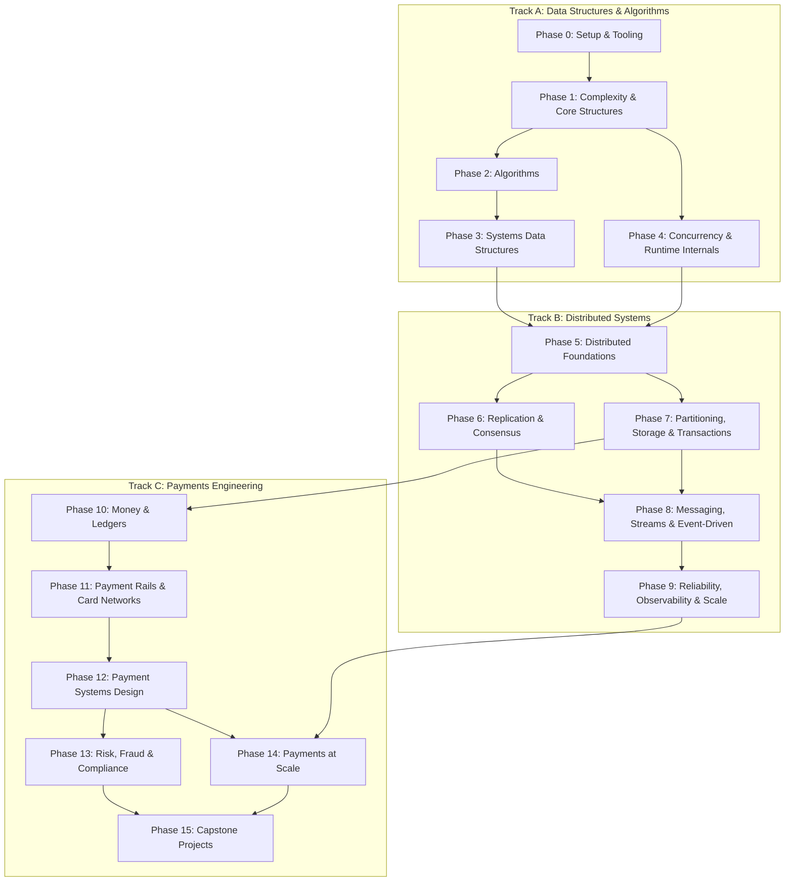

# Payments Engineering from Scratch

Build data structures, distributed systems, and payment systems from first principles, in the language you choose. Every Build lesson ships a from-scratch implementation with tests, a quiz, and an artifact you keep. **Java is the primary language and ships first; Python and Go ports are being added lesson by lesson** (several lessons already have all three), and the tutor teaches in whichever you pick.

**[Start learning](#choose-how-to-learn)** · **[Choose a track](#learning-paths)** · **[Build a project](#projects)** · **[Browse the curriculum](#contents)**

Free, open source, MIT. Learn with a coding agent as your tutor, or by running the code locally.

<!-- COUNTS:START -->
> 199 lessons. 16 phases. 3 tracks. Java, Python. ~329 hours of guided building.
<!-- COUNTS:END -->

## Why this course exists

Payments is where data structures and distributed systems stop being interview topics and start being legal obligations. A hash map is an idempotency store that decides whether a customer is charged twice. A heap is the retry scheduler that decides whether a webhook is delivered. Raft is the reason a ledger survives a datacenter failure. Rounding modes are the difference between a reconciliation that balances and one that is off by $3,412.07 at year end.

This course teaches all three layers as one subject, from the bottom up, with no frameworks between you and the mechanism:

- **Track A — Data Structures & Algorithms** (Phases 0–4): hash maps, heaps, graphs, balanced trees, LSM trees, Bloom filters, consistent hashing, rate limiters, and the concurrency primitives beneath them. Built, measured, and tested.
- **Track B — Distributed Systems** (Phases 5–9): clocks, idempotency, retries, consensus (Paxos and Raft from scratch), replication, transactions, event streams, and the reliability practices that keep them running. Built on a deterministic simulated network so every bug is replayable.
- **Track C — Payments Engineering** (Phases 10–15): money and ledgers, card networks and ISO 8583, ACH and ISO 20022, payment state machines, webhooks, reconciliation, fraud and compliance, and payments at scale. Built on the structures from A and the guarantees from B.

Every Build lesson follows the same loop: **The Problem → The Concept → Build It → Use It → Ship It**. You write the mechanism from scratch, prove its invariant with a test, compare it with the production equivalent (`java.util.concurrent`, PostgreSQL, Kafka, Stripe's API), and keep an artifact — a checklist, a design document, a runbook — you can use at work.

## Learning paths

| Your goal | Start here | Then |
|---|---|---|
| I want the whole thing, in order | [Phase 0: Setup & Tooling](phases/00-setup-and-tooling/) | Phases 1 → 15 |
| I know DSA; I want distributed systems | [Phase 5: Distributed Foundations](phases/05-distributed-foundations/) | Phases 6 → 9, then Track C |
| I am a backend engineer joining a payments team | [Phase 10: Money & Ledgers](phases/10-money-and-ledgers/) | Phases 11 → 14, with Phase 5 and 7 as references |
| I am preparing for payments system-design interviews | [Interview route](learning-paths/payments-interview-prep.json) | `/interview-prep` skill |
| I only want to build a ledger | [Ledger route](learning-paths/ledger-engineering.json) | `ledger-engine` project |
| I only want consensus | [Consensus route](learning-paths/consensus-from-scratch.json) | `raft-kv` project |

Not sure? The `start-learning` skill runs a placement quiz, asks which language you want to learn in, and writes a personal plan to `LEARNING.md`.

## Choose how to learn

### With an AI tutor (recommended)

If you use **Claude Code**, **Codex**, or any agent that reads `SKILL.md` files, the course can teach itself to you, one lesson per session, in your chosen language.

```bash
git clone https://github.com/RatnadeepSimhadri/payments-engineering-from-scratch.git
cd payments-engineering-from-scratch
claude            # Claude Code discovers .claude/skills/ automatically
```

Then, inside your agent:

| Host | Start the course | Next lesson | Where is X taught? | Quiz a phase | Build a project |
|---|---|---|---|---|---|
| Claude Code | `/start-learning` | `/learn` | `/course-guide idempotency` | `/check-understanding 10` | `/build-project ledger-engine` |
| Codex | `start-learning` | `learn` | `course-guide idempotency` | `check-understanding 10` | `build-project ledger-engine` |
| Other hosts | `Use start-learning to begin the course.` | `Use learn to teach the next lesson.` | `Use course-guide to find where idempotency is taught.` | `Use check-understanding to quiz me on Phase 10.` | `Use build-project to start ledger-engine.` |

`start-learning` interviews you (why, how much time, **which language: Java, Python, or Go**), runs a ten-question placement quiz across the three tracks, and writes `LEARNING.md`. From then on `learn` reads that file, teaches the next lesson interactively in your language (concept, worked example, the code in chunks with prediction questions, run it, quiz), and records your progress and a review queue. You can switch languages at any time; the tutor will re-teach the current lesson's Build It in the new one.

<details>
<summary>All learning skills</summary>

| Skill | What it does |
|---|---|
| [`start-learning`](skills/start-learning/SKILL.md) | One-time onboarding: mission, language choice, placement quiz, plan saved to `LEARNING.md`. |
| [`learn`](skills/learn/SKILL.md) | The tutor loop: warm-up recall, the next lesson taught interactively in your language, quiz, progress recorded. |
| [`course-guide`](skills/course-guide/SKILL.md) | Topic router: "where do I learn sagas?" or "my balances don't reconcile" → the exact lessons. |
| [`find-your-level`](skills/find-your-level/SKILL.md) | Ten-question placement quiz across DSA, distributed systems, and payments; maps to an entry phase. |
| [`check-understanding <phase>`](skills/check-understanding/SKILL.md) | Eight-question phase quiz generated from the lesson docs, with feedback and lessons to review. |
| [`build-project <id>`](skills/build-project/SKILL.md) | Project coach: one stage per session in your language, grader run with you, hints never solutions. |
| [`learn-ledgers`](skills/learn-ledgers/SKILL.md) | Focused route: money, double-entry, balances, reconciliation, then the `ledger-engine` project. |
| [`learn-consensus`](skills/learn-consensus/SKILL.md) | Focused route: clocks, Paxos, Raft I–III, linearizability checking, then the `raft-kv` project. |
| [`interview-prep`](skills/interview-prep/SKILL.md) | Payments and distributed-systems design interview drills grounded in the lessons, with a rubric. |

</details>

### Run the code locally

```bash
git clone https://github.com/RatnadeepSimhadri/payments-engineering-from-scratch.git
cd payments-engineering-from-scratch
python3 scripts/run_lesson.py phases/10-money-and-ledgers/01-representing-money            # all three languages
python3 scripts/run_lesson.py phases/10-money-and-ledgers/01-representing-money --lang java
```

You need Java 21+ to run every complete lesson. Python 3.11+ and Go 1.22+ run the lessons that already have those ports (`run_lesson.py` reports `SKIP` for the rest). There are no package managers, build tools, or third-party libraries anywhere in the curriculum: every lesson compiles with `javac`, runs with `python3`, or builds with `go run`.

<details>
<summary>Use every lesson the same way</summary>

1. **Read** `docs/en.md` and explain the core idea in your own words before touching code.
2. **Type and build** the implementation in your language. Do not paste it.
3. **Run** `main` and the tests from `code/<lang>/`; the exact commands are in the file header.
4. **Keep evidence**: the command, the output, and the test count. The tutor skills log this to `LEARNING.md`.
5. **Continue** only when you can explain the output and make one small change without guessing.

</details>

## Projects

Staged projects with starters, graders, and reference solutions (Java today; Python and Go ports to follow). The grader runs every earlier stage too, so a regression is reported the moment you introduce it.

```bash
python3 scripts/project_test.py --list
python3 scripts/project_test.py ledger-engine --lang java --init my-ledger
python3 scripts/project_test.py ledger-engine --lang java --stage 1 --path my-ledger
python3 scripts/project_test.py ledger-engine --lang java --all --path my-ledger --strict --report completion.json
```

| Project | Level | What you build | Stages |
|---|---|---|---|
| [`ledger-engine`](projects/ledger-engine/) | Builder | A double-entry ledger with balanced journal entries, running balances, holds, and statement reconciliation | 4 |
| [`idempotent-payment-gateway`](projects/idempotent-payment-gateway/) | Builder | An idempotency store, a payment state machine, retries with backoff and a circuit breaker, and signed webhook delivery | 4 |
| [`raft-kv`](projects/raft-kv/) | Advanced | Raft terms and log, leader election, log replication, and commit/apply on a deterministic simulated network | 4 |

Reference solutions are for diagnosing, not copying; the `build-project` skill never shows them.

## The shape of the curriculum



<!-- CONTENTS:START -->

## Contents

16 phases, 199 lessons, three tracks. Click a phase to expand its lesson list. `Lang` lists the languages whose from-scratch implementation already exists; planned lessons show a dash.

### Track A: Data Structures & Algorithms

<details id="phase-0">
<summary><b>Phase 0 — Setup & Tooling</b> &nbsp;<code>8 lessons · 8 complete</code>&nbsp; <em>Three toolchains, one repository, zero magic.</em></summary>
<br/>

| # | Lesson | Type | Lang | Status |
|:---:|--------|:----:|------|:------:|
| 01 | [Dev Environment: Java 21, Python 3.12, Go 1.22](phases/00-setup-and-tooling/01-dev-environment/) | Build | Java, Python, Go | ✅ |
| 02 | [Choose Your Language: How Every Lesson Maps to Java, Python, and Go](phases/00-setup-and-tooling/02-choose-your-language/) | Learn | — | ✅ |
| 03 | [Testing from the Standard Library](phases/00-setup-and-tooling/03-testing-from-the-standard-library/) | Build | Java, Python, Go | ✅ |
| 04 | [Git for Engineers: Atomic Commits and Evidence](phases/00-setup-and-tooling/04-git-for-engineers/) | Learn | — | ✅ |
| 05 | [Benchmarking and Profiling Without Lying to Yourself](phases/00-setup-and-tooling/05-benchmarking-and-profiling/) | Build | Java, Python | ✅ |
| 06 | [Reading a Spec: RFCs, ISO Standards, and Network Rulebooks](phases/00-setup-and-tooling/06-reading-a-spec/) | Learn | — | ✅ |
| 07 | [Decimal and Integer Arithmetic in Three Runtimes](phases/00-setup-and-tooling/07-decimal-and-integer-arithmetic/) | Build | Java, Python, Go | ✅ |
| 08 | [The Learning Loop: Read, Build, Run, Keep Evidence](phases/00-setup-and-tooling/08-the-learning-loop/) | Learn | — | ✅ |

</details>

<details id="phase-1">
<summary><b>Phase 1 — Complexity & Core Data Structures</b> &nbsp;<code>14 lessons · 14 complete</code>&nbsp; <em>Every structure is a trade between time, space, and what you can promise.</em></summary>
<br/>

| # | Lesson | Type | Lang | Status |
|:---:|--------|:----:|------|:------:|
| 01 | [Complexity Analysis: Big-O, Big-Theta, and What Hardware Does to Them](phases/01-complexity-and-core-structures/01-complexity-and-big-o/) | Learn | — | ✅ |
| 02 | [Amortized Analysis: Why Dynamic Arrays Are O(1)](phases/01-complexity-and-core-structures/02-amortized-analysis/) | Learn | — | ✅ |
| 03 | [Dynamic Arrays from Scratch](phases/01-complexity-and-core-structures/03-dynamic-arrays/) | Build | Java, Python | ✅ |
| 04 | [Linked Lists: Singly, Doubly, and Intrusive](phases/01-complexity-and-core-structures/04-linked-lists/) | Build | Java, Python | ✅ |
| 05 | [Stacks, Queues, and Ring Buffers](phases/01-complexity-and-core-structures/05-stacks-queues-and-deques/) | Build | Java, Python | ✅ |
| 06 | [Hash Maps from Scratch: Chaining, Open Addressing, and Resizing](phases/01-complexity-and-core-structures/06-hash-maps-from-scratch/) | Build | Java, Python, Go | ✅ |
| 07 | [Hash Functions, Collisions, and HashDoS](phases/01-complexity-and-core-structures/07-hash-functions-and-collisions/) | Learn | — | ✅ |
| 08 | [Binary Search Trees and Ordered Maps](phases/01-complexity-and-core-structures/08-binary-search-trees/) | Build | Java, Python | ✅ |
| 09 | [Heaps and Priority Queues from Scratch](phases/01-complexity-and-core-structures/09-heaps-and-priority-queues/) | Build | Java, Python, Go | ✅ |
| 10 | [Disjoint Sets (Union-Find) with Path Compression](phases/01-complexity-and-core-structures/10-disjoint-sets/) | Build | Java, Python | ✅ |
| 11 | [Bit Manipulation and Compact Encodings](phases/01-complexity-and-core-structures/11-bit-manipulation/) | Build | Java, Python | ✅ |
| 12 | [Strings, Unicode, and Byte Encodings](phases/01-complexity-and-core-structures/12-strings-and-encodings/) | Learn | — | ✅ |
| 13 | [Tries and Prefix Trees](phases/01-complexity-and-core-structures/13-tries/) | Build | Java, Python, Go | ✅ |
| 14 | [Choosing a Structure: A Decision Procedure](phases/01-complexity-and-core-structures/14-choosing-a-structure/) | Learn | — | ✅ |

</details>

<details id="phase-2">
<summary><b>Phase 2 — Algorithms</b> &nbsp;<code>16 lessons · 16 complete</code>&nbsp; <em>An algorithm is a proof you can run.</em></summary>
<br/>

| # | Lesson | Type | Lang | Status |
|:---:|--------|:----:|------|:------:|
| 01 | [Sorting: Merge, Quick, Heap, and Why Libraries Use Timsort](phases/02-algorithms/01-sorting-algorithms/) | Build | Java, Python | ✅ |
| 02 | [Binary Search and Its Variants](phases/02-algorithms/02-binary-search-and-its-variants/) | Build | Java, Python | ✅ |
| 03 | [Two Pointers and Sliding Windows](phases/02-algorithms/03-two-pointers-and-sliding-windows/) | Build | Java, Python | ✅ |
| 04 | [Recursion and Backtracking](phases/02-algorithms/04-recursion-and-backtracking/) | Build | Java, Python | ✅ |
| 05 | [Divide and Conquer and the Master Theorem](phases/02-algorithms/05-divide-and-conquer/) | Learn | — | ✅ |
| 06 | [Dynamic Programming: From Recurrence to Table](phases/02-algorithms/06-dynamic-programming/) | Build | Java, Python, Go | ✅ |
| 07 | [Greedy Algorithms and Exchange Arguments](phases/02-algorithms/07-greedy-algorithms/) | Build | Java, Python | ✅ |
| 08 | [Graph Traversal: BFS, DFS, and Connected Components](phases/02-algorithms/08-graph-traversal-bfs-dfs/) | Build | Java, Python, Go | ✅ |
| 09 | [Shortest Paths: Dijkstra, Bellman-Ford, and Negative Cycles](phases/02-algorithms/09-shortest-paths/) | Build | Java, Python, Go | ✅ |
| 10 | [Topological Sort and DAG Scheduling](phases/02-algorithms/10-topological-sort-and-dags/) | Build | Java, Python | ✅ |
| 11 | [Minimum Spanning Trees: Kruskal and Prim](phases/02-algorithms/11-minimum-spanning-trees/) | Build | Java, Python | ✅ |
| 12 | [String Matching: KMP, Rabin-Karp, and Aho-Corasick](phases/02-algorithms/12-string-matching/) | Build | Java, Python | ✅ |
| 13 | [Interval Problems: Merging, Scheduling, and Sweep Lines](phases/02-algorithms/13-interval-problems/) | Build | Java, Python | ✅ |
| 14 | [Randomized Algorithms and Reservoir Sampling](phases/02-algorithms/14-randomized-algorithms/) | Build | Java, Python | ✅ |
| 15 | [Numerical Algorithms: GCD, Modular Arithmetic, and Check Digits](phases/02-algorithms/15-numerical-algorithms/) | Build | Java, Python, Go | ✅ |
| 16 | [Algorithm Design Patterns: A Field Guide](phases/02-algorithms/16-algorithm-design-patterns/) | Learn | — | ✅ |

</details>

<details id="phase-3">
<summary><b>Phase 3 — Systems Data Structures</b> &nbsp;<code>15 lessons · 15 complete</code>&nbsp; <em>The structures that databases, caches, and routers are made of.</em></summary>
<br/>

| # | Lesson | Type | Lang | Status |
|:---:|--------|:----:|------|:------:|
| 01 | [Bloom Filters from Scratch](phases/03-systems-data-structures/01-bloom-filters/) | Build | Java, Python, Go | ✅ |
| 02 | [Count-Min Sketch and HyperLogLog](phases/03-systems-data-structures/02-count-min-sketch-and-hyperloglog/) | Build | Java, Python | ✅ |
| 03 | [Balanced Trees: AVL and Red-Black](phases/03-systems-data-structures/03-balanced-trees/) | Build | Java, Python | ✅ |
| 04 | [B-Trees and Why Databases Love Them](phases/03-systems-data-structures/04-b-trees/) | Build | Java, Python | ✅ |
| 05 | [LSM Trees: Memtables, SSTables, and Compaction](phases/03-systems-data-structures/05-lsm-trees/) | Build | Java, Python | ✅ |
| 06 | [Consistent Hashing and Virtual Nodes](phases/03-systems-data-structures/06-consistent-hashing/) | Build | Java, Python, Go | ✅ |
| 07 | [Skip Lists](phases/03-systems-data-structures/07-skip-lists/) | Build | Java, Python | ✅ |
| 08 | [LRU and LFU Caches from Scratch](phases/03-systems-data-structures/08-lru-and-lfu-caches/) | Build | Java, Python, Go | ✅ |
| 09 | [Merkle Trees and Content-Addressed Verification](phases/03-systems-data-structures/09-merkle-trees/) | Build | Java, Python | ✅ |
| 10 | [Segment Trees and Fenwick Trees](phases/03-systems-data-structures/10-segment-trees-and-fenwick-trees/) | Build | Java, Python | ✅ |
| 11 | [Rate Limiter Algorithms: Token Bucket, Leaky Bucket, Sliding Window](phases/03-systems-data-structures/11-rate-limiter-algorithms/) | Build | Java, Python, Go | ✅ |
| 12 | [Hierarchical Timing Wheels](phases/03-systems-data-structures/12-time-wheels-and-timers/) | Build | Java, Python | ✅ |
| 13 | [Unique ID Generation: UUIDs, ULIDs, and Snowflake](phases/03-systems-data-structures/13-unique-id-generation/) | Build | Java, Python | ✅ |
| 14 | [Memory Layout, Cache Lines, and False Sharing](phases/03-systems-data-structures/14-memory-layout-and-cache-lines/) | Learn | — | ✅ |
| 15 | [Serialization: JSON, Protobuf-style Binary, and Schema Evolution](phases/03-systems-data-structures/15-serialization-formats/) | Build | Java, Python | ✅ |

</details>

<details id="phase-4">
<summary><b>Phase 4 — Concurrency & Runtime Internals</b> &nbsp;<code>12 lessons · 12 complete</code>&nbsp; <em>Shared mutable state is where money goes missing.</em></summary>
<br/>

| # | Lesson | Type | Lang | Status |
|:---:|--------|:----:|------|:------:|
| 01 | [Threads and the Memory Model](phases/04-concurrency/01-threads-and-the-memory-model/) | Learn | — | ✅ |
| 02 | [Locks, Atomics, and a Balance That Never Lies](phases/04-concurrency/02-locks-and-atomic-counters/) | Build | Java, Python, Go | ✅ |
| 03 | [Compare-and-Swap and Lock-Free Structures](phases/04-concurrency/03-compare-and-swap-and-lock-free-structures/) | Build | Java, Python | ✅ |
| 04 | [Concurrent Hash Maps: Striping and Lock-Free Reads](phases/04-concurrency/04-concurrent-hash-maps/) | Build | Java, Python | ✅ |
| 05 | [Producers, Consumers, and Bounded Queues](phases/04-concurrency/05-producers-consumers-and-bounded-queues/) | Build | Java, Python, Go | ✅ |
| 06 | [Executors, Goroutines, and asyncio](phases/04-concurrency/06-executors-goroutines-and-async/) | Build | Java, Python | ✅ |
| 07 | [Deadlocks, Lock Ordering, and Detection](phases/04-concurrency/07-deadlocks-and-lock-ordering/) | Build | Java, Python, Go | ✅ |
| 08 | [The Actor Model](phases/04-concurrency/08-the-actor-model/) | Build | Java, Python | ✅ |
| 09 | [JVM Garbage Collection and the Go Runtime](phases/04-concurrency/09-jvm-gc-and-go-runtime/) | Learn | — | ✅ |
| 10 | [The Python GIL and Free-Threaded Python](phases/04-concurrency/10-the-python-gil/) | Learn | — | ✅ |
| 11 | [Structured Concurrency and Cancellation](phases/04-concurrency/11-structured-concurrency-and-cancellation/) | Build | Java, Python | ✅ |
| 12 | [Testing Concurrent Code: Stress, Model Checking, and Determinism](phases/04-concurrency/12-testing-concurrent-code/) | Build | Java, Python | ✅ |

</details>

### Track B: Distributed Systems

<details id="phase-5">
<summary><b>Phase 5 — Distributed Systems Foundations</b> &nbsp;<code>13 lessons · 13 complete</code>&nbsp; <em>The network is not reliable, and the clock is lying.</em></summary>
<br/>

| # | Lesson | Type | Lang | Status |
|:---:|--------|:----:|------|:------:|
| 01 | [The Fallacies of Distributed Computing](phases/05-distributed-foundations/01-the-fallacies-of-distributed-computing/) | Learn | — | ✅ |
| 02 | [Failure Models: Crash-Stop, Omission, Byzantine](phases/05-distributed-foundations/02-failure-models/) | Learn | — | ✅ |
| 03 | [Time, Order, and Clocks: Lamport and Vector Clocks](phases/05-distributed-foundations/03-lamport-and-vector-clocks/) | Build | Java, Python, Go | ✅ |
| 04 | [Physical Clocks, NTP, and Hybrid Logical Clocks](phases/05-distributed-foundations/04-physical-clocks-ntp-and-hybrid-logical-clocks/) | Build | Java, Python | ✅ |
| 05 | [Consistency Models: Linearizability to Eventual](phases/05-distributed-foundations/05-consistency-models/) | Learn | — | ✅ |
| 06 | [CAP, PACELC, and What They Actually Constrain](phases/05-distributed-foundations/06-cap-and-pacelc/) | Learn | — | ✅ |
| 07 | [RPC, Framing, and Serialization Over Raw Sockets](phases/05-distributed-foundations/07-rpc-and-serialization/) | Build | Java, Python | ✅ |
| 08 | [Timeouts and Deadline Propagation](phases/05-distributed-foundations/08-timeouts-and-deadlines/) | Build | Java, Python | ✅ |
| 09 | [Idempotency Keys: Exactly-Once Effects on At-Least-Once Networks](phases/05-distributed-foundations/09-idempotency-keys/) | Build | Java, Python, Go | ✅ |
| 10 | [Retries, Exponential Backoff, and Jitter](phases/05-distributed-foundations/10-retries-backoff-and-jitter/) | Build | Java, Python, Go | ✅ |
| 11 | [Circuit Breakers and Bulkheads](phases/05-distributed-foundations/11-circuit-breakers-and-bulkheads/) | Build | Java, Python, Go | ✅ |
| 12 | [Leases, Fencing Tokens, and Distributed Locks](phases/05-distributed-foundations/12-leases-and-fencing-tokens/) | Build | Java, Python | ✅ |
| 13 | [Gossip Protocols and Failure Detection](phases/05-distributed-foundations/13-gossip-and-failure-detection/) | Build | Java, Python | ✅ |

</details>

<details id="phase-6">
<summary><b>Phase 6 — Replication & Consensus</b> &nbsp;<code>12 lessons · 12 complete</code>&nbsp; <em>Agreement is expensive. Know exactly what you are paying for.</em></summary>
<br/>

| # | Lesson | Type | Lang | Status |
|:---:|--------|:----:|------|:------:|
| 01 | [Replication: Leader-Based, Multi-Leader, Leaderless](phases/06-replication-and-consensus/01-replication-strategies/) | Learn | — | ✅ |
| 02 | [Replication Lag and Read-Your-Writes](phases/06-replication-and-consensus/02-replication-lag-and-read-your-writes/) | Build | Java, Python | ✅ |
| 03 | [Quorums: R + W > N and Its Limits](phases/06-replication-and-consensus/03-quorums/) | Build | Java, Python | ✅ |
| 04 | [Single-Decree Paxos from Scratch](phases/06-replication-and-consensus/04-paxos/) | Build | Java, Python, Go | ✅ |
| 05 | [Raft I: Terms, Leader Election, and a Simulated Network](phases/06-replication-and-consensus/05-raft-leader-election/) | Build | Java, Python, Go | ✅ |
| 06 | [Raft II: Log Replication and Commit](phases/06-replication-and-consensus/06-raft-log-replication/) | Build | Java, Python, Go | ✅ |
| 07 | [Raft III: Safety Proofs, Membership Changes, Snapshots](phases/06-replication-and-consensus/07-raft-safety-and-membership/) | Build | Java, Python | ✅ |
| 08 | [CRDTs: Counters, Sets, and Convergence](phases/06-replication-and-consensus/08-crdts/) | Build | Java, Python | ✅ |
| 09 | [Conflict Resolution: LWW, Version Vectors, Merge Functions](phases/06-replication-and-consensus/09-conflict-resolution/) | Build | Java, Python | ✅ |
| 10 | [Chain Replication and Primary-Backup](phases/06-replication-and-consensus/10-chain-and-primary-backup/) | Build | Java, Python | ✅ |
| 11 | [Byzantine Fault Tolerance: PBFT in Outline](phases/06-replication-and-consensus/11-byzantine-fault-tolerance/) | Learn | — | ✅ |
| 12 | [Linearizability Checking with Recorded Histories](phases/06-replication-and-consensus/12-linearizability-checking/) | Build | Java, Python, Go | ✅ |

</details>

<details id="phase-7">
<summary><b>Phase 7 — Partitioning, Storage & Transactions</b> &nbsp;<code>14 lessons · 14 complete</code>&nbsp; <em>Durability is a promise; isolation is a contract.</em></summary>
<br/>

| # | Lesson | Type | Lang | Status |
|:---:|--------|:----:|------|:------:|
| 01 | [Partitioning Strategies and Rebalancing](phases/07-storage-and-transactions/01-partitioning-and-rebalancing/) | Build | Java, Python | ✅ |
| 02 | [Write-Ahead Logs and Crash Recovery](phases/07-storage-and-transactions/02-write-ahead-logs/) | Build | Java, Python, Go | ✅ |
| 03 | [Storage Engines: B-Tree vs LSM in Practice](phases/07-storage-and-transactions/03-storage-engines/) | Learn | — | ✅ |
| 04 | [Isolation Levels and Their Anomalies](phases/07-storage-and-transactions/04-isolation-levels-and-anomalies/) | Build | Java, Python | ✅ |
| 05 | [Two-Phase Locking and Deadlock Detection](phases/07-storage-and-transactions/05-two-phase-locking/) | Build | Java, Python | ✅ |
| 06 | [MVCC and Snapshot Isolation](phases/07-storage-and-transactions/06-mvcc-and-snapshot-isolation/) | Build | Java, Python | ✅ |
| 07 | [Serializable Snapshot Isolation](phases/07-storage-and-transactions/07-serializable-snapshot-isolation/) | Build | Java, Python | ✅ |
| 08 | [Two-Phase Commit and Its Blocking Problem](phases/07-storage-and-transactions/08-two-phase-commit/) | Build | Java, Python, Go | ✅ |
| 09 | [Percolator and Spanner-Style Transactions](phases/07-storage-and-transactions/09-percolator-and-spanner-style-transactions/) | Learn | — | ✅ |
| 10 | [Secondary Indexes: Local vs Global](phases/07-storage-and-transactions/10-secondary-indexes/) | Build | Java, Python | ✅ |
| 11 | [Change Data Capture](phases/07-storage-and-transactions/11-change-data-capture/) | Build | Java, Python | ✅ |
| 12 | [The Saga Pattern: Compensations Instead of Locks](phases/07-storage-and-transactions/12-saga-pattern/) | Build | Java, Python | ✅ |
| 13 | [The Transactional Outbox and Dual-Write Problem](phases/07-storage-and-transactions/13-transactional-outbox/) | Build | Java, Python | ✅ |
| 14 | [Schema Migrations at Scale: Expand, Migrate, Contract](phases/07-storage-and-transactions/14-schema-migrations-at-scale/) | Learn | — | ✅ |

</details>

<details id="phase-8">
<summary><b>Phase 8 — Messaging, Streams & Event-Driven Systems</b> &nbsp;<code>11 lessons · 11 complete</code>&nbsp; <em>The log is the database turned inside out.</em></summary>
<br/>

| # | Lesson | Type | Lang | Status |
|:---:|--------|:----:|------|:------:|
| 01 | [The Append-Only Log: Partitions, Offsets, and Segments](phases/08-messaging-and-streams/01-the-append-only-log/) | Build | Java, Python | ✅ |
| 02 | [Consumer Groups, Offsets, and Rebalancing](phases/08-messaging-and-streams/02-consumer-groups-and-rebalancing/) | Build | Java, Python | ✅ |
| 03 | [At-Most-Once, At-Least-Once, and Effectively-Once](phases/08-messaging-and-streams/03-delivery-guarantees/) | Build | Java, Python | ✅ |
| 04 | [Message Ordering, Keys, and Head-of-Line Blocking](phases/08-messaging-and-streams/04-message-ordering-and-keys/) | Build | Java, Python | ✅ |
| 05 | [Event Sourcing: State as a Fold Over Events](phases/08-messaging-and-streams/05-event-sourcing/) | Build | Java, Python | ✅ |
| 06 | [CQRS and Projections](phases/08-messaging-and-streams/06-cqrs-and-projections/) | Build | Java, Python | ✅ |
| 07 | [Stream Processing: Tumbling, Sliding, and Session Windows](phases/08-messaging-and-streams/07-stream-processing-windows/) | Build | Java, Python | ✅ |
| 08 | [Watermarks, Event Time, and Late Data](phases/08-messaging-and-streams/08-watermarks-and-late-data/) | Build | Java, Python | ✅ |
| 09 | [Backpressure and Flow Control](phases/08-messaging-and-streams/09-backpressure/) | Build | Java, Python | ✅ |
| 10 | [Dead-Letter Queues and Poison Messages](phases/08-messaging-and-streams/10-dead-letter-queues-and-poison-messages/) | Build | Java, Python | ✅ |
| 11 | [Schema Registries and Compatible Evolution](phases/08-messaging-and-streams/11-schema-registry-and-evolution/) | Learn | — | ✅ |

</details>

<details id="phase-9">
<summary><b>Phase 9 — Reliability, Observability & Scale</b> &nbsp;<code>13 lessons · 13 complete</code>&nbsp; <em>You cannot operate what you cannot observe.</em></summary>
<br/>

| # | Lesson | Type | Lang | Status |
|:---:|--------|:----:|------|:------:|
| 01 | [SLIs, SLOs, and Error Budgets](phases/09-reliability-and-scale/01-slis-slos-and-error-budgets/) | Learn | — | ✅ |
| 02 | [Load Balancing: Round Robin, Least Connections, Power of Two Choices](phases/09-reliability-and-scale/02-load-balancing-algorithms/) | Build | Java, Python, Go | ✅ |
| 03 | [Caching Strategies: Cache-Aside, Write-Through, Write-Behind](phases/09-reliability-and-scale/03-caching-strategies/) | Build | Java, Python | ✅ |
| 04 | [Cache Invalidation, Stampedes, and Request Coalescing](phases/09-reliability-and-scale/04-cache-invalidation-and-stampedes/) | Build | Java, Python | ✅ |
| 05 | [Distributed Rate Limiting](phases/09-reliability-and-scale/05-distributed-rate-limiting/) | Build | Java, Python | ✅ |
| 06 | [Metrics: Counters, Gauges, and Histograms Without Averages](phases/09-reliability-and-scale/06-metrics-and-histograms/) | Build | Java, Python | ✅ |
| 07 | [Distributed Tracing and Context Propagation](phases/09-reliability-and-scale/07-distributed-tracing/) | Build | Java, Python | ✅ |
| 08 | [Structured Logging and Log Correlation](phases/09-reliability-and-scale/08-structured-logging/) | Build | Java, Python | ✅ |
| 09 | [Chaos Engineering and Fault Injection](phases/09-reliability-and-scale/09-chaos-engineering/) | Build | Java, Python | ✅ |
| 10 | [Capacity Planning and Queueing Theory](phases/09-reliability-and-scale/10-capacity-planning-and-queueing-theory/) | Learn | — | ✅ |
| 11 | [Multi-Region Architecture and Disaster Recovery](phases/09-reliability-and-scale/11-multi-region-and-disaster-recovery/) | Learn | — | ✅ |
| 12 | [Incident Response and Blameless Postmortems](phases/09-reliability-and-scale/12-incident-response/) | Learn | — | ✅ |
| 13 | [Graceful Degradation and Load Shedding](phases/09-reliability-and-scale/13-graceful-degradation/) | Build | Java, Python | ✅ |

</details>

### Track C: Payments Engineering

<details id="phase-10">
<summary><b>Phase 10 — Money & Ledgers</b> &nbsp;<code>12 lessons · 12 complete</code>&nbsp; <em>A ledger is a data structure with a legal obligation.</em></summary>
<br/>

| # | Lesson | Type | Lang | Status |
|:---:|--------|:----:|------|:------:|
| 01 | [Representing Money: Minor Units, Currencies, and Rounding](phases/10-money-and-ledgers/01-representing-money/) | Build | Java, Python, Go | ✅ |
| 02 | [Currencies, Exchange Rates, and FX Conversion](phases/10-money-and-ledgers/02-currency-and-fx/) | Build | Java, Python | ✅ |
| 03 | [The Double-Entry Ledger from Scratch](phases/10-money-and-ledgers/03-double-entry-ledger/) | Build | Java, Python, Go | ✅ |
| 04 | [Chart of Accounts and Account Types](phases/10-money-and-ledgers/04-chart-of-accounts/) | Learn | — | ✅ |
| 05 | [Balances, Running Totals, and Snapshots](phases/10-money-and-ledgers/05-balances-and-snapshots/) | Build | Java, Python | ✅ |
| 06 | [Immutability, Reversals, and Corrections](phases/10-money-and-ledgers/06-immutability-and-reversals/) | Build | Java, Python | ✅ |
| 07 | [Holds, Pending Transactions, and Available Balance](phases/10-money-and-ledgers/07-holds-and-available-balance/) | Build | Java, Python, Go | ✅ |
| 08 | [Reconciliation: Matching Your Ledger Against Theirs](phases/10-money-and-ledgers/08-reconciliation/) | Build | Java, Python | ✅ |
| 09 | [Multi-Currency Ledgers and Revaluation](phases/10-money-and-ledgers/09-multi-currency-ledgers/) | Build | Java, Python | ✅ |
| 10 | [Fees, Splits, and Platform Payments](phases/10-money-and-ledgers/10-fees-and-splits/) | Build | Java, Python | ✅ |
| 11 | [Ledger Concurrency: Hot Accounts and Balance Checks](phases/10-money-and-ledgers/11-ledger-concurrency/) | Build | Java, Python | ✅ |
| 12 | [Audit Trails, Trial Balance, and Financial Close](phases/10-money-and-ledgers/12-audit-trails-and-financial-close/) | Learn | — | ✅ |

</details>

<details id="phase-11">
<summary><b>Phase 11 — Payment Rails & Card Networks</b> &nbsp;<code>15 lessons · 15 complete</code>&nbsp; <em>Every rail is a protocol, a rulebook, and a settlement cycle.</em></summary>
<br/>

| # | Lesson | Type | Lang | Status |
|:---:|--------|:----:|------|:------:|
| 01 | [How a Card Payment Works: Issuer, Acquirer, Network, Processor](phases/11-payment-rails/01-how-a-card-payment-works/) | Learn | — | ✅ |
| 02 | [Authorization, Capture, Void, Refund: The Card Lifecycle State Machine](phases/11-payment-rails/02-card-authorization-lifecycle/) | Build | Java, Python, Go | ✅ |
| 03 | [ISO 8583: Parsing the Card Network Message](phases/11-payment-rails/03-iso-8583/) | Build | Java, Python, Go | ✅ |
| 04 | [PANs, Luhn, and BIN Range Routing](phases/11-payment-rails/04-pan-luhn-and-bin-ranges/) | Build | Java, Python | ✅ |
| 05 | [Tokenization and PCI DSS Scope Reduction](phases/11-payment-rails/05-tokenization-and-pci-scope/) | Build | Java, Python | ✅ |
| 06 | [3-D Secure and Strong Customer Authentication](phases/11-payment-rails/06-3ds-and-strong-customer-authentication/) | Learn | — | ✅ |
| 07 | [Interchange, Scheme Fees, and Merchant Pricing](phases/11-payment-rails/07-interchange-and-scheme-fees/) | Build | Java, Python | ✅ |
| 08 | [ACH and the NACHA File Format](phases/11-payment-rails/08-ach-and-nacha/) | Build | Java, Python, Go | ✅ |
| 09 | [SEPA, Wires, and ISO 20022 (pain.001, pacs.008)](phases/11-payment-rails/09-sepa-and-iso-20022/) | Build | Java, Python | ✅ |
| 10 | [Real-Time Payments: RTP, FedNow, UPI, Faster Payments](phases/11-payment-rails/10-real-time-payments/) | Learn | — | ✅ |
| 11 | [IBAN, BIC, and Account Number Validation](phases/11-payment-rails/11-iban-bic-and-account-validation/) | Build | Java, Python, Go | ✅ |
| 12 | [Wallets, Stored Value, and E-Money Regulation](phases/11-payment-rails/12-wallets-and-stored-value/) | Learn | — | ✅ |
| 13 | [Open Banking: OAuth Consent, Account Aggregation, and Data Access](phases/11-payment-rails/13-open-banking-and-account-aggregation/) | Build | Java, Python | ✅ |
| 14 | [Bank Statement Formats: MT940, CAMT.053, BAI2, OFX](phases/11-payment-rails/14-bank-statements-and-formats/) | Build | Java, Python | ✅ |
| 15 | [Settlement and Clearing: Gross, Net, and Deferred](phases/11-payment-rails/15-settlement-and-clearing/) | Learn | — | ✅ |

</details>

<details id="phase-12">
<summary><b>Phase 12 — Payment Systems Design</b> &nbsp;<code>14 lessons · 14 complete</code>&nbsp; <em>Correctness first, then availability, then everything else.</em></summary>
<br/>

| # | Lesson | Type | Lang | Status |
|:---:|--------|:----:|------|:------:|
| 01 | [Designing an Idempotent Payment API](phases/12-payment-systems-design/01-idempotent-payment-api/) | Build | Java, Python, Go | ✅ |
| 02 | [The Payment State Machine](phases/12-payment-systems-design/02-payment-state-machine/) | Build | Java, Python, Go | ✅ |
| 03 | [Payment Orchestration Across Processors](phases/12-payment-systems-design/03-payment-orchestration/) | Build | Java, Python | ✅ |
| 04 | [Smart Routing, Cascading, and Retry Policies](phases/12-payment-systems-design/04-smart-routing-and-retries/) | Build | Java, Python | ✅ |
| 05 | [Webhooks: Signing, Delivery, Ordering, and Replay](phases/12-payment-systems-design/05-webhooks-and-callbacks/) | Build | Java, Python | ✅ |
| 06 | [Refunds, Partial Refunds, and Refund Windows](phases/12-payment-systems-design/06-refunds-and-partial-refunds/) | Build | Java, Python | ✅ |
| 07 | [Disputes and Chargebacks: The Lifecycle and the Evidence](phases/12-payment-systems-design/07-disputes-and-chargebacks/) | Build | Java, Python | ✅ |
| 08 | [Payouts, Balances, and Negative Balance Handling](phases/12-payment-systems-design/08-payouts-and-balance-management/) | Build | Java, Python | ✅ |
| 09 | [Limits, Velocity Controls, and Exposure](phases/12-payment-systems-design/09-limits-and-velocity-controls/) | Build | Java, Python | ✅ |
| 10 | [Payment Method Abstraction and Processor Adapters](phases/12-payment-systems-design/10-payment-method-abstraction/) | Build | Java, Python | ✅ |
| 11 | [Recurring Payments, Subscriptions, and Dunning](phases/12-payment-systems-design/11-recurring-and-subscriptions/) | Build | Java, Python | ✅ |
| 12 | [Currency Conversion at Checkout and DCC](phases/12-payment-systems-design/12-currency-conversion-at-checkout/) | Build | Java, Python | ✅ |
| 13 | [API Design for Money: Versioning, Pagination, and Error Semantics](phases/12-payment-systems-design/13-api-design-for-money/) | Learn | — | ✅ |
| 14 | [Testing Payment Systems: Simulators, Property Tests, and Invariants](phases/12-payment-systems-design/14-testing-payment-systems/) | Build | Java, Python | ✅ |

</details>

<details id="phase-13">
<summary><b>Phase 13 — Risk, Fraud & Compliance</b> &nbsp;<code>11 lessons · 11 complete</code>&nbsp; <em>Every control is a trade between fraud losses and good customers lost.</em></summary>
<br/>

| # | Lesson | Type | Lang | Status |
|:---:|--------|:----:|------|:------:|
| 01 | [Fraud Patterns: Card Testing, Account Takeover, Friendly Fraud](phases/13-risk-fraud-and-compliance/01-fraud-patterns/) | Learn | — | ✅ |
| 02 | [A Rules Engine with Velocity Checks](phases/13-risk-fraud-and-compliance/02-rules-engine-and-velocity-checks/) | Build | Java, Python, Go | ✅ |
| 03 | [Risk Scoring, Thresholds, and Precision-Recall Trade-offs](phases/13-risk-fraud-and-compliance/03-risk-scoring-and-thresholds/) | Build | Java, Python | ✅ |
| 04 | [Sanctions Screening: Name Matching Under Uncertainty](phases/13-risk-fraud-and-compliance/04-sanctions-screening/) | Build | Java, Python, Go | ✅ |
| 05 | [KYC, CIP, and Identity Verification Flows](phases/13-risk-fraud-and-compliance/05-kyc-and-identity-verification/) | Learn | — | ✅ |
| 06 | [AML Transaction Monitoring and Structuring Detection](phases/13-risk-fraud-and-compliance/06-aml-transaction-monitoring/) | Build | Java, Python | ✅ |
| 07 | [Device Fingerprinting and Behavioral Signals](phases/13-risk-fraud-and-compliance/07-device-fingerprinting-and-signals/) | Learn | — | ✅ |
| 08 | [PCI DSS for Engineers](phases/13-risk-fraud-and-compliance/08-pci-dss-for-engineers/) | Learn | — | ✅ |
| 09 | [PSD2, SCA, and Regional Regulation](phases/13-risk-fraud-and-compliance/09-psd2-sca-and-regional-regulation/) | Learn | — | ✅ |
| 10 | [Data Privacy, Retention, and Right to Erasure in Financial Systems](phases/13-risk-fraud-and-compliance/10-data-privacy-and-retention/) | Learn | — | ✅ |
| 11 | [Auditability: Immutable Logs and Evidence Bundles](phases/13-risk-fraud-and-compliance/11-auditability-and-evidence/) | Build | Java, Python | ✅ |

</details>

<details id="phase-14">
<summary><b>Phase 14 — Payments at Scale</b> &nbsp;<code>11 lessons · 11 complete</code>&nbsp; <em>At scale, every rare bug is a daily event.</em></summary>
<br/>

| # | Lesson | Type | Lang | Status |
|:---:|--------|:----:|------|:------:|
| 01 | [Architecture of a High-Availability Payment Gateway](phases/14-payments-at-scale/01-high-availability-payment-gateway/) | Learn | — | ✅ |
| 02 | [Multi-Region Ledgers and Home-Region Routing](phases/14-payments-at-scale/02-multi-region-ledgers/) | Learn | — | ✅ |
| 03 | [Exactly-Once Money Movement End to End](phases/14-payments-at-scale/03-exactly-once-money-movement/) | Build | Java, Python, Go | ✅ |
| 04 | [Reconciliation at Scale: Streams, Buckets, and Breaks](phases/14-payments-at-scale/04-reconciliation-at-scale/) | Build | Java, Python | ✅ |
| 05 | [Batch vs Real-Time Settlement Pipelines](phases/14-payments-at-scale/05-batch-vs-real-time-settlement/) | Build | Java, Python | ✅ |
| 06 | [Observability for Money Movement](phases/14-payments-at-scale/06-observability-for-money-movement/) | Build | Java, Python | ✅ |
| 07 | [Incident Management for Payments](phases/14-payments-at-scale/07-payment-incident-management/) | Learn | — | ✅ |
| 08 | [Cost and Authorization-Rate Optimization](phases/14-payments-at-scale/08-cost-and-authorization-optimization/) | Build | Java, Python | ✅ |
| 09 | [Migrating a Live Ledger](phases/14-payments-at-scale/09-ledger-migrations/) | Learn | — | ✅ |
| 10 | [Deterministic Simulation Testing of Payment Systems](phases/14-payments-at-scale/10-simulation-testing-of-payment-systems/) | Build | Java, Python | ✅ |
| 11 | [Payments System Design: Interview Patterns](phases/14-payments-at-scale/11-payments-system-design-interviews/) | Learn | — | ✅ |

</details>

<details id="phase-15">
<summary><b>Phase 15 — Capstone Projects</b> &nbsp;<code>8 lessons · 8 complete</code>&nbsp; <em>Build the platform, keep the evidence.</em></summary>
<br/>

| # | Lesson | Type | Lang | Status |
|:---:|--------|:----:|------|:------:|
| 01 | [Capstone: A Durable Double-Entry Ledger Service](phases/15-capstone-projects/01-capstone-ledger-service/) | Capstone | — | ✅ |
| 02 | [Capstone: An Idempotent Multi-Processor Payment Gateway](phases/15-capstone-projects/02-capstone-payment-gateway/) | Capstone | — | ✅ |
| 03 | [Capstone: A Raft-Replicated Key-Value Store](phases/15-capstone-projects/03-capstone-replicated-kv-store/) | Capstone | — | ✅ |
| 04 | [Capstone: An Event-Sourced Wallet with CQRS](phases/15-capstone-projects/04-capstone-event-sourced-wallet/) | Capstone | — | ✅ |
| 05 | [Capstone: Real-Time Fraud Decisioning](phases/15-capstone-projects/05-capstone-fraud-decisioning/) | Capstone | — | ✅ |
| 06 | [Capstone: A Reconciliation Engine](phases/15-capstone-projects/06-capstone-reconciliation-engine/) | Capstone | — | ✅ |
| 07 | [Capstone: A Settlement and Payout Pipeline](phases/15-capstone-projects/07-capstone-settlement-pipeline/) | Capstone | — | ✅ |
| 08 | [Capstone: End-to-End Payments Platform](phases/15-capstone-projects/08-capstone-end-to-end-payments-platform/) | Capstone | — | ✅ |

</details>

<!-- CONTENTS:END -->

## Status and roadmap

The curriculum map is complete: every one of the 199 lessons has a title, hook, time estimate, and objectives. 73 lessons are fully authored (deep docs, Java implementation with tests, quiz, artifact), including every capstone spec, and all three projects grade end to end. The remaining lessons are ⬚ Planned in [`ROADMAP.md`](ROADMAP.md) with outlines on disk; the tutor skips them and `course-guide` tells you what they will cover. Python and Go ports are tracked per lesson in the `Lang` column.

## Contributing

Read [`AGENTS.md`](AGENTS.md) (the operating manual and lesson contract) and [`LESSON_TEMPLATE.md`](LESSON_TEMPLATE.md). Planned lessons in [`ROADMAP.md`](ROADMAP.md) are open for authors: pick one, scaffold it, write it to the contract in all three languages, and open a PR with one commit per lesson. [`CONTRIBUTING.md`](CONTRIBUTING.md) has the checklist.

## License

MIT. Fork it, teach with it, run a bootcamp on it. See [`FORKING.md`](FORKING.md).
