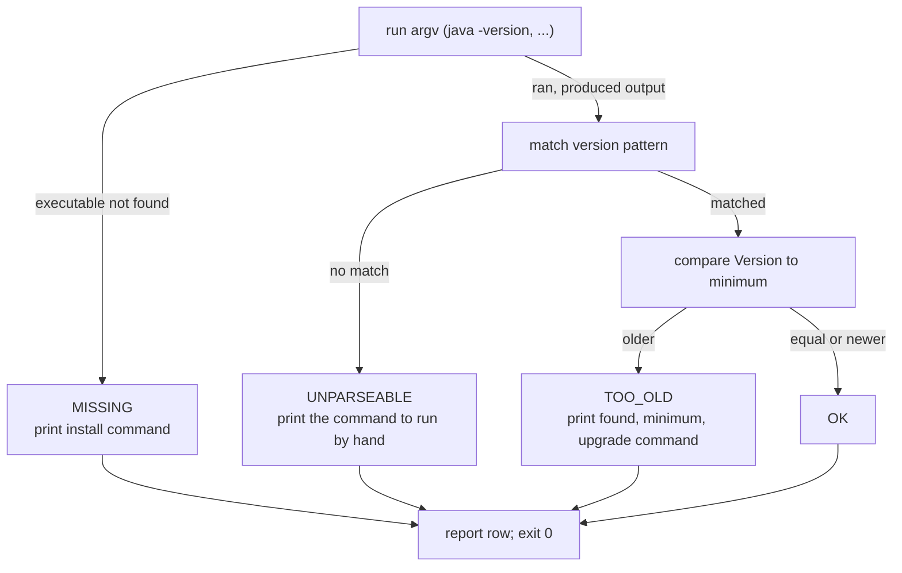

# Dev Environment: Java 21, Python 3.12, Go 1.22

> A preflight that tells you exactly which toolchain is missing and how to fix it.

**Type:** Build
**Languages:** Java, Python, Go
**Prerequisites:** None
**Time:** ~60 minutes

## Learning Objectives

- Install or verify a JDK 21+, a Python 3.11+, and a Go 1.22+ toolchain and explain what each one's version command actually prints
- Parse the three version-string formats (`openjdk version "21.0.2"`, `Python 3.12.1`, `go version go1.22.3 linux/amd64`) into a comparable `Version` value and compare it numerically against a minimum
- Build a preflight checker that runs the other toolchains as subprocesses, classifies each as OK, TOO_OLD, UNPARSEABLE, or MISSING, and prints the corrective command instead of a stack trace
- Inject the subprocess boundary so the checker's logic is tested against canned output rather than against whatever happens to be installed
- Verify the repository layout (`phases/`, `scripts/`, `languages.json`, `curriculum/curriculum.json`) so later lessons' scripts have something to run against

## The Problem

A new engineer joins a payments team on Monday. The onboarding document says "install Java, Python, and Go", so they do: `brew install java`, the Python that ships with the operating system, and a Go tarball from a bookmark. They clone the ledger repository, run the test suite, and get this:

```console
error: invalid source release: 21
```

followed, once they have fixed that, by

```console
SyntaxError: invalid syntax  (match statement, line 212)
```

and finally

```console
go: errors parsing go.mod: invalid go version '1.22': must match format 1.23
```

Each message is accurate and each is useless. The first means the installed `javac` is older than 21 and cannot compile records with pattern matching. The second means the system Python is 3.9 and does not know `match`. The third is a Go toolchain older than the module's `go` directive, reporting the problem in terms of the file rather than the tool. The engineer loses the afternoon to three separate searches, and the third search leads to a forum answer that tells them to edit `go.mod`, which breaks the build for everyone else.

The same thing happens on a build agent. A CI image is rebuilt with a base layer that pins `python3` to 3.10, and every lesson in this course that uses `ExceptionGroup` or `tomllib` starts failing with a traceback that points into the lesson, not at the interpreter. The failure is real, but its location is a lie.

This lesson builds the tool that should have run first: a preflight that asks each toolchain for its version, parses the answer, compares it to a stated minimum, and prints one line per tool that says what was found, what was required, and the exact command that fixes it. It never fails. A preflight that exits non-zero when Go is missing would stop a Java learner from starting, and the course only needs the one language you chose. It reports; you decide. The same checker also confirms the repository is laid out the way `scripts/run_lesson.py` expects, because a clone that is missing `scripts/` produces its own hour of confusion.

## The Concept

### What the course needs and why those versions

| Toolchain | Minimum | What the minimum unlocks in this course | Version command | Writes to |
|-----------|---------|------------------------------------------|-----------------|-----------|
| Java (JDK) | 21 | records, sealed interfaces, pattern matching for `switch`, virtual threads (Phase 3, Phase 5) | `java -version`, `javac -version` | stderr for `java`, stdout for `javac` |
| Python | 3.11 | `ExceptionGroup`, `tomllib`, `Self`, the faster interpreter; `match` arrived in 3.10 | `python3 --version` | stdout (stderr before 3.4) |
| Go | 1.22 | per-iteration loop variables (closes the classic goroutine-capture bug), `math/rand/v2`, range-over-int | `go version` | stdout |

The minimums live in `languages.json` at the repository root, which is the registry the course scripts read. The preflight hard-codes the same three numbers so that it has no dependency on parsing JSON before it can tell you whether your Python is new enough to parse JSON. If the registry and the checker ever disagree, the registry wins and the checker is the bug.

A JDK versus a JRE matters here. A JRE ships `java` but not `javac`; it can run compiled classes but cannot compile `Main.java`. The preflight checks both executables separately and gives the "install the full JDK" fix when only the compiler is missing, because that is the single most common Java onboarding fault.

### The three version-string grammars

Each toolchain prints its version in a different shape, on a different stream, sometimes preceded by noise. The checker must read all three.

| Tool | Typical output | Noise you will see | Version text |
|------|----------------|--------------------|--------------|
| `java -version` | `openjdk version "21.0.2" 2024-01-16` then two more lines | `Picked up JAVA_TOOL_OPTIONS: ...` as the first line when that environment variable is set | the quoted string |
| `java -version` (legacy) | `java version "1.8.0_292"` | | `1.8.0_292`, meaning Java 8 |
| `javac -version` | `javac 21.0.2` | | after the word `javac` |
| `python3 --version` | `Python 3.12.1` | `Python 3.13.0rc1` for release candidates | after `Python` |
| `go version` | `go version go1.22.3 linux/amd64` | `go1.22` with no patch for a `.0` release; `go1.23rc1` | after `go version go` |

Java's version scheme changed with JEP 223 (JDK 9). Before it, `1.8.0_292` meant "Java 8, update 292"; after it, `21.0.2` means major 21, minor 0, security 2. A parser that reads `1.8.0_292` as major 1 will report Java 8 as "below minimum 21" with the found version `1.8.0`, which is true but misleading. The checker strips a leading `1.` only for the Java toolchain, because `1.22.3` from Go really does mean major 1. This is the kind of special case that lives in the tool's pattern, not in the shared parser.

Python's version identifiers follow PEP 440: `3.13.0rc1` is a pre-release of `3.13.0`. The checker drops the suffix and treats it as `3.13.0`, which is correct for a minimum check (a release candidate of 3.13 is at least 3.11) and would be wrong for an exact-pin check (which this is not). Go's `go1.22` with no third component is release `1.22.0`; missing components are zero.

### The `Version` value and numeric comparison

A version is three integers compared lexicographically as a tuple: major first, then minor, then patch. Not as strings. The string `"3.9.18"` sorts after `"3.11.0"` because `'9' > '1'`, which would pass Python 3.9 as newer than 3.11. Every language in this lesson compares integers.

Worked example, by hand:

```text
found   = "Python 3.9.18"    -> pattern captures "3.9.18" -> Version(3, 9, 18)
minimum = Version(3, 11, 0)
compare major: 3 == 3   -> continue
compare minor: 9 < 11   -> found is older    => TOO_OLD

found   = "go version go1.22 darwin/arm64" -> captures "1.22" -> Version(1, 22, 0)
minimum = Version(1, 22, 0)
compare major: 1 == 1, minor: 22 == 22, patch: 0 == 0 -> equal => OK (minimum is inclusive)

found   = 'java version "1.8.0_292"' -> java pattern strips "1." -> "8.0_292" -> Version(8, 0, 0)
minimum = Version(21, 0, 0)
compare major: 8 < 21 => TOO_OLD, reported as 8.0.0 against 21.0.0
```

The `_292` is dropped because the leading-number regex stops at the first character that is not a digit or a dot. Update numbers never matter for a minimum check that is expressed as a major version.

### Four outcomes, one of which is not "the tool is broken"



`UNPARSEABLE` is the outcome people forget. It happens when `java` exists but the JVM fails to start (`error: could not create the Java Virtual Machine` because `JAVA_TOOL_OPTIONS` names a missing file), or when a shim such as `pyenv` prints its own error instead of a version. The tool is present, so `MISSING` would be a lie; nothing was compared, so `TOO_OLD` and `OK` would be lies. The honest report is "it ran, I could not read the result, here is the command to run yourself".

The invariant of the whole program is simple: **every toolchain and every required path produces exactly one row, and the process exits 0 regardless of what the rows say.** The tests check the first half with a runner that pretends nothing is installed (four rows, all `MISSING`); the second half is a property of `main`, which contains no `exit` call at all.

### The subprocess boundary is injected

The interesting logic (parse, compare, classify, format) is deterministic. The uninteresting part (spawn `go version`, read its output) depends on the machine. The design separates them with a `CommandRunner`: a function from `argv` to "the combined output, or nothing because the executable does not exist". `main` passes the real runner; the tests pass a fake that answers from a script. This is the first appearance of a pattern the whole course uses: the clock in Lesson 03, the network in Phase 5, the random source in Phase 8. If a test needs a real toolchain installed to pass, the test is testing the machine, not the code.

The real runner has two things worth knowing. It merges stderr into stdout, because `java -version` writes to stderr and a runner that only reads stdout sees an empty string and reports Java as `UNPARSEABLE` on a perfectly good machine. And it distinguishes "could not start the process" (the executable is not on `PATH`) from "the process started and exited non-zero" (it ran, so parse what it printed). Conflating those two is how a broken JVM gets reported as "Java is not installed", which sends the learner off to reinstall something they already have.

### Repository layout

The second half of the preflight checks the clone itself. `scripts/run_lesson.py` resolves lesson paths relative to the repository root and reads `languages.json` for the canonical commands; a clone that is missing either cannot run anything. The checker finds the root by walking upward from the current directory until it sees `languages.json`, the registry file that `scripts/run_lesson.py` reads for every canonical command, so the preflight agrees with the scripts about where the root is even when it is launched from inside `code/java/`. If no marker is found it falls back to the starting directory and the layout rows say what is missing. It then reports four rows: `phases/`, `scripts/`, `languages.json`, `curriculum/curriculum.json`.

### What this preflight does not do

It does not install anything. It prints the command; you run it, because installing toolchains means downloading executables and that is a decision a human makes. It does not check `PATH` ordering (a machine with Java 8 first and Java 21 second passes the "installed" test and fails the "used" test; the checker reports the one your shell would use, which is the right one to report). It does not check network access, because this course never needs any. It does not validate `go.mod` directives, `JAVA_HOME`, or virtual environments; it checks the three executables the canonical commands in `languages.json` invoke, by the names those commands use.

## Build It

The primary walkthrough is Java. The Python and Go files implement the same design with the same names, and the subsections at the end show only what differs.

### Step 1: A version that compares numerically

```java
record Version(int major, int minor, int patch) implements Comparable<Version> {
    private static final Pattern LEADING = Pattern.compile("^(\\d+)(?:\\.(\\d+))?(?:\\.(\\d+))?");

    static Optional<Version> parse(String text) {
        if (text == null) return Optional.empty();
        Matcher m = LEADING.matcher(text.strip());
        if (!m.find()) return Optional.empty();
        int major = Integer.parseInt(m.group(1));
        int minor = m.group(2) == null ? 0 : Integer.parseInt(m.group(2));
        int patch = m.group(3) == null ? 0 : Integer.parseInt(m.group(3));
        return Optional.of(new Version(major, minor, patch));
    }

    boolean atLeast(Version minimum) { return compareTo(minimum) >= 0; }

    @Override
    public int compareTo(Version o) {
        if (major != o.major) return Integer.compare(major, o.major);
        if (minor != o.minor) return Integer.compare(minor, o.minor);
        return Integer.compare(patch, o.patch);
    }
}
```

The regex is anchored at the start and takes up to three dot-separated integers, so `21-ea`, `3.13.0rc1`, and `8.0_292` all stop cleanly at the first non-numeric character. `parse` returns `Optional.empty()` rather than throwing, because "this text has no version in it" is an expected outcome the caller turns into `UNPARSEABLE`, not a programming error. `compareTo` compares integers field by field; there is no string comparison anywhere in the type.

**Predict:** `Version.parse("1.22")` and `Version.parse("1.22.0")`: are they equal? What about `Version.parse("v1.22")`?

### Step 2: What a toolchain is

```java
record Toolchain(String name, List<String> argv, Version minimum, Pattern versionPattern, String fix) {
    Optional<Version> parseVersion(String output) {
        Matcher m = versionPattern.matcher(output);
        if (!m.find()) return Optional.empty();
        return Version.parse(m.group(1));
    }
}

static final List<Toolchain> TOOLCHAINS = List.of(
        new Toolchain("java", List.of("java", "-version"), JAVA_MIN,
                Pattern.compile("version \"(?:1\\.)?([^\"]+)\""),   // legacy "1.8.0_292" means Java 8
                "install a JDK 21+ (https://adoptium.net or `sudo apt install openjdk-21-jdk`) ..."),
        new Toolchain("javac", List.of("javac", "-version"), JAVA_MIN,
                Pattern.compile("javac\\s+(\\S+)"),
                "a JRE alone is not enough: install the full JDK 21+ so `javac` exists"),
        new Toolchain("python3", List.of("python3", "--version"), PYTHON_MIN,
                Pattern.compile("Python\\s+(\\S+)"), "install Python 3.11+ ..."),
        new Toolchain("go", List.of("go", "version"), GO_MIN,
                Pattern.compile("go version go(\\S+)"), "install Go 1.22+ from https://go.dev/dl/ ..."));
```

A toolchain is data: a name, the command that prints its version, the minimum, a pattern with one capture group that isolates the version text, and the fix sentence. Adding a fifth toolchain is adding a row, not a branch. Two patterns deserve a second look. The Java pattern uses `find`, not `matches`, so the `Picked up JAVA_TOOL_OPTIONS` noise line before the real one is skipped. The optional `(?:1\.)?` prefix converts the legacy `1.8.0_292` scheme to `8.0_292` before the shared parser sees it; it cannot misfire on `11.0.2` or `21.0.2` because those do not start with `1.`.

**Predict:** which of these does the Java pattern accept and what does it capture: `openjdk version "17.0.9" 2023-10-17`, `java version "1.8.0_292"`, `javac 21.0.2`?

### Step 3: The boundary with the operating system

```java
interface CommandRunner {
    Optional<String> run(List<String> argv);     // empty = executable does not exist
}

static final CommandRunner REAL_RUNNER = argv -> {
    try {
        Process p = new ProcessBuilder(argv).redirectErrorStream(true).start();
        try (InputStream in = p.getInputStream()) {
            String out = new String(in.readAllBytes(), StandardCharsets.UTF_8);
            if (!p.waitFor(10, TimeUnit.SECONDS)) p.destroyForcibly();
            return Optional.of(out);
        }
    } catch (IOException e) {
        return Optional.empty();                 // executable not on PATH
    } catch (InterruptedException e) {
        Thread.currentThread().interrupt();
        return Optional.empty();
    }
};
```

`redirectErrorStream(true)` is the line that makes `java -version` work at all. `ProcessBuilder.start()` throws `IOException` when the executable cannot be found, and that is the only condition mapped to `Optional.empty()`; a process that starts and exits with status 1 still returns its output so the parser can decide. Reading the stream to completion before `waitFor` avoids the classic deadlock where a child blocks on a full pipe while the parent waits for it to exit. The ten-second bound exists because a hung JVM should produce an `UNPARSEABLE` row, not a hung preflight.

**Predict:** if `java` exists but `JAVA_TOOL_OPTIONS` points at a trust store that does not exist, which branch runs and which status results?

### Step 4: Classify one toolchain

```java
static CheckResult checkToolchain(Toolchain tool, CommandRunner runner) {
    Optional<String> output = runner.run(tool.argv());
    if (output.isEmpty()) {
        return new CheckResult(tool.name(), Status.MISSING, Optional.empty(),
                "not on PATH (minimum " + tool.minimum() + ") -> " + tool.fix());
    }
    Optional<Version> found = tool.parseVersion(output.get());
    if (found.isEmpty()) {
        return new CheckResult(tool.name(), Status.UNPARSEABLE, Optional.empty(),
                "ran but printed no recognisable version; run `" + String.join(" ", tool.argv()) + "` by hand");
    }
    if (!found.get().atLeast(tool.minimum())) {
        return new CheckResult(tool.name(), Status.TOO_OLD, found,
                "below minimum " + tool.minimum() + " -> " + tool.fix());
    }
    return new CheckResult(tool.name(), Status.OK, found, "(minimum " + tool.minimum() + ")");
}
```

The four outcomes from the diagram, in order of discovery. Every non-OK row carries the fix text or the command to run by hand, so the report is actionable without a search. `CheckResult` is a record of `(name, status, found, detail)` with a `formatted()` method that renders one fixed-width line; the formatting is kept out of the classification so tests can assert on fields rather than on column positions.

### Step 5: The repository layout

```java
static Path findRepoRoot(Path start) {
    Path dir = start.toAbsolutePath().normalize();
    while (dir != null) {
        if (Files.isRegularFile(dir.resolve("languages.json"))) return dir;
        dir = dir.getParent();
    }
    return start.toAbsolutePath().normalize();
}

static List<CheckResult> checkLayout(Path root) {
    List<CheckResult> results = new ArrayList<>();
    for (String d : REQUIRED_DIRS) {                      // "phases", "scripts"
        boolean present = Files.isDirectory(root.resolve(d));
        results.add(new CheckResult(d + "/", present ? Status.OK : Status.MISSING, Optional.empty(),
                present ? "directory present" : "missing -> re-clone the repository; you may be running outside it"));
    }
    for (String f : REQUIRED_FILES) {                     // "languages.json", "curriculum/curriculum.json"
        boolean present = Files.isRegularFile(root.resolve(f));
        results.add(new CheckResult(f, present ? Status.OK : Status.MISSING, Optional.empty(),
                present ? "file present" : "missing -> re-clone the repository; this file is the course's registry"));
    }
    return results;
}
```

`findRepoRoot` walks up until it finds the marker, which lets the preflight be launched from `code/java/`, from the lesson directory, or from the root. The fallback to the starting directory is deliberate: if the marker is nowhere above you, the layout rows will all say `MISSING`, which is the correct report for "you are not inside the repository".

**Predict:** you run the preflight from `/tmp`. What does `findRepoRoot` return and what do the four layout rows say?

### Step 6: The report, and the exit code that is not there

```java
public static void main(String[] args) {
    // deterministic section: parse five canned strings (see the file for the table)
    List<CheckResult> tools = Preflight.checkToolchains(Preflight.REAL_RUNNER);
    tools.forEach(r -> System.out.println(r.formatted()));
    Path root = Preflight.findRepoRoot(Paths.get(""));
    List<CheckResult> layout = Preflight.checkLayout(root);
    layout.forEach(r -> System.out.println(r.formatted()));
    List<CheckResult> all = new ArrayList<>(tools);
    all.addAll(layout);
    System.out.println(Preflight.summary(all));
    // A preflight reports; it never fails. Exit 0 regardless of findings.
}
```

The first section of `main` parses five fixed strings so there is always a deterministic block of output to compare against the lesson, whatever the machine has installed. The second section is live. There is no `System.exit` anywhere; the summary line counts every status, and the closing sentence reminds the learner that only the language in `LEARNING.md` is required to continue.

### Step 7: Run it

```bash
cd phases/00-setup-and-tooling/01-dev-environment/code/java
javac -d .out *.java && java -cp .out Main
java -cp .out MainTest
```

Expected output on a machine with everything installed, abbreviated:

```console
== Parsing version strings (deterministic) ==
java     "openjdk version "21.0.2" 2024-01-16"         -> 21.0.2 (meets 21.0.0)
java     "java version "1.8.0_292""                    -> 8.0.0 (below 21.0.0)
python3  "Python 3.12.1"                               -> 3.12.1 (meets 3.11.0)
go       "go version go1.22.3 linux/amd64"             -> 1.22.3 (meets 1.22.0)
go       "go version go1.21.13 linux/amd64"            -> 1.21.13 (below 1.22.0)

== Preflight: toolchains on this machine ==
OK          java                        21.0.2    (minimum 21.0.0)
OK          javac                       21.0.2    (minimum 21.0.0)
OK          python3                     3.12.1    (minimum 3.11.0)
OK          go                          1.22.3    (minimum 1.22.0)

== Preflight: repository layout ==
repository root: /home/you/payments-engineering-from-scratch
OK          phases/                     -         directory present
OK          scripts/                    -         directory present
OK          languages.json              -         file present
OK          curriculum/curriculum.json  -         file present

Summary: 8 OK 0 TOO_OLD 0 UNPARSEABLE 0 MISSING
```

And with Go absent from `PATH`:

```console
MISSING     go                          -         not on PATH (minimum 1.22.0) -> install Go 1.22+ from https://go.dev/dl/ and add /usr/local/go/bin to PATH
Summary: 7 OK 0 TOO_OLD 0 UNPARSEABLE 1 MISSING
Something is missing. You need only the language recorded in LEARNING.md to follow the course; CI needs all three.
```

The process exit code is 0 in both cases. Check it: `echo $?`.

### In Python

```python
@dataclass(frozen=True, order=True)
class Version:
    major: int
    minor: int
    patch: int

    def at_least(self, minimum: "Version") -> bool:
        return self >= minimum   # order=True compares (major, minor, patch) as a tuple of ints


def real_runner(argv: tuple[str, ...]) -> Optional[str]:
    try:
        proc = subprocess.run(list(argv), capture_output=True, text=True, timeout=10)
    except FileNotFoundError:
        return None             # executable not on PATH
    except subprocess.TimeoutExpired:
        return ""
    return proc.stdout + proc.stderr
```

Differences, all in `code/python/main.py`:

- **`order=True` writes `compareTo` for you.** A frozen, ordered dataclass compares field by field in declaration order, which for three `int` fields is exactly the numeric tuple comparison. Declare the fields as `str` and you get lexical comparison and the `3.9 > 3.11` bug back, silently.
- **`None` is the "not installed" signal.** `subprocess.run` raises `FileNotFoundError` when the executable does not exist, which maps to `None`; a non-zero exit does not raise (no `check=True`), so the output still reaches the parser.
- **`CommandRunner` is a `Callable` type alias**, and the fake in the tests is a `lambda`. No interface declaration is needed because the runner is just a function.

### In Go

```go
type CommandRunner func(argv []string) (output string, found bool)

func RealRunner(argv []string) (string, bool) {
    ctx, cancel := context.WithTimeout(context.Background(), 10*time.Second)
    defer cancel()
    out, err := exec.CommandContext(ctx, argv[0], argv[1:]...).CombinedOutput()
    if err != nil {
        var execErr *exec.Error
        if errors.As(err, &execErr) || errors.Is(err, exec.ErrNotFound) {
            return "", false // executable not on PATH
        }
    }
    return string(out), true // ran (perhaps with a non-zero exit); let the parser decide
}
```

Differences, all in `code/go/main.go`:

- **Two return values instead of `Optional`.** `(Version, bool)` for parsing and `(string, bool)` for the runner are the Go idiom for "a value or nothing"; `*Version` in `CheckResult` is `nil` when no version was read.
- **`exec.Error` versus `exec.ExitError`.** Go reports "could not start" as `*exec.Error` (wrapping `exec.ErrNotFound`) and "started, exited non-zero" as `*exec.ExitError`. Only the first means `MISSING`; the second still carries output. `errors.As` is how you tell them apart.
- **`CombinedOutput` merges the streams** the same way `redirectErrorStream(true)` does. `context.WithTimeout` bounds the run; a hung child is killed and reports as `UNPARSEABLE`.
- **The `Status` type is an `int` with a names table**, because Go has no enums; `statusNames` doubles as the iteration order for the summary line.

## Use It

### `scripts/run_lesson.py` and `languages.json`

The course's own runner does a lighter version of this check: `shutil.which(lang["versionCommand"][0])` tells it whether `java`, `python3`, or `go` exists, and a missing toolchain is reported as `SKIP`, never as a failure, for the same reason the preflight exits 0. It does not compare versions; that is what this lesson's checker adds. `languages.json` holds `minVersion` and `versionCommand` for each language, which is where the three numbers hard-coded here come from. Exercise 2 wires them together.

### Version managers

In practice, teams pin toolchains with a manager rather than a preflight: SDKMAN or `jenv` for the JDK, `pyenv` or `uv` for Python, and Go's own toolchain directive (`go 1.22` plus `toolchain go1.22.3` in `go.mod`, which Go 1.21+ honours by downloading the named version). What they do that the checker makes explicit is select among several installed versions per project. What they hide is that a shim is a program too: `pyenv`'s `python3` shim prints its own error when no version is selected, which is why `UNPARSEABLE` exists. Go's directive is the one to know about: `go.mod` with `go 1.22` on a Go 1.21 toolchain fails with `invalid go version`, while on Go 1.21+ with a `toolchain` line it fetches the right compiler automatically.

### Container images and CI

A `Dockerfile` that starts `FROM eclipse-temurin:21-jdk`, `FROM python:3.12-slim`, or `FROM golang:1.22` is a preflight that cannot fail, which is the strongest form. The weakness is the multi-language image: a Java base image with `apt install python3` gets whatever Python the distribution pins, which is where the "CI image rebuilt with Python 3.10" failure in The Problem comes from. Run this lesson's checker as the first step of the pipeline and the failure is reported in one line against the toolchain, not in a traceback against lesson code.

### The version strings themselves

JEP 223 defines the modern JDK scheme (`$FEATURE.$INTERIM.$UPDATE.$PATCH`, so `21.0.12.1` is legal and the checker reads the first three parts). PEP 440 defines Python's (`3.13.0rc1`, `3.12.1`, with post-releases and dev-releases the checker never meets). Go's release notes define `go1.22.3` and `go1.23rc1`, and `runtime.Version()` returns the same string programmatically. If the format changes, the tool's pattern changes; the shared `Version` parser does not.

## Ship It

`outputs/checklist-dev-environment.md` is the onboarding checklist distilled from this lesson: the three version commands and what each prints, the fix for each failure class, the JDK-versus-JRE trap, and the "no network needed" statement. Hand it to the next engineer who joins, or paste it into the repository's `CONTRIBUTING.md`.

## Exercises

1. **Reinforce.** Add a fifth toolchain row for `git` (`git --version` prints `git version 2.43.0`; minimum `2.0.0`) in all three implementations, with a pattern, a fix sentence, and two parsing tests. Do not touch the shared `Version` parser. Then explain in one sentence why the brief for this lesson said the preflight should never exit non-zero, and whether a missing `git` changes that answer.
2. **Apply.** Replace the three hard-coded minimums with values read from `languages.json` (`minVersion` and `versionCommand`), using only `java.net`-free standard-library JSON handling: Python's `json` module, Go's `encoding/json`, and in Java a twenty-line hand parser or a regex over the known shape, since the JDK has no JSON library. Keep the hard-coded values as the fallback when the file is missing, so the checker can still report a broken clone. Write the test that proves the fallback runs.
3. **Extend.** The checker reports the first `java` on `PATH`. Add a `JAVA_HOME` check: if the variable is set, run `$JAVA_HOME/bin/java -version` too and report a fifth status, `MISMATCH`, when its version differs from the `PATH` one. This is the real cause of "it compiles in my IDE but not in the terminal". Reuse the injected runner so the test needs no real JDK, and connect the two results in the summary line.

## Key Terms

| Term | What people say | What it actually means |
|------|-----------------|------------------------|
| Preflight | "the setup check" | A program that inspects the environment and reports what is missing with a fix, and does not fail, because reporting is its job and deciding is yours |
| JDK vs JRE | "Java" | A JDK ships `javac` and `java`; a JRE ships only `java`. A JRE can run this course's compiled classes but cannot compile them |
| Version string | "the version number" | A tool-specific text whose grammar differs per toolchain (JEP 223, PEP 440, Go release names); it is parsed into integers before any comparison |
| Numeric comparison | "newer than" | Comparing `(major, minor, patch)` as an integer tuple; comparing the strings sorts `3.9` after `3.11` |
| Injected runner | "mocking the subprocess" | Passing the function that spawns processes as a parameter so tests supply canned output and the logic is tested without the toolchain installed |
| `UNPARSEABLE` | "it is installed but weird" | The tool started and produced output the pattern did not recognise; neither missing nor compared, so the honest report is the command to run by hand |
| `PATH` resolution | "which Java am I using" | The shell runs the first matching executable in `PATH` order; a newer JDK installed second is present but unused |

## Further Reading

- [JEP 223: New Version-String Scheme](https://openjdk.org/jeps/223) — the definition of `21.0.2` versus the legacy `1.8.0_292`, and why the checker strips the leading `1.` only for Java.
- [PEP 440: Version Identification and Dependency Specification](https://peps.python.org/pep-0440/) — Python's version grammar, including the `rc1` pre-release suffix the parser drops.
- [Go Toolchains](https://go.dev/doc/toolchain) — how the `go` and `toolchain` directives in `go.mod` select a compiler, and why an old toolchain fails with `invalid go version`.
- [`java.lang.ProcessBuilder` (Java 21 API)](https://docs.oracle.com/en/java/javase/21/docs/api/java.base/java/lang/ProcessBuilder.html) — `redirectErrorStream` and the pipe-deadlock warning that motivates reading output before `waitFor`.
- [Python `subprocess` module](https://docs.python.org/3/library/subprocess.html) — `run`, `capture_output`, `timeout`, and the `FileNotFoundError` that means "not installed".
- [Go `os/exec` package](https://pkg.go.dev/os/exec) — `exec.Error` versus `exec.ExitError`, which is the distinction between `MISSING` and "ran but failed".
