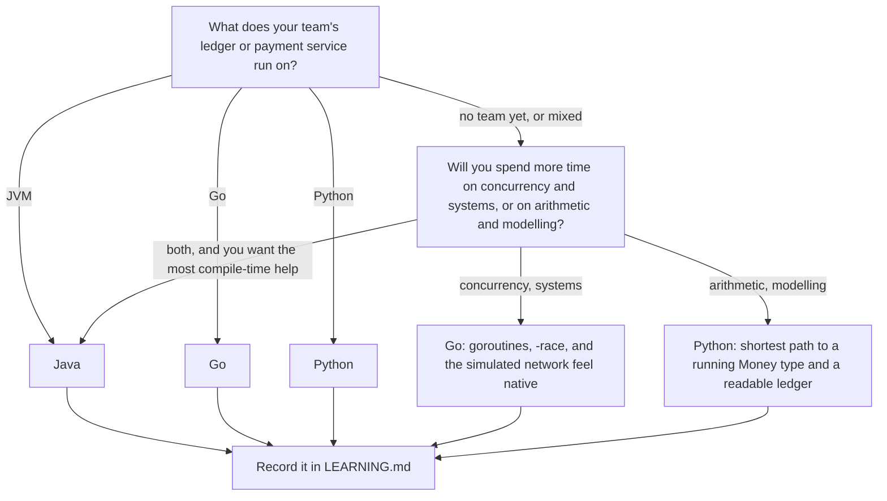

# Choose Your Language: How Every Lesson Maps to Java, Python, and Go

> The same algorithm in three languages, and what each one hides from you.

**Type:** Learn
**Languages:** —
**Prerequisites:** Phase 0 Lesson 01 (Dev Environment)
**Time:** ~45 minutes

## Learning Objectives

- Describe how every Build lesson in this course ships one design in Java 21, Python 3.11+, and Go 1.22+, with the same type names, method names, and test cases
- Compare the three languages on the five axes that matter for this course: type system, error handling, numeric model, concurrency model, and test runner
- Name, for each language, one thing it hides that a payments engineer must know is there (wrapping overflow, the GIL, nil zero values, floor division, constant folding)
- Choose a language for the course with a decision procedure based on your team's stack, not on taste, and know how to record and later change that choice in `LEARNING.md`
- Read a lesson's `### In Python` and `### In Go` subsections and know what kind of difference each one is reporting

## The Problem

A payments platform has three services in the authorization path. The gateway is Go, because the team that built it wanted small static binaries and goroutines for fan-out to card networks. The ledger is Java, because it was there first and because the JVM's memory model was something the team could reason about when the ledger went multi-threaded. The risk engine is Python, because the models are Python and the engineers who tune them are not going to rewrite them. This is not a pathology; it is what most payment stacks look like after five years.

Now a one-cent discrepancy appears between the Java ledger and the Python risk engine's shadow ledger. Both compute the same fee: 2.9% of each amount, rounded. The Java side does `amount * 29 / 1000` with `long` arithmetic; the Python side does `amount * 29 // 1000`. On positive amounts they agree. On a refund of `-1999` cents the product is `-57971`, the Java `/` truncates toward zero (`-57`) and the Python `//` floors toward negative infinity (`-58`). Both engineers wrote "integer division". Neither language is wrong, and neither side rounds the way the fee schedule says (nearest, ties to even, which is `-58`); the Java side is accidentally `DOWN` and the Python side is accidentally `FLOOR`, a mode no payment rule uses. The ledgers disagree by one cent on every refund, and the reconciliation job that compares them has been emitting a warning that someone muted eight months ago.

The same stack has a second, quieter problem. The Go gateway represents an optional authorization code as a `string` field; when the network returns none, the field is `""`, which is Go's zero value, and downstream code cannot tell "no code" from "empty code". The Java ledger uses `Optional<String>`; the Python risk engine uses `None` and a type hint nobody checks. Three representations of "absent", three different failure modes when one is wrong.

This course makes you build every mechanism in one of these three languages and read about the other two, because the differences above are not trivia. They are exactly the places where a polyglot payments stack produces a penny discrepancy, a lost update, or a nil pointer in production. This lesson is the map: what is the same in every lesson, what differs, and which differences are the lesson.

## The Concept

### How to read a lesson in your language

Every Build lesson is written with Java as the primary walkthrough in Build It, then two subsections, `### In Python` and `### In Go`, that show only what differs and point at the full files. If Java is your language, read Build It and skim the other two for the traps that will bite you when you read a colleague's code. If Python or Go is your language, the tutor skill reads Build It to you in your language (the code it shows is from your `code/<lang>/` folder, which has the same step structure), and the subsection for your language is the one to read closely, because it names the places where your implementation had to differ and why.

The naming map is mechanical and worth knowing once:

| Concept | Java | Python | Go |
|---------|------|--------|-----|
| Value type | `record Money(long minorUnits, Currency currency)` | `@dataclass(frozen=True) class Money` | `type Money struct { MinorUnits int64; Currency Currency }` |
| Method | `plus`, `divideRounded` (camelCase) | `plus`, `divide_rounded` (snake_case) | `Plus`, `DivideRounded` (exported CamelCase) |
| Constant | `Rounding.HALF_EVEN`, `static final` | `Rounding.HALF_EVEN`, module-level `UPPER_CASE` | `HalfEven` (an `iota` constant on a named `int`) |
| Constructor | `new Money(...)`, static `Money.parse(...)` | `Money(...)`, `@staticmethod parse` | `OfMinor(...)`, `Parse(...)` returning `(Money, error)` |
| Interface | `interface Clock { long nowMillis(); }` | `class Clock(Protocol): def now_millis(self) -> int` | `type Clock interface { NowMillis() int64 }` |
| Absent value | `Optional<Version>` | `Optional[Version]` (`None`) | `(Version, bool)` or `*Version` (`nil`) |
| Failure | `throw new ArithmeticException(...)` | `raise OverflowError(...)` | `return 0, fmt.Errorf("%w ...", ErrOverflow)` |
| Test file | `MainTest.java` with `check(...)` | `test_main.py` with `unittest.TestCase` | `main_test.go` with `func TestXxx(t *testing.T)` |

### One design, three implementations

Every Build lesson has a `code/` folder with `java/`, `python/`, and `go/`. The three are not three idiomatic rewrites. They are one design: the same type names (modulo casing), the same method names (`plus`/`plus`/`Plus`, `divideRounded`/`divide_rounded`/`DivideRounded`), the same test cases in the same order, the same demo output from `main`. If you learn the course in Python and join a Java team, the `Money` record you meet in Phase 10 is the dataclass you built, with `Math.addExact` where you had unbounded ints.

What differs is forced by the language, and each lesson reports those differences in two short subsections at the end of Build It: `### In Python` and `### In Go`. The differences fall into five families, and knowing which family a difference belongs to tells you how seriously to take it.

### The five axes

| Axis | Java 21 | Python 3.11+ | Go 1.22+ | Where the course leans on it |
|------|---------|--------------|----------|------------------------------|
| **Type system** | static, nominal; `record`, `sealed interface`, pattern matching in `switch`; generics erased at runtime | dynamic; type hints are documentation unless a checker runs; `dataclass(frozen=True)` for value types; `Protocol` for structural interfaces | static, structural; interfaces satisfied implicitly; no sum types, no enums (constants over an `int`); generics since 1.18 | state machines (Phase 12) use sealed interfaces, `match`, and tagged structs respectively |
| **Error handling** | checked and unchecked exceptions; `ArithmeticException` on `addExact` | exceptions only; `OverflowError`, `ValueError`; no checked exceptions | error values returned as the last result; `errors.Is` / `errors.As`; `panic` for programming errors only | every `Money` operation that can fail: throws / raises / returns `(Money, error)` |
| **Numeric model** | `long` wraps at 2^63; `Math.*Exact` throws; `BigDecimal` for decimals; `/` truncates | `int` is unbounded; `//` floors; `Decimal` and `Fraction` in the standard library | `int64` wraps; no checked ops in the standard library; no decimal type; `/` truncates; constants folded exactly | Lesson 07 and Phase 10: minor units, checked add, explicit rounding |
| **Concurrency model** | OS threads and virtual threads (Java 21); shared memory under the JMM; `synchronized`, `java.util.concurrent` | one interpreter lock (the GIL) serialises bytecode; `threading` for I/O-bound, `multiprocessing` for CPU-bound, `asyncio` for cooperative concurrency | goroutines scheduled onto OS threads; channels and `sync`; `-race` detector | Phase 3 (threads), Phase 5 (simulated network), Phase 14 (scale) |
| **Test runner** | none in the JDK; the course's `check()` harness in `MainTest.java` | `unittest` in the standard library; `python3 -m unittest -v` | `testing` in the toolchain; `go test ./...`, table-driven, `-race`, benchmarks | Lesson 03 builds all three |
| **Build and run** | `javac -d .out *.java && java -cp .out Main`; no packages in this course | `python3 main.py`; one file per lesson | `go run .` with a per-lesson `go.mod`; one `package main` | `languages.json` holds the canonical commands |

### Axis 1: What the type system catches

Java catches the most at compile time. A `record Money(long minorUnits, Currency currency)` cannot be constructed with a `double`; a `sealed interface PaymentState permits Authorized, Captured, Refunded` makes a `switch` that forgets `Refunded` a compile error. The cost is ceremony and the erasure of generics at runtime, which rarely matters here.

Go catches less but catches it early: a `Money` struct with an `int64` field cannot hold a float, interfaces are satisfied by having the right methods (no `implements`), and the compiler rejects unused variables and imports. It has no sum types, so a state machine is a struct with a `State` field of a named `int` type and a `switch` the compiler does not check for exhaustiveness. The course's Go lessons add a `default: panic("unknown state")` to every such switch for that reason.

Python catches nothing at compile time because there is no compile time in the relevant sense. `Money(10.0, USD)` is legal until `__post_init__` says otherwise, which is why every Python value type in this course has one. Type hints (`minor_units: int`) are read by `mypy` or `pyright` if you run them; the course does not require either, but every hint is correct so you can. The practical rule: in Python, the validation that Java and Go get from the type goes in the constructor.

### Axis 2: Exceptions versus error values

```java
Money plus(Money other) {
    requireSameCurrency(other);                        // throws CurrencyMismatchException
    return new Money(Math.addExact(minorUnits, other.minorUnits), currency);   // throws ArithmeticException
}
```

```python
def plus(self, other: "Money") -> "Money":
    self._require_same_currency(other)                 # raises CurrencyMismatchError
    return Money(self.minor_units + other.minor_units, self.currency)   # cannot overflow
```

```go
func (m Money) Plus(other Money) (Money, error) {
    if err := m.requireSameCurrency(other); err != nil {
        return Money{}, err                            // errors.Is(err, ErrCurrencyMismatch)
    }
    sum, err := addChecked(m.MinorUnits, other.MinorUnits)
    return Money{sum, m.Currency}, err                 // errors.Is(err, ErrOverflow)
}
```

Java and Python unwind the stack; the caller handles the failure wherever it chooses to, or not at all, and an unhandled exception ends the thread with a trace. Go returns the failure as a value in the same breath as the result; the caller must write `if err != nil` or deliberately discard it with `_`, which a reviewer can see. Neither is safer in the abstract. Exceptions make the happy path short and the failure path invisible; error values make every failure visible and the happy path long. For payments code the course's position is that visibility wins, which is why the Java lessons use specific exception types (`CurrencyMismatchException`, never bare `RuntimeException`) and the Python lessons define their own exception classes: a reviewer should be able to grep for the failure.

Go's `panic` is reserved for programming errors (a `switch` reaching an impossible state, `NextInt(0)`), where no caller could sensibly recover. The Java and Python equivalents are `IllegalArgumentException` and `ValueError`. Lesson 03 shows all three.

### Axis 3: Numbers

This axis has the most sharp edges and gets its own lesson (Lesson 07). The summary:

| Operation | Java `long` | Python `int` | Go `int64` |
|-----------|-------------|--------------|------------|
| `MAX + 1` | wraps to `MIN`, silently | `9223372036854775808`, keeps going | wraps to `MIN`, silently |
| Checked add | `Math.addExact` throws | not needed; range-check at the storage boundary | write it yourself (Lesson 07) |
| `-7 / 2` | `-3` (truncate toward zero) | `-4` with `//` (floor toward -inf) | `-3` (truncate toward zero) |
| `-7 % 2` | `-1` (sign of dividend) | `1` (sign of divisor) | `-1` (sign of dividend) |
| `0.1 + 0.2` | `0.30000000000000004` | `0.30000000000000004` | `0.30000000000000004` at run time; `0.3` if both are constants |
| Decimal type | `BigDecimal` | `decimal.Decimal` | none; `math/big.Rat` is the exact rational |

The division row is the one from The Problem. Every `divideRounded` in this course works on magnitudes and reapplies the sign so the three languages agree on negative inputs; the Python version has a comment saying exactly why.

### The specification text behind the one-cent bug

The division row is not folklore; each language writes it down, and reading the three sentences side by side is a good first exercise in Lesson 06's skill of reading a spec.

- The Java Language Specification, section 15.17.2 (Division Operator `/`), says that integer division rounds toward zero, and section 15.17.3 defines `%` so that `(a / b) * b + (a % b)` equals `a`, which forces the remainder to take the sign of the dividend. `-57971 / 1000` is `-57`, and `-57971 % 1000` is `-971`.
- The Go Programming Language Specification, under Integer operators, defines `q = x / y` and `r = x % y` with `x = q*y + r` and `|r| < |y|`, and states that the quotient is truncated towards zero. Same two numbers as Java, and the spec adds the one exception: if the dividend is the most negative value and the divisor is `-1`, the quotient overflows and equals the dividend. That is the `MIN_VALUE / -1` case Lesson 07's `Checked.mul` has to special-case.
- The Python Language Reference, section 6.7 (Binary arithmetic operations), defines `//` as floor division, the floor of the mathematical quotient, and `%` so that `x == (x // y) * y + (x % y)` with the result taking the sign of the divisor. `-57971 // 1000` is `-58` and `-57971 % 1000` is `29`.

Three identities of the form `x == q*y + r`, two different choices of which `q` to pick when the quotient is inexact, and a one-cent disagreement on every negative amount. The identities are what let `divideRounded` be written once: work on `abs(x)` and `abs(y)`, where floor and truncation coincide, and reapply the sign.

### Axis 4: Concurrency

Java gives you shared memory and the Java Memory Model to reason about it: `synchronized`, `volatile`, `java.util.concurrent`, and since Java 21 virtual threads, which make a blocking call cheap enough to run a million of them. Go gives you goroutines (cheap, scheduled by the runtime), channels for communication, `sync.Mutex` for shared state, and the race detector. Python gives you threads that share memory but execute bytecode one at a time under the GIL, which means CPU-bound work does not speed up with threads (use processes), I/O-bound work does (the lock is released during I/O), and `asyncio` offers single-threaded cooperative concurrency with explicit `await` points.

What each hides: Java hides nothing and gives you the tools to hurt yourself; a missing `synchronized` is a data race the JVM will not report. Go hides scheduling and gives you `-race`, which reports the race Java would not. Python hides parallelism: a program with eight threads is running one at a time, and `self._now += millis` is still three bytecodes that another thread can interleave with, so a lock is still needed for correctness even though the GIL exists. Phase 3 builds a thread-safe queue in all three and the differences are the lesson.

### Axis 5: Tests and tooling

Python and Go ship a runner; Java does not. Lesson 03 is this axis in full. The short version: in Java you write `check(name, condition)` and a `main` that exits 1; in Python you write `unittest.TestCase` methods; in Go you write `func TestXxx(t *testing.T)` and run `go test -race`. Each lesson has at least ten assertions per language and the same cases in each.

What a failure looks like differs enough that it is worth seeing once before you meet it in anger. The same broken assertion, `divideRounded(-125, 10, HALF_EVEN)` returning `-13` instead of `-12`:

```console
$ java -cp .out MainTest
37 passed, 1 failed
FAIL: HALF_EVEN negative tie -12.5 -> -12 (expected -12, got -13)

$ python3 -m unittest
F......................
FAIL: test_ties (test_main.RoundedDivisionTest.test_ties)
AssertionError: -13 != -12

$ go test ./...
--- FAIL: TestDivideRounded (0.00s)
    main_test.go:91: DivideRounded(-125, 10, HALF_EVEN) = -13, <nil>; want -12
FAIL
```

The Java harness reports every failure by name at the end, because it keeps going; `unittest` prints a traceback per failing method and a summary; `go test` prints the file and line of the `t.Errorf`, which is why `t.Helper()` matters when the assertion is inside a helper. All three exit non-zero, which is the only property `scripts/run_lesson.py` relies on.

### What each language hides

| Language | Hidden behaviour | Where it bites a payments engineer | How the course surfaces it |
|----------|------------------|------------------------------------|----------------------------|
| Java | `long` overflow wraps silently | a balance near 2^63 flips sign | `Math.addExact` everywhere an amount is added (Phase 10) |
| Java | `new BigDecimal(0.1)` is exact in the wrong way | a rate parsed from a double carries 55 digits of binary error | `BigDecimal.valueOf` or a string, never the double constructor |
| Java | `HashMap` iteration order is unspecified | a report whose line order changes between runs | sorted keys or `LinkedHashMap` where order is asserted (Phase 1) |
| Python | `//` floors toward negative infinity | one-cent disagreement with Java and Go on refunds | magnitude-and-sign division in every `divide_rounded` |
| Python | `int` never overflows | a value that no `BIGINT` column can store, discovered at insert time | explicit int64 range check in Lesson 07 |
| Python | the GIL serialises bytecode but not compound statements | `x += 1` from two threads loses updates | locks in every shared fake (Lesson 03) |
| Python | `sum()` compensates float error since 3.12 | "floats look fine" in a quick check | the explicit loop in Lesson 07 |
| Go | zero values: `""`, `0`, `nil`, `false` | "no auth code" is indistinguishable from an empty one | pointer or `(value, ok)` for optional fields (Phase 12) |
| Go | `int64` wraps and there is no checked arithmetic | same as Java, with no `addExact` to reach for | `addChecked` / `mulChecked` written by hand (Lesson 07) |
| Go | constant expressions are evaluated exactly | `0.1 + 0.2` prints `0.3` and the demo looks wrong | operands stored in variables |
| Go | loop variable capture (fixed in 1.22) | goroutines all see the last value of `i` on older toolchains | the preflight's minimum of 1.22 (Lesson 01) |
| Go | `map` iteration order is randomised on purpose | a test that passes once and fails the next time | sorted keys, `sort.SliceStable` (Phase 1) |

### What this map does not tell you

It does not tell you which language is faster, because for everything in this course the answer is "all three are fast enough, and when they are not the lesson says so" (Lesson 05 is about measuring that honestly). It does not tell you which language is safer in the abstract: Java's compile-time guarantees do not stop `long` from wrapping, Go's error values do not stop a `nil` map write from panicking, and Python's unbounded integers do not stop a `float` from being passed where an `int` was expected. Each language moves the dangerous places; it does not remove them. The table of hidden behaviours above is the list of where they moved to.

It also does not tell you what idiomatic code in each language looks like at a company. The course's three implementations are deliberately parallel, which makes the Java slightly less fluent than a Java team would write (no packages, no JUnit) and the Go slightly more Java-shaped than a Go team would write (methods on a value type that return the same type). That is a cost paid on purpose so that a learner who switches languages recognises everything. When you read production code in your language afterwards, expect the same mechanisms arranged more idiomatically.

### Which language should you choose?

Pick the language your team's payments code is in, or the one you will be interviewed in. The course is the same course in each. If you have a free choice, a decision procedure:



For a payments team, the honest trade-offs: Java has the strongest type-level guarantees for money and state (records, sealed types, `BigDecimal`, `addExact`) and the largest existing body of ledger and core-banking code. Go produces small, fast services with the best built-in concurrency testing, and most newer payment gateways and processors are written in it; it has the weakest numeric standard library, which is why Go payment code is disciplined about `int64` minor units. Python is where the risk and data engineers are, it has the best decimal library of the three, and its unbounded integers remove one whole class of bug while adding the storage-boundary one; its weakness is that nothing is checked until it runs.

Your choice is recorded in `LEARNING.md` at the repository root by the `start-learning` skill, which asks once and then has every tutor skill teach in that language and mention the others only when the difference is the lesson. To change it later, edit the `language:` line in `LEARNING.md` or run `start-learning` again; nothing else in the repository depends on it, because every lesson already ships all three.

## Worked Example

The same function, Phase 10's `divideRounded` restricted to `HALF_EVEN`, in three languages, traced on the refund from The Problem: `-1999 * 29 / 1000`, which is `-57971 / 1000`, exact value `-57.971`.

```java
static long divideRounded(long dividend, long divisor) {          // HALF_EVEN only
    long quotient = dividend / divisor;        // -57971 / 1000 = -57   (truncates toward zero)
    long remainder = dividend % divisor;       // -57971 % 1000 = -971  (sign of the dividend)
    if (remainder == 0) return quotient;
    int sign = (dividend < 0) ^ (divisor < 0) ? -1 : 1;             // -1
    long twice = Math.abs(remainder) * 2;      // 1942
    if (twice > Math.abs(divisor)) return quotient + sign;          // 1942 > 1000 -> -58
    if (twice < Math.abs(divisor)) return quotient;
    return quotient % 2 == 0 ? quotient : quotient + sign;
}
```

```python
def divide_rounded(dividend: int, divisor: int) -> int:          # HALF_EVEN only
    sign = -1 if (dividend < 0) != (divisor < 0) else 1            # -1
    quotient, remainder = divmod(abs(dividend), abs(divisor))      # 57971 // 1000 = 57, remainder 971
    if remainder == 0:
        return sign * quotient
    twice = remainder * 2                                          # 1942
    if twice > abs(divisor) or (twice == abs(divisor) and quotient % 2 == 1):
        quotient += 1                                              # 58
    return sign * quotient                                         # -58
```

```go
func DivideRounded(dividend, divisor int64) int64 {              // HALF_EVEN only
    quotient := dividend / divisor   // -57  (truncates toward zero, like Java)
    remainder := dividend % divisor  // -971 (sign of the dividend, like Java)
    if remainder == 0 {
        return quotient
    }
    sign := int64(1)
    if (dividend < 0) != (divisor < 0) {
        sign = -1
    }
    twice := abs64(remainder) * 2    // 1942
    if twice > abs64(divisor) {
        return quotient + sign       // -58
    }
    if twice < abs64(divisor) {
        return quotient
    }
    if quotient%2 == 0 {
        return quotient
    }
    return quotient + sign
}
```

Three things to notice. First, Java and Go are nearly character-for-character the same, because their integer semantics are the same; the Go version is longer only because it has no ternary operator. Second, the Python version is structurally different, not stylistically: it must work on `abs()` values because `divmod(-57971, 1000)` would return `(-58, 29)` (floor and a positive remainder), and `-58` with remainder `29` would then be rounded as if the fraction were `0.029` instead of `0.971`. Writing the Python version "the same way" as Java would be the bug from The Problem. Third, all three return `-58`, and the Phase 10 tests assert `divideRounded(-125, 10, HALF_EVEN) == -12` and `divideRounded(-135, 10, HALF_EVEN) == -14` in every language, so a learner in any language sees the negative-tie cases that catch the floor-versus-truncate mistake.

The naive Python, for the record:

```python
>>> -57971 // 1000
-58
>>> -57971 % 1000
29
>>> 57971 // 1000, 57971 % 1000
(57, 971)
```

The naive answer happens to agree with the correct answer for this input, because `-57.971` rounds to `-58` under every mode except `DOWN`. For `-57.129` (floor gives `-58`, correct `HALF_EVEN` gives `-57`) it would not. Agreement on one example is how the bug survived eight months. A table of where plain floor division lands relative to each correct mode, on negative inputs:

| Exact value | `//` (floor) | `HALF_EVEN` | `HALF_UP` | `DOWN` | `UP` |
|-------------|--------------|-------------|-----------|--------|------|
| `-57.971` | `-58` | `-58` | `-58` | `-57` | `-58` |
| `-57.5` | `-58` | `-58` | `-58` | `-57` | `-58` |
| `-56.5` | `-57` | `-56` | `-57` | `-56` | `-57` |
| `-57.129` | `-58` | `-57` | `-57` | `-57` | `-58` |

Floor agrees with `UP` on every negative inexact quotient (both move away from zero) and with nothing else consistently. A Python service that computes a refund fee with `//` is rounding `UP` on refunds and `DOWN` on charges, which is the worst possible combination: it always rounds against the customer, and the auditor who notices will not accept "that is just how the operator works".

## Exercises

1. **Reinforce.** For each of the twelve rows in the "What each language hides" table, write one line of code in that language that exhibits the behaviour and one line that avoids it. Run the exhibiting lines; three of them need a specific toolchain version or a specific input to show anything, and finding which three is the exercise.
2. **Apply.** Rewrite the `divide_rounded` worked example in Python the naive way: take `quotient, remainder = divmod(dividend, divisor)` directly (floor and a non-negative remainder) and keep the same `2 * remainder` comparisons. For each of `HALF_EVEN`, `HALF_UP`, `DOWN`, and `UP`, find the smallest positive integer `n` such that the naive and correct versions disagree on `-n / 10`, or show that they never disagree. One of the four never does; explain why the symmetry of that rule about the midpoint makes floor-plus-correction equivalent to truncate-plus-correction, and why the other three are not symmetric in the same way. Then connect the answer to The Problem: which mode was the Python side in that story effectively using, and does your result say its code was fixable by adding the rounding step alone?
3. **Extend.** Open `LEARNING.md` after running `start-learning` (or create it by hand with a `language:` line). Then read Phase 10, Lesson 01 in your chosen language and, for each of the three differences listed in its `### In Python` or `### In Go` subsection (whichever is not your language), classify the difference under one of the five axes from this lesson and say whether a learner in your language could hit the same bug in a different form.

## Key Terms

| Term | What people say | What it actually means |
|------|-----------------|------------------------|
| One design, three implementations | "the same code in three languages" | Identical type names, method names, test cases, and demo output; only language-forced differences remain, and each is reported in an `### In Python` / `### In Go` subsection |
| Checked exception | "Java makes you catch it" | A Java exception type the compiler forces callers to handle or declare; this course uses unchecked exceptions with specific types, so the failure is greppable without being mandatory to catch |
| Error value | "Go's `if err != nil`" | A failure returned as an ordinary result; callers must handle or explicitly discard it, which makes every failure path visible in the code |
| Zero value | "Go's default" | The value a Go variable has when not initialised: `0`, `""`, `nil`, `false`; indistinguishable from a deliberately set value of the same shape |
| GIL | "Python is single-threaded" | The global interpreter lock in CPython, which lets one thread run bytecode at a time; threads still interleave between bytecodes, so compound updates still need a lock |
| Floor vs truncate | "integer division" | Python `//` rounds toward negative infinity; Java and Go `/` round toward zero; they differ on every negative inexact quotient, by exactly one |
| Virtual thread | "Java's goroutine" | A Java 21 thread scheduled by the JVM onto a small pool of OS threads, cheap enough to block freely; the course uses them from Phase 3 |
| `LEARNING.md` | "the config file" | The file at the repository root where `start-learning` records your language; every tutor skill reads it and teaches in that language |

## Further Reading

- [JEP 395: Records](https://openjdk.org/jeps/395) and [JEP 409: Sealed Classes](https://openjdk.org/jeps/409) — the two Java features every value type and state machine in this course is built on.
- [PEP 557: Data Classes](https://peps.python.org/pep-0557/) and [PEP 544: Protocols](https://peps.python.org/pep-0544/) — frozen dataclasses as value types and structural interfaces, the Python shapes of `record` and `interface`.
- [The Go Programming Language Specification — Arithmetic operators](https://go.dev/ref/spec#Arithmetic_operators) — the definitions of integer division, remainder, and overflow that make Go and Java agree and Python differ.
- [Python documentation — Built-in Types, numeric operations](https://docs.python.org/3/library/stdtypes.html#numeric-types-int-float-complex) — the note that `//` is floor division and that `%` takes the sign of the divisor.
- [JEP 444: Virtual Threads](https://openjdk.org/jeps/444) — Java 21's concurrency model, compared against goroutines in Phase 3.
- [Python `threading` and the GIL](https://docs.python.org/3/glossary.html#term-global-interpreter-lock) — the glossary definition, and why I/O-bound and CPU-bound code behave differently under it.
- [Effective Go — Errors](https://go.dev/doc/effective_go#errors) — the rationale for error values, and when `panic` is appropriate.
