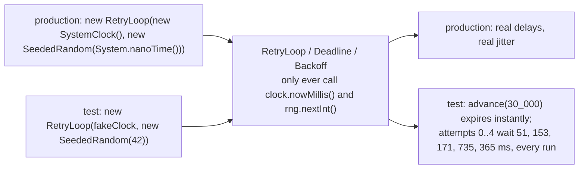

# Testing from the Standard Library

> JUnit-free Java, unittest, and go test: the three runners this course relies on.

**Type:** Build
**Languages:** Java, Python, Go
**Prerequisites:** Phase 0 Lesson 01 (Dev Environment), Phase 0 Lesson 02 (Choose Your Language)
**Time:** ~60 minutes

## Learning Objectives

- Write and run a test in each of the three harnesses this course uses: the Java `check()` pattern, Python `unittest`, and Go `testing`, and explain how each one turns a failed assertion into a non-zero exit code
- Explain why the Java track has no JUnit and what the twenty-line harness gives up by not having it
- Build a `FakeClock` whose invariant is that time never moves backwards, and use it to test a deadline without sleeping
- Build a `SeededRandom` (SplitMix64) that produces the same sequence in Java, Python, and Go, and explain why a shared generator matters for a polyglot course
- Write a table-driven Go test with `t.Run` and `t.Helper()`, and run the FakeClock concurrency test under `go test -race`
- Test a full-jitter retry backoff deterministically by injecting both the clock and the random source

## The Problem

A payments team has a retry policy for calls to the card processor: exponential backoff with jitter, capped at two seconds, five attempts. The test for it looks like this in spirit: start a timer, call the retry loop against a stub that fails four times, stop the timer, and assert the elapsed time is between 1.5 and 4 seconds. The test takes three seconds to run. It passes on every laptop. On the build agent, which is a shared virtual machine, it fails about one run in twenty because the agent paused for garbage collection, or because another job stole the CPU, or because the jitter happened to draw small numbers four times in a row. The team adds a retry to the test runner. Now the suite takes four minutes longer and still fails one run in four hundred.

A second test checks that an authorization expires thirty seconds after it was issued. It calls `Thread.sleep(30_000)`. A third one tests the "order of settlement batches is randomised to avoid hot-spotting one acquirer" feature with `new Random()` and asserts that the shuffled order differs from the input, which fails once every 3.6 million runs when the shuffle happens to be the identity, and the engineer who sees that failure spends a day looking for a bug that does not exist.

All three tests share the fault: they let the world into the test. Wall-clock time and an unseeded random source are inputs the test did not choose, so the test's outcome is a sample, not a verdict. The fix is the same for both: the code under test takes its time and its randomness as parameters, production passes the real ones, and the test passes a `FakeClock` it controls and a `SeededRandom` whose every number is known in advance. The thirty-second test takes a microsecond: `clock.advance(30_000)`. The backoff test asserts exact delays. The shuffle test asserts the exact permutation. This lesson builds those two fakes, in the three languages, and the test harnesses that run them. Every later lesson copies them.

## The Concept

### Three runners, one contract

A test runner has four jobs: find the tests, run them, turn a failed assertion into a report, and exit non-zero so the build knows. The three languages do this very differently, and this course deliberately uses what ships with each toolchain and nothing else.

| | Java (`MainTest.java`) | Python (`test_main.py`) | Go (`main_test.go`) |
|---|---|---|---|
| Discovery | none: `main` calls each check | `python3 -m unittest` imports `test_*.py` and runs `test_*` methods of `TestCase` subclasses | `go test` compiles `*_test.go` and runs `func TestXxx(*testing.T)` |
| Assertion | `check(name, boolean)`; `checkEquals`; `checkThrows` | `self.assertEqual`, `assertRaises`, `assertTrue`, about forty more | none built in: `if got != want { t.Errorf(...) }` |
| Failure semantics | records the name, continues | raises `AssertionError`, aborts the method, continues with the next | `t.Errorf` records and continues; `t.Fatalf` records and stops this test |
| Exit code | `System.exit(1)` if any failure was recorded | runner exits 1 if any test failed or errored | `go test` exits 1 if any test failed |
| Table-driven | a loop over an array, one `check` per row | `for ... with self.subTest(...)` | `for _, tc := range cases { t.Run(tc.name, ...) }` |
| Isolation between tests | none: shared static state unless you avoid it | fresh `TestCase` instance per method; `setUp` runs before each | fresh function call; `t.TempDir`, `t.Cleanup` |
| Concurrency checks | none; use a `CountDownLatch` and assert the total | none; use `threading` and assert the total | `go test -race` instruments every memory access |
| Benchmarks | none (Lesson 05 builds one) | none (`timeit` is a different tool) | `func BenchmarkXxx(*testing.B)` |

The Java column is the one that needs a defence. The JDK ships no test runner. JUnit is a library, and rule 3 of this course is standard library only: `javac -d .out *.java && java -cp .out MainTest` must work on a machine that has only a JDK. So every Java lesson carries its own harness, which is three static methods and a `main`. What it gives up is real: no discovery (you call every check yourself, and a check you forget to call silently passes), no per-test isolation, no IDE integration, no parameterised-test annotations, no timeouts. What it keeps is the only thing that matters for a from-scratch course: a reader can see the entire test mechanism on one screen, and there is nothing to install.

### The harness, line by line

```java
static void check(String name, boolean condition) {
    if (condition) passed++; else failures.add(name);
}

static void checkEquals(String name, Object expected, Object actual) {
    if (Objects.equals(expected, actual)) passed++;
    else failures.add(name + " (expected " + expected + ", got " + actual + ")");
}

static void checkThrows(String name, Class<? extends Throwable> type, Runnable action) {
    try {
        action.run();
        failures.add(name + " (no exception)");
    } catch (Throwable t) {
        if (type.isInstance(t)) passed++;
        else failures.add(name + " (wrong exception " + t.getClass().getSimpleName() + ")");
    }
}
```

`check` is the whole idea: a named boolean, counted. `checkEquals` exists because "FAIL: seed 42 #3" tells you less than "FAIL: seed 42 #3 (expected 5139283748462763858, got 5139283748462763857)". `checkThrows` has two failure branches on purpose: an action that does not throw is a failure, and an action that throws the wrong type is a different failure, because catching `Throwable` and calling it a pass would make a `NullPointerException` in the setup look like a passing overflow test. The reference lesson in Phase 10 uses the first and third; this lesson adds the second and later lessons copy all three.

The harness also tests itself. The last block of `MainTest.main` calls `checkThrows` with an action that does nothing, confirms a failure was recorded, and removes it. A harness that cannot detect a missing exception would pass every negative test in the course.

### Why `FakeClock` and what it promises

A `Clock` is an interface with one method, `nowMillis()`. Production code receives a `Clock` and calls it; it never calls `System.currentTimeMillis()` directly. `SystemClock` implements the interface with the real time. `FakeClock` implements it with a number you set.

The invariant is **monotonicity: a FakeClock never reports an earlier time than it reported before.** `advance(millis)` rejects a negative argument and `advanceTo(millis)` rejects a target earlier than now. Why enforce this on a fake? Because the code under test may cache "last seen time" and compute durations as `now - last`; a test that accidentally rewinds the clock produces negative durations and tests a situation that cannot occur in production, which is worse than no test. Real clocks do go backwards (NTP step corrections, VM migration), and Phase 5 deals with that explicitly using a monotonic clock; the fake models the ideal so the tests of ordinary logic are not polluted by it.

The fake is also thread-safe. Lesson 05 and the whole of Phase 3 run code under test on worker threads that read the clock while the test thread advances it. A `synchronized` method in Java, a `threading.Lock` in Python, and a `sync.Mutex` in Go cost nothing in a test and remove a whole class of flakiness. The Go test for this is the one that justifies `-race` in the table above: eight goroutines each advance by one a thousand times; the assertion is that the total is eight thousand. Delete the mutex and run `go test -race` and the detector names the two lines that touch `now` without synchronisation. Run without `-race` and the test passes most of the time, which is exactly the failure mode The Problem described.

### Why `SeededRandom` is SplitMix64 and not `new Random(seed)`

Each language has a seeded generator in its standard library: `java.util.Random`, Python's `random.Random`, Go's `math/rand`. They are three different algorithms (a 48-bit LCG, Mersenne Twister, and an additive lagged Fibonacci generator or, in `math/rand/v2`, PCG and ChaCha8). Seed all three with 42 and you get three unrelated sequences. For this course that is a problem: the Phase 5 network simulator drops packets, delays messages, and partitions nodes according to a seeded generator, and the lesson text says "with seed 7, the third message is lost". That sentence must be true in all three languages.

SplitMix64 is a generator with a 64-bit state and ten lines of code:

```text
state  = state + 0x9E3779B97F4A7C15          (mod 2^64)
z      = state
z      = (z xor (z >> 30)) * 0xBF58476D1CE4E5B9   (mod 2^64)
z      = (z xor (z >> 27)) * 0x94D049BB133111EB   (mod 2^64)
output = z xor (z >> 31)
```

The additive constant is the golden ratio scaled to 64 bits, which gives the state a full period of 2^64; the two multiply-xorshift rounds are a bijective mixing function. It passes BigCrush and is the algorithm behind Java's `SplittableRandom` and the seeding of Go's `math/rand/v2` and many C++ libraries. The published test vector for seed 1234567 begins `6457827717110365317, 3203168211198807973`, and the tests in all three languages assert it, which is how you know the three implementations are the same function and not three near misses.

Worked example for seed 42, first output, by hand (all arithmetic mod 2^64):

```text
state = 42 + 0x9E3779B97F4A7C15 = 0x9E3779B97F4A7C3F
z     = state xor (state >> 30)   = 0x9E3779B97F4A7C3F xor 0x278DDE6E5 = 0x9E3779BB07979ADA
z     = z * 0xBF58476D1CE4E5B9    = 0xFDD202BADC3BE98A (low 64 bits of the product)
z     = z xor (z >> 27)           = 0xFDD202BADC3BE98A xor 0x1FBA40575B = 0xFDD202A5667BBED1
z     = z * 0x94D049BB133111EB    = 0xBDD7322754450ADB (low 64 bits)
out   = z xor (z >> 31)           = 0xBDD7322754450ADB xor 0x17BAE644E = 0xBDD732262FEB6E95
      = 13679457532755275413 unsigned = -4767286540954276203 as a signed 64-bit integer
```

The intermediate hex values are shown so you can check one step in a REPL; the final line is what `nextLong()` returns and what the first test in every language asserts. The signed form is the one the API exposes because Java has no unsigned `long`; Python masks to 64 bits and converts, Go casts `uint64` to `int64`.

On top of `nextLong()` the type offers `nextInt(bound)` (the top 31 bits modulo the bound, which has a bias below 2^-31 for any bound you will use; good enough for simulation, never for anything that pays out), `nextDouble()` (the top 53 bits times 2^-53, so every result is an exactly representable double in [0, 1)), and `shuffle` (Fisher-Yates from the end, swapping `a[i]` with `a[nextInt(i+1)]`). The shuffle's exact output for seed 7 on `0..9` is `[3, 2, 1, 6, 7, 5, 4, 8, 9, 0]`, which the tests assert verbatim: a seeded shuffle is tested by its permutation, not by "is it different from the input".

What SplitMix64 is not: a cryptographic generator. Anything that issues tokens, nonces, or idempotency keys uses `SecureRandom`, `secrets`, or `crypto/rand` (Phase 12). SplitMix64's entire state is recoverable from one output, which is the property that makes it reproducible and the property that makes it unsafe for secrets.

### The two consumers: `Deadline` and `Backoff`

`Deadline(clock, atMillis)` is a record with `expired()` (now is at or after the instant) and `remainingMillis()` (never negative). It is five lines and exists to show the shape every clock-consuming type in the course has: it holds a `Clock`, never a timestamp it took itself.

`Backoff.backoffMillis(attempt, base, cap, rng)` is full-jitter exponential backoff: a uniform draw from `[0, min(cap, base * 2^attempt))`. The AWS analysis that popularised the name showed that full jitter (uniform over the whole window) finishes a contended retry storm in fewer total calls than "equal jitter" or no jitter, because clients spread out instead of colliding at the same doubling instants. For a payments team the retry target is a processor whose rate limit you share with every other merchant; synchronised retries after a blip are how a thirty-second outage becomes a five-minute one.



The `attempt` is clamped at 30 before shifting so `base << attempt` cannot overflow for a learner who passes attempt 64, and the window is capped before the draw so the result is never at or above the cap. Both bounds are tested with two hundred attempts and a thousand draws respectively.

### What these fakes do not do

`FakeClock` does not fire timers. Code that says "call me in 500 ms" needs a scheduler driven by the clock, which is Phase 2 (the heap-based retry scheduler) and Phase 5 (the simulated network's event queue). `SeededRandom` does not split or jump; the Phase 5 simulator derives per-node generators by seeding each with `baseSeed + nodeId`, which is adequate for simulation. Neither fake knows about time zones, leap seconds, or calendars; the course works in epoch milliseconds until Phase 11 needs settlement dates.

## Build It

The walkthrough is in Java; the Python and Go subsections show only what differs.

### Step 1: The clock interface and the real clock

```java
interface Clock {
    long nowMillis();
}

final class SystemClock implements Clock {
    @Override
    public long nowMillis() {
        return System.currentTimeMillis();
    }
}
```

One method. Returning `long` epoch milliseconds rather than `Instant` keeps the type identical across languages (Python `int`, Go `int64`) and keeps the ledger lessons' timestamps comparable with a `<`. `SystemClock` is the only place in the whole course that calls `System.currentTimeMillis()`, and it is never constructed in a test.

**Predict:** if `Deadline` stored `System.currentTimeMillis()` in its constructor instead of holding a `Clock`, which of this lesson's tests could still be written?

### Step 2: The fake, with its invariant

```java
final class FakeClock implements Clock {
    private long now;

    FakeClock(long startMillis) { this.now = startMillis; }

    @Override
    public synchronized long nowMillis() { return now; }

    synchronized void advance(long millis) {
        if (millis < 0) throw new IllegalArgumentException("cannot advance by a negative duration: " + millis);
        now = Math.addExact(now, millis);
    }

    synchronized void advanceTo(long millis) {
        if (millis < now) throw new IllegalArgumentException("cannot move the clock backwards from " + now + " to " + millis);
        now = millis;
    }
}
```

Three `synchronized` methods make the fake safe to read from worker threads while the test advances it. `Math.addExact` is a habit from the money lesson: a test that advances by `Long.MAX_VALUE` should fail loudly, not wrap to a negative time. `advance(0)` and `advanceTo(now)` are allowed; "no time passed" is a legitimate thing to assert about.

**Predict:** after `new FakeClock(2_000).advanceTo(1_999)` throws, what does `nowMillis()` return? Which test checks that?

### Step 3: SplitMix64

```java
final class SeededRandom {
    private static final long GOLDEN_GAMMA = 0x9E3779B97F4A7C15L;
    private final long seed;
    private long state;

    SeededRandom(long seed) { this.seed = seed; this.state = seed; }

    long nextLong() {
        state += GOLDEN_GAMMA;
        long z = state;
        z = (z ^ (z >>> 30)) * 0xBF58476D1CE4E5B9L;
        z = (z ^ (z >>> 27)) * 0x94D049BB133111EBL;
        return z ^ (z >>> 31);
    }

    int nextInt(int bound) {
        if (bound <= 0) throw new IllegalArgumentException("bound must be positive: " + bound);
        return (int) ((nextLong() >>> 33) % bound);
    }

    double nextDouble() {
        return (nextLong() >>> 11) * 0x1.0p-53;
    }
}
```

The shifts are `>>>`, the unsigned shift. Java's `>>` copies the sign bit, which would make the mixing function differ from the reference on every output whose top bit is set, which is half of them. Java `long` arithmetic wraps on overflow, which is what "mod 2^64" means here; this is the one place in the course where wrapping is wanted, and Lesson 07 is about every other place where it is not. `0x1.0p-53` is a hexadecimal floating-point literal for 2^-53.

**Predict:** `nextInt(100)` takes the top 31 bits (`>>> 33`) rather than the low 31 bits. Why does it matter which end you take from a generator whose output is already mixed? (Hint: consider a generator whose low bit alternated.)

### Step 4: Shuffle

```java
<T> void shuffle(List<T> list) {
    for (int i = list.size() - 1; i > 0; i--) {
        int j = nextInt(i + 1);
        T tmp = list.get(i);
        list.set(i, list.get(j));
        list.set(j, tmp);
    }
}
```

Fisher-Yates from the end: at each step the element at `i` is swapped with a uniformly chosen element at or before it. Every permutation is equally likely, and the exact permutation is a function of the seed, so the test asserts `[3, 2, 1, 6, 7, 5, 4, 8, 9, 0]` for seed 7 and also that the result is a permutation (sorts back to `0..9`). The common bug is `nextInt(list.size())` instead of `nextInt(i + 1)`, which is not uniform (it produces `n^n` equally likely paths onto `n!` outcomes, which cannot divide evenly for `n > 2`).

### Step 5: The consumers

```java
record Deadline(Clock clock, long atMillis) {
    boolean expired() { return clock.nowMillis() >= atMillis; }
    long remainingMillis() { return Math.max(0, atMillis - clock.nowMillis()); }
}

static long backoffMillis(int attempt, long baseMillis, long capMillis, SeededRandom rng) {
    if (attempt < 0 || baseMillis <= 0 || capMillis < baseMillis) {
        throw new IllegalArgumentException("attempt >= 0, base > 0, cap >= base required");
    }
    int shift = Math.min(attempt, 30);
    long window = Math.min(capMillis, baseMillis << shift);
    return rng.nextInt((int) Math.min(window, Integer.MAX_VALUE));
}
```

`expired()` uses `>=`: a deadline is expired at the instant it names, not one millisecond after. The test advances to 29,999 (not expired), then by 1 (expired), which pins the boundary. In `backoffMillis`, the draw is `nextInt(window)`, so the result is in `[0, window)`, strictly below the cap; the test with two hundred attempts checks that the clamp holds long after `2^attempt` would have overflowed.

**Predict:** with seed 42 the five waits are 51, 153, 171, 735, 365. Attempt 3's window is `[0, 800)` and attempt 4's is `[0, 1600)`, yet attempt 4 waited less. Is that a bug?

### Step 6: Run it

```bash
cd phases/00-setup-and-tooling/03-testing-from-the-standard-library/code/java
javac -d .out *.java && java -cp .out Main
java -cp .out MainTest
```

```console
== SeededRandom(42): the same five numbers in Java, Python, and Go ==
-4767286540954276203
2949826092126892291
5139283748462763858
6349198060258255764
701532786141963250

== nextInt(100) x 8 and a shuffle of 0..9 with seed 7 ==
51 53 71 35 65 97 82 63
[3, 2, 1, 6, 7, 5, 4, 8, 9, 0]

== FakeClock and a deadline: no Thread.sleep anywhere ==
t+0s     expired=false remaining=30000ms
t+29.999 expired=false remaining=1ms
t+30s    expired=true remaining=0ms

== Full-jitter backoff for a PSP call, base 100ms cap 2000ms, seed 42 ==
attempt 0: window [0,  100) -> wait   51 ms
attempt 1: window [0,  200) -> wait  153 ms
...
rejected: cannot advance by a negative duration: -1
```

Run `python3 main.py` and `go run .` in the sibling folders. The five numbers, the eight ints, and the permutation are identical. That is the property the whole course leans on.

### In Python

```python
class Clock(Protocol):
    def now_millis(self) -> int: ...

class SeededRandom:
    def _next_u64(self) -> int:
        self._state = (self._state + _GOLDEN_GAMMA) & _MASK64
        z = self._state
        z = ((z ^ (z >> 30)) * 0xBF58476D1CE4E5B9) & _MASK64
        z = ((z ^ (z >> 27)) * 0x94D049BB133111EB) & _MASK64
        return z ^ (z >> 31)

    def next_long(self) -> int:
        return _to_signed64(self._next_u64())
```

Differences, all in `code/python/main.py` and `test_main.py`:

- **Python integers do not wrap**, so every addition and multiplication is masked with `& _MASK64` by hand. Forget one mask and the state grows without bound, the output diverges from Java and Go on the second call, and nothing raises. The test against the published vector catches it.
- **`>>` is already a logical shift** on non-negative Python ints, so there is no `>>>` to reach for; the masking is what keeps the values non-negative.
- **`next_long` converts to signed** so the three languages print the same number. Internally the generator works on the unsigned value.
- **`Clock` is a `Protocol`**: any object with `now_millis()` qualifies, no inheritance needed. `FakeClock` does not subclass anything.
- **The harness is `unittest`.** Classes group related tests; `setUp` builds a fresh `FakeClock` per method; `self.subTest(attempt=attempt)` labels each row of the two-hundred-attempt loop so a failure names the row; `with self.assertRaises(ValueError)` is the `checkThrows` equivalent. The self-test asserts that `assertRaises` with no exception raises `AssertionError`. Run with `python3 -m unittest -v` to see each method's name.

### In Go

```go
func mustEqual[T comparable](t *testing.T, name string, want, got T) {
    t.Helper()
    if want != got {
        t.Errorf("%s: want %v, got %v", name, want, got)
    }
}

func TestFakeClock(t *testing.T) {
    cases := []struct {
        name string
        step func(c *FakeClock) error
        want int64
    }{
        {"starts where told", func(c *FakeClock) error { return nil }, 1_000},
        {"advance adds", func(c *FakeClock) error { return c.Advance(500) }, 1_500},
        // ...
    }
    clock := NewFakeClock(1_000)
    for _, tc := range cases {
        t.Run(tc.name, func(t *testing.T) {
            if err := tc.step(clock); err != nil { t.Fatalf("unexpected error: %v", err) }
            mustEqual(t, "now", tc.want, clock.NowMillis())
        })
    }
}
```

Differences, all in `code/go/main.go` and `main_test.go`:

- **`uint64` wraps**, which is exactly the arithmetic SplitMix64 wants; no masking, and `>>` on an unsigned type is a logical shift. `NextInt64` is a cast.
- **Errors are values.** `Advance` and `AdvanceTo` return `error` wrapping the sentinel `ErrClockBackwards` so a test can `errors.Is`. `NextInt(0)` panics instead, because a non-positive bound is a programming error with no sensible recovery, and the test uses `recover()` to assert the panic.
- **`Shuffle` is a generic function**, not a method, because Go methods cannot have their own type parameters.
- **The harness is `testing`.** There are no assertion functions; `mustEqual` is written here with `t.Helper()`, which makes a failure report the caller's line rather than the helper's. `t.Run` turns the table into named subtests you can run alone with `go test -run 'TestFakeClock/advance_adds'`. `t.Errorf` continues, `t.Fatalf` stops the current test.
- **`go test -race ./...`** instruments every load and store. `TestFakeClockConcurrentAdvancesAreNotLost` passes under `-race` because of the mutex; remove the mutex and the detector reports a data race with the two stack traces, every run, which a plain `go test` would catch only sometimes.

## Use It

### The real test frameworks

JUnit 5 (`@Test`, `assertEquals`, `assertThrows`, `@ParameterizedTest`), pytest (`assert` rewriting, fixtures, `@pytest.mark.parametrize`), and Go's `testify` give you what the from-scratch harness made explicit: discovery, isolation, rich diffs on failure, parameterisation, and reporting that IDEs and CI understand. Their trap is the one this lesson is about: none of them stops you from calling `System.currentTimeMillis()` or `new Random()` inside the code under test. The fakes are the fix, not the framework. JUnit's `@Timeout` and pytest-timeout address hung tests; they do nothing for flaky ones.

### Clocks in the standard libraries

`java.time.Clock` is an abstract class with `Clock.fixed(instant, zone)` and `Clock.offset(clock, duration)` built in; this lesson's `Clock` interface is its one-method shadow, and a production codebase would use `java.time.Clock` with `Clock.fixed` in tests. Go has no clock interface in the standard library; the idiom is exactly what this lesson does (an interface with `Now()` and a fake), and `testing/synctest` (experimental in Go 1.24) adds a controllable fake clock for goroutine-based code. Python's `unittest.mock.patch("time.time")` works but patches a global, which is why injection is preferred: a patched global leaks between tests the moment one of them forgets to unpatch.

### Random sources in the standard libraries

`java.util.SplittableRandom` is SplitMix64 with a `split()` operation for deterministic parallel streams; `java.util.random.RandomGenerator` (Java 17+) is the interface. Python's `random.Random(seed)` is Mersenne Twister and is reproducible within Python but not across languages; `random.SystemRandom` and `secrets` are the cryptographic ones. Go's `math/rand/v2` offers `rand.New(rand.NewPCG(seed1, seed2))` for reproducibility and `rand.NewChaCha8` for a cryptographically strong seeded source; `crypto/rand` is for secrets. Use this lesson's `SeededRandom` when the sequence must match across the three implementations; use the standard library's seeded generator when it only has to match itself.

### Race detection elsewhere

Go's `-race` is ThreadSanitizer. Java has no equivalent in the JDK; `jcstress` is the OpenJDK project for concurrency stress tests, and Phase 3 writes its own stress loop with `CountDownLatch` the way this lesson's thread test does. Python's GIL serialises bytecode execution but not compound operations: `self._now += millis` is a read, an add, and a write, and the thread test in `test_main.py` would eventually lose updates without the lock, which is why the lock is there even though "Python has a GIL".

## Ship It

`outputs/checklist-deterministic-tests.md` is a review checklist for test code: the four inputs that must be injected (time, randomness, I/O, concurrency scheduling), the assertions that make a seeded test meaningful, and the smells (`sleep`, elapsed-time windows, "assert it changed") that mean a test is sampling the world instead of checking the code. Apply it to the next flaky test your team retries instead of fixing.

## Exercises

1. **Reinforce.** Add `FakeClock.advanceSeconds(long)` and `Deadline.extend(long millis)` returning a new `Deadline`, in all three languages, with tests. Then write a test in each language that confirms `SystemClock` is never constructed anywhere in `MainTest`, `test_main.py`, or `main_test.go` (hint: it is a property of the file, not the code; a comment counts as documentation of the rule).
2. **Apply.** Implement equal jitter (`window/2 + nextInt(window/2)`) and decorrelated jitter (`min(cap, nextInt(base, previous * 3))`) alongside full jitter, driven by the same `SeededRandom`. Simulate 100 clients retrying against a server that admits 10 per 100 ms tick, using `FakeClock` as the tick source, and report total attempts until all succeed for each strategy with seed 1. Compare your numbers with the ordering in the AWS post.
3. **Extend.** The thread test asserts the total after all threads finish. Write a stronger test, in Go first, that reads the clock concurrently and asserts monotonicity from every reader's point of view: no reader ever observes a smaller value than it observed before. Run it under `-race`. Then port it to Java with virtual threads (`Thread.ofVirtual()`) and explain why the Python version cannot show the same failure even with the lock removed, and what it can show instead. This connects to Phase 3, Lesson 01 (Threads and the Memory Model).

## Key Terms

| Term | What people say | What it actually means |
|------|-----------------|------------------------|
| Test harness | "the test framework" | Whatever finds tests, runs them, reports failures, and sets the exit code; in this course's Java track it is three static methods and a `main` |
| Deterministic test | "a stable test" | A test whose outcome depends only on the code under test and inputs the test chose; time and randomness are injected, never sampled from the environment |
| Fake | "a mock" | A working implementation of an interface with controllable behaviour (`FakeClock` really keeps time); a mock records calls and checks expectations, which is a different tool |
| Seeded generator | "random with a seed" | A pseudorandom function from a seed to a fixed sequence; the same seed always yields the same numbers, so a test can assert exact outputs |
| SplitMix64 | "that hash-based RNG" | A 64-bit-state generator (add golden gamma, two multiply-xorshift rounds) used by `java.util.SplittableRandom`; identical output in any language that does 64-bit wrapping arithmetic |
| Table-driven test | "parameterised test" | One test body applied to a list of cases, each named; Go's `t.Run`, Python's `subTest`, and a loop over an array in the Java harness |
| `t.Helper()` | "the helper marker" | Tells Go's runner that failures inside this function should be reported at the caller's line, so an assertion helper does not hide where the bad value came from |
| Race detector | "`-race`" | Go's ThreadSanitizer build that records every memory access and reports two unsynchronised accesses to the same address from different goroutines, with stack traces |

## Further Reading

- [Steele, Lea, Flood — Fast Splittable Pseudorandom Number Generators (OOPSLA 2014)](https://doi.org/10.1145/2660193.2660195) — the SplitMix paper; section 4 gives the 64-bit mixing function this lesson implements and the reasoning behind the golden-ratio gamma.
- [Brooker — Exponential Backoff And Jitter (AWS Architecture Blog, 2015)](https://aws.amazon.com/blogs/architecture/exponential-backoff-and-jitter/) — the simulation that shows full jitter beats no jitter and equal jitter on total work; Exercise 2 reproduces it.
- [Go `testing` package](https://pkg.go.dev/testing) — `T.Run`, `T.Helper`, `T.Cleanup`, and the `-race` flag, with the official guidance on table-driven tests.
- [Python `unittest` documentation](https://docs.python.org/3/library/unittest.html) — `TestCase`, `setUp`, `subTest`, `assertRaises`, and how discovery finds `test_*.py`.
- [`java.util.SplittableRandom` (Java 21 API)](https://docs.oracle.com/en/java/javase/21/docs/api/java.base/java/util/SplittableRandom.html) — the JDK's SplitMix64, including the statement that it is not cryptographically secure.
- [Go Data Race Detector](https://go.dev/doc/articles/race_detector) — what `-race` instruments, its cost, and how to read a report.
