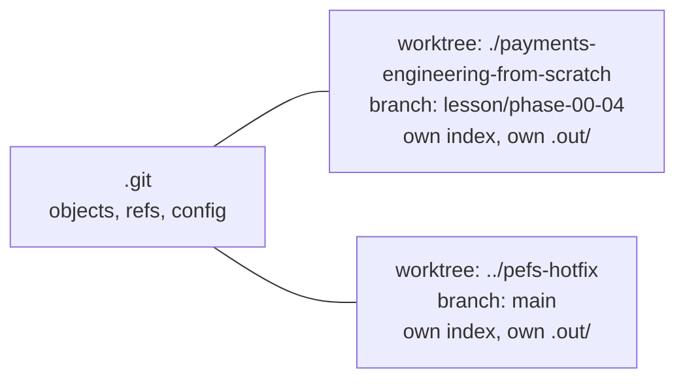

# Git for Engineers: Atomic Commits and Evidence

> One lesson, one commit, one piece of evidence you can show in a review.

**Type:** Learn
**Languages:** —
**Prerequisites:** Phase 0, Lesson 01 (Dev Environment), Phase 0, Lesson 03 (Testing from the Standard Library)
**Time:** ~45 minutes

## Learning Objectives

- Define an atomic commit as a change that is complete, self-contained, and revertible on its own, and recognise the three ways a commit fails that test
- Write a Conventional Commits subject and a body that records why, and attach evidence (the command run, its exit code, the test count) so the commit can be audited without re-running anything
- Explain what makes `git bisect` work (a monotone good/bad predicate over a linear history) and compute how many steps it needs for a given number of commits
- Use `git worktree` to keep a lesson in flight while a hotfix lands, without stashing or losing a build
- Apply this course's one-commit-per-lesson rule and state exactly which files a lesson commit contains and which generated files it must never contain

## The Problem

A payments team ships a change to its settlement batch job on a Thursday. The pull request has one commit titled `fixes`. Inside it: a rounding change in the fee calculator, a new retry loop around the bank file upload, a renamed configuration key, a reformatted test file, and a deleted debug log line. Reviewed, approved, merged. On Friday night the batch double-uploads a settlement file to the acquiring bank, and 3,400 merchants are paid twice.

The on-call engineer wants to revert whatever caused it. `git revert` of the one commit would also revert the fee fix that finance has already signed off on and the configuration rename that three other services now depend on. So instead of a one-line revert at 02:00, the engineer hand-edits the retry loop under pressure, with no test demonstrating the bug, while the bank's reconciliation desk is on the phone. The root cause was a retry that re-sent the file on a timeout without checking whether the first upload had landed, which is Phase 12's idempotency lesson. The reason the fix took four hours instead of four minutes is this lesson: the change was not atomic, and nobody could prove which part of it worked.

A quieter version of the same failure happens in every code review. A reviewer opens a 1,900-line diff with the description "ledger changes". They cannot tell which hunk is the behaviour change and which is the reformat. They cannot run the tests the author ran because the description does not say what was run. They approve because the author is trusted and the sprint ends tomorrow. Six weeks later `git blame` on a wrong line of code lands on a commit whose message explains nothing, written by someone who has since left.

Both failures have the same fix, and it is not a Git trick. It is a discipline: one commit is one change, its message says why, and it carries the evidence that it worked at the time it was made. Git's tools, `bisect`, `revert`, `blame`, `cherry-pick`, are all built on that assumption, and they all degrade to uselessness when it is violated. This course enforces the discipline with a rule you will follow for every lesson you complete: one lesson directory, one commit, one line of evidence in your `LEARNING.md`.

## The Concept

### What "atomic" means

An atomic commit satisfies three tests at once:

1. **Complete.** The repository builds and its tests pass at that commit. Not "will pass once the next commit lands". A commit that leaves the tree broken cannot be bisected through (below) and cannot be the base for a hotfix branch.
2. **Self-contained.** It does exactly one thing, and its message can describe that thing in one sentence without the word "and". A reformat and a behaviour change are two commits. A rename and a logic change are two commits. A fix and the test that demonstrates the fix are one commit, because neither is complete without the other.
3. **Revertible.** `git revert <sha>` removes the change and nothing else, and the result also builds and passes. If reverting a commit would also undo an unrelated fix, the commit was not atomic.

The three tests are not independent. A commit that fails "self-contained" almost always fails "revertible". A commit that fails "complete" breaks bisect for everyone, forever, because bisect cannot distinguish "this commit introduced the bug" from "this commit does not compile".

The unit of atomicity is the *logical change*, not the file. A commit may touch twenty files if they are one change (a renamed method and its callers). A commit may touch one file and still be two changes (a bug fix on line 40 and an unrelated typo on line 300).

### Conventional Commits: the subject line is an index entry

A commit message has two readers. The subject line is read by people scanning `git log --oneline`, release-note generators, and bisect output. The body is read by one person, later, who has found this commit with `blame` or `bisect` and needs to know *why* the change was made.

[Conventional Commits 1.0.0](https://www.conventionalcommits.org/en/v1.0.0/) standardises the subject:

```text
<type>(<optional scope>): <description>

[optional body]

[optional footer(s)]
```

| Type | Use it when | Semantic-version effect |
|------|-------------|-------------------------|
| `feat` | the change adds behaviour a user or caller can observe | minor bump |
| `fix` | the change corrects behaviour that was wrong | patch bump |
| `refactor` | behaviour is identical before and after; only structure changed | none |
| `test` | only tests changed | none |
| `docs` | only documentation changed | none |
| `chore` | build, tooling, dependency housekeeping | none |
| any type with `!` or a `BREAKING CHANGE:` footer | callers must change | major bump |

The scope is the subsystem in parentheses. This course uses `phase-NN/MM` as the scope, so the subject for the lesson you are reading is `feat(phase-00/04): git-for-engineers`. The description is imperative mood ("add", not "added" or "adds"), lower-case, no trailing period, and the whole subject is at most 72 characters so it is not truncated in `git log --oneline` or on GitHub.

The body explains what the subject cannot: the reason, the alternative that was rejected, the incident number. Compare:

```text
fix(settlement): retry upload

```

with

```text
fix(settlement): make bank file upload idempotent across retries

The upload retried on socket timeout without checking whether the first
attempt had been accepted. On 2026-10-09 this double-paid 3,400 merchants
(INC-4471). The uploader now sends a client reference per batch and the
retry first calls GET /batches/{ref}; it re-sends only on 404.

Rejected: lowering the timeout. The bank's p99 accept latency is 40 s.

Evidence: python3 scripts/run_lesson.py ... --lang java -> exit 0, 31 passed, 0 failed
```

Nothing in the second body is in the diff. That is the test for a good body: it says what the code cannot.

### Evidence: a commit that proves it worked

A test suite proves the code works *now*, on *this* machine. A commit message that records the command, the exit code, and the test count proves it worked *then*, and lets a reviewer or an auditor check without re-running anything. In regulated payments environments (PCI DSS requirement 6, SOC 2 change-management controls) the question "how do you know this change was tested before it shipped?" is asked literally, and "the CI was green" is a weaker answer than "the commit body records 31 assertions passing and the CI log for sha `a1b2c3d` is attached".

The evidence line has a fixed shape in this course:

```text
python3 scripts/run_lesson.py phases/00-setup-and-tooling/03-testing-from-the-standard-library --lang java -> exit 0, 29 passed, 0 failed
```

Command, arrow, exit code, counts. The `learn` skill appends exactly this line to the `## Evidence` section of `LEARNING.md` after every lesson (Lesson 08 covers the loop). You put the same line in the commit body. A year from now, `git log --grep="exit 0"` over your fork lists every lesson you completed, with proof.

### Shaping commits after the fact

Nobody writes atomic commits in the order they type. You fix a bug, notice a typo, rename a variable, and all three are in the working tree. Git separates *what you changed* from *what you commit*, and three commands turn a messy working tree into clean history:

```bash
git add -p                     # stage hunk by hunk; answer y/n/s(plit)/e(dit) per hunk
git commit -m "fix(fees): round HALF_EVEN on negative amounts"
git add -p
git commit -m "refactor(fees): rename rate -> basisPoints"
```

`git add -p` walks every hunk of every modified file and asks whether to stage it. `s` splits a hunk that contains two unrelated edits; `e` opens it for manual editing when the split is too coarse. Two logical changes in one file become two commits without touching the editor between them.

When you notice a defect in a commit you have already made on a branch that is not yet pushed, do not add a `fix typo` commit on top. Attach the fix to the commit it belongs to:

```bash
git commit --fixup=<sha-of-the-commit-to-amend>
git rebase -i --autosquash <base>
```

`--fixup` writes a commit whose subject is `fixup! <original subject>`; `--autosquash` reorders and squashes it into the original during the interactive rebase, so the published history has one atomic commit, not a commit and its correction. The rule that makes this safe: rewrite only commits that nobody else has based work on. Once a commit is on a shared branch, add a new commit; `git revert` if it was wrong.

The distinction between `revert` and `reset` is worth stating because both are described as "undo":

| Command | What it does | Safe on shared history | Leaves evidence |
|---------|--------------|------------------------|-----------------|
| `git revert <sha>` | adds a new commit with the inverse diff | yes | yes: the revert commit and its message |
| `git reset --hard <sha>` | moves the branch pointer back, discarding commits | no: collaborators' clones still have them | no: the commits are unreachable and garbage-collected |
| `git commit --amend` | replaces the most recent commit | only if unpushed | no: the old commit is replaced |
| `git rebase -i` | rewrites a range of commits | only if unpushed | no |

In a payments codebase the answer to "a bad change reached `main`" is always `revert`, never `reset`: the audit trail that a change was made and then removed is itself evidence that compliance will ask for.

### Choosing the operation

| Situation | Operation | Why |
|-----------|-----------|-----|
| Two unrelated edits in the working tree | `git add -p`, two commits | each commit stays self-contained |
| Defect in your own unpushed commit | `git commit --fixup` + `rebase --autosquash` | history shows one atomic commit |
| Defect in a commit already on `main` | `git revert` | shared history is never rewritten |
| Need `main` while a lesson is in flight | `git worktree add` | no stash, no lost build output |
| A test went from passing to failing somewhere in 500 commits | `git bisect run <test>` | nine steps instead of reading 500 diffs |
| Want to know why a line exists | `git blame -w <file>`, then `git show <sha>` | the body of an atomic commit answers it; `-w` ignores whitespace-only reformats |

### Bisect: binary search over history

`git bisect` finds the commit that introduced a regression. You give it one commit known to be good and one known to be bad; it checks out the midpoint; you test and say `good` or `bad`; it halves the range and repeats.

The algorithm is binary search, so the number of steps is `ceil(log2(n))` for `n` candidate commits:

| Commits between good and bad | Steps |
|------------------------------|-------|
| 8 | 3 |
| 100 | 7 |
| 1,000 | 10 |
| 10,000 | 14 |

Ten thousand commits, fourteen builds. That is the payoff for atomic commits. Binary search only works when the predicate is *monotone*: every commit before the culprit is good and every commit after it is bad. Three things break monotonicity:

- **A commit that does not build.** Bisect lands on it; you cannot answer good or bad. `git bisect skip` moves to a neighbour, but a run of unbuildable commits leaves the culprit inside an unresolvable range. This is why "complete" is the first test of atomicity.
- **A commit that mixes a fix and a regression.** The bisect correctly identifies it, but then you cannot revert it without losing the fix. This is why "self-contained" is the second test.
- **A merge-heavy history where the bug entered on a side branch.** Bisect handles DAGs, but the "midpoint" is less intuitive and the step count grows. Linear history via rebase-and-merge or squash-and-merge keeps the arithmetic above honest.

The whole session can be scripted. If the lesson's test is the predicate:

```bash
git bisect start HEAD v2.3.0
git bisect run sh -c 'cd code/java && javac -d .out *.java && java -cp .out MainTest'
```

`git bisect run` calls the command at each step and uses its exit code: 0 means good, 1 to 127 (except 125) means bad, 125 means skip. The `MainTest` harness from Lesson 03 exits 1 on any failure, which is exactly what bisect wants. A test harness that prints failures but exits 0 is useless here, and that is one of the reasons the course's harness exits 1.

### Worktrees: two checkouts, one repository

You are halfway through a lesson, the build is warm, and a hotfix needs to go out from `main`. The traditional answer is `git stash`, switch branches, fix, switch back, `git stash pop`, and discover that the stash did not include the untracked `.out/` directory or that the pop conflicted. The better answer:

```bash
git worktree add ../pefs-hotfix main
cd ../pefs-hotfix
# fix, test, commit, push
cd -
git worktree remove ../pefs-hotfix
```

A worktree is a second working directory attached to the same `.git` object store. Each worktree has its own checked-out branch, index, and untracked files; they share objects, refs, and configuration. No stash, no lost build output, and the lesson directory is untouched when you return. `git worktree list` shows every attached checkout. The one rule: a branch can be checked out in only one worktree at a time, which is a feature, not a limitation; it prevents two directories from racing to update the same ref.



### This course's one-commit-per-lesson rule

`AGENTS.md`, hard rule 1: one commit per lesson directory, subject `feat(phase-NN/MM): <slug>`. A ten-lesson contribution is ten commits. The rule exists because every Git tool above assumes it:

- **Bisect.** If lesson 05's code breaks lesson 03's test (they share nothing, but a scaffold script could have been wrong), bisect lands on exactly one lesson.
- **Revert.** A lesson found to be wrong is one `git revert`, and the catalog regenerates.
- **Review.** A reviewer reads one lesson's diff against the contract in `AGENTS.md` and `LESSON_TEMPLATE.md`, not a mixture of three.
- **Blame.** Every line of every lesson points at the commit that authored that lesson, whose body says what was verified.

A lesson commit contains exactly: `phases/<phase>/<lesson>/` (docs, quiz, code, outputs), and, if you regenerated them, `README.md`, `ROADMAP.md`, and the phase `README.md` that `scripts/build_catalog.py` writes. It never contains `.out/`, `catalog.json`, `__pycache__/`, `*.class`, or any `*-LEARNING.md`; all of those are in `.gitignore` and the audit will not stop you from force-adding them, so do not.

## Worked Example

Walk one lesson from scaffold to commit. The lesson is this one, Phase 0 Lesson 04, so the scope is `phase-00/04`.

**Step 1: a branch per lesson.** Branch names are not standardised by Conventional Commits; a readable convention is `lesson/<phase>-<lesson>`.

```bash
git switch -c lesson/phase-00-04
python3 scripts/scaffold_lesson.py 0 4 --force
```

**Step 2: author, then verify.** Write `docs/en.md` and `quiz.json`. Then from the repository root:

```bash
python3 scripts/audit_lessons.py --phase 0
```

```console
8 lessons checked, 0 issues
```

For a Build lesson you would also run `scripts/run_lesson.py` and keep its summary line; a Learn lesson's evidence is the audit line.

**Step 3: stage exactly the lesson.** Never `git add .` or `git add -A` in this repository; both will pick up `catalog.json` if the ignore file is ever edited and will stage every lesson you have touched.

```bash
git add phases/00-setup-and-tooling/04-git-for-engineers
git status --short
```

```console
A  phases/00-setup-and-tooling/04-git-for-engineers/docs/en.md
A  phases/00-setup-and-tooling/04-git-for-engineers/quiz.json
```

Two files, one lesson. If `git status` shows a second lesson directory, you have two commits to make.

**Step 4: the message.**

```text
feat(phase-00/04): git-for-engineers

Learn lesson: atomic commits, Conventional Commits, evidence in the body,
bisect as binary search, worktrees, and the one-commit-per-lesson rule.
Primary sources are the Conventional Commits spec and the git-bisect and
git-worktree manuals; the settlement double-upload scenario is a composite.

Evidence: python3 scripts/audit_lessons.py --phase 0 -> exit 0, 8 lessons checked, 0 issues
```

The subject is 38 characters. The body answers "why these sources" and "what was verified". Nothing restates the diff.

**Step 5: the predicate for a future bisect.** Suppose a later commit breaks the audit for Phase 0. The predicate is already written:

```bash
git bisect start HEAD <last-known-good-sha>
git bisect run python3 scripts/audit_lessons.py --phase 0
```

Over 100 commits, seven steps. Each step runs in a second because the audit is stdlib Python with no build. Had this lesson been committed together with lessons 05 and 06, the bisect would stop at the combined commit and leave you to read three lessons' worth of diff to find the broken one.

### What this discipline does not do

Atomic commits do not make a change correct; they make an incorrect change *findable* and *removable*. Conventional Commits do not enforce anything by themselves; a `commit-msg` hook or a CI check does, and this repository relies on review. Evidence in a message proves the tests passed on the author's machine at that moment, not that the tests were adequate; the lesson contract's "8+ assertions covering the failure the lesson warns about" is the adequacy rule, and `audit_lessons.py` checks the shape, not the substance. And none of this replaces a changelog or an incident report; it makes both easier to write.

## Exercises

1. **Reinforce.** Take the last five commits on any repository you work in and classify each against the three tests (complete, self-contained, revertible). For each failure, write the two or three commit subjects it should have been, in Conventional Commits form, each under 72 characters.
2. **Apply.** Write a `commit-msg` hook in stdlib Python (`.git/hooks/commit-msg`, receives the message file path as `argv[1]`) that rejects a subject that does not match `^(feat|fix|refactor|test|docs|chore)(\([a-z0-9/-]+\))?!?: [a-z].{0,60}$` or is over 72 characters, and that warns (but does not reject) when the body lacks an `Evidence:` line. Test it with `git commit --allow-empty`.
3. **Extend.** Combine with Lesson 03. Create a throwaway repository with a `MainTest.java` using the `check` harness, make eight commits where commit five silently changes an expected value so one check fails, and run `git bisect run` with the test as the predicate. Record how many steps it took and compare with `ceil(log2(8))`. Then amend commit three so it does not compile, repeat the bisect, and explain in a sentence what `git bisect skip` had to do and whether the culprit was still uniquely identified.

## Key Terms

| Term | What people say | What it actually means |
|------|-----------------|------------------------|
| Atomic commit | "small commit" | A commit that is complete (builds and passes), self-contained (one logical change), and revertible on its own; size is a symptom, not the definition |
| Conventional Commits | "the `feat:`/`fix:` thing" | A specification for the subject line (`type(scope): description`) whose types map to semantic-version bumps and whose body carries the why |
| Evidence | "tests passed" | The exact command, exit code, and assertion counts recorded where an auditor can read them later without re-running anything |
| Bisect | "git finds the bad commit" | Binary search over a range of commits using a monotone good/bad predicate; `ceil(log2(n))` steps, broken by commits that do not build |
| Monotone predicate | "it was fine then broken" | A test whose result is good for every commit before the culprit and bad for every commit after; the precondition for bisect to be correct |
| Worktree | "a second clone" | A second working directory sharing one `.git` object store, with its own branch, index, and untracked files; no stash needed |
| Revert | "undo the commit" | A new commit that applies the inverse diff of an earlier one; history is preserved, and it only works cleanly when the original was atomic |
| Generated file | "build output" | Anything a script produces from committed inputs (`catalog.json`, `.out/`, `*.class`); committing it creates merge conflicts and hides the real change |

## Further Reading

- [Conventional Commits 1.0.0](https://www.conventionalcommits.org/en/v1.0.0/) — the specification this course's commit subjects follow; two pages, read the FAQ on `BREAKING CHANGE`.
- [git-bisect manual](https://git-scm.com/docs/git-bisect) — the `run` subcommand's exit-code contract (0 good, 125 skip, 1-127 bad) is the reason the course's test harness exits 1.
- [git-worktree manual](https://git-scm.com/docs/git-worktree) — `add`, `list`, `remove`, and the one-branch-per-worktree rule.
- [Pro Git, chapter 7.7: Reset Demystified](https://git-scm.com/book/en/v2/Git-Tools-Reset-Demystified) — the three trees (HEAD, index, working directory) that `git add <path>` and `git status --short` are reporting on in the worked example.
- [Semantic Versioning 2.0.0](https://semver.org/spec/v2.0.0.html) — why `feat` is minor, `fix` is patch, and `!` is major.
- [PCI DSS v4.0, Requirement 6](https://www.pcisecuritystandards.org/document_library/) — change-control requirements for systems that handle cardholder data; the reason "evidence in the commit" is a compliance habit as well as an engineering one.
