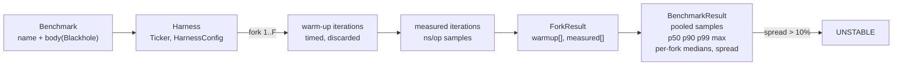

# Benchmarking and Profiling Without Lying to Yourself

> JIT warm-up, GC pauses, and the GIL make naive timing meaningless.

**Type:** Build
**Languages:** Java, Python, Go
**Prerequisites:** Phase 0 Lesson 03 (Testing from the Standard Library)
**Time:** ~75 minutes

## Learning Objectives

- Name the five ways a naive `nanoTime()` loop lies (interpreter warm-up, dead-code elimination, constant folding, GC and OS noise, averaging) and show the code that defeats each one
- Build a benchmark harness with warm-up iterations, repeated runs, a blackhole sink, an injected ticker, and nearest-rank percentile reporting, and test it deterministically with a scripted clock
- Explain coordinated omission, compute by hand how a single stall changes p99, and implement the back-fill correction
- Distinguish a sampling profiler from an instrumenting one, define self versus inclusive time, and read a flat profile to decide what to optimise
- Benchmark `ArrayList` against `LinkedList` and `HashMap` against `TreeMap` in a way that reports the cases where each one loses, and state what the numbers do not tell you

## The Problem

A payments team is choosing a data structure for the hot path of its authorization service: the per-request lookup of a merchant's risk configuration by merchant id. An engineer writes a ten-line benchmark, runs it once, and posts the result in the design review: "`TreeMap.get` is 9x faster than `HashMap.get`, we should switch." The number is real. It is also wrong in every way that matters.

The loop ran `HashMap.get` first, during the first few hundred milliseconds of the JVM's life, when the code was still being interpreted and the JIT had not yet compiled `HashMap.getNode`. By the time the `TreeMap` loop ran, the JVM was warm. The benchmark's result was never read, so the C2 compiler was entitled to delete the lookup entirely, and in one of the two loops it did. The reported figure was a mean over a single run, which a garbage-collection pause of 40 ms turned into a number dominated by one event that had nothing to do with either map. And the keys were sequential integers inserted in order, the one distribution where a red-black tree's cache behaviour is at its best and a hash table's is irrelevant.

The service switched. Under production load, with 40,000 merchants, random access, and 2,000 requests per second per node, `TreeMap.get` was the slower one by a factor of five, exactly as the complexity analysis would have said: `O(log n)` with sixteen pointer chases per lookup versus `O(1)` with one or two. p99 latency on the authorization path rose by 400 microseconds. Nobody noticed for a month because the dashboard showed the mean.

A second failure is subtler and more expensive. The same team load-tests a new ledger-posting endpoint with a closed-loop generator: send a request, wait for the response, send the next. The report says p99 is 3 ms. In production, p99 is 800 ms. The load generator was not lying about the latencies it observed; it was lying about which requests existed. Every time the service stalled for a second (a GC pause, a lock convoy), the generator stopped sending, so the hundreds of requests that real users would have sent during that second, each of which would have waited most of a second, were never measured. This is coordinated omission, and almost every home-grown load test has it.

This lesson builds the small harness that makes those lies visible: warm-up you can see being discarded, repeated runs whose disagreement is reported rather than averaged away, a sink the compiler cannot see through, percentiles instead of means, a ticker you can script so the harness itself is testable, and a corrector for coordinated omission. Then it uses the harness to compare the four collections honestly, and it shows what a sampling profiler actually computes so that when JFR hands you a flame graph you know what the widths mean.

## The Concept

### Five ways a timing loop lies

| Lie | Mechanism | What you see | Defence |
|-----|-----------|--------------|---------|
| Warm-up | HotSpot interprets bytecode first, compiles with C1 after ~1,500 invocations, C2 after ~10,000; each tier is faster; the first loop measures the interpreter | the first benchmark in a file is always "slow" | run and discard warm-up iterations until the per-iteration time stops falling |
| Dead-code elimination | a result nobody reads has no observable effect, so the JIT deletes the computation | a loop that "runs" in 0.3 ns per iteration | hand every result to a sink the compiler cannot prove unused (a volatile field) |
| Constant folding | inputs known at compile time are computed once | `Math.sqrt(2.0)` measured at zero cost | read inputs from fields or arrays, not literals |
| GC and OS noise | a stop-the-world pause or a context switch lands inside one iteration | a mean dominated by one 40 ms event | report percentiles and max, not mean; repeat the run |
| Single run | JIT decisions (inlining, escape analysis) differ run to run; one run has no error bar | two engineers get different numbers from the same code | run several times, report every run's median and their spread |

The arithmetic of the first lie is worth having in your head. C2 compilation needs on the order of ten thousand invocations of a method, or a loop back-edge count in the same range. A benchmark body that runs 5,000 operations per iteration needs at least two iterations before the body is compiled, and several more before inlining decisions settle. The harness in this lesson defaults to ten warm-up iterations of 5,000 operations and prints the warm-up samples so you can watch them fall.

### Percentiles, not means

A latency distribution is almost never symmetric. Most operations take about the same time; a few take a great deal longer because of a cache miss, a page fault, a GC pause, or a lock. The mean is pulled toward the tail by those few, and it tells you nothing about what any particular user experienced. The median (p50) tells you the typical case; p99 tells you what one user in a hundred saw; the max tells you the worst thing that happened.

This lesson uses the nearest-rank definition: the p-th percentile of `n` sorted samples is the value at 1-based rank `ceil(p/100 * n)`. For ten samples `10, 20, ..., 100`:

```text
p50: ceil(0.50 * 10) = 5  -> sorted[4] = 50
p90: ceil(0.90 * 10) = 9  -> sorted[8] = 90
p99: ceil(0.99 * 10) = 10 -> sorted[9] = 100
```

Nearest rank never interpolates, so every reported percentile is a value that actually occurred. Interpolated definitions (the ones `numpy.percentile` and spreadsheets default to) are fine for smooth distributions but invent values between two real samples, which for latencies that cluster at distinct modes produces numbers nobody observed. For the small sample counts a micro-benchmark produces (tens of iterations), the difference is large; for a million production latencies, it is not.

### Forks and the cross-fork spread

JMH, the OpenJDK benchmark harness, runs each benchmark in several freshly started JVMs and calls each one a fork. The reason is that the JIT's decisions are not deterministic: inlining depth, which methods get compiled when, whether a lock is elided, all depend on timing and on what else ran first. A single JVM gives you one draw from that distribution. Five forks give you five, and if they disagree by 30% the benchmark is telling you about JIT variance, not about your code.

This lesson's harness cannot start new JVMs from the standard library without `ProcessBuilder` gymnastics that would obscure the lesson, so a "fork" here is a repeated run within one JVM: a fresh warm-up schedule followed by fresh measured iterations. That is weaker than JMH's forks (the second run inherits the first run's compiled code) and the demo shows the consequence directly: the first benchmark's first fork is often several times slower than its second and third, because the harness's own loop is being compiled during it. The harness does not hide this. It reports every fork's median and the coefficient of variation across them, and marks the row `UNSTABLE` when that exceeds 10%. An unstable row is not a result; it is an instruction to run longer or to find out what varied.



### Coordinated omission

A closed-loop load generator sends a request, waits for the response, then sends the next. Suppose it intends one request per millisecond, and the service stalls for two seconds once. The generator records one two-second latency and 999 sub-millisecond ones. But a real population of users sending one request per millisecond would have sent 1,999 more requests during the stall, and each of them would have waited: the one sent at the start of the stall waits 2.000 s, the one sent 1 ms later waits 1.999 s, down to the last one, which waits 1 ms. The generator never sent them, so it never measured them, so the stall shows up in the data as one sample instead of two thousand.

Work the numbers by hand. 999 requests at 0.2 ms, one at 2,000 ms, intended interval 1 ms:

```text
Raw:       1,000 samples. Sorted, the 2,000 ms sample is last.
           p99 rank = ceil(0.99 * 1000) = 990 -> 0.2 ms.   p99 = 0.2 ms, max = 2,000 ms.

Corrected: for the 2,000 ms sample, back-fill 2000 - 1, 2000 - 2, ..., 1 ms: 1,999 extra samples.
           2,999 samples total. 999 at 0.2 ms, then 1 ms, 2 ms, ..., 2,000 ms.
           p50 rank = ceil(0.50 * 2999) = 1500 -> the 501st back-filled value = 501 ms.
           p99 rank = ceil(0.99 * 2999) = 2970 -> the 1971st back-filled value = 1,971 ms.
```

Raw p99 is 0.2 ms. Corrected p99 is 1,971 ms. Same service, same stall, same generator; the only difference is whether the requests that should have existed are counted. The correction is the one HdrHistogram's `recordValueWithExpectedInterval` applies: for each recorded latency `L` with expected interval `I`, also record `L - I`, `L - 2I`, ... while the value is at least `I`. It is an approximation (it assumes the missing requests would each have waited for the remainder of the stall) and it is enormously better than the uncorrected number. The real fix is an open-loop generator that sends on schedule regardless of responses; the correction is for when you only have the closed-loop data.

The connection to payments is direct. Card networks impose authorization timeouts (a few seconds end to end); a p99 that hides a two-second GC pause is a p99 that hides declined transactions.

### What a profiler computes

A benchmark tells you how long something takes. A profiler tells you where the time goes. There are two kinds:

- **Instrumenting profilers** insert code at every method entry and exit. They see every call, and they distort the measurement badly for small methods because the instrumentation costs more than the method.
- **Sampling profilers** interrupt the program at a fixed rate (say every 10 ms), record the stack of every thread, and aggregate. They miss short events and see everything else in proportion. Java Flight Recorder (JFR) and async-profiler are sampling profilers.

The aggregate is two numbers per frame. **Self time** is the number of samples in which the frame was the leaf, the thing actually executing. **Inclusive time** is the number of samples in which the frame appeared anywhere on the stack. A flame graph is inclusive time drawn as width; the flat profile this lesson builds is the same data as a table. Worked example from the demo, 100 samples:

| Frame | Self | Inclusive | Reading |
|-------|------|-----------|---------|
| `Money.times` | 60% | 60% | the hot leaf; if this is slow, fix it |
| `computeFees` | 0% | 70% | never the leaf, but 70% of all time is beneath it; call it less often |
| `FileChannel.write` | 25% | 25% | I/O; batch it |
| `settleBatch` | 0% | 100% | the root of the work; width 100% is not a problem, it is the frame of reference |

Two traps. First, **safepoint bias**: the JVM's older profilers (and JFR's execution samples before JDK 17's improvements) could only sample at safepoints, points the JIT inserts at method returns and loop back-edges, so a tight loop with no safepoint poll appeared to take no time and the method after it appeared to take all of it. async-profiler uses `perf_events` and `AsyncGetCallTrace` to sample at any instruction, which is why its results differ from older JFR output on hot loops. Second, **inlining**: once C2 inlines `Money.times` into `computeFees`, there is no `Money.times` frame on the stack; the profiler attributes its time to the caller unless it reconstructs the inlined frames from debug information, which JFR does and `jstack` does not.

### Complexity is a prediction; the benchmark is the test

The four collections in the demo have known asymptotics. The point of benchmarking them is not to discover the asymptotics but to see the constant factors and the crossover, and to catch the case where the asymptotics predict one winner and the hardware produces another.

| Operation | `ArrayList` | `LinkedList` | `HashMap` | `TreeMap` |
|-----------|-------------|--------------|-----------|-----------|
| `get(i)` / `get(key)` random | `O(1)`, one bounds check and one load | `O(n)`, pointer chase from the nearer end | `O(1)` expected, hash then one or two loads | `O(log n)`, ~11 pointer chases at n = 2,000 |
| insert and remove at the front | `O(n)`, shift every element | `O(1)`, relink two nodes | — | — |
| iterate everything | `O(n)`, contiguous memory, prefetcher helps | `O(n)`, every node is a cache miss | `O(n + capacity)`, no order | `O(n)`, in key order |
| keys in sorted order | — | — | `O(n log n)`: copy and sort | `O(n)`: walk the tree |

The demo output confirms every row of the table and adds the constant factors: at n = 2,000, `LinkedList.get` is about 100x slower than `ArrayList.get`, `LinkedList` front insertion is about 5x faster than `ArrayList`'s, and `ArrayList` iteration is about 4x faster than `LinkedList`'s despite both being `O(n)`, because the array's elements are adjacent in memory and the list's nodes are not. For the maps, `HashMap.get` is 5-6x faster than `TreeMap.get`, and getting the keys in order is 10x faster from the `TreeMap`. There is no winner in the table. There is a right structure for each access pattern, which is why the lesson prints all eight rows and not one.

### GC pauses and the GIL: the runtime is part of the measurement

Two runtime mechanisms deserve their own line because they produce the tail that the mean hides.

A stop-the-world garbage-collection pause halts every application thread. With G1 on a multi-gigabyte heap a young collection is typically 5-50 ms; a full collection can be seconds. In a benchmark that runs for two seconds, one such pause lands in one iteration and makes it a hundred times slower than its neighbours. The mean moves noticeably; the median does not move at all; p99 and max move exactly as much as the pause. That is the whole argument for reporting percentiles: they separate "what the code costs" from "what the runtime did to it". Run with `-Xlog:gc` alongside the benchmark once, and you will see the pause timestamps line up with the outliers.

CPython's global interpreter lock serialises bytecode execution across threads. A Python benchmark that spawns four threads to "parallelise" a CPU-bound body measures one core's worth of work plus lock hand-off overhead, and reports a slowdown that has nothing to do with the algorithm. A Go benchmark with `GOMAXPROCS` left at the default will use every core, and its result will not reproduce on a two-core CI runner. In every runtime, the question "what else was the runtime doing during my loop" is part of the measurement, and the harness's job is to make the answer visible rather than to pretend it is zero.

### What this harness does not do

It does not start separate JVMs, so its forks share JIT state and under-report run-to-run variance; JMH's forks do not. It does not control CPU frequency scaling, pin threads, or disable turbo boost; run on a quiet machine and read the spread. It does not measure memory allocation or GC pressure; JFR's allocation profiling does. It does not detect when the JIT has eliminated part of your body that did not reach the blackhole; only reading the generated assembly does. And it measures throughput per operation in a tight loop, which is not latency under concurrent load; the coordinated-omission recorder is a reminder that those are different measurements with different lies.

## Build It

### Step 1: A ticker you can script

```java
interface Ticker {
    long nanoTime();
}

final class SystemTicker implements Ticker {
    @Override
    public long nanoTime() {
        return System.nanoTime();
    }
}

final class FakeTicker implements Ticker {
    private final long[] readings;
    private int next = 0;

    FakeTicker(long... readings) { this.readings = readings.clone(); }

    @Override
    public long nanoTime() {
        if (next >= readings.length) throw new IllegalStateException("FakeTicker exhausted after " + readings.length + " readings");
        return readings[next++];
    }
}
```

`System.nanoTime()` is monotonic and has no relation to wall-clock time, which is exactly right for elapsed-time measurement; `System.currentTimeMillis()` can jump backwards when NTP adjusts the clock and has millisecond granularity. The `FakeTicker` returns scripted readings in order and fails loudly when the script runs out. That failure is a feature: the test for the harness asserts how many times the ticker was read, which pins the harness's control flow.

**Predict:** if the harness reads the ticker exactly twice per iteration, how many readings does a run with 2 warm-up and 3 measured iterations in 1 fork consume?

### Step 2: The blackhole

```java
final class Blackhole {
    private volatile long sink;

    void consume(long value) { sink ^= value; }

    void consume(Object value) { if (value != null) sink ^= value.hashCode(); }

    long value() { return sink; }
}
```

A write to a `volatile` field is a side effect the JIT must preserve, so a computation whose result reaches `consume` cannot be eliminated. XOR-folding rather than storing means every consumed value influences the final state, which the test checks. JMH's `Blackhole` is more elaborate (it defeats some additional optimisations around predictable values), but the principle is identical: the result must escape.

### Step 3: Nearest-rank statistics

```java
static long percentile(long[] samples, double p) {
    if (samples.length == 0) throw new IllegalArgumentException("no samples");
    if (p < 0 || p > 100) throw new IllegalArgumentException("percentile must be in 0..100: " + p);
    long[] sorted = samples.clone();
    Arrays.sort(sorted);
    if (p == 0) return sorted[0];
    int rank = (int) Math.ceil(p / 100.0 * sorted.length);   // 1-based rank
    return sorted[rank - 1];
}

static double coefficientOfVariation(long[] samples) {
    double mean = mean(samples);
    return mean == 0 ? 0 : stddev(samples) / mean;
}
```

The sort is on a clone so the caller's sample order is preserved (the warm-up and measured arrays are printed in time order, and sorting them in place would destroy the "watch the warm-up fall" demonstration). The coefficient of variation is standard deviation divided by mean: dimensionless, so a 10% threshold means the same thing for a 10 ns benchmark and a 100 ms one.

**Predict:** `percentile(new long[]{90, 10, 50}, 50)` returns what, and what is `samples[0]` afterwards?

### Step 4: Configuration and the harness loop

```java
record HarnessConfig(int warmupIterations, int measuredIterations, int forks, int opsPerIteration) {
    static final HarnessConfig QUICK = new HarnessConfig(10, 7, 3, 5_000);
    static final HarnessConfig HEAVY = new HarnessConfig(5, 7, 3, 200);
}

BenchmarkResult run(Benchmark benchmark) {
    List<ForkResult> forkResults = new ArrayList<>();
    List<Long> pooled = new ArrayList<>();
    for (int fork = 1; fork <= config.forks(); fork++) {
        long[] warm = new long[config.warmupIterations()];
        for (int i = 0; i < warm.length; i++) warm[i] = timeIteration(benchmark.body());
        long[] measured = new long[config.measuredIterations()];
        for (int i = 0; i < measured.length; i++) {
            measured[i] = timeIteration(benchmark.body());
            pooled.add(measured[i]);
        }
        forkResults.add(new ForkResult(fork, warm, measured));
    }
    return new BenchmarkResult(benchmark.name(), forkResults, toArray(pooled));
}

private long timeIteration(BenchmarkBody body) {
    long start = ticker.nanoTime();
    for (int op = 0; op < config.opsPerIteration(); op++) body.run(blackhole);
    long end = ticker.nanoTime();
    long elapsed = end - start;
    if (elapsed < 0) throw new IllegalStateException("ticker went backwards: " + start + " -> " + end);
    return elapsed / config.opsPerIteration();
}
```

One iteration is `opsPerIteration` calls bracketed by two ticker reads; the sample is nanoseconds per operation. Reading the ticker once per operation would make the measurement about the ticker (a `nanoTime` call costs 20-30 ns, which would swamp a 10 ns `HashMap.get`). Warm-up iterations are timed and kept in the `ForkResult` for inspection but never pooled, so the percentiles describe only the warm state. Two configs ship: `QUICK` for bodies that do one cheap thing, `HEAVY` for bodies that already walk thousands of elements, so the demo finishes in under two seconds.

**Predict:** with `FakeTicker(0, 1000, 1000, 1900, 1900, 2000, 2000, 2200, 2200, 2500)` and `HarnessConfig(2, 3, 1, 10)`, what are the three measured samples?

### Step 5: Results that report their own uncertainty

```java
record BenchmarkResult(String name, List<ForkResult> forks, long[] pooledNsPerOp) {
    static final double UNSTABLE_CV = 0.10;

    long p50() { return Stats.percentile(pooledNsPerOp, 50); }
    long p99() { return Stats.percentile(pooledNsPerOp, 99); }

    long[] forkMedians() {
        long[] medians = new long[forks.size()];
        for (int i = 0; i < medians.length; i++) medians[i] = forks.get(i).median();
        return medians;
    }

    double forkSpread() {
        return forks.size() < 2 ? 0 : Stats.coefficientOfVariation(forkMedians());
    }

    boolean stable() { return forkSpread() <= UNSTABLE_CV; }
}
```

The per-fork medians are the honesty mechanism. Three forks reporting `[60, 8, 8]` tell you the first fork was still compiling; `[53, 53, 23]` tell you the JIT made a different decision on the third run. Averaging those into one number would be the lie the lesson is about. The `row()` method prints p50, p90, p99, max, the fork medians, the spread, and `UNSTABLE` when the spread exceeds 10%.

### Step 6: The coordinated-omission recorder

```java
void record(long latencyNanos, long expectedIntervalNanos) {
    raw.add(latencyNanos);
    corrected.add(latencyNanos);
    for (long missing = latencyNanos - expectedIntervalNanos; missing >= expectedIntervalNanos; missing -= expectedIntervalNanos) {
        corrected.add(missing);
    }
}
```

For a latency of 5,000 ns at a 1,000 ns interval, `corrected` receives `5000, 4000, 3000, 2000, 1000`: the observed sample plus four back-filled ones for the four requests the generator should have sent during the stall. A latency below the interval adds nothing. The demo feeds this 999 fast requests and one two-second stall and prints both percentile sets; the numbers match the hand trace in The Concept.

**Predict:** `record(2_000, 1_000)` adds how many samples to `corrected`, and what are they?

### Step 7: The sampling-profile aggregator

```java
void record(String... stackRootFirst) {
    samples++;
    self.merge(stackRootFirst[stackRootFirst.length - 1], 1, Integer::sum);
    for (String frame : new LinkedHashSet<>(Arrays.asList(stackRootFirst))) {
        inclusive.merge(frame, 1, Integer::sum);
    }
}
```

The leaf frame gets one unit of self time; every distinct frame on the stack gets one unit of inclusive time. The `LinkedHashSet` matters for recursion: a stack `main, f, f, f` counts `f` once in inclusive time, not three times, because `f` was on the stack during one sample, however deep. The `topSelf` and `topInclusive` methods sort by count descending and then by name, so the report is deterministic even when counts tie.

### Step 8: Run it

```bash
cd phases/00-setup-and-tooling/05-benchmarking-and-profiling/code/java
javac -d .out *.java && java -cp .out Main
java -cp .out MainTest
```

Expected output, abbreviated and with timing numbers that will differ on your machine:

```console
== 1. Why warm-up matters: the first iterations are the interpreter, not your code ==
warm-up samples (discarded) ns/op: [730, 132, 126, 146, 93]
measured samples           ns/op: [93, 97, 90, 94, 102]

== 2. ArrayList vs LinkedList, honestly ==
benchmark (ns/op)                p50           p90           p99           max            per-fork medians
ArrayList.get(random)            p50       11  p90       61  p99       72  max        72  forks [58, 8, 8]  spread  95.6% UNSTABLE
LinkedList.get(random)           p50      774  p90      808  p99     1041  max      1041  forks [779, 779, 762]  spread   1.0%
ArrayList add(0)+remove(0)       p50      249  p90      325  p99      608  max       608  forks [255, 249, 247]  spread   1.4%
LinkedList add(0)+remove(0)      p50       52  p90       62  p99     1066  max      1066  forks [53, 53, 27]  spread  27.6% UNSTABLE
ArrayList iterate+sum            p50     1068  p90     1144  p99     1205  max      1205  forks [1110, 1067, 1067]  spread   1.9%
LinkedList iterate+sum           p50     4554  p90     4874  p99     6643  max      6643  forks [4589, 4554, 4551]  spread   0.4%

== 4. Coordinated omission: one stall, two very different p99s (scripted, deterministic) ==
raw:       1000 samples, p50 0.2 ms, p99 0.2 ms, max 2000 ms
corrected: 2999 samples, p50 501.0 ms, p99 1971.0 ms, max 2000 ms

== 5. What a sampling profiler computes (scripted stacks) ==
100 samples
frame                          self   incl
Money.times                   60.0%  60.0%
FileChannel.write             25.0%  25.0%
```

Read the first `ArrayList.get` row carefully. Its first fork is 58 ns and the next two are 8 ns, so the row is marked `UNSTABLE`, and the pooled p50 of 11 ns is not a number you should quote. That is the harness telling the truth: the first benchmark to run in this JVM paid for compiling the harness loop itself. Sections 4 and 5 are scripted and print identical numbers on every machine; the tests pin them.

### In Python

The Python port (`code/python/main.py`) keeps every type and the scripted-ticker invariant (two readings per iteration). What differs: **the ticker is `time.perf_counter_ns()`**, CPython's monotonic nanosecond clock; `time.time_ns()` is wall-clock and can jump, exactly like `currentTimeMillis`. **No JIT, so warm-up barely shows:** CPython 3.11 interprets bytecode (its specialising interpreter adapts within a few calls), so section 1's warm-up samples sit close to the measured ones. Dead-code elimination is not a concern either; the `Blackhole` exists to keep the design identical, and its XOR fold is masked to 64 bits so it matches a Java `long`. Section 1 runs 2,000 ops per iteration instead of 20,000 so the interpreted demo stays under ten seconds. **Different structures, same question:** the stdlib has no `LinkedList` or `TreeMap`, so section 2 compares `list` with `collections.deque` (a linked list of 64-slot blocks, so `deque[i]` is O(n) but with a small constant) and section 3 compares `dict` with a `SortedMap` built on `bisect`. Expect every Python row to be 10-50x the Java row: one interpreted call per op dominates. **Seeded data matches Java:** `seeded_ints` uses a `JavaRandom` that reproduces `java.util.Random`'s 48-bit LCG and `nextInt(bound)`, so both languages benchmark the same index sequence, and sections 4 and 5 print the same numbers as Java.

Run it from `code/python/` with `python3 main.py`; test with `python3 -m unittest -v`.

#### Step 1: A ticker you can script

`Ticker` is a base class whose `nano_time` raises `NotImplementedError`; the two implementations override it. `SystemTicker` reads `perf_counter_ns()`, and `FakeTicker` serves its tuple of readings in order, raising `RuntimeError` when the script runs out so a harness that reads the ticker more often than it should fails the test immediately. `readings_consumed()` is what the harness test asserts against.

```python
class Ticker:
    def nano_time(self) -> int:
        raise NotImplementedError


class SystemTicker(Ticker):
    """time.perf_counter_ns: monotonic, not wall-clock, the only correct source for elapsed time."""

    def nano_time(self) -> int:
        return time.perf_counter_ns()


class FakeTicker(Ticker):
    """Returns scripted readings in order. The harness reads the ticker exactly twice per iteration."""

    def __init__(self, *readings: int) -> None:
        self._readings = tuple(readings)
        self._next = 0

    def nano_time(self) -> int:
        if self._next >= len(self._readings):
            raise RuntimeError(f"FakeTicker exhausted after {len(self._readings)} readings")
        value = self._readings[self._next]
        self._next += 1
        return value

    def readings_consumed(self) -> int:
        return self._next
```

#### Step 2: The blackhole

There is no `volatile` and no dead-code elimination in CPython, so the blackhole's job here is to keep the harness's contract identical: every body hands its result to `consume`. Ints are folded directly and everything else through `hash()`, and `to_int64` wraps the running XOR into Java's signed 64-bit range so the test that checks the fold agrees with the Java one. `bool` is excluded from the int path because `True` is an `int`.

```python
class Blackhole:
    def __init__(self) -> None:
        self._sink = 0

    def consume(self, value: object) -> None:
        if value is None:
            return
        if isinstance(value, int) and not isinstance(value, bool):
            self._sink = to_int64(self._sink ^ value)
        else:
            self._sink = to_int64(self._sink ^ hash(value))

    def value(self) -> int:
        return self._sink
```

#### Step 3: Nearest-rank statistics

`Stats` is a class of static methods. `sorted(samples)` returns a new list, so the caller's sample order is preserved just as the Java clone does; `math.ceil` gives the 1-based rank. Bad arguments raise `ValueError`. `coefficient_of_variation` is standard deviation over mean, with the zero-mean guard.

```python
class Stats:
    @staticmethod
    def percentile(samples: list[int], p: float) -> int:
        """Nearest-rank percentile: the smallest value such that at least p% of samples are <= it."""
        if len(samples) == 0:
            raise ValueError("no samples")
        if p < 0 or p > 100:
            raise ValueError(f"percentile must be in 0..100: {p}")
        ordered = sorted(samples)
        if p == 0:
            return ordered[0]
        rank = math.ceil(p / 100.0 * len(ordered))  # 1-based rank
        return ordered[rank - 1]

    @staticmethod
    def coefficient_of_variation(samples: list[int]) -> float:
        """stddev / mean. Dimensionless, so comparable across benchmarks."""
        mean = Stats.mean(samples)
        return 0.0 if mean == 0 else Stats.stddev(samples) / mean
```

#### Step 4: Configuration and the harness loop

`HarnessConfig` is a frozen dataclass that validates in `__post_init__`; `QUICK` and `HEAVY` are attached as class attributes after the class body. The loop in `run` is the same two-phase loop per fork, with a list comprehension for the warm-up samples. In `_time_iteration` the division is `//`, which equals Java's truncating `/` because `elapsed` has already been checked to be non-negative; the ticker is read exactly twice, so a `FakeTicker` can script every sample.

```python
@dataclass(frozen=True)
class HarnessConfig:
    warmup_iterations: int
    measured_iterations: int
    forks: int
    ops_per_iteration: int


HarnessConfig.QUICK = HarnessConfig(10, 7, 3, 5_000)
HarnessConfig.HEAVY = HarnessConfig(5, 7, 3, 200)
```

```python
    def run(self, benchmark: Benchmark) -> BenchmarkResult:
        fork_results: list[ForkResult] = []
        pooled: list[int] = []
        for fork in range(1, self._config.forks + 1):
            warm = [self._time_iteration(benchmark.body) for _ in range(self._config.warmup_iterations)]
            measured: list[int] = []
            for _ in range(self._config.measured_iterations):
                sample = self._time_iteration(benchmark.body)
                measured.append(sample)
                pooled.append(sample)
            fork_results.append(ForkResult(fork, warm, measured))
        return BenchmarkResult(benchmark.name, fork_results, pooled)

    def _time_iteration(self, body: BenchmarkBody) -> int:
        bh = self._blackhole
        start = self._ticker.nano_time()
        for _ in range(self._config.ops_per_iteration):
            body(bh)
        end = self._ticker.nano_time()
        elapsed = end - start
        if elapsed < 0:
            raise RuntimeError(f"ticker went backwards: {start} -> {end}")
        return elapsed // self._config.ops_per_iteration  # elapsed >= 0, so floor == Java truncation
```

#### Step 5: Results that report their own uncertainty

`BenchmarkResult` is a frozen dataclass with `UNSTABLE_CV` as a class attribute. The per-fork medians come from a comprehension over `ForkResult.median()`, and `fork_spread` is zero for a single fork (there is nothing to disagree with). `row()` prints the same columns as the Java version and appends `UNSTABLE` when the spread exceeds 10%.

```python
@dataclass(frozen=True)
class BenchmarkResult:
    name: str
    forks: list[ForkResult]
    pooled_ns_per_op: list[int]

    UNSTABLE_CV = 0.10

    def p50(self) -> int:
        return Stats.percentile(self.pooled_ns_per_op, 50)

    def p99(self) -> int:
        return Stats.percentile(self.pooled_ns_per_op, 99)

    def fork_medians(self) -> list[int]:
        return [f.median() for f in self.forks]

    def fork_spread(self) -> float:
        """Spread of the per-fork medians. Above UNSTABLE_CV the forks disagree and the result is noise."""
        return 0.0 if len(self.forks) < 2 else Stats.coefficient_of_variation(self.fork_medians())

    def stable(self) -> bool:
        return self.fork_spread() <= self.UNSTABLE_CV
```

#### Step 6: The coordinated-omission recorder

The back-fill loop is a `while` instead of a three-clause `for`, but the arithmetic is identical: starting from `latency - interval`, append and subtract while the remainder is still at least one interval. `record(5_000, 1_000)` adds `5000, 4000, 3000, 2000, 1000` to `corrected`; `record(500, 1_000)` adds only the observed sample. The two argument checks raise `ValueError`.

```python
    def record(self, latency_nanos: int, expected_interval_nanos: int) -> None:
        if latency_nanos < 0:
            raise ValueError("latency must be >= 0")
        if expected_interval_nanos <= 0:
            raise ValueError("expected interval must be > 0")
        self._raw.append(latency_nanos)
        self._corrected.append(latency_nanos)
        missing = latency_nanos - expected_interval_nanos
        while missing >= expected_interval_nanos:
            self._corrected.append(missing)
            missing -= expected_interval_nanos
```

#### Step 7: The sampling-profile aggregator

`dict.fromkeys(stack_root_first)` is the ordered de-duplication that `LinkedHashSet` provides in Java, so a recursive stack `main, f, f, f` counts `f` once in inclusive time. The leaf is `stack_root_first[-1]`. `_top` sorts by `(-count, name)`, which is descending count with ties broken by name, so the report is deterministic.

```python
    def record(self, *stack_root_first: str) -> None:
        if len(stack_root_first) == 0:
            raise ValueError("empty stack")
        self._samples += 1
        leaf = stack_root_first[-1]
        self._self[leaf] = self._self.get(leaf, 0) + 1
        for frame in dict.fromkeys(stack_root_first):  # ordered de-dup, like LinkedHashSet
            self._inclusive[frame] = self._inclusive.get(frame, 0) + 1

    @staticmethod
    def _top(counts: dict[str, int], n: int) -> list[tuple[str, int]]:
        return sorted(counts.items(), key=lambda e: (-e[1], e[0]))[:n]
```

#### Step 8: Run it

```bash
cd phases/00-setup-and-tooling/05-benchmarking-and-profiling/code/python
python3 main.py
python3 -m unittest -v
```

Timing numbers will differ on your machine; the shape is what matters. One run:

```console
== 1. Why warm-up matters: the first iterations pay for caches and allocation, not your code ==
warm-up samples (discarded) ns/op: [23014, 22641, 22889, 22351, 22040]
measured samples           ns/op: [23478, 21483, 26508, 21193, 38860]
CPython has no JIT, so the warm-up drop is small; in Java the first sample is often several times the last.

== 2. list vs deque, honestly ==
benchmark (ns/op)                p50           p90           p99           max            per-fork medians
list[i] (random)                 p50      571  p90      665  p99      918  max       918  forks [636, 601, 501]  spread   9.9%
deque[i] (random)                p50      345  p90      358  p99      367  max       367  forks [345, 349, 348]  spread   0.5%
list insert(0)+pop(0)            p50      548  p90      561  p99      716  max       716  forks [548, 550, 547]  spread   0.2%
deque appendleft+popleft         p50      217  p90      233  p99      285  max       285  forks [175, 226, 228]  spread  11.7% UNSTABLE

== 4. Coordinated omission: one stall, two very different p99s (scripted, deterministic) ==
raw:       1000 samples, p50 0.2 ms, p99 0.2 ms, max 2000 ms
corrected: 2999 samples, p50 501.0 ms, p99 1971.0 ms, max 2000 ms

== 5. What a sampling profiler computes (scripted stacks) ==
100 samples
frame                          self   incl
Money.times                   60.0%  60.0%
FileChannel.write             25.0%  25.0%
```

Notice that `list[i]` is not faster than `deque[i]` here: at n=2000 the deque walks at most 16 blocks, and the interpreted call overhead dominates both. Sections 4 and 5 are identical to Java, as the tests require.

### In Go

The Go port (`code/go/main.go`) keeps every type and the scripted-ticker invariant (two readings per iteration). What differs: **errors are values.** `Harness.Run`, `Percentile`, `LatencyRecorder.Record`, and `SampleProfile.Record` return an `error` instead of throwing; `ErrTickerBackwards` and `ErrNoSamples` are sentinels the tests match with `errors.Is`. The one deliberate panic is `FakeTicker` running out of script: that is a harness bug, not a runtime condition, so it fails as loudly as Java's `IllegalStateException`. **The ticker is `time.Since(origin)`.** Go's `time.Now()` carries a monotonic reading since 1.9, and `time.Since` subtracts on it, so the harness never sees a wall-clock jump. There is no JIT, so section 1's warm-up drop is small; the compiler still eliminates dead stores, which is why the `Blackhole` XOR fold stays. **Different structures, same question:** Go has no `LinkedList` or `TreeMap` in the standard library, so section 2 compares a slice with `container/list` (the index read walks `Front()` and `Next()`, the O(n) pointer chase) and section 3 compares `map` with a `SortedMap` built on `sort.SearchInts`, the same stand-in the Python port uses. **Seeded data matches Java:** `JavaRandom` reproduces `java.util.Random`'s 48-bit LCG and `nextInt(bound)`, so all three languages benchmark the same index sequence; the test pins the first five values of `SeededInts(100, 42)`. Sections 4 and 5 print the same numbers as Java.

Run it from `code/go/` with `go run .`; test with `go test ./...`.

#### Step 1: A ticker you can script

`Ticker` is a one-method interface. `SystemTicker` subtracts a package-level `origin` captured at start-up, which keeps the reading on the monotonic clock. `NewFakeTicker` copies its readings so the caller cannot mutate the script afterwards, and `NanoTime` panics when exhausted; `ReadingsConsumed` is what the harness test checks.

```go
type Ticker interface {
	NanoTime() int64
}

// SystemTicker reads the monotonic clock: time.Since on a fixed origin never goes backwards.
type SystemTicker struct{}

var origin = time.Now()

// NanoTime returns nanoseconds elapsed since program start.
func (SystemTicker) NanoTime() int64 { return int64(time.Since(origin)) }

// FakeTicker returns scripted readings in order. The harness reads the ticker exactly twice per iteration.
type FakeTicker struct {
	readings []int64
	next     int
}

// NewFakeTicker copies the readings so the caller cannot mutate the script.
func NewFakeTicker(readings ...int64) *FakeTicker {
	return &FakeTicker{readings: append([]int64(nil), readings...)}
}

// NanoTime panics when exhausted: a benchmark that reads more than it scripted is a harness bug.
func (f *FakeTicker) NanoTime() int64 {
	if f.next >= len(f.readings) {
		panic(fmt.Sprintf("FakeTicker exhausted after %d readings", len(f.readings)))
	}
	v := f.readings[f.next]
	f.next++
	return v
}
```

#### Step 2: The blackhole

Go has no `volatile`, but a value that reaches a field of a struct the caller holds a pointer to is a store the compiler must keep, so XOR-folding into `sink` is enough. `Consume` takes `int64` for the common case; `ConsumeAny` type-switches so bodies that produce other values still have somewhere to put them. The harness exposes its blackhole so tests can prove the bodies ran.

```go
type Blackhole struct {
	sink int64
}

// Consume folds a value into the sink.
func (b *Blackhole) Consume(value int64) { b.sink ^= value }

// ConsumeAny folds an arbitrary value's hash in; nil is tolerated.
func (b *Blackhole) ConsumeAny(value any) {
	if value == nil {
		return
	}
	switch v := value.(type) {
	case int:
		b.sink ^= int64(v)
	case int64:
		b.sink ^= v
	default:
		b.sink ^= int64(len(fmt.Sprint(v)))
	}
}

// Value is the current fold.
func (b *Blackhole) Value() int64 { return b.sink }
```

#### Step 3: Nearest-rank statistics

`Percentile` returns `(int64, error)` with the `ErrNoSamples` sentinel for the empty case; `MustPercentile` wraps it for callers (the result methods, the demo) that know their sample is valid. `append([]int64(nil), samples...)` is the idiomatic copy, so the caller's order survives the sort. `CoefficientOfVariation` is the same ratio with the zero-mean guard.

```go
var ErrNoSamples = errors.New("no samples")

// Percentile is the nearest-rank percentile: the smallest value such that at least p% of samples are <= it.
func Percentile(samples []int64, p float64) (int64, error) {
	if len(samples) == 0 {
		return 0, ErrNoSamples
	}
	if p < 0 || p > 100 {
		return 0, fmt.Errorf("percentile must be in 0..100: %v", p)
	}
	sorted := append([]int64(nil), samples...)
	sort.Slice(sorted, func(i, j int) bool { return sorted[i] < sorted[j] })
	if p == 0 {
		return sorted[0], nil
	}
	rank := int(math.Ceil(p / 100.0 * float64(len(sorted)))) // 1-based rank
	return sorted[rank-1], nil
}

// CoefficientOfVariation is stddev / mean. Dimensionless, so comparable across benchmarks.
func CoefficientOfVariation(samples []int64) float64 {
	mean := Mean(samples)
	if mean == 0 {
		return 0
	}
	return Stddev(samples) / mean
}
```

#### Step 4: Configuration and the harness loop

`HarnessConfig` is a plain struct; `NewHarnessConfig` validates and the two package-level values `Quick` and `Heavy` are known-good literals. `Run` returns `(BenchmarkResult, error)` and propagates the first `timeIteration` error, which is how a backwards ticker surfaces. `timeIteration` is otherwise the Java method line for line: two reads, `OpsPerIteration` calls, truncating division.

```go
var (
	// Quick: cheap bodies (a get, a relink): many ops per iteration so a sample is not dominated by the two ticker reads.
	Quick = HarnessConfig{10, 7, 3, 5_000}
	// Heavy: bodies that already walk thousands of elements; fewer ops per iteration keeps the demo under ten seconds.
	Heavy = HarnessConfig{5, 7, 3, 200}
)
```

```go
func (h *Harness) Run(benchmark Benchmark) (BenchmarkResult, error) {
	var forks []ForkResult
	var pooled []int64
	for fork := 1; fork <= h.config.Forks; fork++ {
		warm := make([]int64, h.config.WarmupIterations)
		for i := range warm {
			v, err := h.timeIteration(benchmark.Body)
			if err != nil {
				return BenchmarkResult{}, err
			}
			warm[i] = v
		}
		measured := make([]int64, h.config.MeasuredIterations)
		for i := range measured {
			v, err := h.timeIteration(benchmark.Body)
			if err != nil {
				return BenchmarkResult{}, err
			}
			measured[i] = v
			pooled = append(pooled, v)
		}
		forks = append(forks, ForkResult{fork, warm, measured})
	}
	return BenchmarkResult{benchmark.Name, forks, pooled}, nil
}

func (h *Harness) timeIteration(body BenchmarkBody) (int64, error) {
	start := h.ticker.NanoTime()
	for op := 0; op < h.config.OpsPerIteration; op++ {
		body(&h.blackhole)
	}
	end := h.ticker.NanoTime()
	elapsed := end - start
	if elapsed < 0 {
		return 0, fmt.Errorf("%w: %d -> %d", ErrTickerBackwards, start, end)
	}
	return elapsed / int64(h.config.OpsPerIteration), nil
}
```

#### Step 5: Results that report their own uncertainty

`UnstableCV` is a package constant. The percentile accessors go through `MustPercentile` because a result always holds at least one measured sample per fork. `ForkMedians` preallocates with `make` and `ForkSpread` returns 0 for a single fork; `Row` builds the `UNSTABLE` marker first and then formats the same columns as the Java `row()`.

```go
const UnstableCV = 0.10

func (r BenchmarkResult) P50() int64 { return MustPercentile(r.PooledNsPerOp, 50) }
func (r BenchmarkResult) P99() int64 { return MustPercentile(r.PooledNsPerOp, 99) }

// ForkMedians lists each fork's median in fork order.
func (r BenchmarkResult) ForkMedians() []int64 {
	medians := make([]int64, len(r.Forks))
	for i, f := range r.Forks {
		medians[i] = f.Median()
	}
	return medians
}

// ForkSpread is the spread of the per-fork medians. Above UnstableCV the forks disagree and the result is noise.
func (r BenchmarkResult) ForkSpread() float64 {
	if len(r.Forks) < 2 {
		return 0
	}
	return CoefficientOfVariation(r.ForkMedians())
}

// Stable reports whether the forks agree.
func (r BenchmarkResult) Stable() bool { return r.ForkSpread() <= UnstableCV }
```

#### Step 6: The coordinated-omission recorder

`Record` returns an `error` for the two argument checks and otherwise mirrors the Java loop exactly, including the three-clause `for` that back-fills one sample per missed interval. `RawSamples` and `CorrectedSamples` hand out copies so a test cannot disturb the recorder's state.

```go
func (l *LatencyRecorder) Record(latencyNanos, expectedIntervalNanos int64) error {
	if latencyNanos < 0 {
		return errors.New("latency must be >= 0")
	}
	if expectedIntervalNanos <= 0 {
		return errors.New("expected interval must be > 0")
	}
	l.raw = append(l.raw, latencyNanos)
	l.corrected = append(l.corrected, latencyNanos)
	for missing := latencyNanos - expectedIntervalNanos; missing >= expectedIntervalNanos; missing -= expectedIntervalNanos {
		l.corrected = append(l.corrected, missing)
	}
	return nil
}
```

#### Step 7: The sampling-profile aggregator

Go maps return the zero value for a missing key, so `p.self[leaf]++` needs no `merge`. A local `seen` map replaces `LinkedHashSet` for the once-per-stack inclusive count (order does not matter for counting, only distinctness). `top` collects the map into a slice of `FrameCount` and sorts by count descending with name as the tie-break, because Go map iteration order is random and the report must not be.

```go
func (p *SampleProfile) Record(stackRootFirst ...string) error {
	if len(stackRootFirst) == 0 {
		return errors.New("empty stack")
	}
	p.samples++
	p.self[stackRootFirst[len(stackRootFirst)-1]]++
	seen := map[string]bool{}
	for _, frame := range stackRootFirst {
		if !seen[frame] {
			seen[frame] = true
			p.inclusive[frame]++
		}
	}
	return nil
}

// top orders frames by count descending, ties broken by name so the output is deterministic.
func top(counts map[string]int, n int) []FrameCount {
	entries := make([]FrameCount, 0, len(counts))
	for k, v := range counts {
		entries = append(entries, FrameCount{k, v})
	}
	sort.Slice(entries, func(i, j int) bool {
		if entries[i].Count == entries[j].Count {
			return entries[i].Frame < entries[j].Frame
		}
		return entries[i].Count > entries[j].Count
	})
	if n < len(entries) {
		entries = entries[:n]
	}
	return entries
}
```

#### Step 8: Run it

```bash
cd phases/00-setup-and-tooling/05-benchmarking-and-profiling/code/go
go run .
go test ./...
```

Timing numbers will differ on your machine. One run:

```console
== 1. Why warm-up matters: the first iterations pay for caches and allocation, not your code ==
warm-up samples (discarded) ns/op: [400, 404, 373, 308, 309]
measured samples           ns/op: [312, 303, 304, 306, 305]
Go compiles ahead of time, so the warm-up drop is small; in Java the first sample is often several times the last.

== 2. slice vs container/list, honestly ==
benchmark (ns/op)                p50           p90           p99           max            per-fork medians
slice[i] (random)                p50        6  p90        6  p99        7  max         7  forks [6, 6, 6]  spread   0.0%
list.Front()+i (random)          p50     1635  p90     1866  p99     1996  max      1996  forks [1562, 1708, 1708]  spread   4.1%
slice insert(0)+remove(0)        p50      870  p90     1096  p99     1669  max      1669  forks [870, 860, 902]  spread   2.0%
list PushFront+Remove(Front)     p50       38  p90      101  p99      218  max       218  forks [39, 42, 22]  spread  25.7% UNSTABLE

== 4. Coordinated omission: one stall, two very different p99s (scripted, deterministic) ==
raw:       1000 samples, p50 0.2 ms, p99 0.2 ms, max 2000 ms
corrected: 2999 samples, p50 501.0 ms, p99 1971.0 ms, max 2000 ms

== 5. What a sampling profiler computes (scripted stacks) ==
100 samples
frame                          self   incl
Money.times                   60.0%  60.0%
FileChannel.write             25.0%  25.0%
```

The `list PushFront+Remove(Front)` row is marked `UNSTABLE` because one fork's median (22 ns) disagrees with the other two; the pooled p50 of 38 ns is not a number to quote. Sections 4 and 5 match Java and Python exactly.

## Use It

### JMH

The OpenJDK Microbenchmark Harness is what this lesson's harness is a model of. `@Warmup(iterations = 5)`, `@Measurement(iterations = 10)`, `@Fork(3)`, `Blackhole.consume(...)`, and `@State` for inputs the JIT must not fold correspond one to one with the pieces above. What JMH adds: real forks in separate JVMs, so JIT variance is measured rather than inherited; a blackhole hardened against more optimisations; `@CompilerControl` to forbid inlining when you need to see a frame; and `-prof perfasm` to show you the generated assembly, which is the only way to be certain the body you wrote is the body being timed. What JMH does not do: tell you whether the micro-benchmark resembles production. A `HashMap.get` on a map that fits in L2 cache says nothing about one that does not.

JMH is not in the standard library, which is why this course builds the small version. When you can add a dependency, use JMH.

### Java Flight Recorder and async-profiler

JFR ships in every JDK since 11 (JEP 328). Start a recording with the running process:

```bash
java -XX:StartFlightRecording=duration=60s,filename=settle.jfr -cp .out Main
jfr print --events jdk.ExecutionSample settle.jfr | head -50
jfr summary settle.jfr
```

The `jdk.ExecutionSample` event is the sampling profile this lesson modelled: one stack per sampled thread every 10-20 ms, aggregated by JDK Mission Control into a flame graph whose widths are inclusive time. JFR also records allocation samples, GC pauses, lock contention, and I/O, all with low overhead, which is why it can run in production. async-profiler samples via `perf_events` and avoids safepoint bias; its `--alloc` mode attributes allocations to the stacks that made them, which is how you find the `Money` objects that a hot path should not be creating.

### `System.nanoTime` and `Instant`

`System.nanoTime()` is the right source for elapsed time: monotonic, high resolution, meaningless as an absolute. `Instant.now()` and `System.currentTimeMillis()` are wall-clock, can go backwards, and belong in timestamps on ledger entries, not in benchmarks. Phase 5 returns to this distinction when it builds logical clocks.

### Production latency measurement

HdrHistogram (Gil Tene) is the production tool for what `LatencyRecorder` does by hand: a log-scale histogram with bounded relative error that records millions of samples per second and supports `recordValueWithExpectedInterval` for the coordinated-omission correction. Load generators that are open-loop by design (wrk2, Gatling in open-model mode) avoid the problem at the source. Prometheus histograms give you quantiles with bucket error and no coordinated-omission correction; know which you are reading.

## Ship It

`outputs/checklist-honest-benchmark.md` is the review checklist for any pull request that cites a performance number: what the benchmark must show (warm-up, forks, percentiles, spread, the losing cases), what the number must not be used to claim, and the three questions to ask of a load-test report. Attach it to any design review where someone says "x is faster".

## Exercises

1. **Reinforce.** Add `p999()` to `BenchmarkResult` and a test that, with 1,000 scripted samples of which one is a 10x outlier, shows p99 and p999 disagree. Then change the demo's `HarnessConfig.QUICK` to one warm-up iteration and explain, from the printed per-fork medians, why every row becomes `UNSTABLE`.
2. **Apply.** Replace the demo's in-process forks with real ones: use `ProcessBuilder` to launch `java -cp .out Main --fork <benchmark-name>` three times, have the child print its median as a single line, and have the parent compute the cross-fork spread. Compare the spread with the in-process version on the `ArrayList.get` row and write down which one you believe and why.
3. **Extend.** Combine with Lesson 03. Build a `SimulatedService` whose `handle()` takes 200 µs except for every 500th request, which stalls for 50 ms (use the `FakeClock` pattern, no real sleeping). Drive it with a closed-loop generator that records into `LatencyRecorder` with a 1 ms expected interval, and with an open-loop generator that computes each request's latency as `response time - scheduled send time`. Show that the open-loop raw percentiles match the closed-loop corrected ones to within one interval, and explain the residual difference.

## Key Terms

| Term | What people say | What it actually means |
|------|-----------------|------------------------|
| Warm-up | "let the JVM settle" | Iterations run and discarded so that the interpreter and C1 tiers, class loading, and cache population are not in the measured samples; visible as the first samples being several times the later ones |
| Dead-code elimination | "the compiler optimised it away" | The JIT removing a computation whose result has no observable effect; defeated by writing the result to a volatile sink |
| Blackhole | "the sink" | An object whose `consume` has a side effect the compiler must preserve, so every benchmark result escapes |
| Fork | "run it again" | An independent run with its own warm-up; in JMH a separate JVM, here a repeated run in one JVM; disagreement between forks measures JIT variance |
| Nearest-rank percentile | "p99" | The sample at 1-based rank `ceil(p/100 * n)` of the sorted samples; always a value that occurred, never interpolated |
| Coordinated omission | "the load test was optimistic" | A closed-loop generator failing to send, and so failing to measure, the requests that would have arrived during a stall; corrected by back-filling `L - I, L - 2I, ...` |
| Self vs inclusive time | "where the time goes" | Self: samples where the frame was the leaf. Inclusive: samples where it was anywhere on the stack. Flame-graph width is inclusive |
| Safepoint bias | "the profiler blames the wrong line" | Sampling only where the JIT placed safepoint polls (method returns, loop back-edges), which attributes a hot loop's time to the code after it |

## Further Reading

- [OpenJDK JMH](https://github.com/openjdk/jmh) and its [samples](https://github.com/openjdk/jmh/tree/master/jmh-samples/src/main/java/org/openjdk/jmh/samples) — `JMHSample_08_DeadCode`, `_10_ConstantFold`, and `_12_Forking` are each one file and demonstrate three of the five lies with runnable code.
- [Gil Tene, "How NOT to Measure Latency"](https://www.infoq.com/presentations/latency-response-time/) — the talk that named coordinated omission; the first twenty minutes are the worked example in this lesson with production data.
- [HdrHistogram](http://hdrhistogram.org/) — the data structure and the `recordValueWithExpectedInterval` correction that `LatencyRecorder` imitates.
- [JEP 328: Flight Recorder](https://openjdk.org/jeps/328) and the [`jfr` tool reference](https://docs.oracle.com/en/java/javase/21/docs/specs/man/jfr.html) — what JFR records and how to print `jdk.ExecutionSample` events.
- [async-profiler](https://github.com/async-profiler/async-profiler) — the README's section on safepoint bias explains why its output differs from older JVM profilers on hot loops.
- [Brendan Gregg, "Flame Graphs"](https://www.brendangregg.com/flamegraphs.html) — how inclusive time becomes width, and how to read one.
