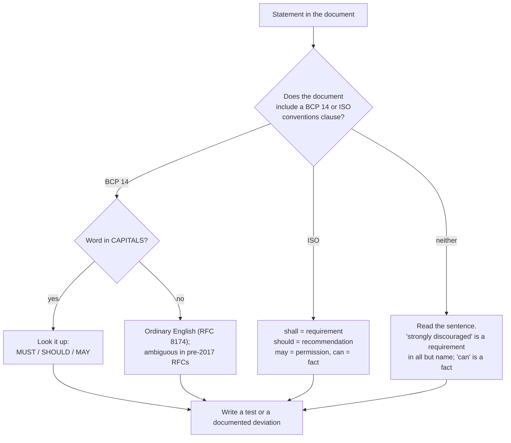

# Reading a Spec: RFCs, ISO Standards, and Network Rulebooks

> Payments is a specification-driven field. Learn to read one before you implement one.

**Type:** Learn
**Languages:** —
**Prerequisites:** Phase 0 Lesson 03 (Testing from the Standard Library)
**Time:** ~45 minutes

## Learning Objectives

- Locate, in any RFC or ISO document, the four things that decide what you must build: its status, what it updates or obsoletes, which sections are normative, and where the test vectors are
- State the precise meaning of MUST, SHOULD, and MAY under BCP 14 (RFC 2119 and RFC 8174) and of shall, should, may, and can under the ISO/IEC Directives, and explain why lower-case "should" in a 1997 RFC is a different kind of statement
- Extract a requirements list from RFC 2104 (HMAC) by hand and map each requirement to a test
- Decode an ISO 8583 message from a field-attribute table, including the MTI, the bitmap, fixed and LLVAR fields, and the implied-decimal amount that depends on another field
- Decide what to do when the specification, the network's implementation guide, and the counterparty's behaviour disagree

## The Problem

A payments team integrates a new acquirer. The acquirer's documentation says the authorization interface is "ISO 8583 (1987)". The team has an ISO 8583 library, so the integration is estimated at two weeks. Eleven weeks later it goes live, having failed certification three times.

The first failure: the library encoded the amount in data element 4 as twelve digits with two implied decimals, because that is what every other acquirer did. This acquirer processes Japanese yen and Kuwaiti dinar, and the implied decimal count comes from data element 49, the currency code, which the library ignored. 1,250 JPY was sent as 12.50 and declined as a mismatch against the terminal's receipt. The second failure: data element 22, point-of-service entry mode, is three numeric digits in the 1987 standard, but the acquirer's implementation guide defines a twelve-character field with a different sub-structure, as the 1993 revision does. The library parsed the next five fields at the wrong offsets and rejected every message as malformed. The third failure: the acquirer's guide says the Message Authentication Code in data element 128 "should be computed over the message as specified in the appendix". The team computed it over the wrong byte range because they read "should" as advisory and skipped the appendix.

None of these were bugs in the ISO 8583 library. ISO 8583 is not a wire format; it is a framework from which every card network and every acquirer derives its own, mutually incompatible, format, published as an implementation guide that overrides the standard wherever the two differ. The team's error was treating the standard as the specification and the guide as commentary, when the guide is the specification and the standard is background. They also read "should" in three documents written under three different vocabularies and gave it one meaning.

Every system in this course is built against a document like this. HMAC webhook signatures come from RFC 2104. Money representation comes from ISO 4217. Card messages come from ISO 8583 and the network's rules. Idempotency keys, retries, and timestamps come from RFCs. The documents are written in a formal register with a technical vocabulary that looks like English and is not quite English. This lesson teaches the vocabulary and the reading procedure, then applies both to two documents you will meet again: RFC 2104 in Phase 11 and the ISO 8583 field table in Phase 12.

## The Concept

### The anatomy of a specification

Every RFC and every ISO standard has the same skeleton, and reading it in order is a mistake. Read it in this order:

| Read | Where it is | Why first |
|------|-------------|-----------|
| Status and category | RFC header: "Category: Standards Track / Informational / Experimental / Best Current Practice"; ISO: the cover ("International Standard", "Technical Specification", "Technical Report") | an Informational RFC describes; a Standards Track RFC prescribes. RFC 2104 is Informational, which surprises people |
| Updates / Obsoletes / Updated by | RFC header and the RFC Editor's page for the number; ISO: the edition and the amendments list | you may be reading a superseded document. RFC 2104 is updated by RFC 6151; RFC 2119 is updated by RFC 8174 |
| Errata | rfc-editor.org/errata for the RFC number | verified errata are corrections to the text you are about to read |
| Terminology and conventions section | usually section 1.x or 2; the BCP 14 boilerplate lives here | this is where the document tells you which vocabulary it uses |
| Normative references | the references section is split into normative and informative | normative references are part of the specification; you must read them too |
| The requirement sections | the body | now you can read the body knowing what every capitalised word means |
| Security considerations and IANA considerations | near the end, mandatory in RFCs | the failure modes the authors knew about |
| Appendices and test vectors | the end | the only part of the document a test can execute |

An ISO standard adds two things: a scope clause that says what the standard does not cover (ISO 8583 explicitly does not define a transport, a character encoding, or a security scheme), and a bibliography of related standards that are not normative.

### Normative versus informative

A normative statement creates a requirement that an implementation can conform to or violate. An informative statement explains, illustrates, or motivates, and cannot be violated. The distinction is structural, not stylistic: RFCs and ISO standards label sections and references as one or the other, and an example in an informative appendix does not create a requirement even if it is the only place the behaviour is shown.

The practical rule: when the body says "the key MAY be of any length" and the appendix shows a 16-byte key, the requirement is "any length" and the appendix is one case. When the body is silent and only the appendix shows a behaviour, the behaviour is unspecified and you must find the actual requirement elsewhere, typically in the implementation guide or by asking the counterparty.

### The three vocabularies

The same English words mean different things in three families of documents.

**BCP 14 (RFC 2119, clarified by RFC 8174)**, used by IETF documents that include its boilerplate paragraph:

| Keyword | Meaning | Conformance consequence |
|---------|---------|-------------------------|
| MUST, REQUIRED, SHALL | absolute requirement | an implementation that does otherwise does not conform |
| MUST NOT, SHALL NOT | absolute prohibition | same |
| SHOULD, RECOMMENDED | do this unless you have understood the full implications of not doing so and have a valid reason | you may deviate, but you must be able to say why; a reviewer should ask |
| SHOULD NOT, NOT RECOMMENDED | the mirror of SHOULD | same |
| MAY, OPTIONAL | truly optional; an implementation that omits it MUST interoperate with one that includes it | you can skip it, but you cannot break when the other side does it |

RFC 8174 (2017) added one rule that matters when reading older documents: these words have the special meaning **only when in capitals**. A lower-case "must" or "should" in a post-2017 RFC that includes the RFC 8174 boilerplate is ordinary English. In a pre-2017 RFC that includes only the RFC 2119 boilerplate, the convention was already to capitalise, but lower-case uses are ambiguous and you must read the sentence.

**ISO/IEC Directives, Part 2**, used by every ISO standard:

| Verbal form | Meaning |
|-------------|---------|
| shall, shall not | requirement |
| should, should not | recommendation |
| may, need not | permission |
| can, cannot | possibility or capability (a statement of fact, not a requirement) |
| must | not used for requirements; reserved for external constraints (a law of physics, a legal requirement) |

ISO's "should" is weaker than BCP 14's SHOULD: it is a recommendation with no "must have a valid reason" clause. And ISO's "can" is purely descriptive, which trips up readers who treat "the field can contain up to 19 digits" as permission to send 19 when the implementation guide caps it at 16.

**Documents that predate or ignore both.** RFC 2104 was published in February 1997, one month before RFC 2119. It uses no capitalised keywords. It says "we recommend", "is strongly discouraged", and "can be of any length". Each of those is a sentence you must read and decide the force of; there is no vocabulary to look up. Network rulebooks (Visa Core Rules, Mastercard Rules) use their own defined terms, capitalised and listed in a glossary, and use "must" as a requirement because they are contracts, not standards.



### Standards, variants, and the counterparty

ISO 8583 says of itself that it "specifies a common interface by which financial transaction card originated messages may be interchanged". It defines the message structure, a catalogue of data elements with their attributes, and the meaning of each. It does not define which elements a given message type must carry, how messages are framed on the wire, how binary fields are encoded, or how the MAC is computed. Every one of those is decided by the network or acquirer and published in an implementation guide that is the actual specification you are implementing. Visa's BASE I, Mastercard's Authorization Platform, and each domestic switch have their own; they share the vocabulary of ISO 8583 and almost nothing else at the byte level.

The reading procedure when there are three documents:

1. The implementation guide wins over the standard wherever it speaks.
2. The standard fills in whatever the guide leaves unspecified, and tells you what the guide's terms mean.
3. The counterparty's actual behaviour, observed in certification, wins over both when it conflicts, and you record the conflict as a deviation in your own documentation with a reference to the ticket where they confirmed it.

The third rule is Postel's robustness principle ("be conservative in what you send, liberal in what you accept") applied with a paper trail. Accept the deviation; never send one without written agreement.

### Rulebooks: specifications that are also contracts

The third family of document a payments engineer reads is the network rulebook. These differ from RFCs and ISO standards in kind, not just in style.

| Document | Who publishes | Binding how | Vocabulary | What it governs that a standard does not |
|----------|---------------|-------------|------------|------------------------------------------|
| Visa Core Rules and Visa Product and Service Rules | Visa; public PDF, updated twice a year | contract between Visa and its members; members flow it down to merchants | defined terms capitalised and listed in a glossary; "must" is a contractual obligation | chargeback reasons and time limits, interchange qualification, authorization validity windows, surcharging rules |
| Mastercard Rules and Chargeback Guide | Mastercard; public | same | same pattern | same, with different time limits and reason codes |
| Nacha Operating Rules and Guidelines | Nacha; paid | binding on every ACH participant by agreement | "must" and "shall" | return codes, return windows (2 banking days for R01, 60 calendar days for unauthorized consumer debits), same-day ACH eligibility |
| EMV Integrated Circuit Card Specifications, Books 1-4 | EMVCo; public | required for EMV certification of terminals and cards | "shall" (ISO style) | the chip transaction flow: application selection, cardholder verification, cryptogram generation |
| PCI DSS | PCI Security Standards Council; public | contractual via the card brands and acquirers | "must" with numbered requirements and testing procedures per requirement | what you may store (never the full track, CVV, or PIN block), encryption, access control, change control |

Three reading habits specific to rulebooks. First, the glossary is normative: a rule about a "Transaction Receipt" means the glossary's definition, which may include things you would not call a receipt. Second, time limits are counted in defined units ("calendar days", "banking days", "processing days") that differ by document and by rule; a return window measured in the wrong unit is a lost dispute. Third, rulebooks change on a schedule (Visa in April and October), and the change summary at the front of each edition is the first thing to read, because an obligation that did not exist last year can now be the reason a transaction is declined.

### Failure modes of spec reading

Each of these has caused a certification failure or an incident on a real payments team:

- **Reading the superseded edition.** The guide says 1993, the library implements 1987, DE 22 changes width, every later field is misparsed.
- **Promoting an example to a requirement.** The appendix shows a 16-byte key; the implementation rejects 32-byte keys; a partner's webhook signatures all fail verification.
- **Demoting a requirement to a suggestion.** "Should" in an ISO document is a recommendation; "SHOULD" in an RFC needs a reason to skip; "should" in a 1997 RFC might be either. Treating all three as optional ships a MAC computed over the wrong bytes.
- **Reading the table and not the text.** `n 12` says nothing about decimals; the text does.
- **Trusting the standard over the counterparty.** Certification is where the counterparty's actual behaviour is discovered; the standard cannot argue with a decline.
- **Not recording the decision.** The next engineer re-reads the same ambiguous clause and chooses the other reading, and the two services disagree.

### The extraction procedure

When you sit down to implement from a document, produce a requirements table before writing code. The procedure:

1. Record the document's identity: number, edition, date, status, and the list of documents that update it. Put it at the top of the design note so a reader knows which text you read.
2. Read the conventions clause and write down which vocabulary applies (BCP 14, ISO, contractual, or none).
3. Walk the normative sections sentence by sentence. For each sentence that constrains an implementation, add a row: section, paraphrase, force (requirement, recommendation, permission, fact), and the test or review rule it implies. Facts get no test. Recommendations you decline get a one-line reason in the row.
4. Walk the informative sections and appendices for test vectors and examples. Add each vector as a test row. Add each example that reveals an unstated requirement as a question for the counterparty, not as a requirement.
5. Read the normative references. Any term they define that your document uses goes in your glossary; any requirement they impose that your document inherits goes in the table.
6. Read the errata and the security considerations last, and amend the table.

The table is the deliverable. The Worked Example below is the table for RFC 2104.

## Worked Example

### Reading RFC 2104 to implement HMAC

HMAC is the keyed hash this course uses in Phase 11 for webhook signatures and in Phase 12 for request signing. Read RFC 2104 in the order above.

**Status.** Informational. It does not prescribe; it describes a construction that other, Standards Track documents (RFC 4868 for HMAC-SHA-2 in IPsec, RFC 6234 for SHA-2 code, every TLS RFC) then require. The construction is what you are implementing; the requirements come from whichever of those documents governs your protocol.

**Updates.** Updated by RFC 6151 (2011), which discusses MD5 weaknesses and concludes that HMAC-MD5 is not broken for authentication but that new protocols should not use it. Your implementation parameterises the hash; your protocol document chooses it.

**Conventions.** None. No BCP 14 boilerplate. Every statement of force is ordinary English and must be weighed.

**The definition** (section 2). With `H` a hash function, `B` its block size in bytes (64 for MD5 and SHA-1; 64 for SHA-256, 128 for SHA-512), `L` its output length (16, 20, 32, 64), `K` the key, `ipad` the byte `0x36` repeated `B` times, and `opad` the byte `0x5C` repeated `B` times:

```text
HMAC(K, text) = H( (K' XOR opad) || H( (K' XOR ipad) || text ) )
where K' = K padded with zero bytes to length B
      (if K is longer than B bytes, K' = H(K) padded with zeros to B)
```

**The requirements, extracted.** Every sentence that constrains an implementation, with its force as written and the test it implies:

| Section | Text (paraphrased) | Force as written | Test |
|---------|--------------------|------------------|------|
| 2 | keys shorter than B are padded with zeros to B | definitional ("is") | HMAC with a 20-byte key equals HMAC with the same key followed by 44 zero bytes |
| 2 | keys longer than B are first hashed with H | definitional | HMAC with a 100-byte key equals HMAC with H(key) |
| 3 | key length less than L "is strongly discouraged" | recommendation, strong | not a conformance test; a lint warning or a documented minimum in your API |
| 3 | keys longer than L "are acceptable but the extra length would not significantly increase the function strength" | informative | none |
| 3 | keys "need to be chosen at random (or using a cryptographically strong pseudo-random generator)" | requirement in all but name | key generation uses `SecureRandom` / `secrets` / `crypto/rand`; a test that the key API rejects a `java.util.Random` source is overkill, a code-review rule is not |
| 5 | truncation to `t` leftmost bytes is permitted; "we recommend" `t` at least `L/2` and at least 80 bits | recommendation | if you truncate, a test that `t >= max(L/2, 10)` |
| 6 | the security of HMAC depends on H's compression function being a secure MAC with a secret IV | informative | none; this is why you do not invent your own hash |
| Appendix | sample code and the test vector `key = 0x0b * 16, text = "Hi There"` for HMAC-MD5 | informative, but executable | the first test in the suite: the output must be `9294727a3638bb1c13f48ef8158bfc9d` |

RFC 2202 supplies the same vectors for HMAC-SHA-1 (`b617318655057264e28bc0b6fb378c8ef146be00` for the 20-byte `0x0b` key) and RFC 4231 for HMAC-SHA-224/256/384/512. A test suite for an HMAC implementation that does not start with those vectors is testing the wrong thing.

Two further observations that only a close reading yields. First, "text" is a byte string and the RFC never mentions character encoding, so an implementation that accepts a `String` has invented a requirement; make the API take bytes and let the caller encode. Second, the RFC says nothing about comparing a received MAC with a computed one. Constant-time comparison is a requirement that comes from later literature on timing attacks and from the protocol documents (and from `MessageDigest.isEqual` existing in the JDK for exactly this reason); a spec reader who implements only what RFC 2104 says will ship `Arrays.equals` and a timing side channel. The specification is the floor, not the ceiling.

In Java, the construction is available as `javax.crypto.Mac`, and the test vector is three lines:

```java
Mac mac = Mac.getInstance("HmacMD5");
mac.init(new SecretKeySpec(new byte[]{0x0b, 0x0b, 0x0b, 0x0b, 0x0b, 0x0b, 0x0b, 0x0b, 0x0b, 0x0b, 0x0b, 0x0b, 0x0b, 0x0b, 0x0b, 0x0b}, "HmacMD5"));
byte[] tag = mac.doFinal("Hi There".getBytes(StandardCharsets.US_ASCII));
// HexFormat.of().formatHex(tag) -> "9294727a3638bb1c13f48ef8158bfc9d"
```

Phase 11 builds the construction from `MessageDigest` by hand and then compares it with `Mac`.

### Reading an ISO 8583 field table

An ISO 8583 message is a message type indicator, one or two 64-bit bitmaps, and the data elements whose bits are set, in ascending order. Each data element has an attribute in the standard's table, written in a compact notation:

| Notation | Meaning |
|----------|---------|
| `n` | numeric digits only |
| `a` | letters only |
| `s` | special characters |
| `an`, `ans` | combinations |
| `b` | binary |
| `z` | track 2 or 3 data as encoded on the card |
| `n 6` | fixed length, exactly 6 |
| `n..19` | variable, up to 19, preceded by a 2-digit length (LLVAR) |
| `ans...999` | variable, up to 999, preceded by a 3-digit length (LLLVAR) |

The fields used in the trace below, as the 1987 standard lists them:

| DE | Name | Attribute | Notes |
|----|------|-----------|-------|
| 2 | Primary account number | `n..19` LLVAR | the PAN; the only field PCI DSS cares about in this list |
| 3 | Processing code | `n 6` | transaction type and account types; `000000` is a purchase from the default account |
| 4 | Amount, transaction | `n 12` | no decimal point; the exponent comes from DE 49 |
| 7 | Transmission date and time | `n 10` | `MMDDhhmmss`, UTC |
| 11 | System trace audit number | `n 6` | the STAN; the per-terminal sequence that matches a response to its request |
| 12 | Time, local transaction | `n 6` | `hhmmss` |
| 13 | Date, local transaction | `n 4` | `MMDD` |
| 22 | Point of service entry mode | `n 3` | 1987; the 1993 revision changes this to `an 12` with a different structure |
| 41 | Card acceptor terminal identification | `ans 8` | |
| 42 | Card acceptor identification code | `ans 15` | the merchant id |
| 49 | Currency code, transaction | `n 3` | ISO 4217 numeric code; `840` is USD, `392` is JPY |

Now decode this authorization request by hand. It is written in ASCII with a hexadecimal bitmap for readability; a real acquirer will specify EBCDIC or BCD and a binary bitmap, which is the first thing to check in the implementation guide.

```text
0100 7238040000C08000 164111111111111111 000000 000000001999 1013143015 000123 143015 1013 051 TERM0001 MERCHANT0000001 840
```

**MTI `0100`.** Four digits: version `0` (1987), class `1` (authorization), function `0` (request), origin `0` (acquirer). The response will be `0110`. A `0200` would be a financial request (the transaction posts, not just authorises); a `0400` is a reversal; `0800` is network management. The MTI tells you which fields the implementation guide requires for this message, which ISO 8583 itself does not.

**Primary bitmap `7238040000C08000`.** Eight bytes, 64 bits; bit 1 is the most significant bit of the first byte. Expand each byte:

```text
byte 1: 0x72 = 0111 0010 -> bits 2, 3, 4, 7
byte 2: 0x38 = 0011 1000 -> bits 11, 12, 13
byte 3: 0x04 = 0000 0100 -> bit 22
byte 4: 0x00
byte 5: 0x00
byte 6: 0xC0 = 1100 0000 -> bits 41, 42
byte 7: 0x80 = 1000 0000 -> bit 49
byte 8: 0x00
```

Bit 1 is clear, so there is no secondary bitmap and no data element above 64. Present: 2, 3, 4, 7, 11, 12, 13, 22, 41, 42, 49, in that order.

**The fields, in bitmap order.**

| DE | Raw | Decoded | What the table told you |
|----|-----|---------|-------------------------|
| 2 | `16` `4111111111111111` | PAN, 16 digits | LLVAR: read two digits of length first |
| 3 | `000000` | purchase, default accounts | fixed `n 6` |
| 4 | `000000001999` | 1999 minor units | fixed `n 12`; meaningless until DE 49 is read |
| 7 | `1013143015` | October 13, 14:30:15 UTC | `MMDDhhmmss`; no year, the network supplies it |
| 11 | `000123` | STAN 123 | the key you will match the `0110` against |
| 12 | `143015` | 14:30:15 local | |
| 13 | `1013` | October 13 local | |
| 22 | `051` | `05` chip read, `1` terminal can accept PIN | `n 3` in 1987; if the guide says 1993, this field is 12 characters and everything after it shifts |
| 41 | `TERM0001` | terminal id | fixed `ans 8` |
| 42 | `MERCHANT0000001` | merchant id | fixed `ans 15` |
| 49 | `840` | USD, exponent 2 | now DE 4 means 19.99 USD |

The amount is the lesson. `000000001999` with DE 49 = `840` is 19.99 USD. The same bytes with DE 49 = `392` is 1,999 JPY, and with `414` (KWD, exponent 3) is 1.999 KWD. The field table for DE 4 does not say any of this; it says `n 12`. The dependency on DE 49 is in the description of DE 4 in the body of the standard and in ISO 4217, which ISO 8583 references normatively. A parser that hard-codes two decimals has read the table and not the text. This is the same discipline as `Money.parse(text, currency)` in Phase 10, Lesson 01: the exponent belongs to the currency, so the amount cannot be interpreted until the currency is known.

### What this procedure does not do

Reading the specification correctly does not make the counterparty conform to it, does not tell you which optional fields a given network actually requires (that is the guide, and then certification), and does not substitute for test vectors supplied by the counterparty. It does not resolve ambiguity in the document itself; when two readings are defensible, the errata page and the mailing-list archive for an RFC, or the network's certification team for a rulebook, are the authorities, and your reading of either goes in a decision record so the next engineer does not re-derive it.

## Exercises

1. **Reinforce.** Open RFC 8174 and RFC 2119 side by side. Then open RFC 7231 (HTTP/1.1 semantics, 2014) section 4.2.2 on idempotent methods and section 6.5.9 on status 409. For each capitalised keyword in those two sections, write the conformance test it implies for a payments API server. Note which statements use lower-case "should" and decide whether each is a requirement.
2. **Apply.** Compute the primary bitmap, as sixteen hexadecimal characters, for a `0110` authorization response carrying data elements 2, 3, 4, 7, 11, 12, 13, 37, 38, 39, 41, 49. Then decide whether a secondary bitmap is needed if the response also carries DE 128 (MAC), and write the first hexadecimal character of the primary bitmap in that case. Check your answer by writing a ten-line program that sets the bits.
3. **Extend.** Combine with Lesson 03. Write a `check`-harness test file (no implementation yet) for an HMAC-SHA-256 function, derived only from RFC 2104, RFC 4231's test vectors, and RFC 8174's reading rules: one test per normative requirement from the table above, the four RFC 4231 test cases, a key-longer-than-block-size case, and a constant-time-comparison test that you justify in a comment with a citation to something other than RFC 2104. You will implement against this file in Phase 11.

## Key Terms

| Term | What people say | What it actually means |
|------|-----------------|------------------------|
| Normative | "the official part" | Text that creates requirements an implementation can conform to or violate; sections and references are labelled as normative or informative, and only normative ones bind |
| Informative | "the examples" | Text that explains or illustrates and cannot be violated; an informative appendix's test vectors are still the first thing to test against |
| BCP 14 | "MUST and SHOULD" | RFC 2119 as clarified by RFC 8174: capitalised keywords with defined conformance meanings; lower-case forms are ordinary English |
| SHOULD | "optional" | Do it unless you have understood the full implications and have a valid reason not to; a deviation needs a stated reason, not just a decision |
| MAY | "nice to have" | Truly optional, with the constraint that implementations that omit it must still interoperate with those that include it |
| Implementation guide | "the acquirer's PDF" | The network's or acquirer's document that fixes everything ISO 8583 leaves open (field presence per MTI, encoding, framing, MAC); it is the specification you are actually implementing |
| MTI | "the message type" | The four-digit message type indicator: version, class, function, origin; `0100` is an authorization request, `0110` its response |
| LLVAR | "variable length field" | A field whose content is preceded by a two-digit decimal length (`LLLVAR` three digits); `n..19` means numeric, up to 19, LLVAR |
| Test vector | "the sample in the appendix" | A published input and expected output; the only part of a specification a test can execute directly |

## Further Reading

- [RFC 2119: Key words for use in RFCs to Indicate Requirement Levels](https://www.rfc-editor.org/rfc/rfc2119) and [RFC 8174](https://www.rfc-editor.org/rfc/rfc8174) — two pages each; the entire BCP 14 vocabulary, including the "only in capitals" rule.
- [RFC 2104: HMAC: Keyed-Hashing for Message Authentication](https://www.rfc-editor.org/rfc/rfc2104) — the document read in this lesson; note its Informational status and the absence of BCP 14 keywords.
- [RFC 2202](https://www.rfc-editor.org/rfc/rfc2202) and [RFC 4231](https://www.rfc-editor.org/rfc/rfc4231) — test vectors for HMAC-MD5/SHA-1 and HMAC-SHA-2; the first tests in any HMAC suite.
- [RFC 6151: Updated Security Considerations for MD5 and HMAC-MD5](https://www.rfc-editor.org/rfc/rfc6151) — how an RFC is updated rather than replaced, and what "updated by" obliges you to read.
- [ISO 8583-1:2003 — Financial transaction card originated messages, Part 1: Messages, data elements and code values](https://www.iso.org/standard/31628.html) — the current edition's table of contents and scope are free; the full text is paywalled, which is itself a fact about the field. The 1987 and 1993 editions remain in production use.
- [ISO/IEC Directives, Part 2: Principles and rules for the structure and drafting of ISO and IEC documents](https://www.iso.org/sites/directives/current/part2/index.xhtml) — clause 7 defines shall, should, may, and can for every ISO standard.
- [RFC 1122, section 1.2.2](https://www.rfc-editor.org/rfc/rfc1122#section-1.2.2) — the robustness principle as the IETF states it, for the "counterparty wins" rule.
