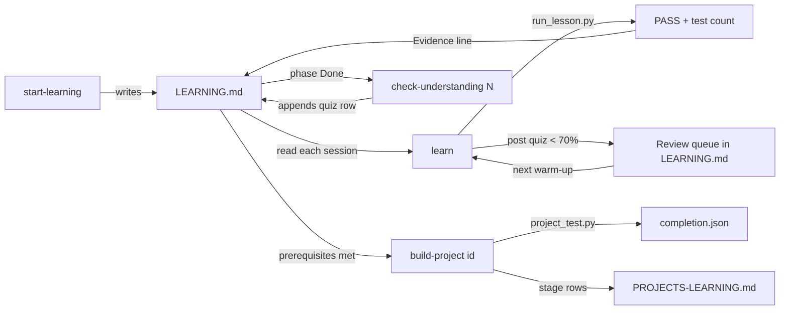

# The Learning Loop: Read, Build, Run, Keep Evidence

> How to use the tutor skills, LEARNING.md, and the project graders.

**Type:** Learn
**Languages:** —
**Prerequisites:** Phase 0 Lesson 03 (Testing from the Standard Library), Phase 0 Lesson 04 (Git for Engineers)
**Time:** ~30 minutes

## Learning Objectives

- Name the four steps of the loop every lesson in this course expects (read, build, run, keep evidence) and say which failure each step prevents
- Run a lesson end to end with `scripts/run_lesson.py` and read its `PASS`/`FAIL`/`SKIP` output and summary line
- Describe what each of the nine skills does (`start-learning`, `learn`, `course-guide`, `find-your-level`, `check-understanding`, `build-project`, `learn-ledgers`, `learn-consensus`, `interview-prep`), which state file each one owns, and how to invoke it in Claude Code, Codex, or another host
- Read and hand-maintain `LEARNING.md`: the Language, Path, Progress log, Review queue, and Evidence sections, and what the tutor writes to each
- Grade a project stage with `scripts/project_test.py` and explain why `completion.json` from a reference-solution run is never evidence

## The Problem

An engineer decides to learn distributed systems properly. They read a well-regarded book over three months, highlighting as they go. They watch a lecture series. They feel, at the end, that they understand Raft. Then a colleague asks in a design review why the leader must have the most up-to-date log before it can be elected, and they cannot reconstruct the argument. They know the words ("log matching", "election restriction") and not the mechanism. Three months, nothing they can show, nothing they can do that they could not do before.

The failure is well documented. Re-reading and highlighting produce a feeling of familiarity that is not the same as the ability to retrieve or apply; the research literature calls the feeling an illusion of competence, and it is one of the most robust findings in the study of learning. What produces durable, usable knowledge is retrieval (answering a question before being told the answer), generation (predicting an output before running the code), spacing (returning to a topic after an interval), and feedback that arrives while the attempt is still in working memory. None of those happen when you read a chapter.

A second, quieter failure. The same engineer does work through a course with code. Six months later they are asked in an interview what they built. They cannot remember which lessons they finished, the test counts, or whether the ledger project passed every stage or just the first two. There is a folder of code somewhere. There is no record of what was verified and when, so there is nothing to show, and nothing to resume from.

This course is built to prevent both failures mechanically. Every lesson has the same shape, so the loop is the same every time: a pre-question before you read, prediction questions inside the code walk, a run whose output you must explain, a change you must make, a quiz, and a line of evidence written to a file you own. The tutor skills drive the loop so you do not have to remember it; the scripts make the run reproducible; the state files make the record. This lesson is the manual for that machinery. It is short because the machinery is meant to disappear into habit.

## The Concept

### The loop

Every lesson, Build or Learn, is used the same way. The sequence is deliberate: each step defends against a specific way of fooling yourself.

| Step | What you do | What it prevents | Where the course enforces it |
|------|-------------|------------------|------------------------------|
| **Read** | the lesson's The Problem and The Concept, after answering the `pre` quiz question; explain the core idea in your own words before touching code | the illusion of competence from passive reading; the pre-question makes you retrieve what you already know, so the reading attaches to it | `quiz.json` stage `pre`; `learn` Step 2.2 |
| **Build** | type the implementation from Build It, chunk by chunk, answering each "Predict:" question before reading on; do not paste | the illusion that recognising code is the same as being able to produce it; prediction is generation, and a wrong prediction corrected immediately is the strongest learning event in the lesson | the "Predict:" lines in every Build It; `learn` Step 2.4 |
| **Run** | run `main` and the tests from `code/<lang>/`, then explain one line of the output and change one thing (a rounding mode, a seed, a dropped message) and predict the new output before running | the gap between "it compiled" and "I know what it does"; the change-one-thing step is the moment the lesson moves into memory | `scripts/run_lesson.py`; `learn` Steps 2.5 and 2.6 |
| **Keep evidence** | record the exact command, its exit code, and the test count, plus the quiz score and a one-line note on what was hard | the six-months-later problem: no record, nothing to show, nothing to resume from; also the review queue that drives spaced return to weak topics | `LEARNING.md` Progress log and Evidence; `learn` Step 4 |

The loop is the same for a Learn lesson, with Build replaced by the Worked Example: trace it by hand with the lesson's numbers, predicting each step before reading it. The evidence line for a Learn lesson reads `traced by hand`, and the tutor records it in the same place.

The quiz at the end (`post` stage, two questions) is retrieval with feedback. A score below 70% puts the lesson in the Review queue, and the next session's warm-up asks two questions from the previous lesson's quiz. That is spacing, applied automatically.

### The scripts

Four scripts under `scripts/` do the mechanical work. They are standard-library Python and read `languages.json` and `curriculum/curriculum.json`, so they need no installation.

**`run_lesson.py`** compiles and runs a lesson's `main`, then its tests, in one or every language:

```bash
python3 scripts/run_lesson.py phases/00-setup-and-tooling/03-testing-from-the-standard-library --lang java
```

```console
PASS  phases/00-setup-and-tooling/03-testing-from-the-standard-library [java]   2.1s

1 passed, 0 failed, 0 skipped
```

`PASS` means both the run and the test commands from `languages.json` exited 0 inside `code/java/`. `FAIL` prints which phase (`run` or `test`) failed and the last 4,000 characters of output. `SKIP` means the language folder is absent for that lesson or the toolchain is not installed; it is never a failure unless you pass `--strict`. `--all` runs every lesson, `--phase N` one phase, `-v` shows the full output. The summary line is your evidence; the test count comes from the harness's own last line (`38 passed, 0 failed` for a Java `MainTest`).

**`audit_lessons.py`** checks the lesson contract (header, sections, six-question quiz, code headers citing the docs). You run it when you contribute a lesson; as a learner you only need to know that `0 issues` is what a finished lesson looks like.

**`project_test.py`** grades the staged projects. Three invocations matter:

```bash
python3 scripts/project_test.py --list
python3 scripts/project_test.py ledger-engine --lang java --init my-ledger
python3 scripts/project_test.py ledger-engine --lang java --stage 2 --path my-ledger
python3 scripts/project_test.py ledger-engine --lang java --all --path my-ledger --strict --report completion.json
```

`--init` copies stage 1's starter files into a workspace. `--stage N` runs the tests of stages 1 through N against your workspace in a temporary directory, so a stage-3 change that breaks stage 1 is reported as a regression. `--all --report completion.json` writes a JSON report with `eligibleForCompletion` and a fingerprint of your workspace sources. The report from a `--solution` run (grading the reference implementation) is never eligible, by construction: evidence is of what you built.

**`scaffold_lesson.py`** and **`build_catalog.py`** are for contributors: the first creates a lesson skeleton from `curriculum.json`, the second regenerates the README Contents, `ROADMAP.md`, and the phase READMEs. You will meet them if you author a lesson (Lesson 04 described the commit).

### The skills

A skill is a `SKILL.md` file that an agent host (Claude Code, Codex, or anything that reads the format) loads as instructions. The portable copies are in `skills/<name>/SKILL.md`; `.claude/skills/` holds identical copies for Claude Code discovery, kept in sync by `scripts/sync_skills.py`. Nine ship with the course:

| Skill | What it does | State file it owns | Claude Code | Codex |
|-------|--------------|--------------------|-------------|-------|
| `start-learning` | one-time onboarding: four interview questions (why, which language, hours per week, build goal), placement quiz, writes the plan | `LEARNING.md` (creates) | `/start-learning` | `start-learning` |
| `learn` | the tutor loop: warm-up recall, next lesson taught in your language, run it, change one thing, quiz, record | `LEARNING.md` (updates) | `/learn` | `learn` |
| `course-guide` | topic router: a topic, a question, or a bug ("my balances don't reconcile") to the 1-3 lessons that teach it | none (reads `LEARNING.md`) | `/course-guide sagas` | `course-guide sagas` |
| `find-your-level` | ten-question placement across five areas, mapped to an entry phase; `start-learning` calls it | none | `/find-your-level` | `find-your-level` |
| `check-understanding` | eight questions generated from a phase's lesson docs, graded Mastered / Almost / Developing / Start over | `LEARNING.md` (appends a `phase-N quiz` row) | `/check-understanding 10` | `check-understanding 10` |
| `build-project` | project coach: one stage per session, you write the code, grader run with you, hints never solutions | `PROJECTS-LEARNING.md` | `/build-project ledger-engine` | `build-project ledger-engine` |
| `learn-ledgers` | focused route from `learning-paths/ledger-engineering.json`, then hands off to `build-project ledger-engine` | `LEDGER-LEARNING.md` | `/learn-ledgers` | `learn-ledgers` |
| `learn-consensus` | focused route from `learning-paths/consensus-from-scratch.json`, then `build-project raft-kv` | `CONSENSUS-LEARNING.md` | `/learn-consensus` | `learn-consensus` |
| `interview-prep` | timed mock, probe round, or weak-area review, graded against the rubric in Phase 14 Lesson 11 | `INTERVIEW-PREP.md` | `/interview-prep` | `interview-prep` |

On any other host the invocation is natural language: `Use learn to teach the next lesson.` The skills never present one host's syntax as universal, and neither should you when you write about them.

Two rules the skills enforce that you should know about so they do not surprise you. First, **answer isolation**: the tutor never shows the correct option, the answer letter, or the answer distribution before you answer, and its only plain-text hint is `Reply with one letter: <A|B|C|D>.` If you want to cheat, open `quiz.json`; the skill will not help you. Second, **the solution folder is off limits**: `build-project` never shows you `projects/<id>/solution/`. It may read it to diagnose why your correct-looking attempt fails, and then it gives a hint, not the code. If after two honest attempts you ask for the answer, it shows only the one function you are stuck on and writes that down in your log.



### LEARNING.md: the file you own

`start-learning` writes `LEARNING.md` in your current directory with exactly these sections, and `learn` updates it. It is gitignored (along with `PROJECTS-LEARNING.md` and every `*-LEARNING.md`), so it stays yours and never lands in a pull request.

| Section | Written by | Contains | What to do with it by hand |
|---------|------------|----------|----------------------------|
| `## Mission` | `start-learning` | your answer to "why" and your build goal, in your words | reread it when motivation dips; edit it when the goal changes |
| `## Language` | `start-learning`; `learn` on a switch | `Primary`, `Fallback: Java`, a `Changed on` line per switch | you can switch by telling `learn` "switch me to Go"; it validates against `languages.json` and re-teaches the current Build It |
| `## Placement` | `start-learning` | date, score out of 10 (or `self-selected`), entry phase, pace | leave it; re-run placement through `start-learning` if you want it updated |
| `## Path` | `start-learning`; `learn` marks `Done` | all sixteen phases with Status `Skip`, `Review`, `Do`, or `Done` and estimated hours | change a `Skip` to `Do` if you want a phase after all; `learn` honours it |
| `## Progress log` | `learn`, `check-understanding` | date, `<phase>/<lesson>`, language, quiz score, one-line note | the note is for the next warm-up: write what was hard, not "done" |
| `## Review queue` | `learn` | lessons with a post score below 70% or a check question missed twice, with the topic | work it when `learn` says no eligible lesson remains, or on a day you have twenty minutes |
| `## Evidence` | `learn` | one line per lesson: command, exit code, test count (or `traced by hand`) | this is what you show; copy lines into commit bodies (Lesson 04) and interview notes |

If you decline `start-learning` and run `learn` without a plan, it offers to start at Phase 0, Lesson 1 in Java with no state file, and skips the recording step silently. The loop still works; you just keep the evidence yourself.

Resume routing is worth knowing because it is where people get confused. "Continue" or "resume" is resolved against whichever state files exist: `LEARNING.md` goes to `learn`, `PROJECTS-LEARNING.md` to `build-project`, `LEDGER-LEARNING.md` to `learn-ledgers`, `CONSENSUS-LEARNING.md` to `learn-consensus`, `INTERVIEW-PREP.md` to `interview-prep`. If several exist and you do not say which, the skill asks. No skill ever copies one route's progress into another file, so finishing the ledger route does not mark Phase 10 `Done` in `LEARNING.md`; that is a deliberate separation, not a bug.

### Projects and the grader

The projects under `projects/` are where the loop stops being a worked example and becomes your code. Three ship today, each four stages, each Java:

| Project | Level | What you build | Prerequisite lessons |
|---------|-------|----------------|----------------------|
| `ledger-engine` | L2 Builder | a double-entry ledger that refuses to go out of balance, then reconciles against a bank statement | Phase 10 Lessons 01, 03, 08 |
| `idempotent-payment-gateway` | L2 Builder | a charge API that survives client retries, flaky processors, and duplicate webhooks without charging twice | Phase 5 Lessons 09, 10, 11; Phase 12 Lesson 01 |
| `raft-kv` | L3 Advanced | a Raft-replicated key-value store on a deterministic simulated network, with a linearizability check of its history | Phase 6 Lessons 05, 06, 12 |

`python3 scripts/project_test.py --list` prints the current list with hours. A stage is graded by copying your workspace sources (`*.java` excluding `*Test.java`) and the stage's test files (`Stage01Test.java`, `Stage02Test.java`, ...) into a temporary directory and running them all; your workspace is never modified. The grader output ends with a line of the form `3/4 stages pass in Java`, which is the evidence line for `PROJECTS-LEARNING.md`.

The completion report is a JSON object with these fields: `project`, `language`, `gradedAt`, `workspace`, `referenceSolution`, `eligibleForCompletion`, `fingerprint`, and `stages`. `eligibleForCompletion` is true only when every stage passed, nothing was skipped, and `referenceSolution` is false. The fingerprint is a hash over your source files, so a report can be tied to the exact code it graded. Hand the file to whoever needs proof; the `build-project` coach explains this at the last stage and runs the command with you.

### Focused routes

If you want one slice of the course rather than all sixteen phases, three manifests under `learning-paths/` define ordered routes, each with its own tutor skill and state file:

| Manifest | Skill | Lessons | Ends in | State file |
|----------|-------|---------|---------|------------|
| `ledger-engineering.json` | `learn-ledgers` | 8, from Phase 0 Lesson 07 through Phase 10 | `build-project ledger-engine` | `LEDGER-LEARNING.md` |
| `consensus-from-scratch.json` | `learn-consensus` | 8, clocks through Raft and linearizability | `build-project raft-kv` | `CONSENSUS-LEARNING.md` |
| `payments-interview-prep.json` | `interview-prep` | 13, the lessons behind the five interview probes | drills graded against Phase 14 Lesson 11 | `INTERVIEW-PREP.md` |

A route tutor follows the `learn` loop exactly for each manifest lesson, records evidence in its own file, and when a manifest lesson lists a checkpoint it will not mark the lesson `Done` until you have produced it. Finishing a route hands you to the project it ends in. `course-guide` will suggest a route when your question matches one ("I only want Raft").

### Evidence habits

Four kinds of evidence, in increasing strength, and who each is for:

| Evidence | Produced by | Proves | Audience |
|----------|-------------|--------|----------|
| the `run_lesson.py` line in `## Evidence` | `learn`, or you | the lesson's code compiled and its tests passed on your machine on that date | you, six months from now; a commit body |
| the `check-understanding N` row in the Progress log | `check-understanding` | you could answer eight fresh questions about the phase without the lesson open | you; a mentor |
| `completion.json` with `eligibleForCompletion: true` | `project_test.py` on your workspace | you built a multi-stage system that passes every grader | a hiring manager; a bootcamp or course administrator (see `FORKING.md`) |
| an atomic commit per lesson or stage with the evidence line in its body | you, following Lesson 04 | all of the above, with history | anyone reading your fork |

Two habits make the record trustworthy. Write the evidence line immediately after the run, from the terminal, never from memory. And never record a pass you did not see: the skills are instructed not to, and neither should you.

### When the loop stalls

| Symptom | Cause | Fix |
|---------|-------|-----|
| `learn` says there is no eligible lesson | every `Do` or `Review` phase is complete or planned | work the Review queue, run `check-understanding` on the last phase, or re-run `start-learning` to extend the plan |
| `run_lesson.py` prints `SKIP ... (no python/ implementation)` | the lesson has no port for that language yet | expected; the tutor teaches from Java with the lesson's Porting notes |
| `run_lesson.py` prints `FAIL ... run` | `main` exited non-zero or did not compile | fix the compile error before looking at the tests; the harness never runs tests on code that does not build |
| `run_lesson.py` prints `FAIL ... test` | `main` ran but `MainTest` reported failures | read the `FAIL:` lines the harness prints; each is a named check |
| the grader fails stage 1 after you changed stage 3 | a regression; grading stage N runs stages 1 through N | the grader's first failing stage is the one to fix |
| several state files exist and "resume" is ambiguous | you have used more than one route | name the route; the skills never merge progress across files |
| you pasted the code instead of typing it | the Build step was skipped | delete it and type it; the prediction questions do not work on code you did not produce |

### Planned lessons

Every lesson in this edition of the course is complete, so you will not meet one today, but the mechanism exists because a fork or a future edition may add lessons before they are written. `ROADMAP.md` marks every lesson ✅ Complete, 🚧 In Progress, or ⬚ Planned. A planned lesson has a title, hook, and objectives in `curriculum.json` and a short outline on disk, and nothing else. `learn` skips planned lessons and tells you once per session how many it skipped; `course-guide` will name a planned lesson that matches your question but will say it is not teachable yet and point at the nearest complete one. Do not treat the skip as a gap in your knowledge; treat it as a lesson to come back to. The hour estimates in `## Path` count planned lessons too, so a phase with skipped lessons finishes sooner than estimated.

### Pace, and what the tutor expects from you

`start-learning` asks how many hours a week you have (about 2, about 5, about 10, or "as fast as possible") and uses the answer only to phrase the plan honestly; it never cuts content. The arithmetic: a Build lesson is 60-90 minutes with the loop, a Learn lesson 30-45, a project stage about two hours. At two hours a week that is one lesson a week and the sixteen phases take well over a year; at ten hours it is a lesson a day and a phase every two to three weeks. The phase READMEs carry the hour total for each phase, and `## Path` sums the ones you marked `Do`.

The tutor is scripted but not rigid. Things it will do if you ask: speed up ("I know this, skip to the code" outranks the script), slow down and re-explain with a different example, teach a lesson out of order ("teach me sagas", recorded as a detour), switch your language mid-course, and redo the previous lesson instead of advancing when the warm-up goes badly. Things it will not do: show you a quiz answer before you commit to one, paste a project solution, or record a result it did not see. The contract works in both directions: answer the prediction before you scroll, type the code rather than pasting it, and run the command yourself when it asks.

### The commands you will type

Everything a learner runs, in one place. All from the repository root.

```bash
# first session
/start-learning                                                           # Claude Code; `start-learning` in Codex

# every lesson
/learn
python3 scripts/run_lesson.py phases/<phase-dir>/<lesson-dir> --lang java   # the tutor runs this with you

# finding things
/course-guide idempotency
/check-understanding 10

# projects
python3 scripts/project_test.py --list
python3 scripts/project_test.py ledger-engine --lang java --init my-ledger
/build-project ledger-engine
python3 scripts/project_test.py ledger-engine --lang java --stage 2 --path my-ledger
python3 scripts/project_test.py ledger-engine --lang java --all --path my-ledger --strict --report completion.json

# verifying a lesson you authored (contributors; Lesson 04 has the commit)
python3 scripts/audit_lessons.py --phase 0

# focused routes
/learn-ledgers
/learn-consensus
/interview-prep
```

The slash forms are Claude Code's. Drop the slash for Codex; in any other host, say what you want in a sentence (`Use learn to teach the next lesson.`).

### What the loop does not do

It does not make a lesson easy; the "Predict:" questions are supposed to be answered wrong some of the time, because the correction is the learning. It does not replace building something of your own; the projects and the Phase 15 capstones exist because a lesson's code is a worked example, not your design. It does not verify understanding; a passing test proves the code you typed matches the lesson, and the quiz samples two facts. The `check-understanding` phase quiz and the project graders are stronger evidence, and an explanation to a colleague is stronger still. And it does not grade you; `LEARNING.md` is yours, the numbers in it are for you, and nobody is reading it but you and your tutor.

## Worked Example

One session, start to finish, for a learner who chose Java and is on Phase 0, Lesson 03. Host is Claude Code.

**Invocation.** `/learn`. The skill reads `LEARNING.md`, finds `Primary: Java`, finds the last Progress log row is `00/02`, and resolves the next lesson to `00/03` because Phase 0 is `Do` and lesson 03 is ✅ in `ROADMAP.md`.

**Warm-up.** Two questions from `phases/00-setup-and-tooling/02-choose-your-language/quiz.json`, chosen at random, answered by letter. One sentence of feedback each. Both right; the session proceeds.

**Frame and pre-question.** Two sentences on why a test harness with no framework matters, tied to the learner's Mission ("joining a payments team"). Then the `pre` question from `03-testing-from-the-standard-library/quiz.json`, before any explanation.

**Concept with the worked example.** The tutor walks the lesson's `FakeClock` and seeded-backoff trace with its real numbers, pausing to ask "with seed 42, which way does the first jittered delay fall relative to the cap?" The three `check` questions are asked one at a time at the points the lesson places them.

**Build in Java.** `code/java/Main.java` is opened and walked in the chunks Build It defines. At each "Predict:" the learner answers before the tutor shows the next chunk. The learner types the code into their own file rather than reading the lesson's.

**Run.** From the repository root:

```bash
python3 scripts/run_lesson.py phases/00-setup-and-tooling/03-testing-from-the-standard-library --lang java
```

```console
PASS  phases/00-setup-and-tooling/03-testing-from-the-standard-library [java]   2.1s

1 passed, 0 failed, 0 skipped
```

The tutor asks the learner to explain one line of `main`'s output. Then the change: "set the seed to 7 instead of 42 and tell me what the first delay will be before you run it." The learner predicts, runs, and compares.

**Use it, ship it.** The production equivalent (JUnit's assertion model, what it hides) and the `outputs/checklist-deterministic-tests.md` artifact, with one place at work to use it.

**Quiz.** The two `post` questions, lettered, no hints. Score 2/2.

**Record.** The tutor appends to `LEARNING.md`:

```text
| 2026-10-13 | 00/03 | Java | 2/2 | Predicted backoff with the wrong cap once; solid on FakeClock |

python3 scripts/run_lesson.py phases/00-setup-and-tooling/03-testing-from-the-standard-library --lang java -> exit 0, 38 passed, 0 failed
```

The first line goes under `## Progress log`, the second under `## Evidence`. Nothing goes in the Review queue because the score is above 70%.

**Close.** Two lines: what the learner can now do (write a deterministic test for anything that depends on time or randomness, without a framework), and the next hook from `curriculum.json` as a teaser: "One lesson, one commit, one piece of evidence you can show in a review."

Total: about an hour. The evidence line is the only artifact, and it is enough to resume from, to put in a commit body, and to show.

## Exercises

1. **Reinforce.** Without a tutor, run the loop by hand on Phase 0, Lesson 07: answer the `pre` question from `quiz.json` before reading, write your own one-paragraph explanation of The Concept, run `scripts/run_lesson.py ... --lang java`, change one thing in `main` and predict the output before running, answer the two `post` questions, and write the Progress log row and the Evidence line into `LEARNING.md` yourself in the exact format above.
2. **Apply.** Write a stdlib-only Python script, in your own directory and not in `scripts/`, that parses `LEARNING.md`'s Evidence section and prints, for each line, the lesson path, exit code, and test count, then a total; have it exit 1 if any line's exit code is not 0. Use it to check that your evidence matches what `python3 scripts/run_lesson.py --phase 0 --lang java` prints today.
3. **Extend.** Combine with Lesson 04. Initialise the ledger project (`python3 scripts/project_test.py ledger-engine --lang java --init my-ledger`), make one commit per stage as you complete stages 1 and 2 with `build-project`, and put the grader's summary line in each commit body. Then run the `--all --report completion.json` command on your workspace and on `--solution`, diff the two reports, and explain in two sentences why only one of them is evidence.

## Key Terms

| Term | What people say | What it actually means |
|------|-----------------|------------------------|
| Retrieval practice | "quizzing" | Attempting to recall or produce an answer before being shown it; the `pre` and `post` quiz stages and the warm-up exist for this, and it is the step passive reading skips |
| Prediction | "guess the output" | Generating an expected result before running; a wrong prediction corrected immediately is the strongest learning event in a Build lesson, which is why every chunk has a "Predict:" |
| Spacing | "review later" | Returning to a topic after an interval; the warm-up asks about the previous lesson and the Review queue brings back lessons scored under 70% |
| Evidence | "I did it" | The exact command, exit code, and test count, recorded where you can show it; one line per lesson under `## Evidence` |
| Skill | "slash command" | A `SKILL.md` file an agent host loads as instructions; the name is portable (`learn`), the invocation syntax belongs to the host (`/learn`, `learn`, or natural language) |
| State file | "my progress" | A Markdown file a skill owns and updates: `LEARNING.md` for `learn`, `PROJECTS-LEARNING.md` for `build-project`, one per focused route; all gitignored, none ever merged into another |
| Grader | "the project tests" | `scripts/project_test.py`, which runs the tests of stages 1..N against your workspace in a temporary directory so regressions surface; `completion.json` from your workspace is evidence, from `--solution` it is not |
| Planned lesson | "the missing ones" | A lesson registered in `curriculum.json` with an outline but no content yet (⬚ in `ROADMAP.md`); `learn` skips it and says so, `course-guide` names it but does not pretend it is teachable |

## Further Reading

- [Dunlosky, Rawson, Marsh, Nathan, Willingham, "Improving Students' Learning With Effective Learning Techniques" (Psychological Science in the Public Interest, 2013)](https://journals.sagepub.com/doi/10.1177/1529100612453266) — the review that rates practice testing and distributed practice as high-utility and highlighting and rereading as low-utility; the evidence behind every step of the loop.
- [Roediger and Karpicke, "Test-Enhanced Learning" (Psychological Science, 2006)](https://journals.sagepub.com/doi/10.1111/j.1467-9280.2006.01693.x) — the experiment showing that a retrieval attempt beats an extra study session a week later, even though the study group felt more confident.
- [Bjork and Bjork, "Making Things Hard on Yourself, But in a Good Way" (2011)](https://bjorklab.psych.ucla.edu/wp-content/uploads/sites/13/2016/07/EBjork_RBjork_2011.pdf) — desirable difficulties: why the "Predict:" questions are supposed to be hard and why a wrong prediction is not a failure.
- [`skills/learn/SKILL.md`](../../../../skills/learn/SKILL.md) — the tutor's actual instructions; read them once so nothing it does surprises you.
- [`AGENTS.md`](../../../../AGENTS.md) — the lesson contract the tutor relies on; the "Lesson contract" section explains why every lesson has the same six sections.
- [`projects/AUTHORING.md`](../../../../projects/AUTHORING.md) — how the grader copies your sources and a stage's tests into a sandbox, and why the stage test classes are named `StageNNTest`.
