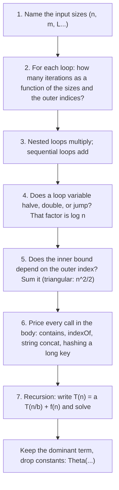

# Complexity Analysis: Big-O, Big-Theta, and What Hardware Does to Them

> O(n) with cache misses loses to O(n log n) without them.

**Type:** Learn
**Languages:** —
**Prerequisites:** Phase 0, Lesson 05 (Benchmarking and Profiling)
**Time:** ~75 minutes

## Learning Objectives

- State the formal definitions of O, Omega, and Theta and use them to say precisely what "binary search is O(n)" does and does not claim
- Distinguish a *bound* (O, Theta, Omega) from a *case* (best, average, worst) and from an *amortised* cost, and give one example where each distinction changes a decision
- Convert a complexity class into a concrete running time for n = 10, 10^3, 10^6, and 10^9, and recognise which classes are usable at each scale
- Apply a six-step decision procedure to a loop nest or a recursive function and produce its Theta class, including loops with hidden costs
- Explain cache lines, memory latency, and branch prediction well enough to predict when an O(n) scan beats an O(log n) search, and verify it with a measurement
- Decide, for a given payments workload, whether the asymptotic class or the constant factor is the thing to optimise

## The Problem

A settlement team reconciles the day's card transactions against the processor's settlement file. For each of the processor's records, the job looks for the matching record in the ledger's list of the day's captures: a loop inside a loop, comparing transaction IDs. The engineer who wrote it tested on a staging dataset of 10,000 records. The job took under a second. It shipped.

Daily volume is 400,000 records, and the job takes about 25 minutes, which is tolerable overnight. On the last business day of the quarter, volume is 2.1 million records. The nested loop performs 2.1 million times 2.1 million, about 4.4 trillion, comparisons. At a billion simple operations per second that is over an hour of pure comparison; with string comparison, object dereferences, and cache misses it is closer to a day. The settlement file is not reconciled before the funding deadline, 2.1 million merchants are paid a day late, and the postmortem's root cause is a single sentence: the reconciliation step was quadratic and nobody had written down what n was going to be. Switching the inner loop to a hash-map lookup (Lesson 06) makes the job linear and brings the quarter-end run to under a minute. That is the first half of this lesson: a notation that makes "quadratic" a thing you can see in code before production shows it to you.

The second half is the opposite failure. A different team routes authorisations by checking the card's leading digits against eight BIN ranges stored in an array, scanning them in order. A reviewer points out that a linear scan is O(n) and a `TreeMap` lookup is O(log n), and the code is changed. The benchmark shows the new version is slower, by about three times, and nobody on the review understands why, because the asymptotic analysis was correct. It was also irrelevant: at n = 8 the whole array fits in one cache line, the scan's branches are perfectly predictable, and the `TreeMap` replaces that with pointer chasing to three or four separately allocated nodes, each a potential cache miss, plus a boxed `Integer` comparison per step. Asymptotic notation describes what happens as n grows without bound; the hardware describes what happens at the n you actually have. An engineer needs both, and needs to know which one is in charge.

## The Concept

### What the notation actually says

Let `f(n)` be the exact cost of an algorithm on an input of size `n`, counted in whatever unit is relevant (comparisons, memory accesses, bytes). The three notations compare `f` against a simpler function `g` for all sufficiently large `n`:

| Notation | Definition | Plain reading | Example |
|---|---|---|---|
| `f(n) = O(g(n))` | there exist constants `c > 0` and `n0` such that for all `n >= n0`, `0 <= f(n) <= c * g(n)` | `g` is an upper bound, up to a constant, eventually | `3n^2 + 50n + 7 = O(n^2)`; also `= O(n^3)`, which is true and useless |
| `f(n) = Omega(g(n))` | there exist `c > 0` and `n0` such that for all `n >= n0`, `f(n) >= c * g(n)` | `g` is a lower bound, up to a constant, eventually | any comparison sort is `Omega(n log n)` in the worst case |
| `f(n) = Theta(g(n))` | `f(n) = O(g(n))` and `f(n) = Omega(g(n))` | `g` is the exact growth rate, up to a constant | insertion sort's worst case is `Theta(n^2)`: not just at most quadratic, quadratic |

Three consequences follow from the definitions and are the source of most arguments in code review:

1. **O is an upper bound, not a description.** "Binary search is O(n)" is a true statement, because `log n <= n`. It is also unhelpful. When someone says "this is O(n^2)" about an algorithm that is actually linear, they are not wrong, they are imprecise. If you mean the exact growth rate, say Theta.
2. **Constants and lower-order terms vanish.** `3n^2 + 50n` and `n^2 / 1000` are both `Theta(n^2)`. The notation says that for large enough `n` the quadratic term dominates; it says nothing about where "large enough" starts. For `n^2 / 1000` versus `50n`, the crossover is at `n = 50,000`. Below that the "slower" algorithm is faster.
3. **The input size has to be named.** For a hash map with `n` keys of average length `L`, a lookup is `O(L)`, not `O(1)`; the `O(1)` claim silently assumes `L` is bounded. For a graph, `n` is vertices and `m` is edges, and `O(n + m)` is not `O(n)`. Half of all "this is O(1)" claims in design documents are missing a variable.

### Cases are not bounds

Best, average, and worst case describe *which input* you are measuring. O, Theta, and Omega describe *how the cost grows* on that input. The two axes are independent, and conflating them produces statements like "quicksort is O(n log n)", which is false for the worst case (`Theta(n^2)` on sorted input with a naive pivot) and true for the average.

| | Best case | Average case | Worst case |
|---|---|---|---|
| Linear search in an array of `n` | `Theta(1)` (first element) | `Theta(n)` | `Theta(n)` |
| Binary search in a sorted array | `Theta(1)` (middle element) | `Theta(log n)` | `Theta(log n)` |
| Quicksort, first-element pivot | `Theta(n log n)` | `Theta(n log n)` | `Theta(n^2)` (already sorted input) |
| Hash map lookup, chaining | `Theta(1)` | `Theta(1)` expected, under a uniform hash | `Theta(n)` (all keys in one bucket) |
| Insertion into a dynamic array | `Theta(1)` | `Theta(1)` amortised | `Theta(n)` (the resize) |

A payment system usually cares about the worst case, because the worst case is what an attacker sends and what the quarter-end batch looks like. The hash map row is the one to remember: its `Theta(1)` depends on an assumption about the hash function, and Lesson 06 shows exactly what breaks when the assumption does.

### Amortised cost: a preview

The dynamic array row introduces a third kind of statement. A single append is `Theta(n)` when the backing array is full and must be copied. But doubling the capacity means a copy of size `n` happens only after `n/2` cheap appends, so any sequence of `m` appends costs `O(m)` in total: `O(1)` *amortised* per operation. Amortised cost is a bound on the average over a *sequence* of operations, with no probability involved; it is a worst-case statement about the sequence. It is the right measure for a structure's throughput and the wrong measure for its latency, because the `Theta(n)` append still happens, and if it happens on a request thread the p99 shows it. Lesson 02 makes this rigorous with the accounting and potential methods; Lesson 03 builds the array and measures the spikes.

### From class to clock

The notation is only useful if you can turn it into seconds. Assume `10^9` simple operations per second, which is a fair figure for one core doing cache-friendly work, and a budget of one second:

| Class | n = 10 | n = 1,000 | n = 10^6 | n = 10^9 | Largest n in one second | Where it shows up |
|---|---|---|---|---|---|---|
| `Theta(1)` | 1 | 1 | 1 | 1 | unbounded | hash lookup, array index |
| `Theta(log n)` | 3 | 10 | 20 | 30 | unbounded in practice | binary search, balanced tree, heap push |
| `Theta(n)` | 10 | 10^3 | 10^6 (1 ms) | 10^9 (1 s) | about 10^9 | one pass over the settlement file |
| `Theta(n log n)` | 33 | 10^4 | 2 x 10^7 (20 ms) | 3 x 10^10 (30 s) | about 4 x 10^7 | sorting, merging, heapsort |
| `Theta(n^2)` | 100 | 10^6 (1 ms) | 10^12 (17 min) | 10^18 (32 years) | about 3 x 10^4 | the nested reconciliation loop |
| `Theta(n^3)` | 1,000 | 10^9 (1 s) | 10^18 (32 years) | - | about 1,000 | naive matrix multiply, some DP |
| `Theta(2^n)` | 1,024 | 10^301 | - | - | about 30 | brute-force subset search |
| `Theta(n!)` | 3.6 x 10^6 | - | - | - | about 12 | brute-force permutations |

Read the quadratic row against The Problem: `n = 10,000` costs `10^8`, a tenth of a second, which is why the staging test passed; `n = 2.1 x 10^6` costs `4.4 x 10^12`, over an hour at the idealised rate. The `n log n` row explains why sorting two million records and merging them is a non-event. The table also shows that for `n <= 1,000` almost anything polynomial is fine, and that for `n = 10^9` only linear and below survive, which is the regime streaming systems (Phase 8) live in.

### A decision procedure for loop nests

Reading a function and producing its Theta class is mechanical once the steps are written down.



Applied to six common shapes:

```text
A.  for i in 0..n:  for j in 0..n:  body            n * n                         Theta(n^2)
B.  for i in 0..n:  for j in i+1..n:  body          sum_{i} (n - i - 1) = n(n-1)/2  Theta(n^2)
C.  for (i = n; i > 0; i /= 2):  body               halves each time              Theta(log n)
D.  for (i = 1; i < n; i *= 2):  for j in 0..n       (log n) outer * n inner       Theta(n log n)
E.  for i in 0..n:  for j in 0..i*i:  body          sum_{i} i^2 ~ n^3 / 3           Theta(n^3)
F.  for x in list:  if other.contains(x): ...       n iterations * O(n) contains   Theta(n * m), quadratic if m ~ n
```

Shape F is the reconciliation bug: the body looks like one line, and the cost is in the call. The same trap hides in `String s = s + piece` inside a loop (each concatenation copies the whole string so far: `Theta(n^2)` characters copied), in `list.remove(0)` on an array-backed list (shifts everything: `Theta(n)` per call), and in `indexOf` inside a loop over the same list. Step 6 exists because the body of a loop is where the complexity hides from a reviewer who only counts the `for` keywords.

For recursion, step 7 writes the recurrence. `T(n) = 2T(n/2) + Theta(n)` (merge sort: two halves plus a linear merge) solves to `Theta(n log n)`. `T(n) = T(n/2) + Theta(1)` (binary search) is `Theta(log n)`. `T(n) = T(n-1) + Theta(n)` (selection sort, or a recursive function that scans then recurses on one less) is `Theta(n^2)`. The master theorem covers the `a T(n/b) + f(n)` family in general; for the recurrences that appear in this course, the three above and `T(n) = 2T(n-1) + 1 = Theta(2^n)` are nearly all of them.

### Solving a recurrence by drawing the tree

For `T(n) = 2T(n/2) + n`, the merge sort recurrence, the recursion tree makes the answer visible without the master theorem:

```text
level 0:  one problem of size n          work n
level 1:  two problems of size n/2       work 2 * (n/2) = n
level 2:  four problems of size n/4      work 4 * (n/4) = n
...
level k:  2^k problems of size n/2^k     work n
depth:    log2(n) levels until size 1
total:    n * log2(n)                    Theta(n log n)
```

Every level does the same `n` units of work, and there are `log n` levels. For `T(n) = T(n/2) + 1` the tree is a single path of `log n` nodes each doing constant work: `Theta(log n)`. For `T(n) = 2T(n-1) + 1` the tree doubles at each of `n` levels: `Theta(2^n)`. The shape of the tree is the answer; the master theorem is a shortcut for the cases where the levels are geometric.

Two facts about logarithms that come up constantly: the base does not matter inside Theta, because `log_2 n = log_10 n / log_10 2` differs by a constant, so `O(log n)` never needs a base; and `log n` is small, with `log2(10^9) = 30` and `log2(10^18) = 60`, which is why `Theta(log n)` is treated as "effectively constant" for any `n` that fits in a `long`, and why a balanced tree over the whole world's transaction history is still only about 40 levels deep.

### What the standard structures actually cost

The classes you will meet in this phase, as the standard libraries implement them. Every row is built from scratch in a later lesson:

| Structure | Lookup by key | Lookup by index | Insert | Delete | Min / max | Lesson |
|---|---|---|---|---|---|---|
| Dynamic array (`ArrayList`, `list`, slice) | `Theta(n)` | `Theta(1)` | `Theta(1)` amortised at end, `Theta(n)` at front | `Theta(n)` | `Theta(n)` | 03 |
| Linked list | `Theta(n)` | `Theta(n)` | `Theta(1)` with a node reference | `Theta(1)` with a node reference | `Theta(n)` | 04 |
| Hash map | `Theta(1)` expected, `Theta(n)` worst | - | `Theta(1)` expected | `Theta(1)` expected | `Theta(n)` | 06 |
| Balanced BST (`TreeMap`) | `Theta(log n)` | - | `Theta(log n)` | `Theta(log n)` | `Theta(log n)` | 08 |
| Binary heap (`PriorityQueue`) | `Theta(n)` | - | `Theta(log n)` | `Theta(log n)` for the min | `Theta(1)` | 09 |
| Trie (keys of length `L`) | `Theta(L)` | - | `Theta(L)` | `Theta(L)` | - | 13 |

The table is the first thing to consult when a design says "store the pending authorisations in a list and find the oldest": that is `Theta(n)` per find, and the heap row is one line down.

### Reading the library's promise

Standard-library documentation states complexity in careful language, and the qualifiers are where the information is. Each of these is a direct paraphrase of the official documentation, and each contains a word that a reviewer should stop on:

| Documentation says | The word to stop on | What it means for you |
|---|---|---|
| `java.util.HashMap`: "constant-time performance for the basic operations, assuming the hash function disperses the elements properly among the buckets" | *assuming* | The `O(1)` is conditional on your `hashCode()`. A key type with a bad hash gets `O(log n)` after treeification, or `O(n)` in older JDKs |
| `java.util.ArrayList`: "the `add` operation runs in amortized constant time" | *amortized* | Individual appends are `Theta(n)` when the array grows; fine for throughput, visible in a latency histogram |
| `java.util.PriorityQueue`: "`O(log(n))` time for the enqueuing and dequeuing methods; linear time for the `remove(Object)` and `contains(Object)` methods" | *linear* | Cancelling an arbitrary scheduled retry is `Theta(n)`; Lesson 09 adds an index map to fix exactly this |
| `java.util.LinkedList`: "operations that index into the list will traverse the list from the beginning or the end, whichever is closer" | *traverse* | `get(i)` is `Theta(n)`; a `for (int i...) list.get(i)` loop over a `LinkedList` is `Theta(n^2)` |
| Python `list.insert(0, x)` and `list.pop(0)`: documented in the wiki as `O(n)` | *O(n)* | The idiom "use a list as a queue" is quadratic; `collections.deque` exists for this reason |
| Go `map`: the specification promises nothing about complexity; the runtime's map is "average `O(1)`" by implementation | *nothing* | Go's language spec deliberately leaves map complexity unspecified; you are relying on the runtime, not the language |

Every row is the same pattern: the headline class is true under a condition, and the condition is the part that fails in production. When a design document cites a library class, quote the qualifier along with it.

### Space is a resource too

The same notation applies to memory. The nested reconciliation loop uses `Theta(1)` extra space; the hash-map join uses `Theta(m)` extra to hold the ledger side; sort-then-merge uses `Theta(1)` extra if both inputs can be sorted in place and `Theta(n + m)` if they cannot. Trading space for time is the most common move in this course: the hash map in Lesson 06 trades a table proportional to the key count for `Theta(1)` lookups; the index map in Lesson 09 trades a second structure for `O(log n)` decrease-key. The trade is only free when the extra space fits: a join that needs 2.1 million ledger records in memory needs a machine with the memory, and a streaming job (Phase 8) that sees records once cannot hold either side. State the space class next to the time class in every design document; a reviewer who sees `Theta(n)` time and `Theta(n)` space will ask what `n` is in bytes, which is the right question.

### Measuring the class: the doubling test

You can recover an algorithm's class from a benchmark without reading the code. Run it at `n`, `2n`, `4n`, `8n`, and look at the ratio of consecutive times:

| Class | Time ratio when `n` doubles | What you see across four doublings |
|---|---|---|
| `Theta(1)` | 1.0 | flat |
| `Theta(log n)` | approaches 1.0 from above | 1.1, 1.08, 1.07, ... |
| `Theta(n)` | 2.0 | 2, 2, 2, 2 |
| `Theta(n log n)` | about 2.1-2.3 for practical `n` | 2.3, 2.2, 2.15, 2.1 (slowly tending to 2) |
| `Theta(n^2)` | 4.0 | 4, 4, 4, 4 |
| `Theta(n^3)` | 8.0 | 8, 8, 8, 8 |

```java
for (int n = 1_000; n <= 128_000; n *= 2) {
    long start = System.nanoTime();
    reconcile(processor(n), ledger(n));
    System.out.printf("n=%7d  %8.1f ms%n", n, (System.nanoTime() - start) / 1e6);
}
```

Run on the nested loop, the ratios are 4, 4, 4; on the hash join they are 2, 2, 2 with a bump where the table outgrows a cache level. Two cautions, both from Phase 0, Lesson 05: warm up before timing (the JIT changes the constant mid-run), and keep going until the ratios stabilise, because at small `n` the fixed costs dominate and every algorithm looks `Theta(1)`. A ratio that is 2 at small `n` and drifts to 3 as `n` grows is the signature of the memory hierarchy: the algorithm is still linear in operations but each operation is getting more expensive as the working set falls out of cache.

### A real incident: the quadratic loader

In 2021 an independent engineer profiled the six-minute loading screen of a popular online game and found two quadratic loops in the startup path. The game parsed a 10 MB JSON file of about 63,000 in-app store items with a hand-rolled tokenizer that called `sscanf` on the remaining buffer for every token; `sscanf` calls `strlen` on its input, so every token paid for a scan of the whole unparsed remainder: shape F, hidden cost in the body, `Theta(n^2)` over 10 MB. After parsing, each item was inserted into an array with a linear duplicate check: `Theta(n^2)` again over 63,000 items, with no duplicates ever present. Replacing the `strlen` with a cached length and the array with a hash set cut the load time by about 70%. The publisher shipped the fix. Nothing in that code was wrong at the `n` it was written for; the catalogue had grown by two orders of magnitude since, which is exactly what happens to a payments platform's merchant list, BIN table, or daily transaction count. The procedure in this lesson, applied once during review, would have flagged both loops in under a minute.

### Phrases to challenge in a design review

- **"It's O(1)."** In what? A hash lookup is `O(L)` in key length; a database primary-key read is `O(log n)` in table size plus a network round trip that dwarfs both.
- **"It's O(n log n), same as sorting, so it's fine."** At what `n`, and how many times per request? `n log n` once per batch is fine; once per transaction over the day's history is not.
- **"We'll use a tree instead of a list for the lookup."** How many elements? Below a few dozen, the list is probably faster and certainly simpler.
- **"The average case is linear."** What is the worst case, and can a client choose the input? If both answers are unfavourable, the worst case is the case.
- **"It's amortised O(1)."** What is the un-amortised worst case, and does it run on a request thread?
- **"We benchmarked it and it's fast."** At what `n`, relative to production, and did the ratio hold when `n` doubled?

## Worked Example

### The reconciliation loop, by the procedure

```java
for (Record p : processorRecords) {                 // n iterations
    for (Record l : ledgerRecords) {                // m iterations per outer
        if (p.transactionId().equals(l.transactionId())) {   // string compare, O(L)
            match(p, l);
            break;
        }
    }
}
```

1. Sizes: `n` processor records, `m` ledger records, `L` the ID length (about 32 characters).
2. Outer loop: `n` iterations. Inner loop: up to `m`, with an early `break` on a match. On average a match is found halfway, so about `m/2`, which the notation then discards.
3. Nested: `n * m`.
4. No halving.
5. The inner bound does not depend on the outer index.
6. Body: `equals` on two 32-character strings is `O(L)`, and `match` is constant.
7. No recursion.

Result: `Theta(n * m * L)`, and with `n ~ m` and `L` fixed, `Theta(n^2)`. The fix, building a `HashMap<String, Record>` from `ledgerRecords` once (`Theta(m * L)` to hash every key) and probing it once per processor record (`Theta(L)` expected per probe), is `Theta((n + m) * L)`, which with fixed `L` is linear. The `break` and the average-case halving were red herrings: they change the constant, not the class.

### Linear scan versus binary search at small n

Now the second failure. Eight BIN range starts, as `int` values, sorted. Two lookups:

```java
// A: linear scan, O(n)
static int scan(int[] starts, int bin) {
    int found = -1;
    for (int i = 0; i < starts.length; i++) if (starts[i] <= bin) found = i;
    return found;
}

// B: binary search, O(log n)
static int search(int[] starts, int bin) {
    int lo = 0, hi = starts.length - 1, found = -1;
    while (lo <= hi) {
        int mid = (lo + hi) >>> 1;
        if (starts[mid] <= bin) { found = mid; lo = mid + 1; } else hi = mid - 1;
    }
    return found;
}
```

To predict which is faster at `n = 8`, you need three facts about the machine that the notation abstracts away. The figures below are typical of a 2020s x86 server core and are the kind of thing Phase 0, Lesson 05 taught you to measure rather than trust:

| Mechanism | What it is | Cost |
|---|---|---|
| Cache line | Memory moves between cache and core in 64-byte units: 16 `int`s or 8 `long`s | One miss fetches the whole line |
| L1 hit | Data already in the core's 32-48 KB cache | about 4 cycles (about 1 ns) |
| L2 / L3 hit | Data in the larger, slower caches | about 12 / 40 cycles |
| DRAM access | Data not in any cache | 200-300 cycles (60-100 ns) |
| Branch prediction | The core guesses which way an `if` goes and runs ahead; a wrong guess discards the work | 15-20 cycles per mispredict |
| Sequential prefetch | The core detects a linear access pattern and fetches the next lines early | Sequential scans rarely miss after the first line |

Variant A touches one cache line (eight `int`s are 32 bytes), and its loop branch goes the same way seven times then exits: predicted almost perfectly. The `starts[i] <= bin` comparison is a data-dependent branch, but a JIT usually compiles it to a conditional move with no branch at all. Cost: one line fetch, then about 8 iterations of two or three cycles. **Roughly 20-30 cycles, plus the one line fetch shared by both variants.**

Variant B does `log2(8) = 3` iterations. Each has a data-dependent branch on `starts[mid] <= bin` whose direction depends on the query, so the predictor is right about half the time: about 1.5 mispredicts at 15-20 cycles each. Each iteration also has a dependent load (the next `mid` depends on this comparison), so iterations cannot overlap. **Roughly 40-60 cycles.** The scan wins by about two to one at `n = 8`, which is what the team's benchmark showed before anyone added a `TreeMap` with pointer chasing on top.

Scale up, using the same per-iteration costs (about 2.5 cycles per scanned element; about 17 cycles per binary-search iteration, counting half a mispredict and a dependent load):

| `n` | Cache lines touched | Scan: iterations x 2.5 | Binary search: `log2 n` x 17 | Predicted winner |
|---|---|---|---|---|
| 8 | 1 | 20 cycles | 51 cycles | scan, by about 2.5x |
| 16 | 1 | 40 | 68 | scan |
| 32 | 2 | 80 | 85 | roughly even |
| 64 | 4 | 160 | 102 | binary search |
| 128 | 8 | 320 | 119 | binary search, by about 2.7x |
| 1,024 | 64 | 2,560 | 170 | binary search, by about 15x |

They cross between 32 and 64 elements. The asymptotic analysis was right about the *direction*; the hardware decides *where* the lines cross, and the model's answer of "somewhere between 32 and 128" is the kind of estimate you should carry into a review and then confirm with a measurement (Exercise 2), because the real crossover moves with the element size, the JIT's choices, and whether the array is already in cache. This is also why many production sorted-array lookups switch to a linear scan below a threshold, and why library sorts (introsort in libstdc++, Java's dual-pivot quicksort) fall back to insertion sort for ranges under a few dozen elements: at small `n`, the asymptotically worse algorithm has the better constants.

### The hook, with numbers

Summing a linked list of one million nodes is `Theta(n)`. Sorting an array of one million `int`s is `Theta(n log n)`. The list's nodes were allocated over time and sit scattered across the heap, so each `node.next` is a dependent load that misses cache: about 10^6 x 80 ns = **80 ms**. The sort reads the array sequentially many times, each pass prefetched: about 10^6 x 20 x 1-3 ns = **20-60 ms**. The `n log n` algorithm finishes first, by a factor the notation cannot see, because the notation counts operations and the machine charges for memory access patterns. The lesson for a payments engineer: a `LinkedList<Transaction>` is `O(1)` to append and `O(n)` to iterate, exactly like an `ArrayList`, and will be several times slower at both; Lesson 04 builds it anyway so you know what you are not using.

### What asymptotic analysis does not tell you

- **Where the crossover is.** Two algorithms with different classes have a crossover point; the notation proves it exists and says nothing about whether it is at n = 8 or n = 8 million.
- **Anything about latency distribution.** `O(1)` amortised hides `Theta(n)` spikes; `Theta(1)` expected hides a `Theta(n)` worst case. Both matter for a p99.
- **Memory traffic.** Two `Theta(n)` algorithms can differ by 50x if one streams through an array and the other chases pointers.
- **Which n.** A claim without a named input size is not a claim. "The fraud check is O(1)" means nothing until someone says "in the number of rules" or "in the number of past transactions for this card".

## Exercises

1. **Reinforce.** Give the Theta class of each of the six loop shapes A-F from the decision procedure, then write a seventh: `for (i = 0; i < n; i++) for (j = 1; j < n; j *= 3)`. Prove your answer for shape B by writing out the sum for `n = 5` and checking it against `n(n-1)/2`.
2. **Apply.** Using the benchmark harness from Phase 0, Lesson 05, implement `scan` and `search` above in your chosen language and measure them for `n` in `{4, 8, 16, 32, 64, 128, 256, 1024}` with random queries. Report the crossover and compare it with the 32-128 prediction. Then repeat with the array replaced by a `TreeMap` / `bisect` on a list / `sort.SearchInts`, and explain each difference in one sentence about memory layout.
3. **Extend.** Take the settlement reconciliation loop and rewrite it three ways: hash-map join, sort both sides then merge, and the original nested loop. Give the Theta class of each in `n`, `m`, and `L`. Then estimate, using the cost table above, the clock time of each at `n = m = 2.1 x 10^6`, `L = 32`, assuming every ID comparison misses L1 for the nested loop but not for the sort-merge. State which one you would ship and why the answer could change if the records arrived as a stream (Phase 8).

## Key Terms

| Term | What people say | What it actually means |
|------|-----------------|------------------------|
| Big-O | "the complexity" | An asymptotic *upper* bound up to a constant: `f = O(g)` means `f <= c * g` for large `n`; `O(n^2)` is a true statement about binary search |
| Big-Theta | "exactly O(...)" | A tight bound: upper and lower at once; the class you usually mean when you say "this algorithm is quadratic" |
| Big-Omega | "at least" | An asymptotic lower bound; used for impossibility results such as `Omega(n log n)` for comparison sorting |
| Worst case | "the slow path" | The input that maximises cost for a given `n`; a property of the input, not of the bound, and the case an attacker or a quarter-end batch will find |
| Amortised | "O(1) on average" | The total cost of any sequence of `m` operations divided by `m`, with no randomness; a throughput guarantee that says nothing about individual latency |
| Cache line | "a chunk of memory" | The 64-byte unit in which data moves between RAM and the core; touching one byte fetches all 64, so sequential access is nearly free after the first miss |
| Branch misprediction | "a pipeline stall" | The 15-20 cycle penalty when the core guessed the wrong direction of a data-dependent `if`; the hidden cost of binary search on small arrays |
| Crossover point | "when the better algorithm wins" | The `n` above which the asymptotically better algorithm is actually faster; determined by constants and memory layout, invisible to the notation |

## Further Reading

- [Knuth, *The Art of Computer Programming*, Vol. 1, Section 1.2.11.1 "The O-notation"](https://www-cs-faculty.stanford.edu/~knuth/taocp.html) — the definitions as the field uses them, and Knuth's own warning about the abuse of `=` in `f = O(g)`.
- [Cormen, Leiserson, Rivest, Stein, *Introduction to Algorithms*, Chapter 3 "Characterizing Running Times"](https://mitpress.mit.edu/9780262046305/introduction-to-algorithms/) — the formal definitions of O, Omega, Theta, little-o, and the master theorem for recurrences (Chapter 4).
- [Drepper, "What Every Programmer Should Know About Memory" (2007)](https://people.freebsd.org/~lstewart/articles/cpumemory.pdf) — cache lines, the memory hierarchy, prefetching, and measured costs; the source for the hardware table.
- [Intel 64 and IA-32 Architectures Optimization Reference Manual](https://www.intel.com/content/www/us/en/developer/articles/technical/intel-sdm.html) — branch prediction, misprediction penalties, and conditional-move guidance straight from the vendor.
- [Fog, "Instruction tables" and "Optimizing software in C++"](https://www.agner.org/optimize/) — per-instruction latencies and the practical consequences of mispredicts and dependent loads, maintained for every current microarchitecture.
- [OpenJDK `java.util.Arrays.binarySearch` source](https://github.com/openjdk/jdk/blob/master/src/java.base/share/classes/java/util/Arrays.java) — read `binarySearch0` with the branch-prediction discussion in mind and decide whether you would add a small-n linear fallback.
