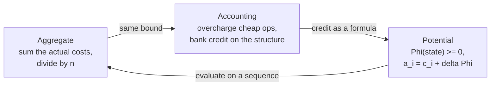

# Amortized Analysis: Why Dynamic Arrays Are O(1)

> The accounting method, applied to the structure you use most.

**Type:** Learn
**Languages:** —
**Prerequisites:** Phase 1 Lesson 01 (Complexity Analysis)
**Time:** ~60 minutes

## Learning Objectives

- Define amortized cost precisely and distinguish it from average-case and worst-case cost
- Apply the aggregate, accounting, and potential methods to the same structure and show they give the same bound
- Prove that appending to a doubling array is O(1) amortized, with the exact constant, by hand
- Explain why union-find with path compression is nearly O(1) amortized per operation and trace a sequence that shows the cost being paid once and then never again
- Identify where an amortized guarantee is the wrong tool: tail latency, adversarial sequences, and structures that are shared or persistent
- Recognize de-amortization as the fix when a worst-case bound is required

## The Problem

An authorization service must answer in under 50 milliseconds at the 99.9th percentile, because the card network times out at 100 and the acquirer retries, and retries double the load during the exact moment the service is struggling. The service keeps the day's authorizations in an in-memory list to detect duplicates. The list is a dynamic array. Its append is documented as O(1), the engineers measured the average at 30 nanoseconds, and the capacity plan assumed that number.

At 2.1 million authorizations, one append took 180 milliseconds. The array had reached its capacity of 2,097,152, allocated a new one twice the size, and copied every element. Every request in flight on that thread missed its deadline. The network retried all of them. The duplicate detector, doing its job, rejected the retries as duplicates, which the issuer's system then logged as suspicious activity. One `add` call produced a page, a fraud alert, and a conversation with a card network.

Nothing in that story was a bug. The array behaved exactly as specified. The specification said "O(1) amortized" and the engineers read "O(1)". Amortized analysis is a precise tool with a precise claim: over any sequence of `n` operations, the total cost is bounded by `n` times the amortized cost. It says nothing about any single operation. The claim is exactly right for throughput and exactly wrong for a deadline.

The opposite failure is just as common. A team rejects a hash map because "resize is O(n)" and builds a balanced tree with a guaranteed O(log n) per operation instead. Their lookups are now ten times slower on every call to avoid a cost that, summed over the life of the process, was smaller than one second. They paid a permanent tax to insure against a risk they never quantified.

This lesson is about quantifying it. Three methods give the same number from three directions; knowing all three lets you pick the one that makes a particular structure's bound obvious, and lets you see exactly where the bound stops applying.

## The Concept

### What "amortized" claims

For a sequence of operations `op_1, ..., op_n` with actual costs `c_1, ..., c_n`, an amortized cost `a` per operation is any number such that:

```text
c_1 + c_2 + ... + c_n  <=  n * a      for every sequence of n operations, starting from the empty structure
```

Three things to notice. The bound is on the **sum**, and it holds for **every** sequence, not on average over random inputs. That makes it a worst-case guarantee about totals. It is not probabilistic (that is average-case analysis, which depends on an input distribution) and it is not a per-operation worst case (which would say `c_i <= a` for each `i`). A single `c_i` can be as large as it likes, provided the cheap operations before it paid for it.

| Kind of bound | Claims | Depends on | Example |
|---------------|--------|------------|---------|
| Worst case per operation | every `c_i <= a` | nothing | red-black tree insert: O(log n) always |
| Amortized | `sum c_i <= n * a` for every sequence | the sequence starting from empty | dynamic array append: O(1) amortized, O(n) worst |
| Average case | `E[c_i] <= a` | a probability distribution over inputs | hash map lookup: O(1) expected, assuming a good hash |
| Expected amortized | both | a distribution and a sequence | splay tree with random access pattern |

The authorization service needed the first row and had the second. A hash map resize is the second row's cost model with the third row's assumptions layered on; Lesson 06 builds one and Lesson 07 shows what happens when the distribution assumption is attacked.

### Five misreadings, and the sentence that corrects each

1. *"Amortized O(1) means each operation is about O(1)."* No: it means the total over `n` operations is O(n); any single operation may be O(n).
2. *"Amortized is the same as average case."* No: amortized is a worst-case bound on sums over every sequence; average case assumes a distribution over inputs and can be defeated by an adversary who picks the inputs.
3. *"The expensive operation is rare, so it does not matter."* It matters exactly when a deadline, a lock, or a shared resource is involved; rarity does not shorten it.
4. *"If I start from a big structure the bound still holds."* Only if that structure was built by a sequence from empty whose credit is intact; a structure handed over at zero credit charges full price on the first operation.
5. *"Amortized bounds are a theoretical nicety."* They are the reason `ArrayList.add`, `HashMap.put`, and every growable buffer in every language are usable at all; the misreading is treating them as per-call guarantees.

### Method 1: aggregate

Count the total cost of the whole sequence directly, then divide by `n`. It is the most honest method and the hardest to apply to anything but simple structures, because you need a closed form for the sum.

For a dynamic array that starts at capacity 1 and doubles when full, appending `n = 16` elements:

```text
append #   1  2  3  4  5  6  7  8  9 10 11 12 13 14 15 16
write      1  1  1  1  1  1  1  1  1  1  1  1  1  1  1  1    = 16
copy       0  1  2  0  4  0  0  0  8  0  0  0  0  0  0  0    = 15   (copies happen at appends 2, 3, 5, 9)
total      1  2  3  1  5  1  1  1  9  1  1  1  1  1  1  1    = 31
```

The copies are `1 + 2 + 4 + 8 = 15 = 16 - 1`. In general the copy total is `1 + 2 + 4 + ... + 2^k < 2^(k+1) <= 2n`, so total cost is under `n + 2n = 3n`, and the amortized cost per append is at most 3. The actual cost of append #9 was 9; the amortized bound still says 3, because appends 6, 7, and 8 cost 1 each and had slack to spare.

Where `n` is a power of two the bound is tight at `2n - 1 + n`; for `n = 2^k + 1`, right after a doubling, the ratio is worst and still under 3. Lesson 03 measures this: one million appends, 1,048,568 copies, 1.049 copies per append plus the write.

### Method 2: accounting

Charge each operation an amortized cost; when the actual cost is lower, the difference is deposited as credit on the structure; when it is higher, credit is withdrawn. The method is valid if the credit never goes negative, because then the total amortized charge is at least the total actual cost.

Charge 3 per append. Each append spends 1 to write its own element and banks 2 credits on the element it just wrote. When the array of capacity `m` fills and must copy `m` elements into a new array of `2m`, which elements have credit? The array last doubled when it had `m/2` elements; the `m/2` elements appended since then each hold 2 credits, which is `m` credits in total, exactly enough to pay for copying all `m` elements. After the copy the credit is zero, and the next `m` appends rebuild it.

```text
capacity 4, elements 1..4; elements 3 and 4 were appended since the last doubling and carry 2 credits each = 4 credits
append 5: array full. Copy elements 1..4: cost 4, paid by the 4 credits. Write element 5: cost 1. Bank 2 credits on element 5.
capacity 8, credit = 2. Appends 6, 7, 8 bank 2 each -> credit 8 = exactly the copy cost at append 9.
```

Why 3 and not 2? Because each copy must pay for an element that has credit **and** one that does not: the `m/2` elements from before the last doubling spent their credit in that doubling. Each new element must therefore pay for its own future copy and for one old element's future copy: 1 write + 2 credits. If you charge 2, the credit goes negative, and the method fails, correctly, because 2 is not a valid amortized bound: 17 appends cost 17 writes plus `1 + 2 + 4 + 8 + 16 = 31` copies, 48 in total, but charging 2 collects only 34. The accounting method's failure is informative: it tells you the bound you proposed is wrong.

The accounting method is the one engineers use in their heads. "Every insert pays a little toward the next resize" is this method; the discipline is to check the credit never goes negative on **every** sequence, which is where the shrink-thrash bug in Lesson 03 is caught.

### Method 3: potential

Define a potential function `Phi(state) >= 0` with `Phi(empty) = 0`. The amortized cost of an operation is its actual cost plus the change in potential:

```text
a_i = c_i + Phi(state_i) - Phi(state_{i-1})
sum a_i = sum c_i + Phi(state_n) - Phi(state_0) >= sum c_i      since Phi(state_n) >= 0 = Phi(state_0)
```

So any bound on every `a_i` is a valid amortized bound. The potential is the credit from the accounting method written as a single formula over the state, which makes it checkable without tracking who holds what.

For the doubling array, with `size` elements and `capacity` slots, use `Phi = 2 * size - capacity` (non-negative whenever the array is at least half full, which it always is right after a doubling and stays until the next one, and `Phi(empty with capacity 1) = -1`, so shift by one or start at capacity 0; the constant does not affect the bound).

- Append without copy: `c = 1`, `size` grows by 1, `capacity` unchanged: `a = 1 + 2 = 3`.
- Append with copy from capacity `m` to `2m`: `c = m + 1` (copy `m`, write 1). Before: `size = m`, `Phi = 2m - m = m`. After: `size = m + 1`, `capacity = 2m`, `Phi = 2(m + 1) - 2m = 2`. So `a = (m + 1) + (2 - m) = 3`.

Every append has amortized cost exactly 3. The potential method's strength is that it handles mixed sequences: add `removeLast` with `c = 1` and the potential drops by 2, giving `a = -1`, which is fine (the bound is an upper bound). Add a shrink rule and you can prove or refute the hysteresis design from Lesson 03 in two lines: with "shrink to half when below one quarter full" and `Phi = |2 * size - capacity|`, every operation has amortized cost at most 3; with "shrink when below half full", the potential right after a shrink is zero and the next grow has nothing to pay with, so the amortized cost of the sequence is unbounded.



### A second structure: the stack with multipop

The textbook warm-up, included because it shows the accounting method with no arithmetic at all. A stack supports `push` (cost 1), `pop` (cost 1), and `multipop(k)` (pop `min(k, size)` elements, cost equal to the number popped). A single `multipop` can cost `n`. Over any sequence of `n` operations from empty, however, each element is popped at most once and was pushed exactly once, so the total number of pops across all `pop` and `multipop` calls is at most the total number of pushes, which is at most `n`. Total cost at most `2n`; amortized cost 2 per operation.

In accounting terms: charge 2 for every `push`, 1 to do the push and 1 banked on the element. Charge 0 for `pop` and `multipop`; each popped element pays with its own banked credit. Credit never goes negative because you cannot pop an element that was not pushed. The potential function is simply the stack size.

The payments shape of this structure is the saga compensation stack from Lesson 05: pushes during the forward path, one `multipop` on failure. The failure path can be long, but it cannot be longer than the forward path that preceded it.

### A third structure: the hash map resize

Lesson 06 builds a hash map that doubles its bucket array when the load factor (`size / buckets`) exceeds 0.75 and rehashes every entry into the new array. The resize costs O(size). By the doubling argument above, inserts are O(1) amortized: with `b` buckets the map resizes at `0.75b` entries, the previous resize was at `0.375b`, so `0.375b` cheap inserts preceded each rehash of `0.75b` entries. Charge each insert 1 for itself plus 2 for the rehash (one for itself, one for an entry from before the last resize) plus the expected probe cost from Lesson 06's analysis: O(1) amortized, O(1) expected, two different qualifiers for two different reasons.

Deletions do not shrink `java.util.HashMap`, so there is no thrash case. Deletions do matter in open-addressing maps that use tombstones (Lesson 06): the tombstones count toward the load factor, so a workload of alternating inserts and deletes on a map of constant size still triggers periodic rehashes. The amortized bound survives (each rehash is paid for by the inserts that created the tombstones), but a team that expected zero rehashes on a "constant-size" map gets a latency spike every few hundred thousand operations, which is the Problem section's story with a different structure.

### A fourth structure: union-find

Union-find (Lesson 10 builds it) maintains disjoint sets under two operations: `find(x)` returns a canonical representative of x's set, and `union(x, y)` merges two sets. The payments use is entity resolution: link accounts, devices, and cards that belong to the same actor, and ask "are these two in the same ring" in constant time.

Each set is a tree; `find` walks parent pointers to the root. Without care, a chain of `n` unions produces a path of length `n` and `find` is O(n). Two heuristics fix it: **union by rank** (attach the shorter tree under the taller) bounds every path by `log n`, and **path compression** (after a `find`, point every node on the walked path directly at the root) flattens the tree as a side effect of reading it.

The worked numbers: eight elements, unioned into a chain by a sequence that defeats union by rank (so we see compression alone at work). After unions producing the path `7 -> 6 -> 5 -> 4 -> 3 -> 2 -> 1 -> 0`:

```text
find(7):  walk 7,6,5,4,3,2,1,0        cost 7 links
          compress: 7,6,5,4,3,2,1 all point to 0
find(7):  walk 7,0                     cost 1 link
find(5):  walk 5,0                     cost 1 link
find(6):  walk 6,0                     cost 1 link
```

The first `find` cost 7 and paid for seven future finds to be O(1). This is amortization in its purest form: the expensive operation **improves the structure**, so its cost is recovered by every later operation that benefits. Tarjan proved in 1975 that with both heuristics any sequence of `m` operations on `n` elements costs `O(m * alpha(n))`, where `alpha` is the inverse Ackermann function, which is at most 4 for any `n` that fits in the observable universe. The proof is a potential-function argument over node ranks and is one of the celebrated results of the field; Lesson 10 cites it and measures the flattening directly. For this lesson the shape is what matters: each compression step reduces a potential that is bounded by `n log n` in total, so compression steps cannot be expensive forever.

### Where the amortized guarantee stops

**Deadlines.** The authorization service in The Problem needed `c_i <= 50 ms` for each `i`. An amortized bound cannot promise that; only a worst-case bound can. The fix is **de-amortization**: spread the expensive operation across the cheap ones so no single operation does it all. For a dynamic array, keep the new array alongside the old one and move two elements per append; by the time the old array is full, the new one holds everything, and no append ever costs more than 3. For hash maps, the same idea is **incremental resizing** (Redis, Go's `map`): rehash a few buckets per operation. Phase 3's structures use it wherever a p99.9 matters.

**Adversarial sequences.** The bound holds for every sequence **from empty**. It does not hold if you start mid-sequence: a structure handed to you at the moment its credit is zero will charge you the full cost on the first operation. In the accounting method's terms, you inherited an account with no balance. This matters for shared structures: in a multi-tenant service, tenant A's cheap operations bank the credit and tenant B's one operation spends it, which is a fairness problem and, if tenant B can time it, a denial-of-service lever. Lesson 07 shows the hash-map version of this attack.

**Persistence.** If old versions of the structure stay reachable (undo stacks, snapshot isolation, functional data structures), the accounting method breaks: an operation on an old version may spend credit that a different branch already spent. Amortized bounds on persistent structures need either a worst-case design or the lazy-evaluation techniques from Okasaki; this course meets the problem in Phase 7 when a transaction log must be both appendable and snapshot-readable.

**Measuring the wrong thing.** "O(1) amortized, measured at 30 ns average" told the team nothing about the 180 ms spike. The measurement that matters for a deadline is the maximum, or the p99.9, over a long enough run to include the expensive operations. Lesson 01's benchmarking discipline applies: report the distribution, not the mean.

### Reading an amortized bound in documentation

Library documentation states these bounds, and reading them precisely is a skill. The Javadoc for `java.util.ArrayList` says: "The add operation runs in amortized constant time, that is, adding n elements requires O(n) time." That is the aggregate method stated in one sentence, and it is careful not to say "constant time". The Javadoc for `ArrayDeque` says "Most ArrayDeque operations run in amortized constant time. Exceptions include remove, removeFirstOccurrence, ... iterator.remove(), and the bulk operations, all of which run in linear time." The Javadoc for `HashMap` says "constant-time performance for the basic operations (get and put), assuming the hash function disperses the elements properly," which is an expected bound (depends on the distribution of hash values) and says nothing about amortization because the resize is mentioned separately: "the hash table is rehashed ... so that the hash table has approximately twice the number of buckets."

| Documentation phrase | Kind of bound | What it promises about one call | What it promises about n calls |
|----------------------|---------------|---------------------------------|--------------------------------|
| "constant time" | worst case | O(1) | O(n) |
| "amortized constant time" | amortized | nothing | O(n) from empty |
| "constant time assuming good hashing" | expected | O(1) on average over hash values | O(n) on average |
| "expected amortized constant time" | both | nothing | O(n) on average over hash values |
| "logarithmic time" (TreeMap) | worst case | O(log n) | O(n log n) |

When a document says only "fast" or "O(1)" without a qualifier, assume the weakest reading until you have read the source. The authorization team read "amortized constant time" and heard "constant time"; the word they skipped was the whole content of the sentence.

### Measuring an amortized cost honestly

Because the amortized bound is about sums and the deadline is about maxima, the two need different measurements:

- **For throughput**, measure total time for `n` operations and divide. This is what the amortized bound predicts, and the measured constant (Lesson 03: 1.049 copies per append for 2x) should match the analysis (`1/(r - 1)` plus the write).
- **For deadlines**, record every operation's latency into a histogram with enough range to hold the expensive ones (HdrHistogram-style: microseconds to seconds), run long enough to include several expensive operations, and read the p99.9 and the maximum. A mean of 30 ns and a maximum of 180 ms are both true of the same array.
- **For capacity planning**, count the expensive operations directly (Lesson 03's `reallocations` counter) and multiply by their cost. Seventeen copies of up to a million references is a number you can reason about; "O(1) amortized" is not.

A test that exercises the amortized bound asserts the sum: "after 100,000 appends, `elementsCopied < 2 * n`". A test that exercises a worst-case bound asserts the maximum: "no single append moved more than 2 elements". Lesson 03 ships the first; Exercise 3 of this lesson asks for the structure that passes the second.

### Which bound do you need?

| Situation | Bound you need | Structure choice |
|-----------|----------------|------------------|
| Batch job: total runtime matters, no per-item deadline | amortized | doubling array, chaining hash map, path-compressed union-find |
| Request path with a per-request deadline | worst case per operation | de-amortized array, incremental-resize hash map, balanced tree |
| Shared structure across tenants or threads | worst case, or amortized with per-tenant accounting | incremental resize; or one structure per tenant |
| Structure with reachable old versions (snapshots, undo) | worst case, or a persistence-aware amortized design | balanced tree; Okasaki-style lazy structures |
| Adversary controls the input (keys, sizes, timing) | worst case, plus randomization against the distribution attack | Lesson 07 |

### What amortized analysis does not do

- It does not bound any single operation. If you need that, you need a worst-case bound or de-amortization.
- It does not depend on, or tell you anything about, the input distribution. That is average-case analysis.
- It does not make the expensive operation cheaper. The copy still takes 180 ms; amortization only tells you that you will not do it often.
- It does not survive being started from an arbitrary state. The guarantee is about sequences from empty.

## Worked Example

A full accounting trace for appends 1 through 9 on a doubling array that starts with capacity 1, charging 3 per append:

| Append | Capacity before | Actual cost (write + copies) | Charged | Credit before | Credit after |
|--------|-----------------|------------------------------|---------|---------------|--------------|
| 1 | 1 | 1 + 0 = 1 | 3 | 0 | 2 |
| 2 | 1 | 1 + 1 = 2 | 3 | 2 | 3 |
| 3 | 2 | 1 + 2 = 3 | 3 | 3 | 3 |
| 4 | 4 | 1 + 0 = 1 | 3 | 3 | 5 |
| 5 | 4 | 1 + 4 = 5 | 3 | 5 | 3 |
| 6 | 8 | 1 + 0 = 1 | 3 | 3 | 5 |
| 7 | 8 | 1 + 0 = 1 | 3 | 5 | 7 |
| 8 | 8 | 1 + 0 = 1 | 3 | 7 | 9 |
| 9 | 8 | 1 + 8 = 9 | 3 | 9 | 3 |

Total actual cost: 24. Total charged: 27. Credit never negative; the bound holds with 3 to spare. Now the same nine appends with the potential method, `Phi = 2 * size - capacity`:

| Append | size, capacity after | Phi after | Actual | Delta Phi | Amortized = actual + delta |
|--------|----------------------|-----------|--------|-----------|-----------------------------|
| 1 | 1, 1 | 1 | 1 | 1 - (-1) = 2 | 3 |
| 2 | 2, 2 | 2 | 2 | 1 | 3 |
| 3 | 3, 4 | 2 | 3 | 0 | 3 |
| 4 | 4, 4 | 4 | 1 | 2 | 3 |
| 5 | 5, 8 | 2 | 5 | -2 | 3 |
| 6 | 6, 8 | 4 | 1 | 2 | 3 |
| 7 | 7, 8 | 6 | 1 | 2 | 3 |
| 8 | 8, 8 | 8 | 1 | 2 | 3 |
| 9 | 9, 16 | 2 | 9 | -6 | 3 |

Every row's amortized cost is exactly 3; the potential rises on cheap appends and collapses on the copy, and the sum of amortized costs (27) exceeds the sum of actual costs (24) by the final potential minus the initial (2 - (-1) = 3). Same bound, three methods, one structure.

Now the sequence that breaks a naive shrink policy. Capacity 8, size 4, rule "grow 2x when full, shrink to half when below half full", `Phi = |2 * size - capacity| = 0`:

| Op | size, capacity after | Actual | Phi after | Amortized |
|----|----------------------|--------|-----------|-----------|
| removeLast | 3, 4 (shrink, copy 3) | 4 | 2 | 6 |
| add | 4, 4 | 1 | 4 | 3 |
| add | 5, 8 (grow, copy 4) | 5 | 2 | 3 |
| removeLast | 4, 8 | 1 | 0 | -1 |
| removeLast | 3, 4 (shrink, copy 3) | 4 | 2 | 6 |

The potential never accumulates enough to pay for the copies; the amortized cost of the shrinks is 6 and would be `n` for an array of size `n`. Change the shrink trigger to "below one quarter full" and the row for the first `removeLast` becomes `size 3, capacity 8, Phi = 2, amortized = 1 + 2 = 3`; the copies cannot happen until `Phi` has grown to pay for them. This is the proof behind Lesson 03's hysteresis, and it took five lines.

### De-amortization, traced

The de-amortized array from the "Where the amortized guarantee stops" section, with old capacity 4 holding `a b c d` and a new array of capacity 8. Each append writes its element into the new array and migrates two elements from the old one; `migrated` counts how many old elements have moved.

| Append | Writes to new | Migrates from old | Old array | New array | Max work this append |
|--------|---------------|-------------------|-----------|-----------|----------------------|
| e | slot 4 | a, b | `. . c d` | `a b . . e . . .` | 3 writes |
| f | slot 5 | c, d | `. . . .` (retired) | `a b c d e f . .` | 3 writes |
| g | slot 6 | nothing left | | `a b c d e f g .` | 1 write |
| h | slot 7 | nothing left | | `a b c d e f g h` | 1 write |
| i | new array full: allocate capacity 16, start migrating | a, b | `. . c d e f g h` | `a b . . . . . . i . . . . . . .` | 3 writes + 1 allocation |

The old array of capacity `m` is fully migrated after `m / 2` appends, and the new array of capacity `2m` has room for `m` appends before it fills, so migration always finishes before the next allocation starts. No append ever does more than 3 writes and one allocation (and the allocation itself is O(1) if the runtime zero-fills lazily or if it is done in slices). The cost is memory: during migration both arrays are live, so peak memory is `3m` instead of `2m`, and reads must check which array holds index `i` (one comparison). That is the price of converting "O(1) amortized" into "O(1)", and for the authorization service it is a price worth paying.

### Where amortized bounds live in a payments stack

| Component | Amortized operation | Expensive step | Who pays if the deadline matters |
|-----------|---------------------|----------------|----------------------------------|
| Idempotency store (hash map, Lesson 06) | `put` | rehash on resize | request thread, unless resize is incremental |
| Pending-authorization index (Lesson 03 array) | append | copy on grow | request thread, unless pre-sized or de-amortized |
| Entity resolution (union-find, Lesson 10) | `find` | path compression after a long chain | the first query after a bulk load; later queries are faster |
| Retry scheduler (heap, Lesson 09) | `push`/`pop` | heap array grow | the scheduler tick that hits the grow |
| Write-ahead log (Phase 7) | append | segment roll and fsync | the write that triggers the roll; usually de-amortized by pre-allocating the next segment |
| Ledger balance cache (Phase 10) | read | recompute from postings after invalidation | the first read after a posting burst |

Every row has the same shape: a cheap common case, an expensive rare case that the cheap cases paid for in aggregate, and a question about who is standing there when the bill comes due.

### Take it with you

`outputs/interview-card-amortized-analysis.md` condenses this lesson to one page: the exact claim, the three methods with the doubling-array numbers, the five situations where amortized is the wrong bound, and the review red flags. Use it before an interview, and use it when someone justifies a latency SLO with the word "amortized".

## Exercises

1. **Reinforce.** A binary counter of `k` bits supports one operation, `increment`, whose cost is the number of bits flipped. Incrementing from 0 to `n` flips bit 0 every time, bit 1 every second time, bit 2 every fourth time. Use the aggregate method to show the total is under `2n`, then find the potential function (hint: number of 1 bits) that gives amortized cost exactly 2 per increment.
2. **Apply.** Lesson 03's `DynamicArray` grows by 1.5x. Redo the accounting method for growth factor `r`: how many credits must each append bank so that the copy at the next growth is paid for? Express the amortized cost as a function of `r`, check it against the measured 2.011 copies per append for `r = 1.5` and 1.049 for `r = 2`, and explain why the measured numbers are slightly below your bound.
3. **Extend.** The authorization service in The Problem needs a worst-case O(1) append. Design the de-amortized dynamic array: two arrays, the old of capacity `m` and the new of capacity `2m`, with every append writing its element to the new array and also moving two elements from old to new. Prove that the old array is fully migrated before the new one fills, state the worst-case cost of any single append, and state what the design costs in memory compared to the plain doubling array. Then connect it to Phase 3's incremental hash map resize.

## Key Terms

| Term | What people say | What it actually means |
|------|-----------------|------------------------|
| Amortized cost | "O(1) on average" | A per-operation number `a` such that any sequence of `n` operations from empty costs at most `n * a` in total; a worst-case bound on sums, not an average over inputs |
| Aggregate method | "add it all up" | Compute the total cost of the whole sequence in closed form and divide by `n` |
| Accounting method | "every insert pays a bit toward the resize" | Overcharge cheap operations and bank the surplus as credit on the structure; valid only if credit never goes negative on any sequence |
| Potential method | "the energy stored in the structure" | A function `Phi(state) >= 0` with `Phi(empty) = 0`; amortized cost is actual cost plus the change in `Phi` |
| De-amortization | "spread the work out" | Restructuring so the expensive operation is performed incrementally across the cheap ones, converting an amortized bound into a worst-case one at a memory or constant-factor cost |
| Average-case cost | "O(1) on average" | Expected cost under a probability distribution over inputs; a different claim from amortized, with different failure modes |
| Inverse Ackermann `alpha(n)` | "basically constant" | The amortized cost per union-find operation with union by rank and path compression; at most 4 for every `n` below 2^65536 |

## Further Reading

- Robert E. Tarjan, ["Amortized Computational Complexity"](https://doi.org/10.1137/0606031), SIAM Journal on Algebraic and Discrete Methods, 1985 — the paper that named the technique and introduced the potential method; the dynamic array and union-find are both worked examples.
- Cormen, Leiserson, Rivest, Stein, [*Introduction to Algorithms*](https://mitpress.mit.edu/9780262046305/introduction-to-algorithms/) (MIT Press), Chapter 17 — aggregate, accounting, and potential methods on the binary counter, the stack with multipop, and dynamic tables including the shrink policy with hysteresis.
- Robert E. Tarjan, ["Efficiency of a Good But Not Linear Set Union Algorithm"](https://doi.org/10.1145/321879.321884), Journal of the ACM, 1975 — the inverse-Ackermann bound for union-find with path compression and union by rank.
- Chris Okasaki, [*Purely Functional Data Structures*](https://doi.org/10.1017/CBO9780511530104) (Cambridge University Press), Chapter 5 and 6 (1998) — why amortized bounds fail under persistence and how lazy evaluation restores them; the clearest statement of the "inherited credit" problem.
- [Redis documentation: incremental rehashing](https://redis.io/docs/latest/develop/reference/internals/) and the `dict.c` source — a production de-amortized hash table that rehashes a few buckets per operation to keep tail latency flat.
- Gil Tene, ["How NOT to Measure Latency"](https://www.youtube.com/watch?v=lJ8ydIuPFeU) (2015) — why averages hide exactly the operations amortized analysis is about, and how to measure a p99.9 honestly.
