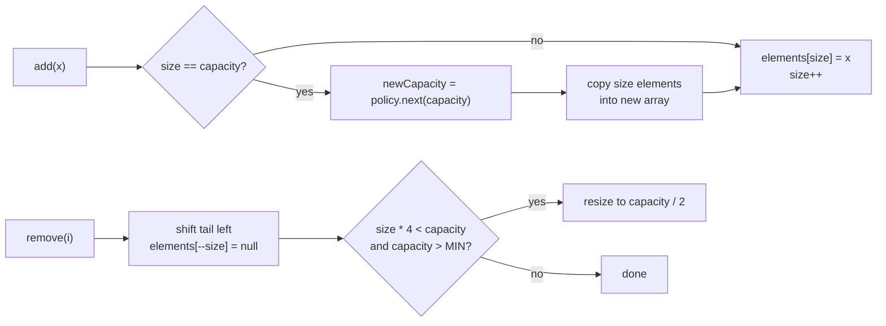

# Dynamic Arrays from Scratch

> Growth factors, memory layout, and why 1.5x beats 2x in some runtimes.

**Type:** Build
**Languages:** Java, Python
**Prerequisites:** Phase 1, Lesson 01 (Complexity Analysis), Phase 1, Lesson 02 (Amortized Analysis)
**Time:** ~75 minutes

## Learning Objectives

- Distinguish size from capacity and state the invariant a dynamic array maintains between them
- Implement append, indexed access, insert, and remove over a backing array with explicit reallocation
- Compare growth factors 1.5x and 2x by measuring copies, reallocations, and slack rather than by reasoning alone
- Explain why a growth factor below the golden ratio lets an allocator reuse freed blocks and why 2x never can
- Design a shrink policy with hysteresis so that an add/remove sequence at the boundary cannot thrash
- Name what `java.util.ArrayList`, Python's `list`, and Go's `append` do differently and where each one bites

## The Problem

A settlement service ingests the daily clearing file from a card network. The file is a few million records; the parser appends each record to an in-memory list before sorting and posting them to the ledger. The code is `records.add(record)` in a loop, and nobody thinks about it because `ArrayList.add` is "O(1)".

The first problem shows up in a heap dump during an incident. The list holds 3.2 million records but its backing array has room for 4.8 million, so a third of the largest object in the process is empty slots. The service was sized to the record count and runs out of heap on the busiest day of the month. The second problem shows up in a latency chart: once every few hundred thousand appends, one `add` takes 40 milliseconds instead of 40 nanoseconds, because that is the call that allocates a new array and copies every existing record into it. Averaged over the whole file the cost is invisible; on a p99.9 chart it is a row of spikes exactly where the capacity doubles.

The third problem is subtler and belongs to a different team. Their bounded worker queue is an array that grows when full and shrinks when half empty. Under a steady load that hovers at the boundary, every `add` triggers a grow and every `remove` triggers a shrink, each copying the whole array. A structure documented as O(1) runs at O(n) per operation for hours, and the profiler shows `System.arraycopy` at the top with no obvious caller.

All three are the same structure misunderstood in the same way: a dynamic array is a fixed-size array plus a policy. The policy decides when to reallocate, by how much, and when to give memory back. The previous lesson proved that doubling makes append O(1) amortized. This lesson builds the structure, makes the policy a parameter, measures what each choice costs, and fixes the thrash.

## The Concept

### Size, capacity, and the invariant

A dynamic array owns a backing array of `capacity` slots and uses the first `size` of them. The invariant every operation must preserve:

```text
0 <= size <= capacity
elements[0 .. size)        are the live elements, in order
elements[size .. capacity) are not elements: unreachable through the public API, and null so the GC can collect what they used to hold
```

`get(i)` checks `i < size`, not `i < capacity`. A slot past `size` may contain a stale reference from an earlier `remove`, and handing it back would be a use-after-free in a language that otherwise has none. The null-out on `remove` matters for the same reason: a list that once held a million records and now holds ten should not keep a million records alive.



### The cost model

| Operation | Cost | Why |
|-----------|------|-----|
| `get(i)`, `set(i, x)` | O(1) | one bounds check and one indexed load; the address is `base + i * slotSize` |
| `add(x)` (append) | O(1) amortized, O(n) worst case | free until the array is full, then one copy of all `size` elements |
| `removeLast()` | O(1) amortized | null one slot; occasionally shrink |
| `insert(i, x)` | O(n - i) | every element after `i` moves one slot right |
| `remove(i)` | O(n - i) | every element after `i` moves one slot left |
| iteration | O(n), sequential | contiguous memory: the prefetcher streams it; this is where arrays beat linked lists by an order of magnitude (Lesson 04) |

The O(n) in `insert` and `remove` is a memory move, `System.arraycopy`, which runs at memory bandwidth. Moving a million references is about a millisecond. That is still O(n), and a queue implemented as `insert(0, x)` / `remove(0)` on a dynamic array is the classic quadratic mistake; Lesson 05 builds the ring buffer that avoids it.

### Memory layout: what "contiguous" buys and what it does not

The reason indexed access is O(1) with a tiny constant is arithmetic: element `i` lives at `base + header + i * slotSize`, so there is nothing to search and nothing to follow. The reason iteration is fast is the hardware: a cache line is 64 bytes, so one miss brings in 8 references (compressed oops: 16) or 8 `long` values, and the prefetcher notices the sequential pattern and starts fetching the next lines before you ask. Lesson 01 measured this; Lesson 04 will measure it against a linked list.

What contiguity does not buy you in Java is the elements themselves. A `DynamicArray<Money>` is a contiguous array of references; the `Money` objects are wherever the allocator put them. Summing a million amounts from such an array is one sequential scan over the references plus a million dependent loads to scattered objects. The scan is nearly free; the dependent loads dominate. For the hot paths in later lessons (the ledger's balance recomputation, the WAL's record scan) this is why the course sometimes keeps parallel primitive arrays (`long[] minorUnits`, `int[] currencyIndex`) instead of an array of records: the data, not just the pointers to it, becomes contiguous.

| Layout | What one cache line holds | Sum of 1M elements | Typical cost |
|--------|---------------------------|--------------------|--------------|
| `long[]` | 8 amounts | 125,000 line fills, all sequential | about 1 ms |
| `Object[]` of `Money` records | 8 to 16 references | the reference scan plus 1M dependent loads to scattered objects | 5 to 20 ms, allocation-order dependent |
| Linked list of `Money` nodes | one node's fields, maybe | 1M dependent loads with no prefetch help | 20 to 100 ms (Lesson 04 measures it) |

The numbers are indicative; the ordering is not. It survives every JVM, every CPU, and every language with a heap.

### Growth factor: the trade

When the array is full, the policy picks the next capacity. Every real runtime uses a geometric factor, because a constant increment (`capacity + 1000`) gives O(n) amortized appends: with increment `k`, appending `n` elements costs `n^2 / (2k)` copies. The only question is which factor.

Let the factor be `r` and the final capacity be `C`. The capacities visited are `C/r, C/r^2, ...`, and each grow copies the whole array, so total copies are:

```text
copies = C/r + C/r^2 + C/r^3 + ...  =  C / (r - 1)
r = 2   : copies = C        about 1.0 to 2.0 copies per element appended (C is between n and 2n)
r = 1.5 : copies = 2C       about 2.0 to 3.0 copies per element appended
```

Measured in this lesson's `main`, one million appends from an initial capacity of 8:

| Policy | Reallocations | Elements copied | Copies per append | Final capacity | Slack |
|--------|---------------|-----------------|-------------------|----------------|-------|
| 2x | 17 | 1,048,568 | 1.049 | 1,048,576 | 4.9% |
| 1.5x | 29 | 2,010,617 | 2.011 | 1,005,310 | 0.5% |

Both are O(1) amortized. The factor moves a constant: 2x copies roughly half as much and reallocates fewer times; 1.5x wastes less memory. Slack is bounded by `r - 1`: a 2x array can be up to 50% empty right after a grow (100% slack relative to size), a 1.5x array at most 33% empty. For a list of 3.2 million settlement records, that difference is 1.6 million versus 0.5 million wasted slots at worst.

### Why 1.5x: the golden-ratio argument

There is a second reason runtimes pick a factor below 2, and it is about the allocator, not the copy count. Consider the sequence of blocks the array has occupied and freed. With factor 2 from capacity 8: 8, 16, 32, 64. When you need 64 slots, the blocks you have freed total `8 + 16 + 32 = 56`, which is less than 64; even if the allocator placed them contiguously you cannot reuse them. This holds for every power of two: `1 + 2 + ... + 2^(k-1) = 2^k - 1 < 2^k`. A doubling array always needs fresh memory and leaves a trail of freed blocks it can never return to.

With a factor `r`, the freed blocks eventually cover the next request when `r^(k-1) + r^(k-2) + ... >= r^k` for large `k`, which simplifies to `1/(r-1) >= r`, i.e. `r^2 - r - 1 <= 0`, i.e. `r <= (1 + sqrt 5) / 2 = 1.618`. Below the golden ratio the freed space adds up; above it, it never does. The demo prints the check for 1.5x:

```text
GROW_1_5X: 12(no) 18(fits) 27(fits) 40(fits) 60(fits) 90(fits) 135(fits) 202(fits)
GROW_2X:   16(no) 32(no) 64(no) 128(no) 256(no)
```

Whether a real allocator exploits this depends on the allocator. For a garbage-collected heap with a compacting collector, freed blocks are not the problem and the argument is mostly moot; for `malloc`-based runtimes with size-class allocators, it matters. This is why Facebook's `folly::fbvector` documentation argues for 1.5x, why OpenJDK's `ArrayList` uses 1.5x (`oldCapacity + (oldCapacity >> 1)`), why Go's `append` uses 2x for small slices and tapers toward 1.25x after 256 elements, and why Python's `list` uses roughly 1.125x plus a constant. None of them is wrong; they weigh copies against slack and allocator behaviour differently.

### Shrinking and hysteresis

Growing is forced; shrinking is a choice. Many libraries never shrink (`ArrayList` does not unless you call `trimToSize`). If you do shrink, the trigger must not be the mirror image of the grow trigger. The naive rule "grow by 2x when full, shrink by half when below half full" thrashes, because a shrink lands you exactly at full:

```text
capacity 64, size 32:  remove -> size 31 < 32, shrink to 32, copy 31 elements
capacity 32, size 31:  add    -> size 32 (full)
capacity 32, size 32:  add    -> grow to 64, copy 32 elements
capacity 64, size 33:  remove, remove -> size 31 < 32, shrink to 32, copy 31 elements
```

Two operations in every three or four copy the whole array: O(n) per operation, and amortized analysis cannot rescue it because no cheap operations separate the expensive ones.

The fix is hysteresis: shrink only when the array is below one quarter full, and shrink only to half capacity. Right after a shrink the array is half full, so it takes `capacity/2` appends to force a grow and `capacity/4` removals to force another shrink. Any add/remove sequence must do O(capacity) work between reallocations, which pays for the O(capacity) copy. The potential-method proof from Lesson 02 goes through with `Phi = |2 * size - capacity|`. Measured in `main`: 1,000 add/remove pairs at the boundary cause zero reallocations.

### Worked example by hand

Appending 1 through 5 to an array with initial capacity 4 under 2x:

| Step | Operation | size before | capacity before | Action | size after | capacity after | Copies |
|------|-----------|-------------|-----------------|--------|------------|----------------|--------|
| 1 | add(1) | 0 | 4 | write slot 0 | 1 | 4 | 0 |
| 2 | add(2) | 1 | 4 | write slot 1 | 2 | 4 | 0 |
| 3 | add(3) | 2 | 4 | write slot 2 | 3 | 4 | 0 |
| 4 | add(4) | 3 | 4 | write slot 3 | 4 | 4 | 0 |
| 5 | add(5) | 4 | 4 | full: allocate 8, copy 4, write slot 4 | 5 | 8 | 4 |

Then remove from 64 elements in a capacity-64 array down to 15: the first 48 removals do nothing but null a slot (size 16 at capacity 64 is exactly one quarter, not below it); the 49th removal makes `15 * 4 = 60 < 64`, so the array shrinks to 32 and copies 15 elements.

### Tracing the 1.5x sequence

The capacity sequence under 1.5x from 8 is `8, 12, 18, 27, 40, 60, 90, 135, 202, 303, ...`. Each step is `c + (c >> 1)`, and the integer shift means odd capacities lose a half: `27 + 13 = 40`, not `40.5`. Appending 100 elements:

| Grow # | Capacity before | Capacity after | Elements copied | Running total copied |
|--------|-----------------|----------------|-----------------|----------------------|
| 1 | 8 | 12 | 8 | 8 |
| 2 | 12 | 18 | 12 | 20 |
| 3 | 18 | 27 | 18 | 38 |
| 4 | 27 | 40 | 27 | 65 |
| 5 | 40 | 60 | 40 | 105 |
| 6 | 60 | 90 | 60 | 165 |
| 7 | 90 | 135 | 90 | 255 |

Seven reallocations and 255 copies for 100 appends: 2.55 copies per append, slightly above the asymptotic 2.0 because the final capacity (135) overshoots 100 by 35%. Under 2x the same 100 appends take 4 reallocations (8, 16, 32, 64, 128) and `8 + 16 + 32 + 64 = 120` copies: 1.2 per append, with 28% overshoot. Both numbers converge toward the `1/(r - 1)` bound as `n` grows, which is what the million-element measurement shows.

### What this structure does not do

- It does not give O(1) insertion or removal anywhere but the end. If you need both ends, use the ring buffer (Lesson 05); if you need the middle, use a linked list with a handle to the node (Lesson 04) or a tree (Lesson 08).
- It does not keep element addresses stable. After a grow, every element has moved; a pointer or index taken before the grow is still a valid index but the old array is garbage. Languages with raw pointers (C++'s `std::vector`) make this a use-after-free; Java makes it a stale snapshot.
- It does not bound memory. A dynamic array grows until the heap is exhausted; a bounded queue is a different contract (Lesson 05).
- It does not give you the hardware-level win over linked lists by itself: that comes from the elements being contiguous, which is true for primitives and for references, but the objects those references point to are wherever the allocator put them.

## Build It

The implementation lives in `code/java/Main.java`; the tests are in `MainTest.java`.

### Step 1: The growth policy as a value

```java
enum GrowthPolicy {
    GROW_1_5X {
        @Override int next(int capacity) {
            return Math.max(capacity + 1, capacity + (capacity >> 1));
        }
    },
    GROW_2X {
        @Override int next(int capacity) {
            return Math.max(capacity + 1, capacity << 1);
        }
    };
    abstract int next(int capacity);
}
```

Making the policy an enum with a method, rather than a `double factor` field, keeps the arithmetic in integers (no `(int)(capacity * 1.5)` rounding surprises) and lets the tests and the demo iterate over `values()`. The `Math.max(capacity + 1, ...)` guard matters for tiny arrays: `1 + (1 >> 1)` is `1`, and an array that grows from 1 to 1 never grows. OpenJDK's `ArrayList.grow` has exactly this guard, expressed as `minCapacity - oldCapacity`.

**Predict:** `GROW_1_5X.next(2)` and `GROW_1_5X.next(3)`. Which one hit the guard?

### Step 2: Counters, so the argument is measured

```java
final class ArrayStats {
    long reallocations;
    long elementsCopied;
    long shrinks;
    int peakCapacity;
}
```

Every claim in The Concept is a number this object records. `elementsCopied / n` is the measured copies-per-append; `peakCapacity - n` is the measured slack. When a colleague says "2x is obviously better", the answer is a table, not an opinion.

### Step 3: The structure and its invariant

```java
final class DynamicArray<T> implements Iterable<T> {
    static final int MIN_CAPACITY = 4;

    private Object[] elements;
    private int size;
    private final GrowthPolicy policy;
    private final boolean shrinkEnabled;
    private final ArrayStats stats = new ArrayStats();

    DynamicArray(int initialCapacity, GrowthPolicy policy, boolean shrinkEnabled) {
        if (initialCapacity < 1) throw new IllegalArgumentException("initialCapacity must be >= 1");
        this.elements = new Object[initialCapacity];
        this.policy = Objects.requireNonNull(policy);
        this.shrinkEnabled = shrinkEnabled;
        this.stats.peakCapacity = initialCapacity;
    }
```

The backing array is `Object[]`, not `T[]`, because Java generics are erased and `new T[n]` does not compile. The unchecked cast lives in `get` and `set` only. `shrinkEnabled` exists because the demo needs to measure pure growth without shrink interference, and because production lists usually do not shrink.

### Step 4: Append and the grow path

```java
void add(T value) {
    if (size == elements.length) resize(policy.next(elements.length));
    elements[size++] = value;
}

private void resize(int newCapacity) {
    if (newCapacity < size) throw new IllegalStateException("cannot shrink below size");
    elements = Arrays.copyOf(elements, newCapacity);
    stats.reallocations++;
    stats.elementsCopied += size;
    if (newCapacity > stats.peakCapacity) stats.peakCapacity = newCapacity;
}
```

`Arrays.copyOf` allocates the new array and copies the live prefix in one native call; the slots past `size` in the new array are null by construction, which maintains the invariant without a separate fill. Note what is counted: `elementsCopied += size`, not `+= newCapacity`. Copies are the cost; empty slots are allocated but not touched.

**Predict:** starting at capacity 8 under 2x, after how many appends does the 4th reallocation happen, and how many elements has it copied in total by then?

### Step 5: Access bounded by size, not capacity

```java
@SuppressWarnings("unchecked")
T get(int index) {
    Objects.checkIndex(index, size);
    return (T) elements[index];
}

@SuppressWarnings("unchecked")
T set(int index, T value) {
    Objects.checkIndex(index, size);
    T old = (T) elements[index];
    elements[index] = value;
    return old;
}
```

`Objects.checkIndex(index, size)` throws `IndexOutOfBoundsException` for `index >= size` even when `index < capacity`. The test "get(size) rejected even though slot exists" is the one that catches a tempting bug: checking against `elements.length` compiles, passes most tests, and returns stale or null data in production.

### Step 6: Insert and remove in the middle

```java
void insert(int index, T value) {
    if (index < 0 || index > size) throw new IndexOutOfBoundsException("index " + index + " size " + size);
    if (size == elements.length) resize(policy.next(elements.length));
    System.arraycopy(elements, index, elements, index + 1, size - index);
    elements[index] = value;
    size++;
}

@SuppressWarnings("unchecked")
T remove(int index) {
    Objects.checkIndex(index, size);
    T old = (T) elements[index];
    int moved = size - index - 1;
    if (moved > 0) System.arraycopy(elements, index + 1, elements, index, moved);
    elements[--size] = null;
    maybeShrink();
    return old;
}
```

Two details. `insert` allows `index == size` (append) where `get` does not; the valid index range for insertion has one more position than the range for access. `remove` nulls the vacated last slot before considering a shrink, so even a list that never shrinks does not pin dead objects. `System.arraycopy` handles the overlapping source and destination correctly; a hand-written loop must run in the right direction (right-to-left for insert, left-to-right for remove) or it overwrites elements it has not yet moved.

**Predict:** `insert(1, 20)` on `[10, 30]` with capacity 2 under 1.5x: what is the capacity afterwards, and how many elements did `arraycopy` move?

### Step 7: Shrink with hysteresis

```java
private void maybeShrink() {
    if (!shrinkEnabled) return;
    int capacity = elements.length;
    if (capacity > MIN_CAPACITY && size * 4L < capacity) {
        int target = Math.max(MIN_CAPACITY, capacity / 2);
        if (target < capacity) {
            stats.shrinks++;
            resize(target);
        }
    }
}
```

The condition `size * 4L < capacity` is "strictly below one quarter full"; at exactly one quarter nothing happens, which the test "no shrink at exactly one quarter full" pins down. `size * 4L` uses a `long` multiply so a size near `Integer.MAX_VALUE / 2` cannot overflow into a negative number and trigger a spurious shrink. `MIN_CAPACITY` stops the array from shrinking to 1 and then paying a grow on the very next add.

**Predict:** capacity 32 with 8 elements. You remove one (size 7). Does it shrink? To what? How many adds would then be needed to force a grow?

### Step 8: Run it

```bash
cd phases/01-complexity-and-core-structures/03-dynamic-arrays/code/java
javac -d .out *.java && java -cp .out Main
java -cp .out MainTest
```

Expected output, abbreviated:

```console
== Capacity sequences from 8 to 1,000,000 ==
GROW_1_5X: 29 reallocations, final capacity 1005310
  first ten: [8, 12, 18, 27, 40, 60, 90, 135, 202, 303]
GROW_2X: 17 reallocations, final capacity 1048576
  first ten: [8, 16, 32, 64, 128, 256, 512, 1024, 2048, 4096]

== Measured copies for 1,000,000 appends (initial capacity 8) ==
GROW_1_5X: reallocations=29 copied=2010617 shrinks=0 peakCapacity=1005310  copies/append=2.011  slack=0.5%
GROW_2X: reallocations=17 copied=1048568 shrinks=0 peakCapacity=1048576  copies/append=1.049  slack=4.9%

== Shrink with hysteresis: add/remove at the boundary does not thrash ==
down to 15:    size=15 capacity=32 (15*4 < 64 -> shrink to 32)
1000 add/remove pairs at the boundary: reallocations added = 0
```

The test harness prints `38 passed, 0 failed`.

### In Python

```python
def _resize(self, new_capacity: int) -> None:
    if new_capacity < self._size:
        raise RuntimeError("cannot shrink below size")
    # Arrays.copyOf: a new backing list of new_capacity slots holding the live prefix.
    self._elements = self._elements[:self._size] + [None] * (new_capacity - self._size)
    self._stats.reallocations += 1
    self._stats.elements_copied += self._size
```

`code/python/main.py` keeps `GrowthPolicy`, `ArrayStats`, `DynamicArray`, and the same thresholds. What differs:

- **The backing store is a fixed-length `list` of slots.** Python's own `list` is already a dynamic array that hides its capacity, so the port preallocates `[None] * capacity` and never calls `append` on it; `size` is tracked by hand, and the tail shifts in `insert` and `remove` are slice assignments of equal length, the Python spelling of `System.arraycopy`.
- **Bounds are checked by hand, and negative indexes are rejected.** A Python list would happily answer `a[-1]`; `_check_index` raises `IndexError` for anything outside `0..size-1`, which is what `Objects.checkIndex` does. `NoSuchElementException` from `remove_last` on an empty array also becomes `IndexError`, matching `list.pop()`.
- **No overflow guard.** Python integers are arbitrary precision, so `size * 4L` becomes a plain `self._size * 4 < capacity`.
- **`GrowthPolicy` is an `Enum` with a `next` method** instead of constant-specific bodies; the arithmetic (`max(capacity + 1, capacity + (capacity >> 1))`) is identical, so the capacity sequences, copy counts, and slack percentages print the same numbers as Java.

```bash
cd phases/01-complexity-and-core-structures/03-dynamic-arrays/code/python
python3 main.py
python3 -m unittest -v
```

### Porting notes

The Go port uses a `[]T` slice with `make([]T, size, capacity)` and `copy`, returns `(T, error)` from `get` and `remove` instead of throwing, and zeroes the vacated slot with the zero value of `T` so the GC can reclaim pointer-typed elements. It does not change the design: same `GrowthPolicy`, same `ArrayStats`, same hysteresis thresholds, same tests.

## Use It

### `java.util.ArrayList`

`ArrayList` is this lesson with a 1.5x growth factor, an initial capacity of 10 allocated lazily on the first `add`, no automatic shrink (`trimToSize()` is manual), and a `modCount` that makes iterators fail fast on concurrent modification. Its `grow(int minCapacity)` method computes `oldCapacity + max(minCapacity - oldCapacity, oldCapacity >> 1)` through `ArraysSupport.newLength`, which also handles the approach to `Integer.MAX_VALUE - 8` (the largest array the JVM will allocate). What it hides: every grow is still a full copy, and an `ArrayList<Long>` stores references to boxed objects, so iterating it is pointer chasing, not a contiguous scan of 8-byte values. For a hot path over millions of amounts, a `long[]` managed by hand or a primitive collection library is an order of magnitude faster.

The one thing to always do: pass the expected size to the constructor when you know it. `new ArrayList<>(recordCount)` turns 17 to 29 reallocations into zero and the slack into exactly what you asked for.

### Python `list` and Go slices

CPython's `list` over-allocates by about one eighth plus a small constant (`new_allocated = newsize + (newsize >> 3) + 6`, rounded), so it reallocates far more often than 2x but wastes almost nothing. Go's `append` doubles until 256 elements and then grows by a factor that smoothly declines toward 1.25x (`newcap += (newcap + 3*256) / 4`), rounded up to the allocator's size classes. Both choices favour memory over copies, and both are why a tight append loop in those languages benefits from preallocation (`[None] * n`, `make([]T, 0, n)`) even more than Java does.

### Where it shows up in payments systems

Every batch file parser, every in-memory sort before a bulk insert, and every `SELECT ... INTO` result list is a dynamic array. The failure modes from The Problem have operational fixes: size the list from the file header's record count; stream to the sink in chunks instead of materializing the whole file; and when you see `Arrays.copyOf` high in a profile, look for a growth loop that started from the default capacity.

### Choosing the policy for a workload

| Workload | Policy that fits | Why |
|----------|------------------|-----|
| Known size (file header, page count) | pre-size, no growth | zero copies, zero slack |
| Unknown size, memory-tight (many lists alive at once) | 1.5x or lower | slack bounded at 33%; freed blocks reusable |
| Unknown size, latency-tolerant batch | 2x | fewest copy spikes |
| Latency-sensitive hot path | pre-size or chunk | any reallocation is a tail-latency spike |
| Bursty with long quiet periods | 2x grow, shrink below 1/4 | reclaims memory without thrash |

## Ship It

`outputs/checklist-dynamic-array-review.md` is a short review checklist for any code that accumulates records into an in-memory list: initial capacity, growth, shrink, bounds, and the O(n) operations that hide inside innocent method names. Attach it to reviews of batch jobs and file parsers.

## Exercises

1. **Reinforce.** Add a `GROW_1_25X` policy and a `GROW_CONSTANT_1000` policy. Measure both with `measureAppends` for `n = 100,000` and `n = 1,000,000`. Confirm that the constant-increment policy's copies per append grows with `n` (it is O(n) amortized) while every geometric policy's stays flat.
2. **Apply.** Implement `addAll(Collection<T>)` that reallocates at most once regardless of how many elements are added, choosing the new capacity as `max(policy.next(capacity), size + incoming)`. Write a test proving that adding 1,000 elements to an array of capacity 8 performs exactly one reallocation.
3. **Extend.** Combine with Lesson 02: implement `ArrayStats.potential()` that returns `|2 * size - capacity|` and assert after every operation in a randomized test (seeded `Random`, 100,000 mixed adds and removes) that `actualCost + (potentialAfter - potentialBefore) <= 3` for every non-reallocating operation and that the inequality holds in aggregate across the whole sequence. This turns the potential-method proof into an executable check.

## Key Terms

| Term | What people say | What it actually means |
|------|-----------------|------------------------|
| Capacity | "how big the list is" | The length of the backing array: slots allocated, whether or not they hold elements |
| Size | "how big the list is" | The number of live elements; always `<= capacity`; the only bound `get` may check against |
| Growth factor | "it doubles" | The ratio between consecutive capacities; any constant above 1 gives O(1) amortized appends, and the choice trades copies for slack |
| Slack | "wasted memory" | `capacity - size` right after a grow; bounded by `(r - 1) * size` for growth factor `r` |
| Golden-ratio bound | "1.5x is better for the allocator" | For `r < 1.618`, the sum of previously freed blocks eventually exceeds the next allocation; for `r >= 1.618` it never does |
| Hysteresis | "don't shrink too eagerly" | A gap between the shrink trigger (below 1/4 full) and the post-shrink state (1/2 full) so that reallocations are separated by O(capacity) cheap operations |
| Thrash | "it keeps resizing" | Reallocating on nearly every operation because the grow and shrink triggers are adjacent; O(n) per operation with no amortized relief |

## Further Reading

- [OpenJDK `ArrayList.java` source](https://github.com/openjdk/jdk/blob/master/src/java.base/share/classes/java/util/ArrayList.java) — read `grow(int)` and `ArraysSupport.newLength`; the 1.5x rule and the `MAX_ARRAY_LENGTH` handling are a dozen lines.
- [folly `FBVector.md`](https://github.com/facebook/folly/blob/main/folly/docs/FBVector.md) — the clearest written argument for a growth factor of 1.5 and for memory-reuse-aware reallocation.
- [CPython `Objects/listobject.c`, `list_resize`](https://github.com/python/cpython/blob/main/Objects/listobject.c) — the over-allocation formula and the comment explaining its growth pattern.
- [Go runtime `slice.go`, `nextslicecap`](https://github.com/golang/go/blob/master/src/runtime/slice.go) — the 2x-then-taper policy and the rounding to size classes.
- Cormen, Leiserson, Rivest, Stein, *Introduction to Algorithms*, Chapter 17 (Amortized Analysis), section on dynamic tables — the formal treatment of table doubling and halving with the `|2 * num - size|` potential function this lesson's hysteresis is built on.
