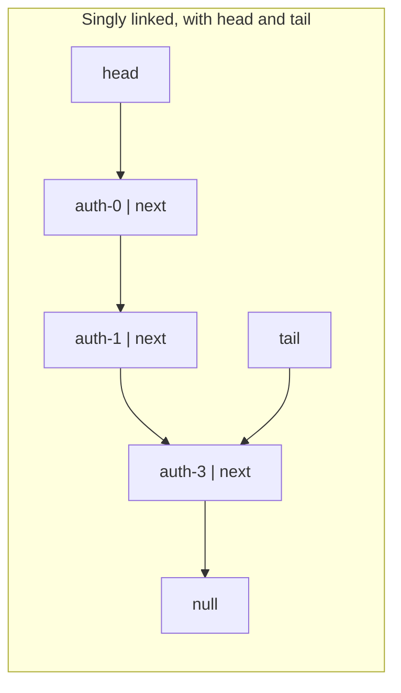
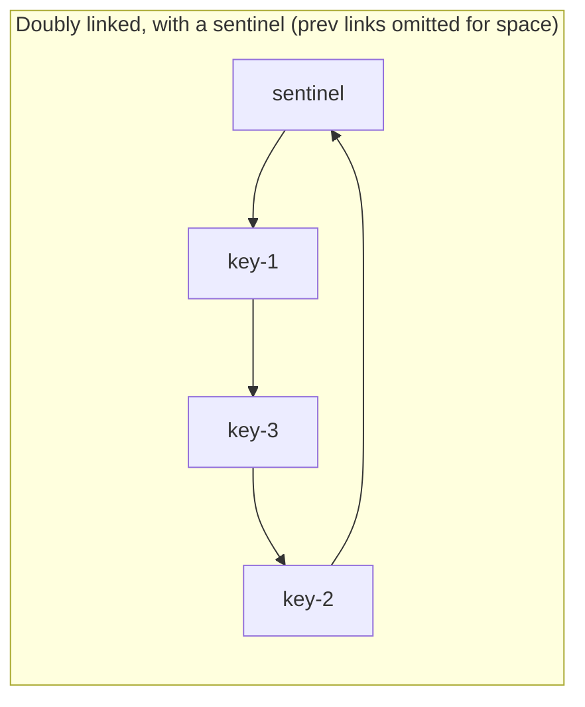

# Linked Lists: Singly, Doubly, and Intrusive

> Pointer chasing is slow; here is when linked lists still win.

**Type:** Build
**Languages:** Java, Python, Go
**Prerequisites:** Phase 1 Lesson 01 (Complexity Analysis), Phase 1 Lesson 03 (Dynamic Arrays)
**Time:** ~75 minutes

## Learning Objectives

- Implement a singly linked list with head and tail pointers and state which operations are O(1) and which are O(n)
- Implement a doubly linked list with a sentinel node so that insert and unlink are the same code at every position
- Explain why handing out node references makes unlink and move-to-front O(1), and why that is the basis of every LRU cache
- Implement an intrusive list where the element carries its own links, and state the one-list-at-a-time constraint it imposes
- Splice two lists in O(1) and explain why ownership tracking makes it O(n) again
- Measure the cache-miss cost of pointer chasing against a contiguous array and decide from the measurement when a linked list is the right choice

## The Problem

An authorization service keeps every pending card authorization in memory until it is captured, voided, or expires. Pending authorizations arrive in time order and mostly leave in time order, so somebody reached for `java.util.LinkedList<PendingAuthorization>`: cheap to append, cheap to remove from the front when the oldest one expires. It worked for a year.

Then captures became the dominant exit path. A capture arrives for an authorization that is somewhere in the middle of two million pending ones, and the code calls `pending.remove(auth)`. `LinkedList.remove(Object)` walks from the head comparing every element until it finds the match: O(n), two million pointer dereferences, each a likely cache miss, around a hundred milliseconds. At two thousand captures per second, the service spends more CPU time walking the list than doing anything else, and the walk holds a lock. Latency climbs, the upstream acquirer times out, and retries make the queue longer. The structure that was chosen for O(1) removal is delivering O(n) removal because the caller does not hold the one thing that would make it O(1): the node.

The second failure is the one everyone has seen. A report iterates a list of transactions with `for (int i = 0; i < list.size(); i++) list.get(i)`. On an `ArrayList` that is O(n). On a `LinkedList` each `get(i)` walks `i` nodes, and the loop is O(n^2): a 100,000-row report takes five billion steps. Nothing in the type signature warns you; `List<T>` promises `get(int)` and says nothing about its cost.

Linked lists are not a bad structure. They are a structure with a narrow contract: O(1) insertion and removal **at a position you already hold**, O(1) splicing of whole lists, and stable element identity across modifications. Everything else they do, an array does faster. This lesson builds three variants to make the contract precise, and then measures the cost that the contract does not mention: following a pointer to memory the CPU has not seen yet.

## The Concept

### The node and the link

A linked list is a chain of nodes, each holding a value and a reference to the next node (and, in a doubly linked list, to the previous one). The list itself holds only a reference to the first node, plus optionally the last. Nothing is contiguous; the nodes are wherever the allocator put them.





Three consequences fall out of the layout:

1. **Position is a pointer, not an index.** The list cannot compute where element `i` lives; it has to walk `i` links. `get(i)` is O(i).
2. **Modification at a held position is local.** Given a node, inserting after it or removing it touches only the node and its neighbours: O(1), no copying, no shifting, and every other node keeps its identity and address.
3. **Every step is a dependent load.** To find node `k + 1` the CPU must first finish loading node `k`. The prefetcher cannot help, because the next address is data, not a pattern.

### The cost table

| Operation | Singly (head + tail) | Doubly (sentinel) | Dynamic array (Lesson 03) |
|-----------|----------------------|-------------------|----------------------------|
| `addFirst` | O(1) | O(1) | O(n) shift |
| `addLast` | O(1) | O(1) | O(1) amortized |
| `removeFirst` | O(1) | O(1) | O(n) shift |
| `removeLast` | O(n): no back pointer to the new tail | O(1) | O(1) |
| `get(i)` | O(i) | O(min(i, n - i)) | O(1) |
| remove given the **node** | O(n): must find the predecessor | O(1) | n/a (no stable handles) |
| remove given the **value** | O(n) | O(n) | O(n) |
| insert before a held node | O(n) | O(1) | n/a |
| splice list B onto A | O(1) with tails | O(1) | O(size of B) |
| iterate n elements | O(n), one cache miss per node | O(n), one cache miss per node | O(n), one miss per 8 to 16 elements |
| memory per element | value ref + next ref + object header: 24 bytes or more beyond the value | plus prev: 32 bytes or more | one reference, 4 to 8 bytes, plus slack |

The row to internalize is "remove given the node": O(n) singly, O(1) doubly. A singly linked node does not know its predecessor, and unlinking requires updating the predecessor's `next`. That is why every structure that needs O(1) removal by handle (LRU caches, timer wheels, free lists, schedulers) is doubly linked.

### The sentinel

A doubly linked list without a sentinel has four cases for every operation: empty list, insert at head, insert at tail, insert in the middle, each with its own null checks. A sentinel is a permanent dummy node whose `next` is the first element and whose `prev` is the last; in an empty list it points to itself. With it there is one case: every element has a non-null `prev` and `next`, so `linkBefore(value, succ)` and `unlink(node)` are each five assignments with no branches. The sentinel costs one node per list and removes an entire class of off-by-one bugs. Java's own `LinkedList` does not use one (it has `first`/`last` fields with null checks); `LinkedHashMap` effectively does, via its `head`/`tail` entries.

### Handles and ownership

The doubly linked list in this lesson returns the `Node` from `addFirst` and `addLast`. That is the design decision that makes it useful: the caller stores the node (in a hash map, in the domain object) and later calls `unlink(node)` or `moveToFront(node)` without searching. An LRU cache is exactly a hash map from key to node plus this list: `get` is a map lookup plus `moveToFront`, eviction is `removeLast`, all O(1). Phase 3 builds that cache on this list.

Handing out nodes creates a new failure mode: a caller can pass a node that was already unlinked, or that belongs to a different list. The `owner` field on each node records which list it is linked into, `unlink` sets it to null, and `requireOwned` rejects anything else. The check is one comparison, and it turns a silent corruption (unlinking a node from the wrong list splices two lists together) into an exception at the call site. `java.util.LinkedList` has no such check because it never exposes nodes; that safety is why its `remove(Object)` is O(n).

### Splice

Moving every node of list B to the end of list A is four pointer assignments: A's last points to B's first, B's first points back, B's last points to A's sentinel, A's sentinel points back to B's last. O(1) regardless of how many nodes moved. This is the operation that makes linked lists the right structure for work queues that merge (a scheduler stealing a whole run queue from another core) and for free lists that are returned in bulk.

With the `owner` field, however, splice must visit every moved node to update its owner, which is O(size of B). The lesson keeps the field because safe `unlink` matters more than O(1) splice in the payment systems this course builds; the Linux kernel's `list_splice` makes the opposite choice (no owner, O(1) splice, and a corrupted list if you misuse it). Both are correct designs for their context; the trade-off is explicit here so you can choose.

### Intrusive lists

In the lists above, the list allocates a `Node` that points to the element. In an intrusive list, the element **is** the node: it extends `IntrusiveNode` (or embeds a `list_head` in C) and carries its own `prev` and `next`. Consequences:

- **No allocation on insert.** The element was allocated when it was created; linking it is pointer assignment.
- **Removal needs nothing but the element.** `pending.remove(auth)` is O(1) because `auth` knows its own neighbours. The authorization service in The Problem is fixed by this one change.
- **Membership is O(1).** `owner == this` answers "is this element in this list" without a hash set.
- **One list at a time.** An element has one pair of links, so it can be in at most one intrusive list. To be in two (pending by time **and** pending by merchant), it needs two sets of links, which is what the kernel does by embedding several `list_head`s in one struct.
- **The type hierarchy is invaded.** `PendingAuthorization extends IntrusiveNode` couples a domain object to a data structure. In C this is idiomatic; in Java it is a deliberate trade made on hot paths (Netty's and the JDK's own `ForkJoinPool` work queues use variants of it).

### Worked example by hand: an LRU over three idempotency keys

Idempotency keys arrive in order 1, 2, 3; the front of the list is most recently used.

| Step | Operation | List (front to back) | Pointer work |
|------|-----------|----------------------|--------------|
| 1 | addLast(key-1), addLast(key-2), addLast(key-3) | key-1, key-2, key-3 | three `linkBefore(value, sentinel)` calls |
| 2 | touch key-3: moveToFront(k3) | key-3, key-1, key-2 | unlink k3 from between key-2 and sentinel (2 writes), link after sentinel (4 writes) |
| 3 | touch key-1: moveToFront(k1) | key-1, key-3, key-2 | same six writes |
| 4 | evict: removeLast() | key-1, key-3 | `unlink(sentinel.prev)` returns key-2 |
| 5 | unlink(k3) directly | key-1 | O(1); k3.owner becomes null |

No step walked the list. Step 5 is the one a `java.util.LinkedList` cannot do.

### The measured cost of pointer chasing

The demo sums one million `long` values three ways: from a `long[]`, from an intrusive list whose nodes were allocated in the same order they are linked (so a walk through the list is also a walk forward through memory), and from an intrusive list whose nodes were allocated sequentially but linked in a seeded random order (so each step jumps to an arbitrary address). On the machine that produced the reference output:

```text
long[] sequential scan        :   0.68 ms
list, nodes in memory order   :   5.39 ms   (8.0x the array)
list, nodes in shuffled order : 132.20 ms   (195.6x the array)
```

Same `n`, same O(n), same sum. The array streams at memory bandwidth: 8 values per 64-byte cache line and a prefetcher that stays ahead. The in-order list pays for a 32-byte object header and link per value and for the dependent load, but the hardware's adjacent-line prefetch still mostly wins. The shuffled list pays a full DRAM round trip (60 to 100 ns) per node, with nothing to overlap it with. Real heaps after a few hours of churn look like the shuffled case, not the sequential one.

The ordering survives every machine; the ratios do not. Run it on yours.

### What linked lists do not do

- They do not give random access. If any caller needs `get(i)`, the list is the wrong type, whatever the interface promises.
- They do not save memory. Each node costs two or three references plus an object header; an array of references costs one reference per element plus slack.
- They do not iterate fast. For a scan over more than a few hundred elements, an array wins by one to two orders of magnitude.
- They do not make `remove(value)` fast. Removal is O(1) only given the node. If you cannot hold the node, use a hash map to find it or use a different structure.

## Build It

The three lists live in `code/java/Main.java`; the tests are in `MainTest.java`.

### Step 1: Singly linked, with the tail pointer that makes `addLast` O(1)

```java
final class SinglyLinkedList<T> implements Iterable<T> {
    private static final class Node<T> {
        T value;
        Node<T> next;
        Node(T value) { this.value = value; }
    }
    private Node<T> head, tail;
    private int size;

    void addLast(T value) {
        Node<T> n = new Node<>(value);
        if (tail == null) { head = tail = n; }
        else { tail.next = n; tail = n; }
        size++;
    }

    T removeFirst() {
        if (head == null) throw new NoSuchElementException("empty");
        T v = head.value;
        head = head.next;
        if (head == null) tail = null;
        size--;
        return v;
    }
```

The two `if` statements are the empty-list special cases a sentinel would remove. Forgetting `if (head == null) tail = null;` leaves `tail` pointing at a removed node; the next `addLast` then links onto garbage and the element is unreachable. The test "singly addLast after emptying works" exists for that bug.

**Predict:** what does `removeLast` cost on this list, and which pointer is missing that would make it O(1)?

### Step 2: Removal by value needs the predecessor

```java
boolean removeFirstOccurrence(T value) {
    Node<T> prev = null, cur = head;
    while (cur != null) {
        if (Objects.equals(cur.value, value)) {
            if (prev == null) head = cur.next; else prev.next = cur.next;
            if (cur == tail) tail = prev;
            size--;
            return true;
        }
        prev = cur;
        cur = cur.next;
    }
    return false;
}
```

The loop carries `prev` alongside `cur` because unlinking `cur` means writing `prev.next`. This is the whole reason singly linked lists cannot remove a node in O(1) given only that node, and the whole reason the next list has a `prev` pointer.

### Step 3: Reversal in place

```java
void reverse() {
    Node<T> prev = null, cur = head;
    tail = head;
    while (cur != null) {
        Node<T> next = cur.next;
        cur.next = prev;
        prev = cur;
        cur = next;
    }
    head = prev;
}
```

Three pointers, one pass, no allocation. It is an interview staple because it tests whether you can hold three moving references in your head; it is in this lesson because it is the simplest operation where forgetting to update `tail` produces a list that looks right until the next `addLast`.

**Predict:** after `reverse()` on `[1, 2, 3]`, what are `head.value` and `tail.value`?

### Step 4: The sentinel, and one `linkBefore` for every position

```java
final class DoublyLinkedList<T> implements Iterable<T> {
    static final class Node<T> {
        T value;
        Node<T> prev, next;
        DoublyLinkedList<T> owner;
        Node(T value) { this.value = value; }
    }
    private final Node<T> sentinel = new Node<>(null);
    private int size;

    DoublyLinkedList() { sentinel.prev = sentinel.next = sentinel; }

    private Node<T> linkBefore(T value, Node<T> succ) {
        Node<T> n = new Node<>(value);
        Node<T> pred = succ.prev;
        n.prev = pred;
        n.next = succ;
        pred.next = n;
        succ.prev = n;
        n.owner = this;
        size++;
        return n;
    }

    Node<T> addFirst(T value) { return linkBefore(value, sentinel.next); }
    Node<T> addLast(T value)  { return linkBefore(value, sentinel); }
```

In an empty list `sentinel.next == sentinel`, so `addFirst` and `addLast` both link between the sentinel and itself. There is no empty-list branch anywhere in the class. The method returns the node: that return value is the handle every O(1) operation below depends on.

### Step 5: O(1) unlink and move-to-front, guarded by ownership

```java
T unlink(Node<T> node) {
    requireOwned(node);
    node.prev.next = node.next;
    node.next.prev = node.prev;
    node.prev = node.next = null;
    node.owner = null;
    size--;
    return node.value;
}

void moveToFront(Node<T> node) {
    requireOwned(node);
    if (sentinel.next == node) return;
    node.prev.next = node.next;
    node.next.prev = node.prev;
    node.prev = sentinel;
    node.next = sentinel.next;
    sentinel.next.prev = node;
    sentinel.next = node;
}

private void requireOwned(Node<T> node) {
    if (node == null || node.owner != this) throw new IllegalArgumentException("node is not linked into this list");
}
```

`unlink` nulls the node's links so a stale handle cannot be used to reach into the list, and sets `owner` to null so a second `unlink` is rejected rather than corrupting `size`. `moveToFront` relinks without allocating: the same node object, six pointer writes, no `new`. On an LRU hot path that is the difference between zero garbage and one object per cache hit.

**Predict:** what happens to `size` if `unlink` is called twice on the same node without the `requireOwned` check?

### Step 6: Splice

```java
void spliceAll(DoublyLinkedList<T> other) {
    if (other == this) throw new IllegalArgumentException("cannot splice a list into itself");
    if (other.size == 0) return;
    Node<T> otherFirst = other.sentinel.next;
    Node<T> otherLast = other.sentinel.prev;
    Node<T> myLast = sentinel.prev;
    myLast.next = otherFirst;
    otherFirst.prev = myLast;
    otherLast.next = sentinel;
    sentinel.prev = otherLast;
    for (Node<T> n = otherFirst; n != sentinel; n = n.next) n.owner = this;
    size += other.size;
    other.sentinel.next = other.sentinel.prev = other.sentinel;
    other.size = 0;
}
```

Four pointer writes do the splice. The `for` loop is the ownership update, and it is the only reason this is not O(1); delete the `owner` field and the loop goes with it, at the cost of the safety in Step 5. The test "splice transfers ownership so nodes can be unlinked from the new list" checks that a handle obtained from B still works after B's nodes moved to A.

### Step 7: The intrusive list

```java
abstract class IntrusiveNode {
    IntrusiveNode prev, next;
    IntrusiveList<?> owner;
    boolean isLinked() { return owner != null; }
}

final class IntrusiveList<T extends IntrusiveNode> implements Iterable<T> {
    private static final class Sentinel extends IntrusiveNode {}
    private final IntrusiveNode sentinel = new Sentinel();
    private int size;

    void addLast(T element) {
        if (element.owner != null) throw new IllegalStateException("element is already in a list");
        IntrusiveNode last = sentinel.prev;
        element.prev = last;
        element.next = sentinel;
        last.next = element;
        sentinel.prev = element;
        element.owner = this;
        size++;
    }

    void remove(T element) {
        if (element.owner != this) throw new IllegalArgumentException("element is not in this list");
        element.prev.next = element.next;
        element.next.prev = element.prev;
        element.prev = element.next = null;
        element.owner = null;
        size--;
    }

    boolean contains(T element) { return element.owner == this; }
}
```

There is no `Node` class and no `new` in `addLast`. `PendingAuthorization extends IntrusiveNode` and the authorization service's capture path becomes `pending.remove(auth)`: O(1), no search, no lock held while walking. The `IllegalStateException` in `addLast` enforces the one-list-at-a-time rule; without it, adding an element to a second list silently corrupts the first.

**Predict:** `pending.contains(auth)` is O(1). What does the equivalent check cost on a `java.util.LinkedList`, and on an `ArrayList`?

### Step 8: Run it

```bash
cd phases/01-complexity-and-core-structures/04-linked-lists/code/java
javac -d .out *.java && java -cp .out Main
java -cp .out MainTest
```

Expected output, abbreviated:

```console
== Doubly linked with a sentinel: O(1) unlink given the node ==
recency order (front = most recent): [idem-key-1, idem-key-2, idem-key-3]
touch key-3 -> [idem-key-3, idem-key-1, idem-key-2]
touch key-1 -> [idem-key-1, idem-key-3, idem-key-2]
evict least recent (removeLast) -> idem-key-2, now [idem-key-1, idem-key-3]

== Intrusive list: the element is its own node ==
pending: auth-7f3a(1999) auth-9c21(4500) auth-0b77(250)
capture auth-9c21: remove(a2) is O(1) with no search; linked before? true
pending: auth-7f3a(1999) auth-0b77(250)  linked after? false

== Measured: summing 1,000,000 longs, array vs linked list (sequential vs shuffled memory order) ==
all three sums equal 499999500000: true
long[] sequential scan :   0.68 ms
list, nodes in memory order :   5.39 ms  (8.0x the array)
list, nodes in shuffled order: 132.20 ms  (195.6x the array)
```

The test harness prints `46 passed, 0 failed`. The timings will differ on your machine; the sums and the ordering will not.

### In Python

The Python port (`code/python/main.py`) keeps all three lists, the sentinel, ownership checks, and `PendingAuthorization`. What differs: **`__slots__` on every node.** Without it each node carries a per-instance `__dict__` and the memory-per-element row of the cost table roughly doubles; `IntrusiveNode` declares `prev`, `next`, `owner`, and subclasses such as `PendingAuthorization` add their own slots. **Exceptions:** `IndexOutOfBoundsException` and `NoSuchElementException` both become `IndexError` (what `list.pop()` raises on an empty list), `IllegalArgumentException` becomes `ValueError`, and `IllegalStateException` (adding an element that is already in a list) becomes `RuntimeError`. **The benchmark measures the interpreter, not the cache.** The shuffle uses a `JavaRandom` that reproduces `java.util.Random`, so the shuffled permutation is identical to Java's and all three sums print `499999500000`. The ratios are not: every `c.value` is a bytecode dispatch and a reference-count update, so the array scan is tens of milliseconds rather than under 1 ms, and the shuffled list is roughly 10x the array instead of 200x. The ordering (array < in-order list < shuffled list) still holds. Python takes the best of 3 rounds instead of 5 to stay under ten seconds.

Run it from `code/python/` with `python3 main.py`; test with `python3 -m unittest -v`.

#### Step 1: Singly linked, with the tail pointer that makes `addLast` O(1)

`_Node` is a nested class with `__slots__` and no generics (Python erases nothing, it simply does not check). `add_last` and `remove_first` are the Java methods with `is None` in place of `== null`; the `self._tail = None` line when the list empties is the same bug guard, and the test "singly add_last after emptying works" exists for it.

```python
class SinglyLinkedList(Generic[T]):
    class _Node:
        __slots__ = ("value", "next")

        def __init__(self, value) -> None:
            self.value = value
            self.next = None

    def __init__(self) -> None:
        self._head: Optional[SinglyLinkedList._Node] = None
        self._tail: Optional[SinglyLinkedList._Node] = None
        self._size = 0

    def add_last(self, value: T) -> None:
        n = SinglyLinkedList._Node(value)
        if self._tail is None:
            self._head = self._tail = n
        else:
            self._tail.next = n
            self._tail = n
        self._size += 1

    def remove_first(self) -> T:
        if self._head is None:
            raise IndexError("empty")  # Java: NoSuchElementException
        v = self._head.value
        self._head = self._head.next
        if self._head is None:
            self._tail = None
        self._size -= 1
        return v
```

#### Step 2: Removal by value needs the predecessor

The loop carries `prev` alongside `cur` for the same reason as in Java: unlinking means writing `prev.next`. `==` compares values (Python's `Objects.equals`) while `is` compares identity for the tail check.

```python
    def remove_first_occurrence(self, value: T) -> bool:
        """O(n): find the node *before* the match so it can be unlinked."""
        prev, cur = None, self._head
        while cur is not None:
            if cur.value == value:
                if prev is None:
                    self._head = cur.next
                else:
                    prev.next = cur.next
                if cur is self._tail:
                    self._tail = prev
                self._size -= 1
                return True
            prev = cur
            cur = cur.next
        return False
```

#### Step 3: Reversal in place

Three references, one pass, no allocation. `nxt` is used as the name because `next` is a builtin; `self._tail = self._head` before the loop is the line that keeps `add_last` correct afterwards.

```python
    def reverse(self) -> None:
        """In-place reversal with three pointers; O(n) time, O(1) extra space."""
        prev, cur = None, self._head
        self._tail = self._head
        while cur is not None:
            nxt = cur.next
            cur.next = prev
            prev = cur
            cur = nxt
        self._head = prev
```

#### Step 4: The sentinel, and one `linkBefore` for every position

`Node` is a public nested class, because callers hold node handles. The constructor points the sentinel at itself, so `_link_before` has no empty-list branch; `add_first` and `add_last` are one-liners that differ only in which node they link before.

```python
class DoublyLinkedList(Generic[T]):
    class Node:
        __slots__ = ("value", "prev", "next", "owner")

        def __init__(self, value) -> None:
            self.value = value
            self.prev: Optional[DoublyLinkedList.Node] = None
            self.next: Optional[DoublyLinkedList.Node] = None
            self.owner: Optional[DoublyLinkedList] = None  # which list this node is linked into; None once unlinked

    def __init__(self) -> None:
        self._sentinel = DoublyLinkedList.Node(None)
        self._sentinel.prev = self._sentinel.next = self._sentinel
        self._size = 0

    def _link_before(self, value: T, succ: Node) -> Node:
        """Link a fresh node holding `value` immediately before `succ`. Works for every position."""
        n = DoublyLinkedList.Node(value)
        pred = succ.prev
        n.prev = pred
        n.next = succ
        pred.next = n
        succ.prev = n
        n.owner = self
        self._size += 1
        return n

    def add_first(self, value: T) -> Node:
        return self._link_before(value, self._sentinel.next)

    def add_last(self, value: T) -> Node:
        return self._link_before(value, self._sentinel)
```

#### Step 5: O(1) unlink and move-to-front, guarded by ownership

`_require_owned` raises `ValueError` when the node is `None` or belongs to another list (or to no list, after an earlier `unlink`). `unlink` clears the node's links and owner so a stale handle is rejected rather than corrupting `size`; `move_to_front` is six attribute writes and no allocation.

```python
    def unlink(self, node: Node) -> T:
        """O(1): the node knows both neighbours, so no search is needed."""
        self._require_owned(node)
        node.prev.next = node.next
        node.next.prev = node.prev
        node.prev = node.next = None
        node.owner = None
        self._size -= 1
        return node.value

    def move_to_front(self, node: Node) -> None:
        """O(1) relink without allocation: the LRU "touch" operation."""
        self._require_owned(node)
        s = self._sentinel
        if s.next is node:
            return
        node.prev.next = node.next
        node.next.prev = node.prev
        node.prev = s
        node.next = s.next
        s.next.prev = node
        s.next = node

    def _require_owned(self, node: Optional[Node]) -> None:
        if node is None or node.owner is not self:
            raise ValueError("node is not linked into this list")
```

#### Step 6: Splice

Four pointer writes relink the two lists; the `while` loop that reassigns `owner` is the only O(n) part and exists only because of the ownership guard. `other is self` is the identity check for the self-splice error.

```python
    def splice_all(self, other: DoublyLinkedList[T]) -> None:
        """O(1) relink regardless of either list's length; ownership transfer is the one O(n) walk."""
        if other is self:
            raise ValueError("cannot splice a list into itself")
        if other._size == 0:
            return
        s = self._sentinel
        other_first = other._sentinel.next
        other_last = other._sentinel.prev
        my_last = s.prev
        my_last.next = other_first
        other_first.prev = my_last
        other_last.next = s
        s.prev = other_last
        n = other_first
        while n is not s:
            n.owner = self
            n = n.next
        self._size += other._size
        other._sentinel.next = other._sentinel.prev = other._sentinel
        other._size = 0
```

#### Step 7: The intrusive list

`IntrusiveNode` is an ordinary base class with three slots; `PendingAuthorization(IntrusiveNode)` adds its own. `add_last` allocates nothing: it writes four links into the element itself. Adding an element that is already linked raises `RuntimeError`, removing one that is not in this list raises `ValueError`, and `contains` is a single identity comparison.

```python
class IntrusiveNode:
    __slots__ = ("prev", "next", "owner")

    def __init__(self) -> None:
        self.prev: Optional[IntrusiveNode] = None
        self.next: Optional[IntrusiveNode] = None
        self.owner: Optional[IntrusiveList] = None

    def is_linked(self) -> bool:
        return self.owner is not None


class IntrusiveList(Generic[T]):
    def add_last(self, element: IntrusiveNode) -> None:
        if element.owner is not None:
            raise RuntimeError("element is already in a list")  # Java: IllegalStateException
        s = self._sentinel
        last = s.prev
        element.prev = last
        element.next = s
        last.next = element
        s.prev = element
        element.owner = self
        self._size += 1

    def remove(self, element: IntrusiveNode) -> None:
        """O(1), no lookup: the element is its own handle."""
        if element.owner is not self:
            raise ValueError("element is not in this list")
        element.prev.next = element.next
        element.next.prev = element.prev
        element.prev = element.next = None
        element.owner = None
        self._size -= 1

    def contains(self, element: IntrusiveNode) -> bool:
        """O(1) membership test, because ownership is recorded in the element."""
        return element.owner is self
```

#### Step 8: Run it

```bash
cd phases/01-complexity-and-core-structures/04-linked-lists/code/python
python3 main.py
python3 -m unittest -v
```

```console
== Doubly linked with a sentinel: O(1) unlink given the node ==
recency order (front = most recent): [idem-key-1, idem-key-2, idem-key-3]
touch key-3 -> [idem-key-3, idem-key-1, idem-key-2]
touch key-1 -> [idem-key-1, idem-key-3, idem-key-2]
evict least recent (removeLast) -> idem-key-2, now [idem-key-1, idem-key-3]

== Intrusive list: the element is its own node ==
pending: auth-7f3a(1999) auth-9c21(4500) auth-0b77(250)
capture auth-9c21: remove(a2) is O(1) with no search; linked before? true
pending: auth-7f3a(1999) auth-0b77(250)  linked after? false

== Measured: summing 1,000,000 longs, array vs linked list (sequential vs shuffled memory order) ==
all three sums equal 499999500000: true
long[] sequential scan :  22.97 ms
list, nodes in memory order :  59.77 ms  (2.6x the array)
list, nodes in shuffled order: 296.17 ms  (12.9x the array)
```

The list sections are identical to Java. The benchmark ratios are compressed by interpreter overhead, as the introduction warns; the ordering is the same.

### In Go

The Go port (`code/go/main.go`) keeps all three lists, the sentinel, ownership checks, and `PendingAuthorization`. What differs: **generics instead of erasure.** `SinglyLinkedList[T comparable]` (it needs `==` for `RemoveFirstOccurrence`), `DoublyLinkedList[T any]` with a `*Node[T]` handle, and `IntrusiveList[T Intrusive]`, where `Intrusive` is a constraint satisfied by any pointer type that embeds `IntrusiveNode`. The sentinel is a plain `Node[T]` value inside the list struct, so an empty list is one allocation. **Embedding replaces inheritance:** Java's `abstract class IntrusiveNode` becomes a struct the element embeds; the promoted `hook()` method gives the list access to the links. Linux's `container_of` macro has no Go equivalent, so `AddLast` stores the element in the hook's `self` field and iteration reads it back. **Errors are values:** `Get`, `Unlink`, `RemoveFirst`, and `RemoveLast` return `(T, error)`; `InsertBefore`, `MoveToFront`, `SpliceAll`, `AddLast`, and `Remove` return `error`; the sentinels `ErrEmpty`, `ErrIndexOutOfBounds`, `ErrNotOwned`, `ErrAlreadyLinked`, and `ErrSpliceSelf` are matched with `errors.Is`. **The benchmark measures the cache, like Java.** The shuffle uses a `JavaRandom` that reproduces `java.util.Random`, so the permutation is identical and all three sums print `499999500000`. Go has no JIT, so the in-order list sits a little further from the slice than in Java, but the ordering (slice < in-order list < shuffled list) and the hundreds-of-times gap for the shuffled list are the same.

Run it from `code/go/` with `go run .`; test with `go test ./...`.

#### Step 1: Singly linked, with the tail pointer that makes `addLast` O(1)

`singlyNode[T]` is unexported because callers never hold singly-linked nodes. The zero value of the struct is a valid empty list, so there is no constructor. `RemoveFirst` returns `(T, error)` with `ErrEmpty`; the `l.tail = nil` reset when the list empties is the same guard as in Java.

```go
type singlyNode[T any] struct {
	value T
	next  *singlyNode[T]
}

type SinglyLinkedList[T comparable] struct {
	head *singlyNode[T]
	tail *singlyNode[T]
	size int
}

// AddLast links a new tail.
func (l *SinglyLinkedList[T]) AddLast(value T) {
	n := &singlyNode[T]{value: value}
	if l.tail == nil {
		l.head, l.tail = n, n
	} else {
		l.tail.next = n
		l.tail = n
	}
	l.size++
}

// RemoveFirst unlinks the head.
func (l *SinglyLinkedList[T]) RemoveFirst() (T, error) {
	if l.head == nil {
		var zero T
		return zero, ErrEmpty
	}
	v := l.head.value
	l.head = l.head.next
	if l.head == nil {
		l.tail = nil
	}
	l.size--
	return v, nil
}
```

#### Step 2: Removal by value needs the predecessor

The `comparable` constraint is what allows `cur.value == value`. Otherwise the loop is the Java one: carry `prev`, unlink through it, fix `tail` if the removed node was last.

```go
func (l *SinglyLinkedList[T]) RemoveFirstOccurrence(value T) bool {
	var prev *singlyNode[T]
	cur := l.head
	for cur != nil {
		if cur.value == value {
			if prev == nil {
				l.head = cur.next
			} else {
				prev.next = cur.next
			}
			if cur == l.tail {
				l.tail = prev
			}
			l.size--
			return true
		}
		prev = cur
		cur = cur.next
	}
	return false
}
```

#### Step 3: Reversal in place

Identical to the Java apart from syntax; `var prev *singlyNode[T]` is the typed nil that starts the chain, and `l.tail = l.head` before the loop keeps the tail pointer honest.

```go
// Reverse is in-place with three pointers; O(n) time, O(1) extra space.
func (l *SinglyLinkedList[T]) Reverse() {
	var prev *singlyNode[T]
	cur := l.head
	l.tail = l.head
	for cur != nil {
		next := cur.next
		cur.next = prev
		prev = cur
		cur = next
	}
	l.head = prev
}
```

#### Step 4: The sentinel, and one `linkBefore` for every position

`Node[T]` is exported with an exported `Value`; `owner` is a typed `*DoublyLinkedList[T]`. The sentinel is a field, not a pointer, so `NewDoublyLinkedList` must exist to point it at itself (`&l.sentinel`), and every comparison with the sentinel takes its address. `linkBefore` is otherwise the Java method.

```go
type Node[T any] struct {
	Value T
	prev  *Node[T]
	next  *Node[T]
	owner *DoublyLinkedList[T] // which list this node is linked into; nil once unlinked
}

type DoublyLinkedList[T any] struct {
	sentinel Node[T]
	size     int
}

// NewDoublyLinkedList makes an empty list whose sentinel points at itself.
func NewDoublyLinkedList[T any]() *DoublyLinkedList[T] {
	l := &DoublyLinkedList[T]{}
	l.sentinel.prev = &l.sentinel
	l.sentinel.next = &l.sentinel
	return l
}

// linkBefore links a fresh node holding value immediately before succ. Works for every position including the ends.
func (l *DoublyLinkedList[T]) linkBefore(value T, succ *Node[T]) *Node[T] {
	n := &Node[T]{Value: value}
	pred := succ.prev
	n.prev = pred
	n.next = succ
	pred.next = n
	succ.prev = n
	n.owner = l
	l.size++
	return n
}

func (l *DoublyLinkedList[T]) AddFirst(value T) *Node[T] { return l.linkBefore(value, l.sentinel.next) }
func (l *DoublyLinkedList[T]) AddLast(value T) *Node[T]  { return l.linkBefore(value, &l.sentinel) }
```

#### Step 5: O(1) unlink and move-to-front, guarded by ownership

`requireOwned` returns `ErrNotOwned`; `Unlink` propagates it with the zero value, `MoveToFront` returns it alone. Nil-ing the links in `Unlink` lets the garbage collector reclaim the node and makes a stale handle fail the ownership check on reuse.

```go
// Unlink is O(1): the node knows both neighbours, so no search is needed.
func (l *DoublyLinkedList[T]) Unlink(node *Node[T]) (T, error) {
	if err := l.requireOwned(node); err != nil {
		var zero T
		return zero, err
	}
	node.prev.next = node.next
	node.next.prev = node.prev
	node.prev, node.next = nil, nil // nil the links so the GC can collect the node
	node.owner = nil
	l.size--
	return node.Value, nil
}

// MoveToFront is an O(1) relink without allocation: the LRU "touch" operation.
func (l *DoublyLinkedList[T]) MoveToFront(node *Node[T]) error {
	if err := l.requireOwned(node); err != nil {
		return err
	}
	if l.sentinel.next == node {
		return nil
	}
	node.prev.next = node.next
	node.next.prev = node.prev
	node.prev = &l.sentinel
	node.next = l.sentinel.next
	l.sentinel.next.prev = node
	l.sentinel.next = node
	return nil
}

func (l *DoublyLinkedList[T]) requireOwned(node *Node[T]) error {
	if node == nil || node.owner != l {
		return ErrNotOwned
	}
	return nil
}
```

#### Step 6: Splice

Same four relinks, same ownership walk. The self-splice case returns `ErrSpliceSelf`, and because the sentinel is a value field, the emptied list is reset by pointing `other.sentinel` back at its own address.

```go
func (l *DoublyLinkedList[T]) SpliceAll(other *DoublyLinkedList[T]) error {
	if other == l {
		return ErrSpliceSelf
	}
	if other.size == 0 {
		return nil
	}
	otherFirst := other.sentinel.next
	otherLast := other.sentinel.prev
	myLast := l.sentinel.prev
	myLast.next = otherFirst
	otherFirst.prev = myLast
	otherLast.next = &l.sentinel
	l.sentinel.prev = otherLast
	// Ownership must follow the nodes: this is the one O(n) walk the splice cannot avoid if nodes track their owner.
	for n := otherFirst; n != &l.sentinel; n = n.next {
		n.owner = l
	}
	l.size += other.size
	other.sentinel.next = &other.sentinel
	other.sentinel.prev = &other.sentinel
	other.size = 0
	return nil
}
```

#### Step 7: The intrusive list

`IntrusiveNode` is a struct the element embeds; the unexported `hook()` method is promoted to the embedding type, and the `Intrusive` constraint demands it (plus `comparable`). Because `owner` must hold a list of any element type it is an `any`, and `Remove` compares it with `any(l)`. `self` is the `container_of` stand-in: `AddLast` stores the element in it, and `Each` reads it back with a type assertion.

```go
type IntrusiveNode struct {
	prev, next *IntrusiveNode
	owner      any // the *IntrusiveList[T] this element is linked into; nil once unlinked
	self       any // the element that embeds this hook: Go's stand-in for container_of
}

// IsLinked reports whether the element is in a list.
func (n *IntrusiveNode) IsLinked() bool { return n.owner != nil }

// hook lets IntrusiveList reach the embedded links through any element type.
func (n *IntrusiveNode) hook() *IntrusiveNode { return n }

// Intrusive is satisfied by any pointer type that embeds IntrusiveNode.
type Intrusive interface {
	comparable
	hook() *IntrusiveNode
}

// AddLast links the element at the tail without allocating.
func (l *IntrusiveList[T]) AddLast(element T) error {
	h := element.hook()
	if h.owner != nil {
		return ErrAlreadyLinked
	}
	last := l.sentinel.prev
	h.prev = last
	h.next = &l.sentinel
	last.next = h
	l.sentinel.prev = h
	h.owner = l
	h.self = element
	l.size++
	return nil
}

// Remove is O(1), no lookup: the element is its own handle.
func (l *IntrusiveList[T]) Remove(element T) error {
	h := element.hook()
	if h.owner != any(l) {
		return fmt.Errorf("%w: element is not in this list", ErrNotOwned)
	}
	h.prev.next = h.next
	h.next.prev = h.prev
	h.prev, h.next = nil, nil
	h.owner = nil
	h.self = nil
	l.size--
	return nil
}

// Contains is an O(1) membership test, because ownership is recorded in the element.
func (l *IntrusiveList[T]) Contains(element T) bool { return element.hook().owner == any(l) }
```

#### Step 8: Run it

```bash
cd phases/01-complexity-and-core-structures/04-linked-lists/code/go
go run .
go test ./...
```

```console
== Doubly linked with a sentinel: O(1) unlink given the node ==
recency order (front = most recent): [idem-key-1, idem-key-2, idem-key-3]
touch key-3 -> [idem-key-3, idem-key-1, idem-key-2]
touch key-1 -> [idem-key-1, idem-key-3, idem-key-2]
evict least recent (removeLast) -> idem-key-2, now [idem-key-1, idem-key-3]

== Intrusive list: the element is its own node ==
pending: auth-7f3a(1999) auth-9c21(4500) auth-0b77(250)
capture auth-9c21: remove(a2) is O(1) with no search; linked before? true
pending: auth-7f3a(1999) auth-0b77(250)  linked after? false

== Measured: summing 1,000,000 int64s, slice vs linked list (sequential vs shuffled memory order) ==
all three sums equal 499999500000: true
[]int64 sequential scan :   0.45 ms
list, nodes in memory order :  16.67 ms  (36.6x the array)
list, nodes in shuffled order: 176.45 ms  (387.8x the array)
```

Timings will differ on your machine; the sums and the ordering will not. The shuffled list is hundreds of times slower than the slice for the same O(n) work, which is the cache-miss argument from The Concept measured rather than asserted.

## Use It

### `java.util.LinkedList`, and why you almost never want it

`LinkedList` is a doubly linked list without a sentinel and without exposed nodes. Because nodes are hidden, `remove(Object)` and `get(int)` are O(n); because every element is a separate 24-byte node pointing to a boxed value, iteration is a pointer chase. Its author, Joshua Bloch, has said publicly that he never uses it; `ArrayDeque` is the better choice for nearly every queue or stack. The remaining legitimate use is `ListIterator.remove()` and `ListIterator.add()` during a traversal, which are O(1) because the iterator holds the node.

### `java.util.ArrayDeque`

For a queue or stack, `ArrayDeque` is a ring buffer over an array (Lesson 05): O(1) at both ends, contiguous, no per-element allocation. It is what to reach for when you were about to type `LinkedList`.

### `LinkedHashMap` and `LinkedHashMap(…, accessOrder = true)`

The JDK's own LRU building block: a hash map whose entries are also nodes in a doubly linked list, with `removeEldestEntry` as the eviction hook. It is exactly the hash-map-plus-doubly-linked-list design from The Concept, and reading its `afterNodeAccess` method shows the same six pointer writes as this lesson's `moveToFront`.

### Intrusive lists in production

The Linux kernel's `struct list_head` is embedded in nearly every kernel object (tasks, inodes, timers, network buffers), and `list_del` is two pointer writes. Netty's object pools, the JDK's `ForkJoinPool` work-stealing queues, and most game engines use the same idea. In payment systems the pattern appears wherever an object must be removable from a time-ordered set in O(1) by the object itself: pending authorizations awaiting capture, in-flight requests awaiting a response for timeout tracking, and connections in a pool.

### Where arrays win anyway

Any list you iterate more than you mutate, any list you index, and any list you sort should be an array. The 196x measurement is the argument; the cache hierarchy that produced it is in every machine you will deploy to.

## Ship It

`outputs/interview-card-linked-lists.md` is a one-page card: the cost table, the three questions to ask before choosing a linked list, the reverse-in-place and LRU patterns, and the trap questions (`LinkedList.get(i)` in a loop, `remove(Object)` on a hot path). Use it to prepare for interviews and to review code that reaches for a linked list.

## Exercises

1. **Reinforce.** Add `removeLast()` to `SinglyLinkedList`. It must be O(n) (walk to the predecessor of `tail`). Then write a test that times `removeLast` on a 100,000-element singly linked list against the doubly linked version and assert the doubly linked version is at least ten times faster.
2. **Apply.** Build `LruCache<K, V>` with `get`, `put`, and a capacity, using `HashMap<K, DoublyLinkedList.Node<Entry<K, V>>>` and this lesson's `DoublyLinkedList`. Every operation must be O(1); the test should insert capacity + 1 keys and assert the least recently used one was evicted, and should assert that `get` on an existing key prevents its eviction. Phase 3 revisits this with TTLs.
3. **Extend.** Combine with Lesson 03: implement the benchmark from `main` for `DynamicArray<Long>` (an array of references to boxed values) as a fourth row. Predict where it lands between `long[]` and the in-order list, then measure. Explain in a comment why the boxed array is closer to one than the other on your machine, and what that implies for a ledger that stores `List<Money>` versus parallel primitive arrays.

## Key Terms

| Term | What people say | What it actually means |
|------|-----------------|------------------------|
| Node | "an element" | The allocated cell holding a value and one or two links; the list is the chain of nodes, the elements are what they hold |
| Sentinel | "a dummy node" | A permanent node whose links frame the list so that every real node has non-null neighbours and no operation has an empty-list branch |
| Handle | "a reference to the item" | The node itself, returned to the caller so it can unlink or move the element in O(1) without searching |
| Intrusive list | "the object has next and prev in it" | A list whose links live inside the element rather than in a separate node; no allocation on insert, O(1) removal by element, at most one list per element |
| Splice | "merge the lists" | Relinking a whole chain into another list in O(1), independent of length; O(n) only if nodes must learn a new owner |
| Dependent load | "pointer chasing" | A memory access whose address comes from the previous access, so the CPU cannot start it early; the reason a linked-list walk is one cache miss per node |
| Cache line | "a block of memory" | The 64-byte unit the CPU moves between RAM and cache; an array scan uses all 8 longs in each line, a list walk uses one node per line and often less |

## Further Reading

- Knuth, [*The Art of Computer Programming*, Volume 1](https://www.informit.com/store/art-of-computer-programming-volume-1-fundamental-algorithms-9780201896831) (Addison-Wesley), Sections 2.2.3 to 2.2.5 (linked allocation, circular lists, doubly linked lists) — the original treatment, including the sentinel idea and the memory-management arguments for and against linking.
- [Linux kernel `include/linux/list.h`](https://github.com/torvalds/linux/blob/master/include/linux/list.h) — the canonical intrusive doubly linked list: `list_add`, `list_del`, `list_splice`, each a handful of pointer writes with no ownership tracking.
- [OpenJDK `LinkedHashMap.java`](https://github.com/openjdk/jdk/blob/master/src/java.base/share/classes/java/util/LinkedHashMap.java) — read `afterNodeAccess` and `afterNodeInsertion` to see this lesson's `moveToFront` and LRU eviction inside a production class.
- [OpenJDK `ArrayDeque.java`](https://github.com/openjdk/jdk/blob/master/src/java.base/share/classes/java/util/ArrayDeque.java) — the class Javadoc states it is faster than `LinkedList` as a queue and than `Stack` as a stack, and explains why.
- Ulrich Drepper, [*What Every Programmer Should Know About Memory*](https://people.freebsd.org/~lstewart/articles/cpumemory.pdf) (2007) — Section 3 measures sequential versus random access and dependent-load chains; the shuffled-list result in this lesson reproduces his random-walk measurements in Java.
