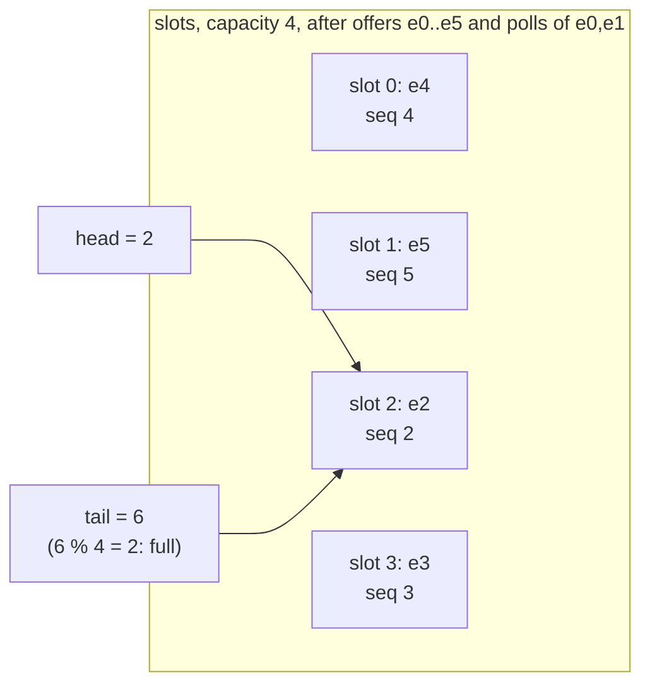

# Stacks, Queues, and Ring Buffers

> A ring buffer is the data structure inside every message broker.

**Type:** Build
**Languages:** Java, Python, Go
**Prerequisites:** Phase 1 Lesson 03 (Dynamic Arrays), Phase 1 Lesson 04 (Linked Lists)
**Time:** ~60 minutes

## Learning Objectives

- Implement a LIFO stack over a growable array and explain why it needs no head pointer and no wraparound
- Implement a bounded double-ended queue over a fixed array using monotonically increasing sequence numbers and `seq % capacity` slot addressing
- Explain how sequence numbers distinguish a full buffer from an empty one without wasting a slot, and why that makes them usable as consumer offsets
- Choose between REJECT and DROP_OLDEST overflow semantics for a bounded queue and state what each one costs the producer and the consumer
- Trace a wraparound by hand with real sequence numbers and slot indices
- Map the ring buffer onto the retention window, offsets, and lag of a broker partition, and name what Kafka and the LMAX Disruptor add to it

## The Problem

A payment-events service publishes one message per state change (authorized, captured, refunded) to an in-process queue that a batch of downstream workers drains. The queue is a `java.util.LinkedList`, used as `addLast` / `removeFirst`. During a sales event the producers outrun the consumers for forty minutes. Nothing rejects, nothing drops, nothing warns; the queue just grows. At 38 million queued events, each a 24-byte node plus a 200-byte event, the JVM spends 90% of its time in garbage collection, then dies with `OutOfMemoryError`. Every queued event is lost, including the ones that were about to be consumed. An unbounded queue did not prevent a failure; it chose the worst moment for one and took the backlog down with it.

A second team solves the same problem with an `ArrayList`: `add` at the end, `remove(0)` at the front. Every `remove(0)` shifts the whole backlog one slot left. With ten thousand events queued, each dequeue copies ten thousand references; the consumer becomes the bottleneck, the backlog grows, and the copy gets longer. O(n) per dequeue, with n growing because of it.

A third team writes a ring buffer and gets the full/empty check wrong. They use `head == tail` to mean empty and `(tail + 1) % capacity == head` to mean full, which works but wastes one slot and, under a copy-paste error, lets a producer overwrite the element the consumer is about to read. The consumer processes a refund for the wrong payment. The bug reproduces only when the buffer is exactly full, which in testing is never and in production is every Friday evening.

Stacks, queues, and deques are the simplest structures in the course, and the bounded ring buffer is the one that matters most: it is the shape of a broker partition, a network card's receive ring, a logger's async buffer, and every bounded handoff between a producer and a consumer. This lesson builds it with sequence numbers instead of wrapped indices, so that full and empty are unambiguous, nothing is ever copied, and the sequence of an element is its offset.

## The Concept

### Three access disciplines

| Structure | Insert | Remove | Order | Canonical use |
|-----------|--------|--------|-------|---------------|
| Stack | top | top | LIFO: last in, first out | call frames, undo, compensation steps, bracket matching, DFS |
| Queue | back | front | FIFO: first in, first out | work handoff, event buffers, BFS, request pipelines |
| Deque | either end | either end | both | sliding windows, work stealing (own end LIFO, thieves' end FIFO), undo with a cap |

All three forbid access in the middle. That restriction is what makes them O(1) at every operation with a trivial implementation, and it is what makes an array the right backing store: there is no `insert(i)` to shift for.

### The stack is a dynamic array that only touches the end

A stack's top is always at index `size - 1`. `push` is `add`, `pop` is `removeLast`. Lesson 03's dynamic array with amortized O(1) append is already a stack; this lesson's `ArrayStack` is that structure with the vocabulary changed and `get(i)` removed. There is no wraparound because nothing is ever removed from the front.

The payments use is the saga: a multi-step operation (reserve funds, post a ledger hold, request capture) that may fail at step `k` and must undo steps `k - 1` down to 1 in reverse order. Push each step's compensation as you perform the step; on failure, pop until empty. The LIFO discipline is the correctness property: you must void the acquirer authorization before you reverse the ledger hold that accounted for it. Phase 7 builds the full saga on this stack.

### The ring buffer: a fixed array plus two sequence numbers

A bounded queue over a fixed array of `capacity` slots keeps two counters:

- `head`: the sequence number of the oldest element (the next to be consumed)
- `tail`: the sequence number the next appended element will receive

Both only ever increase. The element with sequence `s` lives in slot `s % capacity`. The invariant:

```text
0 <= tail - head <= capacity
size  = tail - head
empty = (head == tail)
full  = (tail - head == capacity)
slot(s) = s % capacity         for every live sequence s in [head, tail)
```



Because `size` is a difference of sequence numbers, a full buffer (`size == capacity`) and an empty one (`size == 0`) are distinct even though `head % capacity == tail % capacity` in both cases. The classic wrapped-index design cannot tell them apart and must either waste a slot or keep a separate `count` field. Sequence numbers also give you three things for free:

1. **No element ever moves.** Dequeue advances `head`; enqueue advances `tail`. The O(n) shift that killed the `ArrayList` queue does not exist.
2. **O(1) random access.** The `i`-th element from the front is at `slot(head + i)`, which a linked deque cannot do.
3. **Offsets.** The sequence of an element is a stable, monotonically increasing identifier. A consumer that remembers "I have processed up to sequence 9" can resume, compute its lag as `tail - 9`, and detect that it fell behind the retention window if `9 < head`. This is exactly what a Kafka consumer offset is.

The modulo is the one arithmetic cost per access. With a power-of-two capacity it becomes `seq & (capacity - 1)`, a single AND, which is why the LMAX Disruptor and most high-performance rings require power-of-two sizes. The lesson's implementation uses `%` so any capacity works; the mask is a one-line change.

### Worked example by hand: capacity 4

| Step | Operation | head | tail | size | Slot written or read | Slots (physical order 0..3) |
|------|-----------|------|------|------|----------------------|------------------------------|
| 1 | offer e0 | 0 | 1 | 1 | 0 % 4 = 0 | e0 . . . |
| 2 | offer e1, e2, e3 | 0 | 4 | 4 | 1, 2, 3 | e0 e1 e2 e3 |
| 3 | offer e4 | 0 | 4 | 4 | full: REJECT returns false | e0 e1 e2 e3 |
| 4 | poll | 1 | 4 | 3 | read slot 0 -> e0 | . e1 e2 e3 |
| 5 | poll | 2 | 4 | 2 | read slot 1 -> e1 | . . e2 e3 |
| 6 | offer e4 | 2 | 5 | 3 | 4 % 4 = 0 | e4 . e2 e3 |
| 7 | offer e5 | 2 | 6 | 4 | 5 % 4 = 1 | e4 e5 e2 e3 |
| 8 | get(3) | 2 | 6 | 4 | slot (2 + 3) % 4 = 1 -> e5 | e4 e5 e2 e3 |

After step 7 the buffer is full again, `head % 4 == tail % 4 == 2`, and the physical order `e4 e5 e2 e3` has nothing to do with the logical order `e2 e3 e4 e5`. Iteration follows sequences from `head` to `tail - 1`, not slots from 0 to 3. The demo prints exactly this trace, with `H` and `T` markers on the slots.

### Bounded queue semantics: what happens when it is full

An unbounded queue hides the question until the heap answers it. A bounded queue must answer it on every `offer`:

| Policy | Producer sees | Consumer sees | When it is right |
|--------|---------------|---------------|------------------|
| `REJECT` | `offer` returns false; it must retry, slow down, or shed load | every accepted element, in order, nothing lost | money movement, commands, anything where losing an element is worse than delaying it |
| `DROP_OLDEST` | `offer` always succeeds | the newest `capacity` elements; a gap in sequences where history was evicted | metrics, log tails, market data, position updates: the latest value supersedes the old ones |
| `BLOCK` | `offer` waits until there is room | everything, in order | thread handoff inside one process; needs a lock or a condition variable, which is Phase 4 |

The policy is a property of the queue, not of the caller, because the caller is the party least able to decide: the producer of a payment event does not know whether the consumer can afford to miss one. Making the policy a constructor argument puts the decision where a reviewer can see it. `REJECT` is backpressure: the signal propagates upstream until something that can slow down does. `DROP_OLDEST` is a retention window: the buffer keeps the last `capacity` elements and the `dropped` counter and `head` sequence tell the consumer what it missed.

### Sizing the bound

A bound is only useful if it is the right order of magnitude. Two numbers decide it:

- **Time to fill.** With producers at rate `p` per second and consumers stopped, a buffer of capacity `C` fills in `C / p` seconds. This is how long a consumer outage can last before the policy kicks in. A capacity of 65,536 at 2,000 events per second is 33 seconds; at 50,000 per second it is 1.3 seconds.
- **Steady-state occupancy.** Little's law: the average number of elements in the buffer equals the arrival rate times the average time an element spends there. At 2,000 per second with a consumer that takes 1 ms per element, the buffer holds about 2 elements on average; the capacity exists for bursts, not for steady state.

A worked sizing for the payment-events queue from The Problem: peak producer rate 5,000 per second, consumer throughput 8,000 per second when healthy, acceptable consumer stall 10 seconds before backpressure reaches the producers. Capacity is `5,000 * 10 = 50,000`, rounded to 65,536 for the mask. At 224 bytes per event that is 14.7 MB, which is a number you can put in a design review, as opposed to "unbounded", which is a number you discover from a heap dump.

| Capacity | Fill time at 5,000/s | Memory at 224 B/element | What it tolerates |
|----------|----------------------|-------------------------|-------------------|
| 1,024 | 0.2 s | 229 KB | a GC pause |
| 65,536 | 13 s | 14.7 MB | a consumer restart |
| 4,194,304 | 14 min | 940 MB | a consumer deploy gone wrong, at the cost of the heap |
| unbounded | until the heap is gone | all of it | nothing; it converts a slow consumer into a crash |

### The call stack is a stack

Every recursive algorithm in this course (tree traversal in Lesson 08, DFS in Phase 2, the parser in Phase 11) uses the thread's call stack as its stack. The JVM's default thread stack is 512 KB to 1 MB, which is roughly 10,000 to 20,000 frames; a recursive walk over a degenerate 100,000-node tree throws `StackOverflowError`. Converting recursion to iteration means making the stack explicit: push the work you would have recursed on, loop while the stack is non-empty. `ArrayStack` is that explicit stack, with the heap as its limit instead of the thread stack.

### The broker framing

A Kafka partition is a ring buffer with the array replaced by a sequence of segment files on disk and the capacity replaced by a retention policy (time or bytes). Every message gets a monotonically increasing offset (the sequence number). Consumers track their own offset; lag is `tail - consumerOffset`; a consumer whose offset is below the log start offset (`head`) has fallen behind retention and must reset to earliest or latest, exactly the demo's "must reset to 4 and has lost 2 messages". Producers do not wait for consumers, and old messages are evicted in sequence order: `DROP_OLDEST`, with the drop happening by segment rather than by element.

The LMAX Disruptor is the in-memory, single-process version: a power-of-two ring of preallocated slots, a producer sequence and one sequence per consumer, and a wait strategy instead of `REJECT` (the producer spins or yields until the slowest consumer has moved past the slot it needs). The sequence numbers are the entire coordination mechanism; the Disruptor's performance comes from the fact that each sequence is a single `long` that fits in its own cache line.

Network cards have a receive ring, the kernel's `io_uring` is a pair of rings (submission and completion), and every async logger has a ring between the application threads and the writer thread. All of them are this lesson's `RingBuffer` with a different wait strategy.

### What these structures do not do

- A ring buffer does not grow. If you need unbounded growth, you want `ArrayDeque` (which unwraps and doubles) and you should ask why the bound disappeared.
- Nothing here is thread-safe. One producer and one consumer on this `RingBuffer` from different threads will corrupt it. Making it safe for one producer and one consumer requires memory ordering on `head` and `tail` (Phase 4); for many producers it requires a CAS loop or a lock.
- A stack does not give you the bottom or the middle. If a caller needs `get(i)`, use the dynamic array directly.
- A deque with a cap does not preserve everything; which end it drops from under `DROP_OLDEST` is a design decision (this lesson drops from the end opposite the insertion).

## Build It

Both structures live in `code/java/Main.java`; the tests are in `MainTest.java`.

### Step 1: The stack is a dynamic array that only touches the end

```java
final class ArrayStack<T> implements Iterable<T> {
    private Object[] elements;
    private int size;

    void push(T value) {
        if (size == elements.length) elements = Arrays.copyOf(elements, elements.length * 2);
        elements[size++] = value;
    }

    @SuppressWarnings("unchecked")
    T pop() {
        if (size == 0) throw new NoSuchElementException("stack is empty");
        T v = (T) elements[--size];
        elements[size] = null;
        return v;
    }
```

Two lines deserve attention. `elements[size] = null` after a pop: without it, a stack that held a million compensation closures and popped them all still pins all million. And the choice to throw on an empty `pop` rather than return null: a stack is used for control flow (unwinding, matching), where an unexpected empty is a logic error that must not be silently turned into a null.

**Predict:** the demo pushes three compensations onto a stack with initial capacity 2. What is the capacity afterwards, and how many elements were copied?

### Step 2: The overflow policy is part of the type

```java
enum OverflowPolicy {
    REJECT,        // offer returns false; the producer must slow down or retry: backpressure
    DROP_OLDEST,   // overwrite the oldest element; the consumer loses history but the producer never waits
}
```

`BLOCK` is deliberately absent. Blocking requires a thread to wait, which requires a lock or a park/unpark protocol, which is Phase 4. Keeping this structure single-threaded keeps its invariant provable with plain reasoning.

### Step 3: Two sequence numbers, one array

```java
final class RingBuffer<T> implements Iterable<T> {
    private final Object[] slots;
    private final OverflowPolicy policy;
    private long head;       // sequence of the first (oldest) element
    private long tail;       // sequence one past the last (newest) element
    private long dropped;

    int size() { return (int) (tail - head); }
    boolean isEmpty() { return head == tail; }
    boolean isFull() { return tail - head == slots.length; }
    long headSequence() { return head; }
    long tailSequence() { return tail; }

    int indexOf(long seq) { return (int) (seq % slots.length); }
```

`head` and `tail` are `long`, not `int`. At one million events per second an `int` sequence wraps after 35 minutes; a `long` wraps after 292,000 years. The sequences are exposed read-only because they are meaningful to callers: they are offsets.

**Predict:** a buffer of capacity 4 has `head = 6`, `tail = 10`. Is it full? Which slot holds sequence 7?

### Step 4: Enqueue at the back, with the policy applied

```java
boolean offerLast(T value) {
    if (isFull()) {
        if (policy == OverflowPolicy.REJECT) return false;
        slots[indexOf(head)] = null;
        head++;
        dropped++;
    }
    slots[indexOf(tail)] = value;
    tail++;
    return true;
}
```

Under `DROP_OLDEST` the slot being overwritten is `indexOf(head)`, and because the buffer is full, `indexOf(head) == indexOf(tail)`: the oldest element is sitting exactly where the new one must go. Advancing `head` first makes the overwrite a legal eviction rather than a corruption. The `dropped` counter is the consumer's evidence that something was lost; without it, a gap in processing is indistinguishable from a quiet period.

### Step 5: Dequeue and peek, from either end

```java
@SuppressWarnings("unchecked")
T pollFirst() {
    if (isEmpty()) return null;
    int i = indexOf(head);
    T v = (T) slots[i];
    slots[i] = null;
    head++;
    return v;
}

@SuppressWarnings("unchecked")
T pollLast() {
    if (isEmpty()) return null;
    tail--;
    int i = indexOf(tail);
    T v = (T) slots[i];
    slots[i] = null;
    return v;
}

@SuppressWarnings("unchecked")
T get(int i) {
    Objects.checkIndex(i, size());
    return (T) slots[indexOf(head + i)];
}
```

`pollFirst` returns null on empty where `ArrayStack.pop` throws, because a queue consumer polling an empty queue is the normal idle state, not an error; this matches `java.util.Queue.poll`. Note the asymmetry between the ends: `pollFirst` reads then advances `head`, `pollLast` retreats `tail` then reads, because `tail` points one past the last element. `get(i)` is the O(1) indexed access that a linked deque cannot offer and that the broker framing needs for "read the message at offset `k`".

**Predict:** after `offerLast(a), offerLast(b), pollLast(), offerLast(c)` on an empty capacity-4 buffer, what are `head`, `tail`, and the contents of slots 0 through 3?

### Step 6: Enqueue at the front

```java
boolean offerFirst(T value) {
    if (isFull()) {
        if (policy == OverflowPolicy.REJECT) return false;
        tail--;
        slots[indexOf(tail)] = null;
        dropped++;
    }
    head--;
    if (head < 0) rebase();
    slots[indexOf(head)] = value;
    return true;
}

private void rebase() {
    head += slots.length;
    tail += slots.length;
}
```

`offerFirst` steals the slot just before `head`. If `head` is 0 that would make it negative, and `%` on a negative number in Java yields a negative index; `rebase` adds `capacity` to both sequences, which changes every slot address by exactly one full turn of the ring, so nothing moves. The cost is that sequences are no longer stable offsets once `offerFirst` has been used: a deque and a log are different contracts, and `offerFirst` belongs to the deque. The test "deque offerFirst when head is 0 rebases sequences and keeps order" pins this down.

### Step 7: Iteration follows sequences, not slots

```java
@Override public Iterator<T> iterator() {
    return new Iterator<>() {
        long seq = head;
        @Override public boolean hasNext() { return seq < tail; }
        @Override public T next() {
            if (seq >= tail) throw new NoSuchElementException();
            return (T) slots[indexOf(seq++)];
        }
    };
}
```

A loop from slot 0 to slot `capacity - 1` would visit the elements in physical order (`e4 e5 e2 e3` in the worked example). Iterating from `head` to `tail` visits them in logical order and skips the dead slots. The test "ring iterator follows sequences across the wrap" fails on the first version.

**Predict:** the model-based test runs 2,000 seeded random `offerFirst`, `offerLast`, `pollFirst`, `pollLast` operations against `java.util.ArrayDeque` on a capacity-3 buffer. Why is capacity 3 a better choice for that test than capacity 1024?

### Step 8: Run it

```bash
cd phases/01-complexity-and-core-structures/05-stacks-queues-and-deques/code/java
javac -d .out *.java && java -cp .out Main
java -cp .out MainTest
```

Expected output, abbreviated:

```console
== Ring buffer: wraparound with capacity 4 (sequence -> slot = seq % 4) ==
offer e0..e3   : [e0]HT [e1] [e2] [e3]   [e0, e1, e2, e3] head=0 tail=4 size=4
offer e4 (full): accepted=false  (REJECT: producer must back off)
poll -> e0, poll -> e1
after 2 polls  : [.]T [.] [e2]H [e3]   [e2, e3] head=2 tail=4 size=2
offer e4, e5   : [e4] [e5] [e2]HT [e3]   [e2, e3, e4, e5] head=2 tail=6 size=4
get(0)=e2 get(3)=e5  (O(1) by index, through the wrap)

== Bounded queue semantics: a slow consumer under two policies ==
  REJECT      : holds [payment.0, payment.1, payment.2, payment.3] head=0 tail=4 size=4; rejected=6
  DROP_OLDEST : holds [payment.6, payment.7, payment.8, payment.9] head=6 tail=10 size=4; dropped=6

== Broker framing: sequences are offsets ==
12 messages into a capacity-8 log: retained offsets 4..11, evicted 4
a consumer at offset 2 is behind the retention window: it must reset to 4 and has lost 2 messages
a consumer at offset 9 reads msg9 next; 3 messages of lag
```

The test harness prints `45 passed, 0 failed`.

### In Python

The Python port (`code/python/main.py`) keeps `ArrayStack`, `OverflowPolicy`, and the sequence-numbered `RingBuffer`. What differs: **`%` floors in Python.** `-1 % 4` is `3` in Python but `-1` in Java and Go, so the port could drop `_rebase` and still index correctly. It keeps it anyway: `head_sequence()` is an offset other code compares, and every language must report the same offset after an `offer_first` at sequence 0. Sequences are plain `int`, so the Java `long` never needs a cast to `int` for `size()`. **`None` is the empty signal:** `poll_first`, `poll_last`, `peek_first`, and `peek_last` return `None` when empty, exactly like the Java nullable return. That works because the demo never stores `None`; a buffer that must hold `None` would need a sentinel object or an exception. **Exceptions:** `NoSuchElementException` from `pop` and `peek` on an empty stack becomes `IndexError` (what `list.pop()` raises), out-of-range `get` is `IndexError`, and a bad capacity is `ValueError`. **The model is `collections.deque`:** the model-based test replays the same 2,000 operations as Java by porting `java.util.Random(11)` exactly, then compares against `collections.deque` instead of `ArrayDeque`.

Run it from `code/python/` with `python3 main.py`; test with `python3 -m unittest -v`.

#### Step 1: The stack is a dynamic array that only touches the end

The backing store is a preallocated list of `None` slots, as in the dynamic-array lesson; `push` doubles it by concatenation when full. `pop` raises `IndexError` on empty rather than returning `None`, because an empty stack during unwinding is a logic error, and it clears the vacated slot so a popped closure is not pinned.

```python
class ArrayStack(Generic[T]):
    def __init__(self, initial_capacity: int) -> None:
        if initial_capacity < 1:
            raise ValueError("initial_capacity must be >= 1")
        self._elements: list[Optional[T]] = [None] * initial_capacity
        self._size = 0

    def push(self, value: T) -> None:
        if self._size == len(self._elements):
            self._elements = self._elements + [None] * len(self._elements)  # Arrays.copyOf to double
        self._elements[self._size] = value
        self._size += 1

    def pop(self) -> T:
        if self._size == 0:
            raise IndexError("stack is empty")  # Java: NoSuchElementException
        self._size -= 1
        v = self._elements[self._size]
        self._elements[self._size] = None  # do not pin the popped object
        return v  # type: ignore[return-value]
```

#### Step 2: The overflow policy is part of the type

A two-member `Enum`. `BLOCK` is absent for the same reason as in Java: blocking needs a thread to wait, which is Phase 4.

```python
class OverflowPolicy(Enum):
    """What a bounded buffer does when a producer offers into a full buffer. BLOCK belongs to Phase 4."""

    REJECT = "REJECT"            # offer returns False; the producer must slow down or retry: backpressure
    DROP_OLDEST = "DROP_OLDEST"  # overwrite the oldest element; the consumer loses history, the producer never waits
```

#### Step 3: Two sequence numbers, one array

`_head` and `_tail` are Python ints, which never overflow, so the 292,000-year argument is moot here but the design is kept so sequences mean the same thing in all three languages. `size` is the difference, `is_full` compares it with the slot count, and `index_of` is `seq % capacity`.

```python
class RingBuffer(Generic[T]):
    def __init__(self, capacity: int, policy: OverflowPolicy) -> None:
        if capacity < 1:
            raise ValueError("capacity must be >= 1")
        if policy is None:
            raise ValueError("policy must not be None")
        self._slots: list[Optional[T]] = [None] * capacity
        self._policy = policy
        self._head = 0      # sequence of the first (oldest) element
        self._tail = 0      # sequence one past the last (newest) element
        self._dropped = 0   # elements overwritten under DROP_OLDEST

    def size(self) -> int:
        return self._tail - self._head

    def is_empty(self) -> bool:
        return self._head == self._tail

    def is_full(self) -> bool:
        return self._tail - self._head == len(self._slots)

    def head_sequence(self) -> int:
        return self._head

    def tail_sequence(self) -> int:
        return self._tail

    def index_of(self, seq: int) -> int:
        """The slot for a sequence number. With a power-of-two capacity this could be seq & (capacity - 1)."""
        return seq % len(self._slots)
```

#### Step 4: Enqueue at the back, with the policy applied

Identical control flow: under `DROP_OLDEST` the oldest slot is cleared and `head` advanced before the write, which turns the overwrite into an eviction; `dropped` is incremented so the consumer can see the gap.

```python
    def offer_last(self, value: T) -> bool:
        """Enqueue at the back. Returns False only under REJECT when full. O(1), no element ever moves."""
        if self.is_full():
            if self._policy is OverflowPolicy.REJECT:
                return False
            self._slots[self.index_of(self._head)] = None  # DROP_OLDEST: the slot tail is about to reuse
            self._head += 1
            self._dropped += 1
        self._slots[self.index_of(self._tail)] = value
        self._tail += 1
        return True
```

#### Step 5: Dequeue and peek, from either end

`poll_first` returns `None` on empty (the idle state of a consumer, not an error), reads, then advances `head`; `poll_last` retreats `tail` first because it points one past the last element. `get` checks the index by hand against `size()` and raises `IndexError`.

```python
    def poll_first(self) -> Optional[T]:
        if self.is_empty():
            return None
        i = self.index_of(self._head)
        v = self._slots[i]
        self._slots[i] = None
        self._head += 1
        return v

    def poll_last(self) -> Optional[T]:
        if self.is_empty():
            return None
        self._tail -= 1
        i = self.index_of(self._tail)
        v = self._slots[i]
        self._slots[i] = None
        return v

    def get(self, i: int) -> T:
        """O(1) random access to the i-th element from the front: the thing a linked deque cannot do."""
        if i < 0 or i >= self.size():
            raise IndexError(f"Index {i} out of bounds for length {self.size()}")
        return self._slots[self.index_of(self._head + i)]  # type: ignore[return-value]
```

#### Step 6: Enqueue at the front

Python's floor-mod would index a negative `head` correctly, but `_rebase` is kept so that `head_sequence()` reports the same offset as Java and Go after an `offer_first` at sequence 0. Adding `capacity` to both sequences moves every slot address by one full turn, so nothing physically moves.

```python
    def offer_first(self, value: T) -> bool:
        """Enqueue at the front, stealing the slot before head. Under DROP_OLDEST when full, drops the newest."""
        if self.is_full():
            if self._policy is OverflowPolicy.REJECT:
                return False
            self._tail -= 1
            self._slots[self.index_of(self._tail)] = None
            self._dropped += 1
        self._head -= 1
        if self._head < 0:
            self._rebase()
        self._slots[self.index_of(self._head)] = value
        return True

    def _rebase(self) -> None:
        """Keep sequences non-negative so offsets match the Java and Go versions exactly."""
        self._head += len(self._slots)
        self._tail += len(self._slots)
```

#### Step 7: Iteration follows sequences, not slots

`__iter__` is a generator that walks from `head` to `tail` and maps each sequence to its slot, so iteration is in logical order and skips dead slots. The anonymous `Iterator` class in Java is four lines of `yield` here.

```python
    def __iter__(self) -> Iterator[T]:
        seq = self._head
        while seq < self._tail:
            yield self._slots[self.index_of(seq)]  # type: ignore[misc]
            seq += 1
```

#### Step 8: Run it

```bash
cd phases/01-complexity-and-core-structures/05-stacks-queues-and-deques/code/python
python3 main.py
python3 -m unittest -v
```

```console
== Ring buffer: wraparound with capacity 4 (sequence -> slot = seq % 4) ==
offer e0..e3   : [e0]HT [e1] [e2] [e3]   [e0, e1, e2, e3] head=0 tail=4 size=4
offer e4 (full): accepted=false  (REJECT: producer must back off)
poll -> e0, poll -> e1
after 2 polls  : [.]T [.] [e2]H [e3]   [e2, e3] head=2 tail=4 size=2
offer e4, e5   : [e4] [e5] [e2]HT [e3]   [e2, e3, e4, e5] head=2 tail=6 size=4
get(0)=e2 get(3)=e5  (O(1) by index, through the wrap)

== Deque: both ends in O(1) ==
offerLast 2,3 then offerFirst 1,0 -> [0, 1, 2, 3] head=3 tail=7 size=4
pollLast -> 3, pollFirst -> 0, now [1, 2] head=4 tail=6 size=2

== Bounded queue semantics: a slow consumer under two policies ==
  REJECT      : holds [payment.0, payment.1, payment.2, payment.3] head=0 tail=4 size=4; rejected=6 (the producer saw every rejection)
  DROP_OLDEST : holds [payment.6, payment.7, payment.8, payment.9] head=6 tail=10 size=4; dropped=6 (the consumer resumes at offset 6)

== Broker framing: sequences are offsets ==
12 messages into a capacity-8 log: retained offsets 4..11, evicted 4
a consumer at offset 2 is behind the retention window: it must reset to 4 and has lost 2 messages
a consumer at offset 9 reads msg9 next; 3 messages of lag
```

The deque line shows the rebase at work: two `offer_first` calls from sequence 0 leave `head=3 tail=7` on a capacity-5 buffer, the same numbers Java prints.

### In Go

The Go port (`code/go/main.go`) keeps `ArrayStack`, `OverflowPolicy`, and the sequence-numbered `RingBuffer`. What differs: **`(T, bool)` instead of a nullable.** A Go zero value (`0`, `""`) is a legal element, so `PollFirst`, `PollLast`, `PeekFirst`, and `PeekLast` return a second `ok` result rather than a sentinel. The same reasoning applies to `SlotsView`: a vacated slot holding `0` is indistinguishable from a live `0`, so the debug view asks the sequence range which physical slots are live instead of testing for `null`. **`%` truncates like Java:** `-1 % 4` is `-1` in Go, so `rebase` stays exactly as written; sequences never go negative and `HeadSequence` reports the same offsets as Java after an `OfferFirst` at sequence 0. **Errors are values:** `Pop` and `Peek` return `(T, error)` with `ErrEmpty`; `Get` returns `ErrIndexOutOfBounds`; the constructors return `ErrCapacity` for a capacity below 1. `OfferLast` and `OfferFirst` keep the Java `bool`, because a rejected offer is backpressure, not a failure. **The model is a slice-backed deque:** the model-based test replays the same 2,000 operations as Java by porting `java.util.Random(11)` exactly, then compares against a small `modelDeque` in the test file in place of `ArrayDeque`.

Run it from `code/go/` with `go run .`; test with `go test ./...`.

#### Step 1: The stack is a dynamic array that only touches the end

The generic struct keeps a `[]T` whose length is the capacity. `Push` doubles with `make` and `copy`; `Pop` returns `(T, error)` with `ErrEmpty` and writes the zero value into the vacated slot, which is the Go spelling of `= null` and matters just as much when `T` is a pointer or closure type.

```go
type ArrayStack[T any] struct {
	elements []T // len(elements) is the capacity
	size     int
}

// Push appends at the top, doubling the backing slice when full.
func (s *ArrayStack[T]) Push(value T) {
	if s.size == len(s.elements) {
		grown := make([]T, len(s.elements)*2)
		copy(grown, s.elements)
		s.elements = grown
	}
	s.elements[s.size] = value
	s.size++
}

// Pop removes the top.
func (s *ArrayStack[T]) Pop() (T, error) {
	var zero T
	if s.size == 0 {
		return zero, ErrEmpty
	}
	s.size--
	v := s.elements[s.size]
	s.elements[s.size] = zero // do not pin the popped object
	return v, nil
}
```

#### Step 2: The overflow policy is part of the type

An `int` type with two `iota` constants. There is no `Block`, for the same reason as in Java.

```go
// OverflowPolicy is what a bounded buffer does when a producer offers into a full buffer. BLOCK belongs to Phase 4.
type OverflowPolicy int

const (
	Reject     OverflowPolicy = iota // offer returns false; the producer must slow down or retry: backpressure
	DropOldest                       // overwrite the oldest element; the consumer loses history but the producer never waits
)
```

#### Step 3: Two sequence numbers, one array

The sequences are `int64` exactly as in Java, with the same wraparound argument. `Size` narrows the difference to `int`, `IsFull` widens the capacity to `int64` for the comparison, and `IndexOf` does the modulo in `int64` before narrowing.

```go
type RingBuffer[T any] struct {
	slots   []T
	policy  OverflowPolicy
	head    int64 // sequence of the first (oldest) element
	tail    int64 // sequence one past the last (newest) element
	dropped int64 // elements overwritten under DropOldest
}

// NewRingBuffer allocates capacity slots.
func NewRingBuffer[T any](capacity int, policy OverflowPolicy) (*RingBuffer[T], error) {
	if capacity < 1 {
		return nil, ErrCapacity
	}
	return &RingBuffer[T]{slots: make([]T, capacity), policy: policy}, nil
}

func (r *RingBuffer[T]) Capacity() int       { return len(r.slots) }
func (r *RingBuffer[T]) Size() int           { return int(r.tail - r.head) }
func (r *RingBuffer[T]) IsEmpty() bool       { return r.head == r.tail }
func (r *RingBuffer[T]) IsFull() bool        { return r.tail-r.head == int64(len(r.slots)) }
func (r *RingBuffer[T]) HeadSequence() int64 { return r.head }
func (r *RingBuffer[T]) TailSequence() int64 { return r.tail }

// IndexOf is the slot for a sequence number. With a power-of-two capacity this could be int(seq & (capacity-1)).
func (r *RingBuffer[T]) IndexOf(seq int64) int { return int(seq % int64(len(r.slots))) }
```

#### Step 4: Enqueue at the back, with the policy applied

Same flow as Java; the only Go-specific line is `var zero T` to clear the evicted slot, since there is no `nil` for an arbitrary `T`.

```go
// OfferLast enqueues at the back. Returns false only under Reject when full. O(1), no element ever moves.
func (r *RingBuffer[T]) OfferLast(value T) bool {
	if r.IsFull() {
		if r.policy == Reject {
			return false
		}
		var zero T
		r.slots[r.IndexOf(r.head)] = zero // DropOldest: the oldest slot is exactly the one tail is about to reuse
		r.head++
		r.dropped++
	}
	r.slots[r.IndexOf(r.tail)] = value
	r.tail++
	return true
}
```

#### Step 5: Dequeue and peek, from either end

The polls return `(T, bool)`: `ok == false` is the empty signal, because a zero `T` could be a real element. The asymmetry between the ends is preserved (`PollFirst` reads then advances, `PollLast` retreats then reads). `Get` returns a wrapped `ErrIndexOutOfBounds` for a bad index.

```go
// PollFirst dequeues the oldest element; ok is false when empty.
func (r *RingBuffer[T]) PollFirst() (T, bool) {
	var zero T
	if r.IsEmpty() {
		return zero, false
	}
	i := r.IndexOf(r.head)
	v := r.slots[i]
	r.slots[i] = zero
	r.head++
	return v, true
}

// PollLast dequeues the newest element; ok is false when empty.
func (r *RingBuffer[T]) PollLast() (T, bool) {
	var zero T
	if r.IsEmpty() {
		return zero, false
	}
	r.tail--
	i := r.IndexOf(r.tail)
	v := r.slots[i]
	r.slots[i] = zero
	return v, true
}

// Get is O(1) random access to the i-th element from the front: the thing a linked deque cannot do.
func (r *RingBuffer[T]) Get(i int) (T, error) {
	if i < 0 || i >= r.Size() {
		var zero T
		return zero, fmt.Errorf("%w: index %d size %d", ErrIndexOutOfBounds, i, r.Size())
	}
	return r.slots[r.IndexOf(r.head+int64(i))], nil
}
```

#### Step 6: Enqueue at the front

Go's `%` truncates toward zero like Java's, so a negative `head` would produce a negative index; `rebase` is therefore required, not optional, and is written exactly as in Java.

```go
// OfferFirst enqueues at the front, stealing the slot just before head. Under DropOldest when full, drops the newest.
func (r *RingBuffer[T]) OfferFirst(value T) bool {
	if r.IsFull() {
		if r.policy == Reject {
			return false
		}
		r.tail--
		var zero T
		r.slots[r.IndexOf(r.tail)] = zero
		r.dropped++
	}
	r.head-- // may go negative conceptually; see the rebase guard below
	if r.head < 0 {
		r.rebase()
	}
	r.slots[r.IndexOf(r.head)] = value
	return true
}

// rebase keeps sequences non-negative so % is a valid index (Go's % truncates toward zero like Java's).
func (r *RingBuffer[T]) rebase() {
	r.head += int64(len(r.slots))
	r.tail += int64(len(r.slots))
}
```

#### Step 7: Iteration follows sequences, not slots

Go has no iterator interface in the standard library's collections sense, so `Each` takes a visitor function and walks the sequence range. `String()` uses the same loop, which is why the printed contents are in logical order through the wrap.

```go
// Each visits every element in logical (sequence) order.
func (r *RingBuffer[T]) Each(visit func(T)) {
	for seq := r.head; seq < r.tail; seq++ {
		visit(r.slots[r.IndexOf(seq)])
	}
}
```

#### Step 8: Run it

```bash
cd phases/01-complexity-and-core-structures/05-stacks-queues-and-deques/code/go
go run .
go test ./...
```

```console
== Ring buffer: wraparound with capacity 4 (sequence -> slot = seq % 4) ==
offer e0..e3   : [e0]HT [e1] [e2] [e3]   [e0, e1, e2, e3] head=0 tail=4 size=4
offer e4 (full): accepted=false  (REJECT: producer must back off)
poll -> e0, poll -> e1
after 2 polls  : [.]T [.] [e2]H [e3]   [e2, e3] head=2 tail=4 size=2
offer e4, e5   : [e4] [e5] [e2]HT [e3]   [e2, e3, e4, e5] head=2 tail=6 size=4
get(0)=e2 get(3)=e5  (O(1) by index, through the wrap)

== Deque: both ends in O(1) ==
offerLast 2,3 then offerFirst 1,0 -> [0, 1, 2, 3] head=3 tail=7 size=4
pollLast -> 3, pollFirst -> 0, now [1, 2] head=4 tail=6 size=2

== Bounded queue semantics: a slow consumer under two policies ==
  REJECT      : holds [payment.0, payment.1, payment.2, payment.3] head=0 tail=4 size=4; rejected=6 (the producer saw every rejection)
  DROP_OLDEST : holds [payment.6, payment.7, payment.8, payment.9] head=6 tail=10 size=4; dropped=6 (the consumer resumes at offset 6)

== Broker framing: sequences are offsets ==
12 messages into a capacity-8 log: retained offsets 4..11, evicted 4
a consumer at offset 2 is behind the retention window: it must reset to 4 and has lost 2 messages
a consumer at offset 9 reads msg9 next; 3 messages of lag
```

The output is identical to the Java and Python runs, including the `.` for vacated slots, which `SlotsView` derives from the sequence range rather than from a nil check.

## Use It

### `java.util.ArrayDeque`

The JDK's deque is a ring buffer over an array that grows (doubling, then "unwrapping" the elements into the new array so `head` is back at 0). It uses wrapped `int` indices, not sequences, and distinguishes full from empty by growing before it can ever be full. It is the right default for an unbounded in-process stack or queue and is faster than both `Stack` (which is synchronized and extends `Vector`) and `LinkedList`. What it hides: the growth, and therefore the memory failure mode from The Problem. It also does not expose offsets.

### `java.util.concurrent.ArrayBlockingQueue`

The bounded, thread-safe version with `BLOCK` semantics: `put` waits when full, `take` waits when empty, `offer` returns false, `offer(e, timeout, unit)` waits up to a limit. It is a ring buffer with a `ReentrantLock` and two conditions. Phase 4 builds it. When you want backpressure between threads in one JVM, this is the class; when you reach for an unbounded `LinkedBlockingQueue` instead, you have recreated The Problem with extra steps.

### Choosing the JDK class

| Need | Use | Avoid | Why |
|------|-----|-------|-----|
| Stack, one thread | `ArrayDeque` (`push`/`pop`) | `java.util.Stack` | `Stack` is synchronized on every call and extends `Vector`; `ArrayDeque` is a ring over an array |
| Unbounded FIFO, one thread | `ArrayDeque` | `LinkedList` | no per-element allocation, contiguous, no `get(i)` trap |
| Bounded FIFO across threads, backpressure | `ArrayBlockingQueue` | `LinkedBlockingQueue` with no capacity | the unbounded one recreates the heap failure |
| Bounded, latest-wins | a ring with `DROP_OLDEST` (this lesson) | any JDK queue | no JDK queue overwrites; you build it or you use a metrics library's reservoir |
| Many producers, one consumer, ultra-low latency | Disruptor or `MpscArrayQueue` (JCTools) | locks | sequence-based rings without locks; outside the standard library |
| Durable, multi-process, replayable | Kafka or a WAL (Phase 7) | an in-memory ring | the ring dies with the process |

### Kafka, and the LMAX Disruptor

Kafka is the ring buffer scaled out: per-partition offsets, consumer-tracked positions, retention as eviction, lag as `tail - position`, and `auto.offset.reset` as the policy for a consumer that fell behind `head`. The Disruptor is the ring buffer scaled down and up at once: single-process, preallocated slots, power-of-two mask, per-consumer sequences, and a wait strategy chosen per deployment (busy-spin for latency, yielding or blocking for CPU). Reading either one's documentation after this lesson should feel like reading a description of `RingBuffer` with the thread coordination added.

### Where it shows up in payments systems

Every rail connector has a bounded outbound queue to the network with `REJECT` semantics (you cannot drop a payment instruction, so you must push back). Every metrics pipeline has a `DROP_OLDEST` ring (the latest TPS number supersedes the previous one). Every saga and every reversal chain is a stack. Phase 8 builds the event log on the sequence-numbered ring from this lesson.

## Ship It

`outputs/design-doc-bounded-queue.md` is a one-page design-review template for any bounded handoff: capacity, overflow policy, what the producer does on rejection, what the consumer does about a gap, how lag and drops are observed. Fill it in before the queue goes to production; the questions are the ones the incident review will ask.

## Exercises

1. **Reinforce.** Replace `%` with a mask: require `capacity` to be a power of two in the constructor (reject others with `IllegalArgumentException`), store `mask = capacity - 1`, and make `indexOf` return `(int) (seq & mask)`. All 45 tests must still pass once you adjust the capacities they use. Then measure one million `offerLast`/`pollFirst` pairs with each version and report the difference.
2. **Apply.** Implement a sliding-window rate limiter on the deque: `allow(nowMillis)` appends `nowMillis` with `offerLast`, evicts from the front every timestamp older than `nowMillis - windowMillis` with `pollFirst`, and returns true if `size() <= limit`. Inject the clock as a parameter; the test should assert that 101 requests in one second against a limit of 100 rejects exactly one, and that the oldest timestamps are the ones evicted.
3. **Extend.** Combine with Lesson 04: build a multi-consumer ring where each consumer holds its own sequence and the buffer's effective `head` is the minimum over consumers (the Disruptor's gating sequence). Keep the consumers in a `DoublyLinkedList` so one can unsubscribe in O(1). Write a test showing that a slow consumer stalls the producer under `REJECT` and loses messages under `DROP_OLDEST`, and that removing the slow consumer immediately frees capacity.

## Key Terms

| Term | What people say | What it actually means |
|------|-----------------|------------------------|
| Ring buffer | "circular queue" | A fixed array where positions are computed modulo the capacity so the end wraps to the start; nothing ever moves |
| Sequence number | "the index" | A monotonically increasing `long` identifying an element; the slot is `seq % capacity`, and the sequence outlives the slot |
| Head / tail | "front and back" | `head` is the sequence of the oldest element, `tail` the sequence the next append will receive; `size = tail - head` |
| Backpressure | "the queue is full" | The producer is told to slow down, by a false return or a blocked call, so the overload propagates toward whoever can shed load |
| Retention window | "how much history we keep" | The range `[head, tail)` of sequences still in the buffer; a consumer below `head` has lost data |
| Lag | "how far behind the consumer is" | `tail - consumerSequence`: the number of elements produced but not yet consumed |
| Deque | "a double-ended queue" | Insert and remove at both ends in O(1); a stack and a queue in one type, with the overflow end a design choice |

## Further Reading

- [LMAX Disruptor technical paper](https://lmax-exchange.github.io/disruptor/disruptor.html) (Thompson, Farley, Barker, Gee, Stewart, 2011) — the sequence-numbered ring buffer, why slots are preallocated, and why each sequence gets its own cache line.
- [Apache Kafka documentation: Design](https://kafka.apache.org/documentation/#design) — offsets, retention, consumer position, and the log as the storage abstraction; read it as a distributed ring buffer.
- [OpenJDK `ArrayDeque.java`](https://github.com/openjdk/jdk/blob/master/src/java.base/share/classes/java/util/ArrayDeque.java) — the wrapped-index design with growth; compare its `inc`/`dec` helpers to this lesson's `indexOf`.
- [OpenJDK `ArrayBlockingQueue.java`](https://github.com/openjdk/jdk/blob/master/src/java.base/share/classes/java/util/concurrent/ArrayBlockingQueue.java) — the bounded ring with `BLOCK` semantics, one lock, and two conditions; Phase 4's starting point.
- Knuth, [*The Art of Computer Programming*, Volume 1](https://www.informit.com/store/art-of-computer-programming-volume-1-fundamental-algorithms-9780201896831) (Addison-Wesley), Sections 2.2.1 and 2.2.2 — stacks, queues, deques, and the original treatment of circular sequential allocation with the "one wasted slot" problem this lesson's sequences avoid.
- [Linux `io_uring` design](https://kernel.dk/io_uring.pdf) (Axboe, 2019) — two shared ring buffers between user space and the kernel, each with head and tail sequences, as the interface for all asynchronous I/O.
