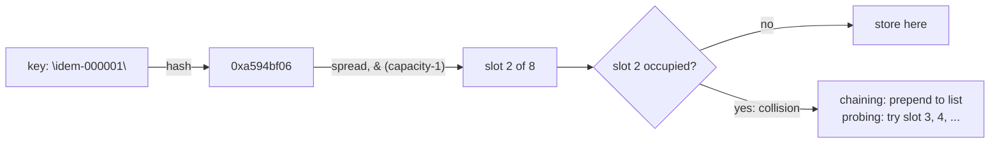

# Hash Maps from Scratch: Chaining, Open Addressing, and Resizing

> The structure behind every idempotency store, built with load factors you can measure.

**Type:** Build
**Languages:** Java, Python, Go
**Prerequisites:** Phase 1 Lesson 01 (Complexity Analysis), Phase 1 Lesson 03 (Dynamic Arrays), Phase 1 Lesson 04 (Linked Lists)
**Time:** ~120 minutes

## Learning Objectives

- Explain why a hash table gives O(1) expected lookups and name the two assumptions that expectation depends on
- Build a separate-chaining table and an open-addressing table with linear probing that share one interface and pass one test suite
- Implement resizing at a load-factor threshold and prove with a test that every entry survives the rehash
- Implement deletion in an open-addressing table with tombstones, and explain why marking a slot empty instead would lose keys
- Measure collisions with a counter and show what a pathological hash function does to each design
- Frame an idempotency store as a hash map whose key is the client's idempotency key and whose value is the stored response

## The Problem

A payment API receives `POST /charges` with an `Idempotency-Key` header. The contract is simple: the first request with a given key runs the charge; any later request with the same key returns the same response without charging again. Mobile clients retry aggressively on flaky networks, so around 3% of all requests are retries, and the store that maps keys to stored responses is on the hot path of every charge.

The first implementation keeps the store as a list of `(key, response)` pairs and scans it. At 10,000 keys a lookup takes a few microseconds and nobody notices. At 2 million keys, the end-of-month peak, each lookup walks an average of a million entries, p99 latency climbs from 40 ms to 1.8 s, upstream clients time out at 1 s and retry, which inserts nothing new but doubles the scan load, and the service falls over under traffic it generated itself. The fix everyone reaches for is "use a hash map", and that is correct. But the team that reaches for it without knowing what is inside will meet three more failures:

1. **The table never resizes.** A fixed 65,536 buckets with 2 million keys is 30 keys per bucket. The "O(1)" lookup is a 30-step list walk, every time, and nobody understands why the hash map is slow.
2. **Deletes corrupt lookups.** Keys expire after 24 hours and are removed. In an open-addressing table, the engineer who marks a removed slot as empty breaks the probe chain running through it: a key that was inserted past that slot becomes unreachable, the store says "never seen this key", and a retried charge is charged twice. That is the exact failure the store exists to prevent.
3. **The hash function is attackable.** If idempotency keys are client-chosen and the hash is predictable, an attacker who sends 50,000 keys that all land in one bucket turns every lookup into a 50,000-step scan. This was a real class of denial-of-service against web frameworks in 2011 (CVE-2011-4815 and its siblings), and the mitigation in every modern runtime is per-process hash seeding.

This lesson builds both common designs by hand, with a collision counter you can read and a load factor you can watch, so that the words "resize", "tombstone", and "load factor" mean something concrete when you read a production implementation or a post-mortem.

## The Concept

### The idea in one sentence

A hash map turns a key into an array index with a hash function, then deals with the fact that two keys will sometimes produce the same index. Everything else is engineering around that one word, "sometimes".



### The hash function and the index

A hash function maps a key of any size to a fixed-width integer. This lesson uses FNV-1a (Fowler, Noll, Vo), 32-bit, because it is six lines long and produces the same value in Java, Python, and Go; Python's built-in `hash(str)` is randomised per process and Go's map hash is seeded too, which is good for security and useless for a deterministic demo.

```text
fnv1a(s):
  h = 0x811c9dc5                 (the offset basis)
  for each byte b of s (UTF-8):
    h = h XOR b
    h = h * 0x01000193 mod 2^32  (the FNV prime)
```

Trace `fnv1a("a")` by hand. The byte is `0x61`. `0x811c9dc5 XOR 0x61 = 0x811c9da4`. Multiply by `0x01000193` and keep the low 32 bits: `0xe40c292c`. That is the published test vector, and the test suite in all three languages asserts it.

A 32-bit hash is not an index. For a table of `capacity` slots, where capacity is always a power of two, the index is `hash & (capacity - 1)`, which keeps only the low bits. Many hash functions have poor low bits (multiplicative hashes especially), so before masking the implementation folds the high half into the low half: `spread = hash ^ (hash >>> 16)`. `java.util.HashMap` does exactly this in its `hash()` method. The whole pipeline for `"a"` in a table of 8: `0xe40c292c ^ 0x0000e40c = 0xe40ccd20`, and `0xe40ccd20 & 7 = 0`. Key `"a"` lives in bucket 0.

### Collisions are not a bug

With `m` slots and `n` keys, the probability that two particular keys collide is `1/m`, and the expected number of colliding pairs is `n(n-1)/2m`. By the birthday bound, once `n` is around `sqrt(m)` a collision is more likely than not: 64 keys in a table of 4,096 slots will probably already share a slot somewhere. A table must handle collisions as the normal case, not as an exception.

The two families of answer:

| | Separate chaining | Open addressing (linear probing) |
|---|---|---|
| Where a colliding key goes | A linked list hanging off the bucket | The next free slot in the array, wrapping around |
| Memory per entry | Node object: key, value, next pointer, header | Key and value in flat arrays, plus a one-byte state |
| Cache behaviour | Every chain step is a pointer dereference, likely a cache miss | Probing walks consecutive slots: one cache line often holds the whole run |
| Load factor it tolerates | Above 1.0 works, just slowly; Java resizes at 0.75 | Must stay well below 1.0; this lesson resizes at 0.5, CPython's dict at 2/3 |
| Deletion | Unlink the node | Cannot just empty the slot; needs a tombstone or back-shifting |
| Worst case with a bad hash | One chain of `n` nodes, O(n) lookups | One cluster of `n` slots, O(n) lookups and the table must stay half empty |
| Used by | `java.util.HashMap` (chains become red-black trees past 8 nodes), Go's map buckets internally | CPython `dict`, Rust `HashMap` (Swiss tables), Google's `absl::flat_hash_map` |

### Load factor and the O(1) promise

The load factor is `alpha = n / capacity`: entries per slot. For chaining with a uniform hash, the expected chain length is `alpha`, so a miss costs about `1 + alpha` steps and a hit about `1 + alpha/2`. Keep `alpha` under a constant and lookups are O(1) *expected*. The word "expected" carries two assumptions:

1. **The hash spreads keys uniformly.** A hash that sends everything to slot 0 gives chains of length `n`.
2. **The table grows with `n`.** A fixed table has `alpha -> infinity` as `n` grows and O(n) lookups whatever the hash.

For linear probing the analysis is harsher. Knuth's result (TAOCP Vol. 3, Section 6.4) for a successful search is about `(1 + 1/(1-alpha)) / 2` probes and for an unsuccessful search about `(1 + 1/(1-alpha)^2) / 2`:

| Load factor `alpha` | Expected probes, hit | Expected probes, miss |
|---|---|---|
| 0.25 | 1.17 | 1.39 |
| 0.50 | 1.50 | 2.50 |
| 0.75 | 2.50 | 8.50 |
| 0.90 | 5.50 | 50.50 |

The miss column explodes because of **primary clustering**: a run of occupied slots grows from both ends, and a longer run is more likely to be hit by the next key, which makes it longer still. That curve is why open addressing resizes at a lower threshold than chaining, and why the table in this lesson doubles when `(size + tombstones + 1) / capacity` would exceed 0.5.

### Resizing

When the load factor crosses the threshold, allocate a table of twice the capacity and reinsert every live entry by recomputing its index from its hash. The reinsert is O(n), but it happens only after n/2 inserts since the last doubling, so the amortised cost per insert stays O(1) (Lesson 02 makes this rigorous; Lesson 03 did the same analysis for an array that doubles). Three details that matter in practice:

- **Rehashing changes every index.** `hash & 7` and `hash & 15` differ for half of all keys. Any code that remembered a slot number across an insert has a bug.
- **Tombstones are dropped during resize.** They are only needed to preserve probe chains in the old array; the new array is built from live entries alone. This is also how an open-addressing table recovers from a long history of deletes.
- **The order of reinsertion matters for determinism.** This lesson walks the old array from slot 0 to the end, so two tables that received the same operations have identical layouts. Tests rely on that.

### Worked example: chaining, by hand

Table capacity 4 (deliberately tiny), `MAX_LOAD = 0.75`, so a resize fires when `size > 3`. Insert `"a"`, `"b"`, `"c"`, `"e"`, using the FNV-1a values from above and `index = spread & 3`:

```text
key  hash        spread      & 3   action
a    0xe40c292c  0xe40ccd20  0     bucket 0 empty -> store [a]              size 1
b    0xe70c2de5  0xe70ccae9  1     bucket 1 empty -> store [b]              size 2
c    0xe60c2c52  0xe60cca5e  2     bucket 2 empty -> store [c]              size 3
e    0xe00c22e0  0xe00cc2ec  0     bucket 0 holds a -> collision, prepend: [e, a]   size 4
                                   4 > 0.75 * 4 -> resize to 8
rehash with & 7:  a -> 0, b -> 1, c -> 6, e -> 4   (the chain dissolved)
```

`collisions()` is 1 after this sequence, `maxChainLength()` is 1, `capacity()` is 8, `loadFactor()` is 0.5. The collision counter records that one insert found its bucket occupied; the resize does not count, because rehashing cost is the structure's doing, not the key distribution's.

### Worked example: linear probing with a tombstone

To make slots predictable, use the pathological hasher that returns 0 for every key, table capacity 16:

```text
put A  -> home 0, slot 0 empty            -> A at 0, displacement 0
put B  -> home 0, slot 0 taken, slot 1    -> B at 1, displacement 1
put C  -> home 0, slots 0,1 taken, slot 2 -> C at 2, displacement 2          collisions() = 3
remove B -> slot 1 becomes TOMBSTONE (not EMPTY); size 2, tombstones 1
get C  -> home 0: slot 0 is A, slot 1 is a tombstone (keep going), slot 2 is C -> found
put D  -> home 0: slot 0 A, slot 1 tombstone (remember it), slot 2 C, slot 3 EMPTY -> stop
          a tombstone was seen -> D goes into slot 1, tombstones 0, displacement 1   collisions() = 4
```

If `remove B` had set slot 1 to EMPTY, `get C` would have stopped at slot 1 and reported C missing, although C is sitting in slot 2. That is failure number two from The Problem, and the test `tombstone: C is still reachable through B's grave` exists so you cannot make it by accident.

### The invariants

- **Chaining:** every key is in the chain of exactly the bucket `indexFor(hash(key), capacity)`, and appears there at most once. Resizing re-establishes this for the new capacity.
- **Probing:** for every stored key, every slot from its home up to (but not including) its actual slot is non-EMPTY (occupied or tombstone). This is what makes "stop at EMPTY" a sound termination rule for lookups, and it is why deletion cannot write EMPTY.
- **Both:** `size()` equals the number of distinct keys stored, and `loadFactor()` never exceeds the threshold after a `put` returns.

### What this structure does not do

- It does not keep keys in any order. Iteration order depends on the hash and the capacity, and changes on resize. If you need insertion order, that is a linked hash map (an exercise); if you need sorted order, that is a tree (Lesson 08).
- It does not give a worst-case guarantee. O(1) is expected under a good hash. A tree gives O(log n) worst case regardless of input; `java.util.HashMap` converts a long chain into a tree for this reason.
- It does not make the idempotency store correct across processes. The store here is in one process's memory. A real one is shared (Redis, PostgreSQL with a unique index) and must also handle the race where two retries arrive at the same instant; Phase 12 covers that.
- It does not expire keys. A production idempotency store keeps a key for 24 hours and then removes it, which is exactly why deletion and tombstones are in this lesson.

## Build It

The primary walkthrough is in Java. Python and Go implement the same design with the same names; the subsections at the end show only what differs.

### Step 1: A hash function you can reproduce

```java
static int fnv1a(String s) {
    int hash = 0x811c9dc5;
    for (byte b : s.getBytes(StandardCharsets.UTF_8)) {
        hash ^= (b & 0xff);
        hash *= 0x01000193;
    }
    return hash;
}

static int indexFor(int hash, int capacity) {
    int spread = hash ^ (hash >>> 16);
    return spread & (capacity - 1);
}
```

Java `int` multiplication wraps at 32 bits, which is exactly the `mod 2^32` the algorithm wants; Python needs an explicit `& 0xFFFFFFFF`, Go's `uint32` wraps natively. The `b & 0xff` matters because Java bytes are signed: without it, a byte above 127 would XOR in a sign-extended value and the three languages would disagree on any non-ASCII key.

**Predict:** `indexFor` requires `capacity` to be a power of two. What does `hash & (capacity - 1)` compute when capacity is 12, and why is the result not a valid slot distribution?

### Step 2: One interface for two tables

```java
interface SimpleMap<K, V> {
    V put(K key, V value);
    V get(K key);
    V remove(K key);
    boolean containsKey(K key);
    int size();
    int capacity();
    long collisions();
    default double loadFactor() { return (double) size() / capacity(); }
}
```

Both implementations satisfy this, and the test file runs one `sharedContract` method against each. The `collisions()` accessor is the measurement the lesson is about: for chaining it counts new-key inserts that found their bucket occupied; for probing it is the total displacement, the sum over inserts of how far from home each key landed.

### Step 3: Separate chaining

```java
@Override public V put(K key, V value) {
    Objects.requireNonNull(key, "key");
    int b = bucketOf(key);
    for (Node<K, V> n = table[b]; n != null; n = n.next) {
        if (n.key.equals(key)) { V old = n.value; n.value = value; return old; }
    }
    if (table[b] != null) collisions++;
    table[b] = new Node<>(key, value, table[b]);
    size++;
    if (size > table.length * MAX_LOAD) resize(table.length * 2);
    return null;
}
```

The walk down the chain first is what gives `put` replace semantics; without it a second `put` of the same key would create a duplicate and `size` would lie. New nodes are prepended, not appended, because prepending is O(1) and chain order carries no meaning. The resize check runs after the insert, so the table is briefly at `size = 0.75 * capacity + 1` before doubling.

```java
private void resize(int newCapacity) {
    Node<K, V>[] old = table;
    table = (Node<K, V>[]) new Node[newCapacity];
    for (Node<K, V> head : old) {
        for (Node<K, V> n = head; n != null; ) {
            Node<K, V> next = n.next;
            int b = Hashers.indexFor(hasher.applyAsInt(n.key), newCapacity);
            n.next = table[b];
            table[b] = n;
            n = next;
        }
    }
    resizes++;
}
```

The existing `Node` objects are reused and relinked, so a resize allocates one array and nothing else. The `next` pointer must be saved before the node is relinked, because relinking overwrites it.

**Predict:** insert seven distinct keys into a fresh `ChainedHashMap`. After the seventh, what are `resizes()` and `capacity()`?

### Step 4: Open addressing, the lookup

```java
int slotOf(K key) {
    int i = homeOf(key);
    for (int probes = 0; probes < keys.length; probes++) {
        if (states[i] == EMPTY) return -1;
        if (states[i] == OCCUPIED && keys[i].equals(key)) return i;
        i = (i + 1) & (keys.length - 1);
    }
    return -1;
}
```

Three slot states: `EMPTY` (never used), `OCCUPIED`, `TOMBSTONE` (used, then deleted). The lookup walks forward from the home slot, skipping tombstones, and stops at the first `EMPTY`. The `probes < keys.length` bound is a safety net: because the table is never allowed to fill, there is always an `EMPTY` somewhere, but a loop that depends on that invariant to terminate should also have a hard limit.

### Step 5: Open addressing, insert with tombstone reuse

```java
@Override public V put(K key, V value) {
    Objects.requireNonNull(key, "key");
    if ((size + tombstones + 1) > keys.length * MAX_LOAD) resize(keys.length * 2);
    int home = homeOf(key);
    int i = home;
    int firstTombstone = -1;
    int displacement = 0;
    while (true) {
        if (states[i] == EMPTY) break;
        if (states[i] == OCCUPIED && keys[i].equals(key)) {
            V old = (V) values[i];
            values[i] = value;
            return old;
        }
        if (states[i] == TOMBSTONE && firstTombstone < 0) firstTombstone = i;
        i = (i + 1) & (keys.length - 1);
        displacement++;
    }
    if (firstTombstone >= 0) {
        i = firstTombstone;
        tombstones--;
        displacement = (i - home) & (keys.length - 1);
    }
    collisions += displacement;
    keys[i] = key; values[i] = value; states[i] = OCCUPIED;
    size++;
    return null;
}
```

Two decisions are easy to get wrong. First, the probe must *not* stop at the first tombstone: the key might already be stored further along, and inserting it at the tombstone would create a duplicate. The loop remembers the first tombstone, keeps going until `EMPTY`, and only then decides. Second, the resize threshold counts tombstones as occupied, because for lookup cost they are: a probe walks through them. A table that has had many deletes can be mostly tombstones with a tiny `size`, and it still needs the rebuild.

**Predict:** with the constant hasher and capacity 16, insert A, B, C, remove B, insert D, then `put("C", "c2")`. Which slot holds C afterwards, and what is `size()`?

### Step 6: Deletion and resize

```java
@Override public V remove(K key) {
    int i = slotOf(key);
    if (i < 0) return null;
    V old = (V) values[i];
    keys[i] = null; values[i] = null;
    states[i] = TOMBSTONE;
    tombstones++; size--;
    return old;
}
```

Clearing `keys[i]` and `values[i]` lets the garbage collector reclaim them; the state byte is what the probe logic reads. The resize loop skips anything that is not `OCCUPIED`, so tombstones vanish there, and after resizing `tombstones()` is 0.

### Step 7: The idempotency store

```java
final class IdempotencyStore {
    private final SimpleMap<String, StoredResponse> responses;
    private int handlerRuns;

    Outcome handle(String idempotencyKey, Supplier<StoredResponse> handler) {
        StoredResponse existing = responses.get(idempotencyKey);
        if (existing != null) return new Outcome(existing, true);
        StoredResponse fresh = handler.get();
        handlerRuns++;
        responses.put(idempotencyKey, fresh);
        return new Outcome(fresh, false);
    }
}
```

The store is twelve lines because the map did the work. `handlerRuns` is the observable that matters: for any number of calls with one key, it is 1. The test passes a handler that would return status 500 on the second call and asserts it never runs.

### Step 8: Run it

```bash
cd phases/01-complexity-and-core-structures/06-hash-maps-from-scratch/code/java
javac -d .out *.java && java -cp .out Main
java -cp .out MainTest
```

Expected output, abbreviated:

```console
== 10,000 idempotency keys, separate chaining ==
size=10000 capacity=16384 load=0.610 resizes=11 collisions=4079 maxChain=5

== Same keys, open addressing (linear probing) ==
size=10000 capacity=32768 load=0.305 resizes=12 displacement=7604 maxProbeRun=13

== Worst case: a hasher that returns 0 for every key ==
chaining: 64 keys -> collisions=63 maxChain=64 (every lookup is O(n))
probing:  64 keys -> displacement=2016 maxProbeRun=64 (sum 0..63 = 2016)

== Idempotency store: retry the same charge three times ==
attempt 1: status=201 replayed=false body={"charge":"ch_1","amount":1999,"currency":"USD"}
attempt 2: status=201 replayed=true body={"charge":"ch_1","amount":1999,"currency":"USD"}
handler ran 1 time(s) for 3 attempts
```

Read the first two blocks against the theory. Under a uniform hash a fresh insert finds its bucket occupied with probability about `1 - e^(-alpha)`; averaged over a table that spends its life between load 0.375 and 0.75 that is roughly 42%, and 4,079 of 10,000 is 41%. The longest chain is 5 at load 0.61, which is what the Poisson tail predicts for 16,384 buckets. Probing at load 0.305 has a longest run of 13: that is clustering at work, since a uniform spread of 10,000 keys in 32,768 slots would rarely produce a run that long. The same program in Python and Go prints byte-identical output, which is the point of a shared hash function.

### In Python

```python
def fnv1a(s: str) -> int:
    h = 0x811C9DC5
    for b in s.encode("utf-8"):
        h ^= b
        h = (h * 0x01000193) & MASK32
    return h
```

Differences, all in `code/python/main.py`:

- **Explicit 32-bit wrap.** Python integers do not overflow, so the multiply must be masked or the hash would grow without bound and disagree with Java and Go.
- **`hash()` is salted.** `hash("idem-000001")` differs between two runs of the interpreter unless `PYTHONHASHSEED` is fixed. That is a deliberate defence against the collision attack in The Problem and it is why the lesson ships its own hash.
- **`bytearray` for slot states.** It is a compact, mutable byte array; a list of ints would be eight times larger per slot.
- **`None` as the key sentinel.** `put(None, ...)` raises `TypeError`, matching Java's `NullPointerException` and keeping `get` able to return `None` for "absent" without ambiguity.

### In Go

```go
func (m *OpenAddressingHashMap[K, V]) Put(key K, value V) (old V, replaced bool) {
    if float64(m.size+m.tombstones+1) > float64(len(m.keys))*OpenMaxLoad {
        m.resize(len(m.keys) * 2)
    }
    // ... same probe loop as Java
}
```

Differences, all in `code/go/main.go`:

- **Two return values instead of null.** `Get` returns `(value, ok)` and `Put` returns `(old, replaced)`, because a zero value such as `0` or `""` is a legitimate stored value and cannot double as "absent".
- **Generics with `comparable`.** `K comparable` is what allows `m.keys[i] == key`; it is the Go equivalent of Java's `equals` contract and Python's `__eq__`.
- **Clearing a slot needs explicit zero values.** `var zeroK K; m.keys[i] = zeroK` is how a generic slot is released for the garbage collector.
- **Go's built-in `map` is also seeded per process**, and iteration order is deliberately randomised so that nobody depends on it.

## Use It

### `java.util.HashMap`

`HashMap` is separate chaining with three refinements over Step 3: the spread function you built, a default load factor of 0.75 with capacity doubling, and *treeification*: a bucket whose chain exceeds 8 nodes is converted into a red-black tree keyed on hash and `compareTo`, so the worst case under a bad hash falls from O(n) to O(log n). What it does not do is protect you from a bad `hashCode()`: if your key class returns a constant, you get the tree, not O(1). `ConcurrentHashMap` is the thread-safe sibling and is what an in-process idempotency cache would actually use; Phase 4 covers why its lock striping matters.

### CPython's `dict`

CPython's dictionary is open addressing with a resize at 2/3 load, a probe sequence that mixes in higher hash bits after the first miss (not pure linear probing, to blunt clustering), and since 3.6 a separate dense entries array that gives insertion-ordered iteration for free. Deleting leaves a dummy marker: a tombstone by another name. `sys.getsizeof({})` will show you the price of the sparse index.

### Go's `map`

Go's runtime map is an array of buckets each holding eight key/value pairs inline, with an overflow pointer to further buckets: chaining, but with eight entries per cache line before the first pointer chase. Growth is incremental: after a resize trigger, each subsequent operation moves a few buckets, so no single `m[k] = v` pays the whole O(n). That is the practical answer to "a resize stalls my p99", and it is what Lesson 02 calls de-amortisation.

### Production idempotency stores

Stripe's API documents the behaviour this lesson's store implements: keys are client-generated, a replayed request returns the saved response including its status code, and keys are pruned after 24 hours. The storage behind that is not an in-process table; it is a replicated key-value store with a TTL. Redis `SET key value NX EX 86400` does the "insert only if absent, expire later" in one atomic command; PostgreSQL does it with a unique index and `INSERT ... ON CONFLICT DO NOTHING`. What those systems add that the from-scratch table makes explicit: atomicity across concurrent requests, durability, and expiry. What they share with it: a hash of the key decides where it lives, and a bad key distribution still hurts.

## Ship It

`outputs/checklist-idempotency-store.md` is a review checklist for any service that stores responses by idempotency key: key scope and format, what gets stored, expiry, concurrency, and the hash-table failure modes from this lesson. Use it when reviewing a new payment endpoint or auditing an existing one.

## Exercises

1. **Reinforce.** Add a `loadFactor()` print to `main` after every 1,000 inserts for both tables and plot the sawtooth. Then change `ChainedHashMap.MAX_LOAD` to 2.0 and report what happens to `maxChainLength()` and to the collision count at 10,000 keys. Explain in two sentences why chaining still works at load 2.0 and probing cannot.
2. **Apply.** Implement `OpenAddressingHashMap.remove` without tombstones, using backward-shift deletion: after emptying a slot, walk forward and move back any entry whose home slot is at or before the gap. Make the existing tombstone tests pass with `tombstones()` always 0, and measure whether `maxProbeRun()` after the remove/re-insert demo is better or worse than the tombstone version.
3. **Extend.** Build a `LinkedHashMap` by adding a doubly linked list through the chaining nodes (Lesson 04) so that iteration returns keys in insertion order, then use it to implement an LRU eviction policy for the idempotency store: a `put` beyond a fixed capacity evicts the least recently *read* key. Test that a replayed request moves its key to the most-recent end.

## Key Terms

| Term | What people say | What it actually means |
|------|-----------------|------------------------|
| Load factor | "how full the table is" | `size / capacity`; for probing tables the meaningful figure is `(size + tombstones) / capacity`, because a probe walks through tombstones |
| Collision | "two keys hashed the same" | Two keys mapping to the same *slot* after masking; they may have different 32-bit hashes and still collide in a table of 8 |
| Separate chaining | "buckets with lists" | Each slot heads a linked list of entries; tolerates load above 1.0 at the cost of a pointer chase per step |
| Open addressing | "everything in one array" | Colliding keys occupy other slots of the same array according to a probe sequence; cache-friendly, but needs free slots to terminate lookups |
| Linear probing | "try the next slot" | Probe sequence `home, home+1, home+2, ...` modulo capacity; simplest and most cache-friendly, worst for clustering |
| Tombstone | "a deleted marker" | A slot state meaning "was occupied, now free for insert, but do not stop a lookup here"; removed only by resize |
| Primary clustering | "the table gets lumpy" | Runs of occupied slots grow faster the longer they are, because a longer run is a bigger target for the next key's home |
| Rehash | "resize" | Allocating a larger array and recomputing every entry's slot from its hash; O(n) once per doubling, O(1) amortised per insert |

## Further Reading

- [Knuth, *The Art of Computer Programming*, Vol. 3, Section 6.4 Hashing](https://www-cs-faculty.stanford.edu/~knuth/taocp.html) — the original analysis of linear probing, including the `1/(1-alpha)^2` miss cost that justifies a 0.5 threshold.
- [FNV hash specification (Fowler, Noll, Vo)](http://www.isthe.com/chongo/tech/comp/fnv/index.html) — the algorithm, the offset basis and prime for each width, and the test vectors the tests assert.
- [`java.util.HashMap` source (OpenJDK)](https://github.com/openjdk/jdk/blob/master/src/java.base/share/classes/java/util/HashMap.java) — read the `hash()` spread function and the `TREEIFY_THRESHOLD` comment block; it is a complete design document for a production chaining table.
- [CPython `Objects/dictobject.c` design notes](https://github.com/python/cpython/blob/main/Objects/dictobject.c) — the long comment at the top explains open addressing with perturbation, the 2/3 resize rule, and dummy (tombstone) entries.
- [Stripe API: Idempotent requests](https://docs.stripe.com/api/idempotent_requests) — the production contract this lesson's store implements: key semantics, replayed status codes, and 24-hour pruning.
- [oCERT advisory 2011-003: hash table collision denial of service](https://ocert.org/advisories/ocert-2011-003.html) — the disclosure that led every major runtime to seed its string hash; the reason your language's `hash()` is not deterministic.
