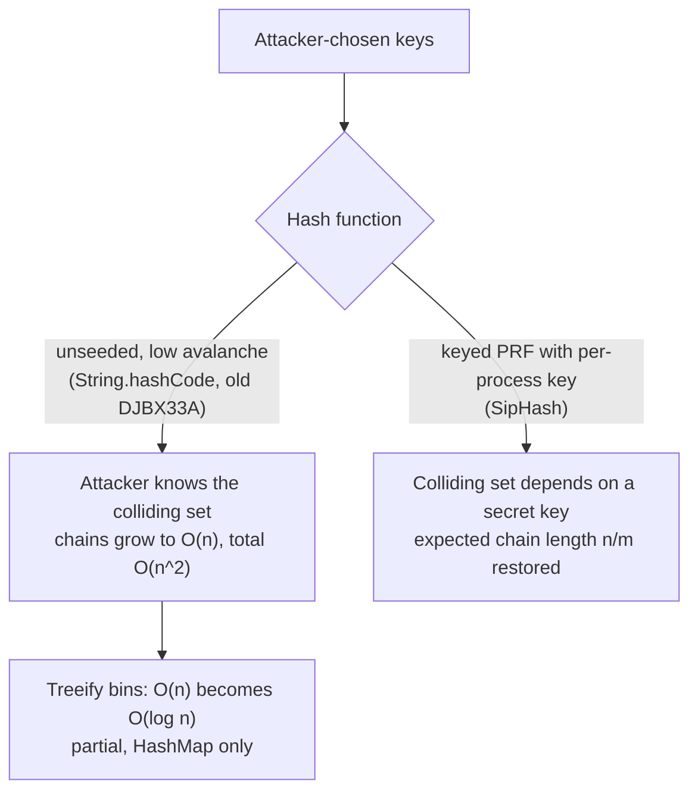

# Hash Functions, Collisions, and HashDoS

> An attacker who knows your hash function can turn O(1) into O(n).

**Type:** Learn
**Languages:** —
**Prerequisites:** Phase 1, Lesson 02 (Amortized Analysis), Phase 1, Lesson 06 (Hash Maps from Scratch)
**Time:** ~60 minutes

## Learning Objectives

- State the four properties a hash function needs for a hash table and distinguish them from the properties a cryptographic hash provides
- Explain why Java's `String.hashCode` has no avalanche and how that lets collisions be found cheaply
- Estimate the cost of a collision-flooding request against a chaining hash map and against Java 8's treeified bins
- Define a universal family of hash functions and explain why a per-process random seed restores the expected-time bound
- Trace the history of algorithmic-complexity attacks from Crosby and Wallach (2003) through 28C3 (2011) to SipHash (2012) and name what each runtime changed in response
- Decide when a hash table key needs a keyed hash, using idempotency keys and card numbers as the worked cases

## The Problem

An idempotency store is a hash map from a client-supplied key to a stored response (Phase 12 builds it; Lesson 06 built the map). The key is whatever string the client sends in the `Idempotency-Key` header. Suppose a merchant integration is compromised and begins sending requests whose keys all fall into the same bucket. Each insert into the store then walks a chain as long as every key received so far: the expected O(1) insert has degraded to O(n), and the total work to process `n` such requests is O(n^2). One request thread sits at 100% CPU for minutes on a single tenant's traffic while holding the store's lock, and every other merchant's payments queue behind it.

Nothing in the service is misconfigured. The map is `java.util.HashMap`, the keys are valid strings, the request sizes are within limits. The degradation happens because the hash function is public and unseeded: `String.hashCode` is specified in the Java Language Specification, so the set of strings that share a bucket is a fixed, knowable fact rather than a per-process secret. Lesson 06's expected-O(1) bound rested on an assumption, that keys are distributed independently of the hash function, and an adversary who can choose keys is exactly the party able to violate it.

This class of failure has a documented history. In December 2011 researchers demonstrated it against the form-parameter parsers of PHP, Java servlet containers, Ruby, Python, ASP.NET, and V8: a single modest HTTP POST whose parameters shared a bucket kept a CPU core busy for minutes. Every one of those platforms shipped a fix within weeks, and the fixes are a catalogue of the defences this lesson covers: cap the number of parameters, randomize the hash seed, or change the hash function. The payments relevance is direct. Any map keyed by attacker-influenced strings (idempotency keys, merchant reference IDs, customer-supplied metadata, webhook fields) is exposed, and a payment service that stalls is a payment service whose clients retry, which is where double-charges come from.

## The Concept

### What a hash table needs from its hash function

Lesson 06's expected O(1) assumes that for a table with `m` buckets and `n` keys, keys land roughly uniformly, so chains have expected length `n / m`. The hash function must deliver that. Four properties, in increasing order of difficulty:

| Property | Definition | Why a table needs it | Example that lacks it |
|----------|------------|----------------------|------------------------|
| Deterministic | same key, same hash, within one process | a key must be found where it was put | a hash derived from an object address the GC can move |
| Fast | tens of nanoseconds for a short key | it runs on every operation | SHA-256 on a 16-byte key: roughly 200 ns |
| Uniform (for the keys you see) | each bucket gets about `n / m` keys for the real key distribution | chain length is the lookup cost | hashing a 16-digit card number by its first 6 digits: every card from one bank collides |
| Avalanche | flipping one input bit flips each output bit with probability near 1/2 | similar keys (sequential IDs, shared prefixes) must not cluster | a hash where two inputs differing by one byte differ in the result by one |

"Uniform for the keys you see" is the operative phrase. A function can be uniform over random inputs and poor over sequential integers, timestamps, or prefix-sharing strings, which is what real keys look like. Avalanche is the structural property that keeps uniformity holding on structured inputs.

What a hash table does **not** need: collision resistance (infeasible to find any `x != y` with `h(x) = h(y)`), preimage resistance, or cryptographic output size. Those cost roughly a hundred times more and tables do not use them. What a table *under attack* needs is a fifth property sitting between the two lists: **unpredictability to the attacker**, which the seeded functions below provide.

### Java's `String.hashCode` and why it is cheap to collide

The JLS specifies it exactly:

```text
h(s) = s[0] * 31^(n-1) + s[1] * 31^(n-2) + ... + s[n-1]       in 32-bit int arithmetic; overflow wraps
```

Equivalently `h = 31 * h + c` per character. It was chosen in 1995 for speed (`31 * h` is `(h << 5) - h`) and because an odd multiplier loses no information on overflow. It has essentially no avalanche: changing the final character by one changes the hash by one. For benign keys that barely matters, because `HashMap.hash()` mixes the high bits down before masking. Under an adversary it matters a great deal, because the same linear structure that makes the function predictable also makes equal-hash inputs easy to reason about.

A two-character example makes the structure visible without being a recipe:

```text
"Aa": 65 * 31 + 97 = 2112
"BB": 66 * 31 + 66 = 2112
```

The equality holds because raising the first character by one adds 31 while lowering the second by 31 subtracts it; the two changes cancel. The important point is the consequence, not the construction: because the hash is a simple linear combination, blocks that collide can be concatenated, and a collection of `2^k` equal-hash strings can be produced with work proportional to `k`, not to `2^k`. The attacker therefore pays almost nothing to assemble a large set of keys that all target one bucket. This is a property of *any* unseeded, low-avalanche, linear hash, not of Java specifically; Python's pre-2012 string hash and PHP's `DJBX33A` had the same weakness.

### The non-cryptographic hashes you will actually meet

Between `String.hashCode` and SHA-256 sits a family of general-purpose hashes with good avalanche and high speed. Knowing which is which keeps you from reaching for a cryptographic hash when a table hash will do, or the reverse.

| Function | Keyed? | Avalanche | Speed (short keys) | Typical use |
|----------|--------|-----------|--------------------|-------------|
| Java `String.hashCode` | no | none | fastest | legacy table keys; unsafe for adversarial input |
| FNV-1a | no | weak | very fast | small hand-rolled tables, checksums; Lesson 06 uses it for teaching |
| MurmurHash3 | optional seed | good | very fast | analytics, Bloom filters, non-adversarial tables |
| xxHash / wyhash | optional seed | good | fastest of the strong ones | large-scale hashing, dedup, non-adversarial |
| SipHash-1-3 / 2-4 | yes (128-bit key) | good | fast | default table hash in Python, Ruby, Rust; adversarial keys |
| HMAC-SHA-256 | yes (secret key) | cryptographic | ~100x slower | confidentiality and integrity of a sensitive key (PAN, token) |
| SHA-256 (bare) | no | cryptographic | ~100x slower | content addressing of high-entropy data; wrong for low-entropy secrets |

The jump that matters is from "no key" to "keyed": only a keyed function hides its colliding set from an attacker. The jump from SipHash to HMAC-SHA-256 is a different axis entirely, from "unpredictable collisions" to "cryptographically secure", and you pay for it only when the key is itself a secret.

### What good avalanche looks like

Avalanche is testable. Flip one bit of the input, hash both, and count how many output bits changed; over many inputs the average should be half the output width, with low variance. `String.hashCode` fails this immediately: flipping the low bit of the last character flips exactly one output bit, every time. SipHash and MurmurHash pass it: one input bit flips about half the 64 output bits, unpredictably. This is why `HashMap.hash()` bothers to XOR the high 16 bits into the low 16 before masking: it is a cheap partial avalanche step that rescues `String.hashCode`'s distribution on benign keys, spreading the entropy that lives in the high bits down into the bits the bucket mask actually reads. It cannot rescue it against an adversary, because the attacker simply chooses keys whose collision survives the spread.

### The cost of a flooded bucket

Put `n` colliding keys into a chaining hash map. Insert `i` compares the new key against the `i - 1` already in the bucket (the map must check equality to honour "no duplicate keys"), so the total is `1 + 2 + ... + (n - 1)`, which is `n(n-1)/2`: quadratic. Each comparison is a full string `equals`, tens of nanoseconds. The table below is the back-of-envelope a defender should be able to produce:

| Colliding keys `n` | Comparisons (`~n^2/2`) | At ~20 ns each |
|--------------------|------------------------|----------------|
| 1,000 | 500,000 | 10 ms |
| 10,000 | 50,000,000 | 1 s |
| 100,000 | 5,000,000,000 | ~100 s |

The attacker's cost to build the input is linear; the server's cost to process it is quadratic. That asymmetry is the whole attack: a few hundred kilobytes of request body buys minutes of CPU.

### Java 8's partial fix: treeify the bin

Java 8 changed `HashMap` so that a bucket holding 8 or more entries, when the table has at least 64 buckets, converts from a linked list to a red-black tree keyed by hash and then by `Comparable` order (or identity order as a tiebreak). Lookups and inserts in a flooded bucket become O(log n) instead of O(n), so the quadratic becomes `n log n`:

| Colliding keys `n` | Chaining (`~n^2/2`) | Treeified (`~n log n`) |
|--------------------|---------------------|-------------------------|
| 10,000 | 50,000,000 | ~130,000 |
| 100,000 | 5,000,000,000 | ~1,700,000 |

This is a real mitigation, and it is why modern Java is far harder to stall than Java 7 was. It is not a complete defence. Treeification needs the keys to be mutually `Comparable`; keys that are not (or that are all equal under `compareTo` but not under `equals`) fall back to a list. It also does nothing for structures that are not `java.util.HashMap`: a hand-rolled chaining map (like Lesson 06's), a `HashSet` of a non-`Comparable` type, or a hash map in another language without the same fix. Treeification raises the cost of the attack; it does not remove the attacker's ability to choose the bucket.

### The real fix: make the bucket unpredictable

The attack needs to know, offline, which keys share a bucket. Remove that knowledge and the attack collapses. Two ideas, which combine:

**Universal hashing.** A family `H` of hash functions is *universal* if, for any two distinct keys `x` and `y`, a function `h` drawn uniformly at random from `H` collides them with probability at most `1/m` (for `m` buckets). The classic family is `h_{a,b}(x) = ((a*x + b) mod p) mod m` with a prime `p` larger than the key space and `a, b` chosen at random (`a != 0`). The guarantee is about the *average over the family*: no fixed pair of keys is reliably bad, because the function is not fixed until runtime. If the process picks `a` and `b` at startup from a source the attacker cannot read, the attacker cannot know which keys collide, so the expected chain length returns to `n / m` and the expected-O(1) bound holds even for adversarial keys.

**A keyed, well-mixing function.** In practice runtimes do not use the textbook linear family (it mixes poorly and `x` must be an integer); they use a keyed hash with good avalanche and a per-process random key. SipHash (Aumasson and Bernstein, 2012) is the standard choice: a keyed pseudorandom function over byte strings, designed for short inputs, fast enough to run on every key, and built so that without the 128-bit key an attacker cannot predict which inputs collide. It is not collision-resistant in the cryptographic sense, and it does not need to be; it only needs to be unpredictable without the key.

The distinction that matters: **a seed on a weak function is not enough.** If the function is linear and you merely add a secret constant (`h = weak(x) + seed`), the differences that produce collisions are unchanged, so the same pairs still collide regardless of the seed. The seed must feed a function whose output is a pseudorandom function of the key, which is why the fix was "replace the function with SipHash and key it", not "add a random number to `String.hashCode`".



### Universal hashing with real numbers

Make the family concrete. Take the integer multiply-shift family over 32-bit keys mapping to `2^L` buckets: pick an odd 32-bit constant `a` at random at startup, and let `h_a(x) = (a * x mod 2^32) >> (32 - L)`. This is strongly tied to the universal guarantee (Dietzfelbinger's multiply-shift) and is one multiply and one shift, cheap enough for every operation.

Say `L = 3` (8 buckets) and the process happens to pick `a = 2,654,435,761` (a common odd choice). For keys 1000 and 2024:

```text
a * 1000 mod 2^32 = 2,654,435,761 * 1000 mod 2^32 = 3,131,829,648  ->  >> 29 = 5   (bucket 5)
a * 2024 mod 2^32 = ...                                             ->  >> 29 = 2   (bucket 2)
```

A different startup picks a different `a` and sends the same two keys to different buckets. An attacker who wants 1000 and 2024 to collide would have to know `a`, which is chosen after their payload is built and never leaves the process. That is the whole mechanism: the colliding set is a function of a runtime secret, so it cannot be precomputed. The textbook additive family `((a*x + b) mod p) mod m` gives the same guarantee with a cleaner proof but a slower modulo; runtimes prefer multiply-shift or SipHash for speed.

### Load factor, chain length, and where the cost comes from

Lesson 06's bound is worth restating in attack terms. With `n` keys in `m` buckets the expected chain length under a good hash is the load factor `alpha = n / m`, kept near 0.75 by resizing, so a lookup touches about 1.75 entries on average: the "O(1)" everyone quotes. The variance matters too. Under a uniform hash, the longest chain among `m` buckets with `n = m` keys is about `ln m / ln ln m`, roughly 5 to 7 for a million buckets: even the worst bucket is short. The attack does not nudge the average; it destroys the distribution, forcing one chain to length `n` while the rest stay empty. That is why an averaged metric (mean insert time, overall throughput) shows nothing until the service is already stalled: the damage is entirely in the tail, exactly the measurement lesson from Lesson 02.

### Non-string keys and custom hashCode

The exposure is not limited to strings. Any key type whose hash an attacker can influence is a candidate, and the moment you write a custom `hashCode` (or `__hash__`, or implement `hash.Hash`) you have opted out of whatever the runtime's string hash does and taken responsibility yourself. Two common mistakes:

- **A hashCode that drops entropy**: `return (int) accountId;` on a `long` field throws away the high 32 bits, so two account IDs differing only above bit 32 collide. An attacker who controls account creation can farm colliding IDs.
- **A hashCode over a small or structured field**: hashing a transaction by its currency code (a few hundred values) or its merchant category code puts every row of one category in one bucket, which is a self-inflicted version of the attack and shows up as a slow `group by` long before any adversary arrives.

The rule: a key type's hash should depend on all the fields that `equals` depends on, with avalanche, and if the key is attacker-influenced on a hot path, it should be keyed with a per-process secret. `java.util.Objects.hash(...)` gives you the all-fields part but not the avalanche or the seed.

### A history worth knowing

- **2003, Crosby and Wallach**, *Denial of Service via Algorithmic Complexity Attacks* (USENIX Security): named the class, showed it against the Perl hash, the Squid cache, and an intrusion-detection system, and proposed universal hashing as the fix. This is the paper to cite.
- **2011, 28C3, Klink and Walde**, *Efficient Denial of Service Attacks on Web Application Platforms*: demonstrated it against the POST-parameter parsers of most web platforms at once. PHP and others added a `max_input_vars` cap; several runtimes began randomizing their hash seed.
- **2012, SipHash**, Aumasson and Bernstein: a fast keyed PRF designed precisely for hash-table keys. Python adopted hash randomization (PEP 456, SipHash) and enabled it by default in 3.3; Ruby, Rust (`SipHash` is the default `HashMap` hasher), Perl, and others followed.
- **Java's path**: Java 7u6 added an experimental seeded `String.hashCode` alternative (`jdk.map.althashing.threshold`) but it was fragile and was removed; Java 8's answer was treeification instead, which is why Java mitigates the symptom (long chains) rather than the cause (predictable buckets). A Java service exposed to adversarial keys should still prefer a keyed hash at the application layer.

### Why payments amplifies the attack

A stalled web page annoys a user; a stalled payment path misbehaves in ways that cost money, which is why this general attack deserves specific attention here.

- **Retries convert a stall into duplicate work.** Payment clients and card networks retry on timeout, often automatically and often doubling down during the exact window the service is slow. A HashDoS that adds two seconds of latency does not just delay one request; it multiplies the offered load at the worst moment, and the idempotency store that is supposed to absorb retries is the very thing under attack.
- **Shared stores couple tenants.** An idempotency store, a rate-limiter map, or a dedup cache is typically shared across merchants. One merchant flooding a bucket holds the store's lock and stalls every merchant's traffic, turning a single compromised integration into a platform-wide incident.
- **The key surface is wide.** Idempotency keys, merchant reference IDs, customer metadata fields, webhook payload keys, and cache keys built from any of these are all attacker-influenced strings that end up as map keys somewhere. Each is a candidate, and they are easy to overlook because each one individually looks like ordinary data.
- **Correctness depends on the store responding.** If the idempotency store times out, the safe default is often to reject or to treat the request as new, and both have failure modes (rejecting a legitimate payment, or processing a duplicate). The attack therefore threatens not just availability but the exactly-once guarantee the store exists to provide.

None of this changes the defence; it changes the priority. A map keyed by untrusted input on a shared payments path is a higher-severity finding than the same pattern on an internal tool.

### When a table key needs a keyed or cryptographic hash

Most maps do not. Three situations change the calculus:

1. **Keys are attacker-influenced and the map is on a shared hot path.** Use a keyed hash (SipHash) with a per-process random key, or in Java, cap the number of distinct keys per tenant and prefer a structure with treeified bins. This is the idempotency-store case.
2. **The key itself is sensitive and must not be stored in the clear**, such as a card number used to deduplicate or rate-limit by PAN. Here the requirement is not table performance but confidentiality: store a keyed hash (HMAC-SHA-256 with a secret key held in a KMS, or a format-preserving token), never a bare SHA-256 (a 16-digit PAN has only 10^16 possibilities, so an unkeyed digest is reversible by brute force in seconds). The map is keyed by the token; the raw PAN never becomes a map key. Phase 13 covers tokenization in full.
3. **The hash crosses a trust or persistence boundary** (sharding keys consistently across services, or persisting a hash). Here determinism *across processes* is required, so a per-process random seed is wrong; use a fixed, well-specified function (and, if the input is sensitive, a keyed one with a shared secret).

The decision procedure: is the key adversarial? If no, any good non-cryptographic hash (the runtime default) is fine. If yes, is the concern CPU (table performance) or confidentiality (the key is a secret)? CPU wants a per-process keyed PRF; confidentiality wants a keyed cryptographic hash with the key in a vault. The two are different keys for different purposes and are easy to confuse.

### What this topic does not claim

- It does not say `String.hashCode` is broken. It is a fine table hash for non-adversarial keys and will stay specified as it is for compatibility; the problem is using it where keys are attacker-chosen.
- It does not say hash tables are unsafe. It says the expected-O(1) bound has an adversary clause, and the fix is well understood.
- It does not make SipHash a cryptographic hash. SipHash authenticates nothing and resists no collision search by a party who holds the key; it only hides the colliding set from a party who does not.
- It does not remove the need for the ordinary defences: input size limits, per-tenant quotas, and timeouts on request handling catch this attack and many others regardless of the hash.

## Worked Example

Walk the attack and the defence on one store, with numbers.

A chaining idempotency store starts with 1,024 buckets and grows at load factor 0.75 (Lesson 06). A tenant sends 20,000 requests.

**Benign keys (UUIDs).** The 20,000 keys spread across buckets; after growth the table has about 32,768 buckets, so expected chain length is `20000 / 32768 < 1`. Total insert cost is about `20000 * (1 + load factor)`, a few tens of thousands of comparisons, a handful of milliseconds. This is the case Lesson 06 analysed.

**Adversarial keys, unseeded hash.** All 20,000 keys target one bucket. Growth does not help: more buckets, but every key still shares the one. Inserts cost `1 + 2 + ... + 19999 = ~2 * 10^8` comparisons, around 4 seconds on one core, lock held throughout. The other tenants' requests to this store block for 4 seconds. If the attacker sustains it, the store never drains.

**Adversarial keys, Java 8 HashMap.** The flooded bucket treeifies at 8 entries. Inserts cost about `20000 * log2(20000) = ~285,000` comparisons plus the tree rebalancing, a few milliseconds. The attack is defeated for this structure, provided the keys are mutually `Comparable` (strings are). Had the keys been a non-`Comparable` custom type, the bin would stay a list and the 4-second case returns.

**Adversarial keys, keyed hash (SipHash, per-process random key).** The attacker cannot compute which keys collide because the key is a per-process secret, so the 20,000 keys spread as if random: back to the benign numbers. This is the defence that works for *any* table structure, not only `HashMap`.

**Adversarial keys, Lesson 06's hand-rolled chaining map.** That map uses FNV-1a, unseeded, with no treeification. It is the 4-second case with no mitigation at all, which is the point of Exercise 3: a teaching implementation that is correct and fast on benign input is wide open on adversarial input, and the fix is to seed the FNV offset with a per-process random value fed through a mixing step, not to add the seed at the end.

The lesson in one line: treeification caps the damage for one specific class; a per-process keyed hash removes the attacker's ability to aim.

### Where the per-process key comes from

A keyed hash is only as unpredictable as its key. The key must be drawn once at process start from a cryptographically secure source (`SecureRandom`, `/dev/urandom`, `getrandom(2)`), held in memory, and never logged, never persisted, and never sent to a client. Three failure modes turn the defence off without any visible error:

- **A fixed or zero key** (`PYTHONHASHSEED=0`, a hard-coded constant "for reproducible tests") restores the unseeded case in production. Reproducibility belongs in tests, behind a flag that is off in production.
- **A key derived from something the attacker can learn** (the hostname, the start time rounded to the second, a deployment ID) narrows the search enough to recompute collisions. The key must come from a CSPRNG, not from ambient facts.
- **The same key across every process** (baked into an image, shared via config) means one leak compromises the whole fleet, and lets an attacker who collides one instance collide all of them. Per-process is the unit; a fleet-wide secret is a fleet-wide single point of failure.

Rotation is rarely needed: because the key never leaves the process and a restart draws a fresh one, ordinary deploys rotate it for free. The only question worth asking is whether a long-lived process handling adversarial input should periodically rehash under a new key, which trades a rare O(n) rehash for defence-in-depth against a key that might have leaked; most services decide the restart cadence already covers it.

### Measuring your own exposure

You do not need the attacker's input to find the exposure; you need to know which maps are reachable with influenced keys. A quick audit:

1. **Inventory.** List every map and set on a request path and where each key originates. A key that is a UUID you generate is safe; a key that is a header, a field, or a concatenation involving client data is a candidate.
2. **Classify the hash.** Is the key type using the runtime default (Java `String.hashCode`, unseeded) or a custom `hashCode`? Both are unseeded unless you seeded them.
3. **Classify the blast radius.** Is the map shared across tenants, and is a lock held during insert? A per-request local map that is discarded is low risk; a shared store under a lock is high risk.
4. **Estimate the worst case.** With `k` influenced keys in one bucket, chaining costs `~k^2/2` comparisons and treeified `HashMap` costs `~k log k`. Put the number in the design doc.
5. **Decide and test.** Apply the matching defence from the decision procedure, and add a test that drives a flooded workload and asserts a time or comparison budget, measuring the maximum rather than the mean.

The output of this audit is the `outputs/` checklist below, filled in for your service.

## Ship It

`outputs/checklist-hashdos-defence.md` is a review checklist for any map or set keyed by untrusted input: identify the exposed maps, separate the CPU concern from the confidentiality concern, pick the matching defence, and add the input-size and per-tenant limits that catch this attack regardless of the hash. Attach it to reviews of request parsers and any store keyed by a client-supplied value.

## Exercises

1. **Reinforce.** Compute `"Aa".hashCode()` and `"BB".hashCode()` by hand with the `h = 31 * h + c` rule and confirm they are equal. Then explain in two sentences why `HashMap.hash()` spreading the high bits into the low bits does **not** help against these keys, even though it improves distribution on benign keys.
2. **Apply.** You own an idempotency store keyed by a client-supplied header on a shared hot path, running on Java 17. Write the threat model (who the adversary is, what they control, what they gain) and choose a defence from this lesson's list. Justify why you did or did not rely on Java 8 treeification, and state one input-validation control you would add regardless of the hash.
3. **Extend.** Combine with Lesson 06 and Lesson 02: Lesson 06's hand-rolled chaining map has no treeification. Describe the minimal change that restores an expected-O(1) bound under adversarial keys (seed the hash with a per-process random value fed through a mixing function), and explain, using the amortized-analysis vocabulary from Lesson 02, why "expected O(1) with a random seed" is a different guarantee from "amortized O(1)" and which adversary each one does and does not defend against.

## Key Terms

| Term | What people say | What it actually means |
|------|-----------------|------------------------|
| Avalanche | "it scrambles the bits" | Flipping one input bit flips each output bit with probability near 1/2, so structured inputs do not cluster |
| Collision | "two keys hash the same" | `h(x) = h(y)` for `x != y`; unavoidable in general, cheap to find on purpose for a weak unseeded function |
| Universal family | "random hash function" | A set of functions where any fixed pair of keys collides with probability at most `1/m` over a random choice from the set; the choice, made at runtime, is the secret |
| HashDoS | "hash flooding" | An algorithmic-complexity denial of service that forces a hash table into its O(n) worst case by sending keys that share a bucket |
| Seeded hash | "salted hash" | A hash keyed by a per-process random value so the colliding set is unknown to an attacker; only defeats the attack if the function mixes the seed, not merely adds it |
| Keyed PRF (SipHash) | "a fast secure hash" | A pseudorandom function over byte strings with a secret key; unpredictable without the key but not collision-resistant, which is exactly what a table needs |
| Treeification | "Java's hash fix" | Converting an overfull `HashMap` bucket to a red-black tree so its worst case is O(log n) not O(n); caps damage, does not hide the bucket |

## Further Reading

- Scott A. Crosby and Dan S. Wallach, [*Denial of Service via Algorithmic Complexity Attacks*](https://www.usenix.org/legacy/events/sec03/tech/full_papers/crosby/crosby.pdf) (USENIX Security 2003) — the paper that named the class and proposed universal hashing; read Sections 2 and 4.
- Jean-Philippe Aumasson and Daniel J. Bernstein, [*SipHash: a fast short-input PRF*](https://www.aumasson.jp/siphash/siphash.pdf) (2012) — the design and rationale for the keyed hash now default in Python, Ruby, and Rust.
- Alexander Klink and Julian Walde, [*Efficient Denial of Service Attacks on Web Application Platforms*](https://fahrplan.events.ccc.de/congress/2011/Fahrplan/attachments/2007_28C3_Effective_DoS_on_web_application_platforms.pdf) (28C3, 2011) — the demonstration that forced the industry-wide fixes; the slides enumerate each platform's response.
- [Python PEP 456: Secure and interchangeable hash algorithm](https://peps.python.org/pep-0456/) — why CPython moved to SipHash and made hash randomization the default; the clearest write-up of the seed-must-feed-a-PRF point.
- Martin Thompson et al. and the OpenJDK `HashMap` source comments on treeification (`TREEIFY_THRESHOLD`, `MIN_TREEIFY_CAPACITY`) — the rationale for the Java 8 design and its stated limits.
- Daniel Lemire, [*The universality of hashing*](https://arxiv.org/abs/1504.06804) and related notes — accessible treatment of universal and strongly-universal families with the probability proofs.
