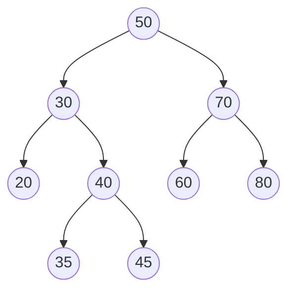
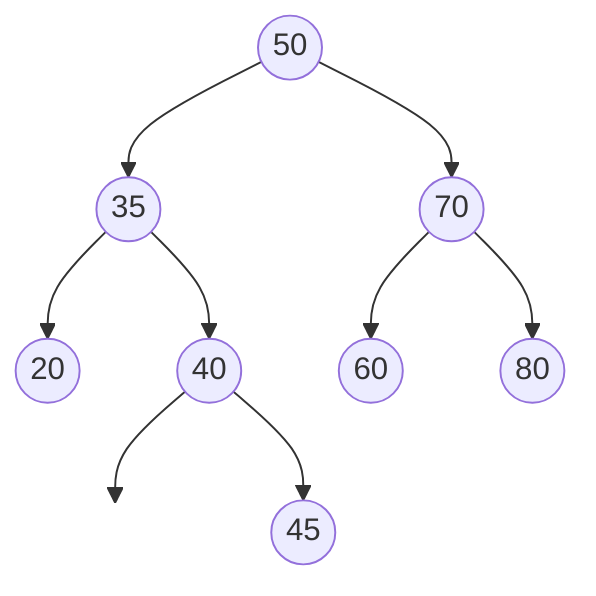

# Binary Search Trees and Ordered Maps

> Range queries over transactions by timestamp need order, not just hashing.

**Type:** Build
**Languages:** Java, Python
**Prerequisites:** Phase 1, Lesson 01 (Complexity Analysis), Phase 1, Lesson 04 (Linked Lists), Phase 1, Lesson 06 (Hash Maps from Scratch)
**Time:** ~90 minutes

## Learning Objectives

- State the binary-search-tree invariant precisely and explain why it makes every lookup a single root-to-leaf path
- Build an ordered map with insert, exact search, floor/ceiling, and delete, including the two-children case via the in-order successor
- Implement an inclusive range query that visits O(h + k) nodes and explain where the pruning happens
- Index transactions by a composite `(timestamp, sequence)` key so that same-millisecond postings are preserved and "everything between t1 and t2" is one call
- Measure the degenerate case: sorted insertion gives height n-1 and O(n) lookups, which motivates the self-balancing trees of Phase 3

## The Problem

A settlement service keeps every authorised card transaction of the day in memory so that the batch job can answer questions like "give me every posting between 14:00:00 and 14:59:59 for this merchant" and "what is the total captured between the last cut-off and now". The first version stores the transactions in a `HashMap<String, Transaction>` keyed by transaction id, because that is what the idempotency layer (Lesson 06) already uses. The range question is answered by iterating over all 40 million entries and filtering by timestamp. It takes 11 seconds. There are 1,440 one-minute windows in a day, and the reconciliation job asks for each one. Nobody notices until the job that used to finish at 02:00 is still running at 08:00 and the finance team's morning report is empty.

The hash map is not slow. It is answering the wrong question well. A hash map promises O(1) *exact-key* lookup and nothing else; the hash function deliberately scatters nearby keys to unrelated buckets, so "every key between a and b" has no structure to exploit and degenerates to a full scan. A sorted array would make the range query O(log n + k) with binary search, but inserting a new transaction into the middle of a 40-million-element array is O(n), and transactions arrive at 2,000 per second.

What the settlement service needs is a structure that keeps keys in order *and* accepts inserts and deletes without shifting everything: an ordered map. The binary search tree is the simplest one. It turns "all keys between t1 and t2" into a walk that enters only the subtrees that can contain such keys, and it does insert and delete by following one path from the root. This lesson builds it, measures it, and then shows the catch: a plain BST is only fast when the insertion order is random, and transactions arrive in the one order that breaks it.

## The Concept

### The invariant

A binary search tree is a set of nodes, each holding a key, a value, and up to two children, with one rule:

**For every node n, every key in n's left subtree is strictly less than n.key, and every key in n's right subtree is strictly greater.**

Note what the rule does not say. It does not say the left *child* is smaller; it says every key anywhere in the left *subtree* is smaller. A tree where each child is correctly placed relative to its parent but a grandchild is on the wrong side of its grandparent is not a BST, and lookups in it silently return "not found" for keys that are present. The `checkInvariant` method in the code verifies the strong form by walking the tree in order and confirming the keys come out strictly ascending, which is equivalent.

Keys are unique. Inserting a key that already exists replaces the value; this matches `java.util.TreeMap` and is the behaviour an index wants. When two records legitimately share the natural key (two postings in the same millisecond), the fix is a composite key, not a tree that allows duplicates. The lesson's `TxKey(timestampMillis, sequence)` does exactly that.

### Why one path answers every question

The invariant means that at any node, a single comparison tells you which subtree a key can be in. Searching for 42 in this tree:



`42 < 50` go left; `42 > 30` go right; `42 > 40` go right; `42 < 45` go left; null, so 42 is absent. Four comparisons. Every operation in this lesson is a variation on that walk, so every operation costs O(h) comparisons where h is the height of the tree (the number of edges on the longest root-to-leaf path). The whole story of BSTs is the story of what h is.

| Insert order of n keys | Height h | Cost per lookup | Why |
|------------------------|----------|-----------------|-----|
| Perfectly balanced (built from a sorted array by recursive midpoints) | floor(log2 n) | ~log2 n | Every level is as full as it can be |
| Uniformly random | about 2 ln n, so roughly 1.39 log2 n on average | ~1.39 log2 n | Analysis identical to quicksort's expected depth |
| Sorted ascending or descending | n - 1 | ~n/2 | Every insert goes to the same side: the tree is a linked list |
| Mostly sorted with a few swaps (real transaction streams) | close to n | close to n/2 | A few out-of-order keys create a few short branches off a long spine |

The last row is the payments problem in one line. Transactions are keyed by time, time increases, so the insert order is almost sorted and the plain BST degenerates. The `demoDegenerate` method in the code reproduces it: 4,096 keys inserted in order give height 4,095 and 2,048 comparisons per lookup; the same keys shuffled give height 25 and 14 comparisons. Phase 3 introduces red-black trees, AVL trees, and B-trees, which rotate nodes to keep h within a constant of log2 n regardless of insert order. This lesson deliberately builds the unbalanced version first because every balanced tree *is* this tree plus a repair step, and you cannot understand the repair without the structure it repairs.

### Insert and search

Insert follows the search path for the new key; where the path falls off the tree (a null child), the new node goes. Because the path was chosen by the invariant, attaching a leaf there preserves the invariant with no further work. If the search finds the key, replace the value in place.

### Floor and ceiling

`floorKey(k)` returns the largest key less than or equal to k. Walk from the root: on an exact hit return it; when the current key is larger than k go left (the answer, if any, is smaller); when the current key is smaller than k, remember it as the best candidate so far and go right, because there may be a larger key that is still below k. `ceilingKey` mirrors it. These two operations are what make an ordered map useful for "the most recent rate at or before this timestamp" (Phase 10, FX lesson) and "the next retry due after now" (Lesson 09 solved it with a heap; a tree does it too, with the added ability to cancel by key).

### Delete, by hand

Delete is the only operation with cases. Removing a node from the tree in the diagram:

1. **No children (a leaf), remove 20.** Set the parent's pointer to null. Done.
2. **One child, remove 70 after 60 is gone.** Splice the child into the parent's slot: 50.right becomes 80. Every key in 80's subtree was already greater than 50, so the invariant holds.
3. **Two children, remove 30.** Neither child can be promoted into 30's slot in general: whichever one you pick, the other child's whole subtree has to be re-hung somewhere, and there is no single place for it. The trick: the **in-order successor** of 30 is the smallest key greater than 30, which is the leftmost node of 30's right subtree, here 35. Copy 35's key and value into 30's node, then delete the node that held 35. That node is the leftmost of a subtree, so it has no left child, so deleting it is case 1 or case 2. The in-order sequence goes from `20 30 35 40 45 50 60 70 80` to `20 35 40 45 50 60 70 80`, and the tree becomes:



Why the successor works: it is larger than everything in the left subtree (it is larger than 30, and 30 is larger than all of them) and smaller than everything else in the right subtree (it is the minimum there). It is the unique key that can sit at that position without moving anything else. The predecessor (maximum of the left subtree) works symmetrically; the lesson uses the successor because that is what `TreeMap` and most textbooks do.

### Range query: O(h + k), not O(n)

The naive way to answer "all keys in [lo, hi]" is to traverse everything and filter, which is O(n). The tree lets you prune. During an in-order traversal, at any node:

- if `node.key < lo`, nothing in `node.left` can be in range (all smaller still), so do not descend left;
- if `node.key > hi`, nothing in `node.right` can be in range, and because the traversal is in order, every node after this one is larger too, so stop.

What remains is: one path down to where `lo` would be (O(h)), then every in-range node (k of them, each reached in amortised O(1) steps because in-order traversal visits each edge at most twice), then one path down to where `hi` would be (O(h)). Total O(h + k). For 40 million transactions in a balanced tree with 20,000 in the window, that is roughly 26 + 20,000 node visits instead of 40,000,000. The range query in the code is the iterative in-order traversal with those two checks added; compare the two methods side by side and the pruning is three lines.

### Worked example: the transaction index

Twelve transactions arrive over ninety minutes, not in timestamp order (network delays, retries). Each is filed under `TxKey(timestampMillis, sequence)` where `sequence` is a counter the index assigns on arrival. Three of them share the timestamp +44 minutes. The query is "everything from +10 to +45 minutes inclusive":

```text
lo = TxKey(T0 + 10 min, Long.MIN_VALUE)   smallest possible key at that timestamp
hi = TxKey(T0 + 45 min, Long.MAX_VALUE)   largest possible key at that timestamp
result, in key order:
  tx-3   +12   16.48 USD
  tx-10  +15   90.93 USD
  tx-9   +29   25.19 USD
  tx-4   +44   87.84 USD   sequence 3
  tx-5   +44   66.70 USD   sequence 4
  tx-12  +44   61.02 USD   sequence 11
sum = 348.16 USD
```

The composite key does two things. It keeps all three +44 postings (a tree keyed by timestamp alone would have overwritten two of them, and the settlement total would be short by 127.72 USD). And it makes a timestamp range expressible as a key range: the sentinel sequences `Long.MIN_VALUE` and `Long.MAX_VALUE` bracket every real key at those timestamps. The sum is computed with the integer-minor-units `Money` type from Phase 10, Lesson 01, not a double, because a settlement total that is off by a cent is a reconciliation break.

### What a BST does not do

- It does not stay balanced. Nothing in insert or delete looks at height. Sorted input produces a linked list, and so does deleting in a pattern that repeatedly removes from one side. Phase 3 fixes this.
- It does not give O(1) exact lookup. A hash map does; if your only question is "is this idempotency key present", Lesson 06 is the right structure and this one is strictly worse.
- It does not support duplicate keys. Use a composite key or store a list as the value.
- It does not survive concurrent writers. Every mutation changes pointers that a concurrent reader may be following. Phase 4 covers locking and lock-free structures; until then, one writer at a time.
- It is not cache friendly. Each node is a separate heap object and each step of the walk is a pointer dereference, which is why Lesson 01's "O(n) with cache misses" warning applies and why databases use B-trees (many keys per node, one cache line or disk page at a time) rather than binary trees.

## Build It

The code lives in `code/java/Main.java`; tests in `code/java/MainTest.java`. The tree is generic in `K extends Comparable<K>` and `V`, so the same class indexes integers in the tests and `TxKey` in the transaction index. Every operation is written iteratively with an explicit loop or stack. That is a deliberate choice: the degenerate case has height n, and a recursive implementation of `inOrder` on a 100,000-element chain would overflow the Java stack long before the demo finished.

### Step 1: The node and the counter

```java
final class BinarySearchTree<K extends Comparable<K>, V> {

    static final class Node<K, V> {
        K key;
        V value;
        Node<K, V> left, right;
        Node(K key, V value) { this.key = key; this.value = value; }
    }

    private Node<K, V> root;
    private int size;
    private long comparisons;

    private int compare(K a, K b) {
        comparisons++;
        return a.compareTo(b);
    }
}
```

`Node` is a plain mutable class, not a record, because delete rewires `left` and `right` and the successor case overwrites `key` and `value` in place. The `comparisons` counter is instrumentation: every key comparison goes through `compare`, so the demo and the tests can measure cost directly instead of guessing from wall-clock time. Lesson 01 made the case for counting the operation that dominates; here that operation is `compareTo`.

**Predict:** after inserting n keys in sorted order and then looking up the largest one, what does `comparisons()` report?

### Step 2: Insert, replacing on an existing key

```java
V put(K key, V value) {
    Objects.requireNonNull(key, "key");
    if (root == null) {
        root = new Node<>(key, value);
        size = 1;
        return null;
    }
    Node<K, V> cur = root;
    while (true) {
        int c = compare(key, cur.key);
        if (c == 0) {
            V old = cur.value;
            cur.value = value;
            return old;
        }
        if (c < 0) {
            if (cur.left == null) { cur.left = new Node<>(key, value); size++; return null; }
            cur = cur.left;
        } else {
            if (cur.right == null) { cur.right = new Node<>(key, value); size++; return null; }
            cur = cur.right;
        }
    }
}
```

The loop is the search walk; the only difference from `get` is what happens at a null child (attach instead of return null) and at an equal key (replace instead of return). Returning the old value lets a caller detect "this was an update" without a separate `containsKey`, which is the `java.util.Map.put` contract. `size` only changes when a node is created.

**Predict:** `put` is called with a key equal to the root's key. How many comparisons happen, and does `size` change?

### Step 3: Search, floor, and ceiling

```java
V get(K key) {
    Node<K, V> cur = root;
    while (cur != null) {
        int c = compare(key, cur.key);
        if (c == 0) return cur.value;
        cur = c < 0 ? cur.left : cur.right;
    }
    return null;
}

K floorKey(K key) {
    Node<K, V> cur = root;
    K best = null;
    while (cur != null) {
        int c = compare(key, cur.key);
        if (c == 0) return cur.key;
        if (c < 0) cur = cur.left;
        else { best = cur.key; cur = cur.right; }
    }
    return best;
}
```

`floorKey` is `get` with a memory. Every time the walk passes a key smaller than the target it records that key and keeps going right, hoping for something closer. When the walk falls off the tree, `best` is the last key it passed on the way right, which is exactly the largest key below the target. `ceilingKey` (in the file) swaps the directions. On the sample tree `floorKey(42)` passes 30 (record), 40 (record), then 45 is too big and its left child is null: answer 40.

**Predict:** what does `floorKey(10)` return on the sample tree, and how many comparisons does it make?

### Step 4: Delete with the in-order successor

```java
V remove(K key) {
    Node<K, V> parent = null, cur = root;
    while (cur != null) {
        int c = compare(key, cur.key);
        if (c == 0) break;
        parent = cur;
        cur = c < 0 ? cur.left : cur.right;
    }
    if (cur == null) return null;
    V removed = cur.value;

    if (cur.left != null && cur.right != null) {
        Node<K, V> succParent = cur, succ = cur.right;
        while (succ.left != null) { succParent = succ; succ = succ.left; }
        cur.key = succ.key;
        cur.value = succ.value;
        if (succParent == cur) succParent.right = succ.right;
        else succParent.left = succ.right;
    } else {
        Node<K, V> child = cur.left != null ? cur.left : cur.right;
        if (parent == null) root = child;
        else if (parent.left == cur) parent.left = child;
        else parent.right = child;
    }
    size--;
    return removed;
}
```

The first loop finds the node and remembers its parent, because Java has no parent pointers and the parent is who must be rewired. The `else` branch handles zero and one child in one line: `child` is whichever child exists (or null), and it replaces `cur` in the parent's slot; the `parent == null` case means `cur` was the root. The two-children branch finds the successor and its parent, copies the successor's contents up, and detaches the successor by splicing its right child into whichever slot it occupied. The `succParent == cur` check matters: when the right child itself has no left child, it *is* the successor, and it hangs off `cur.right`, not off some deeper node's `left`.

**Predict:** in the sample tree, `remove(50)` is the root with two children. Which key ends up at the root, and which pointer is rewritten to detach it?

### Step 5: In-order traversal without recursion

```java
List<Entry<K, V>> inOrder() {
    List<Entry<K, V>> out = new ArrayList<>(size);
    Deque<Node<K, V>> stack = new ArrayDeque<>();
    Node<K, V> cur = root;
    while (cur != null || !stack.isEmpty()) {
        while (cur != null) { stack.push(cur); cur = cur.left; }
        cur = stack.pop();
        out.add(new Entry<>(cur.key, cur.value));
        cur = cur.right;
    }
    return out;
}
```

This is the recursive `visit(left); emit; visit(right)` with the call stack made explicit. Push every node on the way down the left spine; pop one, emit it, then start again from its right child. Each node is pushed once and popped once, so the traversal is O(n) regardless of shape, and the stack's maximum depth is the tree's height, which lives on the heap where a 4,095-deep chain is a few hundred kilobytes rather than a `StackOverflowError`. `checkInvariant` is this method plus an "is the output strictly ascending" check.

### Step 6: Range query is the traversal plus two cuts

```java
List<Entry<K, V>> rangeQuery(K lo, K hi) {
    if (compare(lo, hi) > 0) throw new IllegalArgumentException("lo must not exceed hi");
    List<Entry<K, V>> out = new ArrayList<>();
    Deque<Node<K, V>> stack = new ArrayDeque<>();
    Node<K, V> cur = root;
    while (cur != null || !stack.isEmpty()) {
        while (cur != null) {
            stack.push(cur);
            cur = compare(cur.key, lo) < 0 ? null : cur.left;
        }
        cur = stack.pop();
        int vsLo = compare(cur.key, lo), vsHi = compare(cur.key, hi);
        if (vsHi > 0) return out;
        if (vsLo >= 0) out.add(new Entry<>(cur.key, cur.value));
        cur = cur.right;
    }
    return out;
}
```

Diff this against Step 5. The descent sets `cur = null` instead of `cur.left` when the current key is already below `lo`: nothing to the left can qualify. The emit step returns early the moment a key exceeds `hi`: nothing later in in-order can qualify. Everything else is identical. The test `range query prunes` asserts that `rangeQuery(35, 45)` on the nine-node sample makes fewer comparisons than a full scan would; on a large balanced tree the gap is the difference between milliseconds and seconds.

**Predict:** `rangeQuery(lo, hi)` where no key lies in the range and `lo` is larger than every key. How many nodes are pushed on the stack?

### Step 7: Height, and the composite-key index

```java
int height() {
    if (root == null) return -1;
    int h = -1;
    Deque<Node<K, V>> level = new ArrayDeque<>();
    level.add(root);
    while (!level.isEmpty()) {
        h++;
        for (int i = level.size(); i > 0; i--) {
            Node<K, V> n = level.poll();
            if (n.left != null) level.add(n.left);
            if (n.right != null) level.add(n.right);
        }
    }
    return h;
}
```

Height is computed by level-order (breadth-first) traversal: process one whole level per outer iteration, count the levels. A single node has height 0; an empty tree is -1 by the convention that makes `height(node) = 1 + max(height(left), height(right))` work at the leaves.

```java
record TxKey(long timestampMillis, long sequence) implements Comparable<TxKey> {
    static TxKey lowest(long timestampMillis) { return new TxKey(timestampMillis, Long.MIN_VALUE); }
    static TxKey highest(long timestampMillis) { return new TxKey(timestampMillis, Long.MAX_VALUE); }

    @Override public int compareTo(TxKey o) {
        int c = Long.compare(timestampMillis, o.timestampMillis);
        return c != 0 ? c : Long.compare(sequence, o.sequence);
    }
}

List<Transaction> between(long fromInclusive, long toInclusive) {
    List<Transaction> out = new ArrayList<>();
    for (Entry<TxKey, Transaction> e : tree.rangeQuery(TxKey.lowest(fromInclusive), TxKey.highest(toInclusive))) {
        out.add(e.value());
    }
    return out;
}
```

`TxKey` orders by timestamp first and by arrival sequence second, so no two transactions ever collide and the order within a millisecond is arrival order (deterministic and replayable, which matters when the settlement file is regenerated). `between` converts a timestamp range into a key range using the sentinel sequences. `Long.compare` rather than subtraction: `a - b` on two longs far apart overflows and flips sign, and a comparator that is wrong on 0.001% of inputs produces a tree that is silently not a BST.

### Step 8: Run it

```bash
cd phases/01-complexity-and-core-structures/08-binary-search-trees/code/java
javac -d .out *.java && java -cp .out Main
java -cp .out MainTest
```

Expected output, abbreviated:

```console
== Insert, search, delete with successor ==
in-order keys: [20, 30, 35, 40, 45, 50, 60, 70, 80]
size=9 height=3 min=20 max=80
floor(42)=40 ceiling(42)=45 get(45)=v45
after remove(30), in-order: [20, 35, 40, 45, 50, 60, 70, 80] invariant=true
after remove(50), in-order: [20, 35, 40, 45, 60, 70, 80] height=3

== Range query over transactions by timestamp ==
indexed 12 transactions, tree height 7
between +10min and +45min (inclusive): 6 transactions
  tx-3   +12 min  16.48 USD
  ...
sum in window = 348.16 USD

== Why unbalanced trees need balancing ==
4096 keys inserted in sorted order:   height 4095, 2048.5 comparisons per lookup
4096 keys inserted in shuffled order: height 25, 14.2 comparisons per lookup
ideal balanced height for 4096 keys: 12
```

The tests also cross-check 3,000 random `put`/`remove`/`rangeQuery`/`floorKey` operations against `java.util.TreeMap`, which is the cheapest way to find a delete bug: write the reference-model test first, then the implementation.

### In Python

```python
@dataclass(frozen=True, order=True)
class TxKey:
    timestamp_millis: int
    sequence: int

    @staticmethod
    def lowest(timestamp_millis: int) -> TxKey:
        return TxKey(timestamp_millis, LONG_MIN)
```

```python
def _compare(self, a: K, b: K) -> int:
    """compareTo as a function returning -1/0/1, counted once per call like the Java version."""
    self._comparisons += 1
    if a < b:
        return -1
    if b < a:
        return 1
    return 0
```

`code/python/main.py` keeps the same tree, `TxKey`, `TransactionIndex`, and trimmed `Money`. What differs:

- **No `Comparable` bound.** Keys only need `<`. `TxKey` is a `@dataclass(order=True)`, which compares `(timestamp_millis, sequence)` as a tuple, exactly `Long.compare` then `Long.compare`. `_compare` stays a function so the comparison counter, and therefore the "2048.5 comparisons per lookup" line, is identical to Java.
- **Iteration is mandatory, not a style choice.** CPython's default recursion limit is 1,000, so a recursive in-order walk of the 4,096-node chain would raise `RecursionError`. All traversals use an explicit `list` as a stack, and the test that walks a 1,000-node chain pins that.
- **Integer ranges are explicit.** `Long.MIN_VALUE`/`Long.MAX_VALUE` become `LONG_MIN = -(1 << 63)` and `LONG_MAX`; `Money.plus` checks the 64-bit range by hand (`add_exact`) because Python ints never overflow, and a test asserts the `OverflowError`. A `None` key raises `TypeError` where Java throws `NullPointerException`.
- **Same random data.** `JavaRandom` reproduces `java.util.Random`, so the transaction amounts, the shuffled insert order (height 25), and the 3,000-operation cross-check use the same sequences; the reference model is a `dict` plus `bisect` over sorted keys instead of `TreeMap`. Nodes use `__slots__`.

```bash
cd phases/01-complexity-and-core-structures/08-binary-search-trees/code/python
python3 main.py
python3 -m unittest -v
```

### Porting notes

Go has no generics constraint for ordering beyond `cmp.Ordered`, which excludes structs, so pass a `func(a, b K) int` comparator into the constructor; `remove` and `get` return `(V, bool)` instead of `nil`. Go has no `Long.compare` overflow hazard for the composite key, but it needs the same "compare, do not subtract" discipline for consistency.

## Use It

### `java.util.TreeMap`

`TreeMap<K, V>` is a red-black tree: this lesson's structure plus rebalancing rotations after every insert and delete, guaranteeing height at most 2 log2(n + 1). Its API is a superset of what you built:

| This lesson | `TreeMap` | Notes |
|-------------|-----------|-------|
| `put`, `get`, `remove`, `containsKey` | same names | identical contracts, including "put returns the old value" |
| `minKey`, `maxKey` | `firstKey`, `lastKey` | throw `NoSuchElementException` when empty rather than returning null |
| `floorKey`, `ceilingKey` | same names | plus `lowerKey`/`higherKey` for strict inequality |
| `rangeQuery(lo, hi)` | `subMap(lo, true, hi, true)` | returns a live view, not a copy; mutations through the view affect the tree |
| `inOrder` | `entrySet()` iteration | fail-fast iterator throws `ConcurrentModificationException` on concurrent mutation |
| `height()` | not exposed | you never need it because it is always O(log n) |

What `TreeMap` hides: the rotations (Phase 3), the fact that `subMap` is a view with O(1) construction cost and O(h + k) iteration cost, and the comparator contract. That last one is the production trap: if your `compareTo` is inconsistent with `equals`, or not transitive, or overflows on subtraction, `TreeMap` does not detect it. It builds a tree that is not a BST and returns wrong answers without an exception. The `checkInvariant` you wrote is the test `TreeMap` cannot run for you.

`ConcurrentSkipListMap` is the concurrent ordered map in `java.util.concurrent`; it is a skip list rather than a tree, with the same O(log n) bounds and lock-free reads.

### Databases

Every relational database's default index is a B-tree (Phase 3, and Phase 7 on storage): an ordered map where each node holds hundreds of keys so that one disk page read descends one level. `SELECT * FROM postings WHERE ts BETWEEN ? AND ?` with an index on `ts` is this lesson's `rangeQuery`: descend to `lo`, scan leaves to `hi`. Without the index it is the 11-second full scan from The Problem. PostgreSQL's `EXPLAIN` shows the difference as `Index Range Scan` versus `Seq Scan`. The composite-key lesson transfers directly: an index on `(merchant_id, ts)` answers "this merchant's postings in a window" with one range scan, while an index on `(ts, merchant_id)` cannot.

### Redis sorted sets

`ZRANGEBYSCORE key min max` on a Redis sorted set is a range query over a skip list plus a hash map. Payment systems use it for "all authorisations expiring before now" (score = expiry timestamp), which is exactly the settlement window query with a different predicate.

## Ship It

`outputs/interview-card-ordered-maps.md` is a one-page card: the invariant, the complexity table by insert order, the delete cases, the range-query pruning rule, and the three questions interviewers actually ask about BSTs (why balance, why not a hash map, how do you get a range). Use it the evening before a data-structures round, and use its "when to reach for an ordered map" table in design reviews when someone proposes a hash map for a query that has a `BETWEEN` in it.

## Exercises

1. **Reinforce.** Add `lowerKey(k)` (largest key strictly less than k) and `higherKey(k)` (smallest key strictly greater) to the tree, and write tests that distinguish them from `floorKey`/`ceilingKey` on an exact hit. Then implement `removeMin()` and `removeMax()` in O(h) without calling `remove`.
2. **Apply.** Add a `rank(k)` operation that returns how many keys are strictly less than k, and `select(i)` that returns the i-th smallest key, both in O(h), by storing a `subtreeSize` field in each node and maintaining it in `put` and `remove`. Use it to answer "what percentile of today's transaction amounts is this one" for a fraud-scoring feature. The delete-with-successor case is the hard part: which nodes' sizes change?
3. **Extend.** Combine with Lesson 06: build a `TransactionStore` that keeps a hash map from transaction id to `Transaction` for O(1) idempotency checks *and* this tree for range queries, and keep the two consistent under `record` and `remove`. Then write the test that would have caught the settlement bug in The Problem: insert 100,000 transactions with increasing timestamps, measure `height()`, and assert it is below 64. Watch it fail, and write one paragraph on what Phase 3 must provide for it to pass.

## Key Terms

| Term | What people say | What it actually means |
|------|-----------------|------------------------|
| BST invariant | "left is smaller, right is bigger" | Every key in the entire left subtree is strictly less than the node's key and every key in the entire right subtree is strictly greater; a property of subtrees, not of children |
| Height | "how deep the tree is" | Number of edges on the longest root-to-leaf path; -1 for empty, 0 for one node; the cost of every operation is O(height) |
| Degenerate tree | "the tree became a linked list" | A BST of height n-1, produced by inserting keys in sorted order; every operation is O(n) |
| In-order successor | "the next key" | The smallest key greater than a given key: the leftmost node of its right subtree, or the nearest ancestor from which you turned left; used to delete a node with two children |
| In-order traversal | "walk the tree" | Visit left subtree, node, right subtree; on a BST this emits keys in ascending order and is the basis of range queries |
| Range query | "a BETWEEN" | All entries with lo <= key <= hi, found in O(h + k) by pruning subtrees that cannot contain a qualifying key |
| Composite key | "sort by two fields" | A key whose ordering compares one field, then the next on ties; lets a multi-field range be expressed as a single key range with sentinel values |
| Ordered map | "a sorted dictionary" | A map that additionally supports min, max, floor, ceiling, and range in O(log n); `TreeMap`, B-tree indexes, skip lists |

## Further Reading

- [Cormen, Leiserson, Rivest, Stein, *Introduction to Algorithms*, Chapter 12: Binary Search Trees](https://mitpress.mit.edu/9780262046305/introduction-to-algorithms/) — the canonical treatment, including the proof that a randomly built BST has expected height O(log n) and the delete procedure this lesson uses.
- [Java SE 21 `java.util.TreeMap` documentation](https://docs.oracle.com/en/java/javase/21/docs/api/java.base/java/util/TreeMap.html) — the production ordered map; read the paragraph on comparator consistency with `equals`, which is the bug `checkInvariant` catches.
- [Java SE 21 `java.util.NavigableMap` documentation](https://docs.oracle.com/en/java/javase/21/docs/api/java.base/java/util/NavigableMap.html) — the interface that names floor, ceiling, lower, higher, and the sub-map views; your tree implements most of it.
- [PostgreSQL documentation: Index Types (B-tree)](https://www.postgresql.org/docs/current/indexes-types.html) — which operators a B-tree index can serve, including `BETWEEN`; the production form of `rangeQuery`.
- [Redis `ZRANGEBYSCORE`](https://redis.io/docs/latest/commands/zrangebyscore/) — a range query over an ordered structure in a cache, with the same inclusive/exclusive bound semantics you implemented.
- [Knuth, *The Art of Computer Programming*, Vol. 3, Section 6.2.2](https://www-cs-faculty.stanford.edu/~knuth/taocp.html) — the analysis of search-tree shape under random insertion and the origin of the 2 ln n expected depth.
