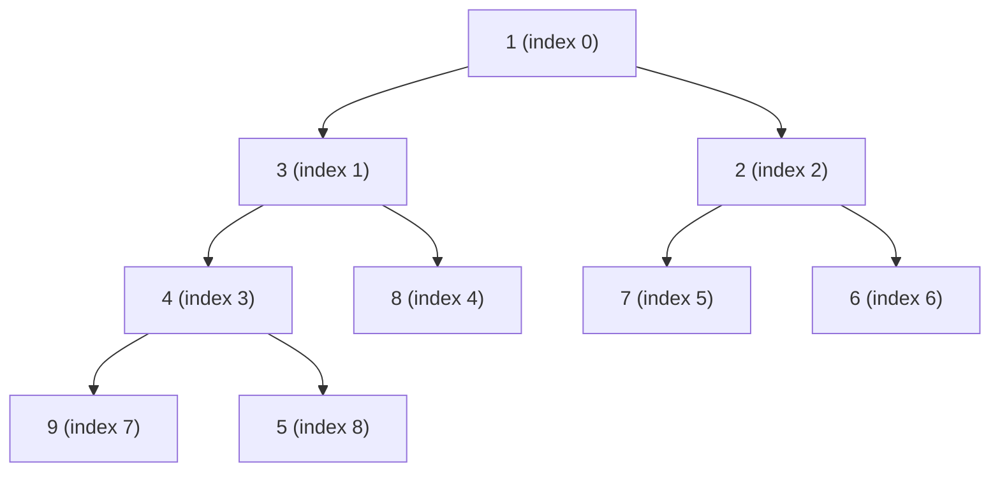

# Heaps and Priority Queues from Scratch

> The structure behind every scheduler, timer wheel, and retry queue.

**Type:** Build
**Languages:** Java, Python, Go
**Prerequisites:** Phase 1 Lesson 03 (Dynamic Arrays), Phase 1 Lesson 06 (Hash Maps), Phase 0 Lesson 03 (Testing from the Standard Library)
**Time:** ~90 minutes

## Learning Objectives

- State the heap invariant and explain why it gives O(1) access to the minimum and O(log n) insert and remove without keeping the array sorted
- Build a binary min-heap in an array with sift-up and sift-down, and derive the index arithmetic that makes the tree implicit
- Build a heap from n items in O(n) with Floyd's bottom-up method and explain why it beats n inserts
- Add a key-to-index map so that decrease-key is O(log n), and keep the map consistent through every swap
- Make ties deterministic with a sequence number, and explain why standard-library priority queues do not
- Frame a payment retry scheduler as a heap ordered by due time on an injected clock, and test it without sleeping

## The Problem

A payment service retries failed authorisations with exponential backoff: 1 s, 2 s, 4 s, up to a minute. The scheduler holds every pending retry and, once per tick, hands out the ones that are due. The first version keeps pending retries in an `ArrayList` sorted by due time: inserting is a binary search plus a shift, O(n), and polling is "take from the front while due". At 2,000 pending retries nobody notices.

Then the card processor has a 20-minute outage. Every authorisation in flight fails, and 400,000 retries are scheduled within three minutes. Each insert shifts, on average, 200,000 elements. The scheduler thread spends its time moving memory, falls behind, and when the processor comes back the retries are released late and in a burst that takes it down again. An engineer replaces the list with a `java.util.PriorityQueue` and insert becomes O(log n). The next incident is subtler. Operations wants a button: "processor is healthy, retry everything now". That means changing the priority of 400,000 items already in the queue. `PriorityQueue` has no operation for that; `remove(Object)` is a linear scan, so re-prioritising everything is O(n^2) and the button takes eleven minutes to do its work.

A third problem shows up in the postmortem. Thousands of retries share the same due millisecond, and `PriorityQueue` documents that ties are broken arbitrarily. Under load, some merchants' retries were consistently released after others' with the identical due time, because of where they happened to land in the array. Nothing was wrong by the queue's contract, but a fairness guarantee the team believed they had did not exist.

The heap built in this lesson fixes all three: O(log n) insert and poll, O(log n) decrease-key through an index map, and ties broken by insertion order so that equal priorities come out first-in, first-out. Those three properties are what every scheduler, timer service, and retry queue needs, and the standard libraries give you only the first.

## The Concept

### The invariant

A binary min-heap is a complete binary tree stored in an array, with one rule: **every node is less than or equal to its children.** Completeness means the tree is filled level by level, left to right, with no gaps, which is exactly what lets the array hold it without pointers:

| Node at index `i` | Where it lives |
|---|---|
| parent | `(i - 1) / 2` (integer division) |
| left child | `2i + 1` |
| right child | `2i + 2` |
| last parent (first node with any child) | `n / 2 - 1` |

The invariant is deliberately weak. Siblings are unordered; the second-smallest element is somewhere in the root's two children, the third-smallest could be at depth 1 or 2. That weakness is the point: a fully sorted array costs O(n) to maintain on insert, while heap order can be restored in O(log n) because only one root-to-leaf path is ever disturbed.



That is the heap `[1, 3, 2, 4, 8, 7, 6, 9, 5]`. Read it against the rule: 1 <= 3 and 2; 3 <= 4 and 8; 2 <= 7 and 6; 4 <= 9 and 5. It holds. The array is not sorted, and 2 is not adjacent to 1, and that is fine.

### Two operations restore the invariant

**Sift-up** (after appending at the end): while the new node is smaller than its parent, swap them. The node rises along one path; at most `log2(n)` swaps.

**Sift-down** (after replacing the root): compare the node with the smaller of its two children; if that child is smaller, swap and continue from the child's position. Again one path, at most `log2(n)` swaps. Choosing the *smaller* child is what preserves the invariant: after the swap the new parent must be less than or equal to both children, and only the smaller child can satisfy that.

| Operation | How | Cost |
|---|---|---|
| `peek` | return `items[0]` | O(1) |
| `push` | append, sift-up from the last index | O(log n) |
| `pop` | save root, move last element to index 0, shrink, sift-down from 0 | O(log n) |
| `heapify` (n items) | sift-down every internal node from `n/2 - 1` down to 0 | O(n) |
| `decreaseKey` | find the index (O(1) with a map, O(n) without), overwrite, sift-up | O(log n) with the map |
| `isHeap` (test only) | check every parent-child pair | O(n) |

### Worked example: heapify by hand

Start from `[9, 4, 7, 1, 8, 2, 6, 3, 5]`, n = 9, last parent is index `9/2 - 1 = 3`. Sift down indices 3, 2, 1, 0 in that order:

```text
i=3 (value 1): children at 7 (3) and 8 (5); 1 is already smaller      no swap
i=2 (value 7): children at 5 (2) and 6 (6); smaller child is 2        swap -> [9, 4, 2, 1, 8, 7, 6, 3, 5]
               7 is now at index 5, which has no children             stop
i=1 (value 4): children at 3 (1) and 4 (8); smaller child is 1        swap -> [9, 1, 2, 4, 8, 7, 6, 3, 5]
               4 is now at index 3: children 7 (3) and 8 (5)          swap -> [9, 1, 2, 3, 8, 7, 6, 4, 5]
i=0 (value 9): children at 1 (1) and 2 (2); smaller child is 1        swap -> [1, 9, 2, 3, 8, 7, 6, 4, 5]
               9 at index 1: children 3 (3) and 4 (8)                 swap -> [1, 3, 2, 9, 8, 7, 6, 4, 5]
               9 at index 3: children 7 (4) and 8 (5)                 swap -> [1, 3, 2, 4, 8, 7, 6, 9, 5]
               9 at index 7: no children                              stop
```

Six swaps for nine elements. The result is the heap drawn above. Now `pop` once: save 1, move the last element 5 to the root, shrink to eight elements, sift down: `[5, 3, 2, 4, 8, 7, 6, 9]`, children 3 and 2, swap with 2: `[2, 3, 5, 4, 8, 7, 6, 9]`, then 5 at index 2 has children 7 and 6, both larger, stop. The next `pop` returns 2. Popping everything yields `1, 2, 3, 4, 5, 6, 7, 8, 9`: that is heapsort, and the test suite checks it.

### Why heapify is O(n), not O(n log n)

Building the heap by `n` pushes costs O(n log n), because the last `n/2` pushes may each climb `log n` levels. Floyd's bottom-up method sifts *down* instead, and most nodes are near the bottom with nowhere to go. A node at height `h` (leaves at height 0) sifts down at most `h` levels, and there are at most `n / 2^(h+1)` nodes at that height:

```text
total swaps <= sum over h of  h * n / 2^(h+1)
            =  n * (0/2 + 1/4 + 2/8 + 3/16 + ...)
            =  n * 1
```

The series sums to exactly 1, so the bound is `n` swaps. Half the nodes are leaves and cost nothing; a quarter cost at most one swap; the single root costs at most `log n`. The trace above spent 6 swaps on 9 nodes, within the bound.

### Decrease-key and the index map

Schedulers need to move an item forward: "retry this payment now, not in 60 seconds". In a bare heap that means finding the item, which is an O(n) scan, because heap order says nothing about *where* a given key is. The fix is a second structure: a hash map (Lesson 06) from key to current array index. Then decrease-key is: look up the index O(1), overwrite the priority, sift-up O(log n).

The cost is an invariant to maintain: **`index.get(entries[i].key) == i` for every `i`**. Every swap in sift-up or sift-down must update two map entries, and `pop` must remove the popped key and re-record the element moved to the root. The implementation routes every movement through one `swap` method so there is exactly one place to get this right, and `isConsistent()` checks both invariants in tests.

Why only *decrease*? Sifting up is enough for a priority that got smaller; a priority that got larger would need sift-down instead. Keeping the operation one-directional makes the retry scheduler's `expedite` honest: an operator can pull a retry forward but cannot accidentally push it later and leave a payment stuck. Exercise 1 adds the other direction.

### Stable ties

Two retries due in the same millisecond have equal priorities. A heap compares priorities only, so which comes out first depends on the array layout, which depends on the history of swaps: arbitrary, and different between implementations. The fix is cheap: give every entry a monotonically increasing sequence number at insertion and compare `(priority, seq)`. Now equal priorities pop in insertion order, which is the FIFO fairness the scheduler in The Problem was assumed to have. Decrease-key keeps the entry's original `seq`, so an expedited item that lands on a tie is ordered as if it had been scheduled at its original time. The test `equal priorities pop in insertion order` pins this down.

### Choosing the structure

The heap is one of several ways to get "smallest first". The right choice depends on which operations dominate and whether the structure must outlive the process:

| Structure | insert | find-min | delete-min | change priority | ordered iteration | Notes |
|---|---|---|---|---|---|---|
| Binary heap (this lesson) | O(log n) | O(1) | O(log n) | O(log n) with index map | no | Smallest memory; array-friendly; what standard libraries ship |
| Sorted array | O(n) | O(1) | O(1) from the end | O(n) | yes | Fine below a few thousand items; collapses under bursts |
| Balanced BST / skip list (Redis `ZSET`) | O(log n) | O(log n) | O(log n) | O(log n) | yes | Range queries ("everything due before 09:00") come free; Lesson 08 |
| Hashed timing wheel | O(1) | O(1) per tick | O(1) per tick | O(1) | no | Fixed resolution; millions of coarse timers; Kafka, Netty |
| Fibonacci / pairing heap | O(1) amortised | O(1) | O(log n) amortised | O(1) amortised | no | Theoretically better decrease-key for Dijkstra; rarely faster in practice |

Two practical refinements of the binary heap are worth knowing. A **d-ary heap** gives each node `d` children (`d = 4` is common): the tree is half as tall, so sift-up does half the swaps, at the cost of comparing four children on the way down; because four `long` priorities fit one 64-byte cache line (Lesson 01), it is usually a net win for timer heaps, and Go's runtime uses exactly this. A **min-max heap** or a pair of heaps supports both ends in O(log n), for a scheduler that must also drop the *latest* item when it is full.

### What the heap does not do

- It does not keep items sorted. `items[1]` is not the second smallest. If you need "the k smallest", pop k times, O(k log n).
- It does not find arbitrary keys. Without the index map, `contains(key)` is O(n). That is why `IndexedMinHeap` exists as a separate type: it pays a hash map's memory for the lookup.
- It does not tolerate priorities that change behind its back. If a comparator reads a mutable field, or the clock, the invariant silently breaks and `pop` returns the wrong item. Priorities are immutable once inserted; the only way to change one is `decreaseKey`, which re-establishes order.
- It does not know about time. `RetryScheduler` owns the clock and asks the heap only "what is the smallest due time". The heap would be exactly as happy ordering Dijkstra's tentative distances (Phase 2) or merge-sort runs.

## Build It

The primary walkthrough is in Java. Python and Go implement the same design with the same names; the subsections at the end show only what differs.

### Step 1: The array and the two sifts

```java
final class MinHeap<T> {
    private final List<T> items = new ArrayList<>();
    private final Comparator<? super T> comparator;

    private void siftUp(int i) {
        while (i > 0) {
            int parent = (i - 1) / 2;
            if (comparator.compare(items.get(parent), items.get(i)) <= 0) return;
            swap(parent, i);
            i = parent;
        }
    }

    private void siftDown(int i) {
        int n = items.size();
        while (true) {
            int left = 2 * i + 1, right = left + 1, smallest = i;
            if (left < n && comparator.compare(items.get(left), items.get(smallest)) < 0) smallest = left;
            if (right < n && comparator.compare(items.get(right), items.get(smallest)) < 0) smallest = right;
            if (smallest == i) return;
            swap(i, smallest);
            i = smallest;
        }
    }
}
```

`siftUp` stops when the parent is less than *or equal*: an equal parent must not be swapped, or equal elements would churn. `siftDown` picks the smaller child by comparing each child against the current best, which handles the case of a left child with no right sibling without a special branch. The `left < n` and `right < n` guards are the only place where the array bound is checked, and they are what make the implicit tree safe at the ragged last level.

**Predict:** on the heap `[1, 3, 2, 4, 8, 7, 6, 9, 5]`, `push(0)` appends at index 9. Which indices does the new element visit on the way up, and how many swaps happen?

### Step 2: push, pop, and heapify

```java
void push(T item) {
    items.add(item);
    siftUp(items.size() - 1);
}

T pop() {
    if (items.isEmpty()) throw new NoSuchElementException("heap is empty");
    T top = items.get(0);
    T last = items.remove(items.size() - 1);
    if (!items.isEmpty()) {
        items.set(0, last);
        siftDown(0);
    }
    return top;
}

static <T> MinHeap<T> heapify(List<T> source, Comparator<? super T> comparator) {
    MinHeap<T> heap = new MinHeap<>(comparator);
    heap.items.addAll(source);
    for (int i = heap.items.size() / 2 - 1; i >= 0; i--) heap.siftDown(i);
    return heap;
}
```

`pop` removes the *last* array element first and only then writes it into index 0; doing it in the other order on a one-element heap would write the element back and then remove it. `heapify` copies the input so the caller's list is untouched, and walks the parents in reverse index order: by the time index `i` is sifted down, both of its subtrees are already heaps, which is the precondition `siftDown` relies on.

**Predict:** `heapify` of a list that is already sorted ascending. How many swaps happen?

### Step 3: Entries with a tie-break

```java
record Entry<K>(K key, long priority, long seq) {
    static <K> int compare(Entry<K> a, Entry<K> b) {
        int c = Long.compare(a.priority, b.priority);
        return c != 0 ? c : Long.compare(a.seq, b.seq);
    }
}
```

`seq` is assigned from a counter at `push` time and never changes. Because `(priority, seq)` pairs are unique, `compare` never returns 0 for two different entries, which means the heap has exactly one valid pop order for any set of contents. Determinism is what makes the tests, and a replay of a production incident, possible.

### Step 4: The indexed heap

```java
void push(K key, long priority) {
    if (index.containsKey(key)) throw new IllegalArgumentException("key already present: " + key);
    entries.add(new Entry<>(key, priority, nextSeq++));
    index.put(key, entries.size() - 1);
    siftUp(entries.size() - 1);
}

void decreaseKey(K key, long newPriority) {
    Integer i = index.get(key);
    if (i == null) throw new NoSuchElementException("key not present: " + key);
    Entry<K> current = entries.get(i);
    if (newPriority > current.priority()) {
        throw new IllegalArgumentException("decreaseKey cannot raise " + key + " from " + current.priority() + " to " + newPriority);
    }
    entries.set(i, new Entry<>(key, newPriority, current.seq()));
    siftUp(i);
}

private void swap(int a, int b) {
    Entry<K> ea = entries.get(a), eb = entries.get(b);
    entries.set(a, eb);
    entries.set(b, ea);
    index.put(eb.key(), a);
    index.put(ea.key(), b);
}
```

Keys are unique, so a second `push` of the same key is an error rather than a duplicate: a scheduler with two entries for one payment would retry it twice. `decreaseKey` replaces the entry with one that has the new priority and the *old* `seq`, then sifts up; because the new priority is smaller or equal, sift-down can never be needed. `swap` is the single point where the map and the array are kept in step. If you ever write a second code path that moves entries, you have a bug waiting.

**Predict:** after `push("A", 50)`, `push("B", 50)`, `push("C", 50)`, `push("D", 10)`, what is `pop().key()` four times in a row?

### Step 5: pop with the map

```java
Entry<K> pop() {
    if (entries.isEmpty()) throw new NoSuchElementException("heap is empty");
    Entry<K> top = entries.get(0);
    Entry<K> last = entries.remove(entries.size() - 1);
    index.remove(top.key());
    if (!entries.isEmpty()) {
        entries.set(0, last);
        index.put(last.key(), 0);
        siftDown(0);
    }
    return top;
}
```

Three bookkeeping steps that the plain heap did not need: remove the popped key from the map, record the moved element's new index 0, and then let `siftDown`'s swaps do the rest. `isConsistent()` in the test file walks the array and checks that every key's recorded index is where it actually sits.

### Step 6: The retry scheduler

```java
final class RetryScheduler {
    static long backoffMillis(int attempt) {
        if (attempt < 0) throw new IllegalArgumentException("attempt must be >= 0");
        long delay = BASE_MILLIS << Math.min(attempt, 20);
        return Math.min(delay, CAP_MILLIS);
    }

    long scheduleRetry(String paymentId, int attempt) {
        long dueAt = clock.nowMillis() + backoffMillis(attempt);
        jobs.put(paymentId, new RetryJob(paymentId, attempt, dueAt));
        heap.push(paymentId, dueAt);
        return dueAt;
    }

    List<RetryJob> pollDue() {
        List<RetryJob> due = new ArrayList<>();
        long now = clock.nowMillis();
        while (!heap.isEmpty() && heap.peek().priority() <= now) {
            Entry<String> e = heap.pop();
            due.add(jobs.remove(e.key()));
        }
        return due;
    }
}
```

The priority is the absolute due time in milliseconds, so "earliest first" is "smallest first" and no comparator is needed. `pollDue` reads the clock once; reading it inside the loop would let a slow poll release items that became due mid-loop, which is harmless here but is the sort of thing that makes a test non-deterministic. The `Math.min(attempt, 20)` guard stops `1000 << 63` from overflowing into a negative delay, the kind of edge that only appears after a payment has failed for a very long time.

**Predict:** retries for A (attempt 2), B (attempt 0), C (attempt 0), D (attempt 6) are scheduled at the same instant, then D is expedited to +500 ms. At +1000 ms, what does `pollDue()` return, in order?

### Step 7: Run it

```bash
cd phases/01-complexity-and-core-structures/09-heaps-and-priority-queues/code/java
javac -d .out *.java && java -cp .out Main
java -cp .out MainTest
```

Expected output, abbreviated:

```console
== heapify in O(n), then pop in sorted order ==
input      = [9, 4, 7, 1, 8, 2, 6, 3, 5]
pop order  = [1, 2, 3, 4, 5, 6, 7, 8, 9]

== 1,000 seeded random pushes and pops keep the heap property ==
pushes=647 pops=353 size=294 isHeap=true min=5348

== Retry scheduler: earliest due first, ties in scheduling order ==
t+0ms: pay-D attempt 6 due at +60000ms (capped at 60s)
t+0ms: operator expedites pay-D to +500ms (decreaseKey)
t+1000ms: due = [pay-D(attempt 6), pay-B(attempt 0), pay-C(attempt 0)]
t+4000ms: due = [pay-A(attempt 2)]
```

The random block uses the SplitMix64 generator from Phase 0, Lesson 03 with seed 42, so the Python and Go programs print exactly the same `pushes=647 pops=353`. The test suite runs 2,000 operations and checks `isHeap()` after every single one, and also checks each popped value against the minimum of a plain list kept alongside.

### In Python

The Python port (`code/python/main.py`) is the same design with four differences. **Comparators are plain functions** returning negative, zero, or positive, the same contract as Java's `Comparator`; `natural_order` and `reverse_order` are provided. Python's `heapq` instead relies on `<`, which is why its documentation recommends `(priority, count, item)` tuples to get stable ties. **`//` for the parent index:** `(i - 1) // 2` on a non-negative `i` is identical to Java's truncating division; the difference between the two only appears for negatives (Phase 10, Lesson 01). **Errors:** `IndexError` for an empty heap (as `list.pop` would raise), `KeyError` for an unknown key, `ValueError` for a priority increase. **The index map is a `dict`:** Lesson 06 built that structure by hand; here the standard library's version is the right choice, and it is itself an open-addressing table.

Run it from `code/python/` with `python3 main.py`; test with `python3 -m unittest -v`.

#### Step 1: The array and the two sifts

The items live in a plain `list`; the comparator is stored at construction. Both sifts bind `items` and `cmp` to locals first, which is a CPython habit that avoids two attribute lookups per iteration. The swap is a tuple assignment, and the `<= 0` stop in `_sift_up` is what keeps equal elements from churning.

```python
class MinHeap(Generic[T]):
    def __init__(self, compare: Callable[[T, T], int]) -> None:
        self._items: list[T] = []
        self._compare = compare

    def _sift_up(self, i: int) -> None:
        items, cmp = self._items, self._compare
        while i > 0:
            parent = (i - 1) // 2
            if cmp(items[parent], items[i]) <= 0:
                return
            items[parent], items[i] = items[i], items[parent]
            i = parent

    def _sift_down(self, i: int) -> None:
        items, cmp = self._items, self._compare
        n = len(items)
        while True:
            left, right, smallest = 2 * i + 1, 2 * i + 2, i
            if left < n and cmp(items[left], items[smallest]) < 0:
                smallest = left
            if right < n and cmp(items[right], items[smallest]) < 0:
                smallest = right
            if smallest == i:
                return
            items[i], items[smallest] = items[smallest], items[i]
            i = smallest
```

#### Step 2: push, pop, and heapify

`list.pop()` with no argument removes the last element, which is exactly the "remove last first" order the Java relies on. `heapify` is a `@staticmethod` that copies the iterable into a fresh heap with `list(source)` and walks the parents backwards with a descending `range`.

```python
    @staticmethod
    def heapify(source: Iterable[T], compare: Callable[[T, T], int]) -> "MinHeap[T]":
        """Floyd's bottom-up construction: sift down every internal node from the last parent to the root. O(n)."""
        heap: MinHeap[T] = MinHeap(compare)
        heap._items = list(source)
        for i in range(len(heap._items) // 2 - 1, -1, -1):
            heap._sift_down(i)
        return heap

    def push(self, item: T) -> None:
        self._items.append(item)
        self._sift_up(len(self._items) - 1)

    def pop(self) -> T:
        if not self._items:
            raise IndexError("heap is empty")
        top = self._items[0]
        last = self._items.pop()
        if self._items:
            self._items[0] = last
            self._sift_down(0)
        return top
```

#### Step 3: Entries with a tie-break

A frozen dataclass with a static `compare`. Priorities and sequence numbers are Python ints, so the comparison is written out rather than delegated to `Long.compare`; the contract is the same: lower priority first, then lower `seq`, never 0 for two distinct entries.

```python
@dataclass(frozen=True)
class Entry(Generic[K]):
    key: K
    priority: int
    seq: int

    @staticmethod
    def compare(a: "Entry[K]", b: "Entry[K]") -> int:
        """Lower priority first; equal priorities fall back to insertion order, which makes pop() stable."""
        if a.priority != b.priority:
            return -1 if a.priority < b.priority else 1
        return natural_order(a.seq, b.seq)
```

#### Step 4: The indexed heap

`K` is bound to `Hashable` because it is a `dict` key. A duplicate `push` raises `ValueError`, an unknown key in `decrease_key` raises `KeyError`, and an attempt to raise a priority raises `ValueError`. The replaced entry keeps the old `seq`, and `_swap` is the single place where `_index` is updated.

```python
    def push(self, key: K, priority: int) -> None:
        if key in self._index:
            raise ValueError(f"key already present: {key!r}")
        self._entries.append(Entry(key, priority, self._next_seq))
        self._next_seq += 1
        self._index[key] = len(self._entries) - 1
        self._sift_up(len(self._entries) - 1)

    def decrease_key(self, key: K, new_priority: int) -> None:
        """Lower the priority of an existing key. The entry keeps its seq, so its tie-break rank is unchanged."""
        i = self._index.get(key)
        if i is None:
            raise KeyError(f"key not present: {key!r}")
        current = self._entries[i]
        if new_priority > current.priority:
            raise ValueError(f"decrease_key cannot raise {key!r} from {current.priority} to {new_priority}")
        self._entries[i] = Entry(key, new_priority, current.seq)
        self._sift_up(i)

    def _swap(self, a: int, b: int) -> None:
        """The one place the index map is maintained: every move of an entry updates its recorded position."""
        e = self._entries
        e[a], e[b] = e[b], e[a]
        self._index[e[a].key] = a
        self._index[e[b].key] = b
```

#### Step 5: pop with the map

`del self._index[top.key]` removes the popped key, the moved element is recorded at index 0, and `_sift_down`'s swaps maintain the rest. `is_consistent()` checks both invariants and is used after every operation in the tests.

```python
    def pop(self) -> Entry[K]:
        if not self._entries:
            raise IndexError("heap is empty")
        top = self._entries[0]
        last = self._entries.pop()
        del self._index[top.key]
        if self._entries:
            self._entries[0] = last
            self._index[last.key] = 0
            self._sift_down(0)
        return top
```

#### Step 6: The retry scheduler

`backoff_millis` is a `classmethod` so it can read the class constants; `<<` on a Python int cannot overflow, but the shift is still capped at 20 so every language computes the same delay. `poll_due` reads the clock once, and `dict.pop(entry.key)` both removes and returns the job in one call.

```python
    @classmethod
    def backoff_millis(cls, attempt: int) -> int:
        if attempt < 0:
            raise ValueError("attempt must be >= 0")
        return min(cls.BASE_MILLIS << min(attempt, 20), cls.CAP_MILLIS)

    def schedule_retry(self, payment_id: str, attempt: int) -> int:
        """Schedule the next attempt for a payment after a failure. Returns the due time."""
        due_at = self._clock.now_millis() + self.backoff_millis(attempt)
        self._jobs[payment_id] = RetryJob(payment_id, attempt, due_at)
        self._heap.push(payment_id, due_at)
        return due_at

    def poll_due(self) -> list[RetryJob]:
        """Every job whose due time has arrived, earliest first. Removes them from the schedule."""
        due: list[RetryJob] = []
        now = self._clock.now_millis()
        while not self._heap.is_empty() and self._heap.peek().priority <= now:
            entry = self._heap.pop()
            due.append(self._jobs.pop(entry.key))
        return due
```

#### Step 7: Run it

```bash
cd phases/01-complexity-and-core-structures/09-heaps-and-priority-queues/code/python
python3 main.py
python3 -m unittest -v
```

```console
== heapify in O(n), then pop in sorted order ==
input      = [9, 4, 7, 1, 8, 2, 6, 3, 5]
pop order  = [1, 2, 3, 4, 5, 6, 7, 8, 9]

== 1,000 seeded random pushes and pops keep the heap property ==
pushes=647 pops=353 size=294 isHeap=true min=5348

== Retry scheduler: earliest due first, ties in scheduling order ==
t+0ms: pay-A attempt 2 due at +4000ms
t+0ms: pay-B attempt 0 due at +1000ms
t+0ms: pay-C attempt 0 due at +1000ms (same due time as pay-B)
t+0ms: pay-D attempt 6 due at +60000ms (capped at 60s)
t+0ms: operator expedites pay-D to +500ms (decreaseKey)
next due in 500ms, pending=4
t+1000ms: due = [pay-D(attempt 6), pay-B(attempt 0), pay-C(attempt 0)]
t+4000ms: due = [pay-A(attempt 2)]
pending=0
```

`pushes=647 pops=353` matches Java exactly because the SplitMix64 generator is the same in all three languages.

### In Go

The Go port (`code/go/main.go`) is the same design with four differences. **Errors are values:** `Pop` and `Peek` return `(T, error)` with the sentinel `ErrEmpty`; `Push` on a duplicate key and `DecreaseKey` on an increase return errors instead of panicking. **Generics with a comparator function:** `MinHeap[T any]` takes `func(a, b T) int`; `IndexedMinHeap[K comparable]` needs `comparable` so `K` can be a map key, exactly as Java's `HashMap` needs `equals` and `hashCode`. **`Heapify` copies with `append([]T(nil), source...)`**, so the caller's slice is not reordered; the test checks that `raw[0]` is still 9 afterwards. **`go test -race` passes**, but only because the heap is used from one goroutine. A shared scheduler needs a mutex around every method; Phase 4 does that.

Run it from `code/go/` with `go run .`; test with `go test ./...`.

#### Step 1: The array and the two sifts

The items are a `[]T` and the comparator is a function field. `(i - 1) / 2` truncates like Java's. `swap` is a one-line method; the sifts are otherwise the Java methods with `for {}` for `while (true)`.

```go
type MinHeap[T any] struct {
	items   []T
	compare func(a, b T) int
}

func (h *MinHeap[T]) swap(a, b int) { h.items[a], h.items[b] = h.items[b], h.items[a] }

func (h *MinHeap[T]) siftUp(i int) {
	for i > 0 {
		parent := (i - 1) / 2
		if h.compare(h.items[parent], h.items[i]) <= 0 {
			return
		}
		h.swap(parent, i)
		i = parent
	}
}

func (h *MinHeap[T]) siftDown(i int) {
	n := len(h.items)
	for {
		left, right, smallest := 2*i+1, 2*i+2, i
		if left < n && h.compare(h.items[left], h.items[smallest]) < 0 {
			smallest = left
		}
		if right < n && h.compare(h.items[right], h.items[smallest]) < 0 {
			smallest = right
		}
		if smallest == i {
			return
		}
		h.swap(i, smallest)
		i = smallest
	}
}
```

#### Step 2: push, pop, and heapify

`Pop` reads the last element and reslices before writing it to index 0, the same order as Java. `Heapify` is a package function because Go has no static methods; the `append([]T(nil), source...)` idiom copies the input so the caller's slice is left alone.

```go
// Heapify is Floyd's bottom-up construction: sift down every internal node from the last parent to the root. O(n).
func Heapify[T any](source []T, compare func(a, b T) int) *MinHeap[T] {
	h := &MinHeap[T]{items: append([]T(nil), source...), compare: compare}
	for i := len(h.items)/2 - 1; i >= 0; i-- {
		h.siftDown(i)
	}
	return h
}

func (h *MinHeap[T]) Push(item T) {
	h.items = append(h.items, item)
	h.siftUp(len(h.items) - 1)
}

func (h *MinHeap[T]) Pop() (T, error) {
	if len(h.items) == 0 {
		var zero T
		return zero, ErrEmpty
	}
	top := h.items[0]
	last := h.items[len(h.items)-1]
	h.items = h.items[:len(h.items)-1]
	if len(h.items) > 0 {
		h.items[0] = last
		h.siftDown(0)
	}
	return top, nil
}
```

#### Step 3: Entries with a tie-break

`Entry[K comparable]` is a plain struct; `CompareEntries` is a generic function with a tagless `switch` that falls through priority to sequence. It never returns 0 for two distinct entries, which gives the heap exactly one pop order.

```go
// Entry is what an indexed heap stores: a unique key, its priority, and the sequence number that breaks ties.
type Entry[K comparable] struct {
	Key      K
	Priority int64
	Seq      int64
}

// CompareEntries orders lower priority first; equal priorities fall back to insertion order, which makes Pop stable.
func CompareEntries[K comparable](a, b Entry[K]) int {
	switch {
	case a.Priority < b.Priority:
		return -1
	case a.Priority > b.Priority:
		return 1
	case a.Seq < b.Seq:
		return -1
	case a.Seq > b.Seq:
		return 1
	}
	return 0
}
```

#### Step 4: The indexed heap

The two-value map lookup (`_, dup := h.index[key]`) is the duplicate check. Both `Push` and `DecreaseKey` return an `error` where Java throws. `swap` updates the map after the parallel assignment, and nothing else touches `index`.

```go
func (h *IndexedMinHeap[K]) Push(key K, priority int64) error {
	if _, dup := h.index[key]; dup {
		return fmt.Errorf("key already present: %v", key)
	}
	h.entries = append(h.entries, Entry[K]{key, priority, h.nextSeq})
	h.nextSeq++
	h.index[key] = len(h.entries) - 1
	h.siftUp(len(h.entries) - 1)
	return nil
}

// DecreaseKey lowers the priority of an existing key. The entry keeps its Seq, so its tie-break rank is unchanged.
func (h *IndexedMinHeap[K]) DecreaseKey(key K, newPriority int64) error {
	i, ok := h.index[key]
	if !ok {
		return fmt.Errorf("key not present: %v", key)
	}
	current := h.entries[i]
	if newPriority > current.Priority {
		return fmt.Errorf("DecreaseKey cannot raise %v from %d to %d", key, current.Priority, newPriority)
	}
	h.entries[i] = Entry[K]{key, newPriority, current.Seq}
	h.siftUp(i)
	return nil
}

// swap is the one place the index map is maintained: every move of an entry updates its recorded position.
func (h *IndexedMinHeap[K]) swap(a, b int) {
	h.entries[a], h.entries[b] = h.entries[b], h.entries[a]
	h.index[h.entries[a].Key] = a
	h.index[h.entries[b].Key] = b
}
```

#### Step 5: pop with the map

`delete(h.index, top.Key)` is the map removal; the moved element is recorded at 0 before `siftDown`. An empty heap returns the zero `Entry` and `ErrEmpty`.

```go
func (h *IndexedMinHeap[K]) Pop() (Entry[K], error) {
	if len(h.entries) == 0 {
		return Entry[K]{}, ErrEmpty
	}
	top := h.entries[0]
	last := h.entries[len(h.entries)-1]
	h.entries = h.entries[:len(h.entries)-1]
	delete(h.index, top.Key)
	if len(h.entries) > 0 {
		h.entries[0] = last
		h.index[last.Key] = 0
		h.siftDown(0)
	}
	return top, nil
}
```

#### Step 6: The retry scheduler

`BackoffMillis` returns `(int64, error)` and writes the shift cap and the delay cap as explicit `if`s. `ScheduleRetry` propagates both the backoff error and the duplicate-key error from `Push`. `PollDue` peeks, breaks when the earliest job is still in the future, and otherwise pops and deletes from the `jobs` map.

```go
func BackoffMillis(attempt int) (int64, error) {
	if attempt < 0 {
		return 0, errors.New("attempt must be >= 0")
	}
	shift := attempt
	if shift > 20 {
		shift = 20
	}
	delay := BaseMillis << shift
	if delay > CapMillis {
		delay = CapMillis
	}
	return delay, nil
}

// ScheduleRetry schedules the next attempt for a payment after a failure and returns the due time.
func (s *RetryScheduler) ScheduleRetry(paymentID string, attempt int) (int64, error) {
	backoff, err := BackoffMillis(attempt)
	if err != nil {
		return 0, err
	}
	dueAt := s.clock.NowMillis() + backoff
	if err := s.heap.Push(paymentID, dueAt); err != nil {
		return 0, err
	}
	s.jobs[paymentID] = RetryJob{paymentID, attempt, dueAt}
	return dueAt, nil
}

// PollDue returns every job whose due time has arrived, earliest first, and removes them from the schedule.
func (s *RetryScheduler) PollDue() []RetryJob {
	due := []RetryJob{}
	now := s.clock.NowMillis()
	for !s.heap.IsEmpty() {
		top, _ := s.heap.Peek()
		if top.Priority > now {
			break
		}
		e, _ := s.heap.Pop()
		due = append(due, s.jobs[e.Key])
		delete(s.jobs, e.Key)
	}
	return due
}
```

#### Step 7: Run it

```bash
cd phases/01-complexity-and-core-structures/09-heaps-and-priority-queues/code/go
go run .
go test ./...
```

```console
== heapify in O(n), then pop in sorted order ==
input      = [9, 4, 7, 1, 8, 2, 6, 3, 5]
pop order  = [1, 2, 3, 4, 5, 6, 7, 8, 9]

== 1,000 seeded random pushes and pops keep the heap property ==
pushes=647 pops=353 size=294 isHeap=true min=5348

== Retry scheduler: earliest due first, ties in scheduling order ==
t+0ms: pay-A attempt 2 due at +4000ms
t+0ms: pay-B attempt 0 due at +1000ms
t+0ms: pay-C attempt 0 due at +1000ms (same due time as pay-B)
t+0ms: pay-D attempt 6 due at +60000ms (capped at 60s)
t+0ms: operator expedites pay-D to +500ms (decreaseKey)
next due in 500ms, pending=4
t+1000ms: due = [pay-D(attempt 6), pay-B(attempt 0), pay-C(attempt 0)]
t+4000ms: due = [pay-A(attempt 2)]
pending=0
```

The Go and Python outputs are byte-identical. `input` still reads `[9, 4, 7, ...]` after heapify because `Heapify` copied the slice.

## Use It

### `java.util.PriorityQueue`

A binary heap over an `Object[]` with the same sift-up/sift-down, growth by 50% or doubling, and a `Comparator` or natural order. Its Javadoc says ties are broken arbitrarily; the from-scratch `Entry.seq` is how you get FIFO among equals. It has no decrease-key: `remove(Object)` is a linear `indexOf` followed by `removeAt`, so changing a priority is O(n). The usual production workaround is lazy deletion: push a new entry with the new priority, mark the old one stale, and skip stale entries on `poll`. `PriorityBlockingQueue` adds a lock and a condition for producer-consumer use; `DelayQueue` is a `PriorityQueue` of `Delayed` elements whose `poll` only returns expired ones, which is exactly `pollDue` with the system clock baked in.

### Python's `heapq`

`heapq` operates on a plain `list` with `heappush`, `heappop`, and `heapify` (the O(n) Floyd build, in C). There is no decrease-key. The module documentation's "Priority Queue Implementation Notes" describe precisely this lesson's design: an `entry_finder` dict from task to entry, a monotonic `counter` for stable ties, and a `REMOVED` sentinel for lazy deletion. Reading that section after this lesson, every line should look familiar.

### Go's `container/heap`

Go inverts the design: you implement `heap.Interface` (`Len`, `Less`, `Swap`, `Push`, `Pop`) on your own slice type and the package supplies `Init` (O(n) heapify), `Push`, `Pop`, `Fix`, and `Remove`. `heap.Fix(h, i)` re-establishes order after element `i`'s priority changed in either direction, which is decrease-key *and* increase-key, but you must know `i`. The package documentation's `PriorityQueue` example keeps an `index` field on each item and updates it in `Swap`: the index map, maintained inline. Go's runtime timers have been a four-ary heap per P since Go 1.14 (`runtime/time.go`); `time.AfterFunc` is this lesson's structure with a wider branching factor, chosen because four children per node fit a cache line and halve the tree's height.

### Timer wheels and sorted sets

When there are millions of timers with coarse resolution, a heap's O(log n) per operation loses to a hashed timing wheel: an array of buckets indexed by `due_time / tick`, O(1) insert and expire at the cost of tick granularity. Netty's `HashedWheelTimer` and Kafka's request purgatory (hierarchical timing wheels, with a `DelayQueue` of buckets underneath) are the production reference points. Sidekiq and Resque schedule retries in a Redis sorted set (`ZADD` by due time, `ZRANGEBYSCORE` to poll), which is a skip list rather than a heap but offers the same three operations with the same costs, plus persistence. Stripe retries failed webhook deliveries with exponential backoff over up to three days; the schedule is a priority queue keyed by next attempt time with the attempt count stored alongside, which is `RetryJob` with a database behind it.

## Ship It

`outputs/design-doc-retry-scheduler.md` is a design-review template for any component that schedules work by time: data structure choice and its complexity, clock injection, backoff policy, tie-break policy, re-prioritisation, and the failure modes from this lesson. Fill it in before building a retry queue, a timeout manager, or a settlement-window scheduler.

## Exercises

1. **Reinforce.** Add `increaseKey(key, newPriority)` to `IndexedMinHeap` in all three languages, using sift-down, then combine both into `changePriority` that picks the direction. Write a test that increases a key from the root to the bottom and checks `isConsistent()`.
2. **Apply.** Implement `kSmallest(List<T> items, int k)` two ways: heapify everything and pop `k` times, O(n + k log n); and keep a *max*-heap of size `k` while scanning once, O(n log k). Count comparisons with a wrapping comparator and report which wins for n = 100,000 and k = 10, and for k = 50,000.
3. **Extend.** The scheduler in this lesson retries one payment at a time. Build a `MergeScheduler` that takes `m` already-sorted streams of settlement records (one per acquirer, Phase 11) and merges them into one time-ordered stream using a heap of size `m` keyed by `(timestamp, streamIndex)`. Verify the output is sorted and stable, and state the complexity in terms of total records `N` and streams `m`.

## Key Terms

| Term | What people say | What it actually means |
|------|-----------------|------------------------|
| Heap | "a sorted thing you pop from" | A complete binary tree in an array where every parent is <= its children; only the root's position is guaranteed |
| Complete binary tree | "balanced" | Every level full except possibly the last, which is filled left to right; this is what makes the array indexing `2i+1`, `2i+2` work with no gaps |
| Sift-up / sift-down | "bubble up", "percolate down" | Restoring heap order along one root-to-leaf path after an insert at the bottom or a replacement at the top; O(log n) |
| Heapify | "build the heap" | Floyd's bottom-up construction: sift down every internal node in reverse order; O(n) total because most nodes are near the leaves |
| Decrease-key | "bump the priority" | Lower an existing entry's key and sift up; O(log n) only if you can find the entry in O(1), hence the index map |
| Priority queue | "a queue with priorities" | The abstract interface (insert, find-min, delete-min); a heap is one implementation, a sorted set or a timing wheel are others |
| Stable ordering | "FIFO for ties" | Equal priorities leave in insertion order; a bare heap does not provide this, so a sequence number is added to the key |
| Lazy deletion | "mark it dead" | Instead of removing from the middle of a heap, flag the entry and skip it on pop; how `PriorityQueue` and `heapq` users work around the missing decrease-key |

## Further Reading

- [Williams, "Algorithm 232: Heapsort", CACM 7(6), 1964](https://doi.org/10.1145/512274.512284) — the paper that introduced the binary heap in an array; two pages, and the sift operations are recognisable.
- [Floyd, "Algorithm 245: Treesort 3", CACM 7(12), 1964](https://doi.org/10.1145/355588.365103) — the bottom-up O(n) construction used by `heapify` here and in every standard library.
- [Python `heapq` documentation, "Priority Queue Implementation Notes"](https://docs.python.org/3/library/heapq.html#priority-queue-implementation-notes) — the stable-tie counter and entry-finder pattern, written as official guidance.
- [Go `container/heap` package documentation](https://pkg.go.dev/container/heap) — the `PriorityQueue` example with an inline index maintained in `Swap`, and `heap.Fix` as change-priority.
- [`java.util.PriorityQueue` Javadoc](https://docs.oracle.com/en/java/javase/21/docs/api/java.base/java/util/PriorityQueue.html) — note "ties are broken arbitrarily" and the O(n) cost of `remove(Object)`.
- [Varghese and Lauck, "Hashed and Hierarchical Timing Wheels", SOSP 1987](https://doi.org/10.1145/41457.37504) — when a heap is the wrong structure for timers, and what replaces it in Kafka and Netty.
