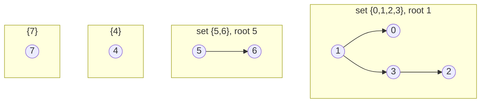

# Disjoint Sets (Union-Find) with Path Compression

> Linking accounts, merging entities, and detecting fraud rings.

**Type:** Build
**Languages:** Java, Python, Go
**Prerequisites:** Phase 1 Lesson 02 (Amortized Analysis), Phase 1 Lesson 06 (Hash Maps)
**Time:** ~60 minutes

## Learning Objectives

- State the disjoint-set forest invariant and explain why `find` answers "same set?" with two root lookups
- Build `find` with two-pass iterative path compression and `union` by rank, with each heuristic switchable so its effect can be measured
- Explain why union by rank alone bounds tree height by log2 n, and why the two heuristics together give near-constant amortised cost per operation
- Model entity linking as union-find: identifiers are elements, shared attributes are unions, fraud rings are components
- Recognise the two things union-find cannot do, deletion and arbitrary splits, and name the structures that handle them

## The Problem

A risk team at a marketplace notices that chargebacks cluster. One account signs up, buys a 900 USD laptop, and disputes the charge. A second account, created a week later with a different email and a different name, does the same thing from the same phone. A third uses a fresh phone but the same card fingerprint as the second. A fourth shares an email with the third. Individually each account looks like a first-time buyer with a clean history. Together they are one person with four identities and a 3,600 USD loss, and by the time the fourth chargeback arrives there is a fifth and sixth account already shopping.

The question the risk engine needs to answer at authorisation time is: "is this account connected, through any chain of shared devices, cards, emails, addresses, or bank accounts, to anything we have already flagged?" The naive implementation stores every observation as an edge in a table and, for each new transaction, runs a breadth-first search over the graph. With 200 million identifiers and 40,000 authorisations per second, that search is a few milliseconds when the ring is small and unbounded when it is not; one well-connected device (a shared airport kiosk, a corporate NAT) joins a component with millions of members and every query that touches it times out. The team adds a depth limit, and the fraudster, who has read the same forum posts, adds one more hop.

The observation that fixes this: the question is not "what is the path from A to B" but "are A and B in the same group". Groups only ever merge; an account that shares a device with a flagged account stays connected forever (de-linking is a separate, manual, audited decision). A structure that supports exactly two operations, `union(a, b)` to merge groups and `find(a)` to name a group, can answer the membership question in what is for all practical purposes constant time, with one integer array. That structure is the disjoint-set forest, usually called union-find.

## The Concept

### The two operations and the invariant

A disjoint-set structure maintains a partition of n elements into non-overlapping sets. It supports:

- `find(x)`: return a canonical representative of the set containing x. Two elements are in the same set iff `find(a) == find(b)`.
- `union(a, b)`: merge the sets containing a and b into one. Returns whether a merge happened (false if they were already together).

Nothing else. No "remove x from its set", no "split this set in two", no "list the members" as a primitive (though you can compute it in O(n)). This narrowness is the source of the speed.

The forest representation stores one integer per element: `parent[x]`. An element whose parent is itself is a root, and the root is the representative of its set. **Invariant: following parent pointers from any element terminates at exactly one root, and two elements are in the same set iff they reach the same root.** `find` walks to the root; `union` points one root at the other.



The shape of each tree is irrelevant to correctness. Any forest with the right partition is valid. The shape is everything for performance, because `find` costs as many steps as the depth of the element it starts from.

### Why shape matters: the naive forest

Point one root at the other with no rule, and an adversary (or an unlucky input order) builds a chain. The code's `demoHeuristics` runs `union(i, i-1)` for i from 1 to 19,999 on a naive forest: each union makes the fresh singleton i the parent of the old root, so the chain is `0 -> 1 -> 2 -> ... -> 19999` and `find(0)` follows 19,999 pointers. Over the n finds that follow, the forest does about 10,000 hops per call. That is the BFS problem from The Problem again, in a different costume: O(n) per query.

The random workload in the same demo (30,000 random unions over 20,000 elements) is less dramatic but still bad: depth 2,948, about 1,950 hops per find. Two heuristics fix it, from different directions.

### Union by rank

Keep, for each root, a `rank`: an upper bound on the height of its tree. When uniting two roots, hang the one with the smaller rank under the one with the larger rank; the taller tree's height does not change, so its rank does not change. Only when the ranks are equal does the result get taller, by exactly one, so increment the surviving root's rank.

Claim: **a root of rank r has at least 2^r elements under it.** By induction: rank 0 is a singleton (2^0 = 1). A root reaches rank r only by absorbing another root of rank r-1 while itself being rank r-1, so it has at least 2^(r-1) + 2^(r-1) = 2^r elements. Since no set has more than n elements, no rank exceeds log2 n, and since rank bounds height, **no `find` ever follows more than log2 n pointers.** For 20,000 elements that is 14; the demo measures a maximum depth of 6 on the random workload and 1 on the chain workload, because the bound is loose in practice.

Rank is an upper bound on height, not the height. Path compression (next) shortens trees without touching ranks, so after a while rank overstates height. That is fine: the proof only needs the bound to hold in one direction.

Union by size (hang the smaller set under the larger) gives the same log2 n guarantee with the same proof and has the advantage that `size[root]` is useful on its own. The code keeps both: `rank` decides the union, `size` answers `componentSize`.

### Worked example: the arrays by hand

Eight elements, four unions, with union by rank and path compression on. Each row shows the arrays after the operation; `rank` is only meaningful at roots and `size` only at roots.

| Operation | parent[0..7] | rank at roots | What happened |
|-----------|--------------|---------------|---------------|
| fresh | `0 1 2 3 4 5 6 7` | all 0 | eight singletons, components = 8 |
| `union(0, 1)` | `0 0 2 3 4 5 6 7` | rank[0] = 1 | equal ranks: 1 hangs under 0, rank of 0 becomes 1 |
| `union(2, 3)` | `0 0 2 2 4 5 6 7` | rank[0] = 1, rank[2] = 1 | same again for 2 and 3 |
| `union(1, 3)` | `0 0 0 2 4 5 6 7` | rank[0] = 2 | find(1) = 0, find(3) = 2; equal rank 1, so 2 hangs under 0 and rank[0] becomes 2 |
| `union(5, 6)` | `0 0 0 2 4 5 5 7` | rank[0] = 2, rank[5] = 1 | components = 4 |
| `find(3)` | `0 0 0 0 4 5 5 7` | unchanged | walks 3 -> 2 -> 0, then compresses: parent[3] = 0 |
| `union(0, 3)` | unchanged | unchanged | both find 0; returns false, components still 4 |

After `find(3)` the tree rooted at 0 has height 1 but rank 2. The rank is now a loose bound, and it stays loose forever; nothing ever lowers a rank. That is fine, because the proof only needs rank to be an upper bound on height, and compression only ever makes trees shorter.

Count the work: six operations, five pointer hops in total, no walk longer than two. The naive forest on the same operations would also be fine, because this input is small and friendly. The heuristics earn their keep on the adversarial and random workloads the demo measures, not on examples that fit on a page.

### Path compression

`find(x)` walks to the root anyway. Having found it, walk the same path again and set every node's parent directly to the root. The next `find` on any of those nodes is one hop. The forest gets flatter every time it is queried, and the work is proportional to work already done, so compression never more than doubles the cost of the find that performs it.

The code uses the two-pass iterative form: first loop finds the root, second loop rewrites parents. The recursive one-liner `parent[x] = find(parent[x])` is prettier and overflows the stack on exactly the deep chain it is meant to repair.

Path compression alone is also strong: on the chain workload the first `find(0)` costs 19,999 hops and every later find costs 1; averaged over 20,000 finds the demo reports about 1 hop each. Its worst case is worse than rank's, though: Tarjan and van Leeuwen showed that compression with naive linking costs Θ(m log_(1+m/n) n) for m finds over n elements, which for m close to n is Θ(log n) amortised, and an adversary can keep rebuilding deep chains between the finds that flatten them.

### Both together: inverse Ackermann

With both heuristics, Tarjan (1975) proved that any sequence of m operations on n elements costs O(m alpha(n)), where alpha is the inverse Ackermann function. alpha(n) is at most 4 for every n that fits in the observable universe (alpha(2^65536) = 4). Fredman and Saks (1989) proved that no pointer-machine algorithm can do better, so this is the final word, not a stepping stone. In engineering terms: **each operation is amortised O(1)**, and the constant is small. The demo measures 1.06 pointers followed per `find` after the random workload.

| Variant | Worst-case `find` | Amortised per operation | Chain workload (measured) | Random workload (measured) |
|---------|-------------------|-------------------------|---------------------------|----------------------------|
| Naive | O(n) | O(n) | 9,999 hops per find | 1,951 hops per find |
| Union by rank only | O(log n) | O(log n) | 0 hops (chain never forms) | 2.05 hops |
| Path compression only | O(n) once, then O(1) | O(log n) | 1 hop averaged | 1.88 hops |
| Both | O(log n) | O(alpha(n)), effectively O(1) | 0 hops | 1.06 hops |

### Reading the amortised claim correctly

Lesson 02 drew the distinction between the cost of one operation and the cost of a sequence. Union-find is the textbook case where the two differ by orders of magnitude. A single `find` with both heuristics can still cost log2 n hops: build 2^14 elements into a rank-14 tree with unions only, then query a leaf. What the bound says is that you cannot do that repeatedly. The find that pays log n also flattens the path, and the potential-function argument (Tarjan's, refined by Seidel and Sharir in 2005 into a four-page proof) shows that the total over any m operations is bounded by m alpha(n) plus a term linear in n.

Three practical consequences:

- Do not benchmark a single `find`; benchmark a workload. The `hops` counter in the code divided by the number of finds is the number that the theory predicts.
- Latency-sensitive paths see the amortisation as occasional slow calls. If a tail-latency budget cannot absorb a few microseconds, pre-flatten with one pass of finds after a batch of unions.
- The bound is on pointer hops, not on cache misses. Three contiguous `int[]` arrays keep the constant small; a `Map<Node, Node>` implementation of the same algorithm is ten to fifty times slower and still "O(alpha(n))".

### Worked example: a fraud ring by hand

Nine observations arrive, each "this account was seen with this identifier":

```text
link acct:1001  device:A          merged   {1001, A}
link acct:1002  device:A          merged   {1001, 1002, A}
link acct:1002  card:4111-xx-0001 merged   {1001, 1002, A, card}
link acct:1003  card:4111-xx-0001 merged   {1001, 1002, 1003, A, card}
link acct:1003  email:x@example   merged   {..., email}
link acct:1004  email:x@example   merged   {1001, 1002, 1003, 1004, A, card, email}   size 7
link acct:2001  device:B          merged   {2001, B}
link acct:2002  device:B          merged   {2001, 2002, B}
link acct:3001  device:C          merged   {3001, C}
```

Twelve identifiers, nine unions, three rings. `sameRing("acct:1001", "acct:1004")` is true even though no observation ever mentions both: the connection runs through device A, then the card, then the email, and union-find does not care how many hops that took because all four accounts now point at one root. `ringsOfAtLeast(4)` returns the seven-member ring for review and leaves the two-account ring alone, because two accounts on one family phone is normal.

Note what the structure records: that these identifiers are connected, not why. The observation log that produced the unions is the audit trail; the forest is the index over it. When a reviewer clears acct:1004 as a false positive, the forest cannot un-link it (see below), so production systems rebuild the forest from the log with the cleared edge removed, or keep a per-ring "cleared" flag.

### What union-find does not do

- **Delete or split.** Once merged, always merged. An element cannot leave its set because other elements may point through it. Deletion needs either a rebuild from the edge log (O(m alpha(n)), usually fine offline) or a different structure (link-cut trees, or Euler-tour trees for fully dynamic connectivity, both well beyond this course).
- **Paths.** It answers "connected?" and never "how". If the reviewer needs the chain of evidence, keep the edge list and run BFS on the small component once the forest has said there is one.
- **Edge weights or directions.** Everything is an undirected, unweighted "these two are the same". Kruskal's minimum spanning tree (Phase 2) uses union-find precisely because it only needs the cycle check.
- **Concurrency.** Compression writes to `parent[]` during a read. A concurrent `find` and `union` race. There are lock-free variants (Anderson and Woll, 1991; Jayanti and Tarjan, 2016) but the plain version is single-writer.
- **Enumerate members cheaply.** `ring()` is O(n) because it scans every element. If enumeration is a hot path, maintain a per-root member list and concatenate on union (small-to-large merging keeps that O(n log n) total).

### Choosing union-find over the alternatives

| Need | Hash map of element to set id | BFS over an edge list | Union-find |
|------|-------------------------------|-----------------------|------------|
| `connected(a, b)` | O(1) | O(component size) | O(alpha(n)), effectively O(1) |
| `union(a, b)` | O(size of the smaller set) to relabel every member | O(1) to append an edge | O(alpha(n)) |
| Memory | one map entry per element plus per-set member lists | one record per edge | one int per element (plus rank) |
| Path of evidence | no | yes | no |
| Delete an edge | relabel the affected set from scratch | O(1) | rebuild from log |
| Fits in cache | poorly: hash buckets and boxed keys | depends on the edge order | well: three contiguous int arrays |

The hash-map-of-set-ids approach is what most engineers write first, and with small-to-large merging (always relabel the smaller set) its total cost is O(n log n), which is respectable. Union-find beats it on constants by a wide margin, uses a fraction of the memory, and is a quarter of the code. BFS is the right tool once the forest has told you two things are connected and a human wants to know why.

## Build It

The code is in `code/java/Main.java`, tests in `code/java/MainTest.java`. `DisjointSet` works over integers 0..n-1; `EntityLinker` maps string identifiers onto those integers with a hash map (Lesson 06) so the fraud example never shows an integer to its caller.

### Step 1: Arrays, not nodes

```java
final class DisjointSet {
    private final int[] parent;
    private final int[] rank;
    private final int[] size;
    private int components;
    private final boolean unionByRank;
    private final boolean pathCompression;
    private long hops;

    DisjointSet(int n, boolean unionByRank, boolean pathCompression) {
        if (n < 0) throw new IllegalArgumentException("n must be >= 0");
        parent = new int[n];
        rank = new int[n];
        size = new int[n];
        for (int i = 0; i < n; i++) { parent[i] = i; size[i] = 1; }
        components = n;
        this.unionByRank = unionByRank;
        this.pathCompression = pathCompression;
    }
}
```

Three parallel `int[]` arrays instead of node objects: 12 bytes per element, contiguous, no pointer chasing beyond the index. Initialising `parent[i] = i` makes every element a root of its own singleton. `components` is maintained incrementally so "how many rings are there" is O(1). The two boolean flags exist for the lesson's measurements; a production class would hard-code both heuristics on.

**Predict:** what does `find(x)` return on a freshly constructed forest, and how many hops does it record?

### Step 2: Find with two-pass compression

```java
int find(int x) {
    checkIndex(x);
    int root = x;
    while (parent[root] != root) { root = parent[root]; hops++; }
    if (pathCompression) {
        while (parent[x] != root) {
            int next = parent[x];
            parent[x] = root;
            x = next;
        }
    }
    return root;
}
```

Pass one walks up, counting hops for the instrumentation. Pass two walks the same path and re-points every node at the root; it stops when it reaches a node that already points at the root (which includes the root's direct child and the root itself). The second loop does at most as many iterations as the first, so compression at most doubles a find's cost while making every future find on that path cost one hop. Neither loop recurses, so a 20,000-deep chain is fine.

**Predict:** on the chain `0 -> 1 -> 2 -> 3 -> 4` (root 4), after `find(0)`, what is `depth(2)`? What is `rank[4]`?

### Step 3: Union by rank

```java
boolean union(int a, int b) {
    int ra = find(a), rb = find(b);
    if (ra == rb) return false;
    if (unionByRank) {
        if (rank[ra] < rank[rb]) { int t = ra; ra = rb; rb = t; }
        parent[rb] = ra;
        if (rank[ra] == rank[rb]) rank[ra]++;
    } else {
        parent[rb] = ra;
    }
    size[ra] += size[rb];
    components--;
    return true;
}
```

After the swap, `ra` is the root with the larger-or-equal rank, so `rb` hangs under it and the result is no taller than `ra` was, unless the ranks tied, in which case it is taller by one and `rank[ra]` is incremented. `size` is updated on the surviving root only; the absorbed root's `size` and `rank` entries are now stale and are never read again, because `componentSize` and `rankOf` always go through `find` first. The boolean return value is what Kruskal's algorithm uses to detect "this edge would close a cycle" and what the fraud demo uses to say "already linked".

**Predict:** `union(0,1)`, `union(2,3)`, `union(0,2)` on a fresh forest. What is the rank of the final root, and what is the maximum depth?

### Step 4: Queries and the invariant checker

```java
boolean connected(int a, int b) { return find(a) == find(b); }
int componentSize(int x) { return size[find(x)]; }

int depth(int x) {
    checkIndex(x);
    int d = 0;
    while (parent[x] != x) { x = parent[x]; d++; }
    return d;
}
```

`connected` is two finds and an integer comparison; this is the whole fraud query. `depth` deliberately does not compress, so tests and demos can observe the shape before and after a `find`. `checkInvariant` (in the file) walks from every element with a step counter as a cycle guard, confirms every walk ends at a root, counts roots against `components`, and checks that each root's `size` equals the number of elements that reached it. Run it after every mutation in tests; a union-find bug almost always shows up as a size or count mismatch before it shows up as a wrong `connected`.

### Step 5: Names on top of integers

```java
final class EntityLinker {
    private final Map<String, Integer> index = new HashMap<>();
    private final List<String> names = new ArrayList<>();
    private final DisjointSet sets;
    private int next;

    private int id(String name) {
        Integer existing = index.get(name);
        if (existing != null) return existing;
        if (next >= capacity) throw new IllegalStateException("linker capacity exceeded: " + capacity);
        index.put(name, next);
        names.add(name);
        return next++;
    }

    boolean link(String a, String b) { return sets.union(id(a), id(b)); }

    boolean sameRing(String a, String b) {
        Integer ia = index.get(a), ib = index.get(b);
        return ia != null && ib != null && sets.connected(ia, ib);
    }
}
```

The hash map assigns each new identifier the next integer; the list maps back for reporting. `sameRing` treats an unknown identifier as connected to nothing rather than creating it, so a query never mutates the forest. The fixed capacity is a teaching simplification: a production linker would grow the arrays (Lesson 03) or shard by identifier hash.

**Predict:** `link("acct:1", "device:A")` then `link("acct:2", "device:A")`. What does `ring("acct:2")` return, and in what order?

### Step 6: Run it

```bash
cd phases/01-complexity-and-core-structures/10-disjoint-sets/code/java
javac -d .out *.java && java -cp .out Main
java -cp .out MainTest
```

Expected output, abbreviated:

```console
== What union by rank and path compression buy ==
naive (neither)          max depth before finds  19999, pointers followed per find  9999, max depth after 19999
union by rank only       max depth before finds      1, pointers followed per find     0, max depth after   1
path compression only    max depth before finds  19999, pointers followed per find     1, max depth after   1
both                     max depth before finds      1, pointers followed per find     0, max depth after   1

random workload: 20,000 elements, 30,000 random unions, then one find per element
naive (neither)          max depth before finds   2948, pointers followed per find 1950.96, max depth after 2948
union by rank only       max depth before finds      6, pointers followed per find  2.05, max depth after   6
path compression only    max depth before finds      8, pointers followed per find  1.88, max depth after   1
both                     max depth before finds      3, pointers followed per find  1.06, max depth after   1

== Entity linking: accounts that share devices, cards, or emails ==
  ...
acct:1001 and acct:1004 share a ring: true (no direct link between them; three hops through device, card, email)
ring of 7 flagged for review: [acct:1001, acct:1002, acct:1003, acct:1004, card:4111-xx-0001, device:A, email:x@example.com]
```

The tests cross-check 2,000 random unions against a brute-force label array (merge by relabelling every element, O(n) per union), which is the simplest possible reference model and the one to write first when porting.

### In Python

The Python port (`code/python/main.py`) keeps `DisjointSet` (three `list[int]`s), `EntityLinker`, and both switchable heuristics. What differs: **the loop is mandatory.** A recursive `find` raises `RecursionError` on the naive chain, because CPython's default limit is 1,000 frames and the chain is 1,999 deep. The two-pass loop also binds `self._parent` to a local and accumulates hops locally, which roughly halves the cost of each hop in the interpreter. **The heuristics demo runs at one tenth the size.** The naive variant is O(n^2) pointer hops by design: about 200 million on Java's 20,000-element chain and tens of millions more on the random workload. CPython follows roughly 10-30 million pointers a second, so `demo_heuristics` runs n = 2,000 with 3,000 random unions. The table has the same shape (naive depth n-1 and n/2 hops per find; rank-only depth 1; compression repairs the chain after one find), and `test_demo_table_matches_java_at_n_2000` pins the exact numbers the Java algorithm prints at that size. Every other section, including the 100,000 unions over 50,000 elements, prints the same numbers as Java. **Same random workloads:** `JavaRandom` reproduces `java.util.Random(seed).nextInt(bound)`, so seeds 3, 11, and 99 drive identical unions. **Exceptions:** an out-of-range element raises `IndexError`, a negative `n` raises `ValueError`, and exceeding the linker's capacity raises `RuntimeError` where Java throws `IllegalStateException`.

Run it from `code/python/` with `python3 main.py`; test with `python3 -m unittest -v`.

#### Step 1: Arrays, not nodes

Three parallel lists: `list(range(n))` makes every element its own root, `[0] * n` and `[1] * n` initialise rank and size. Both heuristics default to on, so `DisjointSet(n)` is the production shape and the demo passes explicit flags.

```python
class DisjointSet:
    def __init__(self, n: int, union_by_rank: bool = True, path_compression: bool = True) -> None:
        if n < 0:
            raise ValueError("n must be >= 0")
        self._parent = list(range(n))
        self._rank = [0] * n
        self._size = [1] * n
        self._components = n
        self._union_by_rank = union_by_rank
        self._path_compression = path_compression
        self._hops = 0  # instrumentation: parent pointers followed inside find

    def _check_index(self, x: int) -> None:
        if x < 0 or x >= len(self._parent):
            raise IndexError(f"element {x} not in 0..{len(self._parent) - 1}")
```

#### Step 2: Find with two-pass compression

Same two passes. The local `parent` alias and the local `hops` counter are interpreter optimisations: an attribute lookup per hop would roughly double the time on the naive chain. `nxt` is used as a name because `next` is a builtin.

```python
    def find(self, x: int) -> int:
        self._check_index(x)
        parent = self._parent
        root = x
        hops = 0
        while parent[root] != root:
            root = parent[root]
            hops += 1
        self._hops += hops
        if self._path_compression:
            while parent[x] != root:
                nxt = parent[x]
                parent[x] = root
                x = nxt
        return root
```

#### Step 3: Union by rank

The swap is a tuple assignment. Otherwise the method is the Java one: hang the shorter root under the taller, bump the rank on a tie, update `size` on the survivor, decrement `components`, and return whether anything merged.

```python
    def union(self, a: int, b: int) -> bool:
        """Merge the sets containing a and b. Returns False if they were already the same set."""
        ra, rb = self.find(a), self.find(b)
        if ra == rb:
            return False
        if self._union_by_rank:
            if self._rank[ra] < self._rank[rb]:
                ra, rb = rb, ra  # ra is now the taller (or equal) root
            self._parent[rb] = ra
            if self._rank[ra] == self._rank[rb]:
                self._rank[ra] += 1
        else:
            self._parent[rb] = ra  # naive: always hang b's root under a's root
        self._size[ra] += self._size[rb]
        self._components -= 1
        return True
```

#### Step 4: Queries and the invariant checker

`connected` is two finds; `component_size` reads `size` at the root. `depth` walks without compressing so tests can observe the shape. `check_invariant` (in the file) does the cycle-guarded walk from every element and reconciles roots against `components` and `size`.

```python
    def connected(self, a: int, b: int) -> bool:
        return self.find(a) == self.find(b)

    def component_size(self, x: int) -> int:
        """Number of elements in x's set."""
        return self._size[self.find(x)]

    def depth(self, x: int) -> int:
        """How many parent pointers separate x from its root. Does not compress."""
        self._check_index(x)
        parent = self._parent
        d = 0
        while parent[x] != x:
            x = parent[x]
            d += 1
        return d
```

#### Step 5: Names on top of integers

A `dict` assigns integers and a list maps back. `_id` raises `RuntimeError` when the fixed capacity is exhausted. `same_ring` uses `dict.get` so an unknown identifier yields `None` and the query never creates an element.

```python
    def _id(self, name: str) -> int:
        existing = self._index.get(name)
        if existing is not None:
            return existing
        if self._next >= self._capacity:
            raise RuntimeError(f"linker capacity exceeded: {self._capacity}")  # Java: IllegalStateException
        self._index[name] = self._next
        self._names.append(name)
        self._next += 1
        return self._next - 1

    def link(self, a: str, b: str) -> bool:
        """Record that two identifiers were seen together. Returns True if this observation merged two rings."""
        return self._sets.union(self._id(a), self._id(b))

    def same_ring(self, a: str, b: str) -> bool:
        ia, ib = self._index.get(a), self._index.get(b)
        return ia is not None and ib is not None and self._sets.connected(ia, ib)
```

#### Step 6: Run it

```bash
cd phases/01-complexity-and-core-structures/10-disjoint-sets/code/python
python3 main.py
python3 -m unittest -v
```

```console
== What union by rank and path compression buy ==
naive (neither)          max depth before finds   1999, pointers followed per find   999, max depth after 1999
union by rank only       max depth before finds      1, pointers followed per find     0, max depth after   1
path compression only    max depth before finds   1999, pointers followed per find     1, max depth after   1
both                     max depth before finds      1, pointers followed per find     0, max depth after   1

random workload: 2,000 elements, 3,000 random unions, then one find per element
naive (neither)          max depth before finds    328, pointers followed per find 213.19, max depth after 328
union by rank only       max depth before finds      5, pointers followed per find  1.98, max depth after   5
path compression only    max depth before finds      6, pointers followed per find  1.88, max depth after   1
both                     max depth before finds      3, pointers followed per find  1.06, max depth after   1

== Entity linking: accounts that share devices, cards, or emails ==
acct:1001 and acct:1004 share a ring: true (no direct link between them; three hops through device, card, email)
ring of 7 flagged for review: [acct:1001, acct:1002, acct:1003, acct:1004, card:4111-xx-0001, device:A, email:x@example.com]

== 100,000 random unions over 50,000 elements ==
effective merges 49036, components left 964, largest set 49000, max depth 1, avg pointers per find 2.01
```

The heuristics table is at n = 2,000, so its absolute numbers differ from the Java run; the shape is the same, and the test pins these exact values. The fraud and 50,000-element sections match Java digit for digit.

### In Go

The Go port (`code/go/main.go`) keeps `DisjointSet` (three `[]int32` slices), `EntityLinker`, and both switchable heuristics. What differs: **panics for programming errors, errors for runtime conditions.** `Find`, `Union`, `Depth`, and friends panic on an out-of-range element, exactly as indexing a Go slice would; there is no honest `(int, error)` shape for a function every other method calls in a tight loop. Conditions a caller can hit at runtime are errors: `NewDisjointSetWith` returns `ErrNegativeSize`, and `EntityLinker.Link` returns `(bool, error)` with `ErrCapacityExceeded` when the identifier slots run out. **`int32` arrays:** `parent`, `rank`, and `size` are `[]int32`, matching Java's `int[]` byte for byte; `rank` never exceeds 64, and the hop counter is `int64` because the naive chain follows 200 million pointers in the demo. **Sorting by hand:** `Ring` and `RingsOfAtLeast` use `sort.Strings` and `sort.Slice` with the same comparator (size descending, then smallest member) instead of `TreeMap` and `Comparator.comparingInt`, so the flagged rings print in the same order as Java. **Same random workloads:** `JavaRandom` reproduces `java.util.Random(seed).nextInt(bound)`, so seeds 3, 11, and 99 drive identical unions and every section prints the same numbers as Java. The test suite pins the heuristics table at n = 2,000, the same size the Python test uses, so `go test -race` stays fast.

Run it from `code/go/` with `go run .`; test with `go test ./...`.

#### Step 1: Arrays, not nodes

Three `[]int32` slices, `components` as an `int`, and an `int64` hop counter. `NewDisjointSetWith` returns an error for a negative `n`; `NewDisjointSet` is the both-heuristics-on convenience that panics on that error because its argument is always a literal in this lesson.

```go
type DisjointSet struct {
	parent          []int32
	rank            []int32
	size            []int32
	components      int
	unionByRank     bool
	pathCompression bool
	hops            int64 // instrumentation: parent pointers followed inside Find
}

// NewDisjointSetWith builds a forest with each heuristic chosen explicitly.
func NewDisjointSetWith(n int, unionByRank, pathCompression bool) (*DisjointSet, error) {
	if n < 0 {
		return nil, ErrNegativeSize
	}
	ds := &DisjointSet{
		parent: make([]int32, n), rank: make([]int32, n), size: make([]int32, n),
		components: n, unionByRank: unionByRank, pathCompression: pathCompression,
	}
	for i := range ds.parent {
		ds.parent[i] = int32(i)
		ds.size[i] = 1
	}
	return ds, nil
}

// checkIndex panics like a slice index would: an out-of-range element is a programming error, not a runtime condition.
func (d *DisjointSet) checkIndex(x int) {
	if x < 0 || x >= len(d.parent) {
		panic(fmt.Sprintf("element %d not in 0..%d", x, len(d.parent)-1))
	}
}
```

#### Step 2: Find with two-pass compression

The walk is done on `int32` values to avoid a conversion per hop; the result is widened back to `int` for callers. Two loops, no recursion, hops counted on the first pass.

```go
func (d *DisjointSet) Find(x int) int {
	d.checkIndex(x)
	root := int32(x)
	for d.parent[root] != root {
		root = d.parent[root]
		d.hops++
	}
	if d.pathCompression {
		cur := int32(x)
		for d.parent[cur] != root {
			next := d.parent[cur]
			d.parent[cur] = root
			cur = next
		}
	}
	return int(root)
}
```

#### Step 3: Union by rank

Identical to the Java, with a parallel assignment for the swap and `int32` roots throughout.

```go
// Union merges the sets containing a and b. Returns false if they were already the same set.
func (d *DisjointSet) Union(a, b int) bool {
	ra, rb := int32(d.Find(a)), int32(d.Find(b))
	if ra == rb {
		return false
	}
	if d.unionByRank {
		if d.rank[ra] < d.rank[rb] {
			ra, rb = rb, ra // ra is now the taller (or equal) root
		}
		d.parent[rb] = ra
		if d.rank[ra] == d.rank[rb] {
			d.rank[ra]++
		}
	} else {
		d.parent[rb] = ra // naive: always hang b's root under a's root
	}
	d.size[ra] += d.size[rb]
	d.components--
	return true
}
```

#### Step 4: Queries and the invariant checker

One-line methods for `Connected` and `ComponentSize`; `Depth` walks without compressing. `CheckInvariant` (in the file) is the same cycle-guarded reconciliation as Java and runs after every mutation in the tests.

```go
// Connected reports whether a and b share a root.
func (d *DisjointSet) Connected(a, b int) bool { return d.Find(a) == d.Find(b) }

// ComponentSize is the number of elements in x's set.
func (d *DisjointSet) ComponentSize(x int) int { return int(d.size[d.Find(x)]) }

// Depth is the actual depth of x: how many parent pointers separate it from its root. Does not compress.
func (d *DisjointSet) Depth(x int) int {
	d.checkIndex(x)
	cur := int32(x)
	depth := 0
	for d.parent[cur] != cur {
		cur = d.parent[cur]
		depth++
	}
	return depth
}
```

#### Step 5: Names on top of integers

`id` returns `(int, error)` so `Link` can surface `ErrCapacityExceeded` instead of panicking in the middle of a fraud batch. `SameRing` uses the two-value map lookup to treat unknown identifiers as connected to nothing.

```go
func (l *EntityLinker) id(name string) (int, error) {
	if existing, ok := l.index[name]; ok {
		return existing, nil
	}
	if l.next >= l.capacity {
		return 0, fmt.Errorf("%w: %d", ErrCapacityExceeded, l.capacity)
	}
	l.index[name] = l.next
	l.names = append(l.names, name)
	l.next++
	return l.next - 1, nil
}

// Link records that two identifiers were seen together. Returns true if this observation merged two rings.
func (l *EntityLinker) Link(a, b string) (bool, error) {
	ia, err := l.id(a)
	if err != nil {
		return false, err
	}
	ib, err := l.id(b)
	if err != nil {
		return false, err
	}
	return l.sets.Union(ia, ib), nil
}

// SameRing reports whether both identifiers are known and connected.
func (l *EntityLinker) SameRing(a, b string) bool {
	ia, okA := l.index[a]
	ib, okB := l.index[b]
	return okA && okB && l.sets.Connected(ia, ib)
}
```

#### Step 6: Run it

```bash
cd phases/01-complexity-and-core-structures/10-disjoint-sets/code/go
go run .
go test ./...
```

```console
== What union by rank and path compression buy ==
naive (neither)          max depth before finds  19999, pointers followed per find  9999, max depth after 19999
union by rank only       max depth before finds      1, pointers followed per find     0, max depth after   1
path compression only    max depth before finds  19999, pointers followed per find     1, max depth after   1
both                     max depth before finds      1, pointers followed per find     0, max depth after   1

random workload: 20,000 elements, 30,000 random unions, then one find per element
naive (neither)          max depth before finds   2948, pointers followed per find 1950.96, max depth after 2948
union by rank only       max depth before finds      6, pointers followed per find  2.05, max depth after   6
path compression only    max depth before finds      8, pointers followed per find  1.88, max depth after   1
both                     max depth before finds      3, pointers followed per find  1.06, max depth after   1

== Entity linking: accounts that share devices, cards, or emails ==
acct:1001 and acct:1004 share a ring: true (no direct link between them; three hops through device, card, email)
ring of 7 flagged for review: [acct:1001, acct:1002, acct:1003, acct:1004, card:4111-xx-0001, device:A, email:x@example.com]

== 100,000 random unions over 50,000 elements ==
effective merges 49036, components left 964, largest set 49000, max depth 1, avg pointers per find 2.01
```

Every number matches the Java run, including the full-size heuristics table: Go follows the naive chain's 200 million pointers in well under a second.

## Use It

### Where union-find appears in production

- **Kruskal's minimum spanning tree** (Phase 2): sort edges by weight, add each edge whose endpoints `union` returns true for. The cycle check is the whole reason the algorithm is O(E log E).
- **Entity resolution.** Customer-data platforms and fraud graphs (Neo4j's weakly connected components, Spark GraphX `connectedComponents`, Google's early "clustering by hashing" pipelines) compute connected components over identifier graphs; the single-machine kernel is union-find and the distributed versions are iterative label propagation that converges to the same partition.
- **Percolation and image segmentation.** "Which pixels are in the same region" is union over adjacent similar pixels.
- **Type inference and unification.** Hindley-Milner type checkers unify type variables with union-find; the Rust compiler's `ena` crate is a union-find with undo support.
- **Network equivalence in EDA and compilers.** Which wires are electrically the same net; which SSA values a compiler has proven equal, kept as equivalence classes that merge as facts are learned.

### Kruskal in twelve lines

The algorithm that made union-find famous. Given banks as nodes and bilateral settlement links with a fee as edges, the cheapest network that still connects every bank is the minimum spanning tree:

```java
record Link(String a, String b, long feeMinor) {}

List<Link> cheapestNetwork(List<String> banks, List<Link> links) {
    Map<String, Integer> id = new HashMap<>();
    for (String bank : banks) id.put(bank, id.size());
    DisjointSet ds = new DisjointSet(banks.size());
    List<Link> chosen = new ArrayList<>();
    List<Link> sorted = new ArrayList<>(links);
    sorted.sort(Comparator.comparingLong(Link::feeMinor));
    for (Link l : sorted) {
        if (ds.union(id.get(l.a()), id.get(l.b()))) chosen.add(l);   // false means this link would close a cycle
        if (chosen.size() == banks.size() - 1) break;
    }
    return chosen;
}
```

Sort the edges by cost, take each edge whose endpoints are not yet connected, stop after n-1 edges. The `union` return value is the cycle test, and because it is amortised O(1) the whole algorithm is dominated by the sort: O(E log E). Exercise 3 asks you to build this and to break it by processing edges out of order.

Worked on four banks: links A-B 3, B-C 1, A-C 2, C-D 5, B-D 4 (fees in minor units). Sorted: B-C 1 (take), A-C 2 (take), A-B 3 (A and B already connected through C: skip), B-D 4 (take), stop with three edges. Total fee 7; the tree is B-C, A-C, B-D. Taking A-B instead of A-C would cost 8 and is exactly the mistake out-of-order processing makes.

### What the library versions add

The JDK has no union-find; it is fifteen lines and everyone writes their own. Boost (`boost::disjoint_sets`), NetworkX (`networkx.utils.UnionFind`), and Rust's `ena` crate ship versions with the same two heuristics. What production implementations typically add that this lesson left out: dynamic growth (a `makeSet()` that appends), a per-set payload merged on union (sum of chargeback amounts per ring, as `Money`), and an undo log for the type-inference use case, which is implemented by recording each `parent[]` write and replaying it backwards, and which disables path compression because compression's writes are not meaningful to undo.

### The fraud graph in practice

Real risk systems do not keep one global forest. They partition identifiers by type and apply weights: sharing a card fingerprint is strong evidence, sharing a public Wi-Fi IP is almost none, and a device id from an emulator farm appears on ten thousand accounts and would join everything into one useless ring. The pattern that works is: union only over strong identifiers, cap the component size (a device shared by more than k accounts is itself suspicious and stops propagating), and treat the resulting component id as one feature among many in the risk score (Phase 13), not as a verdict.

## Ship It

`outputs/checklist-entity-linking.md` is a design-review checklist for any system that merges identities: which identifiers are strong enough to union on, how components are capped, how a false-positive link is undone, and how the component id is used downstream. Bring it to the review of any "customer 360", KYC de-duplication, or fraud-graph project.

## Exercises

1. **Reinforce.** Replace union by rank with union by size (hang the smaller set under the larger) and re-run `demoHeuristics`. Then write the induction proof that union by size also bounds depth by log2 n, in the comment above the method.
2. **Apply.** Give each ring a `Money` total of disputed amounts: add `union(a, b, Money)` semantics to `EntityLinker` so that `ringExposure(name)` returns the sum of chargebacks across the ring, maintained in O(1) per union (store it at the root, add on merge). Use the `Money` type from Phase 10, Lesson 01. Then flag any ring whose exposure exceeds 2,500 USD regardless of size.
3. **Extend.** Combine with Lesson 09 (heaps): implement Kruskal's algorithm for a minimum-cost settlement network. Nodes are banks, edges are bilateral settlement links with a fee, and the output is the cheapest set of links that connects every bank. Use union-find for the cycle check and a heap (or sorted array) for edge order. Then show that processing edges in the wrong order produces a spanning tree that is not minimal.

## Key Terms

| Term | What people say | What it actually means |
|------|-----------------|------------------------|
| Disjoint-set forest | "union-find" | A partition of n elements stored as one parent pointer per element; roots represent sets; two elements are in the same set iff they share a root |
| Representative | "the root" | The element returned by `find`; the same for every member of a set until the next union changes it |
| Union by rank | "attach the smaller tree" | Keep a height upper bound per root and hang the lower-rank root under the higher; guarantees height at most log2 n |
| Path compression | "flatten on the way up" | After finding the root, point every node on the path directly at it; makes future finds on that path one hop |
| Inverse Ackermann alpha(n) | "basically constant" | The amortised cost per operation with both heuristics; at most 4 for any n that fits in memory; proven optimal for pointer machines |
| Amortised cost | "average over the sequence" | Total cost of m operations divided by m; a single find may cost O(log n) but the sequence costs O(m alpha(n)) |
| Connected component | "a ring", "a cluster" | A maximal set of elements reachable from one another through unions; what the fraud model calls one actor |
| Small-to-large merging | "relabel the smaller side" | When merging two member lists, append the shorter to the longer; each element moves at most log2 n times, so the total is O(n log n); the trick behind union by size |
| Entity resolution | "customer 360", "identity stitching" | Deciding which identifiers belong to the same real-world actor; union-find computes the components once the link rules are chosen |

## Further Reading

- [Tarjan, "Efficiency of a Good But Not Linear Set Union Algorithm", JACM 22(2), 1975](https://doi.org/10.1145/321879.321884) — the original inverse-Ackermann bound for union by rank plus path compression.
- [Tarjan and van Leeuwen, "Worst-Case Analysis of Set Union Algorithms", JACM 31(2), 1984](https://doi.org/10.1145/62.2160) — the full comparison of linking and compression variants, including the costs of each heuristic alone.
- [Seidel and Sharir, "Top-Down Analysis of Path Compression", SIAM J. Computing 34(3), 2005](https://doi.org/10.1137/S0097539703439088) — the short modern proof of the inverse-Ackermann bound; readable in an afternoon.
- [Fredman and Saks, "The Cell Probe Complexity of Dynamic Data Structures", STOC 1989](https://doi.org/10.1145/73007.73040) — the lower bound showing alpha(n) amortised is optimal.
- [Cormen, Leiserson, Rivest, Stein, *Introduction to Algorithms*, Chapter 19: Data Structures for Disjoint Sets](https://mitpress.mit.edu/9780262046305/introduction-to-algorithms/) — the textbook presentation, with the rank-size induction proof used above.
- [Galler and Fischer, "An Improved Equivalence Algorithm", CACM 7(5), 1964](https://doi.org/10.1145/364099.364331) — the first disjoint-set forest, written for Fortran EQUIVALENCE statements; three pages.
- [Apache Spark GraphX: `connectedComponents`](https://spark.apache.org/docs/latest/graphx-programming-guide.html#connected-components) — the distributed form of the same computation, which converges to the partition union-find computes on one machine.
