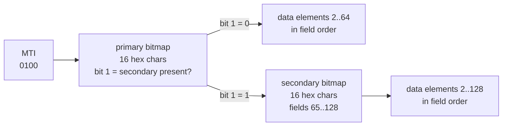

# Bit Manipulation and Compact Encodings

> Flags, bitmaps, and the bit tricks in ISO 8583 and Snowflake IDs.

**Type:** Build
**Languages:** Java, Python, Go
**Prerequisites:** Phase 0, Lesson 07 (Decimal and Integer Arithmetic in Three Runtimes), Phase 1, Lesson 06 (Hash Maps from Scratch)
**Time:** ~60 minutes

## Learning Objectives

- Build and read bit fields with masks, shifts, and the three operators that matter (`&`, `|`, `^`), and state what `>>` and `>>>` do to a negative number
- Implement population count two ways and explain why the parallel version is constant time
- Store a million booleans in a 122 KB bitmap with set, clear, cardinality, next-set-bit, and bitwise AND/OR
- Encode and decode the ISO 8583 primary and secondary bitmaps exactly as the wire format specifies, including the field-1 rule
- Pack a timestamp, a worker id, and a sequence into a Snowflake-style 64-bit id and explain why the ids sort by creation time
- Name the two's complement traps that produce negative absolute values, wrong midpoints, and mis-read bytes

## The Problem

An acquirer's host receives an ISO 8583 `0100` authorisation request from a new terminal vendor. The message parses cleanly on the first 120,000 transactions. Then a batch of declines starts: the host logs "field 35 missing" on messages that visibly contain a track-2 value. The vendor's integration engineer insists the field is there. Both are right. The vendor's encoder set bit 35 counting from the least significant end; the ISO 8583 bitmap counts field 1 as the *most* significant bit of the first byte. Every field number above 32 landed in the wrong position, and the first 120,000 messages happened to use only fields below 32 where the two numbering mistakes cancelled. Nobody caught it in certification because the certification script tested one message shape.

A second incident, same quarter, different team. A payments platform generates transaction ids with a hand-rolled Snowflake variant: 41 bits of milliseconds, 10 bits of worker id, 12 bits of sequence, packed with `timestamp << 22 | worker << 12 | sequence`. The `worker` variable is an `int` read from configuration. On the day the fleet grows past 1,023 workers, worker 1,024 is `0b100_0000_0000`, eleven bits, and its ids collide with worker 0's ids one millisecond later. The ledger's primary-key constraint rejects the inserts, the retry storm doubles the load, and two hours of payouts queue behind it. The fix is a one-line range check that the type system never asked for.

Both incidents are about the same skill: knowing exactly which bit means what, and writing code that cannot put a value where it does not fit. Bit manipulation looks like a party trick in interviews. In a payments stack it is the wire format of every card authorisation, the layout of every distributed id, the representation of every permission set, and the cheapest possible index over "which of these ten million things happened today". This lesson builds the primitives, then four things on top of them, and ends with the list of ways two's complement will lie to you.

## The Concept

### Three operators and two shifts

Everything in this lesson reduces to:

| Operator | Name | What it does | Use |
|----------|------|--------------|-----|
| `a & b` | AND | 1 where both are 1 | test a bit, clear bits, keep a field |
| `a \| b` | OR | 1 where either is 1 | set a bit, combine flags |
| `a ^ b` | XOR | 1 where they differ | toggle a bit, swap without a temp, parity |
| `~a` | NOT | flip every bit | build the complement of a mask |
| `a << n` | left shift | multiply by 2^n, bits fall off the top | position a field |
| `a >> n` | arithmetic right shift | divide by 2^n rounding toward negative infinity, sign bit is copied in from the left | signed arithmetic |
| `a >>> n` | logical right shift | divide by 2^n for unsigned interpretation, zeros come in from the left | extracting fields from a value whose top bit may be set |

A **mask** is a value with ones exactly where you care. `mask(width) = (1L << width) - 1` gives `width` low ones: `mask(3) = 0b111`. Shift it left to cover a field: `mask(3) << 4 = 0b0111_0000`. Then:

- **extract:** `(v >>> shift) & mask(width)` moves the field to the bottom and drops everything else.
- **insert:** `(v & ~(mask(width) << shift)) | (field << shift)` clears the hole, then ORs the new field in.
- **test one bit:** `(v >>> bit) & 1`, or `(v & (1L << bit)) != 0`.

The one that bites: `>>>` not `>>` when extracting. If `v` has its top bit set and you use `>>`, the copied sign bits survive the mask only when the field is at the very top, which is exactly where timestamps live in a Snowflake id and where field 1 lives in an ISO 8583 bitmap. The code uses `>>>` everywhere a value is treated as a bag of bits.

Two edge cases the code handles explicitly. `1L << 64` is not zero: Java uses only the low six bits of a long shift count (five for int), so `1L << 64 == 1L << 0 == 1`, and `mask(64)` must be special-cased to `-1L`. And a field that does not fit (`insert(v, 12, 10, 1024)`) must be rejected rather than allowed to overflow into the neighbouring field; that is the worker-1024 incident.

### Population count

"How many bits are set" is the basis of bitmap cardinality, Hamming distance, and a dozen index structures. Two implementations:

**Kernighan's loop:** `v &= v - 1` clears the lowest set bit (subtracting one borrows through the trailing zeros and flips the lowest one to zero). Repeat until zero; the number of iterations is the answer. O(number of set bits), good when words are sparse.

**Parallel (SWAR) count:** treat the 64-bit word as 32 two-bit counters, add adjacent bits; then as 16 four-bit counters, add adjacent pairs; then 8 eight-bit counters; then multiply by `0x0101010101010101` to sum the eight bytes into the top byte. Twelve operations, no branches, independent of the input. The constants `0x5555…` (alternating bits), `0x3333…` (pairs), `0x0F0F…` (nibbles) are the masks for each level.

```text
v = 0b1011_0100                      (four ones)
step 1: pairs   -> 01 10 01 00       counts per 2 bits: 1,2,1,0
step 2: nibbles -> 0011 0001         counts per 4 bits: 3,1
step 3: byte    -> 00000100          total 4
```

Every modern CPU has a `POPCNT` instruction and `Long.bitCount` compiles to it (the JIT intrinsic), so in production you call the library. The test file checks both hand versions against `Long.bitCount` on 10,000 random longs, which is how you should verify any bit trick: against a trusted oracle, on random inputs, including the boundaries 0, -1, and `Long.MIN_VALUE`.

### Flags: a set of booleans in one word

A payments account has state: frozen, KYC verified, payouts enabled, high risk, chargeback hold. Five booleans in five columns is fine until you need to pass them around, index them, or write the rule "may pay out = verified AND enabled AND NOT (frozen OR hold)". With each flag owning one bit, the rule is one expression:

```text
bits = 0b00110  = {KYC_VERIFIED, PAYOUTS_ENABLED}
required = KYC_VERIFIED | PAYOUTS_ENABLED = 0b00110
blocking = FROZEN | CHARGEBACK_HOLD      = 0b10001
canPayOut = (bits & required) == required && (bits & blocking) == 0  -> true
after adding CHARGEBACK_HOLD: bits = 0b10110, (bits & blocking) = 0b10000 != 0 -> false
```

The subtlety is `has(flags)` for a *set* of flags: `(bits & flags) == flags` tests that all are present; `(bits & flags) != 0` tests that any is. Confusing the two is a classic authorisation bug (granting access when the user has *any* of the required permissions). The class exposes them as `has` and `hasAny` so the call site says which it means. The constructor rejects unknown bits so a flag word read from a database column written by a newer version of the code fails loudly instead of being silently truncated.

### Bitmaps: one bit per thing

A `Bitmap` of capacity n is `n/64` longs. Bit i lives in word `i >>> 6` (divide by 64) at position `i & 63` (remainder). For a million merchants that is 15,625 longs, 122 KB; a `boolean[]` is 1 MB (the JVM uses a byte per boolean) and a `HashSet<Integer>` of 142,857 members is several megabytes of boxed integers and hash nodes. Set, clear, and test are one array access and one shift each. Cardinality is popcount over the words. Intersection and union are a loop of `&` or `|` over the words, 64 merchants per instruction, and the result "active this month AND settled today" is computed in microseconds without looking at a single merchant record.

`nextSetBit(from)` is how you iterate a bitmap without testing every bit: mask off the bits below `from` in the first word, then skip entire zero words, then `Long.numberOfTrailingZeros` finds the position within the first non-zero word. On a sparse bitmap this is O(words) rather than O(bits), which is why `java.util.BitSet` and every database bitmap index work this way.

What bitmaps do not do: they are dense. If your ids are sparse 64-bit values (Snowflake ids, say), a bitmap over the id space is impossible, and you need either a hash set or a compressed bitmap (Roaring, below) over a dense surrogate key.

### ISO 8583: the bitmap that announces the message

ISO 8583 is the message format behind card authorisations between terminals, acquirers, networks, and issuers. A message is a 4-digit message type indicator (`0100` authorisation request, `0110` response, `0200` financial request, `0400` reversal), then a **bitmap**, then the data elements the bitmap says are present, in field-number order. The bitmap is what makes the format compact: a `0100` with 14 fields does not carry 114 empty slots.

The rules, from ISO 8583-1:2003 and its table of data elements:

- The primary bitmap is 64 bits (8 bytes binary, or 16 hex characters in the ASCII-hex variant most hosts use). **Bit 1 is the most significant bit of the first byte**, bit 64 the least significant bit of the last byte. Field f is present iff bit f is 1.
- **Field 1 is the secondary bitmap indicator.** If bit 1 is set, a second 64-bit bitmap follows immediately, describing fields 65 to 128 in the same way (bit 1 of the secondary bitmap is field 65). Field 1 is never a data element in its own right; the encoder derives it from whether any field above 64 is present.
- Fields 2 (PAN), 3 (processing code), 4 (amount, 12 digits in minor units, which is the Phase 10 discipline in a 1987 standard), 7 (transmission date and time), 11 (STAN), 22 (POS entry mode), 35 (track 2), 41 (terminal id), 42 (merchant id), 49 (currency code, ISO 4217 numeric) are the ones in almost every authorisation.

In Java terms, field f of the primary bitmap is bit `64 - f` of the long: field 1 is bit 63 (the sign bit), field 64 is bit 0. Worked example, the fourteen fields of a typical `0100`:

```text
fields          2 3 4  7  11 12 13  22 24 25  35  41 42  49
bit (64 - f)   62 61 60 57 53 52 51 42 40 39  29  23 22  15
hex digit (from the left, 4 bits each)
  bits 63..60 : fields 1..4   -> 0111 = 7
  bits 59..56 : fields 5..8   -> 0010 = 2   (field 7)
  bits 55..52 : fields 9..12  -> 0011 = 3   (fields 11, 12)
  bits 51..48 : fields 13..16 -> 1000 = 8   (field 13)
  bits 47..44 : fields 17..20 -> 0000 = 0
  bits 43..40 : fields 21..24 -> 0101 = 5   (fields 22, 24)
  bits 39..36 : fields 25..28 -> 1000 = 8   (field 25)
  bits 35..32 : fields 29..32 -> 0000 = 0
  bits 31..28 : fields 33..36 -> 0010 = 2   (field 35)
  bits 27..24 : fields 37..40 -> 0000 = 0
  bits 23..20 : fields 41..44 -> 1100 = C   (fields 41, 42)
  bits 19..16 : fields 45..48 -> 0000 = 0
  bits 15..12 : fields 49..52 -> 1000 = 8   (field 49)
  bits 11..0  : fields 53..64 -> 000
primary bitmap = 7238058020C08000
```

Add field 102 (account identification 1, used in balance inquiries) and the encoder must set bit 1 (the first hex digit becomes `F`) and append a secondary bitmap with bit `128 - 102 = 26` set: `0000000004000000`. The decoder checks that bit 1 and the message length agree, because a host that reads 16 characters when 32 were sent will parse the secondary bitmap as field 2 and produce exactly the "field missing" incident from The Problem.



### Snowflake ids: time, worker, sequence in 64 bits

Twitter's Snowflake (2010) generates unique 64-bit ids on many machines with no coordination:

| Bits | Field | Range | Why |
|------|-------|-------|-----|
| 1 | sign, always 0 | | keeps the id positive as a signed long in every language and database |
| 41 | milliseconds since a custom epoch | 2^41 ms = 69.7 years | time in the top bits makes ids sort by creation order |
| 10 | worker id | 1,024 workers | uniqueness across machines without a central counter |
| 12 | sequence within the millisecond | 4,096 per ms per worker | 4 million ids per second per worker |

`compose` is three `insert` calls; `decompose` is three `extract` calls. Because the timestamp occupies the most significant non-sign bits, comparing two ids as longs compares timestamps first, so a database index on the id is also an index on creation time (within one millisecond the order is by worker then sequence, which is arbitrary but stable). That property is why payments systems use this layout for transaction ids: the id is the sort key for the ledger, the partition key for storage, and a debugging aid (you can read the creation time out of any id).

The generator's two failure modes are both about the clock:

- **Sequence exhaustion.** 4,096 ids in one millisecond: the sequence wraps to zero and the generator must wait for the clock to advance rather than issue a duplicate. The code spins on the injected clock; a real one would spin on `System.currentTimeMillis()`, which is why Snowflake's documented peak is per millisecond, not per second.
- **Clock moving backwards.** NTP corrections and VM migrations do this. If the clock reads earlier than the last issued id's millisecond, continuing would risk duplicates. The code refuses and throws; Twitter's original did the same, and Sonyflake, Baidu UidGenerator, and Instagram's variant each document their own policy (wait, borrow from the future, or fail).

The 41-bit window is the third trap: with the epoch at 2023-11-14, ids go negative in 2093. Choose the epoch late (the day you deploy) and record it in the type, not in a configuration file someone can change.

### Two's complement, and seven ways it lies

Signed integers are stored so that `-x = ~x + 1`. The top bit is the sign, the range is asymmetric (`-2^63 .. 2^63 - 1`), and arithmetic wraps. The demo prints each of these; memorise the list.

| Expression | You expected | You got | Why |
|------------|--------------|---------|-----|
| `Math.abs(Long.MIN_VALUE)` | positive | `Long.MIN_VALUE` | there is no +2^63 in 64 bits; `hashCode & Long.MAX_VALUE` or `Math.absExact` instead |
| `Long.MAX_VALUE + 1` | error | `Long.MIN_VALUE` | wraps silently; the Phase 10 money type uses `addExact` for this reason |
| `(byte) 0x80` | 128 | -128 | a byte is signed; `b & 0xFF` before widening to int |
| `-8 >> 1` vs `-8 >>> 1` | the same | -4 vs 2147483644 | arithmetic shift copies the sign; logical shift does not |
| `1 << 31` on an int | 2147483648 | -2147483648 | bit 31 is the sign bit of an int; use `1L << 31` |
| `1 << 32` on an int | 0 | 1 | shift count is taken mod 32 for int, mod 64 for long (JLS 15.19) |
| `(lo + hi) / 2` | the midpoint | negative | the sum overflows; `lo + ((hi - lo) >>> 1)` is the fix (this was a real bug in `java.util.Arrays.binarySearch` for nine years) |
| `-7 / 2` vs `-7 >> 1` | the same | -3 vs -4 | division truncates toward zero, shift floors; they agree only for non-negative values |
| `-7 % 2` | 1 | -1 | remainder takes the sign of the dividend; `x & 1` is the correct odd test |

### What bit tricks do not buy you

They do not make a wrong data structure right: a bitmap over sparse ids is still impossible, and a Snowflake id is still not a secret (it leaks creation time and worker count to anyone who sees it; do not use it as an authorisation token). They do not replace a type: `long` is `long`, and nothing stops a caller passing a worker id into the sequence slot except the `insert` range check and tests. And they do not optimise anything the JIT would not do: `x * 8` compiles to the same shift as `x << 3`. Use bit operations where the *data* is bits (wire formats, flags, bitmaps, ids), and arithmetic where the data is numbers.

## Build It

The code is in `code/java/Main.java`: `Bits` (primitives), `AccountFlags`, `Bitmap`, `Iso8583Bitmap`, `SnowflakeId`, and a `Main` with six demos. Tests in `code/java/MainTest.java` cross-check against `Long.bitCount`, `java.util.BitSet`, and hand-computed ISO 8583 vectors.

### Step 1: Masks, extract, insert

```java
static long mask(int width) {
    if (width < 0 || width > 64) throw new IllegalArgumentException("width must be 0..64: " + width);
    return width == 64 ? -1L : (1L << width) - 1;
}

static long extract(long v, int shift, int width) {
    checkField(shift, width);
    return (v >>> shift) & mask(width);
}

static long insert(long v, int shift, int width, long field) {
    checkField(shift, width);
    if ((field & ~mask(width)) != 0) throw new IllegalArgumentException(field + " does not fit in " + width + " bits");
    long hole = ~(mask(width) << shift);
    return (v & hole) | (field << shift);
}
```

`mask(64)` is special-cased because `1L << 64` is `1L << 0`. `extract` uses `>>>` so a field at the top of a negative long comes out as the unsigned value it is. `insert` checks that `field` has no bits outside `width` before it touches `v`; this check is the one that would have caught worker 1,024. `checkField` rejects any `shift + width > 64`, so a field cannot silently lose its top bits off the end of the word.

**Predict:** `insert(0b1011_0100, 4, 3, 0b110)`: what is `hole` in binary, and what is the result?

### Step 2: Two popcounts

```java
static int popcountKernighan(long v) {
    int n = 0;
    while (v != 0) { v &= v - 1; n++; }
    return n;
}

static int popcountParallel(long v) {
    v = v - ((v >>> 1) & 0x5555555555555555L);
    v = (v & 0x3333333333333333L) + ((v >>> 2) & 0x3333333333333333L);
    v = (v + (v >>> 4)) & 0x0F0F0F0F0F0F0F0FL;
    return (int) ((v * 0x0101010101010101L) >>> 56);
}
```

The first line of the parallel version is the compressed form of "count per 2-bit group": for each pair of bits `ab`, the count is `a + b`, and `ab - a` (where `a` is the pair shifted down one and masked) equals exactly that. The second line adds adjacent 2-bit counts into 4-bit counts; the third adds adjacent 4-bit counts, each at most 4, so the sum is at most 8 and cannot carry into the neighbouring byte, and the mask afterwards discards the stale high nibbles. The multiply sums all eight bytes into the top byte: multiplying by `0x0101010101010101` is adding the value to itself shifted by 8, 16, ..., 56 bits, and the top byte of the product is the sum of all bytes.

**Predict:** `popcountKernighan(Long.MIN_VALUE)`: how many loop iterations, and does `v - 1` overflow?

### Step 3: Flags

```java
final class AccountFlags {
    static final int FROZEN = 1 << 0;
    static final int KYC_VERIFIED = 1 << 1;
    static final int PAYOUTS_ENABLED = 1 << 2;
    static final int HIGH_RISK = 1 << 3;
    static final int CHARGEBACK_HOLD = 1 << 4;

    boolean has(int flag) { return (bits & flag) == flag; }
    boolean hasAny(int flags) { return (bits & flags) != 0; }
    AccountFlags with(int flag) { return new AccountFlags(bits | flag); }
    AccountFlags without(int flag) { return new AccountFlags(bits & ~flag); }

    boolean canPayOut() {
        return has(KYC_VERIFIED | PAYOUTS_ENABLED) && !hasAny(FROZEN | CHARGEBACK_HOLD);
    }
}
```

Immutable: `with` and `without` return new values, so a flag word can be a map key or a record component without aliasing surprises. `has` with a combined mask means "all of these"; `hasAny` means "at least one". The constructor (in the file) rejects bits above position 4, so a column value written by a future version with a sixth flag fails on read instead of being misinterpreted.

**Predict:** `AccountFlags.none().with(FROZEN).has(FROZEN | KYC_VERIFIED)`: true or false, and which method would return true?

### Step 4: The bitmap

```java
final class Bitmap {
    private final long[] words;
    private final int capacity;

    Bitmap(int capacity) {
        this.capacity = capacity;
        this.words = new long[(capacity + 63) >>> 6];
    }

    void set(int i) { checkIndex(i); words[i >>> 6] |= 1L << (i & 63); }
    boolean get(int i) { checkIndex(i); return (words[i >>> 6] & (1L << (i & 63))) != 0; }

    int nextSetBit(int from) {
        if (from >= capacity) return -1;
        int w = from >>> 6;
        long word = words[w] & (-1L << (from & 63));
        while (true) {
            if (word != 0) {
                int idx = (w << 6) + Long.numberOfTrailingZeros(word);
                return idx < capacity ? idx : -1;
            }
            if (++w == words.length) return -1;
            word = words[w];
        }
    }
}
```

`(capacity + 63) >>> 6` is ceiling division by 64. `i >>> 6` and `i & 63` are the word index and bit offset; both are single instructions where `/ 64` and `% 64` would be too after the JIT, but writing them as shifts documents that the layout is bits in words. `nextSetBit` masks away the bits below `from` with `-1L << (from & 63)` (all ones shifted up), then walks whole words, then uses `numberOfTrailingZeros` to find the lowest one. The final `idx < capacity` check matters when capacity is not a multiple of 64 and a stray bit above it could never have been set, but defends against future `or` with a larger map.

**Predict:** `new Bitmap(65).wordsAllocated()`, and in which word and at which offset does bit 64 live?

### Step 5: ISO 8583 encode and decode

```java
static String encode(Set<Integer> fields) {
    long primary = 0, secondary = 0;
    for (int f : fields) {
        if (f < 2 || f > 128) throw new IllegalArgumentException("field must be 2..128 (field 1 is derived): " + f);
        if (f <= 64) primary |= 1L << (64 - f);
        else secondary |= 1L << (128 - f);
    }
    if (secondary != 0) {
        primary |= 1L << 63;
        return Bits.toHex(primary, 16) + Bits.toHex(secondary, 16);
    }
    return Bits.toHex(primary, 16);
}
```

`1L << (64 - f)` is the whole numbering rule: field 1 is bit 63, field 64 is bit 0. Field 1 cannot be requested because it is structural; the encoder sets it exactly when a secondary bitmap exists. `toHex` must be fixed width (16 digits with leading zeros), because `Long.toHexString(1)` is `"1"` and a 1-character bitmap is not a bitmap. The decoder (in the file) parses with `Long.parseUnsignedLong(hex, 16)` because a bitmap with field 1 set has the top bit set and `Long.parseLong` would reject it as out of range; then it cross-checks bit 1 against the string length.

**Predict:** `encode(Set.of(64))`: which bit, and which hex string?

### Step 6: Snowflake compose and the generator

```java
static long compose(long timestampMillis, long worker, long sequence) {
    long delta = timestampMillis - EPOCH_MILLIS;
    if (delta < 0 || delta > MAX_TIMESTAMP) throw new IllegalArgumentException("timestamp outside the 41-bit window");
    long id = 0;
    id = Bits.insert(id, TIMESTAMP_SHIFT, TIMESTAMP_BITS, delta);
    id = Bits.insert(id, WORKER_SHIFT, WORKER_BITS, worker);
    id = Bits.insert(id, 0, SEQUENCE_BITS, sequence);
    return id;
}

long next() {
    long now = clock.getAsLong();
    if (now < lastMillis) throw new IllegalStateException("clock moved backwards by " + (lastMillis - now) + " ms; refusing to issue ids");
    if (now == lastMillis) {
        sequence = (sequence + 1) & MAX_SEQUENCE;
        if (sequence == 0) {
            waits++;
            while (now <= lastMillis) now = clock.getAsLong();
        }
    } else {
        sequence = 0;
    }
    lastMillis = now;
    return compose(now, worker, sequence);
}
```

`compose` goes through `insert`, so a worker of 1,024 or a sequence of 4,096 throws instead of corrupting a neighbouring field. `(sequence + 1) & MAX_SEQUENCE` wraps to zero at 4,096; the zero is the signal to wait. The clock is a `LongSupplier` so the test can advance it by hand and prove that 9,000 ids drawn faster than the clock ticks are still strictly increasing. The generator is not thread-safe; one generator per thread, or a `synchronized` on `next`, is how production versions handle it.

**Predict:** the generator issues 4,096 ids in one millisecond, then is called again before the clock advances. What does the loop do, and what would happen without it?

### Step 7: Run it

```bash
cd phases/01-complexity-and-core-structures/11-bit-manipulation/code/java
javac -d .out *.java && java -cp .out Main
java -cp .out MainTest
```

Expected output, abbreviated:

```console
== Bitmap: which of 1,000,000 merchants settled today ==
memory: 15625 longs = 122 KB for 1000000 merchants (a boolean[] would be 976 KB, a HashSet<Integer> about 6696 KB)
settled today: 142858, active this month: 200000, both: 28572

== ISO 8583 bitmap ==
0100 authorisation request fields [2, 3, 4, 7, 11, 12, 13, 22, 24, 25, 35, 41, 42, 49]
primary bitmap hex   = 7238058020C08000
adding field 102 (account id 1) sets field 1 and appends a secondary bitmap:
bitmaps hex          = F238058020C080000000000004000000  (32 hex chars)

== Snowflake-style ids: 41 + 10 + 12 bits ==
first id = 362387865628672 = 0000000000000001010010011001011100000000000000000111000000000000
  timestamp 1700086400000 ms, worker 7, sequence 0
10,000 ids from one worker: strictly increasing = true, sequence overflows waited out = 2

== Two's complement traps ==
Math.abs(Long.MIN_VALUE)      = -9223372036854775808  (still negative: there is no +2^63)
(lo + hi) / 2 with int        = -97483648  vs  lo + ((hi - lo) >>> 1) = 2050000000  (the binary-search midpoint bug)
```

### In Python

```python
MASK64 = (1 << 64) - 1

def to_int64(v: int) -> int:
    """Wrap to a signed 64-bit value, exactly what a Java long does on overflow."""
    v &= MASK64
    return v - (1 << 64) if v >= (1 << 63) else v

def urshift64(v: int, n: int) -> int:
    """Java's >>> on a long: view the value as unsigned 64 bits, then shift in zeros."""
    return to_int64((v & MASK64) >> n)
```

`code/python/main.py` keeps `Bits`, `AccountFlags`, `Bitmap`, `Iso8583Bitmap`, and `SnowflakeId` with the same layouts. What differs:

- **Python ints have no width.** There is no sign bit to overflow into, no `>>>`, and a negative int has infinitely many leading ones (`-8 >> 100 == -1`). A Java `long` is represented as a Python int in `[LONG_MIN, LONG_MAX]`; every operation that can leave that range goes through `to_int64`, and every unsigned view masks with `MASK64` first. `popcount_kernighan` must mask before its loop, or `v &= v - 1` never reaches zero for a negative input.
- **The traps are emulated, not native.** `Math.abs(Long.MIN_VALUE)`, `(byte) 0x80`, `1 << 32` on an `int`, the int midpoint overflow, and `-7 / 2` all behave correctly in plain Python, which is the point: the demo calls `to_int64`, `to_int8`, `to_int32`, `urshift32`, `java_div`, and `java_rem` to show what Java and Go do, and `test_python_differs_from_java` pins the difference (`-7 // 2 == -4`, `-7 % 2 == 1`).
- **Bitmap words are unsigned.** `Bitmap` stores each word as an int in `0..2^64-1`, the honest type for a bit set, so `next_set_bit` finds the trailing zeros with `(word & -word).bit_length() - 1`. ISO 8583 hex parses with `int(hex, 16)`, which plays `Long.parseUnsignedLong`.
- **Names that are keywords.** `AccountFlags.with` and `Bitmap.and`/`or` become `with_`, `and_`, `or_`. Exceptions map to `ValueError` (`IllegalArgumentException`), `IndexError`, and `RuntimeError` for the backwards clock.

```bash
cd phases/01-complexity-and-core-structures/11-bit-manipulation/code/python
python3 main.py
python3 -m unittest -v
```

### In Go

```go
// IsSet tests one bit; the uint64 view is Java's >>>.
func IsSet(v int64, bit int) bool { return (uint64(v)>>bit)&1 != 0 }

// Extract reads width bits starting at shift as an unsigned value.
func Extract(v int64, shift, width int) (int64, error) {
    if err := checkField(shift, width); err != nil {
        return 0, err
    }
    return int64(uint64(v)>>shift) & Mask(width), nil
}

func (b *Bitmap) NextSetBit(from int) int {
    // ...
    word := b.words[w] & (math.MaxUint64 << (from & 63)) // drop bits below from
    idx := (w << 6) + bits.TrailingZeros64(word)
```

`code/go/main.go` keeps `Bits` (as package-level functions), `AccountFlags`, `Bitmap`, ISO 8583 encode/decode, and the Snowflake generator with the same layouts. What differs:

- **One shift operator, chosen by type.** Go has no `>>>`: `>>` on a signed integer is arithmetic and on an unsigned integer is logical, so every place Java writes `v >>> n` the port writes `uint64(v) >> n`. `Bitmap` words are `[]uint64`, the honest type for a bit set, and the ISO 8583 bitmaps are built as `uint64` and parsed with `strconv.ParseUint`, which plays `Long.parseUnsignedLong`. `math/bits` supplies `OnesCount64`, `TrailingZeros64`, and `Len64` where Java has `Long.bitCount`, `numberOfTrailingZeros`, and `highestOneBit`.
- **The shift-count trap is different, not absent.** Java reduces the count mod the width, so `1 << 32` on an `int` is `1`. Go does not: a shift by the width or more yields zero for an unsigned or positive value, and a constant shift that overflows is a compile error. The demo prints Go's answer (`0`) with a note, and the test pins it; every other row of the two's-complement section prints the same numbers as Java, including the `int8(0x80)` widening, the `int32` midpoint overflow, and `-7 / 2` versus `-7 >> 1`.
- **Errors are values, panics for programming errors.** `Extract`, `Insert`, `Compose`, `Decompose`, `Iso8583Encode`, `Iso8583Decode`, `NewAccountFlags`, `Bitmap.And`/`Or`, and `Generator.Next` return `error`, with sentinels such as `ErrFieldOverflow`, `ErrBadBitmapHex`, and `ErrClockBackwards`. `Mask` with a width outside 0..64 and a `Bitmap` index out of range panic, the same way Go treats an impossible shift count or a bad slice index.
- **Same random inputs.** The test file carries a `javaRandom` with `nextLong` and `nextBoolean`, so the 10,000 popcount inputs and the 2,000 bitmap operations are the ones the Java test draws; the reference bit set is a `[]bool`.

```bash
cd phases/01-complexity-and-core-structures/11-bit-manipulation/code/go
go run .
go test ./...
```

## Use It

### `java.util.BitSet`, `EnumSet`, `Long.bitCount`

`BitSet` is the bitmap you built, growable, with `and`, `or`, `xor`, `andNot`, `cardinality`, `nextSetBit`, `nextClearBit`, and `stream()`. Its trap is growth: `set(1_000_000_000)` allocates 125 MB without complaint. `EnumSet` is the flags class done properly: a set of enum constants backed by a long (or a long[] past 64 constants), with `contains`, `containsAll`, and `retainAll` as the `has`/`hasAny` pair, and it cannot hold an unknown bit. Prefer it to hand-rolled int flags whenever the flags are an enum. `Long.bitCount`, `numberOfTrailingZeros`, `highestOneBit`, `rotateLeft` are all JIT intrinsics that compile to single instructions.

### Compressed bitmaps

Roaring bitmaps (used in Lucene, Druid, ClickHouse, Spark, and Kylin) partition the 32-bit space into 65,536-value chunks and store each chunk as a bitmap, a sorted array, or a run-length list depending on density. The API is the same `and`/`or`/`cardinality`/iterate; the memory for a sparse set is a fraction of a plain bitmap's, and for a dense set it is the same. PostgreSQL's bitmap index scans and Oracle's bitmap indexes do the same thing inside the database: a column with few distinct values gets one bitmap per value, and `WHERE status = 'SETTLED' AND region = 'EU'` is one AND of two bitmaps.

### Where Snowflake went

Twitter archived the original repository but the layout outlived it: Discord and Instagram publish their variants, Sony's Sonyflake uses 39 bits of 10 ms ticks to extend the window, and ULID and UUIDv7 (RFC 9562, 2024) are the same idea with 48 bits of milliseconds and random bits instead of worker and sequence. UUIDv7 is what to pick today for a new system that wants time-sortable ids without coordinating worker ids. All of them share the property you built: the top bits are time, so the id sorts by creation.

### ISO 8583 in production

Every acquiring host, card network switch, and issuer processor speaks a dialect of ISO 8583; jPOS is the common open-source Java implementation and its `ISOMsg` and packager classes do what `Iso8583Bitmap` does plus the field encodings (fixed, LLVAR, LLLVAR, BCD, EBCDIC). The networks publish their own variants (the ISO 8583:1993 and :2003 revisions renumbered some fields, and Visa, Mastercard, and domestic schemes each have a specification), so the bitmap logic is the one part that is identical everywhere and the field semantics are the part you read the spec for. Phase 11 (Payment Rails) comes back to this format with the full message.

## Ship It

`outputs/checklist-bit-level-encodings.md` is a review checklist for any pull request that packs fields into integers, parses a binary wire format, or defines an id layout: numbering direction, width checks, signedness, shift operators, epoch choice, and the test oracles to use. It is the checklist both teams in The Problem needed.

## Exercises

1. **Reinforce.** Implement `Bits.reverse(long v)` (bit 0 becomes bit 63) with the same divide-and-conquer structure as the parallel popcount: swap adjacent bits, then pairs, then nibbles, bytes, shorts, ints. Verify against `Long.reverse` on random inputs. Then explain why ISO 8583's bit numbering can be described as "reverse, then index".
2. **Apply.** Extend `AccountFlags` into a generic `Flags<E extends Enum<E>>` backed by a long, with `of(E...)`, `contains`, `containsAll`, `containsAny`, and a `toString` that lists names. Compare its API and its bytes-per-instance with `java.util.EnumSet`, and find the one operation `EnumSet` has that yours lacks.
3. **Extend.** Combine with Lesson 06 (Hash Maps): build a `MerchantDayIndex` that maps `(merchantId, dayNumber)` to a `Bitmap` of hours in which that merchant transacted (24 bits), stores it in a hash map, and answers "which merchants were active in hour 14 on at least 3 of the last 7 days" by ANDing and popcounting. Then replace the 24-bit hour bitmap with a 1,440-bit minute bitmap and measure how the memory per merchant-day changes.

## Key Terms

| Term | What people say | What it actually means |
|------|-----------------|------------------------|
| Mask | "the bits I care about" | A word with ones exactly at the positions of interest; `&` with it keeps those bits, `& ~` with it clears them |
| Bit field | "packed struct" | A fixed-width run of bits inside an integer, addressed by shift and width; read with `>>>` and `&`, written by clearing the hole and ORing |
| Population count | "popcount", "bit count" | The number of one bits in a word; a hardware instruction on every modern CPU, `Long.bitCount` in Java |
| Arithmetic vs logical shift | "`>>` and `>>>`" | Right shift that copies the sign bit versus one that fills with zeros; they differ only for negative values, which is exactly when it matters |
| Two's complement | "signed integers" | Negative x stored as `~x + 1`; gives an asymmetric range, silent wraparound, and a sign bit that `>>` propagates |
| Bitmap / bitset | "a bit per item" | A dense array of bits indexed by integer id, 64 per word; set/test are O(1), intersection is one AND per word |
| ISO 8583 bitmap | "the field map" | The 64-bit (or 128-bit) header that says which data elements follow; bit 1 is the most significant bit and means "secondary bitmap present" |
| Snowflake id | "a time-sortable id" | A 64-bit id with the timestamp in the top bits, then worker and sequence; unique without coordination and ordered by creation time |

## Further Reading

- [ISO 8583-1:2003, Financial transaction card originated messages, Part 1: Messages, data elements and code values](https://www.iso.org/standard/31628.html) — the bitmap rules and the data-element table; the standard itself is paywalled, and the field table is reproduced in every network's implementation guide.
- [Twitter Snowflake (archived repository)](https://github.com/twitter-archive/snowflake/tree/snowflake-2010) — the original 41/10/12 layout, the clock-backwards policy, and the README explaining why they wanted roughly sortable ids.
- [RFC 9562: Universally Unique IDentifiers (UUIDs)](https://www.rfc-editor.org/rfc/rfc9562) — UUIDv7, the standardised time-ordered successor to Snowflake-style ids; section 6 discusses monotonicity and clock handling.
- [Henry S. Warren, *Hacker's Delight*, 2nd edition](https://www.oreilly.com/library/view/hackers-delight-second/9780133084993/) — chapter 2 (basics) and chapter 5 (counting bits) are the source of the parallel popcount and every mask trick in this lesson.
- [Java Language Specification, section 15.19: Shift Operators](https://docs.oracle.com/javase/specs/jls/se21/html/jls-15.html#jls-15.19) — the rule that the shift distance is masked to 5 or 6 bits, which makes `1 << 32 == 1`.
- [Joshua Bloch, "Extra, Extra - Read All About It: Nearly All Binary Searches and Mergesorts are Broken" (2006)](https://research.google/blog/extra-extra-read-all-about-it-nearly-all-binary-searches-and-mergesorts-are-broken/) — the `(low + high) / 2` overflow that lived in `java.util.Arrays` for nine years.
- [Roaring Bitmaps: specification and papers](https://roaringbitmap.org/) — compressed bitmaps as used in Lucene, Spark, and ClickHouse; read the format specification after you have built the dense version.
