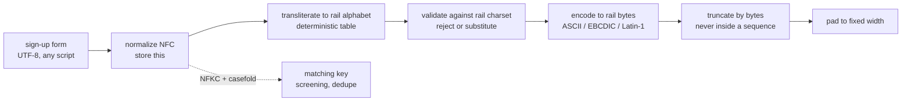

# Strings, Unicode, and Byte Encodings

> Why a name on a card is bytes, not characters, and what that breaks.

**Type:** Learn
**Languages:** —
**Prerequisites:** Phase 1, Lesson 11 (Bit Manipulation and Compact Encodings), Phase 1, Lesson 07 (Hash Functions, Collisions, and HashDoS)
**Time:** ~60 minutes

## Learning Objectives

- Distinguish the four things "the length of a string" can mean: bytes, UTF-16 code units, code points, and grapheme clusters, and compute each for a real name
- Encode a code point into UTF-8 by hand and recognise a truncation that splits a multi-byte sequence
- Explain why `"é"` can be one code point or two, and apply NFC and NFKC normalization before storing, comparing, or hashing a name
- Name the byte-level constraints of the payment formats that carry names (ISO 8583, EMV, NACHA, SWIFT MT, ISO 20022) and the transliteration they force
- Write a truncation rule for a fixed-width field that never produces invalid output, and a comparison rule for name matching that is not fooled by normalization form or case
- Recognise mojibake, lone surrogates, overlong encodings, and homoglyphs as the four encoding failures that reach production

## The Problem

A payout service builds a NACHA file every evening: a fixed-width text file in which each entry detail record has a 22-character "Individual Name" field. The service formats the name with `String.format("%-22.22s", name)`, which pads to 22 and truncates to 22 *characters*. For "Müller-Ñandú Consulting GmbH" Java's `%.22s` keeps 22 UTF-16 code units: `Müller-Ñandú Consultin`. The file is then written with `getBytes(StandardCharsets.UTF_8)`. The ü and the Ñ and the ú are each two bytes in UTF-8, so the field is 25 bytes wide, the record is 97 bytes instead of 94, and every subsequent field in that record is shifted by three columns. The bank's parser reads the amount field from the wrong offset, rejects the record, and because NACHA batches are all-or-nothing by default, 40,000 payouts are returned the next morning. The on-call engineer "fixes" it by writing the file as ISO-8859-1. The next week a Polish contractor named Łukasz is paid as `?ukasz`, because Ł is not in Latin-1 and the encoder substituted a question mark.

A second team runs sanctions screening. A payment to "Nguyễn Thị Hương" is compared against a list entry "Nguyễn Thị Hương" and does not match, so it is not held for review. The two strings look identical and are both valid Unicode. One was typed on a Vietnamese keyboard that produces precomposed characters (`ễ` as U+1EC5, one code point); the other came from a PDF-to-text extraction that produced the base letter plus two combining marks (`e` U+0065, U+0302 circumflex, U+0303 tilde). `equals` compares code units and returns false. The regulator's view of a missed match does not include a discussion of normalization forms.

Both teams believed a string was a sequence of characters and that a character was a thing. Neither is true. A `String` in Java is a sequence of 16-bit UTF-16 code units; a Unicode "character" is a code point in the range 0 to 0x10FFFF; what a human sees as one letter is a grapheme cluster that may be several code points; and what goes on the wire is bytes under some encoding. Payments formats were designed between 1970 and 2005, and most of them define fields in bytes, in a character set that predates Unicode. The engineering task is to move a name from the first world to the last without losing a payout. This lesson gives you the vocabulary, the rules, and the two procedures (truncate, compare) you will need.

## The Concept

### Four lengths

Take the name `Müller` and the single emoji sequence for a family, `👨‍👩‍👧` (man, zero-width joiner, woman, zero-width joiner, girl). Measure each:

| Measure | What it counts | `Müller` | `👨‍👩‍👧` | Java expression |
|---------|----------------|----------|-----------|-----------------|
| Grapheme clusters | what a reader sees as one character | 6 | 1 | `BreakIterator.getCharacterInstance()` |
| Code points | Unicode scalar values | 6 | 5 | `s.codePointCount(0, s.length())` |
| UTF-16 code units | what `String` stores | 6 | 8 | `s.length()` |
| UTF-8 bytes | what the file or socket carries | 7 | 18 | `s.getBytes(UTF_8).length` |

`Müller` has one code point (ü) that needs two bytes in UTF-8. The family emoji has three code points above U+FFFF, each of which needs two UTF-16 code units (a surrogate pair) and four UTF-8 bytes, plus two zero-width joiners (U+200D, three bytes each): 3 x 4 + 2 x 3 = 18 bytes, 3 x 2 + 2 = 8 code units, 5 code points, 1 grapheme.

Every "max length" in a specification is one of these four, and the specification rarely says which. NACHA means bytes in ASCII, where all four coincide, which is why nobody noticed for forty years. ISO 20022 `Max35Text` means 35 characters where "character" is a Unicode code point, but the banks that implement it frequently enforce 35 bytes or a restricted Latin repertoire. A statement descriptor at Visa and Mastercard is 22 bytes of printable ASCII. A database `VARCHAR(22)` is 22 characters in PostgreSQL, 22 bytes in older MySQL with a Latin-1 collation, and 22 UTF-16 code units in SQL Server's `NVARCHAR`. Before you enforce a length, find out which length.

### Code points and UTF-8

Unicode assigns every character a number, the code point, written `U+` and hex: `U+00FC` is ü, `U+1EC5` is ễ, `U+1F468` is the man emoji. There are 1,114,112 possible code points (17 planes of 65,536); about 150,000 are assigned. UTF-8 encodes a code point as one to four bytes, and the first byte tells you how many:

| Code point range | Bytes | Pattern (x = payload bits) | Example |
|------------------|-------|----------------------------|---------|
| U+0000 to U+007F | 1 | `0xxxxxxx` | `M` = `4D` |
| U+0080 to U+07FF | 2 | `110xxxxx 10xxxxxx` | `ü` U+00FC = `C3 BC` |
| U+0800 to U+FFFF | 3 | `1110xxxx 10xxxxxx 10xxxxxx` | `ễ` U+1EC5 = `E1 BB 85` |
| U+10000 to U+10FFFF | 4 | `11110xxx 10xxxxxx 10xxxxxx 10xxxxxx` | `👨` U+1F468 = `F0 9F 91 A8` |

Encoding ü by hand: U+00FC is `1111 1100` in binary, eight bits, so two bytes. Split the payload into 5 + 6 bits: `00011` and `111100`. Prefix: `110 00011` = `C3`, `10 111100` = `BC`. Decoding reverses it, and three properties fall out of the pattern: ASCII bytes are unchanged (so every ASCII file is already UTF-8), a continuation byte always starts `10`, so you can find the start of a character from any byte by backing up while the byte starts with `10`, and no encoding of one code point appears inside the encoding of another, so byte-level search for a UTF-8 string is safe.

That second property is the basis of safe truncation. Cut a UTF-8 byte array at an arbitrary offset and you may land inside a sequence. Back up to the nearest byte that does not start with `10`, and cut there instead: the result is valid UTF-8, one grapheme shorter than you hoped at worst. Cut without backing up and you produce an invalid sequence that a strict decoder rejects and a lenient one replaces with U+FFFD, the replacement character `�`, which is how a name becomes `Nguy�`.

### Reading a hex dump

When a bank returns a rejected file, the evidence is a hex dump, and decoding one by hand is a ten-second skill. Each byte's top bits say what it is:

```text
bytes:  4A 6F 73 C3 A9 20 4D 75 6C 6C 65 72
        J  o  s  [C3 A9]  sp M  u  l  l  e  r
C3 = 1100 0011 -> lead byte of a 2-byte sequence, payload 00011
A9 = 1010 1001 -> continuation, payload 101001
code point = 00011 101001 = 0xE9 = U+00E9 = e-acute      -> "José Muller"

bytes:  4A 6F 73 C3 | 20 4D ...
C3 followed by 20 (0010 0000, not a continuation) -> malformed: a lead byte with no continuation
a lenient decoder gives "Jos� Muller"; a strict one throws MalformedInputException at offset 3
```

The strict decoder is what a validator should use, and it is three lines in Java:

```java
CharsetDecoder strict = StandardCharsets.UTF_8.newDecoder()
        .onMalformedInput(CodingErrorAction.REPORT)
        .onUnmappableCharacter(CodingErrorAction.REPORT);
String text = strict.decode(ByteBuffer.wrap(bytes)).toString();   // throws CharacterCodingException on bad input
```

`new String(bytes, UTF_8)` never throws; it substitutes U+FFFD and moves on, which is the right default for rendering a log line and the wrong one for accepting a payment instruction.

### UTF-16, surrogates, and what `String` actually is

Java, JavaScript, C#, and Windows store strings as UTF-16: code points up to U+FFFF are one 16-bit unit; code points above are two units, a high surrogate (`D800` to `DBFF`) followed by a low surrogate (`DC00` to `DFFF`). This is the design decision of 1991, when 65,536 looked like enough, and it means:

- `s.length()` is not the number of characters. `"👨".length()` is 2.
- `s.charAt(i)` can return half a character. `s.substring(0, 1)` on `"👨"` is a lone high surrogate, which is not valid Unicode; `getBytes(UTF_8)` on it emits `?` (Java's default replacement for unmappable input) and you have corrupted the name without an exception.
- `s.codePointAt(i)` and `s.codePoints()` are the correct iteration. `Character.isSurrogate(c)` tells you when a unit is half of something.
- Reversing a string by code units, uppercasing by `charAt`, or hashing a prefix by `substring` are all wrong for anything outside the Basic Multilingual Plane, which includes every emoji, most historic scripts, and the CJK Extension B characters some people's names are written with.

Java 9+ stores Latin-1-only strings in one byte per character internally (compact strings), but the API still speaks UTF-16; the optimisation is invisible except in memory use.

```java
String name = "Nguyễn";                      // precomposed, 6 code points
name.length();                               // 6
name.codePointCount(0, name.length());       // 6
name.getBytes(StandardCharsets.UTF_8).length; // 8: ễ is 3 bytes

String family = "👨‍👩‍👧";
family.length();                             // 8
family.codePointCount(0, family.length());   // 5
family.getBytes(StandardCharsets.UTF_8).length; // 18
```

### Boundaries: where the encoding is decided

Inside a running Java program there is no encoding question: a `String` is UTF-16 and every operation agrees. Encodings are decided at boundaries, and every boundary that does not state one is a latent incident. The ones a payment service crosses:

| Boundary | Encoding rule | Trap |
|----------|---------------|------|
| HTTP request and response bodies | `Content-Type: application/json; charset=utf-8`; JSON itself is UTF-8 by RFC 8259 | A client that omits the charset and a server that assumes Latin-1 |
| JSON text | `\uXXXX` escapes are UTF-16 code units, so a code point above U+FFFF is two escapes (`\ud83d\udc68`) | A producer that emits one escape of a lone surrogate; a consumer that rejects it |
| Database connection | PostgreSQL `client_encoding`, MySQL `character_set_client`; `utf8mb4` not `utf8` in MySQL (the latter is three bytes maximum and rejects emoji) | A column declared `VARCHAR(22)` whose unit of 22 differs by engine |
| Files | Stated per format: NACHA ASCII, ISO 20022 UTF-8 XML with a declaration, CSV has no standard and is whatever the producer used | A byte order mark (`EF BB BF`) at the start of a UTF-8 file that a fixed-width parser reads as the first three bytes of record 1 |
| Message queues | Bytes. Kafka, SQS, and RabbitMQ carry bytes and the schema (Avro, Protobuf) states the string encoding, always UTF-8 | Serialising with `getBytes()` without an argument on a producer whose default charset is not UTF-8 |
| Logs and consoles | The terminal's locale; `?` or `�` in a log usually means the log is wrong, not the data | Debugging mojibake by looking at it in a tool that itself re-encodes |
| Legacy hosts | EBCDIC (code page 037, 500, or 1047 depending on the mainframe) for many ISO 8583 and batch interfaces; the same letter has a different byte in each code page | Translating with the wrong code page table turns `[` and `]` into other characters because those are where the EBCDIC variants disagree |

Rule for review: every `new String(byte[])`, `getBytes()`, `InputStreamReader(InputStream)`, `FileReader`, `PrintStream`, and `Scanner` constructor must name its charset. JDK 18 made the default UTF-8 (JEP 400), which removes the laptop-versus-production discrepancy but does not make an EBCDIC host speak UTF-8.

### Normalization: one string, many spellings

Unicode allows the same text to be encoded in more than one way. `é` is U+00E9 (precomposed) or U+0065 U+0301 (e plus combining acute). Both render identically and both are correct. Unicode Standard Annex #15 defines four normalization forms that pick one spelling:

| Form | Does | `é` becomes | `fi` (U+FB01 ligature) becomes | `①` (U+2460) becomes | Use |
|------|------|-------------|-------------------------------|---------------------|-----|
| NFD | decompose canonically | `e` + U+0301 | unchanged | unchanged | stripping accents (drop combining marks after NFD) |
| NFC | decompose, then recompose canonically | U+00E9 | unchanged | unchanged | **storage and transmission**; what the web and most systems expect |
| NFKD | decompose canonically and by compatibility | `e` + U+0301 | `f` + `i` | `1` | |
| NFKC | NFKD then recompose | U+00E9 | `fi` | `1` | **matching and search**; folds ligatures, fullwidth forms, superscripts |

Canonical equivalence (NFC/NFD) is about identical meaning: `é` is `é`. Compatibility equivalence (NFKC/NFKD) is about *probably* identical intent: the ligature `fi` is a typographic rendering of `fi`, the fullwidth `Ａ` (U+FF21) is a CJK-typesetting rendering of `A`. NFKC loses information (you cannot get the ligature back) and is therefore wrong for storage and right for comparison. The sanctions team needed to normalise both sides to NFKC, and then case-fold, before comparing.

```java
import java.text.Normalizer;
String a = "Nguyễn";                                            // U+1EC5
String b = "Nguyễn";                                 // e + circumflex + tilde
a.equals(b);                                                    // false
Normalizer.normalize(a, Normalizer.Form.NFC).equals(
    Normalizer.normalize(b, Normalizer.Form.NFC));              // true
```

Normalization is not idempotent across concatenation: NFC(x) + NFC(y) is not necessarily NFC(x + y) when y begins with a combining mark. Normalise after assembling a string, not before. And normalization is not case folding: `Normalizer` leaves `MÜLLER` and `müller` different. For matching, apply NFKC, then `toUpperCase(Locale.ROOT)` (or a dedicated case-fold), then compare. The `Locale.ROOT` is not optional: `"i".toUpperCase()` in a Turkish default locale is `İ` (U+0130), and a screening system that behaves differently on a server in Istanbul is a compliance incident.

### Case, locale, and collation

Three operations that look like string basics depend on locale, and payments systems run in many:

- **Case mapping.** `toUpperCase()` without a locale uses the JVM default. In Turkish, `i` uppercases to `İ` (U+0130) and `I` lowercases to `ı` (U+0131). German `ß` uppercases to `SS` (two characters: the length changes). Greek final sigma has a context-dependent lowercase. Always pass `Locale.ROOT` for machine comparisons and the user's locale only for display.
- **Case-insensitive comparison.** `equalsIgnoreCase` compares per UTF-16 unit using `Character.toUpperCase` and `toLowerCase`, which is locale-independent but also not full Unicode case folding: it will not treat `ß` and `SS` as equal. Full case folding (Unicode `CaseFolding.txt`) is what ICU's `UCharacter.foldCase` implements; for name matching, apply it after NFKC.
- **Sorting.** `String.compareTo` orders by UTF-16 code unit, which puts `Z` before `a` and `Ö` after `z`. Human order is `java.text.Collator` with a locale: Swedish sorts `ö` after `z`, German sorts it with `o`, and a bank statement sorted by `compareTo` will put every customer whose name begins with an accented letter at the end. Collation keys are also what a database `ORDER BY` uses; PostgreSQL's `collate "de-DE-x-icu"` and MySQL's `utf8mb4_0900_ai_ci` (accent-insensitive, case-insensitive) are the same decision made in SQL.

The matching key for the screening system, assembled from the pieces so far: `casefold(NFKC(trim(name)))` with collapsed internal whitespace, and optionally the UTS #39 skeleton for confusables. Build it once, store it next to the NFC original, index it, and never compare raw strings.

### Why a cardholder name is bytes

The formats that carry names in payments were defined in terms of byte fields in a named character set. Four that you will meet:

| Format | Name field | Width | Character set | What happens to `Łukasz Müller` |
|--------|-----------|-------|---------------|-------------------------------|
| EMV tag `5F20` Cardholder Name (chip) and ISO/IEC 7813 track 1 (magstripe) | surname/first name | 2 to 26 bytes | alphanumeric and special, in practice printable ASCII | issuer transliterates at personalization: `LUKASZ MULLER` or `MUELLER` |
| ISO 8583 field 43 Card Acceptor Name/Location | merchant name, city, country | 40 bytes fixed | `ans`, typically ASCII or EBCDIC per network | truncated and padded with spaces; non-ASCII rejected or replaced |
| NACHA entry detail | Individual Name | 22 bytes fixed | ASCII (the spec permits only printable characters; many ODFIs enforce upper case) | must be transliterated before formatting; UTF-8 bytes shift the record |
| SWIFT MT (FIN) fields 50/59 | ordering/beneficiary customer | 4 x 35 characters | the "X" character set: A-Z, a-z, 0-9, and `/-?:().,'+ ` plus space | `?` is the only permitted substitute; `Lukasz Muller` after transliteration |
| ISO 20022 (pain.001, pacs.008) | `Nm` elements | `Max140Text`, `Max70Text` | UTF-8 by the schema; most banks and schemes (SEPA, CBPR+) restrict to the Latin subset of the SWIFT X set | schema accepts it; the receiving bank's validation may reject it |

The pattern: the closer to the card and the older the rail, the narrower the byte budget and the smaller the alphabet. A name travels from a UTF-8 sign-up form to a 26-byte ASCII track field through at least one lossy transliteration, and your system has to decide where that happens, record what was sent, and never compare the sent form against the stored form as if they were the same string. ICU's transliterator (`Any-Latin; Latin-ASCII`) and the simpler rule "NFKD, drop combining marks, map the few remaining non-ASCII letters (Ł, Ø, ß, Æ) by table" are the two standard approaches. Both must be deterministic: the same input must always give the same output, because the issuer compares what the acquirer sent against what is on the card.



### Worked example: truncating by hand

Fit `Müller-Ñandú GmbH` (17 code points) into a 16-byte UTF-8 field.

```text
code point   M  ü     l  l  e  r  -  Ñ     a  n  d  ú     (space) G  m  b  H
bytes        4D C3 BC 6C 6C 65 72 2D C3 91 61 6E 64 C3 BA 20   47 6D 62 48
offset       0  1  2  3  4  5  6  7  8  9  10 11 12 13 14 15   16 17 18 19
```

The string is 20 bytes. Cutting at 16 lands on offset 16, byte `47` = `G`, which starts with `0`, so it is a lead byte and the cut is clean: `Müller-Ñandú ` (with a trailing space, 16 bytes). Now fit it into 14 bytes: offset 14 is `BA`, which is `10111010`, a continuation byte. Back up to offset 13, `C3`, a lead byte, and cut there: `Müller-Ñand`, 13 bytes. The field has one spare byte that no valid character can fill, and that is correct; padding fills it.

Compare the naive approaches: `substring(0, 14)` keeps 14 code units = `Müller-Ñandú G` = 17 bytes, three over. `Arrays.copyOf(bytes, 14)` keeps bytes 0 to 13, ending in `C3` alone: invalid UTF-8, rendered as `Müller-Ñand�` by a lenient decoder, rejected outright by a strict one.

```java
static byte[] truncateUtf8(String s, int maxBytes) {
    byte[] b = s.getBytes(StandardCharsets.UTF_8);
    if (b.length <= maxBytes) return b;
    int cut = maxBytes;
    while (cut > 0 && (b[cut] & 0xC0) == 0x80) cut--;   // back up over continuation bytes (10xxxxxx)
    return Arrays.copyOf(b, cut);
}
```

`(b[cut] & 0xC0) == 0x80` is Lesson 11 applied: mask the top two bits and test for `10`. For UTF-16 the equivalent rule is "do not cut between a high and a low surrogate": `Character.isHighSurrogate(s.charAt(cut - 1))` means back up one more. For grapheme clusters there is no byte-level trick; you need `BreakIterator` or ICU, and for a fixed-width field you usually do not need grapheme precision because the rail's alphabet does not include combining marks or emoji in the first place.

### A decision procedure for any string field

Before writing a validator or a formatter for a text field, answer five questions and write the answers in the schema:

| Question | Typical answers | Consequence |
|----------|-----------------|-------------|
| What is the unit of the maximum length? | bytes (NACHA, EMV, ISO 8583), code points (ISO 20022), UTF-16 units (SQL Server, JavaScript), graphemes (a UI) | Determines which `length` you compute and how you truncate |
| What is the alphabet? | printable ASCII, SWIFT X set, Latin-1, any Unicode | Determines whether transliteration is required and what is rejected |
| Which normalization form is stored? | NFC (almost always) | Applied once at ingestion, after assembling the full value |
| Which key is compared or hashed? | NFKC + casefold, or exact NFC | Stored as a separate derived column; never recomputed inconsistently in two services |
| What happens to what does not fit? | truncate by bytes at a boundary and record it; reject; substitute `?` | Must be deterministic and logged; the original is kept |

The answers differ per field. A statement descriptor is 22 bytes of printable ASCII, truncated. A beneficiary name in a SEPA payment is 70 code points in the Latin subset, rejected if it does not fit. A merchant's display name on a dashboard is 100 graphemes of any Unicode, NFC, no truncation needed because the UI wraps. One `validateName` function cannot serve all three. `outputs/checklist-text-fields.md` turns these questions, and the rest of this lesson, into a pull-request checklist for any change that touches a text field.

### Worked example: the screening match, step by step

List entry: `NGUYEN, Thi Huong` (ASCII, as published). Payment beneficiary: `Nguyễn Thị Hương` from a Vietnamese bank's pacs.008 message, with `ễ` arriving as `e` + U+0302 + U+0303 (the decomposed spelling from The Problem).

```text
step                              beneficiary                         list entry
raw                               Nguye\u0302\u0303n Thi\u0323 Hu\u031Bo\u031Bng   NGUYEN, Thi Huong
NFKC                              Nguyễn Thị Hương (precomposed)      NGUYEN, Thi Huong
casefold (Locale.ROOT upper)      NGUYỄN THỊ HƯƠNG                    NGUYEN, THI HUONG
strip punctuation, collapse ws    NGUYỄN THỊ HƯƠNG                    NGUYEN THI HUONG
NFKD + drop \p{Mn} (accent strip) NGUYEN THI HUONG                    NGUYEN THI HUONG
compare                           equal
```

Each step is deterministic and each is necessary: without NFKC the two spellings of `ễ` would not even strip to the same base letter in some implementations; without case folding `Nguyen` and `NGUYEN` differ; without accent stripping the list's ASCII entry can never match a correctly spelled Vietnamese name. Note the order: normalise before stripping, fold case before comparing, and strip accents last because it is the most lossy step. Production screening engines add phonetic keys and edit distance on top, but every one of them starts with this pipeline, and a system that skips it generates false negatives that no fuzzy matcher downstream can recover.

The same pipeline, minus the accent stripping, is the deduplication key for beneficiaries, and minus the case folding it is a reasonable idempotency component for "same payee, same amount, same day" checks (Phase 12). Decide which steps each use case needs and give each its own named function; a shared `normalizeName` that silently strips accents is how a screening match leaks into a display name.

### Four failures that reach production

**Mojibake.** Bytes encoded as UTF-8 and decoded as Latin-1 (or Windows-1252): `José` becomes `José`, because `C3 A9` read as two Latin-1 characters is `Ã` and `©`. The reverse direction, Latin-1 bytes decoded as UTF-8, produces `�` or an exception. The fix is never a clever re-decode in the application; it is finding the one boundary where the encoding was not stated and stating it. Every `new String(bytes)` and `getBytes()` without a charset argument uses the platform default, which differs between a developer's laptop, a CI container, and production, and Java only made the default UTF-8 in JDK 18 (JEP 400).

**Lone surrogates.** `substring` through a surrogate pair, or a JSON producer that escaped `\uD83D` without its partner, yields a string that is not valid Unicode. `getBytes(UTF_8)` turns it into `?`; some JSON libraries throw; databases reject it. Iterate by code point and your code cannot produce one.

**Overlong and invalid sequences.** UTF-8 forbids encoding a code point with more bytes than necessary: `C0 AF` would decode to `/` (U+002F) if you allowed a two-byte form of an ASCII character. Early decoders allowed it, and `..%C0%AF..` walked past path-traversal filters that looked for `../` (Microsoft IIS, 2000, CVE-2000-0884). Strict decoders reject overlong forms, surrogates encoded in UTF-8 (`ED A0 80`), and code points above U+10FFFF. Java's `CharsetDecoder` with `CodingErrorAction.REPORT` is strict; the convenience `new String(bytes, UTF_8)` silently substitutes U+FFFD, which is right for display and wrong for validation.

**Homoglyphs and confusables.** Cyrillic `а` (U+0430) and Latin `a` (U+0061) are different code points that render identically. A beneficiary name or a merchant descriptor with mixed scripts is a classic sanctions-evasion and phishing pattern, and no normalization form maps between scripts. Unicode Technical Standard #39 publishes the confusables table; screening systems apply a skeleton transform from it before comparing. The same mechanism is why IDN domains in browsers show Punycode when scripts are mixed.

### Hashing and keying strings

Lesson 07 built hash functions over bytes. A string has no bytes until you choose an encoding and a normalization form, so a hash of a string is a hash of `encode(normalize(s))`, and both choices must be fixed and written down wherever the hash is reproduced. Three consequences:

- **Never persist `String.hashCode()`.** It is defined over UTF-16 code units (`s[0]*31^(n-1) + ...`), which makes it stable across JVMs but useless across languages: Python's `hash` is salted per process, Go has no string hash in the standard library, and a Go service cannot recompute a Java `hashCode` without reimplementing UTF-16. Hash the UTF-8 bytes of the NFC form with a named algorithm (SHA-256 for identifiers, SipHash or xxHash for tables).
- **Idempotency keys are byte strings.** If a client sends `Idempotency-Key: Müller-2024-03-01` and your store hashes it after a normalization the client did not apply, a retry with the NFD spelling is a different key and the payment is made twice. Treat the header as opaque bytes, exactly as received; normalization is for human text, not for identifiers.
- **Signatures and MACs bind bytes, not characters.** A webhook signature computed over the UTF-8 body fails verification if the receiver re-serialises the JSON (which may change escapes) before checking. Verify over the raw received bytes.

The same discipline applies to database unique constraints on text columns: a `UNIQUE(email)` index does not know about normalization or case unless its collation says so, and `User@Example.com` and `user@example.com` are two rows until you store a normalised key column and put the constraint on that.

### Why the old formats are the way they are

ISO 8583 (1987), ISO 7813 track data (1985), NACHA (1974), and SWIFT FIN (1977) all predate Unicode (1991) and UTF-8 (1992). They were designed for fixed-width records on mainframes where a character was a byte in EBCDIC or ASCII, and for magnetic stripes with 79 characters of total capacity. Their alphabets are small because the printers at the point of sale and the embossing machines at the card factory had small character sets. None of this is going to change: the installed base of terminals, hosts, and card readers is measured in hundreds of millions of devices, and the newer formats (ISO 20022, EMV tag `9F0B` for a longer cardholder name, Visa and Mastercard's extended descriptor fields) are added alongside the old ones, not in place of them. A payments engineer spends a career at the boundary between a UTF-8 world and a byte-field world, and the transliteration table is a permanent part of the codebase, not a migration.

### Testing strings

Unit tests for string handling fail in a predictable way: they use ASCII fixtures. Every test suite that touches a name, a descriptor, or a file format should include a fixed set of hostile fixtures and assert the four lengths of each:

- `Müller` (two-byte UTF-8, one grapheme per code point)
- `Nguyễn` in both NFC and NFD spellings (three-byte UTF-8; equal after normalization, unequal before)
- `Łukasz` (a letter outside Latin-1, so Latin-1 encoding must fail loudly)
- `👨‍👩‍👧` (surrogate pairs, zero-width joiners; one grapheme, eight code units, eighteen bytes)
- `İstanbul` and `ıi` (Turkish case mapping)
- `Ａｂｃ１２３` (fullwidth forms, collapsed by NFKC only)
- A string containing U+202E (right-to-left override) and one containing 50 combining marks on one base letter
- The empty string, a single space, and a string of exactly the maximum length in each unit

Assert that truncation output decodes without error under `CodingErrorAction.REPORT`, that round-tripping through every boundary (JSON, database, file) returns the NFC original byte for byte, and that the matching key of the NFC and NFD spellings is identical. These eight fixtures find most of the bugs in this lesson before a Polish contractor does.

### What encoding discipline does not solve

It does not decide which name is correct. A cardholder with a name in Devanagari has a Latin transliteration on their card that was chosen by the issuer, and a different one on their passport, and your system will see a third from the sign-up form. Matching those is an identity problem (Phase 13), not a string problem. It does not make lossy rails lossless: the 26-byte track field cannot hold a 40-byte name, and the right behaviour is to document the truncation and keep the original, not to invent an escape mechanism the issuer will not understand. And it does not replace input validation: a name field that accepts any Unicode will receive right-to-left overrides, zero-width spaces, and 10,000 combining marks on one base letter (a "Zalgo" string), each of which has crashed a renderer or a PDF generator somewhere.

## Exercises

1. **Reinforce.** Encode `Ł` (U+0141), `€` (U+20AC), and `𝕊` (U+1D54A) into UTF-8 by hand using the table above, then verify with `"...".getBytes(UTF_8)`. For each, state the UTF-16 code-unit count and whether `substring(0, 1)` is safe.
2. **Apply.** Write `truncateToField(String name, int widthBytes, Charset rail)` that applies NFKD, drops combining marks (`\p{Mn}`), maps a small table of remaining non-ASCII letters (Ł to L, ß to ss, Ø to O, Æ to AE), rejects anything still outside the rail's alphabet with a specific exception, truncates by bytes without splitting a sequence, and pads with spaces. Test it with the NACHA 22-byte field and the SWIFT X character set, including a name that is entirely non-Latin.
3. **Extend.** Combine with Lesson 07 (Hash Functions): a deduplication index keys beneficiaries by `hash(name)`. Show with two spellings of `Nguyễn` that the index stores duplicates, then define the matching key as `hash(casefold(NFKC(name)))` and show it collapses them. Then find a pair of names that your key wrongly merges (hint: NFKC maps `①` to `1` and ligatures to letters) and decide whether that is acceptable for deduplication, for sanctions screening, and for an idempotency key, with one sentence of reasoning for each.

## Key Terms

| Term | What people say | What it actually means |
|------|-----------------|------------------------|
| Code point | "a character" | A number from U+0000 to U+10FFFF assigned by Unicode; one abstract character, which may not be what a reader sees as one letter |
| Grapheme cluster | "a character" | What a reader perceives as one unit: a base code point plus combining marks, or an emoji sequence joined by U+200D; defined by UAX #29 |
| Code unit | "a char" | The storage unit of an encoding: 8 bits in UTF-8, 16 in UTF-16; Java's `char` and `length()` count UTF-16 units |
| Surrogate pair | "a wide character" | Two UTF-16 code units (`D800`-`DBFF` then `DC00`-`DFFF`) encoding one code point above U+FFFF; splitting them produces invalid text |
| UTF-8 | "Unicode" | A variable-length encoding of code points into 1 to 4 bytes where ASCII is unchanged and continuation bytes start with `10`; the default on the web and in JDK 18+ |
| Normalization (NFC, NFKC) | "cleaning the string" | Rewriting text to a canonical form so equivalent spellings compare equal; NFC for storage, NFKC (plus case folding) for matching, never NFKC for storage |
| Transliteration | "removing accents" | A deterministic mapping from one script or repertoire to another (`Müller` to `Mueller` or `Muller`); lossy, so the original must be kept |
| Mojibake | "garbled text" | Text decoded with the wrong encoding, such as UTF-8 bytes read as Latin-1 (`José` as `José`); the fix is at the boundary that failed to state its encoding |

## Further Reading

- [The Unicode Standard, Chapter 2: General Structure](https://www.unicode.org/versions/latest/) — code points, planes, encoding forms, and the design principles; the twelve pages that make the rest of the standard readable.
- [UAX #15: Unicode Normalization Forms](https://www.unicode.org/reports/tr15/) — the definitions of NFC, NFD, NFKC, NFKD, with the composition exclusion rules and the stability guarantee.
- [UAX #29: Unicode Text Segmentation](https://www.unicode.org/reports/tr29/) — grapheme cluster boundaries, which is what you need to count "characters" as a human does.
- [UTS #39: Unicode Security Mechanisms](https://www.unicode.org/reports/tr39/) — confusable characters, mixed-script detection, and the skeleton algorithm used by screening systems.
- [RFC 3629: UTF-8, a transformation format of ISO 10646](https://www.rfc-editor.org/rfc/rfc3629) — the encoding table, the prohibition on overlong forms and surrogates, and the security considerations that cite the path-traversal attacks.
- [JEP 400: UTF-8 by Default](https://openjdk.org/jeps/400) — why Java's platform default charset was a production hazard and what changed in JDK 18.
- [Nacha Operating Rules and Guidelines: ACH File Format Specifications](https://www.nacha.org/) — the fixed-width record layouts; the Individual Name field is 22 positions of printable ASCII.
- [EMV Book 3, Annex A: Data Elements Dictionary](https://www.emvco.com/specifications/) — tag `5F20` Cardholder Name, format `ans`, 2 to 26 bytes; the field that forces transliteration at card personalization.
