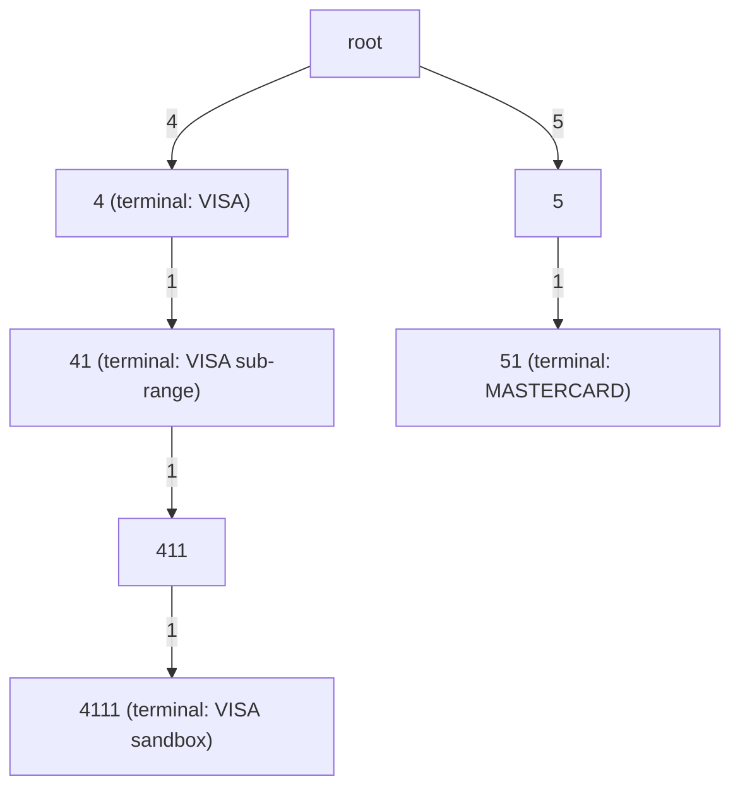

# Tries and Prefix Trees

> BIN range lookup for card routing is a trie problem.

**Type:** Build
**Languages:** Java, Python, Go
**Prerequisites:** Phase 1 Lesson 06 (Hash Maps), Phase 1 Lesson 08 (Binary Search Trees), Phase 1 Lesson 12 (Strings and Encodings)
**Time:** ~75 minutes

## Learning Objectives

- Explain how a trie stores a set of strings as shared paths and why lookup cost depends on key length, not on the number of keys
- Build a trie with insert, search, startsWith, and delete, and prove with a test that deleting one key never damages a key that shares its prefix
- Implement longest-prefix match in a single downward walk and state why it is the right operation for routing
- Decompose a numeric range such as 2221-2720 into the minimal set of prefixes that cover it exactly
- Route sample card numbers to their network and issuer by BIN, and explain what happens at a range boundary
- Compare a plain trie with a compressed (radix) trie and a hash map, and say when each wins

## The Problem

Every card payment starts with a question that must be answered in microseconds: given this card number, which network (Visa, Mastercard, Amex, Discover, JCB, a domestic scheme) and which issuing bank does it belong to? The answer decides where the authorisation request goes, what interchange fee applies, whether the card is debit or credit, prepaid, corporate, or regulated, and which currency the issuer settles in. The answer lives in the first digits of the PAN: the Bank Identification Number (ISO/IEC 7812 calls it the issuer identification number). Networks publish tables of BIN *ranges*, each mapped to an issuer and a product, and the tables have hundreds of thousands of rows.

A gateway's first router stores the table as a hash map from six-digit prefix to issuer record. It works until the first row that is not six digits. Visa owns everything that starts with `4`, so that is a one-digit rule. Mastercard's traditional range is `51`-`55`, two digits. In 2017 Mastercard added the 2-series, `2221`-`2720`, a range whose boundaries are not aligned to any digit position. Amex is `34` and `37`. Discover is `6011`, `65`, and `644`-`649`. In 2022 the industry moved from six-digit to eight-digit BINs, and issuers' ranges inside a network's space now start and end at arbitrary points: `411111`-`411119` belongs to one bank, `411120`-`411199` to another. A six-digit hash map lookup cannot express any of this. The team adds a fallback: if the six-digit lookup misses, try five digits, then four, then three. Six hash lookups per routing decision, and the ranges still have to be expanded into every six-digit prefix they contain, which for `2221`-`2720` is 50,000 entries.

Then a merchant reports that cards starting `2720` are declined. The router had a rule for `27` from an old test fixture, and the "try shorter prefixes" fallback found it before anyone noticed it was wrong, because nothing in the structure says "the longest matching rule wins". A different merchant reports that a BIN update that removed one issuer's range also broke routing for a neighbouring issuer, because the deletion code removed six-digit entries that the two ranges shared.

The structure that fixes all of this is a trie: one node per digit, rules stored at the node where their prefix ends, and a single downward walk that visits the rules for `2`, `27`, `272`, and `2720` in order and returns the deepest one. Ranges become a handful of prefixes rather than tens of thousands of rows. Deleting a rule touches only nodes that no other rule uses. This lesson builds it, and the routing table on top.

## The Concept

### Shared prefixes as shared paths

A trie (from re*trie*val, Fredkin 1960) stores strings as paths from a root. Each edge is labelled with one character; a node is marked *terminal* if the path from the root to it spells a stored key, and a terminal node carries the key's value. Two keys that share a prefix share the nodes of that prefix. The keys `4`, `41`, `4111`, and `51`:



Four keys, seven nodes including the root. The node for `411` exists only because `4111` passes through it; it is a *path*, not a key, and `search("411")` returns nothing. `startsWith("411")` returns true, because a key does continue below it.

### Cost depends on key length, not key count

Every operation walks one path from the root, one node per character. For a key of length `L` over an alphabet of size `A`:

| Operation | Cost | Notes |
|---|---|---|
| `insert(key)` | O(L) | Creates at most L new nodes |
| `search(key)` | O(L) | Fails early at the first missing edge |
| `startsWith(prefix)` | O(length of prefix) | Same walk, no terminal check |
| `longestPrefixMatch(query)` | O(length of query) | One walk, remembering the deepest terminal node |
| `delete(key)` | O(L) | Walk down, then prune back up |
| `keysWithPrefix(prefix)` | O(prefix + size of subtree) | Autocomplete |
| Memory | O(total characters across keys) worst case; far less with sharing | Each node holds a child map of up to A entries |

A hash map's lookup is O(L) too, because hashing reads every character, but it answers only "is this exact key present". The trie answers exact match, prefix existence, longest prefix, and "all keys under this prefix" with the same walk. That is the trade: more pointers per key in exchange for prefix queries.

Compare a BIN table of 500,000 eight-digit rules. In a trie over digits, the walk is at most 8 steps regardless of the table's size. In a balanced BST (Lesson 08) it is about 19 comparisons, each comparing strings of up to 8 characters. In a sorted array with binary search, the same 19 comparisons, with better cache behaviour. The trie wins on lookup and on expressing ranges; the sorted array wins on memory. Production BIN services use all three at different layers.

### Worked example: building the trie by hand

Insert `4`, `4111`, `41`, `51` into an empty trie and track `size` (keys) and `nodeCount` (nodes, including the root):

```text
start:          root                                   size 0  nodes 1
insert "4":     root -4-> [4]*                         size 1  nodes 2   (1 new node, marked terminal)
insert "4111":  root -4-> [4]* -1-> [41] -1-> [411] -1-> [4111]*
                                                       size 2  nodes 5   (3 new nodes; [4] reused)
insert "41":    walk root -4-> [4] -1-> [41], mark terminal
                                                       size 3  nodes 5   (0 new nodes)
insert "51":    root -5-> [5] -1-> [51]*               size 4  nodes 7   (2 new nodes)
```

`*` marks terminal nodes. The third insert created nothing: `41` was already a path, and turning a path into a key is a one-bit change. That is the whole memory argument for tries over a hash map of prefixes: the hash map would hold four independent strings totalling 9 characters; the trie holds 6 non-root nodes because `4`, `41`, and `4111` share their first characters.

### Memory: what a node costs

A node is small in the diagram and large in the heap. Approximate per-node cost for this lesson's implementation on a 64-bit runtime:

| Runtime | Node object | Child container | Per child entry | Typical total for a node with one child |
|---|---|---|---|---|
| Java (`TreeMap<Character, Node>`) | 24 bytes (header, flag, value ref, map ref) | 48 bytes (`TreeMap` object) | about 40 bytes (`TreeMap.Entry`) plus a boxed `Character` | about 130 bytes |
| Python (`dict` children, `__dict__` dataclass) | about 56 bytes plus the instance dict | 64 bytes (empty `dict`) growing to 232 at 6 entries | 8 to 24 bytes amortised | about 200 bytes |
| Go (`map[rune]*node`) | 32 bytes | 48 bytes (`hmap` header) plus a bucket of 8 slots | about 16 bytes amortised | about 190 bytes |

A 500,000-key table with eight-digit keys can approach 4 million nodes in a plain trie if prefixes are not well shared, which at 130 to 200 bytes per node is 500 MB to 800 MB. That is why Exercise 1 replaces the map with a ten-slot array for digit keys (one node drops to about 100 bytes, and child lookup becomes an array index), and why production systems use radix trees or sorted range arrays: the same table as a sorted array of `(lowBound, highBound, record)` is about 20 MB.

### Longest-prefix match

Routing needs "the most specific rule that applies", not "the rule for exactly this key". A 16-digit PAN is never itself a stored rule; the stored rules are `4`, `4111`, `411111`, and the right answer is the deepest one on the PAN's path. The walk:

```text
longestPrefixMatch("4111111111111111") against keys {4, 41, 4111, 51}:
  root -> '4'  : node is terminal        best = ("4", VISA)
       -> '1'  : node is terminal        best = ("41", VISA sub-range)
       -> '1'  : node "411" not terminal best unchanged
       -> '1'  : node is terminal        best = ("4111", VISA sandbox)
       -> '1'  : no child                stop
  return ("4111", VISA sandbox)
```

One pass, no backtracking, no "try shorter prefixes" loop. The same algorithm routes IP packets (the longest matching subnet wins) and resolves file-system mount points (the deepest mounted path wins). A stored empty key `""` is matched by every query and acts as a default route.

### Ranges become prefixes

Networks publish ranges, but a trie stores prefixes. A prefix `p` of length `k` in a space of `n`-digit numbers covers exactly the block `p000...` to `p999...`. So a range decomposes into blocks, and the greedy rule is: from the low end, take the widest block that starts here and ends at or before the high end, emit its prefix, and continue from the number after it.

Worked example, `2221`-`2720`:

```text
cur=2221: last digit is 1, not 0 -> block is just 2221        emit "2221"   next 2222
...       the same for 2222 .. 2229                           emit "2222".."2229"
cur=2230: ends in one 0; 2239 <= 2720 -> widen to 223?        emit "223"    next 2240
...       224, 225, 226, 227, 228, 229                        emit "224".."229"
cur=2300: ends in two 0s; 2399 <= 2720 -> widen to 23??       emit "23"     next 2400
cur=2400, 2500, 2600: same                                    emit "24", "25", "26"
cur=2700: 2799 > 2720, so only one 0 can be freed             emit "270"    next 2710
cur=2710:                                                     emit "271"    next 2720
cur=2720: 2729 > 2720, nothing can be freed                   emit "2720"   next 2721 > hi, stop
```

Twenty-three prefixes replace a 500-number range (or 50,000 six-digit entries), and the test suite checks that every number from 2000 to 2999 is covered by exactly one prefix if it is in range and by none if it is not. `51`-`55` decomposes to the five obvious prefixes; `00`-`99` collapses to the empty prefix, which is the whole space.

### Deletion that respects shared prefixes

Removing a key has two parts. First, unmark the terminal node and drop its value: the key is gone. Second, walk back up the path and remove any node that is now useless, meaning it is not terminal and has no children. Stop at the first node that is still needed. Deleting `4111` from the trie above removes the `4111` node and then the `411` node (no longer terminal, no children), and stops at `41` because it is terminal. Deleting `4` instead unmarks the node and removes nothing, because the node still has a child.

The invariant this maintains: **every node is either terminal or an ancestor of a terminal node.** It is what keeps `nodeCount()` proportional to the live keys and what makes `startsWith` honest: if the `4111` node were left behind after deletion, `startsWith("4111")` would return true for a prefix that no key has. The tests pin both behaviours down.

### Compressed tries

A plain trie spends a node per character even along chains with a single child. The networks trie in this lesson has 47 keys and 61 nodes; a BIN table with 500,000 eight-digit keys has long single-child chains below the shared top levels. A **radix tree** (compressed trie, Patricia trie) merges each chain into one node labelled with the whole substring, so the node count is bounded by `2 * keys - 1` regardless of key length. Lookup compares substrings instead of single characters; insert may have to *split* a merged node when a new key diverges in the middle of its label.

| | Plain trie (this lesson) | Radix tree | Hash map |
|---|---|---|---|
| Nodes for `n` keys of length `L` | up to `n * L` | at most `2n - 1` | `n` entries |
| Lookup | O(L) single-character steps | O(L) with substring compares; fewer pointer chases | O(L) to hash, then O(1) expected |
| Longest-prefix match | one walk | one walk | not supported without a loop over prefix lengths |
| Delete | prune up the path | prune and possibly re-merge | O(1) |
| Where it is used | teaching, small alphabets, digit keys | Linux IP routing (`fib_trie`), Go HTTP routers, Redis Streams' rax, ART in HyPer and DuckDB | everything else |

The plain trie is built here because its invariants are visible in ten lines; a radix tree is the same structure with an extra invariant (no single-child non-terminal nodes) and is Exercise 3.

### What the trie does not do

- It does not validate the card number. `route` checks that the PAN is 12-19 digits (ISO/IEC 7812 allows up to 19); the Luhn check digit is Phase 11's job, and a PAN that routes correctly can still be invalid.
- It does not know that `4111 11` and `411111` are the same key. Keys are strings; normalisation (strip spaces and dashes) belongs before the lookup, and the router rejects non-digits so the mistake fails loudly.
- It does not order keys lexicographically for range *queries* ("every rule between 4000 and 4999") as efficiently as a sorted structure would; `keysWithPrefix` gives you a subtree, not an arbitrary interval.
- It does not store the ranges. After `addNetworkRange("2221", "2720", ...)` the trie holds 23 prefixes and has no memory of the range they came from; removing the range means removing each prefix (Exercise 2).

## Build It

The primary walkthrough is in Java. Python and Go implement the same design with the same names; the subsections at the end show only what differs.

### Step 1: Nodes and insert

```java
private static final class Node<V> {
    final Map<Character, Node<V>> children = new TreeMap<>();
    boolean terminal;
    V value;
}

V insert(String key, V value) {
    Node<V> node = root;
    for (int i = 0; i < key.length(); i++) {
        char c = key.charAt(i);
        Node<V> next = node.children.get(c);
        if (next == null) {
            next = new Node<>();
            node.children.put(c, next);
            nodeCount++;
        }
        node = next;
    }
    V old = node.terminal ? node.value : null;
    if (!node.terminal) size++;
    node.terminal = true;
    node.value = value;
    return old;
}
```

The `terminal` flag is separate from `value` so that a stored value can be anything, and so that the difference between "a key ends here" and "a path passes through here" is one boolean, not a null check. `TreeMap` keeps children sorted, which makes `keysWithPrefix` deterministic; for a digits-only trie a ten-element array indexed by `c - '0'` would be faster and is Exercise 1. `size` counts keys, `nodeCount` counts nodes; both are needed to test deletion.

**Predict:** after inserting `"4"`, `"4111"`, `"41"`, `"51"`, what are `size()` and `nodeCount()`?

### Step 2: search and startsWith share one walk

```java
V search(String key) {
    Node<V> node = walk(key);
    return node != null && node.terminal ? node.value : null;
}

boolean startsWith(String prefix) { return walk(prefix) != null; }

private Node<V> walk(String s) {
    Node<V> node = root;
    for (int i = 0; i < s.length() && node != null; i++) node = node.children.get(s.charAt(i));
    return node;
}
```

The only difference between the two public methods is the terminal check. `walk("")` returns the root, so `startsWith("")` is always true and `search("")` is true only if the empty key was stored.

### Step 3: Longest-prefix match

```java
Match<V> longestPrefixMatch(String query) {
    Node<V> node = root;
    Match<V> best = root.terminal ? new Match<>("", root.value) : null;
    for (int i = 0; i < query.length(); i++) {
        node = node.children.get(query.charAt(i));
        if (node == null) break;
        if (node.terminal) best = new Match<>(query.substring(0, i + 1), node.value);
    }
    return best;
}
```

`best` is overwritten every time a terminal node is passed, so when the walk ends, either by running out of query or by missing an edge, it holds the deepest match. The returned `Match` carries the matched prefix as well as the value, which is what lets the router report *why* a PAN went where it went: `via prefix 2720`.

**Predict:** with keys `4`, `4111`, `51` stored, what does `longestPrefixMatch("411")` return, and why is it not null?

### Step 4: Delete with pruning

```java
boolean delete(String key) {
    List<Node<V>> path = new ArrayList<>(key.length() + 1);
    Node<V> node = root;
    path.add(node);
    for (int i = 0; i < key.length(); i++) {
        node = node.children.get(key.charAt(i));
        if (node == null) return false;
        path.add(node);
    }
    if (!node.terminal) return false;
    node.terminal = false;
    node.value = null;
    size--;
    for (int i = key.length(); i > 0; i--) {
        Node<V> child = path.get(i);
        if (child.terminal || !child.children.isEmpty()) break;
        path.get(i - 1).children.remove(key.charAt(i - 1));
        nodeCount--;
    }
    return true;
}
```

The path is recorded on the way down because nodes have no parent pointers. The pruning loop walks from the deepest node upward and stops at the first node that is still terminal or still has children; everything above it is needed by some other key. Returning `false` for a bare path (`delete("41")` when only `4111` is stored) matters: a router that "deleted" a prefix that was never a rule should not report success.

**Predict:** keys `4111`, `411`, `4` are stored (5 nodes, one path). After `delete("4111")`, how many nodes remain? After then calling `delete("4")`?

### Step 5: Range decomposition

```java
static List<String> rangeToPrefixes(String lo, String hi) {
    int len = lo.length();
    List<String> out = new ArrayList<>();
    String cur = lo;
    while (cur.compareTo(hi) <= 0) {
        int k = 0;
        while (k < len && cur.charAt(len - 1 - k) == '0'
                && (cur.substring(0, len - 1 - k) + "9".repeat(k + 1)).compareTo(hi) <= 0) {
            k++;
        }
        String prefix = cur.substring(0, len - k);
        out.add(prefix);
        String blockEnd = prefix + "9".repeat(k);
        if (blockEnd.equals("9".repeat(len))) break;
        cur = increment(blockEnd);
    }
    return out;
}
```

`k` is how many trailing digits the emitted prefix leaves free. The inner loop widens the block one digit at a time while two conditions hold: the current number ends in a zero at that position (so the block starts on a boundary) and the block's last number does not exceed `hi`. Everything is done on equal-length digit strings so that string comparison is numeric comparison and there is no integer overflow for 19-digit ranges. The `9".repeat(len)` check stops the loop when a block reaches the top of the digit space, where `increment` would need an extra digit.

**Predict:** `rangeToPrefixes("3528", "3589")`. How many prefixes, and what is the last one?

### Step 6: The router

```java
Route route(String pan) {
    requireDigits(pan);
    if (pan.length() < 12 || pan.length() > 19) {
        throw new IllegalArgumentException("PAN must be 12-19 digits, got " + pan.length());
    }
    Match<String> network = networks.longestPrefixMatch(pan);
    if (network == null) throw new NoRouteException("no network owns a prefix of " + mask(pan));
    Match<String> issuer = issuers.longestPrefixMatch(pan);
    return new Route(network.value(), issuer == null ? "UNKNOWN" : issuer.value(), network.prefix());
}
```

Two tries, because network ownership and issuer identity are different tables maintained by different parties and updated on different schedules. A PAN with no network match is an error: nothing downstream can proceed. A PAN with no issuer match is normal for a new or small BIN, so it routes with `UNKNOWN`. The exception message uses `mask`, first six and last four digits, because a full PAN must never appear in a log (PCI DSS requirement 3.4), and an exception message is a log line waiting to happen.

### Step 7: Run it

```bash
cd phases/01-complexity-and-core-structures/13-tries/code/java
javac -d .out *.java && java -cp .out Main
java -cp .out MainTest
```

Expected output, abbreviated:

```console
== A trie of card prefixes ==
keys=4 nodes=7
search("411")  = (none)   (a path, not a key)
longestPrefixMatch("4111111111111111") = "4111" -> VISA (sandbox range)
after delete("4111"): keys=3 nodes=5 search("41")=VISA (sub-range) startsWith("41")=true

== A numeric range becomes a handful of prefixes ==
2221-2720 -> 23 prefixes: [2221, 2222, ..., 2229, 223, 224, ..., 229, 23, 24, 25, 26, 270, 271, 2720]

== BIN routing with longest-prefix match ==
network prefixes stored: 47
411111******1111     -> VISA       issuer=Visa sandbox issuer         via prefix 4
272099******9996     -> MASTERCARD issuer=UNKNOWN                     via prefix 2720
378282*****0005      -> AMEX       issuer=Amex sandbox issuer         via prefix 37
rejected: no network owns a prefix of 272100******0008
```

The PANs are the publicly documented sandbox test numbers (`4111111111111111`, `5555555555554444`, `378282246310005`, `6011111111111117`, `3530111333300000`); they pass the Luhn check and route to the expected network but are not real cards. `2720999999999996` and `2721000000000008` sit on either side of the 2-series boundary: one routes, the other is rejected, which is exactly the failure The Problem describes being caught at the structure level.

### In Python

The Python port (`code/python/main.py`) is the same design with four differences. **Children are a `dict`**, which preserves insertion order but not sorted order, so `_collect` iterates `sorted(node.children)` to match Java's `TreeMap`. **String comparison in `range_to_prefixes` is already lexicographic**, and `str(int(block_end) + 1).zfill(length)` does the increment with arbitrary-precision integers; a 19-digit range needs no special handling. **`isdigit()` accepts Unicode digits** such as Arabic-Indic numerals, so `require_digits` also checks `isascii()`. Java's `Character.isDigit` has the same trap and the Java code should be read with that in mind for non-ASCII input. **Errors:** `ValueError` for invalid input, a `NoRouteError` subclass of `LookupError` for a PAN nobody owns.

Run it from `code/python/` with `python3 main.py`; test with `python3 -m unittest -v`.

#### Step 1: Nodes and insert

`_Node` is a mutable dataclass whose `children` dict defaults to a fresh dict per node (`field(default_factory=dict)`). `insert` iterates the key's characters directly, creating nodes as it goes, and keeps `terminal` separate from `value` so "a key ends here" is a boolean rather than a `None` check. `size` counts keys, `_node_count` counts nodes including the root.

```python
@dataclass
class _Node(Generic[V]):
    children: dict[str, "_Node[V]"] = field(default_factory=dict)
    terminal: bool = False
    value: Optional[V] = None


class Trie(Generic[V]):
    def __init__(self) -> None:
        self._root: _Node[V] = _Node()
        self._size = 0        # number of keys
        self._node_count = 1  # including the root

    def insert(self, key: str, value: V) -> Optional[V]:
        """Insert or replace. Returns the previous value for this exact key, or None."""
        if key is None or value is None:
            raise TypeError("key and value must not be None")
        node = self._root
        for c in key:
            nxt = node.children.get(c)
            if nxt is None:
                nxt = _Node()
                node.children[c] = nxt
                self._node_count += 1
            node = nxt
        old = node.value if node.terminal else None
        if not node.terminal:
            self._size += 1
        node.terminal = True
        node.value = value
        return old
```

#### Step 2: search and startsWith share one walk

`_walk` follows one character at a time and returns `None` the moment an edge is missing; `search` adds the terminal check and `starts_with` does not. `_walk("")` returns the root.

```python
    def search(self, key: str) -> Optional[V]:
        """Exact-match lookup: the value stored under this key, or None. "41" does not match a stored "411"."""
        node = self._walk(key)
        return node.value if node is not None and node.terminal else None

    def starts_with(self, prefix: str) -> bool:
        """True if any stored key begins with this prefix (including the prefix itself)."""
        return self._walk(prefix) is not None

    def _walk(self, s: str) -> Optional[_Node[V]]:
        node: Optional[_Node[V]] = self._root
        for c in s:
            if node is None:
                return None
            node = node.children.get(c)
        return node
```

#### Step 3: Longest-prefix match

`enumerate` gives the index needed for the slice `query[: i + 1]`, which is the matched prefix. `best` is overwritten at every terminal node passed and returned when the walk ends, whether by exhausting the query or by missing an edge.

```python
    def longest_prefix_match(self, query: str) -> Optional[Match[V]]:
        node = self._root
        best: Optional[Match[V]] = Match("", node.value) if node.terminal else None
        for i, c in enumerate(query):
            node = node.children.get(c)
            if node is None:
                break
            if node.terminal:
                best = Match(query[: i + 1], node.value)
        return best
```

#### Step 4: Delete with pruning

The path is a list built on the way down. The pruning loop runs from the deepest node upward with a descending `range`; `if child.terminal or child.children` uses the truthiness of a non-empty dict for the "still has children" test, and `del path[i - 1].children[key[i - 1]]` removes the edge.

```python
    def delete(self, key: str) -> bool:
        path = [self._root]
        node = self._root
        for c in key:
            node = node.children.get(c)
            if node is None:
                return False
            path.append(node)
        if not node.terminal:
            return False
        node.terminal = False
        node.value = None
        self._size -= 1
        for i in range(len(key), 0, -1):
            child = path[i]
            if child.terminal or child.children:
                break
            del path[i - 1].children[key[i - 1]]
            self._node_count -= 1
        return True
```

#### Step 5: Range decomposition

Equal-length digit strings compare lexicographically in Python exactly as they do numerically, so `cur <= hi` and the block-end comparison need no conversion. The increment is the one place integers appear: `int(block_end) + 1` cannot overflow, and `zfill` restores the fixed width.

```python
def range_to_prefixes(lo: str, hi: str) -> list[str]:
    require_digits(lo)
    require_digits(hi)
    if len(lo) != len(hi):
        raise ValueError(f"lo and hi must have equal length: {lo}, {hi}")
    if lo > hi:
        raise ValueError(f"lo must not exceed hi: {lo} > {hi}")
    length = len(lo)
    out: list[str] = []
    cur = lo
    while cur <= hi:
        k = 0  # number of trailing digits the prefix will leave free
        while k < length and cur[length - 1 - k] == "0" and cur[: length - 1 - k] + "9" * (k + 1) <= hi:
            k += 1
        prefix = cur[: length - k]
        out.append(prefix)
        block_end = prefix + "9" * k
        if block_end == "9" * length:  # the block ran to the end of the digit space
            break
        cur = str(int(block_end) + 1).zfill(length)
    return out
```

#### Step 6: The router

Two tries, as in Java. A missing network raises `NoRouteError` (a `LookupError`), a missing issuer routes as `UNKNOWN`, and the error message goes through `mask` so a full PAN never reaches a log line. `require_digits` rejects non-ASCII digits as well as non-digits.

```python
def require_digits(s: str) -> str:
    if not s or not s.isdigit() or not s.isascii():
        raise ValueError(f"expected a non-empty digit string, got {s!r}")
    return s
```

```python
    def route(self, pan: str) -> Route:
        require_digits(pan)
        if not 12 <= len(pan) <= 19:
            raise ValueError(f"PAN must be 12-19 digits, got {len(pan)}")
        network = self._networks.longest_prefix_match(pan)
        if network is None:
            raise NoRouteError(f"no network owns a prefix of {mask(pan)}")
        issuer = self._issuers.longest_prefix_match(pan)
        return Route(network.value, "UNKNOWN" if issuer is None else issuer.value, network.prefix)
```

#### Step 7: Run it

```bash
cd phases/01-complexity-and-core-structures/13-tries/code/python
python3 main.py
python3 -m unittest -v
```

```console
== A trie of card prefixes ==
keys=4 nodes=7
search("411")  = (none)   (a path, not a key)
longestPrefixMatch("4111111111111111") = "4111" -> VISA (sandbox range)
keysWithPrefix("4") = [4, 41, 4111]
after delete("4111"): keys=3 nodes=5 search("41")=VISA (sub-range) startsWith("41")=true

== A numeric range becomes a handful of prefixes ==
2221-2720 -> 23 prefixes: [2221, 2222, 2223, 2224, 2225, 2226, 2227, 2228, 2229, 223, 224, 225, 226, 227, 228, 229, 23, 24, 25, 26, 270, 271, 2720]
3528-3589 -> [3528, 3529, 353, 354, 355, 356, 357, 358]

== BIN routing with longest-prefix match ==
network prefixes stored: 47
411111******1111     -> VISA       issuer=Visa sandbox issuer         via prefix 4
272099******9996     -> MASTERCARD issuer=UNKNOWN                     via prefix 2720
378282*****0005      -> AMEX       issuer=Amex sandbox issuer         via prefix 37
rejected: no network owns a prefix of 272100******0008
```

Every line matches the Java run; `keysWithPrefix` is sorted because `_collect` sorts the dict keys.

### In Go

The Go port (`code/go/main.go`) is the same design with four differences. **`range` over a string yields runes and byte offsets**, so the matched prefix is `query[:i+len(string(c))]`, not `query[:i+1]`; for ASCII digits the two are the same, for anything else only the first is correct. Children are keyed by `rune`. **No null:** `Search` and `LongestPrefixMatch` return `(value, ok)`, and `Route` returns an error that wraps the sentinel `ErrNoRoute` so callers can `errors.Is` it apart from validation errors. **Map iteration order is randomised**, so `collect` copies the child runes into a slice and sorts them before recursing; without that, `KeysWithPrefix` would return a different order on every run. **`go test -race` passes** because nothing is shared; a router that reloads its table while serving needs a `sync.RWMutex` or an atomic pointer swap to a fresh trie, which is the pattern Phase 4 covers.

Run it from `code/go/` with `go run .`; test with `go test ./...`.

#### Step 1: Nodes and insert

`node[V]` keeps a `map[rune]*node[V]`; `newNode` allocates the map because a nil map cannot be written to. `Insert` returns `(old, replaced)` in place of a nullable; `for _, c := range key` walks runes, which is what makes the trie correct for any UTF-8 key even though the lesson only stores digits.

```go
type node[V any] struct {
	children map[rune]*node[V]
	terminal bool
	value    V
}

func newNode[V any]() *node[V] { return &node[V]{children: make(map[rune]*node[V])} }

type Trie[V any] struct {
	root      *node[V]
	size      int // number of keys
	nodeCount int // including the root
}

func NewTrie[V any]() *Trie[V] { return &Trie[V]{root: newNode[V](), nodeCount: 1} }

// Insert stores or replaces. It returns the previous value for this exact key and whether there was one.
func (t *Trie[V]) Insert(key string, value V) (old V, replaced bool) {
	n := t.root
	for _, c := range key {
		next, ok := n.children[c]
		if !ok {
			next = newNode[V]()
			n.children[c] = next
			t.nodeCount++
		}
		n = next
	}
	if n.terminal {
		old, replaced = n.value, true
	} else {
		t.size++
	}
	n.terminal = true
	n.value = value
	return old, replaced
}
```

#### Step 2: search and startsWith share one walk

A missing map key returns a nil pointer, so `walk` can index without the two-value form. `Search` returns the zero `V` and `false` for a path that is not a key.

```go
// Search is an exact-match lookup. "41" does not match a stored "411".
func (t *Trie[V]) Search(key string) (V, bool) {
	n := t.walk(key)
	if n == nil || !n.terminal {
		var zero V
		return zero, false
	}
	return n.value, true
}

// StartsWith reports whether any stored key begins with this prefix (including the prefix itself).
func (t *Trie[V]) StartsWith(prefix string) bool { return t.walk(prefix) != nil }

func (t *Trie[V]) walk(s string) *node[V] {
	n := t.root
	for _, c := range s {
		if n == nil {
			return nil
		}
		n = n.children[c]
	}
	return n
}
```

#### Step 3: Longest-prefix match

The `i` from `range` is a byte offset, so the prefix slice ends at `i+len(string(c))`, the byte after the current rune. `found` carries the "is there a match" signal that Java expresses with `null`.

```go
func (t *Trie[V]) LongestPrefixMatch(query string) (Match[V], bool) {
	n := t.root
	var best Match[V]
	found := false
	if n.terminal {
		best, found = Match[V]{"", n.value}, true
	}
	for i, c := range query {
		n = n.children[c]
		if n == nil {
			break
		}
		if n.terminal {
			best, found = Match[V]{query[:i+len(string(c))], n.value}, true
		}
	}
	return best, found
}
```

#### Step 4: Delete with pruning

The key is converted to `[]rune` once so the pruning loop can index it by position; `delete(map, key)` removes the edge. The cleared value is set to the zero `V` so the garbage collector can reclaim whatever it referenced.

```go
func (t *Trie[V]) Delete(key string) bool {
	runes := []rune(key)
	path := make([]*node[V], 0, len(runes)+1)
	n := t.root
	path = append(path, n)
	for _, c := range runes {
		n = n.children[c]
		if n == nil {
			return false
		}
		path = append(path, n)
	}
	if !n.terminal {
		return false
	}
	var zero V
	n.terminal = false
	n.value = zero
	t.size--
	for i := len(runes); i > 0; i-- {
		child := path[i]
		if child.terminal || len(child.children) > 0 {
			break
		}
		delete(path[i-1].children, runes[i-1])
		t.nodeCount--
	}
	return true
}
```

#### Step 5: Range decomposition

Go string comparison is bytewise, which for equal-length digit strings is numeric comparison. The increment is a hand-written carry over a `[]byte`, because Go has no big-integer fast path; the caller guarantees the input is not all nines. Invalid input is returned as an error.

```go
func RangeToPrefixes(lo, hi string) ([]string, error) {
	if err := requireDigits(lo); err != nil {
		return nil, err
	}
	if err := requireDigits(hi); err != nil {
		return nil, err
	}
	if len(lo) != len(hi) {
		return nil, fmt.Errorf("lo and hi must have equal length: %s, %s", lo, hi)
	}
	if lo > hi {
		return nil, fmt.Errorf("lo must not exceed hi: %s > %s", lo, hi)
	}
	length := len(lo)
	out := []string{}
	cur := lo
	for cur <= hi {
		k := 0 // number of trailing digits the prefix will leave free
		for k < length && cur[length-1-k] == '0' && cur[:length-1-k]+strings.Repeat("9", k+1) <= hi {
			k++
		}
		prefix := cur[:length-k]
		out = append(out, prefix)
		blockEnd := prefix + strings.Repeat("9", k)
		if blockEnd == strings.Repeat("9", length) { // the block ran to the end of the digit space
			break
		}
		cur = increment(blockEnd)
	}
	return out, nil
}

// increment adds one to a digit string of fixed width; the caller guarantees it is not all nines.
func increment(digits string) string {
	d := []byte(digits)
	i := len(d) - 1
	for d[i] == '9' {
		d[i] = '0'
		i--
	}
	d[i]++
	return string(d)
}
```

#### Step 6: The router

`Route` returns `(Route, error)`. Validation failures are plain errors; a PAN nobody owns wraps `ErrNoRoute` with `%w` so the demo can `errors.Is` it. The issuer lookup's `ok` chooses between the stored name and `UNKNOWN`, and the message is masked.

```go
// ErrNoRoute is returned when no stored network prefix matches the PAN.
var ErrNoRoute = errors.New("no route")

func (r *BinRouter) Route(pan string) (Route, error) {
	if err := requireDigits(pan); err != nil {
		return Route{}, err
	}
	if len(pan) < 12 || len(pan) > 19 {
		return Route{}, fmt.Errorf("PAN must be 12-19 digits, got %d", len(pan))
	}
	network, ok := r.networks.LongestPrefixMatch(pan)
	if !ok {
		return Route{}, fmt.Errorf("%w: no network owns a prefix of %s", ErrNoRoute, Mask(pan))
	}
	issuerName := "UNKNOWN"
	if issuer, ok := r.issuers.LongestPrefixMatch(pan); ok {
		issuerName = issuer.Value
	}
	return Route{network.Value, issuerName, network.Prefix}, nil
}
```

#### Step 7: Run it

```bash
cd phases/01-complexity-and-core-structures/13-tries/code/go
go run .
go test ./...
```

```console
== A trie of card prefixes ==
keys=4 nodes=7
search("411")  = (none)   (a path, not a key)
longestPrefixMatch("4111111111111111") = "4111" -> VISA (sandbox range)
keysWithPrefix("4") = [4, 41, 4111]
after delete("4111"): keys=3 nodes=5 search("41")=VISA (sub-range) startsWith("41")=true

== A numeric range becomes a handful of prefixes ==
2221-2720 -> 23 prefixes: [2221, 2222, 2223, 2224, 2225, 2226, 2227, 2228, 2229, 223, 224, 225, 226, 227, 228, 229, 23, 24, 25, 26, 270, 271, 2720]
3528-3589 -> [3528, 3529, 353, 354, 355, 356, 357, 358]

== BIN routing with longest-prefix match ==
network prefixes stored: 47
411111******1111     -> VISA       issuer=Visa sandbox issuer         via prefix 4
272099******9996     -> MASTERCARD issuer=UNKNOWN                     via prefix 2720
378282*****0005      -> AMEX       issuer=Amex sandbox issuer         via prefix 37
rejected: no network owns a prefix of 272100******0008
```

The Go and Python outputs are byte-identical. `keysWithPrefix` comes out sorted only because `collect` sorts the rune slice; drop that sort and the order changes between runs.

## Use It

### Standard libraries

None of the three standard libraries ships a trie. Java has `java.util.TreeMap`, whose `floorKey` can emulate longest-prefix match on *ranges* if you store each range's low bound as the key and check the high bound after the lookup; that is how many BIN services are actually implemented against a sorted table, and it is O(log n) with excellent memory density. Apache Commons Collections provides `PatriciaTrie`. Python has no built-in; `pygtrie` and `marisa-trie` are the common choices, and `bisect` on a sorted list of range starts is the `floorKey` equivalent. Go has no trie in the standard library either, but `net/netip.Prefix` and the `go4.org/netipx` tables implement longest-prefix match for IP routing, and most HTTP routers (`httprouter`, `chi`, `gin`) are radix trees over URL paths.

### Routing tables in the Linux kernel

The IPv4 forwarding table is a level-compressed trie (`fib_trie`, based on Nilsson and Karlsson's LC-tries) whose job is longest-prefix match over 32-bit addresses: `/8`, `/16`, and `/24` routes are prefixes of different lengths, and the most specific wins. Reading `net/ipv4/fib_trie.c` after this lesson, the node structure, the "key prefix plus bit position" layout, and the leaf-pruning on route deletion are all recognisable. The difference is scale: the full BGP table has about a million prefixes and a lookup must finish in tens of nanoseconds, which is why the kernel compresses levels and packs nodes to fit cache lines (Lesson 01).

### BIN tables in production

Visa and Mastercard distribute BIN tables to acquirers and processors as range files (low BIN, high BIN, issuer, product, country, currency), refreshed daily or weekly. A processor loads them into a sorted range structure or a trie and serves millions of lookups a day. Three operational facts shape the design: the move from six- to eight-digit BINs (ISO/IEC 7812-1:2017, mandated by the networks from April 2022) multiplied table sizes and made "the first six digits" wrong as a key; Mastercard's 2-series meant every router that checked `startsWith("5")` had to be fixed; and PCI DSS 3.4 forbids storing or logging a full PAN, which is why `route` masks and why a BIN lookup service is one of the few components allowed to see the first digits at all. Open-source BIN datasets exist but are incomplete and often wrong; the authoritative tables are licensed from the networks.

## Ship It

`outputs/checklist-bin-routing.md` is a review checklist for any component that routes or classifies by card number prefix: key normalisation, range handling, longest-match semantics, table updates and deletions, PAN handling under PCI DSS, and the tests that must exist. Use it when reviewing a routing service, a fraud rule engine keyed on BIN, or a fee calculator.

## Exercises

1. **Reinforce.** Replace `TreeMap<Character, Node>` with a `Node[10]` array indexed by `c - '0'` for a digits-only `DigitTrie`, keeping the same public methods and tests. Measure `nodeCount()` and heap size (via a rough `bytes per node` estimate) for the 47-prefix network table in both versions, and explain when the array wins and when it wastes memory.
2. **Apply.** Add `removeNetworkRange(lo, hi)` to `BinRouter` that deletes exactly the prefixes `rangeToPrefixes(lo, hi)` would have added, and a test showing that removing `644`-`649` leaves `6011` and `65` routable while `6451111111111110` stops routing. Then add a `Luhn` check from the standard algorithm and reject PANs that fail it before routing; confirm the sample PANs all pass.
3. **Extend.** Build a `RadixTrie` where each edge carries a string label and no non-terminal node has exactly one child. Implement insert with node splitting, search, and longest-prefix match, and prove with a test that it returns identical results to `Trie` for 1,000 seeded random digit strings (use the `SeededRandom` from Phase 0, Lesson 03) while using at most `2 * keys - 1` nodes.

## Key Terms

| Term | What people say | What it actually means |
|------|-----------------|------------------------|
| Trie | "prefix tree" | A tree where each edge is one character and each stored key is a root-to-terminal path; keys sharing a prefix share nodes |
| Terminal node | "end of word" | A node where a stored key ends; distinct from a node that merely lies on the path to a longer key |
| Longest-prefix match | "most specific rule wins" | Among all stored keys that are prefixes of the query, the longest one; computed in one downward walk |
| BIN / IIN | "the first six digits" | The issuer identification number of ISO/IEC 7812: now up to eight digits, and assigned in ranges that do not align to digit positions |
| Range decomposition | "expanding the range" | Splitting `[lo, hi]` into the fewest prefix blocks that cover exactly those numbers; `2221`-`2720` becomes 23 prefixes, not 500 |
| Pruning | "cleaning up after delete" | Removing nodes that are neither terminal nor ancestors of a terminal node, so a deleted key leaves no trace and shared prefixes stay intact |
| Radix tree | "compressed trie", "Patricia trie" | A trie where single-child chains are merged into one node with a multi-character label; node count bounded by `2n - 1` |
| PAN | "the card number" | Primary account number, 12-19 digits: BIN, then account identifier, then a Luhn check digit; never logged in full |

## Further Reading

- [Fredkin, "Trie Memory", CACM 3(9), 1960](https://doi.org/10.1145/367390.367400) — the original paper; the name and the data structure, and a remarkably modern discussion of memory trade-offs.
- [ISO/IEC 7812-1:2017 — Identification cards: Numbering system](https://www.iso.org/standard/70484.html) — the standard that defines the issuer identification number, its move to eight digits, and the 19-digit PAN maximum.
- [Mastercard 2-series BIN expansion](https://www.mastercard.us/en-us/business/overview/support/2-series-bin-expansion.html) — the announcement that broke every `startsWith("5")` check; the range `2221`-`2720` used in this lesson.
- [PCI DSS v4.0, Requirement 3](https://www.pcisecuritystandards.org/document_library/) — why `route` masks the PAN in its error message and why BIN lookup services are the only place the leading digits should be visible.
- [Nilsson and Karlsson, "IP-Address Lookup Using LC-Tries", IEEE JSAC 1999](https://doi.org/10.1109/49.772439) — the level-compressed trie behind the Linux kernel's `fib_trie`; longest-prefix match at line rate.
- [Leis, Kemper, Neumann, "The Adaptive Radix Tree: ARTful Indexing for Main-Memory Databases", ICDE 2013](https://db.in.tum.de/~leis/papers/ART.pdf) — how a modern compressed trie chooses node layouts to fit cache lines; the structure used in HyPer and DuckDB.
