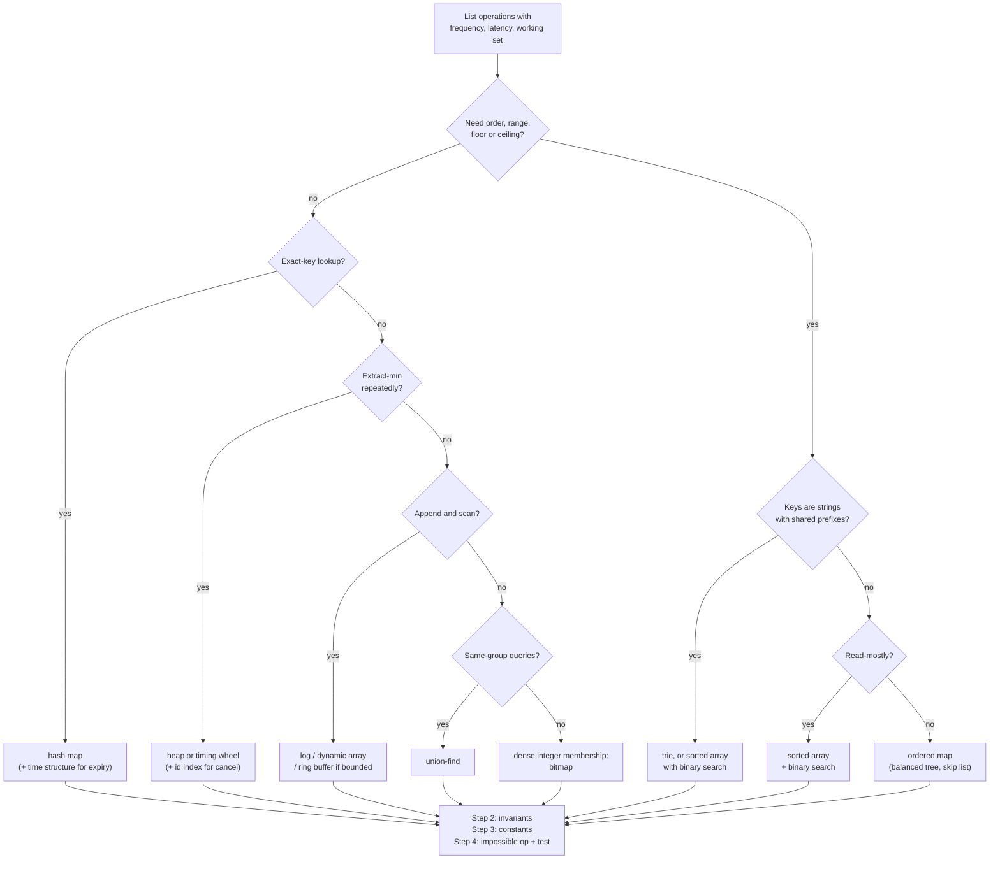

# Choosing a Structure: A Decision Procedure

> Access pattern first, then invariants, then constants.

**Type:** Learn
**Languages:** —
**Prerequisites:** Phase 1, Lessons 01 through 13 (this lesson is the synthesis of the phase)
**Time:** ~45 minutes

## Learning Objectives

- Write down a component's access pattern as a list of operations with frequency and latency budget before naming any data structure
- Separate the invariants a structure must enforce (uniqueness, order, conservation, boundedness) from the operations it must support
- Apply a four-step decision procedure and defend each choice with the operation the rejected alternative cannot do
- Work the procedure for four payments components: an idempotency store, a retry scheduler, a BIN table, and an audit log
- Recognise the three anti-patterns that produce wrong choices: familiarity, Big-O without constants, and the database as a default structure
- Know when a structure choice must be revisited, and what evidence triggers it

## The Problem

A team building a card-routing service needs to look up which issuer and network a card belongs to from its first digits, the Bank Identification Number. The engineer who picks up the ticket has used hash maps all week and reaches for one: `HashMap<String, Issuer>` keyed by the first six digits of the PAN. It passes every test, ships, and runs for two years. Then two things happen within a month. Visa and Mastercard complete their migration from six-digit to eight-digit BINs, and the issuer file the team loads starts containing ranges like `41111100` to `41111199` under one issuer and `41111200` to `41111299` under another. Both share the six-digit prefix `411111`. The hash map can hold only one of them. The service routes a third of one issuer's cards to the wrong network, the network declines them, and the merchant sees a 4% drop in approval rate that takes a week to trace back to a key length.

The engineer did nothing unusual. They chose a structure by familiarity and by one operation, point lookup, and the structure was correct for that operation. What they did not write down was the full access pattern (the lookup is really "find the most specific range that contains this prefix"), the invariants of the data (ranges nest, they do not overlap partially, and exactly one is most specific), or the constants (300,000 ranges, updated monthly, read 10,000 times per second). Any of the three would have pointed at a trie (Lesson 13) or a sorted array with binary search, and either would have survived the eight-digit migration without a code change.

This phase has built twelve structures. Each lesson said what its structure promises and what it does not do. This lesson is the procedure for going from a component you have to build to the structure that fits it, in that order, and for writing the choice down so the next engineer knows what it was optimised for. It has four steps, a table, a flowchart, and four worked examples that come up in every payments system.

## The Concept

### Step 1: Access pattern first

Before any structure is named, list every operation the component performs, with three numbers each: how often, how fast it must be, and how large the working set is. The vocabulary of operations is small, and the lessons in this phase each own a few:

| Operation | Examples | Structures that make it cheap |
|-----------|----------|-------------------------------|
| Point lookup by exact key | idempotency key present? account balance by id | hash map (06), array if keys are dense integers (03) |
| Insert / delete by key | register a key, remove an expired one | hash map (06), ordered map (08) |
| Range by key | transactions between t1 and t2 | ordered map (08), sorted array, B-tree |
| Ordered iteration, min, max, floor, ceiling | latest rate at or before t | ordered map (08), sorted array |
| Extract minimum repeatedly | next job due, next timer | heap (09), timing wheel |
| Prefix or longest-prefix match | BIN ranges, routing tables, autocomplete | trie (13), sorted array with binary search |
| Append and sequential read | log, event stream | dynamic array (03), ring buffer (05), file |
| FIFO / LIFO | request queue, undo stack, parser | ring buffer and deque (05) |
| Bounded buffer with overwrite | last N events, sliding window | ring buffer (05) |
| Membership of integers in a dense range | which merchants settled today | bitmap (11) |
| Same group? merge groups | fraud rings, connected accounts | union-find (10) |
| Insert at a known position, splice | LRU eviction order, intrusive scheduling | doubly linked list (04) |

An access pattern is this table filtered to the operations the component actually does, with numbers. "The idempotency store does `putIfAbsent(key)` 2,000 times per second with a 1 ms budget, `get(key)` 200 times per second, and expires everything older than 24 hours in a background sweep" is an access pattern. "We need a fast store" is not. If you cannot fill in the numbers, you cannot choose; go and measure or estimate them (Phase 0, Lesson 08 on back-of-envelope estimation).

Two operations are consistently forgotten at this step and found in production: **the one that happens rarely but must be possible** (cancel a scheduled retry, un-link two accounts, correct an audit entry) and **the one that scans everything** (reconciliation, export, migration). Write both down even if the first answer is "rebuild from the log" and the second is "once a night".

### Step 2: Invariants

An invariant is a property that must hold after every operation. Some are enforced by the structure for free, some by code around it, and some not at all. The second column of the next table is what to look for:

| Invariant | What enforces it | Structures that give it for free |
|-----------|------------------|----------------------------------|
| Uniqueness of keys | the map's `put` contract | hash map, ordered map, trie |
| Total order by key | the structure's shape | ordered map, sorted array, heap (partial order only: min at the root) |
| Conservation (sum of parts equals the whole) | arithmetic discipline | none; see Phase 10, Lesson 01's `allocate` |
| Append-only, no in-place mutation | API shape | log, ring buffer (bounded), immutable records |
| Bounded size with a stated eviction rule | explicit capacity | ring buffer (FIFO eviction), LRU (hash map + linked list) |
| Expiry after a duration | a second structure ordered by time | none alone; hash map plus heap or time buckets |
| Groups only ever merge | the union operation | union-find |
| Determinism (same input, same output, same order) | stable iteration | arrays, ordered maps, sorted structures; **not** hash maps (iteration order unspecified) |
| Durability across restart | storage, not structure | none in this phase; Phase 7 |

The invariant step is where "what the structure does not do" sections from each lesson pay off. A hash map does not keep order, so an audit log built on one is not an audit log. A BST does not stay balanced under sorted inserts (Lesson 08), so an index on timestamps needs the balanced trees of Phase 3. A heap gives you the minimum but not "is job X in here", so cancellation needs a side index. If an invariant matters and the structure does not provide it, the design must include the code that does, and the test that proves it; write both down now, because they are the parts that get skipped under deadline.

### Step 3: Constants

Big-O ranks structures for large n. Payments components are frequently small, hot, and latency-bound, and there the constants decide. Four to check:

- **n and bytes per entry.** 50 million idempotency keys at 120 bytes each (key, timestamp, response hash, object headers) is 6 GB; that is not an in-process hash map on a 4 GB heap, regardless of its O(1). 300,000 BIN ranges at 40 bytes is 12 MB; that fits in L3 cache and any structure is fast enough, so pick the simplest.
- **Memory locality.** Lesson 01's warning: a pointer-chasing structure (linked list, BST, hash map with chaining) costs a cache miss per step, around 100 ns, while a sorted array scanned sequentially costs under 1 ns per element. Binary search over 300,000 entries is 18 misses; a trie walk over 8 digits is 8 misses; a hash lookup is 1 to 3. All are under 2 microseconds, and the difference only matters if the budget is tight.
- **Allocation and GC.** A heap that allocates a node per job at 100,000 jobs per second generates garbage that a JVM must collect; an array-backed heap (Lesson 09) allocates nothing per operation. In Go the same concern is GC pause; in Python it is the per-object overhead (every entry is a dictionary unless `__slots__` is used).
- **Operational constants.** Is there a tested library implementation (`TreeMap`, `PriorityQueue`, `BitSet`)? Does the team know it? Can it be inspected in production? A structure you built in a lesson is a structure you understand; it is not automatically the one to ship.

Bytes per entry is the constant most often guessed wrong, usually by 3x to 5x, because object overhead is invisible in source code. On a 64-bit JVM with compressed references:

| Thing | Bytes | Note |
|-------|-------|------|
| Object header | 12 (16 with alignment) | every object, including boxed `Long` and `Integer` |
| Reference field | 4 | 8 without compressed oops (heaps over 32 GB) |
| `long`, `double` | 8 | as a field; 24 as a boxed object |
| `String` of n Latin-1 chars | 40 + n, rounded to 8 | header, hash, coder, plus a `byte[]` with its own header |
| `HashMap` entry | 32 + key + value | node object with hash, key, value, next |
| `TreeMap` entry | 40 + key + value | node with left, right, parent, colour |
| Array-backed heap slot | 4 or 8 | a reference or a primitive; no per-entry object |

An idempotency entry with a 36-character UUID key, a `long` timestamp, and a 64-character response hash is roughly 32 (node) + 80 (key string) + 24 (boxed timestamp if stored as `Long`) + 110 (hash string) = 246 bytes, not the 108 bytes of payload. Fifty million of them is 12 GB. The estimate is what tells you the structure lives outside the process before the first load test does.

The order matters: constants are the *third* step. An engineer who starts with "Redis is fast" or "arrays are cache-friendly" has chosen a structure before knowing what it must do. Constants break ties between structures that satisfy the access pattern and the invariants; they do not override either.

### Step 4: Name the impossible operation and the invariant test

Having chosen, write two things in the design document: the operation this structure makes expensive or impossible, and the test that proves the invariant holds. "This is a hash map; range queries are O(n) and we have confirmed no caller needs one. Test: `putIfAbsent` on an existing key returns the original value and does not overwrite." If the first sentence is hard to write, the access pattern was incomplete. If the second is, the invariant was.



The flowchart is a starting point, not an oracle. It gets you to two or three candidates; Steps 2 and 3 pick among them.

### The phase in one table

The twelve structures, by the operations from Step 1. n is the number of entries, k the number of results, L the key length in digits or characters, h the tree height.

| Structure (lesson) | Lookup by key | Insert | Delete | Min / extract-min | Range / ordered scan | Memory per entry | Keeps order? |
|--------------------|---------------|--------|--------|-------------------|----------------------|------------------|--------------|
| Dynamic array (03) | O(1) by index, O(n) by value | O(1) amortised at end, O(n) in middle | O(n) | O(n) | O(n), or O(log n + k) if kept sorted | smallest; contiguous | insertion order |
| Linked list (04) | O(n) | O(1) at a known node | O(1) at a known node | O(n) | O(n) | 2 pointers + object | insertion order |
| Ring buffer / deque (05) | O(1) at ends | O(1) at ends | O(1) at ends | O(n) | O(n) | smallest; contiguous | FIFO / LIFO |
| Hash map (06) | O(1) expected | O(1) expected | O(1) expected | O(n) | O(n), unordered | key + value + ~2 words | no |
| Unbalanced BST (08) | O(h), O(n) worst | O(h) | O(h) | O(h) | O(h + k) | 2 pointers + key + value | yes |
| Balanced ordered map (Phase 3) | O(log n) | O(log n) | O(log n) | O(log n) | O(log n + k) | 3 pointers + colour | yes |
| Binary heap (09) | O(n) | O(log n) | O(log n) with index, else O(n) | O(1) peek, O(log n) extract | O(n log n) to drain | contiguous array | partial |
| Union-find (10) | find O(alpha(n)) | union O(alpha(n)) | not supported | n/a | n/a | 2 ints | no |
| Bitmap (11) | O(1) | O(1) | O(1) | O(words) next-set-bit | O(words) | 1 bit | by index |
| Trie (13) | O(L) | O(L) | O(L) | O(L) | O(L + k) by prefix | one node per shared prefix | lexicographic |
| Sorted array | O(log n) | O(n) | O(n) | O(1) | O(log n + k) | smallest; contiguous | yes |
| Append-only log | O(1) by offset | O(1) append | not supported | O(1) first | O(k) sequential | record size | by time |

Read across a row to see what a structure cannot do cheaply: that cell is the impossible operation of Step 4. Read down a column to see which structures compete for an access pattern dominated by that operation: that is the candidate list.

### Common pairings

One structure is rarely the whole answer. The pairs below recur in every payments codebase, and each is two lessons from this phase bolted together:

| Pairing | Gives you | Example |
|---------|-----------|---------|
| Hash map + doubly linked list | O(1) lookup with an eviction order (LRU cache) | recent BIN lookups, token-to-session cache |
| Heap + hash map (id to position) | extract-min with O(log n) cancel | retry scheduler, timer service |
| Heap + hash set (lazy deletion) | extract-min with O(1) cancel and deferred cleanup | the same scheduler with simpler code |
| Log + hash map (entity to offsets) | append-only history with per-entity reads | audit log, account statement |
| Hash map + time buckets (array of lists) | O(1) put with coarse TTL expiry | idempotency store, rate limiter |
| Sorted array + hash map | prefix lookup plus O(1) exact lookup for the hot subset | BIN table with a cache of the top 1,000 BINs |
| Bitmap per day + hash map (merchant to bitmaps) | dense activity history with cheap intersections | "active on at least 3 of 7 days" features |
| Union-find + hash map (name to index) | grouping over string identifiers | fraud rings, entity resolution |

When the access pattern has two dominant operations that no single row of the big table serves, look for a pairing before looking for a more exotic structure. The secondary structure is almost always a hash map or an array, and the cost is keeping the two consistent, which is a test, not a research problem.

### Worked choice 1: the idempotency store

**Access pattern.** `putIfAbsent(key, response)` at 2,000 per second, `get(key)` at 200 per second, both with a 1 ms budget; expire entries 24 hours after insertion; 50 million live keys at peak. No range queries, no ordering by key, no prefix.

**Invariants.** At most one response per key, ever, within the window: the second `putIfAbsent` must see the first (Phase 12, Lesson 01). Expiry must not remove a key early. Survives a process restart (a client retrying after a deploy must still be deduplicated).

**Candidates.** Hash map for the key operations; something for expiry. Three options for expiry: a heap keyed by expiry time (O(log n) per insert, exact), hourly buckets each holding a list of keys (O(1) per insert, expiry granularity of one hour, 24 live buckets, the "hierarchical timing wheel" idea from Lesson 09's Use It), or a TTL on each entry checked lazily on read plus a periodic sweep (O(1) insert, memory not reclaimed until the sweep).

**Constants.** 50 million entries at roughly 120 bytes is 6 GB: too big for the process, and the durability invariant rules out in-process anyway. So the structure is a hash map *in an external store*: Redis `SET key value NX EX 86400` is exactly `putIfAbsent` with a TTL and does the bucket-expiry internally; a PostgreSQL table with a unique index on the key and an indexed `expires_at` column is the same shape with stronger durability and higher latency (the unique constraint is the `putIfAbsent`). Rejected: a sorted structure keyed by idempotency key (no caller orders by key, and inserts of random UUIDs would be O(log n) for nothing); a hash map keyed by key with a BST keyed by time for expiry (the BST degenerates on monotonic timestamps, Lesson 08).

**Impossible operation.** "List all keys for a customer" is a full scan; if product asks for it, add a secondary index keyed by customer, do not change the primary structure. **Invariant test.** Two concurrent `putIfAbsent` with the same key: exactly one wins, the loser receives the winner's response.

### Worked choice 2: the retry scheduler

**Access pattern.** `schedule(jobId, dueAt)` at up to 5,000 per second in bursts; `pollDue(now)` every 100 ms returning everything due; `cancel(jobId)` at about 50 per second when a payment succeeds before its retry fires; horizon of up to 7 days with exponential backoff; 2 million pending jobs.

**Invariants.** Each job fires at most once per schedule. Jobs fire in due order (within the 100 ms tick). A cancelled job never fires.

**Candidates.** Heap keyed by `dueAt` (Lesson 09): `schedule` O(log n), `pollDue` O(k log n) for k due jobs, but `cancel` is O(n) to find the job. Fix with a hash map from `jobId` to heap index maintained during sift operations, making cancel O(log n), or with *lazy deletion*: mark the job cancelled in a hash set and skip it when it reaches the top, O(1) cancel at the cost of memory until it surfaces. Timing wheel: an array of buckets per tick with a coarser outer wheel for the 7-day horizon; O(1) schedule and cancel, but the implementation is more code and the 100 ms tick granularity is baked in.

**Constants.** 2 million entries at 48 bytes (array-backed heap: a long and a reference per slot plus the job object) is about 100 MB: fits in process. 5,000 inserts per second at log2(2,000,000) = 21 comparisons each is nothing. Lazy deletion wins on simplicity: the set of cancelled ids is small (jobs are cancelled shortly before they would fire, so they surface soon). Rejected: a database table polled with `SELECT ... WHERE due_at <= now() ORDER BY due_at LIMIT 1000` every second (works, is how many systems start, costs a query per tick, has 1 second of latency, and under a burst the index on `due_at` sees the monotonic-insert pattern that fragments B-trees); a sorted list (O(n) insert).

**Impossible operation.** "Which jobs are scheduled for merchant M" is a scan; keep a per-merchant count if the dashboard needs it. **Invariant test.** Schedule, cancel, advance the injected clock past `dueAt`, poll: the job is not returned. Schedule two jobs one millisecond apart, poll: they come back in order.

### Worked choice 3: the BIN table

**Access pattern.** `lookup(pan)` 10,000 per second with a 100 microsecond budget, returning the issuer, network, card type, and country for the most specific range containing the PAN's leading digits; `reload(file)` once a month with 300,000 ranges; no deletes between reloads.

**Invariants.** Exactly one most-specific match, or none. Ranges are properly nested or disjoint (the file is validated on load; a partial overlap is an error). Lookups during a reload see either the old table or the new one, never a mix.

**Candidates.** Trie over digits (Lesson 13): walk up to 11 digits, remembering the last node that carried an issuer; O(digits) per lookup, naturally handles nesting. Sorted array of ranges by start, binary search for the floor of the PAN prefix, then check the end and walk back for nesting; O(log n) with 18 comparisons, cache-friendly, trivial to rebuild atomically by swapping the array reference. Hash map keyed by the first k digits: O(1) but k is not fixed (6 to 11 digits), so it needs one map per length and up to six lookups, and it cannot represent a range that is not aligned to a digit boundary (`41111100` to `41111150`).

**Constants.** 300,000 entries at 40 bytes is 12 MB, in cache either way. Both the trie and the sorted array are well under 1 microsecond. The sorted array wins on constants: fewer allocations, a simpler atomic reload (build the new array, swap one reference), and `Arrays.binarySearch` already exists. The trie wins if ranges are added incrementally between reloads or if the table grows to tens of millions of entries, neither of which is the case. Rejected: the six-digit hash map from The Problem, for the reason it failed.

**Impossible operation.** Reverse lookup, "all ranges for issuer X", is a scan; build a secondary map on reload if anyone needs it. **Invariant test.** Load a file with nested ranges `411111` to `411111` (six digits) and `41111120` to `41111129`; a PAN starting `41111125` resolves to the inner range and `41111130` to the outer. Load a file with a partial overlap and assert the reload is rejected and the old table still serves.

### Worked choice 4: the audit log

**Access pattern.** `append(event)` at 20,000 per second; `readRange(t1, t2)` for investigations, a few per hour; `readByEntity(accountId)` for a customer's history, 100 per second; export everything nightly; never delete, never update; retain seven years.

**Invariants.** Append-only and immutable: an entry, once written, is never changed. Total order: every reader sees the same sequence. Tamper-evident: a modified entry is detectable. Complete: no gaps in sequence numbers.

**Candidates.** The primary structure is forced by the invariants: a log, meaning an append-only sequence of records with monotonically increasing sequence numbers, in memory as a dynamic array of segments and on disk as segment files (Phase 7 builds it). Time range queries come free because append order is time order, so `readRange` is a binary search for `t1` then a sequential scan. `readByEntity` needs a secondary index: a hash map from account id to a list of sequence numbers, maintained on append. Tamper evidence is a hash chain: each record stores the hash of the previous one (Lesson 07; Phase 10 applies it to ledgers).

**Constants.** 20,000 appends per second at 200 bytes is 4 MB per second, 350 GB per day: this is a storage system, not an in-process structure, and the in-memory part is the tail plus the indexes. The secondary index for 7 years of entities does not fit in memory either; it becomes a database table or a per-segment index. Rejected: a BST or `TreeMap` keyed by timestamp as the primary store (timestamps arrive in order, so an unbalanced tree degenerates and a balanced one spends its rotations on an order the log already has for free); a mutable table with `UPDATE` permitted (violates immutability; the invariant must be enforced by the structure's API, not by a code-review rule).

**Impossible operation.** Deleting or correcting an entry. Corrections are new entries that reference the old one; this is the same rule as reversing a ledger posting (Phase 10, Lesson 03). **Invariant test.** Append 1,000 events, flip one byte in event 500, verify the chain, and assert verification fails at 500 and nowhere earlier.

### The four choices side by side

| Component | Dominant operation | Decisive invariant | Decisive constant | Structure | Rejected because |
|-----------|-------------------|--------------------|-------------------|-----------|------------------|
| Idempotency store | `putIfAbsent` by key | at-most-once, survives restart | 6 GB, durability | external hash map with TTL (Redis `SET NX EX`, unique index) | BST on time degenerates; in-process does not survive restart |
| Retry scheduler | extract-min by due time | each job fires once, cancel honoured | 100 MB, fits in process | array heap + lazy-delete set | DB polling adds latency and load; sorted list O(n) insert |
| BIN table | longest-prefix match | one most-specific range, atomic reload | 12 MB, read-mostly | sorted array + binary search (trie is the alternative) | fixed-length hash key cannot represent ranges |
| Audit log | append, then range and entity reads | append-only, ordered, tamper-evident | 350 GB per day | log + hash chain + secondary indexes | tree on timestamps wastes rotations; mutable table violates immutability |

### The design note

Steps 1 to 4 produce a half-page that belongs in the component's README or design document. The retry scheduler's, as it would be written:

```text
Component: retry scheduler (payment-retry-service)

Access pattern
  schedule(jobId, dueAt)      5,000/s burst, 200/s steady     < 1 ms
  pollDue(now)                every 100 ms, returns 0..2,000  < 5 ms
  cancel(jobId)               50/s                             < 1 ms
  working set                 2,000,000 pending, 7-day horizon

Invariants
  each schedule fires at most once; cancelled jobs never fire; due order within a tick
  not required: durability (jobs are re-derived from payment state on restart)

Constants
  ~100 MB in process; 21 comparisons per insert; zero allocation per op (array heap)

Structure
  array-backed binary min-heap keyed by dueAt (Phase 1, Lesson 09)
  + HashSet<jobId> of cancelled ids, checked at extract (lazy deletion)

Impossible / expensive operations
  "jobs for merchant M": O(n) scan. Not needed; a per-merchant counter will be added if asked.
  exact-time firing: tick granularity is 100 ms by design.

Invariant tests
  schedule, cancel, advance clock, poll -> not returned
  two jobs 1 ms apart -> returned in order
  1,000,000 schedules then 1,000,000 polls -> each id returned exactly once

Revisit if
  cancel rate approaches schedule rate (cancelled set grows); horizon exceeds 30 days;
  working set exceeds 20 M; a durability requirement appears (then Phase 7's log).
```

Thirty lines, written before the code, reviewed with the code, and read by whoever inherits the service. `outputs/design-doc-structure-choice.md` is this note as a blank template.

### Three anti-patterns

**Familiarity.** The structure you used yesterday is the one you reach for today. The BIN table incident is this. The defence is Step 1: an access pattern written down before a structure is named cannot be satisfied by habit.

**Big-O without constants, or constants without Big-O.** The first produces a skip list where an array of 200 elements would do, and a heap where a sorted array rebuilt once a day would do. The second produces "Redis is fast" and "arrays are cache-friendly" as design justifications for components whose access pattern they do not fit. Both are fixed by doing Steps 1 to 3 in order.

**The database as the default structure.** A relational table with the right indexes is an ordered map, a hash map, and a log at once, and for a long time that is the right answer: it is durable, inspectable, and already running. It becomes the wrong answer when the access pattern is a hot path that the database's constants cannot meet (the 100 microsecond BIN lookup), when the invariant is one the schema cannot express (a heap's extract-min is a polling query, not a primitive), or when the pattern fragments the index (monotonic inserts, Lesson 08). Use the database until the measurements say otherwise, and when they do, replace the one component, not the architecture.

### When to revisit

A structure choice is a bet on an access pattern. Revisit it when one of these appears:

- A new operation that the impossible-operation sentence covers ("product wants to list keys by customer").
- A constant off by more than 10x from the estimate (the working set that was 12 MB is now 2 GB).
- An invariant violation in production that the structure could have prevented (duplicate payouts: the deduplication was a code rule, not a unique constraint).
- A latency profile showing the structure on the critical path (the heap's `cancel` is O(n) and `cancel` became frequent).

The design note from Step 4 is what makes the revisit cheap: it says what the structure was for, so the question becomes "has that changed" rather than "why is this here".

## Exercises

1. **Reinforce.** For each of the twelve structures in this phase, write one sentence of the form "use it when the dominant operation is X and the invariant you need is Y; it cannot do Z" without looking at the table above. Compare with the lesson's "what it does not do" sections.
2. **Apply.** Run the four-step procedure on an FX rate cache: rates for 150 currency pairs arrive every second from a feed, a quote needs "the rate for pair P at or before time t" with a 50 microsecond budget, and compliance needs "every rate used in the last 90 days". Produce the access pattern table, the invariants, the constants, the chosen structures (there is more than one component), the impossible operation, and the invariant test. Then identify which lesson in Phase 10 you expect to revisit the answer.
3. **Extend.** Take the retry scheduler and change one constant: the horizon is now 30 days and the burst rate is 500,000 schedules per second (a payout run). Rework Step 3 and decide whether the heap survives or a hierarchical timing wheel is needed, with numbers. Then combine with Lesson 05: design the wheel's buckets as ring buffers and state the eviction rule when a bucket overflows.

## Key Terms

| Term | What people say | What it actually means |
|------|-----------------|------------------------|
| Access pattern | "how we use it" | The list of operations a component performs, each with frequency, latency budget, and working-set size; the input to every structure decision |
| Invariant | "a constraint" | A property that must hold after every operation (uniqueness, order, conservation, immutability); either the structure enforces it or code and tests must |
| Working set | "the data" | The entries that must be reachable within the latency budget; determines whether the structure lives in cache, in process, or in an external store |
| Constants | "real-world performance" | Bytes per entry, cache misses per operation, allocations per operation, and operational cost; what ranks structures that have the same Big-O |
| Impossible operation | "not supported" | The operation a chosen structure makes O(n) or cannot express; written down so a future request for it triggers a redesign rather than a workaround |
| Lazy deletion | "tombstones" | Marking an entry as removed and skipping it when encountered, instead of removing it immediately; trades memory for an O(1) cancel in heaps and open-addressing hash maps |
| Secondary index | "another lookup" | A second structure mapping a different key to positions in the primary one; how a log answers queries by entity or a heap answers "is job X scheduled" |
| Read-mostly | "static data" | A working set that changes rarely relative to how often it is read; favours sorted arrays and rebuild-and-swap over structures optimised for insertion |

## Further Reading

- [Jon Bentley, *Programming Pearls*, 2nd edition, Columns 2 and 3](https://www.oreilly.com/library/view/programming-pearls-second/9780134498038/) — the original argument for writing down the problem and its data before choosing a structure, with the bitmap-sort story that is Lesson 11's bitmap in disguise.
- [Cormen, Leiserson, Rivest, Stein, *Introduction to Algorithms*, Part III introduction](https://mitpress.mit.edu/9780262046305/introduction-to-algorithms/) — the dynamic-set operations vocabulary (search, insert, delete, minimum, successor) that the access-pattern table formalises.
- [Java SE 21 Collections Framework overview](https://docs.oracle.com/en/java/javase/21/docs/api/java.base/java/util/doc-files/coll-overview.html) — which interface promises which operations, and the implementation notes on `HashMap`, `TreeMap`, `ArrayDeque`, and `PriorityQueue` that are the production forms of Lessons 05 through 09.
- [Redis data types documentation](https://redis.io/docs/latest/develop/data-types/) — strings with TTL, sorted sets, lists, and sets as the externalised versions of the structures in this phase; read the complexity line on every command.
- [Visa, "Numerics: 8-digit BIN"](https://usa.visa.com/visa-everywhere/innovation/eight-digit-bin.html) — the industry migration that broke six-digit hash-map lookups and is the lesson's opening incident.
- [Varghese and Lauck, "Hashed and Hierarchical Timing Wheels", SOSP 1987](https://doi.org/10.1145/41457.37504) — the alternative to a heap for the retry scheduler, and the paper to read before Exercise 3.
- [Jeff Dean, "Latency Numbers Every Programmer Should Know"](https://colin-scott.github.io/personal_website/research/interactive_latency.html) — the constants behind Step 3: cache reference, memory reference, SSD read, and network round trip, scaled by year.
