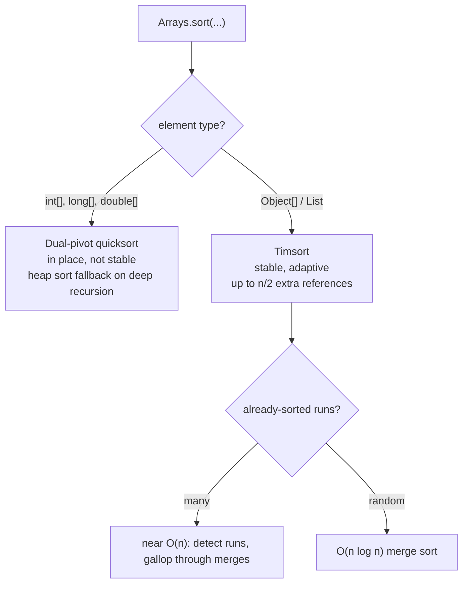

# Sorting: Merge, Quick, Heap, and Why Libraries Use Timsort

> Stability matters when you sort transactions by amount and need time order preserved.

**Type:** Build
**Languages:** Java, Python, Go
**Prerequisites:** Phase 1 Lesson 01 (Complexity Analysis), Phase 1 Lesson 03 (Dynamic Arrays), Phase 1 Lesson 09 (Heaps and Priority Queues)
**Time:** ~120 minutes

## Learning Objectives

- Implement insertion sort, top-down merge sort, randomized three-way quicksort, and heap sort over a generic array with a comparator
- State, for each algorithm, its worst-case time, extra memory, and whether it is stable, and show the comparison counts that back the claims
- Define stability precisely, demonstrate with a ledger why an unstable sort silently reorders same-amount transactions, and apply the two fixes (stable algorithm or total key)
- Explain why three-way partitioning turns duplicate-heavy input from quadratic into linear work for quicksort
- Explain why the JDK uses Timsort for `Object[]` and dual-pivot quicksort for `int[]`, and pick the right library call for a given input

## The Problem

A payouts service builds the daily settlement file for a marketplace. The file lists every seller payment of the day, and the processor requires the lines grouped by amount band and, inside a band, in the order the payments were created, because the processor's own de-duplication compares each line to the previous one it saw for the same seller. The service collects the day's `Transaction` records in arrival order, sorts them by amount, and writes the file.

For eleven months the file is accepted. Then an engineer upgrades the sort: the old code used a hand-written merge sort left by a departed colleague, the new code calls a faster in-place sort from a utility library. Both sort by amount. Both pass the unit test, which checks that the output is in ascending amount order. The next morning the processor rejects 412 lines as duplicates. Three sellers each had two payments of exactly 5.00 USD created minutes apart; the new sort emitted the later one first; the processor's rule, "a line equal to the previous one for this seller with an earlier timestamp is a replay", fired.

Nothing in the sort's contract was violated. Sorting by amount only promises that amounts are non-decreasing. What the file needed was a second promise, that elements with equal amounts keep their original relative order, and that promise has a name: stability. Merge sort gives it for free. Heap sort and quicksort do not, and no amount of testing on inputs with distinct keys will reveal the difference. This lesson builds all four classic comparison sorts, measures them, shows the stability failure on a real ledger, and then explains why the standard library made the choices it did, so you can read `Arrays.sort(...)` and know exactly what you are getting.

## The Concept

### What a sort promises

A comparison sort takes an array and a comparator `cmp` and permutes the array so that `cmp(a[i], a[i+1]) <= 0` for every `i`. That is the whole contract. Three further properties distinguish the algorithms:

| Property | Definition | Why it matters in a ledger |
|----------|------------|----------------------------|
| Stable | Elements that compare equal keep their input order | Sorting by amount must not scramble time order; sorting by one column then another must compose |
| In place | O(1) or O(log n) extra memory beyond the array | A 50 million line batch cannot afford a second copy |
| Adaptive | Fewer operations on input that is already partially ordered | Most ledgers arrive nearly sorted by time |

Every comparison sort needs at least `log2(n!) ≈ n log2 n − 1.44n` comparisons in the worst case, because `n!` permutations must be distinguished and each comparison yields one bit. Merge sort and heap sort meet that bound within a constant factor on every input. Quicksort meets it in expectation. Insertion sort does not, but it beats all of them on short or nearly sorted input, which is why every production sort uses it as a base case.

### The four algorithms

| Algorithm | Worst | Average | Extra memory | Stable | Adaptive | Where it earns its keep |
|-----------|-------|---------|--------------|--------|----------|-------------------------|
| Insertion | O(n^2) | O(n^2) | O(1) | Yes | Yes, O(n + inversions) | Runs of under ~20 elements; nearly sorted input |
| Merge | O(n log n) | O(n log n) | O(n) | Yes | Can be (run detection) | Objects, linked lists, external sorting, anything that must be stable |
| Quick (3-way, random pivot) | O(n^2), vanishingly unlikely | O(n log n), ~1.39 n log n | O(log n) stack | No | Yes on duplicates | Primitives, cache-friendly in-place sorting |
| Heap | O(n log n) | O(n log n) | O(1) | No | No | Hard worst-case guarantee with no extra memory; `introsort` fallback |

**Insertion sort** grows a sorted prefix one element at a time, shifting larger elements right to make room. Each element moves exactly as far as it has inversions, so cost is `n + (number of inversions)`. On a sorted array that is `n − 1` comparisons; on a reversed array it is `n(n−1)/2`.

**Merge sort** splits the array in half, sorts each half recursively, then merges the two sorted halves in one linear pass. The recurrence `T(n) = 2T(n/2) + n` solves to `n log2 n` (Lesson 05 proves this). Merging needs a buffer the size of the array; that buffer is the price of stability and of the guaranteed bound.

**Quicksort** picks a pivot, partitions the array into elements less than, equal to, and greater than the pivot, and recurses on the less and greater parts. The equal part is already in its final position. With a random pivot the expected number of comparisons is about `1.39 n log2 n`; the worst case needs an adversary who can predict the random sequence. With a fixed pivot (first element, middle element) a sorted or adversarially built input is quadratic, and sorted input is exactly what a ledger produces.

**Heap sort** builds a max-heap over the array in O(n) (Phase 1, Lesson 09), then repeatedly swaps the root to the end and sifts down over the shrinking prefix. It is the only one of the four that is both O(n log n) in the worst case and in place. It pays for that with roughly twice the comparisons of merge sort and poor cache behaviour, because `siftDown` jumps between indices `i` and `2i+1`.

### Worked example: merge sort by hand

Sort the eight ledger amounts `[19.99, 5.00, 19.99, 5.00, 120.00, 19.99, 5.00, 0.75]` (sequence numbers 1 to 8) with the cutoff set to 1 so every level is visible. Amounts are written in cents and tagged with their sequence number as a subscript-free suffix: `1999/1` is 19.99 USD from transaction 1.

```text
level 0: [1999/1  500/2  1999/3  500/4 | 12000/5  1999/6  500/7  75/8]
level 1: [1999/1  500/2 | 1999/3  500/4]   [12000/5  1999/6 | 500/7  75/8]
level 2: [1999/1 | 500/2] [1999/3 | 500/4]  [12000/5 | 1999/6] [500/7 | 75/8]

merge level 2 -> [500/2 1999/1] [500/4 1999/3] [1999/6 12000/5] [75/8 500/7]      4 merges, 4 comparisons
merge level 1 -> [500/2 500/4 1999/1 1999/3]  [75/8 500/7 1999/6 12000/5]        2 merges, 6 comparisons
                   ^ tie 500/2 vs 500/4: left half wins, seq 2 stays before seq 4
merge level 0 -> [75/8 500/2 500/4 500/7 1999/1 1999/3 1999/6 12000/5]           1 merge, 7 comparisons
```

Three levels (`log2 8`), each merging a total of 8 elements, 17 comparisons in all against the `8 * 3 = 24` upper bound. Every tie was resolved in favour of the left half, and the left half always came earlier in the input, so sequence numbers ascend inside every equal-amount group. That is the entire proof that merge sort is stable: induction on the recursion, with the `<=` in the merge as the base step.

### Worked example: heap sort scrambles the same input

Build a max-heap over the same eight elements by amount. Bottom-up construction sifts indices 3, 2, 1, 0 down in turn and ends with `12000/5` at the root. The first extraction swaps the root with the last slot and sifts down; the sequence of roots that get extracted is the output in descending order:

```text
extractions (largest first): 12000/5, 1999/1, 1999/3, 1999/6, 500/2, 500/4, 500/7, 75/8
ascending output:            75/8, 500/7, 500/4, 500/2, 1999/6, 1999/3, 1999/1, 12000/5
```

Among the three 19.99 amounts, the one that extracts first (and therefore lands last in the ascending output) is whichever reached the root first after the previous extraction, which depends on the heap's shape, not on arrival order. On this input both groups come out with sequence numbers reversed; on a different permutation of the same eight records they come out in yet another order. The output satisfies the comparator and tells you nothing reliable about time order.

### Choosing a sort

| Situation | Choose | Because |
|-----------|--------|---------|
| Objects, order inside ties matters or might | Merge sort / Timsort (`Arrays.sort(Object[])`) | Stable; O(n) buffer is cheap next to the objects themselves |
| Primitives, memory tight | Quicksort (`Arrays.sort(int[])`) | In place, cache-friendly, no identity to preserve |
| Hard worst-case bound, no extra memory, adversarial input | Heap sort | Only in-place O(n log n) worst case; what introsort falls back to |
| Fewer than ~20 elements, or nearly sorted | Insertion sort | O(n + inversions); no recursion, no buffer |
| Does not fit in memory | External merge sort | Only algorithm that works on sequential runs |
| Few distinct keys | Three-way quicksort or counting sort | Equal keys cost O(n) total |

### Stability, precisely

A sort is stable when for every pair of indices `i < j` in the input with `cmp(a[i], a[j]) == 0`, the element that was at `i` appears before the element that was at `j` in the output.

Trace the ledger from `Main.sampleLedger()`, sorted by amount:

```text
input (seq, amount):   #1 19.99  #2 5.00  #3 19.99  #4 5.00  #5 120.00  #6 19.99  #7 5.00  #8 0.75

stable (merge):        #8 0.75 | #2 5.00  #4 5.00  #7 5.00 | #1 19.99  #3 19.99  #6 19.99 | #5 120.00
                                 ^ seq ascending inside each amount: arrival order survived

heap sort:             #8 0.75 | #7 5.00  #4 5.00  #2 5.00 | #6 19.99  #3 19.99  #1 19.99 | #5 120.00
                                 ^ same amounts, reversed arrival order: both outputs are "sorted by amount"
```

Heap sort reverses the groups here because the heap extracts the largest remaining element first and, among equal keys, the one that happened to reach the root first. Nothing about that order is wrong by the comparator's definition; it is simply not the input order, and it is not even consistent: a different input permutation produces a different scrambling.

There are exactly two fixes:

1. **Use a stable algorithm.** Merge sort (or Timsort, or insertion sort for short arrays).
2. **Make the key total.** Sort by `(amount, seq)`. When no two elements compare equal, every algorithm produces the same output, and stability is moot. The demo shows `heapSort` with `BY_AMOUNT.thenComparing(BY_SEQ)` reproducing the merge sort result exactly.

The second fix is often better in a payments system, because it writes the intended order into the code where a reviewer can see it, instead of relying on a property of whichever sort the library happens to call.

### Three-way partitioning

Classic two-way quicksort puts elements equal to the pivot on one side and recurses into them again. On an array of 4096 identical keys, every partition peels off one element: `n + (n−1) + … = O(n^2)`. Payment data is full of duplicates: amounts cluster on round numbers and on a handful of fee tiers, status codes take five values, currencies take a dozen.

The three-way partition (Dijkstra's Dutch national flag, refined by Bentley and McIlroy) maintains four regions during one pass:

```text
[ < pivot | == pivot | unexamined | > pivot ]
  lo..lt-1  lt..i-1     i..gt       gt+1..hi
```

Each unexamined element is compared with the pivot once and moved into the correct region by a single swap. When `i` passes `gt` the equal block is in its final place and the recursion skips it entirely. On all-equal input that is one linear pass and done. The demo shows 4096 values drawn from three keys: three-way quicksort finishes in about 6,800 comparisons where merge sort needs about 41,700.

### Why the JDK has two sorts

`java.util.Arrays.sort(Object[])` and `Collections.sort` use **Timsort** (Tim Peters, 2002, written for CPython's `list.sort`). It is a merge sort that first scans the input for existing runs (ascending or strictly descending, which it reverses), extends short runs to a minimum length with binary insertion sort, and merges runs with a galloping mode that skips over long stretches where one run is entirely smaller than the other. On random input it is a normal `n log n` merge sort; on input that is a few sorted runs it approaches `O(n)`. It is stable and needs up to `n/2` extra references.

`Arrays.sort(int[])`, `long[]`, `double[]` use **dual-pivot quicksort** (Vladimir Yaroslavskiy, 2009) with insertion sort for small ranges and, since JDK 14, a heap sort fallback when recursion goes too deep, making the worst case `O(n log n)`. It is in place and not stable.

Why the split? Two primitives that compare equal are indistinguishable: there is no "which 5 came first" for an `int[]`, so stability has no observable meaning and the JDK is free to use the faster in-place algorithm. Two objects that compare equal can be different objects carrying different payloads (the same amount, different sequence numbers), so stability is observable and the JDK pays the O(n) buffer for it. A learner who sorts an `int[]` of amounts and a parallel `long[]` of sequence numbers has silently chosen the unstable path; the fix is to sort an array of records, or an index array, with a comparator.



### What a sort does not do

Sorting does not de-duplicate, does not validate the comparator, and does not detect that your comparator is inconsistent. `Comparator.comparing(Transaction::amount)` on a mixed-currency list throws from inside `Money.compareTo` halfway through the sort, leaving the array partially permuted; Timsort may also throw `IllegalArgumentException: Comparison method violates its general contract!` when a comparator is not transitive, and only on some inputs. Sort keys must be total orders over the data you actually have, which for money means one currency per sort or an explicit `(currency, amount)` key.

## Build It

All four algorithms live in the `Sorts` class in `code/java/Main.java` and share one signature shape: `sort(T[] a, Comparator<? super T> cmp)`. Quicksort additionally takes a `Random` so that tests are deterministic.

### Step 1: Insertion sort, the base case for everything else

```java
static <T> void insertionSort(T[] a, int from, int to, Comparator<? super T> cmp) {
    for (int i = from + 1; i < to; i++) {
        T key = a[i];
        int j = i - 1;
        // strict > keeps equal keys in their original order: this is what makes it stable
        while (j >= from && cmp.compare(a[j], key) > 0) {
            a[j + 1] = a[j];
            j--;
        }
        a[j + 1] = key;
    }
}
```

The half-open range `[from, to)` lets merge sort and quicksort call it on sub-ranges. The one line that decides stability is the `> 0`: an element only moves past elements strictly greater than it, so it never overtakes an equal one. Change it to `>= 0` and the algorithm is still a correct sort and no longer stable.

**Predict:** how many comparisons does `insertionSort` make on an array of 4096 ascending integers with no swaps? With one adjacent swap?

### Step 2: Merge sort

```java
static <T> void mergeSort(T[] a, Comparator<? super T> cmp) {
    @SuppressWarnings("unchecked")
    T[] buffer = (T[]) new Object[a.length];
    mergeSort(a, buffer, 0, a.length, cmp);
}

private static <T> void mergeSort(T[] a, T[] buffer, int from, int to, Comparator<? super T> cmp) {
    if (to - from <= INSERTION_CUTOFF) { insertionSort(a, from, to, cmp); return; }
    int mid = from + (to - from) / 2;
    mergeSort(a, buffer, from, mid, cmp);
    mergeSort(a, buffer, mid, to, cmp);
    if (cmp.compare(a[mid - 1], a[mid]) <= 0) return; // halves already in order: skip the merge
    merge(a, buffer, from, mid, to, cmp);
}
```

One buffer is allocated once and threaded through every call; allocating per level would turn the O(n) memory into O(n log n) churn. `from + (to - from) / 2` rather than `(from + to) / 2` avoids integer overflow on arrays over a billion elements, the same idiom Lesson 02 uses for binary search. The pre-merge check costs one comparison and makes already-sorted input `O(n log n)` comparisons total with no copying at all; Timsort takes this idea much further.

```java
static <T> void merge(T[] a, T[] buffer, int from, int mid, int to, Comparator<? super T> cmp) {
    System.arraycopy(a, from, buffer, from, to - from);
    int i = from, j = mid, k = from;
    while (i < mid && j < to) {
        // <= takes from the left half on ties, so the earlier element stays earlier: stability
        if (cmp.compare(buffer[i], buffer[j]) <= 0) a[k++] = buffer[i++];
        else a[k++] = buffer[j++];
    }
    while (i < mid) a[k++] = buffer[i++];
    while (j < to) a[k++] = buffer[j++];
}
```

Again a single character carries the stability guarantee. The left half holds elements that were earlier in the input; `<=` means on a tie the left one is emitted first.

**Predict:** `merge` on halves `[1, 4, 7]` and `[2, 3, 9]` performs how many comparisons before one half is exhausted?

### Step 3: Quicksort with a three-way partition and a random pivot

```java
private static <T> void quickSort(T[] a, int lo, int hi, Comparator<? super T> cmp, Random rng) {
    while (hi - lo + 1 > INSERTION_CUTOFF) {
        swap(a, lo, lo + rng.nextInt(hi - lo + 1));   // random pivot: no fixed input is a worst case
        T pivot = a[lo];
        int lt = lo, gt = hi, i = lo + 1;
        while (i <= gt) {
            int c = cmp.compare(a[i], pivot);
            if (c < 0) swap(a, lt++, i++);
            else if (c > 0) swap(a, i, gt--);
            else i++;
        }
        // a[lo..lt-1] < pivot, a[lt..gt] == pivot, a[gt+1..hi] > pivot
        if (lt - lo < hi - gt) { quickSort(a, lo, lt - 1, cmp, rng); lo = gt + 1; }
        else { quickSort(a, gt + 1, hi, cmp, rng); hi = lt - 1; }
    }
    insertionSort(a, lo, hi + 1, cmp);
}
```

Three things to read carefully. When `c > 0` the element is swapped to the right and `i` does not advance, because the element swapped in from `gt` has not been examined yet. When `c == 0` nothing moves; the equal block grows in place. And the recursion goes into the smaller side while the loop continues on the larger: this bounds the stack to `O(log n)` frames even in the worst case, because each recursive call handles at most half the remaining range.

The `Random` is a parameter, not a static. Tests seed it, so a failure replays exactly; production can pass `new Random()` or `ThreadLocalRandom`.

**Predict:** on the array `[5, 5, 5, 5, 5, 5, 5, 5, 5, 5, 5, 5, 5, 5, 5, 5, 5]` (17 elements, above the cutoff), what are `lt` and `gt` after the partition loop, and how much work remains?

### Step 4: Heap sort

```java
static <T> void heapSort(T[] a, Comparator<? super T> cmp) {
    int n = a.length;
    for (int i = n / 2 - 1; i >= 0; i--) siftDown(a, i, n, cmp);   // build max-heap bottom-up: O(n)
    for (int end = n - 1; end > 0; end--) {
        swap(a, 0, end);            // largest to its final slot
        siftDown(a, 0, end, cmp);   // restore the heap on the prefix
    }
}
```

The heap lives inside the array being sorted: index `i` has children `2i+1` and `2i+2`. Bottom-up construction starts at the last internal node and sifts each one down; the total is O(n), not O(n log n), because most nodes are near the leaves and sift only a step or two. Then `n − 1` extractions each cost one `siftDown` of at most `log2 n` levels, and each level costs two comparisons (left child against the current largest, then right child), which is why heap sort lands near `2 n log n` comparisons where merge sort lands near `n log n`.

**Predict:** why does the second loop stop at `end > 0` rather than `end >= 0`?

### Step 5: Measuring instead of asserting

```java
final class CountingComparator<T> implements Comparator<T> {
    private final Comparator<T> inner;
    long comparisons = 0;

    CountingComparator(Comparator<T> inner) { this.inner = inner; }

    @Override public int compare(T a, T b) { comparisons++; return inner.compare(a, b); }
}
```

Wrapping the comparator is the cheapest honest benchmark: it counts the operation the theory counts, and it is immune to JIT warm-up and clock jitter. The tests assert bounds on these counts (`merge <= 1.1 n log2 n`, `heap <= 2.2 n log2 n`, `insertion > n^2 / 8` on random input, `3-way quick < 3n` on all-equal input) so that a change that quietly breaks the complexity, such as removing the random pivot, fails a test rather than a production batch.

### Step 6: Checking stability mechanically

```java
static <T> boolean isStablePermutation(T[] original, T[] sorted, Comparator<? super T> key, Comparator<? super T> identity) {
    if (original.length != sorted.length || !isSorted(sorted, key)) return false;
    List<T> remaining = new ArrayList<>(Arrays.asList(original));
    for (int i = 1; i < sorted.length; i++) {
        if (key.compare(sorted[i - 1], sorted[i]) == 0) {
            int p = indexOf(remaining, sorted[i - 1], identity), q = indexOf(remaining, sorted[i], identity);
            if (p < 0 || q < 0 || p > q) return false;
        }
    }
    return true;
}
```

For every adjacent pair with equal keys, the earlier element in the output must have had the smaller index in the input. The `identity` comparator (here `BY_SEQ`) is what tells two equal-amount transactions apart. This is the test the payouts service was missing: `isStablePermutation(original, sorted, BY_AMOUNT, BY_SEQ)` would have failed the moment the sort was swapped.

### Step 7: Run it

```bash
cd phases/02-algorithms/01-sorting-algorithms/code/java
javac -d .out *.java && java -cp .out Main
java -cp .out MainTest
```

Expected output, abbreviated:

```console
== Stable vs unstable: sort a ledger by amount, keep arrival order inside each amount ==
mergeSort (stable):
  #8 acct-C 0.75 USD
  #2 acct-B 5.00 USD
  #4 acct-A 5.00 USD
  #7 acct-E 5.00 USD
  ...
heapSort (not stable):
  #8 acct-C 0.75 USD
  #7 acct-E 5.00 USD
  #4 acct-A 5.00 USD
  #2 acct-B 5.00 USD
  ...
merge preserves seq order within equal amounts: true
heap preserves seq order within equal amounts:  false
heapSort with a (amount, seq) tie-break is deterministic: true

== Comparison counts, n = 4096 random ints, seed 42 ==
  insertion      4,182,628 comparisons  sorted=true
  merge             51,140 comparisons  sorted=true
  quick(3-way)      56,728 comparisons  sorted=true
  heap              85,675 comparisons  sorted=true
  n log2 n           49,152

== Duplicate-heavy input: 4096 values drawn from only 3 keys ==
  quick(3-way)     6,817 comparisons (three-way partition finishes equal keys in one pass)
  merge           41,709 comparisons

== Nearly sorted input: 4096 ascending ints with 8 adjacent swaps ==
  insertion        4,103 comparisons (adaptive: close to n)
  heap            88,825 comparisons (oblivious: always n log n)
```

The test run prints `66 passed, 0 failed`.

### In Python

The design is the same; four things differ in `code/python/main.py`. **Comparators are plain callables:** a comparator is any `(a, b) -> int` function; `Transaction.BY_AMOUNT` and `BY_SEQ` are static methods and `then_comparing(BY_AMOUNT, BY_SEQ)` replaces `Comparator.thenComparing`. `CountingComparator` is a callable object, so it can be passed anywhere a comparator is expected. The library equivalent, `sorted(xs, key=...)`, takes a key function instead; `functools.cmp_to_key` adapts a comparator when you need one. **The same seed gives the same numbers:** `JavaRandom` is a bit-for-bit port of `java.util.Random` (the 48-bit LCG, `next(bits)`, and `nextInt(bound)` with its rejection loop), so the pivots, the random arrays, and every comparison count in the demo match the Java output exactly. Python's own `random.Random(42)` is a Mersenne Twister and would give different counts. **No primitive/object split:** a Python list holds references, so there is no `int[]` fast path and no `(T[]) new Object[]` cast; `merge_sort` allocates `[None] * len(a)` once. The closing line of the demo names `sorted()`/`list.sort()` (Timsort, stable) instead of the two `Arrays.sort` overloads. **Overloads become defaults:** `insertion_sort(a, cmp, from_=0, to=None)` covers both Java overloads; `from` is a keyword, hence `from_`.

Run it from `code/python/` with `python3 main.py`; test with `python3 -m unittest -v` (insertion sort on 4096 elements makes the run take a couple of seconds in CPython).

#### Step 1: Insertion sort, the base case for everything else

One static method with keyword defaults covers both Java overloads. The strict `> 0` is the stability guarantee, exactly as in Java: an element only moves past elements strictly greater than it.

```python
    @staticmethod
    def insertion_sort(a: list, cmp: Comparator, from_: int = 0, to: int | None = None) -> None:
        """O(n^2) worst and average, O(n) on nearly-sorted input, stable, in place."""
        if to is None:
            to = len(a)
        for i in range(from_ + 1, to):
            key = a[i]
            j = i - 1
            # strict > keeps equal keys in their original order: this is what makes it stable
            while j >= from_ and cmp(a[j], key) > 0:
                a[j + 1] = a[j]
                j -= 1
            a[j + 1] = key
```

#### Step 2: Merge sort

The buffer is `[None] * len(a)`, allocated once and threaded through the recursion. `//` is the midpoint division (both operands are non-negative, so it agrees with Java's `/`). The pre-merge check skips the merge when the halves are already ordered.

```python
    @staticmethod
    def merge_sort(a: list, cmp: Comparator) -> None:
        """O(n log n) always, stable, O(n) extra memory. Top-down with an insertion-sort base case."""
        buffer = [None] * len(a)
        Sorts._merge_sort(a, buffer, 0, len(a), cmp)

    @staticmethod
    def _merge_sort(a: list, buffer: list, from_: int, to: int, cmp: Comparator) -> None:
        if to - from_ <= Sorts.INSERTION_CUTOFF:
            Sorts.insertion_sort(a, cmp, from_, to)
            return
        mid = from_ + (to - from_) // 2
        Sorts._merge_sort(a, buffer, from_, mid, cmp)
        Sorts._merge_sort(a, buffer, mid, to, cmp)
        if cmp(a[mid - 1], a[mid]) <= 0:
            return  # halves already in order: skip the merge
        Sorts.merge(a, buffer, from_, mid, to, cmp)
```

The slice assignment `buffer[from_:to] = a[from_:to]` is `System.arraycopy`; the `<=` on ties is what keeps the left half's elements first.

```python
    @staticmethod
    def merge(a: list, buffer: list, from_: int, mid: int, to: int, cmp: Comparator) -> None:
        buffer[from_:to] = a[from_:to]
        i, j, k = from_, mid, from_
        while i < mid and j < to:
            # <= takes from the left half on ties, so the earlier element stays earlier: stability
            if cmp(buffer[i], buffer[j]) <= 0:
                a[k] = buffer[i]
                i += 1
            else:
                a[k] = buffer[j]
                j += 1
            k += 1
        while i < mid:
            a[k] = buffer[i]
            i += 1
            k += 1
        while j < to:
            a[k] = buffer[j]
            j += 1
            k += 1
```

#### Step 3: Quicksort with a three-way partition and a random pivot

The `rng` is a `JavaRandom`, so the pivot choices are the ones the Java demo makes and the comparison counts agree. The three-way partition and the recurse-on-the-smaller-side loop are unchanged; the post-increments are spelled out as separate statements.

```python
    @staticmethod
    def _quick_sort(a: list, lo: int, hi: int, cmp: Comparator, rng: JavaRandom) -> None:
        while hi - lo + 1 > Sorts.INSERTION_CUTOFF:
            Sorts.swap(a, lo, lo + rng.next_int(hi - lo + 1))  # random pivot: no fixed input is a worst case
            pivot = a[lo]
            lt, gt, i = lo, hi, lo + 1
            while i <= gt:
                c = cmp(a[i], pivot)
                if c < 0:
                    Sorts.swap(a, lt, i)
                    lt += 1
                    i += 1
                elif c > 0:
                    Sorts.swap(a, i, gt)
                    gt -= 1
                else:
                    i += 1
            # a[lo..lt-1] < pivot, a[lt..gt] == pivot, a[gt+1..hi] > pivot
            # recurse on the smaller side, loop on the larger: stack depth stays O(log n)
            if lt - lo < hi - gt:
                Sorts._quick_sort(a, lo, lt - 1, cmp, rng)
                lo = gt + 1
            else:
                Sorts._quick_sort(a, gt + 1, hi, cmp, rng)
                hi = lt - 1
        Sorts.insertion_sort(a, cmp, lo, hi + 1)
```

#### Step 4: Heap sort

Two descending `range` loops: build the max-heap from the last internal node, then extract. `_sift_down` compares each child against the current largest, two comparisons per level.

```python
    @staticmethod
    def heap_sort(a: list, cmp: Comparator) -> None:
        """O(n log n) always, in place, O(1) extra memory, not stable."""
        n = len(a)
        for i in range(n // 2 - 1, -1, -1):
            Sorts._sift_down(a, i, n, cmp)  # build max-heap bottom-up: O(n)
        for end in range(n - 1, 0, -1):
            Sorts.swap(a, 0, end)  # largest to its final slot
            Sorts._sift_down(a, 0, end, cmp)  # restore the heap on the prefix

    @staticmethod
    def _sift_down(a: list, root: int, size: int, cmp: Comparator) -> None:
        while True:
            left = 2 * root + 1
            right = left + 1
            largest = root
            if left < size and cmp(a[left], a[largest]) > 0:
                largest = left
            if right < size and cmp(a[right], a[largest]) > 0:
                largest = right
            if largest == root:
                return
            Sorts.swap(a, root, largest)
            root = largest
```

#### Step 5: Measuring instead of asserting

`CountingComparator` defines `__call__`, so an instance is itself a comparator. `comparisons` is a public attribute the tests read to assert the complexity bounds.

```python
class CountingComparator:
    """Wraps a comparator and counts how many times it is consulted."""

    def __init__(self, inner: Comparator) -> None:
        self._inner = inner
        self.comparisons = 0

    def __call__(self, a: Any, b: Any) -> int:
        self.comparisons += 1
        return self._inner(a, b)

    @staticmethod
    def natural() -> CountingComparator:
        return CountingComparator(natural_order)
```

#### Step 6: Checking stability mechanically

`sorted_` carries a trailing underscore because `sorted` is a builtin. For each adjacent pair with equal keys, the earlier output element must have the smaller index in the input, found through the `identity` comparator.

```python
    @staticmethod
    def is_stable_permutation(original: list, sorted_: list, key: Comparator, identity: Comparator) -> bool:
        """True when every run of equal keys in `sorted_` appears in the same relative order as in `original`."""
        if len(original) != len(sorted_) or not Sorts.is_sorted(sorted_, key):
            return False
        remaining = list(original)
        for i in range(1, len(sorted_)):
            if key(sorted_[i - 1], sorted_[i]) == 0:
                p = Sorts._index_of(remaining, sorted_[i - 1], identity)
                q = Sorts._index_of(remaining, sorted_[i], identity)
                if p < 0 or q < 0 or p > q:
                    return False
        return True
```

#### Step 7: Run it

```bash
cd phases/02-algorithms/01-sorting-algorithms/code/python
python3 main.py
python3 -m unittest -v
```

```console
merge preserves seq order within equal amounts: true
heap preserves seq order within equal amounts:  false
heapSort with a (amount, seq) tie-break is deterministic: true

== Comparison counts, n = 4096 random ints, seed 42 ==
  insertion      4,182,628 comparisons  sorted=true
  merge             51,140 comparisons  sorted=true
  quick(3-way)      56,728 comparisons  sorted=true
  heap              85,675 comparisons  sorted=true
  n log2 n           49,152

== Duplicate-heavy input: 4096 values drawn from only 3 keys ==
  quick(3-way)     6,817 comparisons (three-way partition finishes equal keys in one pass)
  merge           41,709 comparisons

== Nearly sorted input: 4096 ascending ints with 8 adjacent swaps ==
  insertion        4,103 comparisons (adaptive: close to n)
  heap            88,825 comparisons (oblivious: always n log n)
```

Every comparison count matches the Java run, because `JavaRandom` draws the same arrays and the same pivots.

### In Go

The design is the same; four things differ in `code/go/main.go`. **Generics replace erasure:** `InsertionSort[T any]`, `MergeSort`, `QuickSort`, and `HeapSort` take a `[]T` and a `Comparator[T]` (a `func(a, b T) int`). There is no `(T[]) new Object[]` cast: `make([]T, len(a))` allocates the merge buffer with the right element type. `NaturalOrder[T cmp.Ordered]()` is `Comparator.naturalOrder()`; `ThenComparing` is `Comparator.thenComparing`. **The counting comparator is a method value:** `CountingComparator[T]` keeps `Comparisons` and exposes `Func()`, which returns the bound method `c.Compare` so the sorts can call it like any other comparator while the struct keeps the count. **The same seed gives the same numbers:** `javarandom.go` is a bit-for-bit port of `java.util.Random` (48-bit LCG, `next(bits)`, `nextInt(bound)` with its rejection loop), so the pivots, the random arrays, and every comparison count in the demo match the Java output exactly. `math/rand` seeded with 42 would give different counts. **Compare panics; constructors return errors:** `Money.Compare` cannot return an error, so a currency mismatch panics, as in the Phase 10 Money type; `NewCurrency` returns `(Currency, error)` where Java's compact constructor throws.

Run it from `code/go/` with `go run .`; test with `go test ./...`. The test file ports all 66 Java checks and adds a handful that pin the demo's comparison counts.

#### Step 1: Insertion sort, the base case for everything else

`Comparator[T]` is a named function type. `InsertionSort` is the whole-slice convenience and `InsertionSortRange` is the version merge sort and quicksort call on sub-ranges, with the same strict `> 0` for stability.

```go
// Comparator orders two values: negative when a < b, zero when equal, positive when a > b.
type Comparator[T any] func(a, b T) int

// InsertionSort: O(n^2) worst and average, O(n) on nearly-sorted input, stable, in place. The workhorse for short runs.
func InsertionSort[T any](a []T, cmp Comparator[T]) { InsertionSortRange(a, 0, len(a), cmp) }

// InsertionSortRange sorts a[from:to] in place.
func InsertionSortRange[T any](a []T, from, to int, cmp Comparator[T]) {
	for i := from + 1; i < to; i++ {
		key := a[i]
		j := i - 1
		// strict > keeps equal keys in their original order: this is what makes it stable
		for j >= from && cmp(a[j], key) > 0 {
			a[j+1] = a[j]
			j--
		}
		a[j+1] = key
	}
}
```

#### Step 2: Merge sort

`make([]T, len(a))` is the typed buffer, allocated once. The recursive helper is unexported; the midpoint, cutoff, and pre-merge check are identical to Java.

```go
// MergeSort: O(n log n) always, stable, O(n) extra memory. Top-down with an insertion-sort base case.
func MergeSort[T any](a []T, cmp Comparator[T]) {
	buffer := make([]T, len(a))
	mergeSort(a, buffer, 0, len(a), cmp)
}

func mergeSort[T any](a, buffer []T, from, to int, cmp Comparator[T]) {
	if to-from <= InsertionCutoff {
		InsertionSortRange(a, from, to, cmp)
		return
	}
	mid := from + (to-from)/2
	mergeSort(a, buffer, from, mid, cmp)
	mergeSort(a, buffer, mid, to, cmp)
	if cmp(a[mid-1], a[mid]) <= 0 { // halves already in order: skip the merge
		return
	}
	Merge(a, buffer, from, mid, to, cmp)
}
```

The built-in `copy` on two slices is `System.arraycopy`; the `<=` keeps the left half first on ties.

```go
// Merge combines the sorted halves a[from:mid] and a[mid:to] through `buffer`.
func Merge[T any](a, buffer []T, from, mid, to int, cmp Comparator[T]) {
	copy(buffer[from:to], a[from:to])
	i, j, k := from, mid, from
	for i < mid && j < to {
		// <= takes from the left half on ties, so the earlier element stays earlier: stability
		if cmp(buffer[i], buffer[j]) <= 0 {
			a[k] = buffer[i]
			i++
		} else {
			a[k] = buffer[j]
			j++
		}
		k++
	}
	for i < mid {
		a[k] = buffer[i]
		i++
		k++
	}
	for j < to {
		a[k] = buffer[j]
		j++
		k++
	}
}
```

#### Step 3: Quicksort with a three-way partition and a random pivot

The pivot comes from `rng.NextIntN`, the port's `nextInt(bound)`. The three-way partition and the smaller-side recursion are the Java code with Go's `for` as the `while`.

```go
func quickSort[T any](a []T, lo, hi int, cmp Comparator[T], rng *JavaRandom) {
	for hi-lo+1 > InsertionCutoff {
		Swap(a, lo, lo+rng.NextIntN(hi-lo+1)) // random pivot: no fixed input is a worst case
		pivot := a[lo]
		lt, gt, i := lo, hi, lo+1
		for i <= gt {
			c := cmp(a[i], pivot)
			if c < 0 {
				Swap(a, lt, i)
				lt++
				i++
			} else if c > 0 {
				Swap(a, i, gt)
				gt--
			} else {
				i++
			}
		}
		// a[lo..lt-1] < pivot, a[lt..gt] == pivot, a[gt+1..hi] > pivot
		// recurse on the smaller side, loop on the larger: stack depth stays O(log n)
		if lt-lo < hi-gt {
			quickSort(a, lo, lt-1, cmp, rng)
			lo = gt + 1
		} else {
			quickSort(a, gt+1, hi, cmp, rng)
			hi = lt - 1
		}
	}
	InsertionSortRange(a, lo, hi+1, cmp)
}
```

#### Step 4: Heap sort

Identical structure: bottom-up heap construction, then `n - 1` extractions, each restoring the heap on the shrinking prefix with `siftDown`.

```go
// HeapSort: O(n log n) always, in place, O(1) extra memory, not stable.
func HeapSort[T any](a []T, cmp Comparator[T]) {
	n := len(a)
	for i := n/2 - 1; i >= 0; i-- { // build max-heap bottom-up: O(n)
		siftDown(a, i, n, cmp)
	}
	for end := n - 1; end > 0; end-- {
		Swap(a, 0, end)          // largest to its final slot
		siftDown(a, 0, end, cmp) // restore the heap on the prefix
	}
}

func siftDown[T any](a []T, root, size int, cmp Comparator[T]) {
	for {
		left, right, largest := 2*root+1, 2*root+2, root
		if left < size && cmp(a[left], a[largest]) > 0 {
			largest = left
		}
		if right < size && cmp(a[right], a[largest]) > 0 {
			largest = right
		}
		if largest == root {
			return
		}
		Swap(a, root, largest)
		root = largest
	}
}
```

#### Step 5: Measuring instead of asserting

A struct cannot be called, so `Func()` returns the method value `c.Compare`, which closes over the pointer receiver and therefore keeps counting into the same struct. The sorts take the function; the test reads `Comparisons`.

```go
// CountingComparator wraps a comparator and counts how many times it is consulted.
type CountingComparator[T any] struct {
	inner       Comparator[T]
	Comparisons int64
}

// NewCountingComparator wraps `inner`.
func NewCountingComparator[T any](inner Comparator[T]) *CountingComparator[T] {
	return &CountingComparator[T]{inner: inner}
}

// Compare counts the call and delegates.
func (c *CountingComparator[T]) Compare(a, b T) int { c.Comparisons++; return c.inner(a, b) }

// Func exposes the counter as a Comparator the sorts accept.
func (c *CountingComparator[T]) Func() Comparator[T] { return c.Compare }
```

#### Step 6: Checking stability mechanically

`append([]T(nil), original...)` is the copy of the input. Otherwise the check is the Java one: adjacent equal keys in the output must appear in input order according to `identity`.

```go
func IsStablePermutation[T any](original, sorted []T, key, identity Comparator[T]) bool {
	if len(original) != len(sorted) || !IsSorted(sorted, key) {
		return false
	}
	remaining := append([]T(nil), original...)
	for i := 1; i < len(sorted); i++ {
		if key(sorted[i-1], sorted[i]) == 0 {
			p, q := indexOf(remaining, sorted[i-1], identity), indexOf(remaining, sorted[i], identity)
			if p < 0 || q < 0 || p > q {
				return false
			}
		}
	}
	return true
}
```

#### Step 7: Run it

```bash
cd phases/02-algorithms/01-sorting-algorithms/code/go
go run .
go test ./...
```

```console
merge preserves seq order within equal amounts: true
heap preserves seq order within equal amounts:  false
heapSort with a (amount, seq) tie-break is deterministic: true

== Comparison counts, n = 4096 random ints, seed 42 ==
  insertion      4,182,628 comparisons  sorted=true
  merge             51,140 comparisons  sorted=true
  quick(3-way)      56,728 comparisons  sorted=true
  heap              85,675 comparisons  sorted=true
  n log2 n           49,152

== Duplicate-heavy input: 4096 values drawn from only 3 keys ==
  quick(3-way)     6,817 comparisons (three-way partition finishes equal keys in one pass)
  merge           41,709 comparisons

== Nearly sorted input: 4096 ascending ints with 8 adjacent swaps ==
  insertion        4,103 comparisons (adaptive: close to n)
  heap            88,825 comparisons (oblivious: always n log n)
```

The counts are identical to the Java and Python runs. Only the closing library note differs: it names `slices.SortStableFunc` / `sort.Stable` (stable, O(1) buffer) and `slices.Sort` / `sort.Sort` (pattern-defeating quicksort, unstable) in place of the two `Arrays.sort` overloads.

## Use It

### `java.util.Arrays.sort` and `Collections.sort`

```java
Arrays.sort(transactions, Comparator.comparing(Transaction::amount));        // Timsort: stable
Arrays.sort(amountsAsLongs);                                                 // dual-pivot quicksort: not stable, not relevant
list.sort(Comparator.comparing(Transaction::amount).thenComparingLong(Transaction::seq));  // total key: any algorithm agrees
```

What Timsort does that the from-scratch merge sort made explicit: run detection (it finds the eight sorted runs in a nearly-sorted ledger and merges them with almost no comparisons), galloping (binary search inside a merge to skip ahead), and a minimum run length tuned so the final merge tree is balanced. What it hides: the O(n/2) buffer allocation per call, which shows up as GC pressure when a hot path sorts small lists millions of times; `Arrays.sort` on a primitive array avoids it, at the cost of stability you did not need anyway.

`Arrays.parallelSort` splits the array across `ForkJoinPool.commonPool()` and merges; it is stable for `Object[]` and worth it above roughly 2^13 elements. `Stream.sorted()` is also stable and buffers the whole stream.

### Databases

`ORDER BY amount` in PostgreSQL and MySQL does not promise stability either: the planner may use a heap-based top-N sort, a quicksort, or an external merge, and ties come out in an order that depends on the plan. The database equivalent of the total-key fix is `ORDER BY amount, created_at, id`, and a reviewer should treat an `ORDER BY` on a non-unique column in a settlement or pagination query as a bug. Keyset pagination (`WHERE (amount, id) > (?, ?) ORDER BY amount, id`) depends on exactly this.

### External and distributed sorts

When the data does not fit in memory, merge sort is the only option of the four: sort chunks that fit, write each as a sorted run, then k-way merge the runs with a heap (Phase 1, Lesson 09). Every MapReduce shuffle, every `sort -S` on a Unix box, and every database external sort is this algorithm. Quicksort and heap sort need random access to the whole array and cannot do it.

## Ship It

`outputs/checklist-sorting-review.md` is a review checklist for any code or query that sorts data people will act on: is the key total, is stability required and obtained, is the comparator a total order over the real data (currencies!), and does the chosen call match the memory budget. Keep it next to the money-handling checklist from Phase 10, Lesson 01.

## Exercises

1. **Reinforce.** Change the `<= 0` in `merge` to `< 0` and run `MainTest`. Which tests fail, and which still pass? Write one sentence on why a test suite with only distinct keys would not have caught it.
2. **Apply.** Implement `Sorts.bottomUpMergeSort` that merges runs of width 1, 2, 4, ... without recursion, using the same `merge`. Then add Timsort's first trick: detect natural ascending runs in the input and start from those instead of width 1. Count comparisons on the nearly-sorted ledger and compare with top-down merge sort.
3. **Extend.** Combine with Phase 1, Lesson 09: implement an external sort that sorts a list of 100,000 transactions in chunks of 1,000 (each chunk with `mergeSort`), writes each chunk to a `List<Transaction[]>` standing in for files, then performs a k-way merge of all chunks with a `PriorityQueue<(value, chunkIndex, position)>`. Prove with `isStablePermutation` that the result is stable if and only if the heap breaks ties by chunk index.

## Key Terms

| Term | What people say | What it actually means |
|------|-----------------|------------------------|
| Stable sort | "keeps the order" | Elements that compare equal appear in the output in the same relative order as in the input; observable only for keys with ties |
| Comparison sort | "a normal sort" | An algorithm that learns about the input only through pairwise comparisons; bounded below by log2(n!) comparisons in the worst case |
| In place | "doesn't use memory" | Uses O(1) or O(log n) extra space beyond the input array; merge sort's O(n) buffer disqualifies it |
| Adaptive | "fast on sorted data" | Running time decreases with existing order in the input, measured by inversions or runs; insertion sort and Timsort are, heap sort is not |
| Three-way partition | "Dutch flag" | One pass that separates an array into less-than, equal-to, and greater-than a pivot, so quicksort never recurses into equal keys |
| Inversion | "out of order pair" | A pair i < j with a[i] > a[j]; insertion sort's cost is n plus the number of inversions |
| Timsort | "Python's sort" | A stable merge sort that detects natural runs, extends them with binary insertion sort, and gallops through merges; used by CPython and the JDK for objects |
| Total order | "a proper comparator" | A comparator that is reflexive, antisymmetric, transitive, and defined for every pair; Timsort throws when it detects a violation, other sorts return garbage |

## Further Reading

- [Tim Peters, "listsort.txt"](https://github.com/python/cpython/blob/main/Objects/listsort.txt) — the original design note for Timsort: run detection, minrun, galloping, and the measurements that justified each.
- [Bentley and McIlroy, "Engineering a Sort Function" (1993)](https://cs.fit.edu/~pkc/classes/writing/samples/bentley93engineering.pdf) — the paper that made three-way partitioning and pivot selection standard; the source of the `qsort` most C libraries ship.
- [JDK `java.util.Arrays` source and javadoc](https://docs.oracle.com/en/java/javase/21/docs/api/java.base/java/util/Arrays.html#sort(java.lang.Object%5B%5D)) — the stability guarantee for `Object[]` is stated here, and its absence for primitives is the gap this lesson closes.
- [Yaroslavskiy, "Dual-Pivot Quicksort" (2009)](https://web.archive.org/web/20151002230717/http://iaroslavski.narod.ru/quicksort/DualPivotQuicksort.pdf) — the algorithm behind `Arrays.sort(int[])` and why two pivots reduce cache misses.
- [Knuth, *The Art of Computer Programming*, Vol. 3, Section 5](https://www-cs-faculty.stanford.edu/~knuth/taocp.html) — the definitive analysis of every algorithm here, including the exact comparison counts you measured.
- [de Gouw et al., "OpenJDK's java.utils.Collection.sort() is broken" (2015)](https://link.springer.com/chapter/10.1007/978-3-662-46681-0_16) — a formal-verification study that found a real bug in the JDK's Timsort run-stack bound; a reminder that library sorts are code too.
