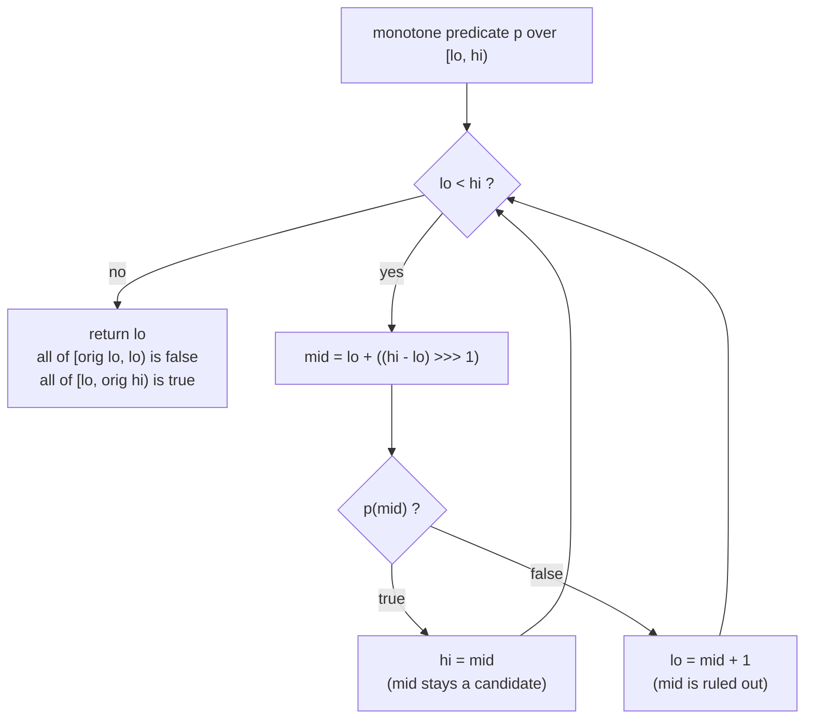

# Binary Search and Its Variants

> Lower bound, upper bound, and search over answer spaces.

**Type:** Build
**Languages:** Java, Python, Go
**Prerequisites:** Phase 1 Lesson 01 (Complexity Analysis), Phase 1 Lesson 03 (Dynamic Arrays), Phase 2 Lesson 01 (Sorting)
**Time:** ~75 minutes

## Learning Objectives

- Write the classic binary search with a loop invariant you can state, an overflow-safe midpoint, and the JDK's negative-insertion-point return convention
- Reduce every variant to one primitive, `firstTrue` over a monotone predicate, and derive lower bound, upper bound, count, and range count from it
- Search a rotated sorted array in O(log n) without un-rotating it, by finding the rotation point with the same primitive
- Recognise when a problem is a search over an answer space rather than over an array, and solve it by binary searching a monotone feasibility check
- Name the two bugs that have shipped in production binary searches for decades (midpoint overflow, off-by-one on the half-open range) and the tests that catch them

## The Problem

A card network publishes an interchange schedule: a sorted table of transaction-amount thresholds, each with a fee tier. A clearing service receives 40 million transactions a night and must assign each one a tier. The first implementation walks the table from the top for every transaction. With 60 tiers that is 60 comparisons a transaction, 2.4 billion comparisons a night, and the batch misses its 02:00 settlement cutoff on the first month-end.

The second implementation uses `Arrays.binarySearch`. It is fast, and it is wrong in two ways that take a quarter to surface. First, several thresholds in the table are equal (the schedule has "0.00 to 10.00" tiers for three different card types), and `binarySearch` on an array with duplicate keys returns *some* matching index, with no promise which. On Tuesdays the JIT compiles the loop differently, a different index comes back, and 0.3% of transactions move to a neighbouring tier. Second, a developer copies the loop into a custom version to handle the "between two thresholds" case and writes `int mid = (lo + hi) / 2`. It works for sixty tiers. Three years later the same utility is reused over an in-memory index of 1.2 billion ledger entries, `lo + hi` exceeds 2^31, `mid` goes negative, and the search throws `ArrayIndexOutOfBoundsException` in production. That exact bug was in `java.util.Arrays.binarySearch` for nine years until Joshua Bloch fixed it in 2006, and it had been in Bentley's *Programming Pearls* before that.

Binary search is twenty lines that nearly everyone writes wrong the first time. The reason is that the "find the element" framing hides what the loop actually maintains. This lesson rebuilds it around one invariant, shows that every variant you will ever need is the same loop with a different predicate, and then turns that primitive on problems that have no array at all.

## The Concept

### The invariant, not the algorithm

Binary search works on anything that is **monotone**: a predicate that is false for a prefix of the search space and true for the rest.

```text
index:      0  1  2  3  4  5  6  7  8  9
predicate:  F  F  F  F  T  T  T  T  T  T
                        ^ firstTrue = 4
```

The loop maintains a half-open range `[lo, hi)` with two facts: everything before `lo` is false and everything from `hi` onward is true. Each step tests the midpoint and moves one end so that the facts stay true and the range shrinks. When the range is empty, `lo == hi` is the boundary. That is the whole algorithm:

```text
firstTrue(lo, hi, p):
  while lo < hi:
    mid = lo + (hi - lo) / 2
    if p(mid): hi = mid        # mid is true; the first true is at or before mid
    else:      lo = mid + 1    # mid is false; the first true is strictly after mid
  return lo                    # lo == hi; if nothing was true this is the original hi
```

Correctness follows from three observations. The invariant holds initially (nothing is known outside `[lo, hi)`). Each branch preserves it. The range shrinks by at least one each iteration because `lo <= mid < hi`, so the loop terminates after at most `ceil(log2(hi - lo)) + 1` iterations. Returning `hi` when nothing is true is not a special case; it is the invariant doing its job.

Every "find the element" search is a predicate in disguise:

| Variant | Predicate on index i | Returns |
|---------|----------------------|---------|
| `lowerBound(a, t)` | `a[i] >= t` | first index of `t`, or where `t` would be inserted before equals |
| `upperBound(a, t)` | `a[i] > t` | one past the last `t`, or where `t` would be inserted after equals |
| `count(a, t)` | both | `upperBound - lowerBound` |
| `countInRange(a, lo, hi)` | both | `upperBound(hi) - lowerBound(lo)` |
| `rotationPoint(a)` | `a[i] <= a[n-1]` | index of the minimum of a rotated sorted array |
| `integerSqrt(n)` | `x * x > n` over values x | `firstTrue - 1` |
| `largestCapWithin(items, budget)` | `totalWithCap(c) > budget` over caps c | `firstTrue - 1` |

### Worked example: lower and upper bound by hand

Fee schedule in cents: `[30, 30, 30, 50, 75, 75, 100, 250, 250, 250, 250, 500]`, twelve elements. Find `lowerBound(250)` with predicate `a[i] >= 250`:

```text
[lo, hi) = [0, 12)   mid = 6   a[6] = 100  >= 250? F   lo = 7
[lo, hi) = [7, 12)   mid = 9   a[9] = 250  >= 250? T   hi = 9
[lo, hi) = [7, 9)    mid = 8   a[8] = 250  >= 250? T   hi = 8
[lo, hi) = [7, 8)    mid = 7   a[7] = 250  >= 250? T   hi = 7
[lo, hi) = [7, 7)    empty -> return 7
```

Four probes for twelve elements (`ceil(log2 12) = 4`). Now `upperBound(250)` with predicate `a[i] > 250`:

```text
[0, 12)  mid = 6   100 > 250? F   lo = 7
[7, 12)  mid = 9   250 > 250? F   lo = 10
[10, 12) mid = 11  500 > 250? T   hi = 11
[10, 11) mid = 10  250 > 250? F   lo = 11
[11, 11) empty -> return 11
```

So the 250 tier occupies indices `[7, 11)`, four entries, and `count(250) = 11 - 7 = 4`. For an absent key such as 60, both bounds return 4 (the index of the first element above 60), so the count is zero and the insertion point is unambiguous. The clearing service's duplicate-tier bug disappears when it asks for `lowerBound` ("the first tier whose threshold is at least the amount") instead of "an index that matches".

### The midpoint that overflows

`(lo + hi) / 2` is correct arithmetic and wrong code. With `int` indices, `lo = 1_500_000_000` and `hi = 2_000_000_000` sum to `3_500_000_000`, which is above `Integer.MAX_VALUE = 2_147_483_647`, wraps to `-794_967_296`, and halves to `-397_483_648`. Three equivalent fixes:

- `lo + (hi - lo) / 2`: the difference cannot overflow because `lo <= hi`.
- `(lo + hi) >>> 1`: unsigned shift treats the wrapped sum as a positive 32-bit value and halves it correctly. Terse and idiomatic in the JDK, but only correct for non-negative `lo` and `hi`.
- `lo + ((hi - lo) >>> 1)`: what this lesson uses; it combines both and reads as "lo plus half the width".

Arrays over a billion elements are rare. Searching over *values* is not: a search for the largest cap in a batch where amounts are in minor units of a 64-bit `long` has `lo + hi` overflow `long` just as easily. Treat the overflow-safe midpoint as the only way to write it.

### Closed versus half-open ranges

The classic `indexOf` uses a closed range `[lo, hi]` and loops `while (lo <= hi)`, because it can stop early when it hits the target. `firstTrue` uses a half-open range `[lo, hi)` and loops `while (lo < hi)`, because it must continue to the boundary even after seeing a true. Mixing the two conventions produces the infinite loop (`hi = mid` with a closed range when `lo == hi - 1`) or the skipped element (`hi = mid - 1` with a half-open range) that every binary search bug report describes. Pick one convention per function and write the invariant as a comment.



### Rotated sorted arrays

A sorted array rotated by `k` positions, such as `[40, 50, 60, 70, 10, 20, 30]`, is two sorted runs with the minimum at the seam. The predicate `a[i] <= a[n-1]` is false across the first run (every element is larger than the last element) and true from the minimum onward, so `firstTrue` returns the rotation point in `O(log n)`. With the pivot known, the array is sorted when read as `a[(pivot + k) % n]` for `k` in `[0, n)`, and a second `firstTrue` over `k` finds the target. Two logarithmic searches, no copying. The method requires distinct values: with duplicates, `[2, 2, 2, 0, 2]` cannot be split by comparing against the last element, and the worst case degrades to linear.

Rotated arrays model ring buffers (Phase 1, Lesson 05) and circular logs: a write-ahead log that wraps around a fixed file is a rotated sorted array of sequence numbers, and "find the oldest entry" is `rotationPoint`.

### Search over the answer space

The most useful variant has no array. If a question of the form "is answer `x` feasible?" is monotone in `x` (feasible for all small `x` and infeasible beyond some threshold, or the reverse), then the threshold is `firstTrue` over the range of `x`, with the feasibility check as the predicate. Cost: `O(log(range) * cost(check))`.

Worked example from the demo. A treasury desk has five payouts due, `120.00, 45.00, 800.00, 25.75, 300.00 USD`, and a funding budget of `600.00 USD`. Policy says: cap every payout at the same per-payout limit `c`, pay `min(amount, c)` each, and choose the largest `c` that fits the budget. The total as a function of `c`, `sum(min(amount_i, c))`, is non-decreasing in `c`, so "total exceeds budget" is a monotone predicate over `c` in `[0, maxAmount]`:

```text
c = 20,000 cents: 12,000 + 4,500 + 20,000 + 2,575 + 20,000 = 59,075 <= 60,000   feasible
c = 21,000:       12,000 + 4,500 + 21,000 + 2,575 + 21,000 = 61,075  > 60,000   infeasible
first infeasible c = 20,463 -> largest feasible cap = 20,462 = 204.62 USD
total at 204.62 = 599.99 USD; at 204.63 = 600.01 USD
```

Seventeen probes over a range of 80,001 possible caps, each probe a five-element sum. The alternative, solving `19,075 + 2c <= 60,000` by hand, requires knowing in advance which items are capped, which is exactly what the search discovers. The same shape solves "smallest batch size that clears the queue in time", "largest page size under the memory limit", "earliest timestamp at which the ledger balance went negative", and "minimum settlement window such that no account overdraws".

### Worked example: the rotated search by hand

`a = [40, 50, 60, 70, 10, 20, 30]`, `n = 7`, target 20. First `rotationPoint` with predicate `a[i] <= a[6] = 30`:

```text
[0, 7)  mid = 3   a[3] = 70 <= 30? F   lo = 4
[4, 7)  mid = 5   a[5] = 20 <= 30? T   hi = 5
[4, 5)  mid = 4   a[4] = 10 <= 30? T   hi = 4
[4, 4)  -> pivot = 4
```

Then search `k` in `[0, 7)` with predicate `a[(4 + k) % 7] >= 20`, which reads the array as `10, 20, 30, 40, 50, 60, 70`:

```text
[0, 7)  k = 3   a[(4+3)%7] = a[0] = 40 >= 20? T   hi = 3
[0, 3)  k = 1   a[(4+1)%7] = a[5] = 20 >= 20? T   hi = 1
[0, 1)  k = 0   a[(4+0)%7] = a[4] = 10 >= 20? F   lo = 1
[1, 1)  -> k = 1, a[(4+1)%7] = a[5] = 20 == target -> return 5
```

Seven probes in total for seven elements, against a linear scan's worst case of seven. The payoff is at scale: for a ring buffer of 2^20 sequence numbers it is about 40 probes against a million.

### Why log2 n is the floor

A search that learns about the data only through yes/no questions must distinguish `n + 1` possible outcomes (the `n` positions plus "absent", or the `n + 1` possible boundary positions for `firstTrue`). Each probe yields one bit, so at least `ceil(log2(n + 1))` probes are needed in the worst case, and binary search achieves that bound exactly. Interpolation search guesses the midpoint from the key's value (`mid = lo + (target - a[lo]) * (hi - lo) / (a[hi] - a[lo])`) and reaches `O(log log n)` expected probes on uniformly distributed keys, but degrades to `O(n)` on skewed data such as amounts, which cluster near round numbers. For a payments table the safe default is plain binary search; the win from interpolation is a handful of probes and the loss is a linear scan on month-end data.

```text
n            probes (binary)   probes (linear, worst)
60           6                 60
1,000,000    20                1,000,000
1.2 billion  31                1,200,000,000
```

### Unbounded ranges: exponential search

`firstTrue` needs an upper bound `hi`. When the search space has no known end (a stream index, a file whose length is unknown, a value that could be anywhere up to `Long.MAX_VALUE`), find one first by doubling: test `p(1), p(2), p(4), p(8), ...` until the predicate is true, then binary search inside the last doubling interval. If the answer is at position `k`, the doubling phase costs `log2 k` probes and the binary phase another `log2 k`, so the total is `O(log k)` in the answer's magnitude rather than in the size of the space. Timsort's "galloping" merge is exactly this: when one run is winning a merge repeatedly, it doubles its stride to find how far the winning streak goes, then binary searches the final interval. Phase 8's log readers use it to find the first record after a timestamp in a segment whose length is unknown until it is scanned.

### Bisection on real-valued answers

When the answer space is continuous (an FX rate, an interest rate that makes a schedule balance, a percentile threshold), the same loop runs on `double` with a fixed iteration count rather than a termination test on `lo < hi`: fifty halvings of any starting interval shrink it below the resolution of a `double`, and `while (hi - lo > epsilon)` can loop forever when `epsilon` is below the spacing of representable values near `lo`. In a payments system the better move is usually to make the answer discrete first: search the rate in basis points, the threshold in minor units, so that `firstTrueLong` applies and every probe is exact integer arithmetic.

### Failure modes

| Symptom | Cause | Fix |
|---------|-------|-----|
| Infinite loop | `hi = mid` on a closed range, or `lo = mid` on a half-open range: the range stops shrinking when it has one or two elements | One convention per function; `lo = mid + 1` on the false branch |
| `ArrayIndexOutOfBoundsException` at scale | `(lo + hi) / 2` overflowed | `lo + ((hi - lo) >>> 1)` |
| Returns a different duplicate on different runs | Classic search on keys with ties | Lower or upper bound; make the key unique |
| Wrong answer, no error, on some inputs | Data not sorted, or predicate not monotone | Assert `isSorted` in tests; sweep the predicate on a small range and assert it flips once |
| Correct but `O(n)` | Random access is a walk (linked list, `Iterable`) | Materialise an array or use an ordered map |
| Off by one on "largest feasible" | Returned `firstTrue` instead of `firstTrue - 1`, or `hi` was inclusive | Write the invariant as a comment; test the boundary value and one past it |

### Complexity and what it does not do

Each variant is `O(log n)` comparisons on a sorted array; `O(log(range))` feasibility checks on an answer space. Binary search needs random access: on a linked list it degrades to `O(n)` because reaching the midpoint is a walk. It needs the data sorted or the predicate monotone; on unsorted data it returns an arbitrary index with no error. And it finds one boundary per call: to find both ends of a run you call it twice, which is still logarithmic. It does not tell you the data was unsorted, does not de-duplicate, and does not help when the predicate is non-monotone (a batch total that can go down as the cap goes up, because of a tiered discount, breaks `largestCapWithin` silently). Check monotonicity with a test before you binary search a business rule.

## Build It

All code is in `code/java/Main.java`, class `BinarySearch`, with the payments application in `CappedBatch`.

### Step 1: The classic search, done carefully

```java
static int indexOf(long[] a, long target) {
    int lo = 0, hi = a.length - 1;          // closed range [lo, hi]
    while (lo <= hi) {
        int mid = lo + ((hi - lo) >>> 1);   // never overflows; (lo + hi) / 2 does at 2^30 elements
        if (a[mid] < target) lo = mid + 1;
        else if (a[mid] > target) hi = mid - 1;
        else return mid;
    }
    return -(lo + 1);
}
```

This is `Arrays.binarySearch` with the same return convention: a non-negative hit index, or `-(insertionPoint + 1)` on a miss. Encoding the insertion point in the negative result means one search both tests membership and tells you where to insert, which is how `TreeMap`-like structures over sorted arrays stay sorted. The convention is `-(lo + 1)` rather than `-lo` so that a miss before index 0 (`lo = 0`) is distinguishable from a hit at index 0.

**Predict:** on `[30, 30, 30, 50]` searching for `30`, which index does `indexOf` return, and is it the one `lowerBound` returns?

Trace it: `lo = 0, hi = 3`, `mid = 1`, `a[1] == 30`, return 1. `lowerBound` returns 0. Both are "correct" by their contracts, and only one of them is the answer the fee-tier lookup needed. On the twelve-element schedule, `indexOf(75)` returns 5 (the second 75) for the same reason: the midpoint happened to land there.

### Step 2: The primitive

```java
static int firstTrue(int lo, int hi, IntPredicate predicate) {
    while (lo < hi) {
        int mid = lo + ((hi - lo) >>> 1);
        if (predicate.test(mid)) hi = mid;   // mid is a candidate: keep it in the range
        else lo = mid + 1;                   // mid is false: the answer is strictly to the right
    }
    return lo;                               // invariant: everything < lo is false, everything >= hi is true
}
```

Seven lines. The predicate is a function of the index, so it can read an array, a `List`, a memory-mapped file, or compute something with no backing data at all. `firstTrueLong` is the same loop over `long` for answer spaces that exceed `int`.

**Predict:** `firstTrue(0, 12, i -> false)` returns what? And `firstTrue(5, 5, i -> true)`?

### Step 3: Bounds and counts as one-liners

```java
static int lowerBound(long[] a, long target) { return firstTrue(0, a.length, i -> a[i] >= target); }
static int upperBound(long[] a, long target) { return firstTrue(0, a.length, i -> a[i] > target); }
static int count(long[] a, long target) { return upperBound(a, target) - lowerBound(a, target); }
static int countInRange(long[] a, long low, long high) { return upperBound(a, high) - lowerBound(a, low); }
```

`lowerBound` is C++'s `std::lower_bound` and Python's `bisect_left`; `upperBound` is `std::upper_bound` and `bisect_right`. The test suite checks both against a linear scan on 200 random arrays with heavy duplication, for every target from below the minimum to above the maximum. That oracle test is the cheapest way to prove a search; write it before you write the search.

The oracle test in `MainTest.java`:

```java
static int linearLowerBound(long[] a, long t) { int i = 0; while (i < a.length && a[i] < t) i++; return i; }
static int linearUpperBound(long[] a, long t) { int i = 0; while (i < a.length && a[i] <= t) i++; return i; }

Random rng = new Random(7);
boolean allAgree = true;
for (int trial = 0; trial < 200; trial++) {
    int n = rng.nextInt(40);
    long[] a = new long[n];
    for (int i = 0; i < n; i++) a[i] = rng.nextInt(20);   // values 0..19 over up to 40 slots: many duplicates
    Arrays.sort(a);
    for (long t = -1; t <= 20; t++) {
        if (BinarySearch.lowerBound(a, t) != linearLowerBound(a, t)) allAgree = false;
        if (BinarySearch.upperBound(a, t) != linearUpperBound(a, t)) allAgree = false;
    }
}
check("lowerBound/upperBound agree with linear scan on 200 random arrays", allAgree);
```

The linear versions are obviously correct, so disagreement is a bug in the logarithmic one. The value range is deliberately smaller than the array so that runs of equal keys are common, and the targets run from below the minimum to above the maximum so that both "none true" and "all true" are exercised on every trial. Empty arrays (`n = 0`) appear naturally. Two hundred trials of this is a stronger test than any hand-picked example.

`countInRange` is the query behind "how many transactions between 30 and 100 cents" on a sorted column, and it is what a database does when it uses a B-tree index for a range predicate: two descents, then arithmetic on positions.

### Step 4: Rotated arrays

```java
static int rotationPoint(long[] a) {
    if (a.length == 0) throw new IllegalArgumentException("empty array");
    long last = a[a.length - 1];
    return firstTrue(0, a.length, i -> a[i] <= last);
}

static int indexOfRotated(long[] a, long target) {
    if (a.length == 0) return -1;
    int pivot = rotationPoint(a);
    int n = a.length;
    int k = firstTrue(0, n, i -> a[(pivot + i) % n] >= target);
    if (k == n || a[(pivot + k) % n] != target) return -1;
    return (pivot + k) % n;
}
```

The second search never materialises the un-rotated array; the index arithmetic `(pivot + i) % n` does the rotation on read. The test suite checks every rotation of a ten-element array against every value from 0 to 29.

**Predict:** what does `rotationPoint` return for an array that was not rotated at all, and why does `indexOfRotated` still work?

### Step 5: Answer-space search

```java
static long integerSqrt(long n) {
    if (n < 0) throw new ArithmeticException("negative");
    long first = firstTrueLong(0, 3_037_000_500L, x -> x > 0 && x > n / x);
    return first - 1;
}
```

`floor(sqrt(n))` for a `long` without floating point. The predicate `x > n / x` is `x * x > n` rewritten so the multiplication cannot overflow; `3_037_000_500` is one more than `floor(sqrt(Long.MAX_VALUE))`, so the range always contains a true. The pattern "first infeasible minus one" is how every "largest x such that" question is answered with a `firstTrue`.

```java
static long largestCapWithin(Money[] items, Money budget) {
    long maxItem = 0;
    for (Money m : items) maxItem = Math.max(maxItem, m.minorUnits());
    long firstOver = BinarySearch.firstTrueLong(0, maxItem + 1, c -> totalWithCap(items, c).compareTo(budget) > 0);
    return firstOver - 1;
}
```

The range is `[0, maxItem + 1)`: a cap above the largest item changes nothing, so `maxItem` is the largest cap worth considering, and `maxItem + 1` as the exclusive upper end means "no cap exceeds the budget" returns `maxItem + 1`, which minus one is `maxItem`. A negative budget makes even `c = 0` infeasible, `firstOver = 0`, and the function returns `-1` as its "infeasible" signal; the tests pin all three cases. Amounts stay `Money` throughout; the sum uses `Math.addExact` so a budget check can never wrap.

**Predict:** the predicate is "total exceeds budget". Why is the search over `c` monotone, and what single change to `totalWithCap` (hint: a volume discount) would break it without any test in this lesson noticing?

### Step 6: Run it

```bash
cd phases/02-algorithms/02-binary-search-and-its-variants/code/java
javac -d .out *.java && java -cp .out Main
java -cp .out MainTest
```

Expected output, abbreviated:

```console
== Sorted fee schedule (cents): [30, 30, 30, 50, 75, 75, 100, 250, 250, 250, 250, 500] ==
indexOf(75)       = 5   (some index of a 75; which one is unspecified)
indexOf(60)       = -5   (negative: insertion point is 4)
lowerBound(250)   = 7   (first 250)
upperBound(250)   = 11  (one past the last 250)
count(250)        = 4
countInRange(30, 100) = 7

== Overflow-safe midpoint ==
(lo + hi) / 2            = -397483648   (wrapped negative)
lo + ((hi - lo) >>> 1)   = 1750000000

== Rotated sorted array ==
rotationPoint   = 4 (index of the minimum)
indexOfRotated(20) = 5

== Search over the answer space ==
integerSqrt(Long.MAX_VALUE) = 3037000499
largest per-payout cap within budget = 204.62 USD -> total 599.99 USD; one cent more -> 600.01 USD
```

The test run prints `45 passed, 0 failed`.

### In Python

```python
@staticmethod
def first_true(lo: int, hi: int, predicate: Callable[[int], bool]) -> int:
    while lo < hi:
        mid = lo + ((hi - lo) >> 1)
        if predicate(mid):
            hi = mid
        else:
            lo = mid + 1
    return lo
```

The loop, the predicates, and the `CappedBatch` search are line-for-line the same; three things differ, all in `code/python/main.py`:

- **No midpoint overflow.** Python integers are arbitrary precision, so `(lo + hi) // 2` is safe and `>>` replaces `>>>` (there is no unsigned shift and none is needed for non-negative ranges). The code keeps `lo + ((hi - lo) >> 1)` so the shape matches the Java. To print the same wrapped value as the Java demo, `to_int32` masks the sum to 32-bit two's complement and `trunc_div` divides toward zero the way Java's `/` does (`-7 // 2` is `-4` in Python but `-7 / 2` is `-3` in Java); a test pins both.
- **`firstTrueLong` is the same function.** With one integer type, `first_true` and `first_true_long` are identical; both are kept so the names match. `integer_sqrt` keeps the `x > n // x` guard even though `x * x` cannot overflow, because the guard is the lesson.
- **Checked addition is explicit.** `CappedBatch.total_with_cap` calls `add_exact`, which raises `ArithmeticError` outside the signed 64-bit range, so a Python total fails exactly where `Math.addExact` would. Predicates are lambdas; `IllegalArgumentException` maps to `ValueError`.

The standard library already has the primitive: `bisect.bisect_left(a, t)` is `lower_bound` and `bisect.bisect_right(a, t)` is `upper_bound` (both take `key=` since 3.10). The test suite checks the JDK-style negative encoding against `bisect_left`.

```bash
cd phases/02-algorithms/02-binary-search-and-its-variants/code/python
python3 main.py
python3 -m unittest -v
```

The demo output matches the Java run line for line; the suite runs the Java's 45 checks plus 3 for the 32-bit wraparound helpers.

### In Go

```go
func FirstTrue(lo, hi int, predicate func(int) bool) int {
    for lo < hi {
        mid := lo + (hi-lo)/2
        if predicate(mid) {
            hi = mid // mid is a candidate: keep it in the range
        } else {
            lo = mid + 1 // mid is false: the answer is strictly to the right
        }
    }
    return lo
}
```

The loop, the predicates, and the `CappedBatch` search are line-for-line the same; three things differ, all in `code/go/main.go`:

- **Errors are values.** `RotationPoint`, `IntegerSqrt`, `TotalWithCap`, and `LargestCapWithin` return `(T, error)` where the Java throws; the sentinels `ErrEmpty`, `ErrNegative`, `ErrNoItems`, `ErrCurrencyMismatch`, and `ErrOverflow` support `errors.Is`. The predicate inside `LargestCapWithin` cannot return an error, so it records the first overflow and returns `true` to stop the search; the caller then reports the error.
- **Checked addition is a helper.** Go's `+` on `int64` wraps like Java's primitive `+`, and there is no `Math.addExact`; `addChecked` in `money.go` returns `ErrOverflow` instead of a wrapped total. `Money.Compare` panics on a currency mismatch because a comparison has no error channel, as in the Phase 10 `Money`.
- **The midpoint bug needs a 32-bit type to show.** Go's `int` is 64 bits on every platform the course targets, so `(lo + hi) / 2` on the demo's indices does not wrap; the demo declares `lo` and `hi` as `int32` to reproduce Java's `-397483648`, and Go's `>>` on a `uint32` plays the role of Java's `>>>`. The search functions still use `lo + (hi-lo)/2`, because the `int64` answer space of `IntegerSqrt` and 32-bit targets make the overflow real again.

```bash
cd phases/02-algorithms/02-binary-search-and-its-variants/code/go
go run .
go test ./...
```

The demo output matches the Java run line for line. The standard library has the primitive: `sort.Search(n, f)` *is* `FirstTrue` over `[0, n)`, and `slices.BinarySearch` returns `(index, found)` instead of the JDK's encoded negative; one test checks the two agree. The suite runs the Java's 45 checks plus 6 for the int32 wraparound, the empty-slice error, the empty-batch error, and the overflow sentinel.

## Use It

### `java.util.Arrays.binarySearch` and `Collections.binarySearch`

Both implement `indexOf` exactly as above (closed range, overflow-safe `>>>` midpoint since 2006, negative insertion point). Both state in their javadoc: "If the array contains multiple elements with the specified value, there is no guarantee which one will be found." That sentence is the clearing service's bug. There is no `lowerBound` in the JDK; use `firstTrue`, or for a `TreeMap`/`TreeSet`, `ceilingKey`/`floorKey`, which are the ordered-map equivalents on a red-black tree (Phase 1, Lesson 08). `Collections.binarySearch` on a `LinkedList` falls back to a sequential midpoint walk and is `O(n)`.

### C++, Python, Go

`std::lower_bound`, `std::upper_bound`, and `std::equal_range` are the C++ standard library's names for the two bounds and the pair; `std::partition_point` is `firstTrue` by its proper name. Python's `bisect_left`/`bisect_right` and Go's `sort.Search`/`slices.BinarySearchFunc` were covered above. Every one of them is the same seven-line loop.

### Databases and indexes

A B-tree index lookup is a binary search within each node, repeated down the tree; a range scan `WHERE amount BETWEEN 30 AND 100` is a `lowerBound` descent, a sequential walk, and a stop at `upperBound`. PostgreSQL's `EXPLAIN` shows this as `Index Scan ... Index Cond: ((amount >= 30) AND (amount <= 100))`. Columnar stores with sorted zone maps use `lowerBound`/`upperBound` on min/max per block to skip blocks entirely. When you write `ORDER BY amount LIMIT 20 OFFSET 400000` and it is slow, the fix, keyset pagination, is `lowerBound` on `(amount, id)`.

### Answer-space searches in production

Kafka consumers seeking by timestamp (`offsetsForTimes`) binary search the time index for the first offset at or after the timestamp. Git bisect is `firstTrue` over commits with "does the bug reproduce" as the predicate. Rate limiters that find "the largest request size that fits in the remaining budget" and capacity planners that find "the smallest instance count that meets the SLO" are the `largestCapWithin` shape. Any time a check is expensive but monotone, 30 checks replace a million.

## Ship It

`outputs/interview-card-binary-search.md` is a one-page card: the primitive, the invariant, the seven variants as predicates, the two classic bugs, and the oracle test. It is written for the thirty minutes before a system-design or coding interview, and for the code review where someone has written `(lo + hi) / 2`.

## Exercises

1. **Reinforce.** Implement `lastTrue(lo, hi, p)` for a predicate that is true then false (the mirror image), both directly and as a one-line call to `firstTrue` with a negated predicate. Write the oracle test against a linear scan.
2. **Apply.** The interchange schedule from The Problem is a sorted `long[] thresholds` with parallel `String[] tiers`; a transaction of amount `x` belongs to the tier of the largest threshold `<= x`. Implement `tierFor(long amount)` with `upperBound`, decide what happens below the first threshold, and write the test that would have caught the duplicate-threshold bug.
3. **Extend.** Combine with Phase 2, Lesson 01: given 100,000 transactions sorted by amount with `mergeSort`, answer 10,000 random queries of the form "how many transactions have amounts in `[a, b]`" with `countInRange`, and compare the comparison count against a linear scan per query. Then add a second sorted copy by timestamp and answer "how many transactions between time `t1` and `t2` had amount over `m`" by filtering; note where binary search stops helping and a two-dimensional structure would start.

## Key Terms

| Term | What people say | What it actually means |
|------|-----------------|------------------------|
| Monotone predicate | "sorted condition" | A boolean function over an ordered domain that is false on a prefix and true on the suffix (or the reverse); the only requirement binary search has |
| Lower bound | "where it starts" | The first index whose value is `>= target`; equivalently the insertion point before any equal keys; `bisect_left`, `std::lower_bound` |
| Upper bound | "where it ends" | The first index whose value is `> target`; one past the last equal key; `bisect_right`, `std::upper_bound` |
| Half-open range | "lo to hi" | `[lo, hi)`: includes `lo`, excludes `hi`; empty when `lo == hi`; the convention that makes `firstTrue` have no special cases |
| Insertion point | "where it would go" | The index at which a missing key would be inserted to keep the array sorted; `Arrays.binarySearch` encodes it as `-(insertionPoint + 1)` |
| Answer-space search | "binary search on the answer" | Binary searching over candidate answers using a monotone feasibility check as the predicate, with no array involved |
| Rotation point | "the pivot" | The index of the minimum in a sorted array that has been cyclically shifted; found with the predicate `a[i] <= a[n-1]` |

## Further Reading

- [Joshua Bloch, "Nearly All Binary Searches and Mergesorts are Broken" (2006)](https://research.google/blog/extra-extra-read-all-about-it-nearly-all-binary-searches-and-mergesorts-are-broken/) — the midpoint overflow bug in the JDK, how it hid for nine years, and the three fixes.
- [Jon Bentley, *Programming Pearls*, 2nd ed., Column 4: Writing Correct Programs](https://www.oreilly.com/library/view/programming-pearls-second/9780134498038/) — binary search as the case study for loop invariants; the chapter that reports most professional programmers get it wrong.
- [`java.util.Arrays.binarySearch` javadoc](https://docs.oracle.com/en/java/javase/21/docs/api/java.base/java/util/Arrays.html#binarySearch(long%5B%5D,long)) — the return convention and the "no guarantee which one will be found" sentence.
- [Python `bisect` module documentation](https://docs.python.org/3/library/bisect.html) — `bisect_left` and `bisect_right` are lower and upper bound; the examples section shows the "search over a key" idiom.
- [Go `sort.Search` documentation](https://pkg.go.dev/sort#Search) — the standard library function that is `firstTrue` by another name, with its own worked examples of answer-space search.
- [Knuth, *The Art of Computer Programming*, Vol. 3, Section 6.2.1](https://www-cs-faculty.stanford.edu/~knuth/taocp.html) — the history (first published 1946, first correct version 1962) and exact analysis of binary search.
