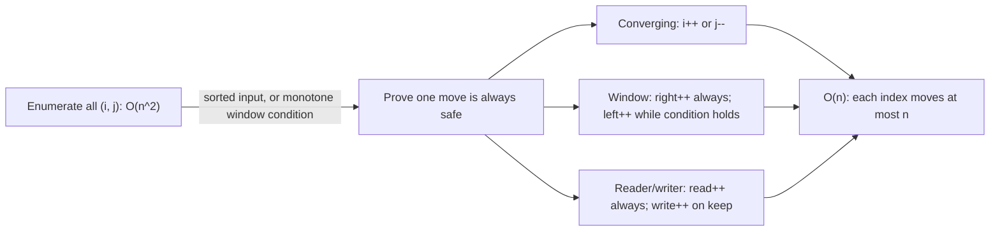

# Two Pointers and Sliding Windows

> Velocity checks are sliding-window problems.

**Type:** Build
**Languages:** Java, Python, Go
**Prerequisites:** Phase 1 Lesson 01 (Complexity Analysis), Phase 1 Lesson 05 (Stacks, Queues, and Ring Buffers), Phase 2 Lesson 01 (Sorting)
**Time:** ~60 minutes

## Learning Objectives

- Explain the amortization argument that makes a two-index scan O(n): each index only moves forward, so the total movement is bounded by 2n
- Implement the three two-pointer patterns (converging, reader/writer, merge) and the three window patterns (fixed width, variable width with a monotone condition, at-most-one-of-each)
- Build a sliding-window maximum with a monotonic deque and state its invariant
- Build a time-based velocity checker that enforces count and amount limits over a trailing window, with deterministic eviction at the boundary
- Identify when a window condition is not monotone (negative values, non-additive aggregates) and the technique stops applying

## The Problem

A fraud engine for a card issuer has one rule that catches most card-testing attacks: no card may be authorized more than four times, or for more than 500.00 USD in total, in any trailing sixty seconds. Card testers run stolen numbers through small purchases to find live ones; the rule denies the fifth attempt and the whole batch of numbers goes cold.

The first implementation stores every authorization in a table and, on each new attempt, runs `SELECT COUNT(*), SUM(amount) FROM auths WHERE card = ? AND ts > now() - 60s`. At 3,000 authorizations a second across the fleet the query is fine. During a bot attack on a Friday evening, one card receives 40 attempts a second, the table for that card grows to tens of thousands of rows, each new attempt scans all of them, and the rule's p99 latency climbs from 4 ms to 900 ms. The authorization path has a 500 ms budget. The engine starts timing out and, by policy, failing open. The attacker's fifth attempt, and their five-hundredth, are allowed.

The query is doing O(n) work per event over a window that is almost entirely unchanged from the previous event. The window gained one event and lost zero or a few at the back. A structure that keeps the window's count and sum as running totals, adds the new event at the front, and pops expired events from the back does O(1) amortized work per event regardless of how many events the window holds. That structure is a deque, the technique is a sliding window, and the reason it is O(1) amortized rather than O(n) is the same reason two pointers can find a pair in a sorted array in one pass: both ends only move forward.

## The Concept

### One invariant: indices only move forward

Every algorithm in this lesson keeps two positions over a sequence, call them `left` and `right`, and advances them under one rule: **neither index ever moves backward.** The total work is then bounded by the total distance travelled, at most `n` for each index, so `O(n)` overall even though the code has a loop inside a loop. This is amortized analysis (Phase 1, Lesson 02) in its simplest form: the inner `while` may run many times on one iteration of the outer `for`, but across the whole run it executes at most `n` times because each execution advances `left` and `left` can advance at most `n` times.

The brute-force alternative enumerates all `O(n^2)` pairs or sub-arrays and tests each. The two-index scan reaches `O(n)` by proving, at each step, that one of the two moves is safe: a whole class of candidates can be discarded without examining them.



### Converging pointers on a sorted array

Find two elements of a sorted array that sum to `target`. Start `i` at the smallest and `j` at the largest. If `a[i] + a[j] < target`, then `a[i]` paired with anything (every other element is at most `a[j]`) is also below target, so `a[i]` can never be part of a solution: `i++`. Symmetrically, if the sum is too large, `j--`. Each step discards one element with proof. On `[75, 500, 500, 1999, 1999, 2575, 4500, 12000]` with target 4574:

```text
i=0 (75)    j=7 (12000)  sum 12075 > 4574  -> j--
i=0 (75)    j=6 (4500)   sum 4575  > 4574  -> j--
i=0 (75)    j=5 (2575)   sum 2650  < 4574  -> i++
i=1 (500)   j=5 (2575)   sum 3075  < 4574  -> i++
i=2 (500)   j=5 (2575)   sum 3075  < 4574  -> i++
i=3 (1999)  j=5 (2575)   sum 4574  == target -> (3, 5)
```

Six steps instead of 28 pairs. The same discipline gives `dedupeSorted` (a reader index that always advances and a writer index that advances only on a new value) and `mergeSorted` (two readers, one on each input, each advancing when it is emitted), which is the merge step of Lesson 01 standing on its own.

### Fixed windows

A window of exactly `k` consecutive elements slides one position per step. The sum of the new window is the old sum plus the entering element minus the leaving one: `O(1)` per step, `O(n)` total, against `O(nk)` for recomputing each window. Any aggregate that supports "remove" works this way: sum, count, mean, a frequency map. Max and min do not support "remove" in O(1), which is why the monotonic deque exists.

### Variable windows with a monotone condition

The window grows at the right on every step and shrinks at the left while some condition holds. For "shortest run with sum at least `target`" over non-negative values:

```text
daily = [12000, 4500, 80000, 2575, 30000, 1999, 500, 75], target = 100000

right=0  sum=12000           left=0  (12000 < target: no shrink)
right=1  sum=16500           left=0
right=2  sum=96500           left=0
right=3  sum=99075           left=0
right=4  sum=129075  >= target: len 5, best=5; shrink: sum=117075 (left=1), len 4, best=4;
                              sum=112575 (left=2), len 3, best=3; sum=32575 (left=3) stops
right=5  sum=34574           left=3
right=6  sum=35074
right=7  sum=35149
result: 3 days (80000 + 2575 + 30000)
```

The correctness argument is the key: once a window `[left, right]` qualifies, every window `[left, r]` with `r > right` also qualifies and is longer, so it cannot be the answer; `left` can be advanced safely. That argument needs the sum to be **monotone in the window**: adding an element never decreases it, removing never increases it. With a negative value the argument fails. `[5, -1, 5]` with target 4: the window `[5]` qualifies, shrinks to empty, and the algorithm never reconsiders `[5, -1, 5]` after `[-1, 5]` fails; the `IllegalArgumentException` on negative input in `shortestRunWithSumAtLeast` is there because this is a silent wrong answer, not a crash, when the precondition is skipped. Prefix sums plus a monotonic structure handle the general case.

The "at most one of each" window (`longestWithoutRepeat`) is the same shape with a different condition and a smarter shrink: instead of advancing `left` one step at a time, it jumps `left` directly past the previous occurrence of the repeated character, using a last-seen index table. `"abba"` is the test that catches the common bug of writing `left = lastSeen[c] + 1` without the `>= left` guard: at the final `a`, the stale `lastSeen['a'] = 0` would move `left` backward from 2 to 1.

### Sliding-window maximum: the monotonic deque

Max over a window cannot be maintained with a running total because removing the current max requires knowing the next-largest. The monotonic deque keeps candidate indices with two invariants:

1. Indices in the deque are increasing front to back (they were pushed in order and only popped from the ends).
2. Their values are **strictly decreasing** front to back.

When a new element `a[i]` arrives, every element at the back that is `<= a[i]` is popped: it is older than `a[i]` and no larger, so it leaves the window before `a[i]` does and can never again be the maximum. Then `a[i]` is pushed. Then the front is popped if its index has fallen out of the window. The front is now the maximum of the current window. Each index is pushed once and popped at most once, so `O(n)` total; the deque never holds more than `k` indices.

```text
a = [1, 3, -1, -3, 5, 3, 6, 7], k = 3        (deque holds indices; values shown for reading)

i=0  push 0            deque [0]              values [1]
i=1  pop 0 (1<=3)      deque [1]              values [3]
i=2  push 2            deque [1,2]            values [3,-1]        window [0,2] max a[1]=3
i=3  push 3            deque [1,2,3]          values [3,-1,-3]     window [1,3] max 3
i=4  pop 3,2,1 (<=5)   deque [4]              values [5]           window [2,4] max 5
i=5  push 5            deque [4,5]            values [5,3]         window [3,5] max 5
i=6  pop 5,4 (<=6)     deque [6]              values [6]           window [4,6] max 6
i=7  pop 6 (<=7)       deque [7]              values [7]           window [5,7] max 7
output [3, 3, 5, 5, 6, 7]
```

Popping on `<=` rather than `<` keeps equal values from accumulating; with `<`, an array of 10^6 equal values would hold every index and `pollFirst` would still be correct but the deque would be `O(k)` of equal useless entries. Either is correct; `<=` is tighter.

### Time-based windows

A velocity check is a variable window over time instead of over index. Events arrive in timestamp order; the window is "every event with `timestamp > now - 60s`". The deque holds the events themselves, a running `Money` total and the deque's `size()` are the aggregates, and arrival of a new event triggers eviction from the front of everything at or before the cutoff. Because evictions are from the front only and every event is evicted at most once, the cost is `O(1)` amortized per event, independent of how many events the window holds. The 40-attempts-a-second attack costs the same per event as a quiet card.

Three details decide whether two implementations of the same rule agree:

- **The boundary is strict.** An event at exactly `t - 60,000 ms` is outside a window ending at `t` (`timestamp <= cutoff` evicts). The tests pin both `+60,000` (evicted) and `+59,999` (retained). Pick one and write it down; a rule engine and its replay tool that disagree on this by one millisecond produce different decisions for the same input.
- **Denied events still count.** The attacker's failed attempts are the evidence. Recording before deciding also means the amount total is checked after the new event is added, so a single 600.00 USD authorization against a 500.00 limit is denied.
- **Time is an input.** The checker takes the event's timestamp; it never reads `System.currentTimeMillis()`. That is what makes the demo deterministic and what lets a fraud analyst replay yesterday's traffic through today's rule.

### Worked example: the velocity window by hand

Rule: at most 4 events and at most 500.00 USD in any trailing 60 s. Events in the demo, with the window state after each `record`:

| t | amount | cutoff (t - 60s) | evicted | window (event times) | count | total | decision |
|---|--------|------------------|---------|----------------------|-------|-------|----------|
| 0 s | 120.00 | -60 s | none | 0 | 1 | 120.00 | ALLOW |
| 10 s | 45.00 | -50 s | none | 0, 10 | 2 | 165.00 | ALLOW |
| 20 s | 250.00 | -40 s | none | 0, 10, 20 | 3 | 415.00 | ALLOW |
| 25 s | 19.99 | -35 s | none | 0, 10, 20, 25 | 4 | 434.99 | ALLOW (4 is not more than 4) |
| 30 s | 1.00 | -30 s | none | 0, 10, 20, 25, 30 | 5 | 435.99 | DENY_COUNT |
| 70 s | 300.00 | 10 s | 0 s, 10 s (both <= 10 s) | 20, 25, 30, 70 | 4 | 570.99 | DENY_AMOUNT |
| 125 s | 0.75 | 65 s | 20 s, 25 s, 30 s | 70, 125 | 2 | 300.75 | ALLOW |

Total evictions across the run: five, for seven events. No event was ever examined twice after insertion except to be evicted. The row at 70 s is the one to study: the event at exactly 10 s is evicted because the boundary is strict (`<= cutoff`), and the amount rule fires only because the count rule did not (four events, not five).

### Three kinds of window

| Kind | Right end | Left end | Aggregate update | Example |
|------|-----------|----------|------------------|---------|
| Fixed (width k) | advances by one | advances by one | add entering, remove leaving | best 3-day settlement total |
| Variable (monotone condition) | advances by one | advances while condition holds | add on grow, remove on shrink | shortest run summing to at least X |
| Time-based (trailing w) | the newest event | all events at or before t - w | add new, remove each evicted | velocity check, rate limiter |

All three share the forward-only invariant and the O(1)-amortized cost. The time-based window differs in that the number of elements is not controlled by the algorithm: a burst of events puts many into one window, a quiet period leaves one or zero, and memory is proportional to the burst.

### Failure modes

| Symptom | Cause | Fix |
|---------|-------|-----|
| Wrong "shortest run" on some inputs, no error | Negative values broke monotonicity | Reject negatives, or use prefix sums with a monotonic deque over prefix values |
| `left` moves backward in `longestWithoutRepeat` | `left = lastSeen[c] + 1` without the `>= left` guard | Only jump when the previous occurrence is inside the current window (`"abba"` test) |
| Window max wrong when `k = 1` | Front evicted before the new index was pushed | Push, then evict the front, then read |
| Deque grows to `k` entries on constant input | Popping on `<` instead of `<=` | Pop on `<=` so equal values do not accumulate |
| Rate limiter allows 2x the limit at bucket edges | Fixed buckets instead of a trailing window | Sliding log, or sliding window counter with interpolation and a documented error |
| Two rule engines disagree on 0.1% of decisions | Boundary inclusivity (`<` vs `<=`) differs | Write the boundary into the spec and pin it with the `w` and `w - 1` tests |
| Replay produces different decisions than production | Rule read the wall clock | Timestamp is an input; the rule has no clock |
| Memory blows up on one key under attack | Exact sliding log with unbounded burst | Cap stored events at `maxCount + 1` while keeping a count of denied overflow, or switch to a counter approximation for that tier |

### Windows versus prefix sums

For a static array and many range-sum queries, prefix sums beat windows: precompute `P[i] = a[0] + ... + a[i-1]` once in O(n), then any range sum is `P[j+1] - P[i]` in O(1), for any `i` and `j`, not just contiguous sliding positions. Windows win when the data is a stream (no second pass), when the query is "the best window" rather than "this range", or when the aggregate is not invertible (max has no prefix-difference form, which is why the deque exists). The hard exercise below makes the trade explicit by solving the same question both ways.

### What a window does not do

A window answers questions about *contiguous* ranges. "Any three transactions totalling over 500" (not necessarily adjacent) is a subset-sum question, not a window. Aggregates must be decomposable: sum, count, and frequency maps support removal; max and min need the deque; median and distinct-count need heavier structures (two heaps, or a count-min sketch when approximate is acceptable). And the technique is single-pass over ordered input: out-of-order events (a late-arriving authorization from a store-and-forward terminal) break the eviction invariant, which is why `VelocityChecker.record` rejects them and why Phase 8 spends a lesson on watermarks.

## Build It

All code is in `code/java/Main.java`: `TwoPointers`, `SlidingWindow`, and `VelocityChecker`, with `Money` and `Event` as records.

### Step 1: Converging pointers

```java
static int[] pairWithSum(long[] sorted, long target) {
    int i = 0, j = sorted.length - 1;
    while (i < j) {
        long sum = sorted[i] + sorted[j];
        if (sum == target) return new int[] {i, j};
        if (sum < target) i++;      // the smallest element can never pair with anything: drop it
        else j--;                   // the largest element can never pair with anything: drop it
    }
    return null;
}
```

The loop condition `i < j` means a single element is never paired with itself. The tests include a brute-force oracle over 100 random sorted arrays with duplicates, checking both existence and that any returned pair actually sums to the target.

**Predict:** on `[1, 2, 3, 4]` with target 5 there are two valid pairs. Which one does the algorithm return, and why is the answer deterministic?

### Step 2: Reader and writer

```java
static int dedupeSorted(long[] sorted) {
    if (sorted.length == 0) return 0;
    int write = 1;
    for (int read = 1; read < sorted.length; read++) {
        if (sorted[read] != sorted[write - 1]) sorted[write++] = sorted[read];
    }
    return write;
}
```

`write <= read` always, so the write never clobbers an unread element. This is the shape of every in-place filter, compaction, and log-truncation routine: Phase 7's log compaction is `dedupeSorted` over keys.

### Step 3: Fixed window

```java
static long maxSumFixed(long[] a, int k) {
    if (k <= 0 || k > a.length) throw new IllegalArgumentException("k must be in 1.." + a.length + ": " + k);
    long sum = 0;
    for (int i = 0; i < k; i++) sum += a[i];
    long best = sum;
    for (int right = k; right < a.length; right++) {
        sum += a[right] - a[right - k];     // slide: add the new element, drop the one that fell off the left
        best = Math.max(best, sum);
    }
    return best;
}
```

Negative values are fine here because nothing depends on monotonicity; the brute-force oracle test deliberately includes them. A `k` of 0 or more than `n` is rejected rather than returning a meaningless 0.

**Predict:** `maxSumFixed(daily, daily.length)` should equal what, and how many times does the second loop execute?

### Step 4: Variable window

```java
static int shortestRunWithSumAtLeast(long[] a, long target) {
    for (long v : a) if (v < 0) throw new IllegalArgumentException("values must be non-negative for the window to be monotone");
    int best = 0, left = 0;
    long sum = 0;
    for (int right = 0; right < a.length; right++) {
        sum += a[right];
        while (sum >= target && left <= right) {           // shrink from the left while the window still qualifies
            int len = right - left + 1;
            if (best == 0 || len < best) best = len;
            sum -= a[left++];
        }
    }
    return best;
}
```

The `while` records the length *before* shrinking, because the current window qualifies and the next might not. `best == 0` doubles as "nothing found yet", which works because a qualifying window has length at least 1; the tests cover "single element suffices", "whole array needed", and "impossible".

**Predict:** what does the algorithm return on `[5, -1, 5]` with target 4 if the negative-value guard is removed, and what is the correct answer?

The at-most-one-of-each variant replaces the running sum with a last-seen table and jumps `left` instead of stepping it:

```java
static int longestWithoutRepeat(String s) {
    int[] lastSeen = new int[Character.MAX_VALUE + 1];
    Arrays.fill(lastSeen, -1);
    int best = 0, left = 0;
    for (int right = 0; right < s.length(); right++) {
        char c = s.charAt(right);
        if (lastSeen[c] >= left) left = lastSeen[c] + 1;    // jump left past the previous copy of c
        lastSeen[c] = right;
        best = Math.max(best, right - left + 1);
    }
    return best;
}
```

The guard `lastSeen[c] >= left` is the whole correctness of the jump: a previous occurrence that is already outside the window must not pull `left` backward. The `"abba"` test exists for this line alone.

### Step 5: The monotonic deque

```java
static long[] maxOfEachWindow(long[] a, int k) {
    if (k <= 0 || k > a.length) throw new IllegalArgumentException("k must be in 1.." + a.length + ": " + k);
    long[] out = new long[a.length - k + 1];
    ArrayDeque<Integer> dq = new ArrayDeque<>();
    for (int i = 0; i < a.length; i++) {
        while (!dq.isEmpty() && a[dq.peekLast()] <= a[i]) dq.pollLast();   // a[i] dominates everything smaller before it
        dq.addLast(i);
        if (dq.peekFirst() <= i - k) dq.pollFirst();                        // the front fell out of the window
        if (i >= k - 1) out[i - k + 1] = a[dq.peekFirst()];
    }
    return out;
}
```

Order matters: push first, then evict the front, then read. Evicting before pushing would be wrong when `k = 1` (the only element in the deque is the one that just fell out, and the new one has not been pushed yet). The deque stores indices, not values, because expiry is decided by position; a deque of values could not tell which `5` is the old one. `ArrayDeque` is the ring buffer from Phase 1, Lesson 05, with `O(1)` operations at both ends.

**Predict:** after processing `[9, 8, 7, 6]` with `k = 2`, what does the deque contain at each step, and why does it never pop from the back?

### Step 6: The velocity checker

```java
Decision record(Event e) {
    if (e.timestampMs() < lastTimestamp) throw new IllegalArgumentException("events must arrive in time order");
    lastTimestamp = e.timestampMs();
    evictOlderThan(e.timestampMs() - windowMs);
    window.addLast(e);
    total = total.plus(e.amount());
    if (window.size() > maxCount) return Decision.DENY_COUNT;
    if (total.compareTo(maxTotal) > 0) return Decision.DENY_AMOUNT;
    return Decision.ALLOW;
}

private void evictOlderThan(long cutoffExclusive) {
    while (!window.isEmpty() && window.peekFirst().timestampMs() <= cutoffExclusive) {
        total = total.minus(window.pollFirst().amount());
    }
}
```

`total` is a `Money`; `plus` and `minus` are exact and throw on overflow or a currency mix, so the running total is always the exact sum of the deque's contents. The order of checks (count before amount) is part of the rule's specification: when both limits are exceeded at once the decision is `DENY_COUNT`, and a reviewer comparing this engine with a replay tool needs that order written down. The tests pin each decision on the demo script, and the boundary tests pin `+60,000 ms` as evicted and `+59,999 ms` as retained.

**Predict:** at `t0 + 70s` the demo evicts two events. Which two, and what is the total after eviction?

### Step 7: Run it

```bash
cd phases/02-algorithms/03-two-pointers-and-sliding-windows/code/java
javac -d .out *.java && java -cp .out Main
java -cp .out MainTest
```

Expected output, abbreviated:

```console
== Two pointers on a sorted array ==
pairWithSum(4574) -> indices [3, 5] = 1999 + 2575
dedupeSorted      -> [75, 500, 1999, 2575, 4500, 12000]

== Fixed window: best 3-day settlement total (cents per day) ==
maxSumFixed(k=3) = 112575 (days 2..4: 80000 + 2575 + 30000)

== Variable window: shortest run of days totalling at least 100,000 cents ==
shortestRunWithSumAtLeast(100000) = 3 days

== Sliding-window maximum with a monotonic deque, k = 3 ==
input  [1, 3, -1, -3, 5, 3, 6, 7]
maxima [3, 3, 5, 5, 6, 7]

== Velocity check: max 4 authorizations and 500.00 USD per trailing 60 s ==
  t=+  0s  120.00 USD -> ALLOW        window: 1 events, 120.00 USD
  t=+ 10s  45.00 USD  -> ALLOW        window: 2 events, 165.00 USD
  t=+ 20s  250.00 USD -> ALLOW        window: 3 events, 415.00 USD
  t=+ 25s  19.99 USD  -> ALLOW        window: 4 events, 434.99 USD
  t=+ 30s  1.00 USD   -> DENY_COUNT   window: 5 events, 435.99 USD
  t=+ 70s  300.00 USD -> DENY_AMOUNT  window: 4 events, 570.99 USD
  t=+125s  0.75 USD   -> ALLOW        window: 2 events, 300.75 USD
```

The test run prints `50 passed, 0 failed`.

### In Python

The classes, method names (in `snake_case`), and every test case are the same; three things differ in `code/python/main.py`. **The deque is `collections.deque`:** it has `O(1)` `append`/`popleft`/`pop` at both ends, so `max_of_each_window` and `VelocityChecker` use it exactly as the Java uses `ArrayDeque`: `dq[0]` is `peekFirst`, `dq[-1]` is `peekLast`. Its `maxlen` option is tempting for fixed windows but wrong for time windows, where eviction is by timestamp, not count. **Integers do not overflow, so `Money` checks by hand:** `plus` and `minus` call `_check_long`, which raises `ArithmeticError` outside the signed 64-bit range where `Math.addExact` would throw; the currency check is unchanged and raises `ValueError` (the `IllegalArgumentException` mapping used throughout). A test pins the overflow. **Strings are code points:** `longest_without_repeat` keeps `last_seen` in a `dict` instead of a 65,536-entry `int[]`, and iterates code points rather than UTF-16 units; for any string in the Basic Multilingual Plane the answers are identical. The `>= left` guard is the same line.

`Decision` is an `Enum`, also reachable as `VelocityChecker.Decision` so the Java spelling works. The test file carries a small port of `java.util.Random` so the 600 brute-force oracle trials are the same random arrays as the Java run. Run it from `code/python/` with `python3 main.py`; test with `python3 -m unittest -v` (the Java's 50 checks plus one for the overflow guard).

#### Step 1: Converging pointers

`sorted_` carries an underscore because `sorted` is a builtin. The loop returns a two-element list or `None`; `i < j` keeps an element from pairing with itself.

```python
    @staticmethod
    def pair_with_sum(sorted_: list[int], target: int) -> list[int] | None:
        """Indices [i, j], i < j, with a[i] + a[j] == target in a sorted list, or None. O(n)."""
        i, j = 0, len(sorted_) - 1
        while i < j:
            s = sorted_[i] + sorted_[j]
            if s == target:
                return [i, j]
            if s < target:
                i += 1  # the smallest element can never pair with anything: drop it
            else:
                j -= 1  # the largest element can never pair with anything: drop it
        return None
```

#### Step 2: Reader and writer

The compaction writes into the same list it reads; `write <= read` always holds, and the caller slices `copy[:n]` to see the live prefix.

```python
    @staticmethod
    def dedupe_sorted(sorted_: list[int]) -> int:
        """Remove duplicates from a sorted list in place; returns the new length. Reader and writer pointers."""
        if not sorted_:
            return 0
        write = 1
        for read in range(1, len(sorted_)):
            if sorted_[read] != sorted_[write - 1]:
                sorted_[write] = sorted_[read]
                write += 1
        return write
```

#### Step 3: Fixed window

`sum(a[:k])` seeds the window; the slide adds the entering element and subtracts the leaving one. An out-of-range `k` raises `ValueError`.

```python
    @staticmethod
    def max_sum_fixed(a: list[int], k: int) -> int:
        """Fixed width k: the maximum sum of any k consecutive elements. Raises if k is out of range."""
        if k <= 0 or k > len(a):
            raise ValueError(f"k must be in 1..{len(a)}: {k}")
        s = sum(a[:k])
        best = s
        for right in range(k, len(a)):
            s += a[right] - a[right - k]  # slide: add the new element, drop the one that fell off the left
            best = max(best, s)
        return best
```

#### Step 4: Variable window

The negative-value guard and the shrink-while-qualifying loop are the Java ones; `best == 0` still means "nothing found yet". `longest_without_repeat` swaps the 65,536-slot array for a `dict` with `get(c, -1)`, which also makes it correct for code points above the BMP.

```python
    @staticmethod
    def shortest_run_with_sum_at_least(a: list[int], target: int) -> int:
        """Variable width: length of the shortest contiguous run with sum >= target; 0 if none. Non-negative only."""
        for v in a:
            if v < 0:
                raise ValueError("values must be non-negative for the window to be monotone")
        best = left = 0
        s = 0
        for right in range(len(a)):
            s += a[right]
            while s >= target and left <= right:  # shrink from the left while the window still qualifies
                length = right - left + 1
                if best == 0 or length < best:
                    best = length
                s -= a[left]
                left += 1
        return best
```

```python
    @staticmethod
    def longest_without_repeat(s: str) -> int:
        """Longest substring with no repeated character; the "at most one of each" window."""
        last_seen: dict[str, int] = {}
        best = left = 0
        for right, c in enumerate(s):
            if last_seen.get(c, -1) >= left:
                left = last_seen[c] + 1  # jump left past the previous copy of c
            last_seen[c] = right
            best = max(best, right - left + 1)
        return best
```

#### Step 5: The monotonic deque

`collections.deque` gives `pop` (back), `append` (back), and `popleft` (front); `dq[-1]` and `dq[0]` peek. The order push, evict, read is preserved for the same `k = 1` reason as in Java.

```python
    @staticmethod
    def max_of_each_window(a: list[int], k: int) -> list[int]:
        """Sliding-window maximum with a monotonic deque of indices whose values strictly decrease front to back."""
        if k <= 0 or k > len(a):
            raise ValueError(f"k must be in 1..{len(a)}: {k}")
        out = [0] * (len(a) - k + 1)
        dq: deque[int] = deque()
        for i in range(len(a)):
            while dq and a[dq[-1]] <= a[i]:
                dq.pop()  # a[i] dominates everything smaller before it
            dq.append(i)
            if dq[0] <= i - k:
                dq.popleft()  # the front fell out of the window
            if i >= k - 1:
                out[i - k + 1] = a[dq[0]]
        return out
```

#### Step 6: The velocity checker

The window is a `deque[Event]` and `_total` is a `Money` kept exact by `plus`/`minus`. Count is checked before amount, as the rule specifies; an out-of-order event raises `ValueError`.

```python
    def record(self, e: Event) -> Decision:
        """Record the event and decide. Denied events still count: an attacker's failed attempts are the signal."""
        if e.timestamp_ms < self._last_timestamp:
            raise ValueError("events must arrive in time order")
        self._last_timestamp = e.timestamp_ms
        self._evict_older_than(e.timestamp_ms - self._window_ms)
        self._window.append(e)
        self._total = self._total.plus(e.amount)
        if len(self._window) > self._max_count:
            return Decision.DENY_COUNT
        if self._total.compare_to(self._max_total) > 0:
            return Decision.DENY_AMOUNT
        return Decision.ALLOW

    def _evict_older_than(self, cutoff_exclusive: int) -> None:
        while self._window and self._window[0].timestamp_ms <= cutoff_exclusive:
            self._total = self._total.minus(self._window.popleft().amount)
```

#### Step 7: Run it

```bash
cd phases/02-algorithms/03-two-pointers-and-sliding-windows/code/python
python3 main.py
python3 -m unittest -v
```

```console
== Two pointers on a sorted array ==
pairWithSum(4574) -> indices [3, 5] = 1999 + 2575
dedupeSorted      -> [75, 500, 1999, 2575, 4500, 12000]

== Fixed window: best 3-day settlement total (cents per day) ==
maxSumFixed(k=3) = 112575 (days 2..4: 80000 + 2575 + 30000)

== Variable window: shortest run of days totalling at least 100,000 cents ==
shortestRunWithSumAtLeast(100000) = 3 days

== Sliding-window maximum with a monotonic deque, k = 3 ==
input  [1, 3, -1, -3, 5, 3, 6, 7]
maxima [3, 3, 5, 5, 6, 7]

== Velocity check: max 4 authorizations and 500.00 USD per trailing 60 s ==
  t=+  0s  120.00 USD -> ALLOW        window: 1 events, 120.00 USD
  t=+ 10s  45.00 USD  -> ALLOW        window: 2 events, 165.00 USD
  t=+ 20s  250.00 USD -> ALLOW        window: 3 events, 415.00 USD
  t=+ 25s  19.99 USD  -> ALLOW        window: 4 events, 434.99 USD
  t=+ 30s  1.00 USD   -> DENY_COUNT   window: 5 events, 435.99 USD
  t=+ 70s  300.00 USD -> DENY_AMOUNT  window: 4 events, 570.99 USD
  t=+125s  0.75 USD   -> ALLOW        window: 2 events, 300.75 USD
```

The output is identical to the Java run.

### In Go

The types, method names, and every test case are the same; three things differ in `code/go/`. **The deque is hand-built:** Go's standard library has no deque, and a slice used as a queue with `q = q[1:]` keeps the whole backing array alive until it is reallocated. `deque.go` is a small generic ring buffer, `Deque[T]`, with `AddLast`, `PeekFirst`, `PeekLast`, `PollFirst`, and `PollLast`, the five `ArrayDeque` calls the lesson uses; `MaxOfEachWindow` and `VelocityChecker` call it exactly as the Java calls `ArrayDeque`. A test pushes past its initial capacity so `grow()` runs with a wrapped head. **Errors are values:** `MaxSumFixed`, `ShortestRunWithSumAtLeast`, `MaxOfEachWindow`, `NewVelocityChecker`, and `Record` return `(T, error)` where the Java throws `IllegalArgumentException`; the sentinels `ErrBadWindow`, `ErrNegative`, `ErrOutOfOrder`, and `ErrBadVelocity` support `errors.Is`. `PairWithSum` returns `([2]int, bool)` instead of `null`. **`int64` wraps, so `Money` checks by hand:** `Plus` and `Minus` call `addChecked` and `subChecked` in `money.go`, which return `ErrOverflow` where `Math.addExact` would throw; a currency mismatch is `ErrCurrencyMismatch`. `LongestWithoutRepeat` ranges over runes with a `map[rune]int`, so it counts code points rather than UTF-16 units; for the Basic Multilingual Plane the answers are identical, and a test with `"ééa"` shows it is not counting bytes.

The test file replays `java.util.Random(11)` through `javarandom.go`, so the 600 brute-force oracle trials are the same random arrays as the Java run. Run it from `code/go/` with `go run .`; test with `go test ./...` (the Java's 50 checks plus 8 for the deque's growth, the code-point count, the `k=0` sentinel, and the two overflow guards).

#### Step 1: Converging pointers

A fixed-size `[2]int` array and an `ok` flag replace the nullable `int[]`. The loop is otherwise the Java one.

```go
// PairWithSum finds indices (i, j), i < j, with a[i] + a[j] == target in a sorted slice. O(n). ok is false when none exists.
func PairWithSum(sorted []int64, target int64) (pair [2]int, ok bool) {
	i, j := 0, len(sorted)-1
	for i < j {
		sum := sorted[i] + sorted[j]
		if sum == target {
			return [2]int{i, j}, true
		}
		if sum < target {
			i++ // the smallest element can never pair with anything: drop it
		} else {
			j-- // the largest element can never pair with anything: drop it
		}
	}
	return [2]int{}, false
}
```

#### Step 2: Reader and writer

Identical to the Java apart from the separate `write++`.

```go
// DedupeSorted removes duplicates from a sorted slice in place; returns the new length. Reader and writer pointers.
func DedupeSorted(sorted []int64) int {
	if len(sorted) == 0 {
		return 0
	}
	write := 1
	for read := 1; read < len(sorted); read++ {
		if sorted[read] != sorted[write-1] {
			sorted[write] = sorted[read]
			write++
		}
	}
	return write
}
```

#### Step 3: Fixed window

A bad `k` returns a wrapped `ErrBadWindow`. The built-in `max` (Go 1.21+) replaces `Math.max`.

```go
// MaxSumFixed: fixed width k, the maximum sum of any k consecutive elements. Errors if k is out of range.
func MaxSumFixed(a []int64, k int) (int64, error) {
	if k <= 0 || k > len(a) {
		return 0, fmt.Errorf("%w: got %d for len %d", ErrBadWindow, k, len(a))
	}
	var sum int64
	for i := 0; i < k; i++ {
		sum += a[i]
	}
	best := sum
	for right := k; right < len(a); right++ {
		sum += a[right] - a[right-k] // slide: add the new element, drop the one that fell off the left
		best = max(best, sum)
	}
	return best, nil
}
```

#### Step 4: Variable window

The negative guard returns `ErrNegative`. `LongestWithoutRepeat` ranges over the string's runes and keeps its own code-point counter `i`, because the index `range` yields is a byte offset; `lastSeen` is a `map[rune]int` and the two-value lookup supplies the "seen before" test.

```go
func ShortestRunWithSumAtLeast(a []int64, target int64) (int, error) {
	for _, v := range a {
		if v < 0 {
			return 0, ErrNegative
		}
	}
	best, left := 0, 0
	var sum int64
	for right := 0; right < len(a); right++ {
		sum += a[right]
		for sum >= target && left <= right { // shrink from the left while the window still qualifies
			length := right - left + 1
			if best == 0 || length < best {
				best = length
			}
			sum -= a[left]
			left++
		}
	}
	return best, nil
}
```

```go
// LongestWithoutRepeat: longest substring with no repeated character; the "at most one of each" window.
func LongestWithoutRepeat(s string) int {
	lastSeen := map[rune]int{}
	best, left, i := 0, 0, 0
	for _, c := range s { // Go strings are UTF-8: index code points, not bytes
		if prev, seen := lastSeen[c]; seen && prev >= left {
			left = prev + 1 // jump left past the previous copy of c
		}
		lastSeen[c] = i
		best = max(best, i-left+1)
		i++
	}
	return best
}
```

#### Step 5: The monotonic deque

`Deque[int]` from `deque.go` supplies the five `ArrayDeque` operations with the same names, so the loop body reads like the Java. Push, evict, read, in that order.

```go
func MaxOfEachWindow(a []int64, k int) ([]int64, error) {
	if k <= 0 || k > len(a) {
		return nil, fmt.Errorf("%w: got %d for len %d", ErrBadWindow, k, len(a))
	}
	out := make([]int64, len(a)-k+1)
	dq := NewDeque[int]()
	for i := range a {
		for !dq.IsEmpty() && a[dq.PeekLast()] <= a[i] { // a[i] dominates everything smaller before it
			dq.PollLast()
		}
		dq.AddLast(i)
		if dq.PeekFirst() <= i-k { // the front fell out of the window
			dq.PollFirst()
		}
		if i >= k-1 {
			out[i-k+1] = a[dq.PeekFirst()]
		}
	}
	return out, nil
}
```

#### Step 6: The velocity checker

`Record` returns `(Decision, error)`: `ErrOutOfOrder` for a backwards timestamp, and the `Money` errors from `Plus` and `Minus` are threaded through `evictOlderThan`. The decision order (count before amount) is unchanged.

```go
// Record stores the event and decides. Denied events still count: an attacker's failed attempts are the signal.
func (vc *VelocityChecker) Record(e Event) (Decision, error) {
	if e.TimestampMs < vc.lastTimestamp {
		return 0, ErrOutOfOrder
	}
	vc.lastTimestamp = e.TimestampMs
	if err := vc.evictOlderThan(e.TimestampMs - vc.windowMs); err != nil {
		return 0, err
	}
	vc.window.AddLast(e)
	total, err := vc.total.Plus(e.Amount)
	if err != nil {
		return 0, err
	}
	vc.total = total
	if vc.window.Len() > vc.maxCount {
		return DenyCount, nil
	}
	if vc.total.Compare(vc.maxTotal) > 0 {
		return DenyAmount, nil
	}
	return Allow, nil
}

func (vc *VelocityChecker) evictOlderThan(cutoffExclusive int64) error {
	for !vc.window.IsEmpty() && vc.window.PeekFirst().TimestampMs <= cutoffExclusive {
		total, err := vc.total.Minus(vc.window.PollFirst().Amount)
		if err != nil {
			return err
		}
		vc.total = total
	}
	return nil
}
```

#### Step 7: Run it

```bash
cd phases/02-algorithms/03-two-pointers-and-sliding-windows/code/go
go run .
go test ./...
```

```console
== Two pointers on a sorted array ==
pairWithSum(4574) -> indices [3 5] = 1999 + 2575
pairWithSum(1)    -> found=false
dedupeSorted      -> [75 500 1999 2575 4500 12000]

== Fixed window: best 3-day settlement total (cents per day) ==
maxSumFixed(k=3) = 112575 (days 2..4: 80000 + 2575 + 30000)

== Variable window: shortest run of days totalling at least 100,000 cents ==
shortestRunWithSumAtLeast(100000) = 3 days

== Sliding-window maximum with a monotonic deque, k = 3 ==
input  [1 3 -1 -3 5 3 6 7]
maxima [3 3 5 5 6 7]

== Velocity check: max 4 authorizations and 500.00 USD per trailing 60 s ==
  t=+  0s  120.00 USD -> ALLOW        window: 1 events, 120.00 USD
  t=+ 30s  1.00 USD   -> DENY_COUNT   window: 5 events, 435.99 USD
  t=+ 70s  300.00 USD -> DENY_AMOUNT  window: 4 events, 570.99 USD
  t=+125s  0.75 USD   -> ALLOW        window: 2 events, 300.75 USD
```

The numbers are the same as the Java run; Go's `fmt` prints slices as `[3 5]` rather than `[3, 5]`, and the missing pair prints as `found=false` rather than `null`.

## Use It

### Fraud and rate limiting in production

Every rate limiter is a sliding window over time with a count aggregate. The deque-of-timestamps version in this lesson is the **sliding log** algorithm: exact, `O(1)` amortized per event, `O(events in window)` memory per key. For a service protecting an API with millions of keys, the memory is the problem, and production systems trade exactness for space: the **sliding window counter** keeps two fixed buckets (current and previous minute) and interpolates; the **token bucket** keeps one counter and a refill timestamp. Redis's `MULTI`/`ZADD`/`ZREMRANGEBYSCORE`/`ZCARD` recipe is the sliding log on a sorted set, and the `redis-cell` module implements GCRA, a token bucket. Stripe's and Cloudflare's published rate-limiter designs are the sliding window counter. The fraud-engine rule from The Problem is the sliding log, because exactness per card matters more than memory, and the number of cards under attack at once is small.

### Stream processors

Apache Flink and Kafka Streams expose windows as first-class operators: tumbling (fixed, non-overlapping), hopping (fixed, overlapping by a step), sliding (variable, one window per event), and session windows. Their implementation of a sliding `MAX` over a time window is the monotonic deque from this lesson with watermarks (Phase 8) deciding when an event is late. `SELECT MAX(amount) OVER (ORDER BY ts RANGE BETWEEN INTERVAL '60' SECOND PRECEDING AND CURRENT ROW)` in Flink SQL or PostgreSQL is `maxOfEachWindow` over time.

### `java.util.ArrayDeque`

The JDK's `ArrayDeque` is a resizable ring buffer with `O(1)` operations at both ends and no capacity limit by default; it is the right structure for every deque in this lesson and faster than `LinkedList` for the purpose. It is not thread-safe; a velocity checker shared across request threads needs `ConcurrentLinkedDeque` or, better, one checker per key behind a striped lock (Phase 4).

## Ship It

`outputs/checklist-velocity-rule.md` is a specification checklist for a velocity or rate-limit rule: window semantics (trailing or bucketed, boundary inclusivity), what counts (denied attempts, reversals), the aggregate and its removal cost, time source and clock skew, and the replay test. Use it when writing or reviewing a fraud rule, a rate limiter, or a stream-processing window.

## Exercises

1. **Reinforce.** Implement `minOfEachWindow` by changing one comparison in `maxOfEachWindow`, then implement `rangeOfEachWindow` (max minus min) by running two deques in the same loop. Verify with the brute-force oracle pattern from `MainTest`.
2. **Apply.** Extend `VelocityChecker` with a third rule: deny if more than two *distinct* merchant IDs appear in the window (card-testing attacks hop merchants). Add a `merchantId` to `Event` and a `HashMap<String, Integer>` of counts in the window that is decremented on eviction and removed at zero. Decide and test whether a denied event's merchant counts.
3. **Extend.** Combine with Phase 2, Lesson 02: given a day's authorizations sorted by timestamp, answer 10,000 queries of the form "how many authorizations and what total amount in `[t1, t2]`" using prefix sums for the amounts and `lowerBound`/`upperBound` for the positions, in `O(log n)` per query. Then explain in a comment why prefix sums are the right tool for a static batch and the deque is the right tool for a live stream.

## Key Terms

| Term | What people say | What it actually means |
|------|-----------------|------------------------|
| Two pointers | "the i and j trick" | Two indices over one or two sequences that only move forward, with a proof at each step that one move is safe; O(n) by amortization |
| Sliding window | "a moving range" | A contiguous sub-range `[left, right]` where `right` advances every step and `left` advances while a condition holds |
| Monotone condition | "it only gets bigger" | A window predicate that, once true, stays true under growth and once false stays false under shrinking; required for the shrink step to be safe |
| Monotonic deque | "the max queue" | A deque of indices with strictly decreasing values, front to back, whose front is the window maximum; each index is pushed and popped at most once |
| Amortized O(1) | "basically constant" | Total cost over n operations is O(n), even though a single operation may cost O(n); the inner `while` in a window is O(n) across the whole run |
| Velocity check | "too many too fast" | A fraud rule limiting count or amount per key over a trailing time window; the sliding log algorithm with a deque and running totals |
| Sliding log | "exact rate limit" | Rate limiting by storing every event timestamp in the window; exact, O(1) amortized, memory proportional to events in the window |
| Trailing window | "last 60 seconds" | The window `(t - w, t]` ending at the current event; the strict left boundary is a specification decision that must be tested |

## Further Reading

- [Cormen, Leiserson, Rivest, Stein, *Introduction to Algorithms*, Chapter 17 (Amortized Analysis)](https://mitpress.mit.edu/9780262046305/introduction-to-algorithms/) — the aggregate method that proves the two-index scan and the deque are O(n).
- [Stripe Engineering, "Scaling your API with rate limiters"](https://stripe.com/blog/rate-limiters) — a production account of sliding window counters, token buckets, and load shedders, with Redis implementations.
- [Cloudflare, "How we built rate limiting capable of scaling to millions of domains"](https://blog.cloudflare.com/counting-things-a-lot-of-different-things/) — the sliding window counter approximation and its measured error against the exact sliding log.
- [Apache Flink documentation: Windows](https://nightlies.apache.org/flink/flink-docs-stable/docs/dev/datastream/operators/windows/) — tumbling, sliding, session, and global windows, with the trigger and evictor model that generalises this lesson's eviction loop.
- [`java.util.ArrayDeque` javadoc](https://docs.oracle.com/en/java/javase/21/docs/api/java.base/java/util/ArrayDeque.html) — the ring-buffer deque used throughout, and the note that it is faster than `LinkedList` as a queue.
- [PCI DSS and card-testing guidance from Visa: "Card Testing Fraud"](https://usa.visa.com/content/dam/VCOM/global/support-legal/documents/card-testing-fraud.pdf) — the attack pattern that velocity rules exist to stop, from the network that sees it.
