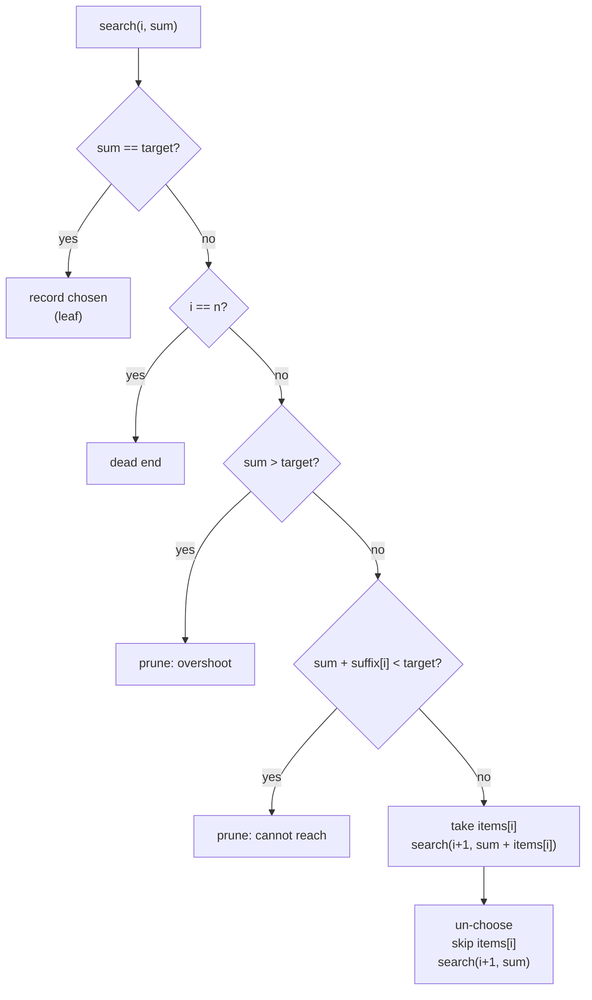

# Recursion and Backtracking

> Enumerating settlement allocations is a constrained search.

**Type:** Build
**Languages:** Java
**Prerequisites:** Phase 1, Lesson 01 (Complexity Analysis), Phase 1, Lesson 05 (Stacks, Queues, and Ring Buffers), Phase 2, Lesson 01 (Sorting)
**Time:** ~75 minutes

## Learning Objectives

- Write a recursive enumeration as choose, explore, un-choose, and explain why the un-choose step is what makes it backtracking rather than copying
- Generate all permutations, subsets, and k-combinations of a list, and state the size of each search tree
- Add constraint pruning to an exhaustive search (overshoot and insufficient-remainder bounds, sorted order) and measure the node count it saves without changing the answer
- Convert a recursive search into an explicit-stack loop that visits the same nodes in the same order, and explain when the conversion is mandatory
- Recognise the problems where backtracking is the right tool (small n, need all solutions, hard constraints) and where it is a trap (large n, one optimal solution, overlapping subproblems)

## The Problem

A treasury operations team receives a wire for 120.00 USD from a corporate customer with a remittance note that says only "payment of outstanding invoices". The customer has seven open receivables: 45.00, 75.00, 20.00, 120.00, 55.00, 10.00, and 30.00. Cash application, the job of matching incoming money to the invoices it pays, must decide which invoices this wire closes. The payment could be the single 120.00 invoice, or 75.00 + 45.00, or 55.00 + 45.00 + 20.00. All three are exact matches. The team needs every candidate, ranked by business rules (oldest first, fewest invoices first), so an operator can pick or an auto-match rule can fire when there is exactly one.

A junior engineer writes seven nested loops. It works for seven invoices. The next customer has 31 open invoices and the code is rewritten as a recursive function that tries every subset. It finds the matches, after visiting 2^31 subsets, which takes eleven minutes per wire. The nightly cash-application batch for 40,000 wires does not finish before the start of business. A senior engineer adds two lines: stop when the running total exceeds the target, and stop when the sum of what is left cannot reach it. The same search now visits a few hundred thousand nodes for the worst customer and the batch finishes in four minutes. Nothing about the answer changed; the search simply stopped exploring branches that could not contain one.

That is backtracking: depth-first enumeration of a tree of partial solutions, where each node either extends the partial solution or abandons it, and where the art is in abandoning early. It is also a technique with a hard ceiling. The search tree is exponential and pruning only shrinks the constant; a customer with 60 invoices and a target that admits no pruning will still take forever, and at that point the problem needs dynamic programming (Lesson 06) or a different question. This lesson builds the enumeration, the pruning, and the measurement that tells you which regime you are in, and then removes the recursion entirely to show that the call stack was never the point.

## The Concept

### Recursion as a tree

A recursive enumeration explores a tree. Each node is a partial solution; each edge is a choice; each leaf is either a complete solution or a dead end. The function body is the same at every node:

```text
search(partial):
  if partial is complete:  record it; return
  for each choice c available at partial:
    apply c                  # choose
    search(partial + c)      # explore
    undo c                   # un-choose
```

The un-choose step is what distinguishes backtracking from building a fresh copy of the partial solution at each node. With a shared mutable `current` list and a `used[]` array, the memory is `O(depth)` regardless of how many leaves there are; copying would make it `O(depth)` per node and allocate at every step. The recursion's own call stack is the only record of the path, and that is why converting to an explicit stack is mechanical: the frames *are* the path.

| Enumeration | Tree shape | Leaves | Total nodes | For n = 20 |
|-------------|------------|--------|-------------|------------|
| Permutations | n branches at the root, n-1 below, ... | n! | about e * n! | 2.4 * 10^18 leaves |
| Subsets | 2 branches at every level, depth n | 2^n | 2^(n+1) - 1 | 1,048,576 leaves |
| k-combinations | variable branching, depth k | C(n, k) | sum of C(n, i) for i <= k | C(20, 10) = 184,756 |
| N-Queens, one per row | up to n branches, depth n | n^n unpruned | far fewer with pruning | 20^20 unpruned, 39 million with pruning |

The right column is the point. Exhaustive enumeration is feasible for n in the teens for subsets and single digits for permutations. Everything beyond that depends on pruning, and pruning depends on the problem's constraints.

### Worked example: subsets of [A, B, C]

```text
subsetsFrom(index 0, current [])
  skip A -> subsetsFrom(1, [])
    skip B -> subsetsFrom(2, [])
      skip C -> leaf []
      take C -> leaf [C]
    take B -> subsetsFrom(2, [B])
      skip C -> leaf [B]
      take C -> leaf [B, C]
  take A -> subsetsFrom(1, [A])
    skip B -> ... leaves [A], [A, C]
    take B -> ... leaves [A, B], [A, B, C]

output order: [], [C], [B], [B, C], [A], [A, C], [A, B], [A, B, C]
```

Fifteen nodes (`2^4 - 1`), eight leaves. "Skip" before "take" at every level gives the empty set first and the full set last; swapping the two calls reverses the output. Each element appears in exactly half the subsets. Within each subset the elements are in input order because the recursion only ever appends the current index.

### Worked example: permutations of [A, B, C]

```text
permute(current [], used [F,F,F])
  i=0: choose A -> permute([A], [T,F,F])
         i=1: choose B -> permute([A,B], [T,T,F])
                i=2: choose C -> leaf [A, B, C]; un-choose C
              un-choose B
         i=2: choose C -> permute([A,C], [T,F,T])
                i=1: choose B -> leaf [A, C, B]; un-choose B
              un-choose C
       un-choose A
  i=1: choose B -> ... leaves [B, A, C], [B, C, A]
  i=2: choose C -> ... leaves [C, A, B], [C, B, A]
```

Sixteen calls for six leaves: `1 + 3 + 6 + 6`. The ratio of internal nodes to leaves approaches `e - 1` as `n` grows, so the cost of permutation enumeration is dominated by the leaves and there is nothing to prune unless the problem adds a constraint on prefixes. Each leaf is a snapshot: `new ArrayList<>(current)` at the moment `current` is full. After the recursion returns, `current` is restored to its state before the choice, which is what lets the loop continue with the next `i` as if nothing had happened.

### Choosing the enumeration shape

| You need | Shape | Branching | Distinctness comes from |
|----------|-------|-----------|-------------------------|
| Every ordering | permutations, `used[]` | n at the root, shrinking | `used[]` prevents repeats |
| Every sub-collection | subsets, include/exclude | 2 at every level | index only advances |
| Every sub-collection of size k | combinations, `start` index | shrinking | `start = i + 1` fixes the order |
| Every assignment of values to slots | one slot per level, loop over values | number of legal values | constraint arrays (N-Queens) |
| Every way to split a total | subsets with a sum bound | 2, heavily pruned | index only advances; sum bounds |

A common mistake is to use the permutation shape for a problem that only needs subsets: enumerating orderings of a settlement allocation produces each allocation `k!` times and makes the search `n!` instead of `2^n`. Decide first whether order matters; the shape follows.

### Worked example: the settlement allocation with pruning

Receivables sorted descending: `120.00, 75.00, 55.00, 45.00, 30.00, 20.00, 10.00` (cents: 12000, 7500, 5500, 4500, 3000, 2000, 1000). Target 12000. Suffix sums (what remains from index i onward): `[35500, 23500, 16000, 10500, 6000, 3000, 1000, 0]`.

```text
search(i=0, sum=0)
  take 12000 -> search(1, 12000): sum == target -> record [120.00]            (leaf; no further descent)
  skip 12000 -> search(1, 0)
    take 7500 -> search(2, 7500)
      take 5500 -> search(3, 13000): sum > target -> prune
      skip 5500 -> search(3, 7500)
        take 4500 -> search(4, 12000): record [75.00, 45.00]
        skip 4500 -> search(4, 7500): 7500 + suffix[4]=6000 = 13500 >= 12000, continue
          take 3000 -> search(5, 10500): 10500 + 3000 = 13500, continue
            take 2000 -> search(6, 12500): prune (over)
            skip 2000 -> search(6, 10500): 10500 + 1000 < 12000 -> prune (cannot reach)
          skip 3000 -> search(5, 7500): 7500 + 3000 < 12000 -> prune
    skip 7500 -> search(2, 0)
      take 5500 -> search(3, 5500)
        take 4500 -> search(4, 10000)
          take 3000 -> 13000 prune;  skip 3000 -> search(5, 10000)
            take 2000 -> search(6, 12000): record [55.00, 45.00, 20.00]
            skip 2000 -> 10000 + 1000 < 12000 prune
        skip 4500 -> search(4, 5500): 5500 + 6000 < 12000 -> prune
      skip 5500 -> search(3, 0): 0 + 10500 < 12000 -> prune
```

Twenty-one nodes visited with pruning against 113 without (the unpruned tree has `2^8 - 1 = 255` nodes; the early return on `sum == target` already saves some). Three allocations, identical in both runs. Sorting descending matters: large items first means the "over" prune fires near the root, where it cuts the most. On 24 receivables the demo visits 32.8 million nodes unpruned and 918 thousand pruned, a 36x saving, with 51,433 identical allocations either way. The saving is real and the search is still exponential: add ten more receivables and the pruned search visits a billion nodes.



### Pruning: the only lever

A pruning rule is a test at a node that proves no leaf below it can be a solution. Two kinds:

- **Feasibility bounds.** The running sum exceeds the target (positive amounts cannot reduce it) or the running sum plus everything remaining cannot reach it. Both are exact: they never cut a branch that contains a solution. The tests assert `noPrune.equals(pruned)` for exactly this reason: a pruning rule that changes the answer is a bug, and the only way to know is to compare against the unpruned search on inputs small enough to run it.
- **Constraint checks before descending.** In N-Queens, a queen is placed only in a column and on diagonals not already occupied, so the subtree below an attacked square is never entered. The 8-queens tree has `8^8 = 16.7` million leaves without the check and the search visits 2,057 nodes with it.

Ordering amplifies pruning. Trying large receivables first makes the overshoot rule fire early; in N-Queens, trying the most constrained row first (fewest legal columns) is the "most constrained variable" heuristic that every constraint solver uses. Neither changes which solutions exist, only how fast the search finds that a branch has none.

### What pruning does not fix

Pruning shrinks the tree by a factor; it does not change the exponent. Three signs that backtracking is the wrong tool:

1. **n is large and the constraints are loose.** Many receivables, a target in the middle of the achievable range: almost nothing prunes, and `2^n` is the real cost. Subset-sum with a bounded target is dynamic programming (Lesson 06): `O(n * target)` instead of `O(2^n)`.
2. **You need one optimal solution, not all solutions.** Backtracking enumerates; it does not know a branch is worse than the best so far unless you add a bound (that extension is branch-and-bound).
3. **Subproblems overlap.** If the same `(index, sum)` state is reached by many paths, the search redoes identical work; memoisation turns the tree into a DAG and the search into DP.

The honest check is the node counter. If pruning gives a 30x saving and you need 30,000x, the problem has changed category.

### Failure modes

| Symptom | Cause | Fix |
|---------|-------|-----|
| Every result is the same empty list | Leaf stored `current` itself instead of a copy | `out.add(new ArrayList<>(current))` |
| Results missing or duplicated after the first branch | Un-choose step forgotten or partial (`used[i]` not reset) | Restore every piece of shared state after `explore` |
| Each allocation appears `k!` times | Permutation shape used where subsets were needed | Advance an index; never loop over all items at every level |
| `StackOverflowError` on real data | Recursion depth proportional to data volume | Explicit stack; or bound depth by problem size, not input length |
| Pruned search returns fewer results than unpruned | Pruning rule is not exact (for example, overshoot prune with negative amounts present) | Compare against the exhaustive search on small inputs in a test; validate preconditions |
| Search hangs on some customers | Loose constraints, large `n`: the exponent, not the constant | Node budget with a fallback; change algorithm when the budget is routinely hit |

### Recursion depth is a resource

Every recursive call pushes a frame on the thread's stack, and the stack has a fixed size: the JVM default is platform dependent (often 512 KB to 1 MB; the demo measures the actual depth on your machine, which on the course's container is under ten thousand trivial frames). Enumeration recursion is depth `n`, where `n` is the number of items, so it is safe up to thousands. Recursion over *data* (a linked list, a day's ledger lines, a parse of a long input) is depth proportional to the data and will overflow. `sumRecursive(50_000_000)` throws `StackOverflowError`; `sumIterative` returns the answer.

The conversion to an explicit stack is mechanical: each frame becomes a record of the local variables, the call becomes a push, the return becomes a pop, and the order of pushes is reversed so that the first branch to explore is on top. `allocationsIterative` does this for the settlement search and the tests assert that it visits the same number of nodes and produces the same allocations in the same order as the recursive version. The call stack was a convenience; the search did not need it.

## Build It

All code is in `code/java/Main.java`: `Enumerate` (permutations, subsets, combinations), `SettlementAllocator` (recursive with optional pruning, and iterative), `NQueens`, and `Depth`.

### Step 1: Permutations with choose, explore, un-choose

```java
private static <T> void permute(List<T> items, boolean[] used, List<T> current, List<List<T>> out) {
    if (current.size() == items.size()) { out.add(new ArrayList<>(current)); return; }   // leaf: copy the path
    for (int i = 0; i < items.size(); i++) {
        if (used[i]) continue;
        used[i] = true; current.add(items.get(i));          // choose
        permute(items, used, current, out);                 // explore
        current.remove(current.size() - 1); used[i] = false; // un-choose: the backtrack step
    }
}
```

`current` and `used` are shared across the whole search and restored after every explore, so there is exactly one copy of each regardless of the tree's size. The leaf copies `current` because the list will be mutated the moment the function returns. Forgetting the copy is the classic bug: every entry in `out` ends up being the same (empty) list.

**Predict:** for `[A, B, C]`, what are the first and last permutations produced, and why?

### Step 2: Subsets by include/exclude

```java
private static <T> void subsetsFrom(List<T> items, int index, List<T> current, List<List<T>> out) {
    if (index == items.size()) { out.add(new ArrayList<>(current)); return; }
    subsetsFrom(items, index + 1, current, out);            // branch 1: leave items[index] out
    current.add(items.get(index));
    subsetsFrom(items, index + 1, current, out);            // branch 2: take it
    current.remove(current.size() - 1);
}
```

Two branches per level, no loop. Depth is `n`, leaves are `2^n`. This shape, "for each item, in or out", is the skeleton of every subset-sum, knapsack, and allocation search, including the settlement allocator below.

**Predict:** how many times is `subsetsFrom` called for `n = 10`, and how many of those calls reach the leaf line?

### Step 3: Combinations with a cheap prune

```java
private static <T> void combine(List<T> items, int k, int start, List<T> current, List<List<T>> out) {
    if (current.size() == k) { out.add(new ArrayList<>(current)); return; }
    // prune: if even taking every remaining item cannot reach k, stop
    for (int i = start; i <= items.size() - (k - current.size()); i++) {
        current.add(items.get(i));
        combine(items, k, i + 1, current, out);
        current.remove(current.size() - 1);
    }
}
```

The loop bound `i <= n - (k - current.size())` is the prune: with `k - current.size()` slots still to fill, starting from an index that leaves fewer than that many items is pointless. Starting at `i + 1` rather than `0` is what makes these combinations rather than permutations: order within a combination is fixed to input order, so each set is produced exactly once.

### Step 4: The settlement allocator

```java
private static void search(List<Money> items, long[] suffix, int index, long sum, long target,
                           List<Money> chosen, List<List<Money>> out, boolean prune, Counter counter) {
    counter.visited++;
    if (sum == target) { out.add(new ArrayList<>(chosen)); return; }     // found one; nothing more can be added (positive amounts)
    if (index == items.size()) return;
    if (prune) {
        if (sum > target) return;                                          // overshot: no positive amount can fix it
        if (sum + suffix[index] < target) return;                          // even taking everything left falls short
    }
    chosen.add(items.get(index));
    search(items, suffix, index + 1, sum + items.get(index).minorUnits(), target, chosen, out, prune, counter);
    chosen.remove(chosen.size() - 1);
    search(items, suffix, index + 1, sum, target, chosen, out, prune, counter);
}
```

The `prune` flag exists so the tests can run both versions and assert they agree; in production you would delete the flag and the unpruned path. Amounts are `Money` with a currency check up front; the search itself works on `long` minor units because the arithmetic inside a hot loop should not allocate. `suffix[index]` is precomputed once in `O(n)` so the "cannot reach" test is `O(1)` per node. The `counter` is the instrument: without it, "pruning helps" is a belief.

**Predict:** why can the search return immediately on `sum == target` without exploring further, and what input would make that early return wrong?

### Step 5: The same search with an explicit stack

```java
record Frame(int index, long sum, List<Money> chosen) {}
Deque<Frame> stack = new ArrayDeque<>();
stack.push(new Frame(0, 0, List.of()));
while (!stack.isEmpty()) {
    Frame f = stack.pop();
    counter.visited++;
    if (f.sum() == t) { out.add(f.chosen()); continue; }
    if (f.index() == sorted.size() || f.sum() > t || f.sum() + suffix[f.index()] < t) continue;
    // push the "skip" branch first so the "take" branch is popped (explored) first, matching the recursion's order
    stack.push(new Frame(f.index() + 1, f.sum(), f.chosen()));
    List<Money> taken = new ArrayList<>(f.chosen());
    taken.add(sorted.get(f.index()));
    stack.push(new Frame(f.index() + 1, f.sum() + sorted.get(f.index()).minorUnits(), taken));
}
```

Each `Frame` is what the JVM would have kept on the call stack: the locals of one invocation. The two recursive calls become two pushes in reverse order, because a stack pops the last push first. `chosen` is copied per frame here (the frames outlive the loop iteration that created them), which trades the recursive version's `O(depth)` memory for `O(frames on stack * depth)`; a local-variable `record` keeps the frame type private to the method. The test asserts `iter.equals(pruned)` and `cIt.visited == cYes.visited`: same nodes, same order, same answers, no recursion.

**Predict:** if the two pushes were swapped, would the set of allocations change? Would the order?

### Step 6: N-Queens

```java
private static long place(int n, int row, boolean[] cols, boolean[] diag1, boolean[] diag2, Counter counter) {
    counter.visited++;
    if (row == n) return 1;
    long found = 0;
    for (int col = 0; col < n; col++) {
        int d1 = row + col, d2 = row - col + n;
        if (cols[col] || diag1[d1] || diag2[d2]) continue;      // constraint check before descending: the prune
        cols[col] = diag1[d1] = diag2[d2] = true;
        found += place(n, row + 1, cols, diag1, diag2, counter);
        cols[col] = diag1[d1] = diag2[d2] = false;
    }
    return found;
}
```

Three boolean arrays answer "is this square attacked" in `O(1)`: a column, a `row + col` diagonal, and a `row - col` diagonal (offset by `n` to keep the index non-negative). Placing one queen per row removes the "two queens in a row" constraint from the search entirely. This is the standard constraint-satisfaction skeleton; Sudoku, graph colouring, and exam timetabling are the same code with different constraint arrays.

### Step 7: Depth

```java
static int measureMaxDepth() {
    int[] depth = {0};
    try { probe(depth); } catch (StackOverflowError e) { /* expected */ }
    return depth[0];
}
```

`StackOverflowError` is an `Error`, not an `Exception`; catching it is legitimate only in a probe like this one, where the stack unwinds completely before the catch runs. In real code the fix is never to catch it; it is to convert the recursion (Step 5) or to bound the depth.

The test suite pins the failure the lesson warns about: `sumRecursive(50_000_000)` must throw `StackOverflowError`, and `sumIterative(50_000_000)` must return `1_250_000_025_000_000`. A test that asserts a failure mode is the only way to make sure a future refactor does not reintroduce data-proportional recursion by accident.

### Step 8: Run it

```bash
cd phases/02-algorithms/04-recursion-and-backtracking/code/java
javac -d .out *.java && java -cp .out Main
java -cp .out MainTest
```

Expected output, abbreviated:

```console
== Subsets of [A, B, C] ==
  [[], [C], [B], [B, C], [A], [A, C], [A, B], [A, B, C]]

== Settlement allocation: which receivables exactly cover 120.00 USD? ==
receivables: [45.00 USD, 75.00 USD, 20.00 USD, 120.00 USD, 55.00 USD, 10.00 USD, 30.00 USD]
  [120.00 USD]
  [75.00 USD, 45.00 USD]
  [55.00 USD, 45.00 USD, 20.00 USD]
3 allocations; nodes visited: no pruning 113, pruning 21, iterative 21; same results: true

== Pruning at scale: 24 receivables, one target ==
51433 allocations found both ways; nodes visited without pruning: 32,838,111 (2^25 - 1 = 33,554,431), with pruning: 917,829

== N-Queens: constraint checks before descending ==
  n=8: 92 solutions, 2,057 nodes visited (of 16,777,216 leaves in the unpruned tree)

== Recursion depth is finite ==
this thread overflowed at a recursion depth of about 9835 trivial frames (JVM default stack; -Xss changes it)
```

The depth figure varies by machine and JVM flags. The test run prints `41 passed, 0 failed`.

### Porting notes

Python's default recursion limit is 1,000 frames (`sys.getrecursionlimit()`), which makes the explicit-stack version mandatory for anything deeper than toy sizes, and `itertools.permutations`, `combinations`, and `product` provide the enumerations lazily as generators; a port should yield rather than build lists. Go has growable goroutine stacks (up to 1 GB by default), so recursion depth is rarely the limit, but the same explicit-stack conversion applies and the `Frame` record becomes a struct; slices used as the `chosen` path must be copied at the leaf (`append([]Money(nil), chosen...)`) for the same reason the Java code copies `current`. Both languages keep `Money` as integer minor units; Python's `int` removes the overflow concern on `sum`.

## Use It

### Where backtracking runs in production

Cash application and remittance matching in ERP systems (SAP, Oracle, NetSuite) and in payment-operations tools do exactly the settlement search, with business-rule pruning (invoice age windows, tolerance for short-pays) on top of the arithmetic bounds, and a hard cap on candidates before falling back to manual review. Constraint solvers (Google OR-Tools CP-SAT, MiniZinc, Z3) are industrial backtracking with learned clauses, propagation, and restarts; when a scheduling or allocation problem has hard constraints and a few hundred variables, they beat hand-written search every time. Regular-expression engines that support backreferences (Java's `java.util.regex`, PCRE) are backtracking matchers, which is why `(a+)+b` on a long string of `a`s takes exponential time: the same tree, no pruning. Phase 13's rule engines use the same skeleton to find which combination of risk signals fired.

### `java.util.regex` as a cautionary example

```java
Pattern.compile("(a+)+b").matcher("a".repeat(30)).matches();   // seconds; 40 a's: minutes
```

The engine backtracks over every way to split the `a`s between the inner and outer `+`, which is `2^n`. This is "catastrophic backtracking" and it is a denial-of-service vector in any service that runs user-supplied input through a regex. The fix is the same as in this lesson: prune (possessive quantifiers `(a++)+b`, atomic groups) or change algorithm (RE2 and Go's `regexp` are automaton-based and guarantee linear time by not supporting backreferences).

### Generating test inputs

Property-based testing libraries generate inputs by enumerating or sampling trees of choices and, on failure, *shrink* by backtracking toward smaller inputs. The `Enumerate` class is the exhaustive version: for small input spaces (every permutation of five ledger postings, every subset of six feature flags) exhaustive enumeration is a stronger test than random sampling and it is cheap. Phase 14's simulation-testing lesson uses exactly this to exercise every interleaving of a small set of concurrent operations.

## Ship It

`outputs/design-doc-exhaustive-search.md` is a template for the design review of any feature that enumerates combinations: the problem's size, the pruning rules and their proof of exactness, the node budget and what happens when it is exceeded, the recursion-depth bound, and the regime check that says whether backtracking is the right tool. Fill it in before writing the search.

## Exercises

1. **Reinforce.** Add a `maxItems` parameter to `SettlementAllocator.allocations` that prunes any branch whose `chosen.size()` exceeds it (an operator rule: "a wire never pays more than five invoices"). Prove with the node counter that it is a prune, not a filter, by comparing against post-filtering the unpruned results.
2. **Apply.** Implement `Enumerate.permutationsLexicographic` that produces permutations of a list that may contain duplicates, each distinct permutation exactly once (`[A, A, B]` has three, not six). Sort first and skip an element when it equals the previous element and the previous one is unused. Verify against `new HashSet<>(permutations(...))`.
3. **Extend.** Combine with Phase 2, Lesson 01: the cash-application team ranks allocations by fewest invoices, then oldest invoice first. Give each receivable a `dueDate`, collect all allocations with the pruned search, and sort them with a stable comparator. Then add branch-and-bound: carry the best ranking found so far and prune any branch that already has more items than the best. Measure the node count and explain in a comment why this prune is exact only if the ranking is monotone in the number of items.

## Key Terms

| Term | What people say | What it actually means |
|------|-----------------|------------------------|
| Backtracking | "try everything" | Depth-first search over partial solutions that undoes each choice after exploring it, so one mutable path is shared by the whole tree |
| Search tree | "the recursion" | The tree whose nodes are partial solutions and edges are choices; its size, not the code's length, is the running time |
| Pruning | "early exit" | A test at a node proving that no leaf below it is a solution; exact pruning never changes the result, only the node count |
| Branch and bound | "pruning with a best-so-far" | Pruning a branch because its best possible outcome is worse than a solution already found; turns enumeration into optimisation |
| Choose / explore / un-choose | "recurse and undo" | The three-line body of every backtracking step; forgetting un-choose corrupts every sibling branch |
| Explicit stack | "iterative DFS" | Replacing recursion with a loop over a stack of frame records; same visit order when pushes are reversed; no depth limit |
| Catastrophic backtracking | "the regex hung" | Exponential search in a backtracking regex matcher on input with many ways to split; a denial-of-service vector |
| Constraint propagation | "the solver trick" | Deriving consequences of a choice before descending (an attacked square, an impossible remainder) so whole subtrees are never entered |

## Further Reading

- [Knuth, *The Art of Computer Programming*, Vol. 4A, Section 7.2.1: Generating All Possibilities](https://www-cs-faculty.stanford.edu/~knuth/taocp.html) — the definitive treatment of generating tuples, permutations, combinations, and partitions, with the history of each algorithm.
- [Golomb and Baumert, "Backtrack Programming" (JACM, 1965)](https://dl.acm.org/doi/10.1145/321296.321300) — the paper that named the technique and stated the pruning principle in its general form.
- [Russ Cox, "Regular Expression Matching Can Be Simple And Fast" (2007)](https://swtch.com/~rsc/regexp/regexp1.html) — why backtracking regex engines go exponential and how automaton-based engines avoid it; the design behind RE2 and Go's `regexp`.
- [Google OR-Tools CP-SAT documentation](https://developers.google.com/optimization/cp/cp_solver) — a production constraint solver; read the section on search strategies to see the heuristics this lesson gestures at.
- [JVM `-Xss` option and thread stack size, *Java Virtual Machine Specification* section 2.5.2](https://docs.oracle.com/javase/specs/jvms/se21/html/jvms-2.html#jvms-2.5.2) — the specification's statement that stack size is implementation-defined and that `StackOverflowError` is the consequence.
- [OWASP, "Regular expression Denial of Service"](https://owasp.org/www-community/attacks/Regular_expression_Denial_of_Service_-_ReDoS) — the security view of catastrophic backtracking, with patterns to audit for.
