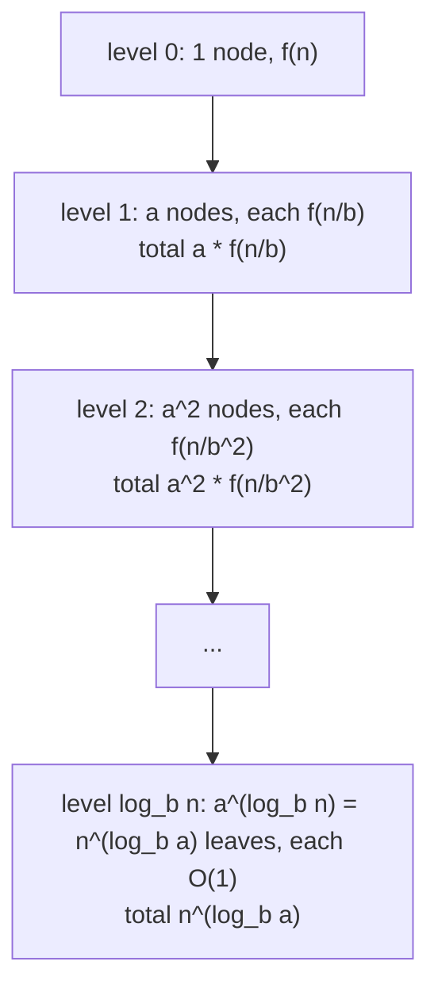

# Divide and Conquer and the Master Theorem

> Recurrences you can solve without memorizing.

**Type:** Learn
**Languages:** —
**Prerequisites:** Phase 1, Lesson 01 (Complexity Analysis), Phase 2, Lesson 01 (Sorting), Phase 2, Lesson 02 (Binary Search and Its Variants)
**Time:** ~60 minutes

## Learning Objectives

- Write the recurrence for a divide-and-conquer algorithm from its code by identifying the number of subproblems, their size, and the combine cost
- Solve recurrences of the form T(n) = a T(n/b) + f(n) with the master theorem, by comparing f(n) against n^(log_b a) and naming which of the three cases applies and why
- Derive the master theorem's three cases from the recursion tree, so that a recurrence outside its scope (unequal splits, T(n-1), log factors) can still be solved by the same picture
- Explain why Strassen's matrix multiplication and Karatsuba's integer multiplication beat the obvious algorithm, in terms of reducing the number of subproblems rather than the combine cost
- Decide when divide and conquer loses to a straightforward iteration, using constant factors, cache behaviour, and the shape of the data

## The Problem

A reconciliation engine compares two sorted lists of a few hundred million transactions and reports the differences. The first version is a simple two-pointer merge (Lesson 03) and runs in nine minutes. An engineer proposes a recursive version: split both lists in half at a matching timestamp, reconcile each half in parallel on separate cores, combine. On a 32-core machine the prototype is slower than the original, at fourteen minutes, and nobody can say why without guessing. The team argues about threads, about GC, and about the merge; the actual reason is in the recurrence. Each split scans both lists to find the matching timestamp, which is `O(n)` combine work at every level, and there are `log n` levels, so the recursive version does `O(n log n)` work to achieve what the merge did in `O(n)`. Parallelism divided the constant by 32 and the algorithm multiplied it by `log2(3 * 10^8) ≈ 28`. Net effect: slower.

A second team, in the same quarter, has the opposite problem. A risk-scoring batch multiplies large dense matrices (customer features by model weights) and the obvious triple loop takes four hours. Someone remembers that Strassen's algorithm is "faster" and spends a week implementing it. It is slower than the triple loop at the sizes they have, because Strassen trades eight multiplications for seven at the cost of eighteen additions and terrible cache behaviour, and the crossover where that trade pays off is well above their matrix dimension. Both teams would have saved weeks by writing the recurrence down and solving it before writing code.

The master theorem is the tool for that. It solves almost every recurrence that divide and conquer produces in one line of comparison, and when it does not apply, the recursion tree it is derived from still gives the answer. This lesson teaches the tree first, then the theorem as the pattern the tree reveals, then the cases where divide and conquer is the wrong shape.

## The Concept

### From code to recurrence

A divide-and-conquer algorithm has three parts: divide the input into subproblems, conquer each recursively, combine the results. Its running time on input size `n` is

```text
T(n) = a * T(n / b) + f(n)
```

where `a` is the number of subproblems, `n / b` is the size of each, and `f(n)` is the cost of dividing and combining at one level. Reading these off code is mechanical:

| Algorithm | a | b | f(n) | Recurrence |
|-----------|---|---|------|------------|
| Binary search | 1 | 2 | O(1) | T(n) = T(n/2) + 1 |
| Merge sort | 2 | 2 | O(n) | T(n) = 2 T(n/2) + n |
| Naive recursive matrix multiply (8 blocks) | 8 | 2 | O(n^2) | T(n) = 8 T(n/2) + n^2 |
| Strassen | 7 | 2 | O(n^2) | T(n) = 7 T(n/2) + n^2 |
| Karatsuba integer multiply | 3 | 2 | O(n) | T(n) = 3 T(n/2) + n |
| Closest pair of points | 2 | 2 | O(n) after presorting | T(n) = 2 T(n/2) + n |
| The failed reconciliation above | 2 | 2 | O(n) | T(n) = 2 T(n/2) + n |

The last row is the whole diagnosis of the first team's problem: `2 T(n/2) + n` is merge sort's recurrence and merge sort is `n log n`.

### The recursion tree

Draw the recurrence as a tree. The root does `f(n)` work and has `a` children of size `n/b`. Each child does `f(n/b)` work and has `a` children of size `n/b^2`. The tree has depth `log_b n` (the size shrinks by `b` each level until it hits 1), and level `i` has `a^i` nodes each doing `f(n / b^i)` work.



The total is the sum over levels. The leaf count, `a^(log_b n)`, is the same number as `n^(log_b a)` (take logs of both: `log_b n * log a = log_b a * log n`), and that quantity is the hinge of the whole theory. Call it the **critical exponent**: `n^(log_b a)` is how much work the leaves do, and the question is whether the root's `f(n)` is smaller, equal, or larger than that.

### Worked example: merge sort by tree

`T(n) = 2 T(n/2) + n`, so `a = 2`, `b = 2`, `log_b a = 1`, critical exponent `n^1 = n`.

```text
level 0:  1 node  * n       = n
level 1:  2 nodes * n/2     = n
level 2:  4 nodes * n/4     = n
...
level log2 n:  n leaves * 1 = n
sum: (log2 n + 1) levels, each n  ->  n log2 n + n  = O(n log n)
```

Every level does the same work because `f(n) = n` exactly matches the critical exponent: halving the size and doubling the count cancel. That is case 2 of the theorem.

### Worked example: binary search by tree

`T(n) = T(n/2) + 1`, `a = 1`, `b = 2`, `log_2 1 = 0`, critical exponent `n^0 = 1`.

```text
level 0:  1 node * 1 = 1
level 1:  1 node * 1 = 1
...
level log2 n:  1 leaf * 1 = 1
sum: log2 n + 1 levels, each 1  ->  O(log n)
```

Again `f(n) = 1` matches `n^0 = 1`, so every level costs the same and the total is the number of levels. Case 2 again, which is why `O(log n)` appears so often: any recurrence that does constant work and recurses on one half is binary search in disguise.

### Worked example: Karatsuba by tree

Multiplying two `n`-digit numbers the schoolbook way is `O(n^2)`. Split each into high and low halves: `x = x1 * 10^(n/2) + x0`, `y = y1 * 10^(n/2) + y0`. The product needs `x1 y1`, `x0 y0`, and `x1 y0 + x0 y1`, which is four half-size multiplications, `T(n) = 4 T(n/2) + n`, critical exponent `n^2`: no better than schoolbook. Karatsuba's observation (1960) is that `x1 y0 + x0 y1 = (x1 + x0)(y1 + y0) - x1 y1 - x0 y0`, so three multiplications suffice, `T(n) = 3 T(n/2) + n`.

```text
critical exponent: n^(log2 3) = n^1.585
level 0:  1 * n          = n
level 1:  3 * n/2        = 1.5 n
level 2:  9 * n/4        = 2.25 n
level i:  3^i * n / 2^i  = n * (1.5)^i       <- a geometric series that GROWS
leaves:   3^(log2 n) = n^1.585, each O(1)
sum: dominated by the last level  ->  O(n^1.585)
```

The work per level grows geometrically, so the leaves dominate and the total is the leaf count. That is case 1. Reducing four subproblems to three changed the exponent from 2 to 1.585; no amount of optimising the `O(n)` additions could have done that. Java's `BigInteger.multiply` switches to Karatsuba above 80 ints (about 2,560 bits) and to Toom-Cook 3-way (`T(n) = 5 T(n/3) + n`, exponent `log_3 5 = 1.465`) above 240 ints; Phase 10's money arithmetic never gets near these sizes, but the RSA and Diffie-Hellman operations in Phase 11's TLS lesson do.

### Worked example: Strassen's intuition

Multiplying two `n x n` matrices by blocks: split each into four `n/2 x n/2` blocks; the product's four blocks each need two block products, eight in total, plus `O(n^2)` additions. `T(n) = 8 T(n/2) + n^2`, critical exponent `n^(log2 8) = n^3`: the triple loop, no gain. Strassen (1969) found seven products of sums and differences of blocks from which all four result blocks can be assembled with eighteen additions. `T(n) = 7 T(n/2) + n^2`, critical exponent `n^(log2 7) = n^2.807`. Case 1 again: the leaves dominate, and seven instead of eight at every level compounds into a smaller exponent.

For the record, the seven products on blocks `A = [[A11, A12], [A21, A22]]` and `B = [[B11, B12], [B21, B22]]`:

```text
M1 = (A11 + A22)(B11 + B22)
M2 = (A21 + A22) B11
M3 = A11 (B12 - B22)
M4 = A22 (B21 - B11)
M5 = (A11 + A12) B22
M6 = (A21 - A11)(B11 + B12)
M7 = (A12 - A22)(B21 + B22)

C11 = M1 + M4 - M5 + M7
C12 = M3 + M5
C21 = M2 + M4
C22 = M1 - M2 + M3 + M6
```

Verifying `C11` by expansion: `M1 + M4 - M5 + M7 = A11B11 + A11B22 + A22B11 + A22B22 + A22B21 - A22B11 - A11B22 - A12B22 + A12B21 + A12B22 - A22B21 - A22B22 = A11B11 + A12B21`, which is the block product's top-left entry. Ten additions to form the operands, eight to assemble the result: eighteen in all, each `O(n^2)` on `n/2 x n/2` blocks.

The intuition that generalises: in divide and conquer, **the number of subproblems sets the exponent; the combine cost only matters when it is as large as the leaf work.** Shaving the combine step from `18 n^2` additions to `15 n^2` (which has been done) changes a constant. Shaving one multiplication changes the exponent. This is also why the practical crossover is high: the constant hidden in `O(n^2.807)` is large, and for `n` below a few hundred (depending on hardware and layout) the triple loop, with its perfect cache behaviour and vectorisation, wins. Production BLAS libraries use Strassen only above a tuned threshold and only for a level or two before switching back.

### The master theorem

For `T(n) = a T(n/b) + f(n)` with `a >= 1`, `b > 1`, and critical exponent `c = log_b a`:

| Case | Condition | Picture | Solution | Example |
|------|-----------|---------|----------|---------|
| 1 | `f(n) = O(n^(c - e))` for some `e > 0`: f is polynomially smaller than `n^c` | Work per level grows geometrically; leaves dominate | `T(n) = Θ(n^c)` | Karatsuba, Strassen, `T(n) = 4T(n/2) + n` → `Θ(n^2)` |
| 2 | `f(n) = Θ(n^c)`: f matches `n^c` | Every level does the same work | `T(n) = Θ(n^c log n)` | Merge sort, binary search, `T(n) = 2T(n/2) + n` → `Θ(n log n)` |
| 3 | `f(n) = Ω(n^(c + e))` for some `e > 0`, and `a f(n/b) <= k f(n)` for some `k < 1` (regularity) | Work per level shrinks geometrically; root dominates | `T(n) = Θ(f(n))` | `T(n) = 2T(n/2) + n^2` → `Θ(n^2)`; `T(n) = T(n/2) + n` → `Θ(n)` |

The procedure, every time:

1. Read `a`, `b`, `f(n)` from the code.
2. Compute `c = log_b a`. For `a = b` it is 1; for `a = 1` it is 0; for `a = b^2` it is 2; otherwise use a calculator once (`log2 3 = 1.585`, `log2 7 = 2.807`, `log3 5 = 1.465`).
3. Compare `f(n)` with `n^c`. Polynomially smaller, same, or polynomially larger.
4. Write the answer.

Three more examples, worked:

- `T(n) = 9 T(n/3) + n`: `c = log3 9 = 2`, `f = n` is polynomially smaller than `n^2`. Case 1: `Θ(n^2)`.
- `T(n) = T(2n/3) + 1`: `a = 1`, `b = 3/2`, `c = 0`, `f = 1 = n^0`. Case 2: `Θ(log n)`. (The ternary-search-like "discard a third" still gives a logarithm; the base of the log changes, which Big-O ignores.)
- `T(n) = 3 T(n/4) + n log n`: `c = log4 3 = 0.793`, `f = n log n` is polynomially larger than `n^0.793` (it is at least `n^1`). Regularity: `3 (n/4) log(n/4) <= (3/4) n log n`, yes. Case 3: `Θ(n log n)`.

### Case 3 by hand, with the regularity check

`T(n) = 2 T(n/2) + n^2`. Critical exponent `c = 1`, `f = n^2 = n^(c + 1)`, polynomially larger. Regularity: `a f(n/b) = 2 (n/2)^2 = n^2 / 2 <= (1/2) n^2`, so `k = 1/2 < 1` holds. Case 3: `T(n) = Θ(n^2)`. The tree confirms it:

```text
level 0:  1 * n^2         = n^2
level 1:  2 * (n/2)^2     = n^2 / 2
level 2:  4 * (n/4)^2     = n^2 / 4
level i:  2^i * (n/2^i)^2 = n^2 / 2^i        <- geometric series that SHRINKS
sum: n^2 (1 + 1/2 + 1/4 + ...) < 2 n^2  ->  Θ(n^2)
```

The root does half of all the work. This is the shape of a recursive algorithm whose combine step is the expensive part: an `O(n^2)` merge of two halves is no better than not recursing at all, and the recurrence says so.

Why the regularity condition exists: `f` could be large at the root and tiny one level down (an `f` that oscillates with `n`), in which case the root does not dominate and the "root wins" conclusion is false. Every polynomial `f` satisfies regularity automatically; it only needs checking for exotic `f`.

### The substitution method: when you have a guess

The recursion tree suggests an answer; the substitution method proves it. Guess `T(n) <= c n log n` for merge sort and verify by induction:

```text
T(n) = 2 T(n/2) + n
     <= 2 * c (n/2) log(n/2) + n          (inductive hypothesis on n/2)
     =  c n (log n - 1) + n
     =  c n log n - c n + n
     <= c n log n                          whenever c >= 1
```

The last step is the whole proof: the `-cn` term absorbs the `+n` as long as `c >= 1`. A guess that is too low fails at exactly this step (try `T(n) <= c n`: you get `c n + n`, which is not `<= c n` for any `c`), and the failure tells you the missing factor. For the quicksort average case, `T(n) = (2/n) sum_{i<n} T(i) + n`, guessing `c n ln n` and substituting gives `c = 2`, hence `2 n ln n = 1.39 n log2 n`, the figure Lesson 01's comparison counter reproduced.

### Decision procedure

1. Write the recurrence from the code: count the recursive calls (`a`), read the size reduction (`n/b`, or `n - k`), and add up the non-recursive work (`f(n)`).
2. If the size shrinks by subtraction, unroll: `T(n) = T(n-1) + f(n)` is `sum f(i)`; `T(n) = a T(n-1) + f(n)` with `a >= 2` is exponential. Stop; the master theorem does not apply.
3. Compute `c = log_b a`. Compare `f(n)` to `n^c` by exponent.
4. Polynomially smaller: case 1, `Θ(n^c)`. Equal: case 2, `Θ(n^c log n)`. Polynomially larger and regular: case 3, `Θ(f(n))`.
5. If `f` differs from `n^c` only by a logarithmic factor, use the extended case 2 (`n^c log^k n` gives `n^c log^(k+1) n`), or sum the tree directly.
6. If the splits are unequal (`T(n/4) + T(3n/4)`), use the tree: constant work per level until the shortest branch ends, `Θ(log n)` levels, or apply Akra-Bazzi.
7. Compare the result to the best iterative alternative before writing code. If D&C gives `n log n` and a single pass gives `n`, the recursion is the wrong shape.

### Failure modes

| Symptom | Cause | Diagnosis |
|---------|-------|-----------|
| Parallel D&C slower than the sequential loop | Combine cost `Θ(n)` per level, `log n` levels: case 2 | Recurrence shows `n log n` versus `n`; partition once, recurse never |
| "Better" algorithm slower at real sizes | Below the crossover; the constant hidden in the exponent | Measure both at the actual `n`; use the simple one below the threshold |
| `n log^2 n` where `n log n` was expected | A per-level sort instead of a per-level merge in the combine | The gap case; replace the `n log n` combine with an `O(n)` one |
| Exponential time from an innocent-looking recursion | Two recursive calls on `n - 1` sized inputs | Subtract-and-conquer with `a >= 2`; memoise or redesign |
| Stack overflow in a D&C algorithm | Depth should be `log n`; a degenerate split (quicksort with a sorted input and a fixed pivot) makes it `n` | Randomise the split or recurse on the smaller side |
| Wrong case chosen | Compared `f(n)` to `n`, not to `n^(log_b a)` | Always compute the critical exponent first; `4 T(n/2) + n` is case 1 with `c = 2`, not case 2 |

### The gap the theorem does not cover

The three cases have gaps between them: `f(n)` must differ from `n^c` by a *polynomial* factor, `n^e`. `T(n) = 2 T(n/2) + n log n` has `c = 1` and `f = n log n`, which is larger than `n` but not by any `n^e`. Case 3 does not apply. The tree still works:

```text
level i:  2^i nodes * (n / 2^i) log(n / 2^i) = n (log n - i)
sum over i from 0 to log n:  n * (log n + (log n - 1) + ... + 1) = n * log n (log n + 1) / 2
T(n) = Θ(n log^2 n)
```

The extended form of the theorem (Case 2 generalised: if `f(n) = Θ(n^c log^k n)` then `T(n) = Θ(n^c log^(k+1) n)`) covers this. The point is that the tree is the method and the theorem is a shortcut for the common shapes.

### Recurrences that are not divide and conquer

- `T(n) = T(n - 1) + n` (selection sort, insertion sort worst case, the naive recursive sum): not of the master form because the size shrinks by subtraction. Unroll it: `n + (n-1) + ... + 1 = Θ(n^2)`. Subtract-and-conquer recurrences `T(n) = a T(n - b) + f(n)` are exponential when `a > 1` (`T(n) = 2 T(n-1) + 1` is `Θ(2^n)`, the subset enumeration of Lesson 04) and polynomial when `a = 1`.
- `T(n) = T(n/4) + T(3n/4) + n` (quicksort with a consistently lopsided but fixed-ratio pivot): unequal splits. The tree's levels still each do `n` work until the shortest branch bottoms out at depth `log4 n`, and the longest branch has depth `log_(4/3) n`; both are `Θ(log n)`, so the total is `Θ(n log n)`. Any fixed-fraction split is as good as halving, up to a constant.
- `T(n) = T(n - 1) + T(n - 2) + 1` (naive Fibonacci): the tree has `Θ(φ^n)` nodes. This is the recurrence that memoisation collapses, and it belongs to Lesson 06.
- Quicksort's expected recurrence `T(n) = (2/n) sum T(i) + n` averages over pivots; it needs a different technique (substitution with a guess of `c n log n`) and yields `1.39 n log2 n`, the number Lesson 01 measured.

### When divide and conquer loses

The reconciliation team's failure generalises into a checklist:

| Situation | Why D&C loses | Use instead |
|-----------|---------------|-------------|
| A linear scan already solves it | Any recursive split adds at least `log n` levels of overhead or an `n log n` combine | Two pointers, a single pass with running state |
| Combine cost equals the whole problem | `f(n) = Θ(n)` with `a = b` is case 2: `n log n`, never better than the direct `n` | Restructure so the combine is `O(1)`, or do not recurse |
| Small `n` | Recursion, allocation, and poor locality dominate; every production sort switches to insertion sort below ~16-32 | A cutoff to the simple algorithm |
| Data in sequential storage | Splitting means random access; merging means streaming | Streaming algorithms; external merge where the "divide" is one sequential pass |
| Subproblems overlap | The tree revisits the same state; D&C assumes independence | Dynamic programming (Lesson 06) |
| Constant factors of the clever algorithm | Strassen's 18 additions, Karatsuba's bookkeeping, cache misses | Measure the crossover; use the clever algorithm only above it |

Divide and conquer wins when the combine is cheap relative to the leaves (case 1), or when the problem genuinely needs `n log n` and the recursive structure delivers it with a small constant (merge sort, closest pair, FFT). Parallelism is a separate axis: a case-2 algorithm parallelises well because the levels are independent, but as the first team learned, parallelising an `n log n` algorithm does not make it faster than a sequential `n` one until the core count exceeds `log n`.

### Where the recurrences show up in production

| System | Recurrence | Case | What it buys |
|--------|------------|------|--------------|
| `Arrays.parallelSort`, `ForkJoinPool` tasks | `T(n) = 2 T(n/2) + n` with the two halves on different cores | 2 | Span `O(log^2 n)` with `O(n log n)` total work: the levels parallelise, the merge does not |
| Fast Fourier transform (signal processing, polynomial multiplication, some fraud-feature pipelines) | `T(n) = 2 T(n/2) + n` | 2 | `n log n` against the `n^2` direct convolution; the reason audio and image codecs exist |
| `BigInteger.multiply` | `4T(n/2)+n` below 2,560 bits; `3T(n/2)+n` (Karatsuba) above; `5T(n/3)+n` (Toom-Cook) above 7,680 bits | 1 | RSA key generation and modular exponentiation in Phase 11's TLS lesson run on these |
| B-tree and skip-list lookups (Phase 1, Lesson 08; Phase 3) | `T(n) = T(n/b) + log b` with fan-out `b` | 2 with `c = 0` | `log_b n` disk reads: a 4-level tree covers a billion keys at `b = 200` |
| External merge sort (databases, `sort(1)`) | `T(n) = k T(n/k) + n` with `k`-way merge via a heap | 2 | `n log_k n` passes over data that does not fit in memory; the "divide" is one sequential pass |
| MapReduce-style aggregation | `T(n) = m T(n/m) + m` combine of `m` partial results | 1 (leaves dominate) | Linear total work, parallel across `m` workers, `O(m)` combine; the design the reconciliation team should have used |

## Worked Example

### Closest pair of points, end to end

Given `n` points in the plane (settlement locations, or two-dimensional risk features), find the two closest. The brute force checks all `n(n-1)/2` pairs: `Θ(n^2)`. Divide and conquer:

1. **Presort** the points by x once, `O(n log n)`, and keep a copy sorted by y.
2. **Divide** at the median x into left and right halves of `n/2` points each.
3. **Conquer** recursively, getting the closest distance `dL` in the left half and `dR` in the right. Let `d = min(dL, dR)`.
4. **Combine**: the only pairs not yet considered straddle the dividing line. Any such pair closer than `d` has both points within `d` of the line, so collect the points in that vertical strip. Walk them in y order; for each point, compare only with the next points whose y differs by less than `d`. A packing argument shows that at most seven such points exist (two `d x d` squares on either side of the line can each hold at most four points pairwise at least `d` apart), so this is `O(n)`.

Recurrence: `T(n) = 2 T(n/2) + O(n)`, case 2, `Θ(n log n)`, plus the `O(n log n)` presort. Against the `n^2` brute force on a million points that is about `2 * 10^7` versus `5 * 10^11` operations.

The step that makes it work is maintaining the y-sorted order through the recursion by merging the halves' y-sorted lists (the merge of Lesson 01, `O(n)`) rather than re-sorting the strip (`O(n log n)` per level, which would make the whole thing `Θ(n log^2 n)`, the gap case above). That is the general lesson: a combine step one logarithmic factor too expensive costs a logarithmic factor in the answer, and the recurrence shows it before a line of code is written.

### The reconciliation team's fix

Write the recurrence for the proposed design: `T(n) = 2 T(n/2) + n`, case 2, `Θ(n log n)`. Write it for the existing merge: a single pass, `Θ(n)`. The proposal is worse by a factor of `log n ≈ 28` before parallelism and better by at most 32 after it; expected speed-up roughly 1.1x on a perfect machine, with real overheads making it a slowdown. The design that does win: partition the two sorted lists by timestamp *once* into 32 ranges (`O(n)` scan, or `O(32 log n)` with binary search on the sorted timestamps), then run the linear merge on each range in parallel, `T = n / 32 + O(1)`. Same cores, no recursion, no combine, and the recurrence said so in advance.

### The card

`outputs/interview-card-master-theorem.md` compresses this lesson onto one page: the procedure, a table of a dozen recurrences with their cases and answers, the non-master shapes, and the sentence to say when asked. Read it before a system-design interview and before a design review that proposes recursion.

## Exercises

1. **Reinforce.** Solve each by the master theorem, naming the case: `T(n) = 4T(n/2) + n^2`; `T(n) = 2T(n/4) + sqrt(n)`; `T(n) = 16T(n/4) + n`; `T(n) = T(n/2) + n`; `T(n) = 8T(n/2) + n^3`. Then draw the recursion tree for one of them and verify the sum level by level.
2. **Apply.** Phase 1, Lesson 09 builds a heap bottom-up in `O(n)`. Write that construction as a recurrence (`T(n) = 2 T(n/2) + O(log n)`: build two half-heaps, then sift the root down) and solve it. Which case is it, and why does the result contradict the intuition that "n elements each sifting log n levels" should be `n log n`? Confirm the answer against the comparison count in that lesson's test.
3. **Extend.** Combine with Phase 2, Lesson 01 and Phase 0, Lesson 05 (benchmarking). Implement Karatsuba multiplication on `long[]` digit arrays and measure it against schoolbook multiplication for digit counts 8 through 8,192. Find the crossover where Karatsuba wins on your machine, then explain in a comment why `BigInteger`'s threshold (80 ints) is in that neighbourhood and why the crossover would move if the base case were `int` instead of `long`.

## Key Terms

| Term | What people say | What it actually means |
|------|-----------------|------------------------|
| Recurrence | "the formula for the runtime" | An equation defining `T(n)` in terms of `T` on smaller inputs plus the work done at this level; read directly off the code's structure |
| Master theorem | "the three cases" | A closed-form solution for `T(n) = a T(n/b) + f(n)` based on comparing `f(n)` with `n^(log_b a)`; a shortcut for the recursion-tree sum |
| Critical exponent | "n to the log b of a" | `log_b a`, the exponent such that `n^(log_b a)` is the number of leaves and hence the leaf work; the quantity `f(n)` is compared against |
| Recursion tree | "unrolling the recurrence" | The tree of subproblem invocations, with work per node written in; summing by level gives `T(n)` for any recurrence, master form or not |
| Case 1 / 2 / 3 | "leaves win / tie / root wins" | Which level dominates the sum: the leaves (`f` small), all levels equally (`f` matches), or the root (`f` large) |
| Regularity condition | "the extra check in case 3" | `a f(n/b) <= k f(n)` for some `k < 1`: the requirement that work actually shrinks going down the tree; fails for oscillating `f` |
| Crossover point | "when the clever one wins" | The input size above which an algorithm with a better exponent but a worse constant becomes faster; Strassen's is in the hundreds, Karatsuba's around 2,500 bits |
| Subtract-and-conquer | "T(n-1) recurrences" | Recurrences where the size shrinks by a constant rather than a factor; polynomial if one branch, exponential if more; outside the master theorem |

## Further Reading

- [Cormen, Leiserson, Rivest, Stein, *Introduction to Algorithms*, 4th ed., Chapter 4: Divide-and-Conquer](https://mitpress.mit.edu/9780262046305/introduction-to-algorithms/) — the master theorem with its proof via the recursion tree, the substitution method, and Strassen's algorithm in full.
- [Bentley, Haken, Saxe, "A general method for solving divide-and-conquer recurrences" (1980)](https://dl.acm.org/doi/10.1145/1008861.1008865) — the paper that introduced what became the master theorem.
- [Karatsuba and Ofman, "Multiplication of Many-Digital Numbers by Automatic Computers" (1962)](https://www.mathnet.ru/eng/dan26729) — the original three-multiplication trick; four pages.
- [Strassen, "Gaussian Elimination is not Optimal" (1969)](https://link.springer.com/article/10.1007/BF02165411) — seven products instead of eight, and the start of fifty years of exponent chasing.
- [OpenJDK `java.math.BigInteger` source](https://github.com/openjdk/jdk/blob/master/src/java.base/share/classes/java/math/BigInteger.java) — search for `KARATSUBA_THRESHOLD` and `TOOM_COOK_THRESHOLD` to see where a production library puts the crossover and why.
- [Akra and Bazzi, "On the Solution of Linear Recurrence Equations" (1998)](https://link.springer.com/article/10.1023/A:1018373005182) — the generalisation to unequal splits such as `T(n/4) + T(3n/4) + n`, for when the master theorem's single `b` is not enough.
