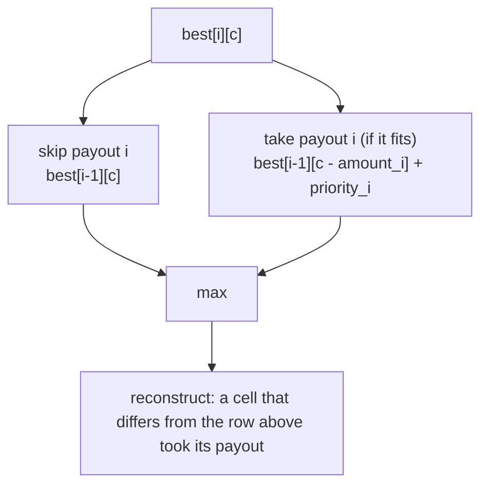

# Dynamic Programming: From Recurrence to Table

> Coin change is literally change-making; knapsack is payout batching.

**Type:** Build
**Languages:** Java, Python, Go
**Prerequisites:** Phase 2 Lesson 04 (Recursion and Backtracking), Phase 2 Lesson 05 (Divide and Conquer and the Master Theorem), Phase 1 Lesson 06 (Hash Maps)
**Time:** ~120 minutes

## Learning Objectives

- Write the recurrence for a problem first, then derive the memoised and tabulated versions mechanically from it, and show with a call counter why the three differ by orders of magnitude
- Recognise the two properties that make a problem a dynamic-programming problem (optimal substructure and overlapping subproblems) and the one that makes greedy sufficient instead (the exchange property)
- Build coin change twice, for the fewest instruments and for the number of distinct bundles, and explain why the loop order decides which question you are answering
- Build 0/1 knapsack as payout batching under a settlement limit, including reconstruction of the chosen set from the table, and state why its running time is pseudo-polynomial
- Build longest common subsequence as an in-order statement matcher and derive the three outputs a reconciliation needs: matched, left-only, right-only
- Reconstruct the solution, not just its value, from any DP table by recording or re-deriving the choice at each cell

## The Problem

A rewards platform pays out balances in gift instruments. The issuer offers three face values: 1.00, 15.00, and 25.00 USD. Each instrument issued costs the platform a flat fulfilment fee, so the payout service should use as few instruments as possible. The first implementation is the one everybody writes: take the largest face value that fits, repeat. For a 30.00 USD payout it picks one 25.00, then five 1.00s: six instruments, six fees. Two 15.00 instruments would have done it. The greedy rule is correct for US coins, for euro notes, and for almost every national currency, which is exactly why nobody questioned it; it is wrong for this voucher set, and it was wrong on about one payout in nine for the eighteen months before someone in finance noticed the fulfilment fee line growing faster than payout volume.

The second failure is in settlement. A payout rail accepts batches up to a fixed total, say 100.00 USD per file in this toy, 10,000,000.00 in the real one. Pending payouts each carry a priority score (days overdue, merchant tier, a regulator's deadline). The batching job sorts by priority and fills the batch until the next payout does not fit. With payouts A (60.00, priority 100), B (50.00, priority 90), and C (50.00, priority 90), the greedy batch is A plus whatever small items fit after it, priority 115 in the demo. B plus C fits exactly and scores 180. Greedy left the two 90-point merchants waiting another day because one 100-point merchant was slightly more urgent than either of them individually. Nobody notices for a week, because the batch was full and the report says "batch utilisation 100%".

The third failure is quieter. A reconciliation job compares a bank statement with the ledger's expected postings line by line. The naive approach pairs line one with line one, line two with line two. One extra fee line at position four on the bank side shifts every later pairing by one and the job reports forty-seven breaks where there is one. What the job needed was the longest sequence of lines that appear in the same order on both sides; everything not in that sequence is a genuine break.

All three are the same shape of problem: a decision now, then the same problem again on what is left, with the same sub-states reached by many different decision paths. Recursion alone solves them in exponential time because it re-solves those shared sub-states. Dynamic programming is the discipline of solving each sub-state once, in an order that guarantees its dependencies are already solved, and keeping enough information to walk the answer back out.

## The Concept

### Two properties, one technique

A problem is a dynamic-programming problem when it has both:

1. **Optimal substructure.** An optimal solution to the whole contains optimal solutions to its parts. If the fewest-coins way to make 30 uses a 15 first, then the rest of that solution is the fewest-coins way to make 15. If it were not, you could swap in the better way to make 15 and improve the whole, contradicting optimality.
2. **Overlapping subproblems.** The recursion reaches the same sub-state many times. "Make 12" is reached from 13 via a 1, from 15 via a 3, and from 16 via a 4. There are only `amount + 1` distinct sub-states but exponentially many paths to them.

Property 1 without property 2 is divide and conquer (Lesson 05): merge sort's halves never overlap, so there is nothing to cache. Property 1 plus a stronger property, that the locally best choice is always safe (the exchange argument of Lesson 07), means greedy is enough and the table is unnecessary. Coin change with US denominations has the exchange property; coin change with `{1, 15, 25}` does not. The table is what you build when you cannot prove the exchange argument.

### The three forms

Every DP solution goes through the same three forms. Do them in this order every time; skipping to the table is how off-by-one errors and wrong loop orders happen.

| Form | What it is | Time for coin change | Space | When to stop here |
|------|-----------|---------------------|-------|-------------------|
| Recurrence | A function from a state to its answer in terms of smaller states, plus base cases | Exponential: 20,736 calls for amount 20 with `{1,3,4}` | Call stack | Never for production; always as the specification |
| Memoisation | The same function with a cache keyed by state; top-down | O(amount * denominations): 56 calls for the same input | Cache plus call stack | When the reachable state space is sparse or hard to enumerate in order |
| Tabulation | Fill an array of states in dependency order; bottom-up | Same big-O, smaller constants, no recursion | The table | When every state is reachable and the order is obvious; this is the production form |

The recurrence for fewest coins, with `D` the set of denominations:

```text
f(0) = 0
f(a) = 1 + min { f(a - d) : d in D, d <= a }     for a > 0
f(a) = INF when no d <= a has a finite f(a - d)
```

Memoisation adds one line: look up `a` before computing, store it after. Tabulation observes that `f(a)` depends only on strictly smaller `a`, so filling `a = 1, 2, ..., amount` in order guarantees every dependency is already filled. The table is the recurrence turned inside out.

### Worked example: fewest coins for 6 with {1, 3, 4}

```text
best[0] = 0
best[1] = 1 + best[0]                       = 1   (choice: 1)
best[2] = 1 + best[1]                       = 2   (choice: 1)
best[3] = 1 + min(best[2], best[0])         = 1   (choice: 3)
best[4] = 1 + min(best[3], best[1], best[0])= 1   (choice: 4)
best[5] = 1 + min(best[4], best[2], best[1])= 2   (choice: 1, via best[4]; ties keep the lowest index)
best[6] = 1 + min(best[5], best[3], best[2])= 2   (choice: 3, via best[3])
```

Reconstruction walks `choice` from the top: `choice[6] = 3`, so take a 3 and move to amount 3; `choice[3] = 3`, take another 3 and reach 0. Result `[3, 3]`. Greedy would have taken 4, then 1, then 1. The table did not "know" greedy was wrong; it simply never assumed the largest coin was safe.

Note the tie rule. At `best[5]`, taking a 1 (via `best[4] = 1`) and taking a 4 (via `best[1] = 1`) both give 2. The code uses strict `<` when updating, so the first denomination index that achieves the minimum wins: `choice[5]` points at denomination 1. This makes the reconstruction deterministic across all three languages, which matters when the payout service and the audit job both recompute the plan.

### Min coins versus number of ways: the loop order is the semantics

Counting the number of distinct bundles that make an amount looks almost identical and has one trap:

```text
ways[0] = 1
for each denomination d:            <- denominations OUTER
    for a from d to amount:
        ways[a] += ways[a - d]
```

With denominations as the outer loop, each bundle is built in a canonical order (all the 1s, then all the 3s, then all the 4s), so `{1, 3}` and `{3, 1}` are the same bundle and counted once. Swap the loops, amounts outer and denominations inner, and you count ordered sequences: `1 then 3` and `3 then 1` are different. For 5 from `{1, 2, 5}` the first gives 4 (5; 2+2+1; 2+1+1+1; 1+1+1+1+1), the second gives 9. Both are valid DPs; they answer different questions. The min-coins table does not care about loop order because `min` is idempotent; the counting table does because `+` is not.

### 0/1 knapsack as payout batching

State: `best[i][c]` is the maximum priority achievable using only the first `i` payouts with total amount at most `c` minor units. Recurrence:

```text
best[0][c] = 0
best[i][c] = best[i-1][c]                                    if amount_i > c   (does not fit)
best[i][c] = max(best[i-1][c], best[i-1][c - amount_i] + p_i) otherwise         (skip it, or take it)
```

"0/1" means each payout is taken whole or not at all. The row index `i` is what prevents taking a payout twice: the "take" branch consults row `i - 1`, which has never seen payout `i`. Coin change, where a denomination may be reused, consults the same row, which is why its table is one-dimensional.

Worked example by hand, with a tiny limit of 7 units and three payouts (amount, priority): A (3, 4), B (4, 5), C (2, 3):

| | c=0 | c=1 | c=2 | c=3 | c=4 | c=5 | c=6 | c=7 |
|---|---|---|---|---|---|---|---|---|
| i=0 (none) | 0 | 0 | 0 | 0 | 0 | 0 | 0 | 0 |
| i=1 (A: 3, 4) | 0 | 0 | 0 | 4 | 4 | 4 | 4 | 4 |
| i=2 (B: 4, 5) | 0 | 0 | 0 | 4 | 5 | 5 | 5 | 9 |
| i=3 (C: 2, 3) | 0 | 0 | 3 | 4 | 5 | 7 | 8 | 9 |

The answer is `best[3][7] = 9`. Reconstruct from the bottom-right corner: `best[3][7] = 9 = best[2][7]`, so C was not taken. `best[2][7] = 9 != best[1][7] = 4`, so B was taken; move to `c = 7 - 4 = 3`. `best[1][3] = 4 != best[0][3] = 0`, so A was taken; move to `c = 0`. Chosen: A and B, total 7, priority 9. Greedy by priority would also take B first (5), then A (3 units, fits), total 9: it happens to agree here. The demo's six-payout instance is the one where it does not.



### Why knapsack is pseudo-polynomial

The table has `(n + 1) * (limit + 1)` cells. With amounts in minor units, a 100.00 USD limit is 10,001 columns; a 10,000,000.00 USD limit is a billion columns. The running time is polynomial in the *numeric value* of the limit but exponential in the *number of bits* needed to write it down, which is what "pseudo-polynomial" means and why 0/1 knapsack is NP-hard despite having this neat table. Three consequences for a payments engineer:

- Knapsack in minor units is fine for small limits and small `n` (a merchant's daily payout list under a per-file cap).
- For large limits, either reduce the resolution (round amounts up to whole units for the table, then verify the chosen set against the exact limit in minor units: rounding up guarantees feasibility), or switch to the value-indexed table `minWeight[i][v]` when priorities are small, or accept a greedy or fractional approximation with a known bound.
- Never scale amounts to a coarser unit *without* re-verifying in exact minor units. The table may approximate; the settlement file may not.

### Longest common subsequence

State: `len[i][j]` is the LCS length of the first `i` lines of A and the first `j` lines of B.

```text
len[0][j] = len[i][0] = 0
len[i][j] = len[i-1][j-1] + 1               if A[i] == B[j]
len[i][j] = max(len[i-1][j], len[i][j-1])   otherwise
```

A subsequence keeps order but need not be contiguous; a substring must be contiguous. Statement matching wants subsequence: a fee line inserted on one side must not break the matching of everything after it. Reconstruction walks back from the corner: on a match, emit it and move diagonally; otherwise move toward the larger neighbour, emitting the skipped line as left-only or right-only. The tie rule (prefer moving up when the neighbours are equal) is arbitrary but must be the same everywhere, because two different maximal subsequences can exist and the reconciliation report must be reproducible.

The demo's bank statement has `CARD 19.99` before `CARD 42.10`; the ledger has them the other way round. Only one of the two can be in an in-order match. The table picks `19.99` under the tie rule and reports `42.10` as present on both sides but out of order, which is itself a useful signal: a posting-order discrepancy rather than a missing posting. Phase 12 extends this with amounts, dates, and tolerance windows; the table is the same.

### What dynamic programming does not do

- It does not make an NP-hard problem polynomial. Knapsack's table is pseudo-polynomial; LCS of `k` sequences, not two, is exponential in `k`.
- It does not choose the state for you. If the state omits something the future depends on (for example, the knapsack state forgetting which items were used, when items have pairwise exclusions), the recurrence is wrong and no table will fix it. Writing the recurrence first and checking it against a brute-force enumeration on tiny inputs is the test.
- It does not give you the solution, only its value, unless you store the choice or re-derive it. Every production use of these tables (which payouts, which vouchers, which lines) needs the reconstruction step, and the reconstruction has its own tie rules.
- It does not replace the exchange argument. When greedy is provably correct it is both faster and uses O(1) extra space; Lesson 07 is about proving when.

## Build It

The primary walkthrough is in Java. The Python and Go files implement the same design with the same names; the subsections at the end show only what differs.

### Step 1: The recurrence, with a call counter

```java
static int minCoinsRecursive(int[] denominations, int amount, long[] calls) {
    validate(denominations, amount);
    return recurse(denominations, amount, calls);
}

private static int recurse(int[] denominations, int amount, long[] calls) {
    calls[0]++;
    if (amount == 0) return 0;
    int best = INF;
    for (int d : denominations) {
        if (d <= amount) {
            int sub = recurse(denominations, amount - d, calls);
            if (sub != INF) best = Math.min(best, sub + 1);
        }
    }
    return best;
}
```

This is the recurrence transcribed. `INF` is `Integer.MAX_VALUE / 2` rather than `MAX_VALUE` so that `sub + 1` can never overflow into a negative number that would then win the `min`. The `calls` counter is a one-element array because Java lambdas and recursion cannot mutate a captured `long`; it is the instrument that makes the exponential cost visible instead of theoretical.

**Predict:** for amount 20 and `{1, 3, 4}` the demo reports 20,736 calls. Roughly how many will amount 24 take? (The branching factor is about 1.4 per unit of amount.)

### Step 2: Memoise

```java
private static int memoised(int[] denominations, int amount, Map<Integer, Integer> memo, long[] calls) {
    calls[0]++;
    if (amount == 0) return 0;
    Integer known = memo.get(amount);
    if (known != null) return known;
    int best = INF;
    for (int d : denominations) {
        if (d <= amount) {
            int sub = memoised(denominations, amount - d, memo, calls);
            if (sub != INF) best = Math.min(best, sub + 1);
        }
    }
    memo.put(amount, best);
    return best;
}
```

Two lines changed: the lookup before the loop and the store after it. The structure of the recursion is untouched, which is the point: memoisation is a mechanical transformation of a correct recurrence. The 20,736 calls become 56: every amount from 1 to 20 is computed once (20 real computations) and the rest are cache hits counted at entry. The memo is a `HashMap` because that is what the lesson on hash maps built; for a dense integer key space an array would be faster, and that observation is the whole motivation for Step 3.

**Predict:** the memo stores `INF` for unreachable amounts. What would go wrong if it skipped storing them?

### Step 3: The table, with reconstruction

```java
static ChangeResult minCoinsTable(int[] denominations, int amount) {
    validate(denominations, amount);
    int[] best = new int[amount + 1];
    int[] choice = new int[amount + 1];
    Arrays.fill(best, INF);
    Arrays.fill(choice, -1);
    best[0] = 0;
    for (int a = 1; a <= amount; a++) {
        for (int i = 0; i < denominations.length; i++) {
            int d = denominations[i];
            if (d <= a && best[a - d] != INF && best[a - d] + 1 < best[a]) {
                best[a] = best[a - d] + 1;
                choice[a] = i;
            }
        }
    }
    int[] used = new int[denominations.length];
    if (best[amount] == INF) return new ChangeResult(ChangeResult.UNREACHABLE, used);
    for (int a = amount; a > 0; a -= denominations[choice[a]]) used[choice[a]]++;
    return new ChangeResult(best[amount], used);
}
```

The outer loop runs amounts in increasing order because `best[a]` depends on `best[a - d]` for positive `d`, all strictly smaller. `choice[a]` records which denomination index produced the minimum; the strict `<` means the lowest index wins ties. The reconstruction loop is the inverse of the recurrence: subtract the chosen denomination and repeat until zero. It cannot loop forever because every denomination is positive (checked in `validate`) and `choice[a]` is set for every reachable `a > 0`.

**Predict:** what does `minCoinsTable(new int[]{2}, 3)` return, and which line decides it?

### Step 4: Number of ways

```java
static long countWays(int[] denominations, int amount) {
    validate(denominations, amount);
    long[] ways = new long[amount + 1];
    ways[0] = 1;
    for (int d : denominations) {
        for (int a = d; a <= amount; a++) ways[a] = Math.addExact(ways[a], ways[a - d]);
    }
    return ways[amount];
}
```

`ways[0] = 1` is the empty bundle: there is exactly one way to make nothing. The loops are denomination-outer for the reason in the Concept section. `Math.addExact` is there because counts grow fast: the number of ways to make 100.00 USD from US coins is 242; the number of ways to make 10,000.00 is in the quadrillions and will overflow a `long` for some denomination sets. An overflow should be an exception, not a wrong count (Phase 10, Lesson 01 made the same choice for money).

**Predict:** swap the two loops. What does `countWays(new int[]{1, 2, 5}, 5)` return then, and what question does that number answer?

### Step 5: Knapsack over payouts

```java
static Batch bestBatch(List<Payout> payouts, Money limit) {
    // ... validation: same currency, positive amounts, non-negative priorities ...
    int n = payouts.size();
    int w = Math.toIntExact(limit.minorUnits());
    long[][] best = new long[n + 1][w + 1];
    for (int i = 1; i <= n; i++) {
        Payout p = payouts.get(i - 1);
        int weight = Math.toIntExact(p.amount().minorUnits());
        for (int c = 0; c <= w; c++) {
            long skip = best[i - 1][c];
            long take = weight <= c ? best[i - 1][c - weight] + p.priority() : -1;
            best[i][c] = Math.max(skip, take);
        }
    }
```

Weights are minor units from the `Money` type, never a `double`. `Math.toIntExact` refuses a limit that does not fit an `int` index, which is the pseudo-polynomial bound showing up as a runtime check: if the table cannot be allocated, the method fails loudly instead of swapping. The `take` branch reads row `i - 1`, which is the 0/1 constraint.

```java
    List<Payout> chosen = new ArrayList<>();
    Money total = Money.ofMinor(0, limit.currency());
    int c = w;
    for (int i = n; i >= 1; i--) {
        if (best[i][c] != best[i - 1][c]) {
            Payout p = payouts.get(i - 1);
            chosen.add(0, p);
            total = total.plus(p.amount());
            c -= Math.toIntExact(p.amount().minorUnits());
        }
    }
    return new Batch(chosen, total, best[n][w]);
}
```

Reconstruction needs the full 2D table; the common 1D space optimisation (one row, iterate `c` downward) gives the optimal value but loses the ability to say which payouts achieved it. For a payout batcher the value alone is useless, so this lesson keeps the table. The total is re-summed with `Money.plus` during reconstruction, and the tests assert it equals the sum of the chosen amounts and is within the limit: the reconstruction is checked against the arithmetic, not trusted.

**Predict:** payout P-F is 120.00 USD against a 100.00 limit. Which branch handles it, and can it ever appear in `chosen`?

### Step 6: LCS and the alignment

```java
static int[][] table(List<String> a, List<String> b) {
    int[][] len = new int[a.size() + 1][b.size() + 1];
    for (int i = 1; i <= a.size(); i++) {
        for (int j = 1; j <= b.size(); j++) {
            if (a.get(i - 1).equals(b.get(j - 1))) len[i][j] = len[i - 1][j - 1] + 1;
            else len[i][j] = Math.max(len[i - 1][j], len[i][j - 1]);
        }
    }
    return len;
}
```

Row 0 and column 0 stay zero: the LCS with an empty sequence is empty. Indices are shifted by one so the base case needs no special-casing inside the loop, a convention worth adopting for every table whose recurrence refers to `i - 1`.

```java
static Alignment align(List<String> a, List<String> b) {
    int[][] len = table(a, b);
    List<String> common = new ArrayList<>(), leftOnly = new ArrayList<>(), rightOnly = new ArrayList<>();
    int i = a.size(), j = b.size();
    while (i > 0 && j > 0) {
        if (a.get(i - 1).equals(b.get(j - 1))) { common.add(0, a.get(i - 1)); i--; j--; }
        else if (len[i - 1][j] >= len[i][j - 1]) { leftOnly.add(0, a.get(i - 1)); i--; }
        else { rightOnly.add(0, b.get(j - 1)); j--; }
    }
    while (i > 0) leftOnly.add(0, a.get(--i));
    while (j > 0) rightOnly.add(0, b.get(--j));
    return new Alignment(common, leftOnly, rightOnly);
}
```

The walk-back produces all three outputs at once. The `>=` is the tie rule: when both neighbours are equal, consume from `a`. Flip it to `>` and the demo matches `CARD 42.10` instead of `CARD 19.99`; both are valid LCSs of length 3, and a reconciliation report that flips between them on different runs would be unreviewable.

**Predict:** `align(x, x)` for any `x`. What are `leftOnly` and `rightOnly`, and how many cells of the table did the walk visit?

### Step 7: Run it

```bash
cd phases/02-algorithms/06-dynamic-programming/code/java
javac -d .out *.java && java -cp .out Main
java -cp .out MainTest
```

Expected output, abbreviated:

```console
== Recurrence -> memo -> table: fewest coins for 20 with {1, 3, 4} ==
recursive: 5 coins after 20736 calls
memoised : 5 coins after 56 calls
table    : 5 coins = [4, 4, 4, 4, 4]

== Greedy is wrong for non-canonical denominations ==
{1,3,4} for 6: greedy=3 (4+1+1), optimal=2 (3+3)
30.00 USD in {1, 15, 25} vouchers: greedy=6 instruments, table=2 -> [1500, 1500] cents

== 0/1 knapsack: payout batch under a 100.00 USD settlement limit ==
greedy by priority: [P-A, P-D, P-E] total=100.00 USD priority=115
knapsack table   : [P-B, P-C] total=100.00 USD priority=180

== LCS: statement lines in order ==
matched in order (3): [DEP 500.00, CARD 19.99, CARD 7.00]
bank only   : [CARD 42.10, FEE 2.50]
ledger only : [CARD 42.10, REFUND 19.99]
```

The call counts (20,736 and 56) are asserted exactly in all three test suites. If you change the recurrence and the counts move, you changed the algorithm, not just the code.

### In Python

```python
def min_coins_memo(denominations, amount, calls):
    _validate(denominations, amount)
    memo: dict[int, int] = {}

    def memoised(a: int) -> int:
        calls[0] += 1
        if a == 0:
            return 0
        if a in memo:
            return memo[a]
        ...
```

Differences, all in `code/python/main.py`:

- **Closures instead of helper methods.** The recursive forms are nested functions that close over `denominations`, `memo`, and `calls`; the call counter is still a one-element list because a nested function cannot rebind an outer integer without `nonlocal`.
- **No overflow, no `addExact`.** `count_ways` on Python ints is exact at any size; the Java and Go versions must check. The knapsack table is a list of lists of ints and `best_batch` binds `prev, row = best[i - 1], best[i]` before the inner loop, which removes two index operations per cell and roughly halves the running time on the pure-Python inner loop.
- **`functools.lru_cache` exists** and is the idiomatic memoiser; the lesson writes the dictionary by hand so the two added lines are visible. Exercise 1 asks you to swap it in.
- **Recursion depth.** Python's default recursion limit is 1,000 frames, so the recursive and memoised forms fail on amounts around 1,000 with denominations that include 1. The table has no such limit, which is one more reason it is the production form.

### In Go

```go
func BestBatch(payouts []Payout, limit Money) (Batch, error) {
    ...
    best := make([][]int64, n+1)
    for i := range best {
        best[i] = make([]int64, w+1)
    }
```

Differences, all in `code/go/main.go`:

- **Errors are values.** Every public function returns `(result, error)`; `BestBatch` wraps `ErrCurrencyMismatch` so tests use `errors.Is`. The demo's `must` helper panics on error, which is acceptable in `main` and nowhere else.
- **A 2D table is a slice of slices**, allocated row by row. Go has no rectangular array type with runtime dimensions; for very large tables a single flat slice indexed by `i*(w+1)+c` is faster and friendlier to the garbage collector.
- **Overflow is checked by hand** in `CountWays` (`next < ways[a]` after an addition of non-negatives) because Go, like Java primitives, wraps silently and has no `addExact`.
- **Closures for recursion** need the `var recurse func(int) int` declaration before assignment so the function literal can refer to itself.

## Use It

### Where the three tables live in production

- **Coin change** is the literal algorithm inside cash-dispensing ATMs and cash-recycler firmware, where denominations are the cassettes currently loaded and the weights are per-cassette wear or stock levels. It is also the shape of "cover this payout with available prepaid instruments" and of multi-rail funding: the "denominations" are rails with fixed fees and the objective is minimum total fee rather than minimum count.
- **Knapsack** appears in batch builders for files with hard caps (NACHA file limits, SWIFT message size, card network clearing file limits), in capital allocation under a reserve requirement, and in any "fit the most valuable subset under a budget" job. In practice teams reach for an integer-programming solver (OR-Tools, CPLEX, Gurobi) once there are multiple constraints; the solver's branch-and-bound uses the same DP as its bounding step.
- **LCS** is `diff`. GNU diff and `git diff` compute a longest common subsequence of lines (Myers' O(ND) algorithm, which is LCS specialised to the case where the two sides are mostly identical). Reconciliation engines, ledger comparison tools, and database migration verifiers do the same thing to line items.

### What the library versions do that this lesson made explicit

- `difflib.SequenceMatcher` (Python) returns matching blocks and opcodes (`equal`, `delete`, `insert`, `replace`), which is the alignment from Step 6 plus a heuristic that ignores lines that appear too often ("junk"). It does not use the plain LCS table: it finds the longest contiguous match first and recurses on each side, which is faster on real diffs and occasionally non-optimal in LCS length.
- `java.util` has no DP primitives; the JDK's `String.compareTo` and `Arrays.mismatch` are prefix comparisons, not alignments. Any Java reconciliation tool either embeds the LCS table or depends on a diff library.
- Go's standard library has no diff either; `golang.org/x/tools/internal/diff` (not importable) implements Myers. The Go test framework's `cmp.Diff` is a third-party package for the same reason.

### What they hide

A library diff gives you *an* LCS, not *the* LCS: when several exist, which one you get depends on heuristics and tie rules you did not choose. For a reconciliation report that will be audited, the tie rule must be documented, which means owning the table.

## Ship It

`outputs/checklist-dp-state-design.md` is the checklist to run before writing any DP: what the state is, what it omits, what the base cases are, which order fills the table, how the answer is reconstructed, and what the table costs in memory for realistic inputs. Its last section is the pseudo-polynomial trap for amounts in minor units. Use it in design review the next time a batching or allocation ticket arrives.

## Exercises

1. **Reinforce.** Replace the hand-written memo in `minCoinsMemo` with the language's memoiser (`functools.lru_cache` in Python; a `HashMap.computeIfAbsent` pattern in Java; a package-level map in Go) and confirm the call count stays 56. Then add a `maxCoins` variant that finds the *most* instruments (useful when the fee is per payout rather than per instrument and you want to drain small denominations) and show its reconstruction.
2. **Apply.** The 1D knapsack optimisation keeps one row and iterates `c` from `w` down to 0. Implement it, confirm it returns the same optimal value as the 2D version on the demo payouts, then explain in a comment why iterating `c` upward would turn 0/1 knapsack into unbounded knapsack. Finally add a `boolean[][] took` array so the 1D version can reconstruct the chosen set with `O(n * w)` bits instead of `O(n * w)` longs.
3. **Extend.** Combine this lesson with Phase 10, Lesson 01's `allocate`. A payout of 1,000.00 USD must be split across three rails in ratio 50:30:20, and each rail has its own denomination set (rail 1: `{1, 15, 25}` dollars; rail 2: `{5, 20}`; rail 3: `{1, 2, 50}`). Use `allocate` to get three exact amounts whose sum is 1,000.00, then `minCoinsTable` on each; report total instruments and show one ratio for which rail 2's share is unreachable, and what the service should do about it.

## Key Terms

| Term | What people say | What it actually means |
|------|-----------------|------------------------|
| Optimal substructure | "the problem breaks into subproblems" | An optimal solution contains optimal solutions to its sub-states; proven by an exchange argument, assumed at your peril |
| Overlapping subproblems | "the recursion repeats itself" | The same sub-state is reached by many decision paths; the number of distinct states is far smaller than the number of paths |
| Memoisation | "caching" | Top-down: the recurrence as written plus a lookup before and a store after; solves only reachable states |
| Tabulation | "bottom-up DP" | Fill every state in dependency order in an array; no recursion, better constants, needs an explicit fill order |
| Pseudo-polynomial | "it is polynomial, sort of" | Polynomial in the numeric value of an input (the limit) but exponential in its bit length; why knapsack in minor units blows up on large caps |
| Reconstruction | "backtracking the table" | Recovering the choices, not just the value, by storing the argmin/argmax per cell or by re-deriving it from neighbours; needs an explicit tie rule |
| Subsequence vs substring | "common part" | A subsequence keeps order but may skip; a substring must be contiguous; statement matching needs subsequence |
| Canonical coin system | "greedy works for coins" | A denomination set on which largest-first is optimal for every amount; true of most national currencies, false of `{1, 3, 4}` and `{1, 15, 25}` |

## Further Reading

- [Bellman, "The Theory of Dynamic Programming" (1954)](https://www.rand.org/pubs/papers/P550.html) — the original statement of the principle of optimality, in Bellman's own words; short and readable.
- [Cormen, Leiserson, Rivest, Stein, *Introduction to Algorithms*, chapter 15 (Dynamic Programming)](https://mitpress.mit.edu/9780262046305/introduction-to-algorithms/) — rod cutting, matrix chain, LCS; the LCS test case in this lesson is the book's example.
- [Kellerer, Pferschy, Pisinger, *Knapsack Problems* (Springer, 2004)](https://link.springer.com/book/10.1007/978-3-540-24777-7) — the reference on every knapsack variant, including the pseudo-polynomial bound and the branch-and-bound methods solvers use.
- [Myers, "An O(ND) Difference Algorithm and Its Variations" (1986)](https://doi.org/10.1007/BF01840446) — the LCS specialisation inside `diff` and `git`; read it after this lesson to see what a production LCS gives up for speed.
- [Pearson, "A Polynomial-Time Algorithm for the Change-Making Problem" (2005)](https://doi.org/10.1016/j.orl.2004.06.001) — how to decide whether a denomination set is canonical, so you know when greedy is safe.
- [NACHA Operating Rules, file and batch structure](https://www.nacha.org/rules) — a real rail with hard per-file limits, the constraint that makes payout batching a knapsack.
