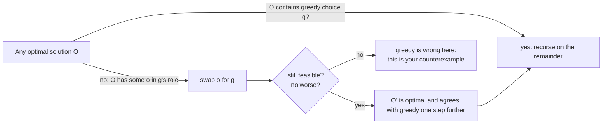

# Greedy Algorithms and Exchange Arguments

> When taking the best local step is provably optimal, and when it is a bug.

**Type:** Build
**Languages:** Java, Python
**Prerequisites:** Phase 1, Lesson 09 (Heaps and Priority Queues from Scratch), Phase 2, Lesson 01 (Sorting), Phase 2, Lesson 04 (Recursion and Backtracking)
**Time:** ~60 minutes

## Learning Objectives

- Define a greedy algorithm as a sequence of locally best choices that are never revisited, and state what must be proved for one to be correct
- Write an exchange argument: show that any optimal solution can be transformed into the greedy one without getting worse
- Implement interval scheduling (earliest finish first) and interval partitioning (minimum lanes with a heap) and prove both optimal
- Build Huffman coding with a priority queue, verify the prefix-free property, and explain why merging the two rarest symbols is always safe
- Implement greedy change-making, show a denomination system where it fails, and test canonicality against a dynamic-programming oracle

## The Problem

A cash-management desk pays out physical currency to retail branches every morning. The system that fills each order picks the fewest notes and coins, which keeps the cassettes balanced and the counting fast. The algorithm is the one every cashier uses: largest denomination first, as many as fit, then the next. For US dollars it is always right, and the team never thinks about it again.

The desk expands to a market whose coinage includes a 1, a 3, and a 4 unit coin. For an order of 6 units the system issues one 4 and two 1s: three coins. Two 3s would have been two. On a few thousand orders a day the branches run short of 1-unit coins by midweek, the cassettes have to be rebalanced by hand, and nobody can explain why the "fewest coins" system is issuing more coins than the tellers would. The algorithm did not change; the denomination system did, and the greedy choice that was provably optimal for one set of denominations is simply wrong for another.

The same shape appears in scheduling. A settlement platform has a fixed number of exclusive lanes (a lane is a thread with a dedicated database connection and a lock on an account range) and a list of settlement windows, each needing a lane from its start to its end. The ops team wants to run as many windows as possible on one lane. The first implementation picks the shortest windows first, reasoning that short windows leave the most room. It picks two of eight. Picking the window that *ends* earliest, regardless of length, picks three, and a brute-force check over all 256 subsets confirms three is the maximum. Both are greedy; one has a proof and the other has an intuition.

A greedy algorithm is the fastest kind there is: sort once, make a pass, never look back. It is also the easiest kind to get wrong, because the local choice *feels* right and the inputs that break it are rare. This lesson is about the difference: how to prove a greedy choice is safe with an exchange argument, three classic algorithms where that proof exists, and one where the proof holds only for some inputs and a test tells you which.

## The Concept

### What makes an algorithm greedy

A greedy algorithm builds a solution one choice at a time, taking at each step the option that looks best by some local criterion, and never reconsidering a choice once made. There is no backtracking (Lesson 04) and no table of subproblems (Lesson 06). The running time is usually the cost of sorting by the criterion plus one linear pass: `O(n log n)`.

Correctness is a separate matter entirely. For a greedy algorithm to produce an optimal solution, the problem must have two properties:

- **Greedy-choice property.** There exists an optimal solution that contains the greedy choice. In other words, the first choice can be made locally without knowing the rest.
- **Optimal substructure.** After making the greedy choice, what remains is a smaller instance of the same problem, and an optimal solution to the whole is the greedy choice plus an optimal solution to the remainder.

The second property is shared with dynamic programming. The first is what distinguishes greedy: DP considers every first choice and picks the best; greedy commits to one. When the greedy-choice property fails, the algorithm is still fast and still produces *a* solution, which is why these bugs survive: nothing crashes, the answer is merely worse than it could be.

### The exchange argument

The standard way to prove the greedy-choice property. Take any optimal solution `O`. If `O` already contains the greedy choice `g`, done. Otherwise, find the element `o` of `O` that occupies the role `g` would have taken, replace `o` with `g`, and show the result is still feasible and no worse. Repeating this converts `O` into the greedy solution one swap at a time without ever decreasing quality, so the greedy solution is also optimal.

The argument has a fixed shape and three things to check at the swap: the swapped solution is still **valid** (constraints hold), it is **no worse** (the objective did not decrease), and the process **terminates** (each swap increases agreement with greedy). When one of those cannot be shown, that is exactly where the greedy fails, and the failing step usually suggests the counterexample.



### Interval scheduling: earliest finish first

Given intervals `[start, end)`, choose the largest set with no two overlapping. The greedy criterion is **earliest end time**: sort by `end`, take the first, skip everything that starts before it ends, repeat.

Exchange argument. Let `g` be the interval with the earliest end, and let `O` be an optimal set that does not contain `g`. Let `o` be the interval in `O` with the earliest end. Since `g` ends no later than `o`, and every other interval in `O` starts at or after `o.end >= g.end`, replacing `o` with `g` keeps `O` pairwise disjoint and the same size. So there is an optimal solution containing `g`; remove `g` and everything overlapping it, and the remainder is the same problem on fewer intervals. Induction finishes it.

Why the tempting alternatives fail, each with its counterexample:

| Criterion | Counterexample | What happens |
|-----------|----------------|--------------|
| Shortest first | `[0,10) [9,12) [11,20)` | Takes the short middle one, blocks both long ones: 1 instead of 2 |
| Earliest start first | `[0,100) [1,2) [3,4) [5,6)` | Takes the long early one, blocks three short ones: 1 instead of 3 |
| Fewest conflicts first | A crafted set where the least-conflicting interval sits between two groups that would each have fit | Known counterexample with 11 intervals; 3 instead of 4 |
| Earliest finish first | none | Proof above |

The settlement windows from the demo:

```text
name          start end        sorted by end:  card-settle(1,4) wire-cutoff(3,5) ACH-batch(0,6) payout-run(4,7)
ACH-batch       0    6                         fx-fixing(3,8) recon(5,9) eod-close(6,10) reporting(8,11)
card-settle     1    4
wire-cutoff     3    5         take card-settle (end 4)
fx-fixing       3    8         wire-cutoff starts 3 < 4: skip;  ACH-batch 0 < 4: skip
payout-run      4    7         payout-run starts 4 >= 4: take (end 7)
recon           5    9         fx-fixing 3 < 7 skip; recon 5 < 7 skip; eod-close 6 < 7 skip
eod-close       6   10         reporting starts 8 >= 7: take
reporting       8   11         result: 3 windows on one lane; brute force over 256 subsets agrees
```

Note the `>=`: an interval that starts exactly when the previous one ends is compatible, because intervals are half-open. The test "touching intervals are compatible" pins it. A settlement window that ends at 06:00:00.000 and one that starts at 06:00:00.000 can share a lane; a system that uses closed intervals would need an extra lane for every back-to-back pair.

### Interval partitioning: how many lanes for all of them

The dual question: run every window, using the fewest lanes. Greedy: sort by **start**, and for each interval, reuse the lane whose current occupant ends earliest if it has already ended, otherwise open a new lane. A min-heap of lane end times makes "which lane frees up first" an `O(log n)` query.

Optimality here is not an exchange argument but a lower bound: if `d` intervals overlap at some instant, at least `d` lanes are needed, and the greedy never opens a lane unless all current lanes are busy at the new interval's start, so it opens exactly the maximum overlap depth. The test checks `minResources == maxDepth` on 300 random instances. For the eight windows, four overlap at `t = 3` (ACH-batch, card-settle, wire-cutoff, fx-fixing), so four lanes.

### Huffman coding: merge the two rarest

Given symbols with frequencies, find a binary prefix code (no code is a prefix of another, so decoding needs no separators) that minimises the total encoded length. Huffman's greedy: put every symbol in a min-heap by frequency; repeatedly remove the two lightest, make them children of a new node whose weight is their sum, and push it back; the last node is the root. Codes are the paths, left `0`, right `1`.

Exchange argument, in two steps. First, in any optimal tree the two rarest symbols `x` and `y` can be made sibling leaves at maximum depth: if some other symbol `a` sits deeper than `x`, swapping `x` and `a` changes the total by `(freq(a) - freq(x)) * (depth(x) - depth(a)) <= 0`, so it does not get worse; do the same for `y`. Second, replacing the sibling pair with a single symbol of weight `freq(x) + freq(y)` gives a smaller instance whose optimal tree, with the pair re-expanded, is optimal for the original, because the expansion adds exactly `freq(x) + freq(y)` bits to any tree it is applied to. So merging the two lightest is always safe, and the rest is induction.

The demo codes ISO 8583 response codes by frequency (`00` approved dominates; `05` do-not-honour, `51` insufficient funds, `14` invalid card, `54` expired, `91` issuer unavailable, `96` system malfunction):

```text
frequencies: 0:850k  5:60k  51:45k  14:20k  54:15k  91:7k  96:3k

merge 96(3k) + 91(7k)        -> 10k
merge 10k + 54(15k)          -> 25k
merge 14(20k) + 25k          -> 45k
merge 51(45k) + 45k          -> 90k         (tie on 45k broken by creation order: the leaf 51 first)
merge 5(60k) + 90k           -> 150k
merge 150k + 0(850k)         -> 1,000k      root

codes: 0 -> 1   5 -> 00   51 -> 010   14 -> 0110   54 -> 01111   91 -> 011101   96 -> 011100
total: 850k*1 + 60k*2 + 45k*3 + 20k*4 + 15k*5 + 7k*6 + 3k*6 = 1,320,000 bits
fixed 3-bit code: 3,000,000 bits.  Huffman uses 44%.
```

The most frequent symbol gets one bit; the rarest get six. This is the mechanism inside DEFLATE (zip, gzip, PNG, HTTP compression), where the "symbols" are literal bytes and match lengths, and inside the HPACK header compression of HTTP/2, where the static Huffman table was built from frequencies measured on real web traffic. Phase 11's ISO 8583 lesson will show that bitmap-based field presence is a different, fixed-width trick aimed at the same goal.

Check the optimality claim against the lower bound. The entropy of this distribution, `sum p_i log2(1/p_i)`, is about 0.92 bits per symbol; Huffman achieves 1.32 bits per symbol. The gap exists because Huffman assigns whole bits: the `00` symbol at probability 0.85 would ideally take `log2(1/0.85) = 0.23` bits and cannot take fewer than one. No prefix code can beat Huffman's 1,320,000 bits on this table, and arithmetic coding, which is not a prefix code, could approach 920,000. That is the trade DEFLATE accepts and zstd's FSE stage does not.

Two details that matter in production: ties must be broken deterministically (the `order` field) so that an encoder and a decoder built independently from the same frequency table produce the same tree, and a one-symbol alphabet still needs a one-bit code, or the encoder emits zero bits per symbol and the decoder cannot count them.

### Change-making: greedy that is right for some inputs

Pay `amount` with the fewest pieces from a set of denominations. Greedy: largest denomination first. For `{1, 5, 10, 25, 100, ...}` (US cents and dollars), for euro, for rupee, this is optimal for every amount. For `{1, 3, 4}`, amount 6: greedy gives `4 + 1 + 1`, optimal is `3 + 3`. For pre-decimal British coinage `{1, 3, 6, 12, 24, 30, 60, 240}` pence, amount 48: greedy gives `30 + 12 + 6`, optimal is `24 + 24`. The exchange argument fails: replacing two 3-coins with a 4-coin and two 1-coins is "no worse" in value but worse in count, and nothing forces the optimal solution to contain the largest coin.

A denomination system where greedy is always optimal is called **canonical**. Kozen and Zaks (1994) proved that it suffices to check every amount below the sum of the two largest denominations: if greedy is optimal for all of those, it is optimal for all amounts. `isCanonical` does exactly that, using the dynamic-programming table from Lesson 06 as the oracle for the true minimum. For US denominations up to 100.00 that is 15,000 amounts, a few milliseconds. The team from The Problem could have run this check the day the new market was configured.

```text
{1, 3, 4}:  amount 6: greedy 3 (4+1+1), optimal 2 (3+3)       -> not canonical
{1, 5, 10, 25}: every amount below 35 agrees                   -> canonical
{1, 3, 6, 12, 24, 30, 60, 240}: amount 48: greedy 3, optimal 2 -> not canonical
```

### When greedy is right and when it is a bug

| Problem | Greedy criterion | Optimal? | Why / why not |
|---------|------------------|----------|---------------|
| Interval scheduling | earliest end | Yes | Exchange: earliest end leaves the most room |
| Interval partitioning | earliest start, reuse earliest-free lane | Yes | Lower bound: max overlap depth |
| Huffman coding | merge two lightest | Yes | Exchange: rarest symbols can be deepest siblings |
| Change-making, canonical coins | largest first | Yes | Kozen-Zaks check passes |
| Change-making, arbitrary coins | largest first | No | `{1,3,4}` at 6; needs DP |
| Fractional knapsack | best value per weight | Yes | Exchange on fractions |
| 0/1 knapsack | best value per weight | No | Cannot take a fraction; needs DP (Lesson 06) |
| Minimum spanning tree | lightest edge that does not form a cycle | Yes | Cut property (Lesson 11) |
| Shortest paths, non-negative weights | closest unvisited vertex | Yes | Dijkstra (Lesson 09) |
| Shortest paths, negative weights | closest unvisited vertex | No | Dijkstra fails; Bellman-Ford |
| Payout batching to minimise fees with tiered pricing | fill the largest tier first | Usually no | Tier boundaries create the `{1,3,4}` effect |

The last row is the payments trap. Processors price in tiers (a batch of up to 500 items costs X, up to 2,000 costs Y) and a greedy "fill the biggest batch first" allocation of 2,600 items into batches may pay more than two batches of 1,300. Whenever a cost function has discontinuities, assume greedy is wrong until a canonicality-style test or an exchange argument says otherwise.

### Failure modes

| Symptom | Cause | Fix |
|---------|-------|-----|
| Fewer windows scheduled than a colleague's hand solution | Wrong criterion (shortest, earliest start) | Earliest end; add the counterexample as a test |
| Two independent encoders disagree on the Huffman tree | Heap tie order is arbitrary | Deterministic tie-break on creation order; or ship the code table (DEFLATE, HPACK) |
| Decoder emits nothing for a one-symbol stream | One-symbol alphabet given a zero-length code | Force a one-bit code for a single symbol |
| Branches run out of small coins | Non-canonical denominations with largest-first | Run the Kozen-Zaks check at configuration time; use DP when it fails |
| Back-to-back windows need two lanes | Closed intervals where half-open was meant | Use `[start, end)` and `>=` in the compatibility test |
| Fee minimiser overpays on some batch sizes | Tiered cost function treated as canonical | Oracle test against DP; or pick batch sizes with DP |
| Greedy "works on all our test data" | Test data lacks the structure of the counterexample | Random oracle tests against brute force on small instances, not hand-picked cases |

### What a greedy algorithm does not do

It does not find the optimum when the greedy-choice property fails, and it does not tell you that it failed. It does not enumerate alternatives, so when the business wants "the best three options" it is the wrong tool. And it is only as good as its criterion: a correct greedy with the wrong sort key (shortest-first instead of earliest-end) is a different, wrong algorithm with identical structure, which is why the proof, not the code shape, is what a reviewer should ask for.

## Build It

All code is in `code/java/Main.java`: `IntervalScheduling`, `Huffman`, and `ChangeMaking`, with `Interval` and `Money` as records.

### Step 1: Earliest finish first

```java
static List<Interval> maxNonOverlapping(List<Interval> intervals) {
    List<Interval> sorted = new ArrayList<>(intervals);
    sorted.sort(Comparator.comparingLong(Interval::end).thenComparingLong(Interval::start));
    List<Interval> chosen = new ArrayList<>();
    long lastEnd = Long.MIN_VALUE;
    for (Interval iv : sorted) {
        if (iv.start() >= lastEnd) { chosen.add(iv); lastEnd = iv.end(); }   // compatible: take it
    }
    return chosen;
}
```

Sort, one pass, `O(n log n)`. The `thenComparingLong(start)` tie-break makes the output deterministic when two intervals end together; it does not affect the count. `Interval`'s compact constructor rejects `end <= start`, so a zero-length window cannot sneak into the schedule and be "compatible" with everything.

**Predict:** on the eight settlement windows, which three does the algorithm pick, and which window is the first one skipped?

### Step 2: The wrong greedy, kept for the test

```java
static List<Interval> shortestFirst(List<Interval> intervals) {
    List<Interval> sorted = new ArrayList<>(intervals);
    sorted.sort(Comparator.comparingLong((Interval iv) -> iv.end() - iv.start()).thenComparingLong(Interval::start));
    List<Interval> chosen = new ArrayList<>();
    for (Interval iv : sorted) {
        boolean compatible = true;
        for (Interval c : chosen) if (iv.start() < c.end() && c.start() < iv.end()) { compatible = false; break; }
        if (compatible) chosen.add(iv);
    }
    return chosen;
}
```

Same structure, different key, wrong answer on `[0,10) [9,12) [11,20)`. The test asserts it picks one where earliest-end picks two. Keeping a known-wrong algorithm in the codebase next to its counterexample is the cheapest documentation of *why* the right one is right.

### Step 3: Minimum lanes with a heap

```java
static int minResources(List<Interval> intervals) {
    List<Interval> sorted = new ArrayList<>(intervals);
    sorted.sort(Comparator.comparingLong(Interval::start).thenComparingLong(Interval::end));
    PriorityQueue<Long> ends = new PriorityQueue<>();
    for (Interval iv : sorted) {
        if (!ends.isEmpty() && ends.peek() <= iv.start()) ends.poll();   // reuse the lane that frees up first
        ends.add(iv.end());
    }
    return ends.size();
}
```

The heap holds one end time per lane in use. When a new interval starts, if the earliest-ending lane is already free (`<=`, half-open again), that lane is reused; either way the new interval's end goes in. The heap's final size is the number of lanes ever opened simultaneously. The oracle test compares it with the maximum overlap depth computed by brute force.

**Predict:** why is it enough to check only the earliest-ending lane? If it is not free, could some other lane be?

### Step 4: Huffman's tree

```java
static Node build(Map<Integer, Long> frequencies) {
    PriorityQueue<Node> pq = new PriorityQueue<>(Comparator.comparingLong(Node::weight).thenComparingLong(Node::order));
    long order = 0;
    for (Map.Entry<Integer, Long> e : new TreeMap<>(frequencies).entrySet()) {
        if (e.getValue() <= 0) throw new IllegalArgumentException("frequency must be positive: " + e.getKey());
        pq.add(new Node(e.getValue(), e.getKey(), null, null, order++));
    }
    if (pq.size() == 1) {   // a one-symbol alphabet still needs a one-bit code
        Node only = pq.poll();
        return new Node(only.weight(), -1, only, null, order);
    }
    while (pq.size() > 1) {
        Node a = pq.poll(), b = pq.poll();                             // the two lightest: the greedy choice
        pq.add(new Node(a.weight() + b.weight(), -1, a, b, order++));
    }
    return pq.poll();
}
```

`n - 1` merges, each `O(log n)` on the heap: `O(n log n)`. The `TreeMap` iteration and the `order` tie-break together make the tree a pure function of the frequency map, regardless of the `HashMap` iteration order the caller used. The test "deterministic across builds" asserts it. The `Node` record is immutable; the tree is built bottom-up and never mutated.

**Predict:** with frequencies `{a: 1, b: 1, c: 1, d: 1}`, what code lengths result, and is Huffman better than a fixed 2-bit code here?

### Step 5: Codes, encoding, decoding, and the prefix check

```java
static int[] decode(String bits, Node root) {
    List<Integer> out = new ArrayList<>();
    Node cur = root;
    for (int i = 0; i < bits.length(); i++) {
        cur = bits.charAt(i) == '0' ? cur.left() : cur.right();
        if (cur == null) throw new IllegalArgumentException("invalid bit string");
        if (cur.isLeaf()) { out.add(cur.symbol()); cur = root; }
    }
    if (cur != root) throw new IllegalArgumentException("truncated bit string");
    return out.stream().mapToInt(Integer::intValue).toArray();
}
```

Decoding walks the tree one bit at a time and emits a symbol at each leaf. No separators, no lengths: that is what prefix-free buys. A bit string that ends mid-path is a truncation error, which the test checks. `isPrefixFree` verifies the property directly by comparing every pair of codes; `encodedBits` computes the objective Huffman minimises, and the test pins it at exactly 1,320,000 for the response-code table and 224 for the six-symbol example from CLRS.

### Step 6: Change-making and the canonicality test

```java
static long[] greedy(long[] denominations, long amount) {
    long[] sorted = denominations.clone();
    Arrays.sort(sorted);
    long[] count = new long[denominations.length];
    long remaining = amount;
    for (int i = sorted.length - 1; i >= 0; i--) {
        long d = sorted[i];
        int idx = indexOf(denominations, d);
        count[idx] = remaining / d;
        remaining %= d;
    }
    return remaining == 0 ? count : null;
}
```

Largest first, integer division for the count, remainder carried down. Returns `null` when the denominations cannot make the amount (`{5, 10}` and 7), which is a distinct outcome from "made it with many coins".

```java
static boolean isCanonical(long[] denominations) {
    long[] sorted = denominations.clone();
    Arrays.sort(sorted);
    if (sorted[0] != 1) return false;
    long limit = sorted.length >= 2 ? sorted[sorted.length - 1] + sorted[sorted.length - 2] : sorted[0];
    long[] optimal = optimalTable(denominations, limit);
    for (long amount = 1; amount < limit; amount++) {
        long[] g = greedy(denominations, amount);
        if (g == null || total(g) != optimal[(int) amount]) return false;
    }
    return true;
}
```

`optimalTable` is the coin-change dynamic program from Lesson 06, computed once up to the Kozen-Zaks limit; the loop then compares greedy against it for every amount. The requirement that a 1-unit coin exists is what guarantees every amount is makeable; without it, "canonical" is not even well-defined. Amounts stay integers in minor units throughout, so `Money.ofMinor(18_741, USD)` is paid with eleven pieces and no rounding question ever arises.

**Predict:** for `{1, 5, 10, 25}` what is the Kozen-Zaks limit, and how many amounts does the check examine?

### Step 7: Run it

```bash
cd phases/02-algorithms/07-greedy-algorithms/code/java
javac -d .out *.java && java -cp .out Main
java -cp .out MainTest
```

Expected output, abbreviated:

```console
== Interval scheduling: settlement windows that need an exclusive lane ==
earliest-end-first picks 3: [card-settle, payout-run, reporting]
shortest-first picks     2: [wire-cutoff, reporting]
lanes needed to run all 8 windows: 4

== Huffman: a prefix code for ISO 8583 response codes by frequency ==
  code  0  freq  850,000  bits 1
  code  5  freq   60,000  bits 00
  ...
  code 96  freq    3,000  bits 011100
fixed 3-bit code: 3,000,000 bits; Huffman: 1,320,000 bits (44.0% of fixed); prefix-free: true

== Change-making: greedy is optimal for some denomination sets and wrong for others ==
USD-like [1, 5, 10, 25, 100, 500, 1000, 2000, 5000, 10000] canonical? true
{1,3,4}  canonical? false: amount 6 -> greedy 3 coins, optimal 2
pre-1971 UK pence canonical? false: amount 48 -> greedy 3 coins (30+12+6), optimal 2 (24+24)
pay 187.41 USD greedily: 11 pieces {1x10000 1x5000 1x2000 1x1000 1x500 2x100 1x25 1x10 1x5 1x1}
```

The test run prints `41 passed, 0 failed`.

### In Python

```python
pq: list[tuple[int, int, Node]] = []  # (weight, order, node): heapq compares tuples left to right
...
while len(pq) > 1:
    a = heapq.heappop(pq)[2]  # the two lightest: the greedy choice
    b = heapq.heappop(pq)[2]
    merged = Node(a.weight + b.weight, -1, a, b, order)
    heapq.heappush(pq, (merged.weight, merged.order, merged))
    order += 1
```

Same classes, same algorithms, same tests; three things differ, all in `code/python/main.py`:

- **Heaps are `heapq` over tuples.** The Huffman heap holds `(weight, order, node)` tuples, so the tuple comparison is the `comparingLong(weight).thenComparingLong(order)` comparator, and `order` is unique, so a comparison never reaches the `Node` itself. The lane heap in `min_resources` is a plain list of `int` end times. Sorting uses `key=lambda iv: (iv.end, iv.start)` in place of the `Comparator` chain.
- **`TreeMap` becomes `sorted(frequencies)`.** A `dict` preserves insertion order, not key order, so `build` iterates `sorted(frequencies)` to assign `order` in ascending symbol order. The "deterministic across builds" test passes the same table in reversed insertion order and expects identical codes.
- **Sentinels and identity.** `optimal_table` marks impossible amounts with `LONG_MAX` (`2**63 - 1`) so the "impossible" assertion reads the same as Java's `Long.MAX_VALUE`; `greedy` returns `None` instead of `null`. `Node` is a frozen dataclass with `eq=False`, so `decode`'s "back at the root" check is an identity test (`is not root`), the same as Java's `!=` on references.

The test file carries a small port of `java.util.Random` so the 300 interval instances and 200 USD amounts are the same random inputs as the Java run.

```bash
cd phases/02-algorithms/07-greedy-algorithms/code/python
python3 main.py
python3 -m unittest -v
```

The demo output is identical to the Java run, and the suite runs the same 41 checks.

### Porting notes

Go's `container/heap` requires implementing `Len/Less/Swap/Push/Pop` on a slice type, which is where the deterministic tie-break on `order` must live; `sort.Slice` with a two-key less function replaces the sort. Amounts stay integers in minor units, and the port should include the DP oracle alongside the greedy so `isCanonical` works unchanged.

## Use It

### Scheduling in production

Interval scheduling by earliest deadline is the core of EDF (earliest deadline first) real-time scheduling, which is optimal for a single processor when the jobs are preemptible, and of the "earliest finish" heuristics in job schedulers (Kubernetes' default scheduler scores nodes greedily; Airflow and cron-style batch systems pick the earliest-due task). Interval partitioning with a heap is how connection pools, thread pools, and database lane assignment decide when to open a new resource: `HikariCP` and `pgbouncer` are, at their core, the `minResources` loop run online.

### Huffman in the stack you already use

DEFLATE (RFC 1951) uses two Huffman codes per block, one for literals and lengths and one for distances, rebuilt per block from the block's own frequencies; `java.util.zip.Deflater` and `gzip` are this. HTTP/2 HPACK (RFC 7541, Appendix B) ships a static Huffman table built from measured header frequencies, so every browser and server agree on the tree without transmitting it; the `order` tie-break in this lesson is the same concern that RFC solves by publishing the table. JPEG's entropy coding stage is Huffman (or arithmetic). Modern compressors (zstd, brotli) use ANS or arithmetic coding for the last few percent, but their dictionary and match-finding stages are greedy too.

### Change-making in payments systems

Cash-dispensing ATMs and cash-recycler software implement greedy denomination selection with a canonicality assumption baked in, which is correct for every currency in circulation today (all modern coinage systems are canonical; the pre-decimal British system was the famous exception and was retired in 1971). The same algorithm appears in **payout splitting**, where a large disbursement is broken into pieces under per-transfer limits (a 1,000,000 payout under a 250,000 cap), and in **fee tier selection**, where greedy is frequently wrong because tiers are not canonical denominations. The `isCanonical` check is a one-line guard that belongs in the configuration validation of any system that picks "largest first".

### Greedy as a heuristic, labelled as such

Many production systems use greedy where no proof exists and accept the gap: bin packing by first-fit-decreasing (within 11/9 of optimal, provably), set cover by largest-uncovered-first (within `ln n`), and most load balancers. That is legitimate when the document says "heuristic" and quantifies the bound. The failure mode this lesson warns about is the unlabelled greedy: an algorithm presented as optimal because it is optimal on the inputs the team had.

### `java.util.PriorityQueue`

The JDK's binary heap (Phase 1, Lesson 09), used here for both the lane heap and the Huffman heap. It is not stable: two entries with equal priority come out in arbitrary order, which is why the Huffman comparator includes `order`. `PriorityQueue` is unbounded and not thread-safe; `PriorityBlockingQueue` is the concurrent version.

## Ship It

`outputs/checklist-greedy-review.md` is a review checklist for any pull request that sorts by a criterion and takes items in order: does the exchange argument exist, is the counterexample for the obvious alternative in the tests, are ties broken deterministically, and if the cost function has tiers, has the canonicality-style check been run against a brute-force or DP oracle. Use it when a design document says "we take the largest first".

## Exercises

1. **Reinforce.** Implement `IntervalScheduling.earliestStartFirst` and `fewestConflictsFirst`, and find (or construct from the table in The Concept) the input on which each produces a smaller set than earliest-end-first. Add both as tests alongside `shortestFirst`.
2. **Apply.** A payout of `Money` must be split into transfers each at most `cap`, minimising the number of transfers and, among equal counts, making the pieces as equal as possible (compliance prefers `[250000, 250000, 250000, 250000]` to `[250000, 250000, 250000, 249999, 1]`). Write the greedy, write the exchange argument for the count, and show with `Money.allocate` from Phase 10, Lesson 01 that the equal-pieces requirement is a separate step that greedy does not provide.
3. **Extend.** Combine with Phase 2, Lesson 06: generalise `isCanonical` to a tiered fee schedule (cost per batch as a step function of batch size) and a batch count. Use the DP to compute the true minimum fee for splitting `n` items into batches, and compare against the greedy "largest tier first". Find the smallest `n` for a realistic schedule (for example, 1-500 items: 10.00; 501-2000: 30.00; 2001-5000: 60.00) where greedy overpays, and report by how much.

## Key Terms

| Term | What people say | What it actually means |
|------|-----------------|------------------------|
| Greedy algorithm | "take the best one each time" | A sequence of locally optimal, irrevocable choices; fast by construction, correct only when the greedy-choice property holds |
| Greedy-choice property | "it works out" | Some optimal solution contains the greedy first choice; the thing an exchange argument proves |
| Exchange argument | "swap it in" | A proof that any optimal solution can be transformed into the greedy one by swaps that never make it worse |
| Optimal substructure | "the rest is the same problem" | An optimal solution to the whole contains optimal solutions to the sub-instances; shared with dynamic programming |
| Prefix code | "no delimiters needed" | A code where no codeword is a prefix of another, so a bit stream decodes unambiguously left to right; Huffman codes are optimal prefix codes |
| Canonical coin system | "greedy change works" | A denomination set for which largest-first is optimal for every amount; checkable by testing amounts below the sum of the two largest denominations |
| Earliest deadline first | "EDF" | The earliest-finish greedy applied to scheduling; optimal for single-resource preemptive scheduling |
| Counterexample | "the case that breaks it" | A specific input on which a greedy criterion gives a suboptimal answer; the output of a failed exchange argument and the most valuable test in the file |

## Further Reading

- [Huffman, "A Method for the Construction of Minimum-Redundancy Codes" (Proceedings of the IRE, 1952)](https://doi.org/10.1109/JRPROC.1952.273898) — four pages, written as a term paper; the algorithm and its optimality argument.
- [Kleinberg and Tardos, *Algorithm Design*, Chapter 4: Greedy Algorithms](https://www.pearson.com/en-us/subject-catalog/p/algorithm-design/P200000003259) — interval scheduling, interval partitioning, and the clearest treatment of exchange arguments in print.
- [Kozen and Zaks, "Optimal bounds for the change-making problem" (Theoretical Computer Science, 1994)](https://doi.org/10.1016/0304-3975(94)90134-1) — the proof that checking amounts below the sum of the two largest denominations suffices.
- [RFC 1951: DEFLATE Compressed Data Format Specification](https://www.rfc-editor.org/rfc/rfc1951) — Section 3.2 defines how Huffman codes are constructed and transmitted; the canonical-code trick that avoids sending the tree.
- [RFC 7541: HPACK, Appendix B](https://www.rfc-editor.org/rfc/rfc7541#appendix-B) — a static Huffman table in a protocol every browser speaks, with the measured frequencies that produced it.
- [Cormen, Leiserson, Rivest, Stein, *Introduction to Algorithms*, Chapter 15 (4th ed.): Greedy Algorithms](https://mitpress.mit.edu/9780262046305/introduction-to-algorithms/) — the formal statement of greedy-choice and optimal-substructure properties, with Huffman's proof in full and the 224-bit example used in the tests.
