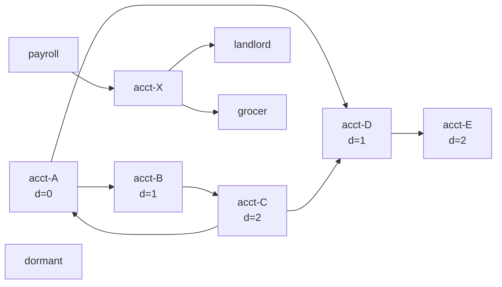

# Graph Traversal: BFS, DFS, and Connected Components

> Money-flow graphs, dependency graphs, and fraud rings all start here.

**Type:** Build
**Languages:** Java, Python, Go
**Prerequisites:** Phase 1, Lesson 06 (Hash Maps from Scratch), Phase 1, Lesson 03 (Dynamic Arrays), Phase 2, Lesson 04 (Recursion and Backtracking)
**Time:** ~90 minutes

## Learning Objectives

- Represent a money-flow graph as an adjacency list with deterministic node and neighbour order, and state the memory cost against an adjacency matrix
- Build breadth-first search that records hop distance and parent for every reached node, and prove why the first discovery of a node is its shortest-hop discovery
- Build depth-first search with an explicit stack that visits in the same order as the recursive version without its stack-depth limit
- Compute connected components on the undirected view of a directed graph and explain what a component does and does not say about a fraud ring
- Detect a directed cycle with three-colour DFS, distinguish a back edge (GRAY) from a cross edge (BLACK), and return the cycle itself, not just a boolean
- Choose between BFS and DFS for a given question (fewest hops, reachability, cycle, component) and state the O(V + E) bound for each

## The Problem

A risk team is handed a flagged account, `acct-A`, and a week of transfers. Three questions arrive in the same ticket. Which accounts received money from `acct-A`, directly or through intermediaries, and how many hops away is each? Is there a group of accounts that only transact among themselves? And did any of the money come back to where it started, which is the signature of layering: funds pushed around a loop to manufacture transaction history before cashing out.

The first implementation answers the first question with a recursive walk: visit `acct-A`, then recursively visit each counterparty. On the production graph it crashes with a stack overflow, because one mule network is a chain of 11,000 accounts each forwarding to the next, and the JVM's default thread stack holds roughly 10,000 frames of this shape. The second attempt switches to an iterative loop but visits counterparties in whatever order the hash map returns them, so the "hops from the flagged account" column changes between runs and the analyst cannot reproduce yesterday's report. The third attempt computes hops by depth-first search and reports `acct-E` as 4 hops away when there is a 2-hop route: depth-first finds *a* path, not the shortest.

The second question is answered with connected components, and the team's first version treats direction as meaningful, so `payroll -> acct-X -> landlord` is three components (nobody can get from `landlord` back to `payroll`) instead of one. The third question is answered with a cycle detector that marks nodes visited or not, so a diamond (`payroll -> acct-X -> landlord` and `payroll -> landlord`) is reported as a cycle because `landlord` is reached twice. Every account that pays rent and groceries from the same salary is flagged as a laundering loop.

All of these are the same two algorithms with the bookkeeping done right: BFS with a distance and parent map for hops and shortest paths, DFS with an explicit stack for reachability without recursion, components on the undirected view, and three-colour DFS so that "visited and finished" is distinguishable from "visited and still on my path". This lesson builds them on an adjacency list whose order is deterministic, which is what makes the fraud report reproducible.

## The Concept

### Representation

A graph is a set of nodes `V` and a set of edges `E`. A money-flow graph has accounts as nodes and transfers as directed edges; a transfer from A to B is not a transfer from B to A. Two representations are standard:

| Representation | Memory | Check edge (u, v) | Enumerate neighbours of u | Best when |
|----------------|--------|-------------------|---------------------------|-----------|
| Adjacency matrix `boolean[V][V]` | O(V^2) | O(1) | O(V) | Dense graphs, V small, many edge-existence queries |
| Adjacency list `Map<node, List<node>>` | O(V + E) | O(degree(u)) | O(degree(u)) | Sparse graphs, which is every transaction graph |

A payments graph with 50 million accounts and 2 billion transfers is sparse: the matrix would need 2.5 x 10^15 cells. The adjacency list stores each edge once (twice for undirected). Every algorithm in this lesson runs in O(V + E) because it touches each node and each edge a constant number of times, and that bound depends on the list representation: with a matrix, enumerating neighbours costs O(V) per node and the traversals degrade to O(V^2).

The lesson's `Graph` preserves insertion order for nodes and for each node's neighbours. That is not a correctness requirement for the algorithms, but it is for the *outputs*: the visit order, the parent chosen for a node reachable by two equally short routes, and which cycle is reported all depend on neighbour order. A `HashMap` in Java or a `map` in Go would make those outputs vary between runs or between processes.

### Breadth-first search: the frontier expands one hop at a time

BFS keeps a queue. It starts with the source at distance 0, and repeatedly dequeues a node `u` and enqueues every neighbour `v` that has not yet been discovered, with `distance[v] = distance[u] + 1` and `parent[v] = u`.

The invariant that makes BFS compute shortest-hop distances: **at every moment the queue holds nodes at distance `d` followed by nodes at distance `d + 1`, and nothing else.** The proof is by induction on dequeues. Initially the queue holds only the source at distance 0. When a node at distance `d` is dequeued and its undiscovered neighbours are enqueued at `d + 1`, they join behind any existing `d + 1` nodes, and no node at distance `d + 2` can be enqueued until every distance-`d` node has been dequeued. So the first time a node is discovered, it is discovered from a node at the smallest possible distance, and its recorded distance is minimal.

The detail that breaks this invariant more often than any other: marking a node as discovered when it is *dequeued* rather than when it is *enqueued*. If `v` is enqueued by two different parents before its first dequeue, it is in the queue twice, its parent is overwritten by the later (not shorter) discovery, and on a dense graph the queue grows to O(E) entries. Mark on enqueue.



### Worked example: BFS from acct-A

Edges in insertion order: A->B, B->C, C->A, C->D, D->E, A->D. So `neighbors(A) = [B, D]`, `neighbors(C) = [A, D]`.

```text
queue = [A]                 distance = {A:0}
dequeue A: neighbours B, D  -> enqueue both      queue = [B, D]      distance = {A:0, B:1, D:1}   parent = {B:A, D:A}
dequeue B: neighbour C      -> enqueue           queue = [D, C]      distance += {C:2}            parent += {C:B}
dequeue D: neighbour E      -> enqueue           queue = [C, E]      distance += {E:2}            parent += {E:D}
dequeue C: neighbours A, D  -> both discovered   queue = [E]
dequeue E: no neighbours                         queue = []
visit order = [A, B, D, C, E]
```

The shortest-hop path to E is read backwards through parents: E <- D <- A, so `[A, D, E]`, two hops. A depth-first walk that follows the first neighbour would reach E via A, B, C, D, E: four hops. Both are paths; only BFS guarantees the short one.

### Depth-first search: go deep, then back up

DFS keeps a stack (explicit or the call stack). It visits a node, then recursively visits its first undiscovered neighbour, and only when that whole subtree is exhausted does it move to the second neighbour. DFS does not compute shortest paths. It computes *reachability* in O(V + E), and the structure of its traversal, which edges go to an ancestor, a descendant, or a finished node, is what makes it the tool for cycles, topological order (Lesson 10), and strongly connected components.

The iterative version pushes the source, then loops: pop a node; if it was already visited, skip it; otherwise visit it and push its undiscovered neighbours in reverse order. Pushing in reverse makes the first neighbour come off the stack first, so the preorder is identical to the recursive version. A node may be pushed several times (once per edge pointing at it before it is visited), which is why the visited check happens after the pop and the stack is bounded by O(E), not O(V).

Why bother with the iterative form? The recursive form's depth equals the longest simple path from the source. Java's default thread stack is 512 KB to 1 MB; Python's recursion limit is 1,000 frames; Go grows goroutine stacks dynamically up to 1 GB so it fails last, but it still fails. A chain of 100,000 forwarding accounts is a realistic shape for a mule network and an unrealistic shape for a recursion. The demo and tests run exactly that chain.

### Connected components

Two nodes are in the same connected component if there is a path between them *ignoring edge direction*. On a directed graph this is sometimes called a weakly connected component, to distinguish it from a strongly connected component (mutual reachability respecting direction). For "which accounts form a closed group that transacts among themselves", weak connectivity is the right first question: a ring where money flows A -> B -> C -> A and also leaks to D -> E is one group, and so is a payroll fan-out.

The algorithm: build the undirected view (every edge both ways), then for each node in order, if it has not been seen, run BFS from it and record the reached set as one component. Each node is the start of at most one BFS and is reached by exactly one, so the total is O(V + E).

A component is a coarse signal. The demo graph has three: the ring plus its tail (5 accounts), the payroll cluster (4), and `dormant` (1). "Components of 3 or more" returns both the fraud ring and the household budget. What distinguishes them is not connectivity but *direction*: in the ring the money comes back. That needs the cycle detector.

### Directed cycles: three colours, not two

Cycle detection by DFS classifies each node as:

| Colour | Meaning | An edge into it from the current node is |
|--------|---------|------------------------------------------|
| WHITE | not yet discovered | a tree edge: descend |
| GRAY | discovered, and still on the current DFS path (an ancestor) | a **back edge: a cycle exists** |
| BLACK | discovered and fully finished | a cross or forward edge: already explored, no cycle through it |

A two-colour "visited or not" detector cannot tell GRAY from BLACK. In the diamond `payroll -> acct-X -> landlord`, `payroll -> landlord`, DFS from `payroll` finishes `landlord` via `acct-X`, then examines the direct edge `payroll -> landlord` and finds `landlord` visited. Two colours say cycle. Three colours see BLACK, meaning "finished, not on my path", and correctly say no cycle. A cycle exists if and only if DFS finds a back edge, and a back edge is exactly an edge into a GRAY node.

Returning the cycle itself rather than a boolean is a small extension: when the back edge `u -> v` is found, `v` is somewhere on the current path stack, and the cycle is the stack from `v` to the top, closed with `v` again. The demo returns `[acct-A, acct-B, acct-C, acct-A]`, which is the thing the analyst actually files.

Three-colour DFS is written recursively in most textbooks. The lesson writes it iteratively with two parallel stacks: the path of GRAY nodes, and for each one the index of the next neighbour to examine. A frame is popped and its node turned BLACK only when its neighbour index runs off the end. That is the recursive algorithm's control flow made explicit, and it survives the 100,000-node chain.

### Choosing the traversal

| Question | Algorithm | Why |
|----------|-----------|-----|
| How many hops from the flagged account to each other account? | BFS with distance map | First discovery is shortest discovery |
| Show me the shortest chain of transfers from A to E | BFS with parent map, walk back | Parent chain is a shortest-hop path |
| Can money from A reach E at all? | Either; DFS is simplest | Reachability only |
| Which accounts form closed groups? | BFS or DFS over the undirected view | Components ignore direction |
| Did any money return to its origin? | Three-colour DFS on the directed graph | Back edge means cycle |
| In what order can settlements be processed given dependencies? | DFS finishing order (Lesson 10) | Reverse postorder is a topological order |
| Cheapest conversion path with weighted edges | Dijkstra (Lesson 09) | BFS assumes every hop costs the same |

### What traversal does not do

- BFS hop distance treats every edge as cost 1. With fees or rates on the edges, the fewest-hop path is not the cheapest; that is Lesson 09.
- A connected component is not a fraud ring. It says "these accounts are linked", including by a single legitimate transfer. Ring detection needs cycles, amounts, timing, and often strongly connected components (Exercise 3).
- `findCycle` returns one cycle, the first back edge in DFS order. A graph may contain many; enumerating all simple cycles is exponential in general (Johnson's algorithm is output-sensitive).
- None of this handles a graph that does not fit in memory. At 2 billion edges the adjacency list is partitioned across machines and traversal becomes a message-passing computation (Pregel, GraphX), where BFS is natural (one round per hop) and DFS is not.

## Build It

The primary walkthrough is in Java. The Python and Go files implement the same design with the same names; the subsections at the end show only what differs.

### Step 1: The adjacency list

```java
final class Graph {
    private final boolean directed;
    private final Map<String, List<String>> adjacency = new LinkedHashMap<>();
    private int edgeCount = 0;

    void addNode(String id) {
        adjacency.computeIfAbsent(id, k -> new ArrayList<>());
    }

    void addEdge(String from, String to) {
        addNode(from);
        addNode(to);
        adjacency.get(from).add(to);
        if (!directed && !from.equals(to)) adjacency.get(to).add(from);
        edgeCount++;
    }

    List<String> neighbors(String id) {
        List<String> out = adjacency.get(id);
        if (out == null) throw new IllegalArgumentException("unknown node: " + id);
        return Collections.unmodifiableList(out);
    }
}
```

`LinkedHashMap` and `ArrayList` give insertion order for nodes and neighbours. `addEdge` creates endpoints on demand so a transfer log can be loaded in one pass. An undirected edge is stored in both lists, except a self-loop, which would otherwise appear twice in the same list. `neighbors` throws on an unknown id rather than returning an empty list: a traversal that silently treats a typo as an isolated node produces a wrong report with no error.

**Predict:** after `addEdge("A","B")` and `addEdge("A","D")` on a directed graph, what does `neighbors("B")` return, and what does `undirectedView().neighbors("B")` return?

### Step 2: BFS with distance and parent

```java
static BfsResult bfs(Graph g, String source) {
    if (!g.hasNode(source)) throw new IllegalArgumentException("unknown node: " + source);
    Map<String, Integer> distance = new LinkedHashMap<>();
    Map<String, String> parent = new HashMap<>();
    List<String> order = new ArrayList<>();
    Deque<String> queue = new ArrayDeque<>();
    distance.put(source, 0);
    queue.add(source);
    while (!queue.isEmpty()) {
        String u = queue.poll();
        order.add(u);
        for (String v : g.neighbors(u)) {
            if (!distance.containsKey(v)) {
                distance.put(v, distance.get(u) + 1);
                parent.put(v, u);
                queue.add(v);
            }
        }
    }
    return new BfsResult(distance, parent, order);
}
```

`distance` doubles as the discovered set: a node has a distance exactly when it has been enqueued. That is the mark-on-enqueue rule from the Concept section, enforced by having no separate `visited` structure to get out of sync. `ArrayDeque` is the JDK's queue; `LinkedList` also implements `Deque` but allocates a node per element and is slower for this access pattern. The source has no parent, which is how the path walk-back knows where to stop.

**Predict:** on the demo graph, `acct-D` has two in-edges, from `acct-A` and from `acct-C`. Which node is `parent.get("acct-D")`, and why can `acct-C` never win that race regardless of neighbour order?

### Step 3: Shortest-hop path

```java
static List<String> shortestHopPath(Graph g, String source, String target) {
    BfsResult r = bfs(g, source);
    if (!r.reached(target)) return List.of();
    List<String> path = new ArrayList<>();
    for (String at = target; at != null; at = r.parent().get(at)) path.add(0, at);
    return path;
}
```

Walking parents from the target produces the path in reverse; inserting at index 0 reverses it back. The loop ends when `parent.get(at)` is `null`, which is only true for the source. An unreachable target returns an empty list rather than `null`, so callers can test `isEmpty()` and never dereference nothing. The path length is always `distance[target] + 1`, which the tests assert.

**Predict:** `shortestHopPath(g, "acct-A", "acct-A")`. What does the loop do on its first iteration, and what is returned?

### Step 4: Iterative DFS

```java
static List<String> dfsIterative(Graph g, String source) {
    List<String> order = new ArrayList<>();
    Set<String> visited = new LinkedHashSet<>();
    Deque<String> stack = new ArrayDeque<>();
    stack.push(source);
    while (!stack.isEmpty()) {
        String u = stack.pop();
        if (!visited.add(u)) continue;
        order.add(u);
        List<String> ns = g.neighbors(u);
        for (int i = ns.size() - 1; i >= 0; i--) {
            if (!visited.contains(ns.get(i))) stack.push(ns.get(i));
        }
    }
    return order;
}
```

`visited.add(u)` returns `false` if `u` was already present, so the check and the mark are one call. The reverse push loop is what makes `[acct-A, acct-B, acct-C, acct-D, acct-E]` come out in the same order a recursive `for (v : neighbors(u)) dfs(v)` would produce. The pre-push `visited.contains` check is an optimisation, not a correctness requirement: without it the stack would merely hold more duplicates.

**Predict:** remove the reverse loop and push neighbours in forward order. What is the preorder from `acct-A` on the demo graph?

### Step 5: Components on the undirected view

```java
static List<List<String>> connectedComponents(Graph g) {
    Graph u = g.undirectedView();
    Set<String> seen = new LinkedHashSet<>();
    List<List<String>> components = new ArrayList<>();
    for (String start : u.nodes()) {
        if (seen.contains(start)) continue;
        List<String> component = bfs(u, start).order();
        seen.addAll(component);
        components.add(component);
    }
    return components;
}
```

Reusing `bfs` means a component comes out in BFS order from its first node, and components come out in node insertion order. Both are deterministic. `undirectedView` copies the graph in O(V + E); for a graph that is already undirected it returns itself.

**Predict:** on the demo graph, in which component does `acct-E` appear, and would the answer change if the edge `D -> E` were reversed to `E -> D`?

### Step 6: Three-colour cycle detection

```java
static Optional<List<String>> findCycle(Graph g) {
    Map<String, Color> color = new HashMap<>();
    for (String n : g.nodes()) color.put(n, Color.WHITE);
    for (String root : g.nodes()) {
        if (color.get(root) != Color.WHITE) continue;
        Deque<String> path = new ArrayDeque<>();
        Deque<Integer> next = new ArrayDeque<>();
        color.put(root, Color.GRAY);
        path.push(root);
        next.push(0);
        while (!path.isEmpty()) {
            String u = path.peek();
            int i = next.pop();
            List<String> ns = g.neighbors(u);
            if (i < ns.size()) {
                next.push(i + 1);
                String v = ns.get(i);
                Color c = color.get(v);
                if (c == Color.GRAY) return Optional.of(closeCycle(path, v));
                if (c == Color.WHITE) {
                    color.put(v, Color.GRAY);
                    path.push(v);
                    next.push(0);
                }
            } else {
                color.put(u, Color.BLACK);
                path.pop();
            }
        }
    }
    return Optional.empty();
}
```

The outer loop over every node is essential: a cycle in a component that no earlier root reaches would otherwise be missed (the test `cycle in a later component is found` covers it). `path` holds exactly the GRAY nodes, so "is `v` GRAY" and "is `v` on my current path" are the same question, and `closeCycle` can read the cycle straight off the stack. A BLACK neighbour falls through both `if`s and is ignored, which is the diamond case.

**Predict:** on the self-loop graph `s -> s`, trace the first iteration. What colour is `s` when the edge `s -> s` is examined, and what does `closeCycle` return?

### Step 7: Run it

```bash
cd phases/02-algorithms/08-graph-traversal-bfs-dfs/code/java
javac -d .out *.java && java -cp .out Main
java -cp .out MainTest
```

Expected output, abbreviated:

```console
== BFS from acct-A: hop distance to every reachable account ==
visit order : [acct-A, acct-B, acct-D, acct-C, acct-E]
distances   : {acct-A=0, acct-B=1, acct-D=1, acct-C=2, acct-E=2}
path A -> E : [acct-A, acct-D, acct-E]
path A -> X : []  (unreachable: empty)

== Iterative DFS preorder from acct-A ==
[acct-A, acct-B, acct-C, acct-D, acct-E]

== Connected components (direction ignored) ==
  size 5: [acct-A, acct-B, acct-D, acct-C, acct-E]
  size 4: [payroll, acct-X, landlord, grocer]
  size 1: [dormant]

== Directed cycle (three-colour DFS) ==
circular flow: [acct-A, acct-B, acct-C, acct-A]
payroll graph has cycle: false

== 100,000-hop chain: iterative DFS does not overflow the stack ==
visited 100001 nodes
```

The BFS and DFS orders differ at the third element, which is the whole difference between the two algorithms in one line. The same output, token for token, comes from the Python and Go programs.

### In Python

```python
def dfs_iterative(g: Graph, source: str) -> list[str]:
    order, visited, stack = [], set(), [source]
    while stack:
        u = stack.pop()
        if u in visited:
            continue
        visited.add(u)
        order.append(u)
        for v in reversed(g.neighbors(u)):
            if v not in visited:
                stack.append(v)
    return order
```

Differences, all in `code/python/main.py`:

- **`collections.deque` for the BFS queue.** `list.pop(0)` is O(n) because it shifts every element; `deque.popleft()` is O(1). On the 100,000-node chain the difference is seconds versus milliseconds.
- **A plain `list` is the DFS stack.** `append` and `pop()` at the end are amortised O(1), and the recursion limit (`sys.getrecursionlimit()`, default 1,000) is exactly why this lesson's DFS is iterative: the recursive version fails on the chain test at depth 1,000.
- **`dict` preserves insertion order** (guaranteed since Python 3.7), so the `Graph` needs no `LinkedHashMap` equivalent; `neighbors` returns a tuple so callers cannot mutate the adjacency list.
- **Errors.** `KeyError` for an unknown node, `ValueError` for `find_cycle` on an undirected graph, `None` instead of `Optional.empty()`.

### In Go

```go
type Graph struct {
    directed  bool
    order     []string
    index     map[string]int
    adjacency [][]string
    edgeCount int
}
```

Differences, all in `code/go/main.go`:

- **Go maps iterate in random order by design**, so the node list and the adjacency lists are slices indexed through a `map[string]int`. This is the one language where "deterministic traversal" requires a deliberate data-structure choice rather than falling out of the standard map.
- **Errors are values.** `Bfs`, `DfsIterative`, `Neighbors`, and `FindCycle` return `error`; `ErrUnknownNode` and `ErrCurrencyMismatch` are sentinels for `errors.Is`. `FindCycle` returns `nil, nil` for a DAG; the demo's `must` helper panics only in `main`.
- **Slices as queue and stack.** `queue = queue[1:]` is O(1) but leaks the consumed prefix until the slice is garbage-collected; for a long-running service use a ring buffer or `container/list`. The stack uses `append` and reslicing, which is idiomatic and fast.
- **Goroutine stacks grow dynamically**, so a recursive DFS fails much later than in Java or Python (at roughly 1 GB of stack), which makes the bug rarer and therefore nastier when a 10-million-node chain finally arrives.

## Use It

### Graph databases and analytics engines

Neo4j, Amazon Neptune, and TigerGraph store adjacency lists natively and expose BFS as a query (`MATCH (a)-[:TRANSFER*1..4]->(b)` in Cypher is a bounded-depth BFS from `a`). Their query planners use the degree information this lesson's `Graph` could expose to decide traversal direction. What they add over the from-scratch version: persistence, indexes on node properties, and concurrency; what they hide: the traversal order, which is why two `MATCH` queries can return the same set in different orders unless you `ORDER BY`.

### Fraud and AML tooling

Production transaction-monitoring systems compute exactly the three outputs of this lesson, at scale, nightly or in streaming: k-hop neighbourhoods of flagged accounts (BFS to depth 2 or 3, because degree explodes beyond that), weakly connected components as a first partition of the account base, and cycle or "round-tripping" detection on the directed graph with amount and time windows attached. The academic literature calls the pattern "smurfing" or "layering"; the FATF guidance on virtual assets describes it in prose; the detector is a three-colour DFS with extra edge predicates.

### Standard libraries

Java, Python, and Go ship no graph type. Python's `networkx` (third party) implements everything here; its `bfs_edges`, `dfs_preorder_nodes`, `connected_components`, and `find_cycle` have the same shapes as this lesson's functions and the same O(V + E) bounds, plus the strongly connected components you will want for Exercise 3. Java's JGraphT and Go's `gonum/graph` are the analogues. In all three, iteration order over neighbours depends on the underlying map unless you choose an ordered one, which is the first thing to check when a graph report is not reproducible.

### Distributed traversal

Pregel (Google, 2010) and its descendants (Apache Giraph, Spark GraphX) run BFS as synchronous supersteps: in round `d`, every node at distance `d` sends a message to its neighbours. The algorithm is identical to the queue version with the queue replaced by "all messages in flight". DFS has no natural distributed form, which is one reason production systems favour BFS-shaped questions (hops, components, label propagation) over DFS-shaped ones (cycles) at the largest scales.

## Ship It

`outputs/runbook-money-flow-investigation.md` is a runbook for an on-call risk engineer handed a flagged account: how to build the graph from the transfer log, which traversal answers which question, how deep to go, how to tell a component from a ring, and what to record so the investigation is reproducible. It cites the functions from this lesson by name.

## Exercises

1. **Reinforce.** Add `bfsLimited(g, source, maxHops)` that stops expanding the frontier beyond `maxHops` and returns only the nodes within it. Then measure, on a seeded random graph of 10,000 nodes with average out-degree 5, how many nodes are within 2, 3, and 4 hops of a random source. Explain why fraud tooling rarely goes beyond 3.
2. **Apply.** Extend `findCycle` to return *all* back edges found during one DFS (not all cycles), as a list of `(from, to)` pairs. On the demo graph plus the edge `acct-E -> acct-C`, show that two back edges are reported and that removing either one leaves a graph that still has a cycle. This is the input a "which transfers to freeze" decision needs.
3. **Extend.** Implement strongly connected components (Kosaraju's two-pass DFS: finish order on `g`, then DFS on the reverse graph in decreasing finish order). Show that on the demo graph the weakly connected 5-account component splits into the SCC `{A, B, C}` and the singletons `{D}` and `{E}`, which is a far better definition of "ring" than the weak component. Use the `MinHeap` from Phase 1, Lesson 09 to report SCCs ordered by total inbound volume (the `volume` map), largest first.

## Key Terms

| Term | What people say | What it actually means |
|------|-----------------|------------------------|
| Adjacency list | "the graph" | A map from each node to the ordered list of its out-neighbours; O(V + E) memory; the representation that makes traversal O(V + E) |
| Hop distance | "degrees of separation" | The number of edges on a shortest path; BFS computes it exactly because the first discovery of a node is from the frontier at minimal distance |
| Frontier | "the queue" | The set of discovered-but-not-yet-expanded nodes; in BFS it contains at most two consecutive distances at any time |
| Back edge | "it loops" | A DFS edge into a GRAY node, one still on the current path; a directed graph has a cycle if and only if DFS finds one |
| Cross edge | "already visited" | A DFS edge into a BLACK node, finished and not an ancestor; harmless for cycle detection, and the reason two colours are not enough |
| Weakly connected component | "the cluster" | Nodes mutually reachable when direction is ignored; a coarse grouping that includes legitimate fan-outs |
| Strongly connected component | "the ring" | Nodes mutually reachable respecting direction; every node in a non-trivial SCC lies on a directed cycle |
| Preorder | "visit order" | The order in which DFS first touches each node; the iterative version reproduces the recursive order by pushing neighbours in reverse |

## Further Reading

- [Cormen, Leiserson, Rivest, Stein, *Introduction to Algorithms*, chapter 22 (Elementary Graph Algorithms)](https://mitpress.mit.edu/9780262046305/introduction-to-algorithms/) — BFS shortest-path proof, the white/gray/black DFS and its edge classification, and the parenthesis theorem behind it.
- [Tarjan, "Depth-First Search and Linear Graph Algorithms" (1972)](https://doi.org/10.1137/0201010) — the paper that made DFS the workhorse of graph algorithms, including the linear-time strongly connected components algorithm for Exercise 3.
- [Malewicz et al., "Pregel: A System for Large-Scale Graph Processing" (2010)](https://doi.org/10.1145/1807167.1807184) — how BFS becomes a sequence of supersteps when the graph does not fit on one machine.
- [FATF, "Guidance for a Risk-Based Approach to Virtual Assets and Virtual Asset Service Providers"](https://www.fatf-gafi.org/en/publications/Fatfrecommendations/Guidance-rba-virtual-assets-2021.html) — the regulator's description of layering and round-tripping patterns; read it as a specification of the cycles and components this lesson detects.
- [Neo4j Cypher manual: variable-length pattern matching](https://neo4j.com/docs/cypher-manual/current/patterns/variable-length-patterns/) — a production BFS exposed as a query language, with the depth bounds that make it tractable.
- [Johnson, "Finding All the Elementary Circuits of a Directed Graph" (1975)](https://doi.org/10.1137/0204007) — why enumerating every cycle is a different, and much harder, problem than finding one.
