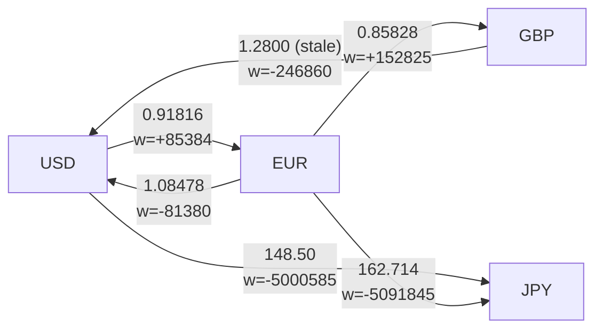

# Shortest Paths: Dijkstra, Bellman-Ford, and Negative Cycles

> Cheapest FX route across currency pairs is a shortest-path problem with a twist.

**Type:** Build
**Languages:** Java, Python, Go
**Prerequisites:** Phase 2, Lesson 08 (Graph Traversal), Phase 1, Lesson 09 (Heaps and Priority Queues), Phase 10, Lesson 01 (Representing Money)
**Time:** ~120 minutes

## Learning Objectives

- Build Dijkstra's algorithm on an indexed binary heap, state the invariant that makes a popped node final, and show with a three-node graph why one negative edge breaks it
- Build Bellman-Ford, explain why V-1 rounds of relaxation suffice, and extract a negative cycle from the parent pointers rather than merely reporting that one exists
- Convert multiplicative FX rates into additive weights with the negative logarithm, and explain why the best conversion path is then a shortest path and an arbitrage loop is a negative cycle
- Justify the numeric representation: rates as 8-decimal scaled integers, weights as integer micro-nats rounded once, and an exact big-integer product to confirm any cycle before calling it arbitrage
- Convert an amount of `Money` along a multi-hop path with one explicit rounding per hop and no floating point touching the amount
- Choose between Dijkstra and Bellman-Ford for a given weight model and state the complexity of each

## The Problem

A treasury service converts customer balances between currencies by chaining quotes from several liquidity providers. It has a quote for every pair it supports, and the first implementation always uses the direct quote: USD to JPY at the USD/JPY price. One provider's USD/JPY quote carries a 1% spread while USD/EUR and EUR/JPY are each quoted at 0.2%. On a 10,000.00 USD conversion the direct route yields 1,485,000 JPY and the two-hop route through EUR yields 1,493,975 JPY. The service gave away 8,975 JPY, about 60 USD, on every such conversion for as long as nobody compared routes. Finding the best route is a shortest-path problem, but the costs multiply instead of adding, and an engineer who reaches for Dijkstra without thinking about that will build something subtly wrong.

The second failure is worse because it is silent. One provider's GBP/USD quote goes stale at 1.2800 while the market has moved so that USD/EUR and EUR/GBP imply 1.2614. Any customer, or any internal process, that converts USD to EUR to GBP and back to USD ends with 0.87% more USD than it started with. Nothing in the system checks for this, because "a rate is a rate" and each conversion is individually valid. A market maker would call it arbitrage. A payments platform calls it a loss that reconciliation finds three weeks later. The shape of the loss is a *negative cycle* in the graph of negative-log rates, and Bellman-Ford detects it in O(V * E).

The third failure is numeric. A developer who knows the negative-log trick implements it with `double` weights, sums them along paths, and compares the sums. Two paths whose true costs are equal come out different by one unit in the last place depending on summation order, so the Java and Go services pick different "best" routes for the same quotes, and a cycle whose rates multiply to exactly 1.0 is reported as arbitrage in one service and not in the other. The course's rule that money is never a float does not forbid floats for *weights*, but it does demand that you know exactly where the float is, how it is rounded, and what you check afterwards. This lesson's answer is: one logarithm per edge, rounded once to an integer, and an exact rational product to confirm every cycle.

## The Concept

### Shortest paths on weighted graphs

Lesson 08's BFS computes fewest hops: every edge costs 1. With a weight on each edge, the length of a path is the sum of its weights and the shortest path is the one with the smallest sum. Two algorithms cover almost every case:

| | Dijkstra | Bellman-Ford |
|---|---|---|
| Weights | Non-negative only | Any, including negative |
| Time | O((V + E) log V) with a binary heap | O(V * E) |
| Negative cycles | Undefined behaviour (rejected up front here) | Detected, and the cycle can be extracted |
| Strategy | Greedy: settle the closest unsettled node | Iterative: relax every edge V-1 times |
| Early exit | When the target is settled | When a full round changes nothing |
| Use in this lesson | Spread costs in basis points | Negative-log FX weights |

### Dijkstra's invariant

Dijkstra keeps a tentative distance for every discovered node and a set of settled nodes. Repeatedly it takes the unsettled node with the smallest tentative distance, settles it, and *relaxes* each of its out-edges: if `dist[u] + w(u, v) < dist[v]`, update `dist[v]` and `parent[v]`.

The invariant: **when a node is settled, its tentative distance is its true shortest distance.** Proof sketch. Suppose `u` is settled with distance `d` but a shorter path exists. That path leaves the settled set at some edge `(x, y)` with `x` settled and `y` not. Then `dist[y] <= dist[x] + w(x, y)` (because `x` was settled and relaxed), and `dist[x] + w(x, y) <=` the length of the shorter path `< d`, because every remaining edge weight is non-negative so the path can only get longer after `y`. So `dist[y] < d`, contradicting the choice of `u` as the smallest unsettled node. The step that fails with a negative edge is "the path can only get longer after `y`".

Concretely, with edges A->B 1, A->C 3, C->B -3: Dijkstra settles A, then B at distance 1 (the smallest tentative), then C at 3. Relaxing C->B finds 3 + (-3) = 0 < 1, but B is settled and final. Dijkstra answers 1; the true distance is 0. This lesson's implementation scans the edges first and throws on a negative weight, so the failure is an exception, not a wrong number.

A common "fix" is to add a constant to every weight to make them non-negative. It does not work: a path with more edges absorbs more copies of the constant, so the shortest path in the shifted graph can differ from the shortest in the original. In the FX setting it would systematically prefer direct quotes over multi-hop routes, which is exactly the bug from The Problem.

### Why the heap, and why an indexed one

Each iteration needs the unsettled node with the smallest tentative distance. A linear scan is O(V) per settle, O(V^2) total, fine for a dozen currencies and hopeless for a road network. The `IndexedMinHeap` from Phase 1, Lesson 09 gives O(log V) pop and, because it tracks each key's position, O(log V) `decreaseKey` when a relaxation lowers a node already in the heap. Each node is pushed once and popped once, each edge relaxes at most once, so the total is O((V + E) log V). Without `decreaseKey` the usual workaround is to push a duplicate entry and skip stale pops; it has the same asymptotics with a larger heap and is what `java.util.PriorityQueue` and Python's `heapq` force you into.

### Bellman-Ford: relax everything, V-1 times

Bellman-Ford makes no greedy choice. It initialises `dist[source] = 0`, then does up to V-1 rounds, each round relaxing every edge in the graph. After round `k`, every node whose shortest path has at most `k` edges has its correct distance (induction: the path's `k`-th edge is relaxed during round `k` from an already-correct predecessor). A shortest path visits no node twice, so it has at most V-1 edges, and V-1 rounds suffice. If a round changes nothing, later rounds will not either, so the implementation exits early.

Negative cycle detection follows directly. If a shortest path exists to every reachable node, round V changes nothing. If round V still relaxes some edge, then some reachable walk keeps getting shorter, which only a cycle of negative total weight can cause. To extract the cycle rather than just report it: take the node `x` relaxed in round V, follow `parent` pointers V times (this guarantees you are standing inside the cycle, not on a tail leading into it), then follow them again until you return to where you started. Parents point backwards, so the collected list is reversed to give the cycle in travel order.



### From rates to weights: the negative logarithm

A conversion path's result is the *product* of its rates: 10,000 USD x 0.91816 x 162.714 = 1,493,975 JPY. Shortest-path algorithms minimise *sums*. The logarithm turns products into sums: `ln(r1 * r2) = ln(r1) + ln(r2)`. Maximising a product of rates is maximising a sum of logs, and maximising a sum is minimising its negation. So with weight `w(u, v) = -ln(rate(u, v))`:

- the best conversion path from A to B is the shortest path from A to B;
- a cycle whose rates multiply to more than 1 (money comes back increased) has `ln(product) > 0`, so its total weight is negative: an arbitrage loop is exactly a negative cycle;
- a cycle whose product is exactly 1 has weight exactly 0, and one with product below 1 (the normal case, because every hop pays a spread) has positive weight.

Rates above 1 (EUR to USD at 1.08) have negative weights. That is not a defect of the model; it is the twist in the lesson's hook, and it is why the FX graph needs Bellman-Ford, not Dijkstra. The spread-cost graph in the demo, where each hop costs a non-negative number of basis points, is the kind of weight Dijkstra is for.

### The numeric choice, stated explicitly

The course forbids floats for money and allows them for weights. This lesson uses exactly one floating-point operation and fences it:

| Quantity | Representation | Why |
|----------|----------------|-----|
| A rate | `long`, scaled by 10^8 (0.92 is `92_000_000`) | Exact; 8 decimals exceed any quoted FX precision; fits comfortably in 64 bits for rates up to 9 x 10^10 |
| A weight | `long` micro-nats: `round(-ln(rate) * 10^6)` | Integer sums are exact and associative, so every language and every summation order agrees; 1 micro-nat is 0.0001% of a rate, far below quote precision |
| A path or cycle total | `long` sum of weights | Exact given the weights; the heap compares longs |
| The amount | `Money` in minor units, `convert` with `HALF_EVEN` per hop | The amount never meets a float; each hop is an exact rational multiply with one named rounding |
| A cycle's true product | `BigInteger` numerator over `RATE_SCALE^k` | Exact confirmation; 10^8 cubed already exceeds 2^63 |

Rounding each weight to the nearest micro-nat introduces at most 0.5 micro-nat of error per edge, so a `k`-edge cycle's integer total can be off by up to `k/2` from the true scaled log. For cycles whose product is within about 10^-6 of 1.0 the sign of the integer total is therefore unreliable. The lesson's `arbitrage` function treats Bellman-Ford's negative cycle as a *candidate* and confirms it with the exact rational product before reporting it. The test suite contains a deliberate case: rates 0.16, 0.25, and 25.0 multiply to exactly 1, but their rounded weights sum to -1 micro-nat, Bellman-Ford reports a negative cycle, and the exact check correctly rejects it.

Why not avoid `ln` entirely? Comparing products directly needs big integers in the inner loop of the shortest-path algorithm and loses the additive structure the algorithms depend on. Why not use `double` weights and tolerate the error? Because "tolerate" becomes a threshold constant, different services pick different thresholds, and a product-exactly-1 cycle becomes a cross-service disagreement. The integer scale plus exact verification is both deterministic and honest about where the approximation lives.

### Worked example: the stale quote, by hand

Scaled rates: USD->EUR `91_816_000` (0.91816), EUR->GBP `85_828_000` (0.85828), GBP->USD `128_000_000` (1.28, stale).

```text
w(USD->EUR) = round(-ln(0.91816) * 1e6) = round( 0.085384... * 1e6) =  +85384
w(EUR->GBP) = round(-ln(0.85828) * 1e6) = round( 0.152825... * 1e6) = +152825
w(GBP->USD) = round(-ln(1.28000) * 1e6) = round(-0.246860... * 1e6) = -246860
cycle total = 85384 + 152825 - 246860 = -8651 micro-nats  (negative: candidate arbitrage)

exact product = 91_816_000 * 85_828_000 * 128_000_000 / (1e8)^3
              = 1_008_689_106_944_000_000_000_000 / 1_000_000_000_000_000_000_000_000
              = 1.008689106944  > 1  (confirmed)
gain = (1.008689... - 1) * 10000 = 86 basis points per loop
```

10,000.00 USD around the loop with `HALF_EVEN` at each hop: 1,000,000 cents x 91,816,000 / 10^8 = 918,160 cents EUR; x 85,828,000 / 10^8 = 788,038.37 -> 788,038 pence GBP; x 128,000,000 / 10^8 = 1,008,688.64 -> 1,008,689 cents = 10,086.89 USD. The exact product would give 1,008,689.11 cents; the per-hop roundings land on 1,008,688.64 before the last rounding, a difference under half a cent, and both round to the same 10,086.89 USD. The loop gains 86.89 USD either way.

### What shortest paths do not do

- They do not model liquidity. A quote is for a size; the best path for 10,000 USD may not exist for 10,000,000 USD. Production routers attach a size to each edge and re-run per tranche.
- They do not model time. Quotes expire; a path assembled from quotes with different timestamps may be unexecutable. The stale-quote arbitrage is precisely a timing artefact.
- Bellman-Ford's cycle is *one* negative cycle, the first one the parent pointers close. A quote set may contain several.
- Dijkstra and Bellman-Ford are single-source. All-pairs shortest paths (Floyd-Warshall, O(V^3), or Johnson's reweighting) is a different lesson and is what you want for a full rate table.

## Build It

The primary walkthrough is in Java. The Python and Go files implement the same design with the same names; the subsections at the end show only what differs. The `IndexedMinHeap` and `Money` types are copied verbatim from their lessons and are not re-explained.

### Step 1: The weighted graph

```java
record Edge(String from, String to, long weight) {}

final class WeightedGraph {
    private final Map<String, List<Edge>> adjacency = new LinkedHashMap<>();
    private final List<Edge> edges = new ArrayList<>();

    void addEdge(String from, String to, long weight) {
        addNode(from);
        addNode(to);
        Edge e = new Edge(from, to, weight);
        adjacency.get(from).add(e);
        edges.add(e);
    }
}
```

Weights are `long`. Dijkstra walks out-edges per node, so the adjacency list is kept; Bellman-Ford walks every edge per round, so a flat edge list is kept too. Both are in insertion order, which makes tie-breaking, and therefore the reported path, deterministic.

**Predict:** the same ordered pair is added twice with different weights. Which one does Dijkstra use, and which does Bellman-Ford use?

### Step 2: Dijkstra on the indexed heap

```java
static PathResult shortestPaths(WeightedGraph g, String source) {
    for (Edge e : g.edges()) {
        if (e.weight() < 0) throw new IllegalArgumentException("Dijkstra requires non-negative weights; ...");
    }
    Map<String, Long> distance = new LinkedHashMap<>();
    Map<String, String> parent = new HashMap<>();
    Map<String, Long> tentative = new HashMap<>();
    IndexedMinHeap<String> heap = new IndexedMinHeap<>();
    tentative.put(source, 0L);
    heap.push(source, 0L);
    while (!heap.isEmpty()) {
        Entry<String> top = heap.pop();
        String u = top.key();
        distance.put(u, top.priority());
        for (Edge e : g.outEdges(u)) {
            if (distance.containsKey(e.to())) continue;
            long candidate = Math.addExact(top.priority(), e.weight());
            Long known = tentative.get(e.to());
            if (known == null) {
                tentative.put(e.to(), candidate);
                parent.put(e.to(), u);
                heap.push(e.to(), candidate);
            } else if (candidate < known) {
                tentative.put(e.to(), candidate);
                parent.put(e.to(), u);
                heap.decreaseKey(e.to(), candidate);
            }
        }
    }
    return new PathResult(distance, parent);
}
```

`distance` holds only settled nodes and is the output; `tentative` holds the heap's current priorities. The `continue` on a settled neighbour is the invariant in code: no settled node is ever relaxed again. `Math.addExact` turns a weight overflow into an exception instead of a negative distance that would win every comparison. The up-front negative-weight scan costs O(E) and is cheaper than debugging a wrong route.

**Predict:** on the spread graph (USD->EUR 20, EUR->JPY 20, USD->JPY 100, EUR->GBP 20, GBP->JPY 15), in what order are nodes settled, and when is JPY's tentative distance lowered by `decreaseKey`?

### Step 3: Bellman-Ford with early exit

```java
static BellmanFordResult run(WeightedGraph g, String source) {
    Map<String, Long> distance = new LinkedHashMap<>();
    Map<String, String> parent = new HashMap<>();
    distance.put(source, 0L);
    int n = g.nodeCount();
    String relaxedInLastRound = null;
    for (int round = 1; round <= n; round++) {
        relaxedInLastRound = null;
        for (Edge e : g.edges()) {
            Long du = distance.get(e.from());
            if (du == null) continue;
            long candidate = Math.addExact(du, e.weight());
            Long dv = distance.get(e.to());
            if (dv == null || candidate < dv) {
                distance.put(e.to(), candidate);
                parent.put(e.to(), e.from());
                relaxedInLastRound = e.to();
            }
        }
        if (relaxedInLastRound == null) break;
    }
```

Unreached nodes have no entry rather than an `INF` sentinel, which avoids `INF + weight` arithmetic entirely. The loop runs to `n`, not `n - 1`: the extra round is the detector. If it exits early, no cycle; if round `n` still relaxes something, `relaxedInLastRound` is non-null and the second half runs.

```java
    if (relaxedInLastRound == null) return new BellmanFordResult(new PathResult(distance, parent), Optional.empty());
    String x = relaxedInLastRound;
    for (int i = 0; i < n; i++) x = parent.get(x);
    List<String> cycle = new ArrayList<>();
    for (String at = x; ; at = parent.get(at)) {
        cycle.add(0, at);
        if (at.equals(x) && cycle.size() > 1) break;
    }
    return new BellmanFordResult(new PathResult(distance, parent), Optional.of(cycle));
}
```

Walking `parent` `n` times from the relaxed node is the step people skip; without it, `x` may be on a path that leads *into* the cycle, and the second loop never returns to `x`. The cycle is prepended as it is collected because parents point backwards, so the result reads in the direction money flows: `[EUR, GBP, USD, EUR]`.

**Predict:** on A->B 1, B->C -3, C->A 1 from source A, which node is relaxed in round 3, and after walking parents 3 times, where do you stand?

### Step 4: Rates to weights

```java
static final long RATE_SCALE = 100_000_000L;
static final long WEIGHT_SCALE = 1_000_000L;

static long weightOf(long scaledRate) {
    double rate = (double) scaledRate / RATE_SCALE;
    return Math.round(-Math.log(rate) * WEIGHT_SCALE);
}
```

This is the only line in the lesson where a `double` exists, and it exists for exactly one expression. `Math.round` on a `double` returns a `long` with ties rounding toward positive infinity, which Python's `round` (banker's) and Go's `math.Round` (away from zero) do differently; the test values were chosen with no exact ties, and the comment in the code says so. The three implementations print identical weights for every rate in the demo.

**Predict:** `weightOf(RATE_SCALE)` and `weightOf(50_000_000) + weightOf(200_000_000)`. Why must the second be exactly zero, and would it still be if `WEIGHT_SCALE` were 10^9?

### Step 5: Arbitrage with a virtual source and an exact check

```java
static Optional<List<String>> arbitrage(List<Rate> rates) {
    WeightedGraph g = fromRates(rates);
    for (String node : new ArrayList<>(g.nodes())) g.addEdge(SOURCE, node, 0);
    Optional<List<String>> cycle = BellmanFord.run(g, SOURCE).negativeCycle();
    if (cycle.isPresent() && !cycleProduct(rates, cycle.get()).exceedsOne()) {
        return Optional.empty();
    }
    return cycle;
}

static CycleProduct cycleProduct(List<Rate> rates, List<String> closedWalk) {
    BigInteger num = BigInteger.ONE, den = BigInteger.ONE;
    for (int i = 0; i + 1 < closedWalk.size(); i++) {
        num = num.multiply(BigInteger.valueOf(rateBetween(rates, closedWalk.get(i), closedWalk.get(i + 1))));
        den = den.multiply(BigInteger.valueOf(RATE_SCALE));
    }
    return new CycleProduct(num, den);
}
```

Bellman-Ford is single-source, and a negative cycle unreachable from the chosen currency would be missed. A virtual source with a zero-weight edge to every currency makes every cycle reachable in one run. The `cycleProduct` check is the promise from the Concept section made concrete: the integer weights find candidates; the exact rational decides.

**Predict:** `rates` contains USD->EUR 0.5 and EUR->USD 2.0 and nothing else. What does Bellman-Ford report, and what does `arbitrage` return?

### Step 6: Converting money along the path

```java
Money convert(long scaledRate, Currency to, Rounding rounding) {
    long numerator = Math.multiplyExact(Math.multiplyExact(minorUnits, scaledRate), to.minorUnitsPerMajor());
    long denominator = Math.multiplyExact(FxGraph.RATE_SCALE, currency.minorUnitsPerMajor());
    return new Money(divideRounded(numerator, denominator, rounding), to);
}
```

USD has two decimals and JPY none, so the minor-unit scales of both currencies enter the fraction. The product `minorUnits * scaledRate` is exact in a `long` for amounts up to about 92 million USD at a rate of 1,000; `multiplyExact` throws beyond that rather than wrapping. `convertAlong` applies this per hop with `HALF_EVEN`, and checks that the amount's currency matches the path's first node, so converting USD along a cycle that starts at EUR is an error rather than a silently mislabelled number.

**Predict:** 15,000 JPY converted to USD at scaled rate `666_667` (0.00666667). What is the exact fraction, and what does `HALF_EVEN` produce?

### Step 7: Run it

```bash
cd phases/02-algorithms/09-shortest-paths/code/java
javac -d .out *.java && java -cp .out Main
java -cp .out MainTest
```

Expected output, abbreviated:

```console
== Dijkstra on non-negative spread costs (basis points) ==
USD->JPY cheapest spread: 40 bps via [USD, EUR, JPY]

== Bellman-Ford on -log weights: best conversion path ==
best USD->JPY path: [USD, EUR, JPY]
  10,000.00 USD along best path  = 1493975 JPY
  10,000.00 USD on the direct quote = 1485000 JPY
arbitrage in consistent market: none

== A stale GBP->USD quote creates a negative cycle ==
arbitrage cycle: [EUR, GBP, USD, EUR]
exact product of rates along the cycle = 1008689106944000000000000 / 1000000000000000000000000
gain = 86 basis points per loop
10,000.00 USD around [USD, EUR, GBP, USD] = 10086.89 USD

== Why Dijkstra cannot be used on these weights ==
rejected: Dijkstra requires non-negative weights; EUR->USD is -81380
```

The test suites also compare Dijkstra against Bellman-Ford on a seeded random graph of 40 nodes and 160 edges and check that every reconstructed path sums to its reported distance. The random generator is a 64-bit LCG written identically in all three languages, so the graph is the same graph everywhere.

### In Python

```python
def weight_of(scaled_rate: int) -> int:
    rate = scaled_rate / RATE_SCALE
    return round(-math.log(rate) * WEIGHT_SCALE)
```

Differences, all in `code/python/main.py`:

- **`round` is banker's rounding** (ties to even) where Java rounds ties up and Go rounds ties away from zero. For the weights in this lesson no value lands on an exact tie, so all three agree; a production implementation that must agree across languages should implement one rounding rule by hand on the scaled integer, as Phase 10, Lesson 01 does for money.
- **No `BigInteger` needed.** Python ints are unbounded, so `cycle_product` multiplies plain ints, and `Money.convert` cannot overflow; the Java and Go versions must check.
- **`gain_basis_points` truncates toward zero** explicitly, because `//` floors; for a positive gain they coincide, but the code handles the negative case the same way the other languages do.
- **`Optional` is `None`**, and the Bellman-Ford result's `negative_cycle` is `Optional[list[str]]`.

### In Go

```go
func (m Money) Convert(scaledRate int64, to Currency, rounding Rounding) (Money, error) {
    num := new(big.Int).Mul(big.NewInt(m.MinorUnits), big.NewInt(scaledRate))
    num.Mul(num, big.NewInt(to.MinorUnitsPerMajor()))
    ...
    if !num.IsInt64() {
        return Money{}, errors.New("int64 overflow in conversion")
    }
```

Differences, all in `code/go/main.go`:

- **`math/big` for the exact product and for overflow-safe conversion.** Go has no `multiplyExact`; computing the numerator in `big.Int` and checking `IsInt64` is the equivalent of Java's exception.
- **Errors are values**: `ErrNegativeWeight`, `ErrUnknownNode`, `ErrArbitrage` are sentinels for `errors.Is`; `Arbitrage` returns `nil, nil` when there is none.
- **Maps iterate randomly**, so `WeightedGraph` keeps `order []string` and per-node edge slices, as Lesson 08 did; otherwise the reported cycle would rotate between runs.
- **`math.Round` rounds ties away from zero**; see the Python note. The `go test -race` flag passes trivially because nothing here is concurrent.

## Use It

### Routing in payments and FX

Multi-leg FX routing engines at banks and payment processors solve exactly this problem, with each provider's quote as an edge and a size attached. The commonest production simplification is to restrict paths to at most two or three hops (so a bounded DFS enumerates them) and to maintain a per-pair "best route" cache refreshed on every quote update; Bellman-Ford's full run is used as a periodic consistency check that flags negative cycles as stale data rather than as trading opportunities. Cross-border payment networks (correspondent banking, and the newer routing layers over them) use the same model with fees as additive weights and Dijkstra as the router.

### Network routing

Dijkstra is the algorithm inside OSPF and IS-IS link-state routing (RFC 2328, section 16, describes the shortest-path-tree computation). Bellman-Ford, in its distributed asynchronous form, is RIP (RFC 2453), and its slow convergence on topology changes, the "count to infinity" problem, is the distributed cousin of the negative-cycle behaviour you built a detector for.

### Libraries

- Python's `networkx` has `dijkstra_path`, `bellman_ford_path`, and `negative_edge_cycle`; `find_negative_cycle` returns the cycle. It uses `heapq` with duplicate entries rather than `decreaseKey`.
- Java has no shortest-path algorithm in the JDK; JGraphT's `DijkstraShortestPath` and `BellmanFordShortestPath` are the standard choices, and `PriorityQueue` is the heap people use when they roll their own (with the duplicate-entry pattern, because it has no `decreaseKey`).
- Go's `gonum/graph/path` has `DijkstraFrom` and `BellmanFordFrom`.

What they all hide: the weight type is a `float64`. For the FX use they are fine as a candidate finder; the exact confirmation remains your job.

## Ship It

`outputs/design-doc-fx-routing.md` is a design-document template for any service that chains conversions or routes value across weighted edges: the weight model and its sign, which algorithm and why, the numeric representation of rates and weights with the rounding stated, the cycle policy (what the service does when it finds one), and the invariants to test. Fill it in before the first line of a router.

## Exercises

1. **Reinforce.** Replace `IndexedMinHeap` in `Dijkstra` with the standard library's priority queue (`java.util.PriorityQueue`, `heapq`, `container/heap`) using the duplicate-entry pattern: push a new entry on every relaxation and skip stale pops. Confirm identical distances on the seeded random graph and count how many stale entries were skipped.
2. **Apply.** Add a `maxHops` parameter to `bestConversionPath` so that a route may use at most `k` legs (real routers cap legs because each leg is a separate settlement). Implement it as Bellman-Ford with exactly `k` rounds and a copy of the distance map per round (so round `k` reads only round `k - 1`). Show a quote set where the unrestricted best path has 3 legs and the 2-leg best path is different.
3. **Extend.** Combine with Lesson 08: run `findCycle` from Lesson 08 on the directed graph of *all* quotes to list candidate loops without weights, then evaluate each with `cycleProduct`. Compare the result with `arbitrage` on a quote set containing two independent negative cycles, and explain why Bellman-Ford reports only one while the enumeration finds both. Then estimate how the enumeration scales with the number of currencies.

## Key Terms

| Term | What people say | What it actually means |
|------|-----------------|------------------------|
| Relaxation | "update the distance" | The step `if dist[u] + w < dist[v] then dist[v] = dist[u] + w, parent[v] = u`; both algorithms are sequences of relaxations in different orders |
| Settled node | "visited" | A node whose distance Dijkstra has fixed; it is never relaxed again, which is correct only when no edge is negative |
| Negative cycle | "an infinite loop" | A directed cycle whose weights sum below zero; shortest paths through it are undefined, and in the FX model it is an arbitrage loop |
| Negative logarithm trick | "take logs" | `w = -ln(rate)` converts a product of rates into a sum of weights so that best rate = shortest path and product > 1 = negative cycle |
| Micro-nat | "the weight unit" | One millionth of a natural-log unit; the integer scale this lesson rounds weights to, so sums are exact and cross-language |
| Pseudo-source | "virtual node" | An extra node with zero-weight edges to every real node, so one single-source run reaches every cycle |
| Basis point | "bps" | One hundredth of a percent; the unit for spreads and for the arbitrage gain this lesson reports |
| Decrease-key | "update priority" | Lowering an existing heap entry's priority in O(log n); what makes Dijkstra O((V + E) log V) without duplicate entries |

## Further Reading

- [Dijkstra, "A Note on Two Problems in Connexion with Graphs" (1959)](https://doi.org/10.1007/BF01386390) — two pages; the algorithm as first stated, without a heap, which makes the greedy invariant unusually clear.
- [Bellman, "On a Routing Problem" (1958)](https://doi.org/10.1090/qam/102435) — the relaxation formulation; read alongside Ford's 1956 RAND report for the full name.
- [Cormen, Leiserson, Rivest, Stein, *Introduction to Algorithms*, chapter 24 (Single-Source Shortest Paths)](https://mitpress.mit.edu/9780262046305/introduction-to-algorithms/) — the correctness proofs for both algorithms, the path-relaxation property, and the negative-cycle lemma this lesson's detector relies on.
- [RFC 2328, OSPF Version 2, section 16](https://www.rfc-editor.org/rfc/rfc2328#section-16) — Dijkstra as deployed in every enterprise network; a production specification of a shortest-path tree computation.
- [RFC 2453, RIP Version 2](https://www.rfc-editor.org/rfc/rfc2453) — distributed Bellman-Ford and its convergence pathologies.
- [Goldberg, "What Every Computer Scientist Should Know About Floating-Point Arithmetic" (1991)](https://docs.oracle.com/cd/E19957-01/806-3568/ncg_goldberg.html) — why `double` sums are not associative, which is the reason this lesson's weights are integers.
- [BIS, "Triennial Central Bank Survey of Foreign Exchange" (2022)](https://www.bis.org/statistics/rpfx22.htm) — the structure of the FX market the rate graph models: pairs, spreads, and why most liquidity routes through a few vehicle currencies.
