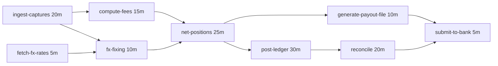

# Topological Sort and DAG Scheduling

> Settlement dependencies and build graphs.

**Type:** Build
**Languages:** Java, Python, Go
**Prerequisites:** Phase 2 Lesson 08 (Graph Traversal), Phase 1 Lesson 05 (Stacks, Queues, and Ring Buffers)
**Time:** ~60 minutes

## Learning Objectives

- Define a topological order, state the one invariant every such order satisfies, and explain why it exists if and only if the graph has no directed cycle
- Build Kahn's algorithm (in-degree peeling) and the DFS finishing-order algorithm, and show on one graph why they produce different valid orders
- Detect a cycle during either algorithm and report the actual nodes of the cycle, not just "a cycle exists"
- Group a dependency graph into parallel levels and compute the minimum number of sequential rounds
- Compute earliest start, latest start, slack, and the critical path of a DAG of timed tasks with a forward and a backward pass

## The Problem

An acquirer runs an end-of-day settlement batch. It is nine jobs, each written by a different team over six years: ingest the day's captures, fetch the FX fixing rates, compute merchant fees, apply the FX fixing, net merchant positions, generate the payout file, post the ledger entries, reconcile the ledger against the netted positions, and submit the payout file to the bank. The orchestration is a cron table. `compute-fees` runs at 23:10 because `ingest-captures` "always finishes by 23:05". `net-positions` runs at 23:40 because fees "take about fifteen minutes". `submit-to-bank` runs at 01:00 because the bank's cutoff is 01:30 and nothing has ever been late.

On the last business day of the quarter, capture volume is 2.4 times normal. `ingest-captures` finishes at 23:31. `compute-fees` started at 23:10 on a partial table and computed fees for 40% of the day. `net-positions` ran on those fees. `generate-payout-file` produced a file paying 1,900 merchants 40% of what they were owed, and `submit-to-bank` sent it to the bank at 01:00. `reconcile` ran at 00:50, found the ledger did not match the netted positions, paged someone, and the page was acknowledged at 01:20. The money had already left. The next three days were spent issuing supplementary payouts, explaining the shortfall to merchants, and reconstructing which fee rows were computed against complete data.

Nothing in that batch was wrong in isolation. Each job did what it was told. The failure was that the dependencies between the jobs lived in people's heads and in clock times, not in the system. `compute-fees` depends on `ingest-captures`; `submit-to-bank` depends on `reconcile`. Those are edges in a directed graph, and the question "in what order may these run so that every job starts only after everything it depends on has finished" has a precise name: a topological order of that graph. A scheduler that computes the order from the edges, instead of guessing it from clock times, cannot run `compute-fees` on partial data no matter how big the quarter-end is. The same scheduler can tell you which jobs may run in parallel, how long the batch must take at minimum, and which job to speed up if you want the batch to finish sooner. And if someone adds an edge that makes `reconcile` wait for `submit-to-bank` while `submit-to-bank` waits for `reconcile`, the scheduler must refuse to run and say exactly which edges form the loop, because a batch that deadlocks silently at 01:00 is worse than one that fails loudly at deploy time.

## The Concept

### Definition and invariant

A directed graph `G = (V, E)` has a **topological order** if its nodes can be listed `v1, v2, ..., vn` so that for every edge `(u -> w)`, `u` appears before `w`. That is the entire invariant: **every edge points forward in the list.** The order is a linear extension of the partial order the edges define; where the edges say nothing about two nodes, the order may put them either way.

Two facts follow immediately:

- **A topological order exists if and only if the graph has no directed cycle.** If there were a cycle `a -> b -> c -> a`, then `a` must precede `b`, `b` must precede `c`, and `c` must precede `a`, which is impossible. Conversely, every finite DAG has at least one node with no incoming edges (follow edges backward; you cannot do so forever without repeating, and repeating means a cycle), and removing it leaves a smaller DAG, so you can peel the whole graph. That peeling argument is Kahn's algorithm.
- **The order is usually not unique.** In the settlement graph, `ingest-captures` and `fetch-fx-rates` have no edge between them, so either may go first. The number of valid orders can be exponential in the number of nodes (for a graph with no edges at all it is `n!`). An algorithm chooses one; a scheduler that wants reproducible runs must choose the same one every time, which means the tie-break rule is part of the design, not an accident.



Nine jobs, ten edges, two sources (`ingest-captures`, `fetch-fx-rates`), one sink (`submit-to-bank`). The durations in minutes are used by the scheduling half of the lesson.

### Kahn's algorithm: peel the sources

Kahn (1962) is the peeling argument made into a procedure:

1. Compute the in-degree of every node (how many edges point at it).
2. Put every node with in-degree zero into a ready queue.
3. Repeatedly take a node from the queue, emit it, and for each of its successors subtract one from the in-degree. Any successor that reaches zero goes into the queue.
4. If every node was emitted, the emitted sequence is a topological order. If some were not, those nodes all still have in-degree greater than zero, which means each of them is waiting on another unfinished node, which means there is a cycle among them.

Trace on the settlement graph. Nodes are listed in the order they were added (`ingest-captures`, `compute-fees`, `fx-fixing`, `fetch-fx-rates`, `net-positions`, `generate-payout-file`, `post-ledger`, `reconcile`, `submit-to-bank`), and the ready queue is first-in, first-out:

```text
in-degree: ingest-captures 0, compute-fees 1, fx-fixing 2, fetch-fx-rates 0, net-positions 2,
           generate-payout-file 1, post-ledger 1, reconcile 1, submit-to-bank 2
ready = [ingest-captures, fetch-fx-rates]

pop ingest-captures   -> compute-fees 1->0 (ready), fx-fixing 2->1
pop fetch-fx-rates    -> fx-fixing 1->0 (ready)
pop compute-fees      -> net-positions 2->1
pop fx-fixing         -> net-positions 1->0 (ready)
pop net-positions     -> generate-payout-file 1->0 (ready), post-ledger 1->0 (ready)
pop generate-payout-file -> submit-to-bank 2->1
pop post-ledger       -> reconcile 1->0 (ready)
pop reconcile         -> submit-to-bank 1->0 (ready)
pop submit-to-bank    -> nothing

order = [ingest-captures, fetch-fx-rates, compute-fees, fx-fixing, net-positions,
         generate-payout-file, post-ledger, reconcile, submit-to-bank]      9 of 9 emitted
```

Every node is enqueued once and dequeued once, and every edge is examined once when its source is dequeued, so the running time is `O(V + E)` and the extra space is the in-degree map plus the queue, `O(V)`.

The tie-break is the FIFO queue over nodes in insertion order. Swap the queue for a priority queue keyed on node name and you get the lexicographically smallest topological order; key it on a priority field and you get "most urgent ready job first". The algorithm does not care what the queue is; the determinism of your scheduler depends entirely on it.

### DFS finishing order: finish your dependents first

The second algorithm comes from Tarjan (1972). Run a depth-first search from every unvisited node. A node is *finished* when the search has returned from all of its successors. Record nodes in finishing order; the reverse of that list is a topological order.

Why it works: when `u` finishes, every node reachable from `u` has already finished (the DFS went there first and came back). So every successor of `u` is earlier in finishing order than `u`, which means later than `u` in the reversed list. Every edge points forward.

Cycle detection falls out of the three-colour scheme. A node is WHITE before it is visited, GRAY while it is on the recursion stack (visited, not finished), and BLACK when finished. An edge from the current node to a GRAY node is a **back edge**: it points at an ancestor that is still open, so following it would return to where you already are. That is a cycle, and the cycle is exactly the stack from the GRAY node down to the current node. An edge to a BLACK node is a cross or forward edge and is harmless.

On the settlement graph, DFS from `ingest-captures` (the first node) with successors visited in insertion order produces finishing order `submit-to-bank, generate-payout-file, reconcile, post-ledger, net-positions, compute-fees, fx-fixing, ingest-captures, fetch-fx-rates`; reversed: `fetch-fx-rates, ingest-captures, fx-fixing, compute-fees, net-positions, post-ledger, reconcile, generate-payout-file, submit-to-bank`. Different from Kahn's order, equally valid. The implementation in this lesson is iterative with an explicit stack of `(node, next successor index)` frames, because a 100,000-job chain is a realistic dependency graph in a build system and a recursive DFS on it overflows the Java call stack at a few thousand frames.

| | Kahn (in-degree) | DFS (finishing order) |
|---|---|---|
| Time, space | `O(V + E)`, `O(V)` | `O(V + E)`, `O(V)` |
| Natural tie-break | the ready queue: FIFO, priority, lexicographic | successor order within each node |
| Cycle detection | leftover nodes after the queue drains | back edge to a GRAY node |
| Cycle report | needs a second pass over the leftover nodes | free: the stack between the GRAY node and the current node |
| Streaming use | yes: emit a node as soon as it is ready; this is how a parallel scheduler runs | no: nothing is emitted until the deepest node finishes |
| Also gives you | parallel levels (every node dequeued before the queue refills forms a round) | reverse postorder, strongly connected components (Tarjan), the same traversal you used in Lesson 08 |

Use Kahn when you are scheduling (you want to dispatch jobs as they become ready); use DFS when you need the cycle reported or when you already have a DFS for another reason.

### Reporting the cycle, not just detecting it

"Cycle detected" is a useless error at 23:00 with nine jobs and ten edges, and a hopeless one with 4,000 jobs. The cycle itself is cheap to produce. In the DFS, when the current node `u` has a successor `w` that is GRAY, walk the `parent` map from `u` back to `w`, and reverse: that is the cycle `w -> ... -> u -> w`. Kahn's algorithm does not naturally know the cycle (it only knows which nodes were never ready), so this implementation runs the DFS on the graph to find one to report. The leftover nodes after Kahn are every node on a cycle *plus everything downstream of a cycle*, which is more than the cycle; reporting all of them is how you get an error message that lists 3,800 of your 4,000 jobs.

Add one edge to the settlement graph, `submit-to-bank -> reconcile` (someone decided reconciliation should confirm the submission). Kahn now emits seven nodes and stops with `reconcile` and `submit-to-bank` both at in-degree 1. The DFS reports `cycle detected: submit-to-bank -> reconcile -> submit-to-bank`. That message tells the author of the change exactly which two edges to argue about.

### Scheduling on a DAG: levels and the critical path

A topological order is a serial schedule. A batch system has more than one worker, so the interesting questions are: what can run at the same time, how long must the batch take at minimum, and where is the slack?

**Levels.** Define the level of a node as 0 if it has no predecessors and otherwise one more than the maximum level of its predecessors. Every node in a level has all of its prerequisites in strictly lower levels, so a level can run as one parallel round. The number of levels is the length (in edges) of the longest path plus one, and it is the minimum number of sequential rounds if every job took unit time. The settlement graph has six levels: `{ingest-captures, fetch-fx-rates}`, `{compute-fees, fx-fixing}`, `{net-positions}`, `{generate-payout-file, post-ledger}`, `{reconcile}`, `{submit-to-bank}`.

**Critical path.** Jobs do not take unit time. Give each one a duration and ask for the earliest time each can start. This is the longest-path problem on a DAG, and unlike longest path on a general graph (NP-hard), on a DAG it is one pass in topological order. The method is Kelley and Walker's critical path method (1959), the thing project managers draw as Gantt charts:

- **Forward pass**, in topological order: `earliestStart(v) = max over predecessors u of earliestFinish(u)`, or 0 for a source; `earliestFinish(v) = earliestStart(v) + duration(v)`. The **makespan** is the maximum `earliestFinish`.
- **Backward pass**, in reverse topological order: `latestFinish(v) = min over successors w of latestStart(w)`, or the makespan for a sink; `latestStart(v) = latestFinish(v) - duration(v)`.
- **Slack** `= latestStart - earliestStart`. A job with zero slack cannot be delayed at all without delaying the whole batch. The zero-slack jobs form the **critical path**, and the sum of their durations equals the makespan.

Worked by hand on the settlement graph, durations in minutes:

```text
forward pass (earliest start - earliest finish)
  ingest-captures       0 - 20
  fetch-fx-rates        0 - 5
  compute-fees         20 - 35     waits for ingest-captures
  fx-fixing            20 - 30     max(ingest 20, fetch 5) = 20
  net-positions        35 - 60     max(fees 35, fx 30) = 35
  generate-payout-file 60 - 70
  post-ledger          60 - 90
  reconcile            90 - 110
  submit-to-bank      110 - 115    max(payout 70, reconcile 110) = 110
makespan = 115

backward pass (latest start)
  submit-to-bank      115 - 5 = 110
  reconcile           110 - 20 = 90
  generate-payout-file 110 - 10 = 100        slack 100 - 60 = 40
  post-ledger          90 - 30 = 60
  net-positions        min(100, 60) - 25 = 35
  fx-fixing            35 - 10 = 25           slack 25 - 20 = 5
  compute-fees         35 - 15 = 20
  fetch-fx-rates       25 - 5 = 20            slack 20 - 0 = 20
  ingest-captures      min(20, 25) - 20 = 0

critical path: ingest-captures -> compute-fees -> net-positions -> post-ledger -> reconcile -> submit-to-bank
20 + 15 + 25 + 30 + 20 + 5 = 115
```

Read the slack column as an engineering budget. Making `fetch-fx-rates` ten times faster saves nothing. Making `generate-payout-file` slower by half an hour costs nothing. Shaving ten minutes off `post-ledger` finishes the batch at 01:05 instead of 01:15. The cron table version of this batch encoded none of that; the DAG version computes it in `O(V + E)`.

### What the structure does not do

A topological order is a statement about dependencies, nothing more. It does not know how many workers you have, so the levels are an upper bound on parallelism, not a schedule for a two-worker pool (that problem, list scheduling with resource constraints, is NP-hard in general and solved with heuristics). It does not know that a job can fail: retrying `compute-fees` after a failure and re-running its downstream jobs is the orchestrator's job, and the topological order tells it what "downstream" means. It does not know about data: a DAG can tell you `compute-fees` runs after `ingest-captures`; it cannot tell you `ingest-captures` finished with a complete table rather than a partial one. That guarantee needs the job to publish an explicit completion marker, which is a Phase 8 concern. And the critical path assumes durations are known; in practice they are estimates from history, and the critical path you compute is only as good as those estimates.

## Build It

The implementation is in `code/java/Main.java` and lives in four types: `Digraph`, `TopoSort`, `CycleException`, and `DagScheduler` with its `Task`, `Slot`, and `Schedule` records.

### Step 1: A directed graph that remembers insertion order

```java
final class Digraph {
    private final Map<String, List<String>> adjacency = new LinkedHashMap<>();

    Digraph addNode(String node) {
        Objects.requireNonNull(node, "node");
        adjacency.computeIfAbsent(node, k -> new ArrayList<>());
        return this;
    }

    Digraph addEdge(String from, String to) {
        addNode(from);
        addNode(to);
        List<String> out = adjacency.get(from);
        if (!out.contains(to)) out.add(to);
        return this;
    }

    Map<String, Integer> inDegrees() {
        Map<String, Integer> in = new LinkedHashMap<>();
        for (String node : adjacency.keySet()) in.put(node, 0);
        for (List<String> out : adjacency.values()) {
            for (String to : out) in.merge(to, 1, Integer::sum);
        }
        return in;
    }
}
```

`LinkedHashMap` rather than `HashMap` is the first design decision and the most important one. Both algorithms break ties by the order they encounter nodes, and a `HashMap` iterates in an order that depends on the hash codes and the table size, so two runs of the same batch with one extra job could schedule everything differently. A scheduler whose output you cannot predict from its input cannot be tested or audited. Insertion order is a choice a reviewer can see.

`addEdge` ignores duplicates because a repeated edge would make the in-degree count 2 for a single dependency and Kahn would never release the node. The edge list is a `List` with a linear `contains` check, which is fine for the fan-out of a dependency graph; a graph with nodes of degree 10,000 would use a `LinkedHashSet`.

**Predict:** what does `inDegrees()` return for a node that was added with `addNode` and never appears in any edge, and what does Kahn do with it?

### Step 2: Kahn's algorithm

```java
static List<String> kahn(Digraph g) {
    Map<String, Integer> inDegree = g.inDegrees();
    Deque<String> ready = new ArrayDeque<>();
    for (Map.Entry<String, Integer> e : inDegree.entrySet()) {
        if (e.getValue() == 0) ready.add(e.getKey());
    }
    List<String> order = new ArrayList<>(g.nodeCount());
    while (!ready.isEmpty()) {
        String node = ready.poll();
        order.add(node);
        for (String next : g.successors(node)) {
            int remaining = inDegree.merge(next, -1, Integer::sum);
            if (remaining == 0) ready.add(next);
        }
    }
    if (order.size() != g.nodeCount()) {
        throw new CycleException(findCycle(g));
    }
    return order;
}
```

This is the trace from The Concept, line for line. `inDegree.merge(next, -1, Integer::sum)` decrements and returns the new value in one call, so the "did it just reach zero" test is on the returned value and a node is enqueued exactly once. The final size check is the cycle test: Kahn cannot emit a node that is waiting on an unemitted node, so a shortfall means a cycle exists somewhere among the leftovers. The leftovers themselves are not reported, because they include everything downstream of the cycle; `findCycle` runs the DFS to name the actual loop.

**Predict:** if `fetch-fx-rates` were added to the graph before `ingest-captures`, which node would Kahn emit first, and would the order still be valid?

### Step 3: Iterative DFS with three colours

```java
static List<String> dfs(Digraph g) {
    Map<String, Color> color = new HashMap<>();
    for (String n : g.nodes()) color.put(n, Color.WHITE);
    Map<String, String> parent = new HashMap<>();
    List<String> finished = new ArrayList<>(g.nodeCount());

    for (String root : g.nodes()) {
        if (color.get(root) != Color.WHITE) continue;
        Deque<Frame> stack = new ArrayDeque<>();
        stack.push(new Frame(root));
        color.put(root, Color.GRAY);
        while (!stack.isEmpty()) {
            Frame top = stack.peek();
            List<String> succ = g.successors(top.node);
            if (top.next < succ.size()) {
                String child = succ.get(top.next++);
                Color c = color.get(child);
                if (c == Color.WHITE) {
                    color.put(child, Color.GRAY);
                    parent.put(child, top.node);
                    stack.push(new Frame(child));
                } else if (c == Color.GRAY) {
                    throw new CycleException(walkBack(top.node, child, parent));
                }
            } else {
                color.put(top.node, Color.BLACK);
                finished.add(top.node);
                stack.pop();
            }
        }
    }
    Collections.reverse(finished);
    return finished;
}
```

Each `Frame` holds a node and the index of the next successor to examine, which is exactly what a recursive call's local state would hold. When the index runs off the end of the successor list the node is finished: it turns BLACK, goes on the `finished` list, and the frame is popped. An edge to a GRAY node is a back edge and triggers the cycle report. An edge to a BLACK node is skipped: that subtree was already fully explored, which is what makes the whole algorithm `O(V + E)` rather than exponential.

The `color` and `parent` maps here may be `HashMap`s because they are only looked up by key, never iterated; the iteration order that determines the output comes from `g.nodes()` and `g.successors`, which are insertion-ordered.

**Predict:** on the graph `a -> b, a -> c, b -> c`, which colour is `c` when the search reaches it the second time (via `a`), and why is that edge not a cycle?

### Step 4: Walking back the cycle

```java
private static List<String> walkBack(String from, String to, Map<String, String> parent) {
    List<String> path = new ArrayList<>();
    String cur = from;
    while (!cur.equals(to)) {
        path.add(cur);
        cur = parent.get(cur);
    }
    path.add(to);
    Collections.reverse(path);
    return path;
}
```

`from` is the node whose edge pointed at a GRAY ancestor `to`. Every node between them on the DFS stack has a `parent` entry pointing one step up, so following `parent` from `from` until you reach `to` collects the stack segment, and reversing it puts the cycle in edge order starting at `to`. A self-loop `a -> a` gives `from == to`, the loop body never runs, and the cycle is `[a]`. The `CycleException` constructor formats it as `a -> b -> c -> a` so the message reads as a path.

### Step 5: Levels, for parallel rounds

```java
List<List<String>> levels() {
    Map<String, Integer> depth = new HashMap<>();
    for (String n : TopoSort.kahn(graph)) {
        int d = 0;
        for (String from : graph.nodes()) {
            if (graph.successors(from).contains(n)) d = Math.max(d, depth.get(from) + 1);
        }
        depth.put(n, d);
    }
    int maxDepth = depth.values().stream().mapToInt(Integer::intValue).max().orElse(-1);
    List<List<String>> out = new ArrayList<>();
    for (int i = 0; i <= maxDepth; i++) out.add(new ArrayList<>());
    for (String n : graph.nodes()) out.get(depth.get(n)).add(n);
    return out;
}
```

Processing nodes in topological order is what makes `depth.get(from)` safe: every predecessor has been assigned a depth before any node that depends on it. The predecessor scan is `O(V * E)` as written because `Digraph` stores only out-edges; a production scheduler stores in-edges too and this becomes `O(V + E)`. The lesson keeps the graph type small and accepts the cost at nine nodes.

**Predict:** if a graph has no edges at all, how many levels does it have?

### Step 6: Forward pass, backward pass, slack

```java
for (String n : order) {
    long start = -1;
    for (String from : predecessors(n)) {
        long f = earliestFinish.get(from);
        if (f > start) {
            start = f;
            criticalPredecessor.put(n, from);
        }
    }
    if (start < 0) start = 0;
    earliestStart.put(n, start);
    earliestFinish.put(n, Math.addExact(start, tasks.get(n).minutes()));
}
long makespan = earliestFinish.values().stream().mapToLong(Long::longValue).max().orElse(0);

Map<String, Long> latestFinish = new HashMap<>();
for (int i = order.size() - 1; i >= 0; i--) {
    String n = order.get(i);
    long lf = makespan;
    for (String to : graph.successors(n)) {
        lf = Math.min(lf, latestFinish.get(to) - tasks.get(to).minutes());
    }
    latestFinish.put(n, lf);
}
```

The forward pass remembers, for each node, which predecessor forced its start time (`criticalPredecessor`). After the pass, start at the task that finishes at the makespan and follow `criticalPredecessor` backwards: that is the critical path, and its durations sum to the makespan. The strict `>` means the first predecessor in insertion order wins a tie, so two equally long paths produce the same reported critical path on every run.

The backward pass runs the same loop in reverse topological order so that every successor's `latestFinish` is known before the node that feeds it. Slack is then `latestStart - earliestStart`, assembled into a `Slot` record per task, and `isCritical()` is `slack == 0`.

Durations are `long` minutes and the addition is `Math.addExact`, for the same reason money is `long` minor units: a scheduling horizon that silently wraps negative is a bug that looks like a job scheduled in 1970.

**Predict:** `generate-payout-file` has slack 40. If its duration grows from 10 to 50 minutes, what happens to the makespan and to the critical path?

### Step 7: Run it

```bash
cd phases/02-algorithms/10-topological-sort-and-dags/code/java
javac -d .out *.java && java -cp .out Main
java -cp .out MainTest
```

Expected output, abbreviated:

```console
== Settlement batch: 9 jobs, 10 dependencies ==
Kahn order: [ingest-captures, fetch-fx-rates, compute-fees, fx-fixing, net-positions, generate-payout-file, post-ledger, reconcile, submit-to-bank]
DFS order:  [fetch-fx-rates, ingest-captures, fx-fixing, compute-fees, net-positions, post-ledger, reconcile, generate-payout-file, submit-to-bank]
both valid: true true

== Parallel levels (jobs in one level can run together) ==
level 0: [ingest-captures, fetch-fx-rates]
level 1: [compute-fees, fx-fixing]
level 2: [net-positions]
level 3: [generate-payout-file, post-ledger]
level 4: [reconcile]
level 5: [submit-to-bank]

== Critical path ==
task                      ES    EF    LS slack
ingest-captures            0    20     0     0  <- critical
compute-fees              20    35    20     0  <- critical
fx-fixing                 20    30    25     5
...
makespan = 115 minutes; critical path = [ingest-captures, compute-fees, net-positions, post-ledger, reconcile, submit-to-bank]

== A cycle: reconcile now waits for submit-to-bank ==
rejected: cycle detected: submit-to-bank -> reconcile -> submit-to-bank
```

The test file checks 41 assertions: both orders satisfy the validator, Kahn's order matches the hand trace exactly, the 100,000-node chain does not overflow the stack, the cycle is reported as the two-node loop and not as every downstream node, the levels and the slack column match the hand computation, and a cyclic graph cannot be scheduled.

### In Python

`Digraph`, `TopoSort`, `CycleException`, and `DagScheduler` keep their names and their algorithms in `code/python/main.py`; three things differ. **Insertion order is free:** a `dict` preserves insertion order (guaranteed since 3.7), so `Digraph` needs no `LinkedHashMap`, and `schedule` uses a `dict` with `None` values as the insertion-ordered set that `LinkedHashSet` provides; `successors` returns a tuple and `nodes` a keys view, the read-only counterparts of `Collections.unmodifiableList` and `unmodifiableSet`. **The iterative DFS is still required, for a different reason:** CPython stops at `sys.getrecursionlimit()` (1,000 frames by default) long before the JVM's stack runs out, so a recursive DFS would fail on the 100,000-node chain at depth 1,000; the explicit stack of `_Frame` objects (with `__slots__`) is the same code as the Java. **Exceptions:** `CycleException` subclasses `RuntimeError`, the closest built-in to `IllegalStateException`, and carries the cycle the same way; argument errors (`unknown node`, a missing duration, a negative duration) raise `ValueError`, and a test checks that a cycle is not reported as a `ValueError`. Durations are summed with `add_exact`, which raises `ArithmeticError` where `Math.addExact` would, because Python ints never overflow on their own.

Run it from `code/python/` with `python3 main.py`; test with `python3 -m unittest -v`. The demo output is identical to the Java run; the suite covers the Java's 41 checks plus 2.

#### Step 1: A directed graph that remembers insertion order

A plain `dict` of lists is the `LinkedHashMap`. `setdefault` is `computeIfAbsent`, `add_edge` keeps the duplicate check so a repeated dependency does not inflate the in-degree, and the parameter is `from_` because `from` is a keyword. `in_degrees` builds its dict from the adjacency keys first so that isolated nodes appear with degree 0.

```python
class Digraph:
    def __init__(self) -> None:
        self._adjacency: dict[str, list[str]] = {}

    def add_node(self, node: str) -> Digraph:
        if node is None:
            raise TypeError("node")
        self._adjacency.setdefault(node, [])
        return self

    def add_edge(self, from_: str, to: str) -> Digraph:
        """Adds the edge from_ -> to, meaning "from_ must finish before to can start"."""
        self.add_node(from_)
        self.add_node(to)
        out = self._adjacency[from_]
        if to not in out:
            out.append(to)
        return self

    def in_degrees(self) -> dict[str, int]:
        in_ = {node: 0 for node in self._adjacency}
        for out in self._adjacency.values():
            for to in out:
                in_[to] += 1
        return in_
```

#### Step 2: Kahn's algorithm

`collections.deque` is the `ArrayDeque`; `popleft` is `poll`. Python has no `merge` that returns the new value, so the decrement and the zero test are two statements, which reads closer to the hand trace anyway. The size check at the end is the cycle test, and `find_cycle` names the loop.

```python
    @staticmethod
    def kahn(g: Digraph) -> list[str]:
        in_degree = g.in_degrees()
        ready: deque[str] = deque(node for node, d in in_degree.items() if d == 0)
        order: list[str] = []
        while ready:
            node = ready.popleft()
            order.append(node)
            for nxt in g.successors(node):
                in_degree[nxt] -= 1
                if in_degree[nxt] == 0:
                    ready.append(nxt)
        if len(order) != g.node_count():
            # every node still holding in-degree > 0 lies on or downstream of a cycle; find one to report
            raise CycleException(TopoSort.find_cycle(g))
        return order
```

#### Step 3: Iterative DFS with three colours

A Python list is the stack, `stack[-1]` is `peek`, and `_Frame` carries the node plus the index of its next unexplored successor. `_Color` is an `Enum`, compared with `is`. The recursion limit is why this loop is not a recursive function: the test's 100,000-node chain would die at depth 1,000 otherwise.

```python
        color = {n: _Color.WHITE for n in g.nodes()}
        parent: dict[str, str] = {}
        finished: list[str] = []

        for root in g.nodes():
            if color[root] is not _Color.WHITE:
                continue
            stack = [_Frame(root)]
            color[root] = _Color.GRAY
            while stack:
                top = stack[-1]
                succ = g.successors(top.node)
                if top.next < len(succ):
                    child = succ[top.next]
                    top.next += 1
                    c = color[child]
                    if c is _Color.WHITE:
                        color[child] = _Color.GRAY
                        parent[child] = top.node
                        stack.append(_Frame(child))
                    elif c is _Color.GRAY:
                        raise CycleException(TopoSort._walk_back(top.node, child, parent))
                    # BLACK: already finished, a cross or forward edge, safe to ignore
                else:
                    color[top.node] = _Color.BLACK
                    finished.append(top.node)
                    stack.pop()
        finished.reverse()
        return finished
```

#### Step 4: Walking back the cycle

The same parent walk, with `list.reverse()` in place of `Collections.reverse`. A self-loop gives `from_ == to`, so the `while` never runs and the cycle is `[to]`. `CycleException.__init__` builds the `a -> b -> a` message and keeps the cycle as a tuple so the exception cannot be mutated after it is raised.

```python
    @staticmethod
    def _walk_back(from_: str, to: str, parent: dict[str, str]) -> list[str]:
        """From the GRAY node `from_` back up the DFS tree to `to`, then reverse into edge order."""
        path: list[str] = []
        cur = from_
        while cur != to:
            path.append(cur)
            cur = parent[cur]
        path.append(to)
        path.reverse()
        return path
```

#### Step 5: Levels, for parallel rounds

Processing Kahn's order makes `depth[from_]` safe to read. `max(depth.values(), default=-1)` is the stream's `orElse(-1)`, and the list comprehension `[[] for _ in range(max_depth + 1)]` allocates one bucket per level (not `[[]] * n`, which would alias one list). The predecessor scan is `O(V * E)` here, as in Java, because the graph stores only out-edges.

```python
    def levels(self) -> list[list[str]]:
        depth: dict[str, int] = {}
        for n in TopoSort.kahn(self._graph):
            d = 0
            for from_ in self._graph.nodes():
                if n in self._graph.successors(from_):
                    d = max(d, depth[from_] + 1)
            depth[n] = d
        max_depth = max(depth.values(), default=-1)
        out: list[list[str]] = [[] for _ in range(max_depth + 1)]
        for n in self._graph.nodes():
            out[depth[n]].append(n)
        return out
```

#### Step 6: Forward pass, backward pass, slack

The forward pass keeps the strict `>` so the first predecessor in insertion order wins ties, and adds durations through `add_exact`, the hand-written `Math.addExact` that raises `ArithmeticError` outside the signed 64-bit range. The backward pass is `for n in reversed(order)`, and the critical path is collected into a `dict` used as an ordered set.

```python
        for n in order:
            start = -1
            for from_ in self._predecessors(n):
                f = earliest_finish[from_]
                if f > start:  # strict: first predecessor wins ties, deterministically
                    start = f
                    critical_predecessor[n] = from_
            if start < 0:
                start = 0  # no predecessors: can start at time zero
            earliest_start[n] = start
            earliest_finish[n] = add_exact(start, self._tasks[n].minutes)
        makespan = max(earliest_finish.values(), default=0)

        latest_finish: dict[str, int] = {}
        for n in reversed(order):
            lf = makespan
            for to in self._graph.successors(n):
                lf = min(lf, latest_finish[to] - self._tasks[to].minutes)
            latest_finish[n] = lf
```

#### Step 7: Run it

```bash
cd phases/02-algorithms/10-topological-sort-and-dags/code/python
python3 main.py
python3 -m unittest -v
```

The demo formats lists with a small `jstr` helper so the output matches the Java run character for character:

```console
== Settlement batch: 9 jobs, 10 dependencies ==
Kahn order: [ingest-captures, fetch-fx-rates, compute-fees, fx-fixing, net-positions, generate-payout-file, post-ledger, reconcile, submit-to-bank]
DFS order:  [fetch-fx-rates, ingest-captures, fx-fixing, compute-fees, net-positions, post-ledger, reconcile, generate-payout-file, submit-to-bank]
both valid: true true

makespan = 115 minutes; critical path = [ingest-captures, compute-fees, net-positions, post-ledger, reconcile, submit-to-bank]

== A cycle: reconcile now waits for submit-to-bank ==
rejected: cycle detected: submit-to-bank -> reconcile -> submit-to-bank
```

### In Go

`Digraph`, `Kahn`, `DFS`, and `DagScheduler` keep their names and their algorithms in `code/go/main.go`; three things differ. **Insertion order is kept by hand:** Go maps iterate in deliberately randomized order, so `Digraph` holds a `[]string` of nodes beside the `map[string][]string` adjacency, and every loop that Java runs over `LinkedHashMap` keys runs over that slice; `Schedule.Slots` is a plain map and the demo iterates `g.Nodes()` to print it in order. **A cycle is an error value with data:** `CycleError` carries the cycle and implements `error`; `Kahn`, `DFS`, `Levels`, and `Schedule` return it, and `errors.As` recovers the slice where Java's `catch (CycleException e)` reads `e.cycle()`. Argument problems are the sentinels `ErrUnknownNode`, `ErrNoDuration`, and `ErrNegativeDuration`, so `errors.Is` tells a bad graph from a bad argument. **The iterative DFS stays, and `int64` needs the overflow check:** a goroutine stack grows to 1 GB, so a recursive DFS would survive the 100,000-node chain, but the explicit `frame` stack is the same code as the Java and the test keeps it honest. Go's `+` wraps, so the forward pass adds durations with `addChecked`, which returns `ErrOverflow` where `Math.addExact` throws; a test schedules two `1 << 62`-minute tasks to see it fire.

Run it from `code/go/` with `go run .`; test with `go test ./...`. The demo output is identical to the Java run; the suite covers the Java's 41 checks plus 7 for insertion order, the DFS order, the error-kind distinction, levelling a cyclic graph, and the overflow guard.

#### Step 1: A directed graph that remembers insertion order

The `order` slice is the part a Go map cannot give you. `AddNode` appends to it only on first sight, `AddEdge` uses `slices.Contains` for the duplicate check, and `InDegrees` seeds every node with 0 from `order` before counting. `Successors` returns `ErrUnknownNode` for callers; the unexported `succ` skips the check for nodes the algorithms already know exist.

```go
type Digraph struct {
	order     []string
	adjacency map[string][]string
}

func (g *Digraph) AddNode(node string) *Digraph {
	if _, ok := g.adjacency[node]; !ok {
		g.adjacency[node] = []string{}
		g.order = append(g.order, node)
	}
	return g
}

func (g *Digraph) AddEdge(from, to string) *Digraph {
	g.AddNode(from)
	g.AddNode(to)
	if !slices.Contains(g.adjacency[from], to) {
		g.adjacency[from] = append(g.adjacency[from], to)
	}
	return g
}

func (g *Digraph) InDegrees() map[string]int {
	in := make(map[string]int, len(g.order))
	for _, node := range g.order {
		in[node] = 0
	}
	for _, out := range g.adjacency {
		for _, to := range out {
			in[to]++
		}
	}
	return in
}
```

#### Step 2: Kahn's algorithm

The FIFO ready queue is a slice with a moving `head` index: nodes are appended at the back and the loop condition `head < len(ready)` re-evaluates every iteration, so nodes released mid-loop are picked up. The initial scan runs over `g.order`, not the in-degree map, which is what makes the output deterministic. A shortfall returns `&CycleError{FindCycle(g)}` instead of throwing.

```go
func Kahn(g *Digraph) ([]string, error) {
	inDegree := g.InDegrees()
	var ready []string
	for _, node := range g.order {
		if inDegree[node] == 0 {
			ready = append(ready, node)
		}
	}
	order := make([]string, 0, g.NodeCount())
	for head := 0; head < len(ready); head++ { // ready[head:] is the FIFO queue
		node := ready[head]
		order = append(order, node)
		for _, next := range g.succ(node) {
			inDegree[next]--
			if inDegree[next] == 0 {
				ready = append(ready, next)
			}
		}
	}
	if len(order) != g.NodeCount() {
		// Every node still holding in-degree > 0 lies on or downstream of a cycle; find one to report.
		return nil, &CycleError{FindCycle(g)}
	}
	return order, nil
}
```

#### Step 3: Iterative DFS with three colours

`colors` is a map whose zero value is `white`, so unvisited nodes need no initialisation. `top := &stack[len(stack)-1]` takes a pointer into the slice so `top.next++` mutates the frame in place; the `switch` on colour has no `black` arm because that edge is ignored. The frame slice is popped by reslicing.

```go
	for _, root := range g.order {
		if colors[root] != white {
			continue
		}
		stack := []frame{{root, 0}}
		colors[root] = gray
		for len(stack) > 0 {
			top := &stack[len(stack)-1]
			succ := g.succ(top.node)
			if top.next < len(succ) {
				child := succ[top.next]
				top.next++
				switch colors[child] {
				case white:
					colors[child] = gray
					parent[child] = top.node
					stack = append(stack, frame{child, 0})
				case gray:
					return nil, &CycleError{walkBack(top.node, child, parent)}
				}
				// black: already finished, a cross or forward edge, safe to ignore
			} else {
				colors[top.node] = black
				finished = append(finished, top.node)
				stack = stack[:len(stack)-1]
			}
		}
	}
	slices.Reverse(finished)
	return finished, nil
```

#### Step 4: Walking back the cycle

The parent walk fits a three-clause `for`. `CycleError` is a pointer type that implements `error`, and its `Error()` renders the same `a -> b -> a` text as the Java constructor so the demo's `rejected:` line is identical.

```go
type CycleError struct {
	// Cycle is the nodes of one cycle, in edge order, without repeating the first node at the end.
	Cycle []string
}

func (e *CycleError) Error() string {
	return "cycle detected: " + strings.Join(e.Cycle, " -> ") + " -> " + e.Cycle[0]
}

func walkBack(from, to string, parent map[string]string) []string {
	var path []string
	for cur := from; cur != to; cur = parent[cur] {
		path = append(path, cur)
	}
	path = append(path, to)
	slices.Reverse(path)
	return path
}
```

#### Step 5: Levels, for parallel rounds

`Levels` first propagates Kahn's `CycleError`, then tracks `maxDepth` as it goes instead of scanning the map afterwards. The buckets are allocated with `make([][]string, maxDepth+1)` and each filled with an empty (non-nil) slice so a level prints as `[]` rather than `null`-ish; nodes are then placed in `g.order`.

```go
func (s *DagScheduler) Levels() ([][]string, error) {
	order, err := Kahn(s.graph)
	if err != nil {
		return nil, err
	}
	depth := make(map[string]int, len(order))
	maxDepth := -1
	for _, n := range order {
		d := 0
		for _, from := range s.graph.order {
			if slices.Contains(s.graph.succ(from), n) {
				d = max(d, depth[from]+1)
			}
		}
		depth[n] = d
		maxDepth = max(maxDepth, d)
	}
	out := make([][]string, maxDepth+1)
	for i := range out {
		out[i] = []string{}
	}
	for _, n := range s.graph.order {
		out[depth[n]] = append(out[depth[n]], n)
	}
	return out, nil
}
```

#### Step 6: Forward pass, backward pass, slack

The forward pass is the Java loop with `addChecked` in place of `Math.addExact` and the makespan accumulated inline with the built-in `max`. The backward pass walks `order` by index from the end. `addChecked` detects overflow by the sign rule: two operands of the same sign whose sum has the other sign.

```go
	for _, n := range order {
		start := int64(-1)
		for _, from := range s.predecessors(n) {
			if f := earliestFinish[from]; f > start { // strict: first predecessor wins ties, deterministically
				start = f
				criticalPredecessor[n] = from
			}
		}
		if start < 0 { // no predecessors: can start at time zero
			start = 0
		}
		earliestStart[n] = start
		finish, err := addChecked(start, s.tasks[n].Minutes)
		if err != nil {
			return Schedule{}, err
		}
		earliestFinish[n] = finish
		makespan = max(makespan, finish)
	}

	latestFinish := map[string]int64{}
	for i := len(order) - 1; i >= 0; i-- {
		n := order[i]
		lf := makespan
		for _, to := range s.graph.succ(n) {
			lf = min(lf, latestFinish[to]-s.tasks[to].Minutes)
		}
		latestFinish[n] = lf
	}
```

```go
func addChecked(a, b int64) (int64, error) {
	sum := a + b
	if (a >= 0) == (b >= 0) && (sum >= 0) != (a >= 0) {
		return 0, ErrOverflow
	}
	return sum, nil
}
```

#### Step 7: Run it

```bash
cd phases/02-algorithms/10-topological-sort-and-dags/code/go
go run .
go test ./...
```

`jstr` joins slices with `", "` inside brackets so the lines match Java's `List.toString`:

```console
== Settlement batch: 9 jobs, 10 dependencies ==
Kahn order: [ingest-captures, fetch-fx-rates, compute-fees, fx-fixing, net-positions, generate-payout-file, post-ledger, reconcile, submit-to-bank]
DFS order:  [fetch-fx-rates, ingest-captures, fx-fixing, compute-fees, net-positions, post-ledger, reconcile, generate-payout-file, submit-to-bank]
both valid: true true

== A cycle: reconcile now waits for submit-to-bank ==
rejected: cycle detected: submit-to-bank -> reconcile -> submit-to-bank
```

## Use It

**Build systems.** Make, Gradle, Bazel, and Cargo all compute a topological order of the target graph and dispatch independent targets in parallel; Bazel's `--jobs` flag is the worker count applied to the levels you computed in Step 5, and `bazel query --output=graph` prints the DAG. A "circular dependency" error from any of them is the `CycleException` from Step 4.

**Workflow orchestrators.** Apache Airflow calls its unit of scheduling a DAG by name, refuses to load a DAG file that contains a cycle, and schedules a task when all upstream tasks have succeeded, which is Kahn's algorithm with the ready queue fed by task completion events rather than by a loop. Temporal, Dagster, and Argo Workflows do the same with different vocabularies. Airflow's scheduler uses "critical path" informally; the computation it would need is Step 6.

**Databases.** PostgreSQL's `pg_dump` orders the objects in a dump topologically (a view after the tables it reads, a foreign key after both tables) and has a documented cycle-breaking step for the circular cases that SQL permits. Liquibase and Flyway order migrations by declared dependencies. Dependency resolution in package managers (`pip`, `npm`, `apt`) is a topological sort on top of a version-selection problem that is much harder.

**The JDK.** There is no `Collections.topologicalSort`. `java.util.concurrent.CompletableFuture` composes futures into a DAG implicitly (`thenCombine` is a node with two predecessors), and the JVM's own class initialization order is a topological order of the static-dependency graph, with a cycle resolved by Java's rule that a class in the middle of initialization is visible to the thread initializing it, which is why a static-initializer cycle produces nulls rather than an error. Knowing that the mechanism exists and is silent is the reason to recognize it.

**Payments.** Settlement batches, as in The Problem. Fee waterfalls (interchange, then scheme fee, then acquirer margin, each computed on the result of the previous) are DAGs with one path. Ledger posting rules that depend on other rules having fired are a DAG the rules engine must order, and a cycle in them is a rule that can never fire.

## Ship It

`outputs/checklist-dag-scheduler.md` is a review checklist for any batch, pipeline, or orchestration change: are dependencies declared as edges rather than as clock times, is the tie-break deterministic, does a cycle fail at load time with the cycle named, are completion markers explicit, and has anyone looked at the critical path before promising a cutoff to the bank.

## Exercises

1. **Reinforce.** Replace the `ArrayDeque` in `kahn` with a `PriorityQueue<String>` so the output is the lexicographically smallest topological order. Write a test asserting the new order on the settlement graph, and a second test showing the output is still a valid topological order under `isTopologicalOrder`.
2. **Apply.** Extend `Digraph` to also store predecessors (`Map<String, List<String>>` in-edges), then rewrite `levels()` and the forward pass to run in `O(V + E)` instead of `O(V * E)`. Time both versions on a 2,000-node random DAG using the harness from Phase 0, Lesson 05.
3. **Extend.** Count the number of distinct topological orders of a DAG using dynamic programming over subsets (Phase 2, Lesson 06): `count(S)` for a set `S` of already-placed nodes is the sum over every node `v` not in `S` whose predecessors are all in `S` of `count(S + v)`. Use a bitmask for `S`. Verify it gives 1 for a chain, `n!` for an edgeless graph, and work out by hand what it gives for the settlement graph before running it. Explain why this is exponential and why that does not matter for scheduling.

## Key Terms

| Term | What people say | What it actually means |
|------|-----------------|------------------------|
| Topological order | "dependency order" | A listing of a DAG's nodes in which every edge points from an earlier node to a later one; a linear extension of the partial order the edges define; exists iff the graph is acyclic |
| DAG | "a graph with no loops" | A directed graph with no directed cycle; undirected cycles (two paths to the same node, as `ingest -> fx-fixing <- fetch-fx`) are allowed and common |
| In-degree | "how many things it waits on" | The number of edges pointing into a node; Kahn's algorithm emits a node when its remaining in-degree reaches zero |
| Back edge | "a loop" | In DFS, an edge to a node that is currently on the recursion stack (GRAY); its existence is exactly equivalent to the graph having a cycle |
| Source / sink | "the start / the end" | A node with in-degree 0 / out-degree 0; every DAG has at least one of each, which is why peeling always makes progress |
| Level | "stage" or "wave" | The length of the longest path from any source to the node; all nodes in one level can run concurrently; the number of levels is the minimum number of sequential rounds |
| Critical path | "the long pole" | The chain of zero-slack tasks whose durations sum to the makespan; shortening any task not on it does not finish the batch sooner |
| Slack | "wiggle room" | `latestStart - earliestStart`; how long a task may be delayed without delaying the end; zero on the critical path |

## Further Reading

- [Kahn, "Topological sorting of large networks", Communications of the ACM 5(11), 1962](https://dl.acm.org/doi/10.1145/368996.369025) — the original in-degree peeling algorithm, written for PERT-style project networks, which is the same application as this lesson's settlement batch.
- [Tarjan, "Depth-first search and linear graph algorithms", SIAM Journal on Computing 1(2), 1972](https://doi.org/10.1137/0201010) — the DFS framework that gives finishing-order topological sort and strongly connected components in one traversal.
- [Kelley and Walker, "Critical-path planning and scheduling", Eastern Joint Computer Conference, 1959](https://dl.acm.org/doi/10.1145/1460299.1460318) — the forward/backward pass and slack computation of Step 6, in its original form.
- [Apache Airflow: DAGs](https://airflow.apache.org/docs/apache-airflow/stable/core-concepts/dags.html) — a production orchestrator's definition of a DAG, its cycle check at load time, and how task dependencies drive scheduling.
- [Bazel: Build concepts, the dependency graph](https://bazel.build/concepts/build-ref) — how a build system models targets as a DAG and why it insists the graph be acyclic.
- [PostgreSQL `pg_dump` source, `pg_dump_sort.c`](https://github.com/postgres/postgres/blob/master/src/bin/pg_dump/pg_dump_sort.c) — a real topological sort with explicit cycle-breaking rules for the dependency loops SQL allows between objects.
