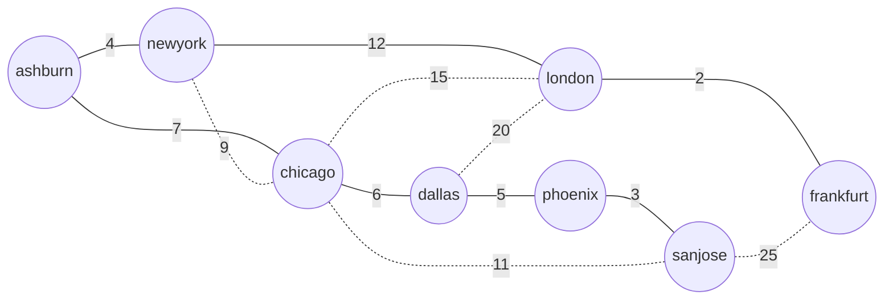

# Minimum Spanning Trees: Kruskal and Prim

> Union-find meets greedy.

**Type:** Build
**Languages:** Java, Python
**Prerequisites:** Phase 1, Lesson 10 (Disjoint Sets), Phase 1, Lesson 09 (Heaps and Priority Queues), Phase 2, Lesson 07 (Greedy Algorithms and Exchange Arguments), Phase 2, Lesson 08 (Graph Traversal)
**Time:** ~60 minutes

## Learning Objectives

- Define a spanning tree and a minimum spanning tree, and state the two structural facts (V-1 edges, exactly one path between any pair) that every algorithm in this lesson relies on
- Prove the cut property with an exchange argument and use it to justify both Kruskal's and Prim's greedy choices
- Build Kruskal's algorithm on a union-find with path compression and union by rank, and explain why the union-find is what makes the cycle test constant time
- Build Prim's algorithm on a binary heap with lazy deletion, and explain how it differs from Dijkstra by one subtraction
- Verify any claimed MST independently with a cut-property checker, and apply the MST to single-linkage clustering

## The Problem

A payments processor runs eight processing sites: Ashburn, New York, Chicago, Dallas, Phoenix, San Jose, London, and Frankfurt. Every site must be able to reach every other site over private leased lines, because card authorizations between sites cannot cross the public internet under the processor's PCI scope. The telecom quotes a monthly cost for each pair of sites it can connect; twelve pairs are feasible and the quotes range from 2 to 25 thousand dollars a month. Leasing all twelve costs 119 thousand a month. The network team wants the cheapest set of lines such that every site is still connected to every other.

The first proposal is a star: connect everything to Chicago. Chicago to Ashburn is 7, to New York 9, to Dallas 6, to San Jose 11, to London 15, and the telecom cannot connect Chicago to Phoenix or Frankfurt at all, so the star is infeasible without a second hub. The second proposal is to have each site lease its single cheapest line. London picks Frankfurt (2), Frankfurt picks London, Phoenix picks San Jose (3), San Jose picks Phoenix, Ashburn picks New York (4), New York picks Ashburn, Dallas picks Phoenix (5), Chicago picks Dallas (6). Total 20, but the result is three islands: the US east pair, the US west and central group, and the European pair. Nobody in New York can reach London. Both proposals share a mistake: they pick edges by looking at one node at a time, and connectivity is a property of the whole graph.

There is a correct greedy rule, and it is almost the second proposal with one extra condition: take the cheapest line in the whole list, then the next cheapest, and so on, but skip any line whose two ends are already connected through lines you have taken. That rule is Kruskal's algorithm. The "already connected" test is the entire difficulty: done by walking the graph it costs `O(V)` per edge; done with the disjoint-set structure from Phase 1, Lesson 10 it costs effectively constant time. The result on the eight sites is seven lines for 39 thousand a month, and this lesson proves it cannot be beaten, builds it two ways, and shows a checker that will catch any MST implementation that is wrong.

## The Concept

### Spanning trees

For a connected undirected graph `G = (V, E)`, a **spanning tree** is a subset of `E` that connects every node and contains no cycle. Every spanning tree has exactly `|V| - 1` edges, and between any two nodes there is exactly one path. Adding any edge to a spanning tree creates exactly one cycle; removing any edge from it splits it into exactly two components. Those two facts drive the exchange argument below.

Given a weight on every edge, a **minimum spanning tree** (MST) is a spanning tree whose total weight is minimal. If all weights are distinct the MST is unique. If some weights tie there may be several MSTs with the same total; both algorithms in this lesson find one of them, and the tie-break decides which.

If the graph is disconnected there is no spanning tree. Both algorithms then produce a **minimum spanning forest**: an MST of each connected component. The implementation reports the component count rather than throwing, because "we cannot connect London" is information the network team needs, not an error in the algorithm.



Solid edges are the MST (total 39); dotted edges are the five lines not leased.

### The cut property and why greedy is safe

A **cut** is a partition of `V` into two non-empty sets `S` and `V - S`. An edge **crosses** the cut if one endpoint is in each side.

**Cut property.** For any cut, if `e` is a lightest edge crossing it, then some MST contains `e`. If `e` is the *unique* lightest crossing edge, every MST contains it.

Proof sketch, which is the exchange argument from Lesson 07 applied to trees. Suppose `T` is an MST that does not contain `e = (u, v)`. `T` is spanning, so it contains a path from `u` to `v`; that path starts in `S` and ends in `V - S`, so some edge `f` on it crosses the cut. Form `T' = T - f + e`. Removing `f` split `T` into two components with `u` and `v` on opposite sides (the path was the only route between them), and `e` reconnects exactly those two components, so `T'` is a spanning tree. Its weight is `w(T) - w(f) + w(e) <= w(T)` because `e` was a lightest crossing edge. So `T'` is also an MST and it contains `e`. If `e` was strictly lighter than `f` then `w(T') < w(T)`, contradicting minimality, so `T` must have contained `e` all along.

Both algorithms are instances of this one lemma:

- **Kruskal** considers edges in weight order. When it reaches `e = (u, v)` with `u` and `v` in different components of the forest built so far, let `S` be `u`'s component. No lighter edge crosses that cut (every lighter edge was already considered: if it crossed, it would have been taken and `u`, `v` would be connected). So `e` is a lightest crossing edge and the cut property says taking it is safe.
- **Prim** maintains one tree `S` and takes the lightest edge leaving it. That edge is by construction a lightest edge crossing the cut `(S, V - S)`, so again it is safe.

The greedy choice never has to be undone. That is unusual (Lesson 07 spent half its time on greedy rules that are wrong), and it is the cut property that makes MST one of the problems where greedy is provably optimal.

### Kruskal's algorithm, by hand

Sort the twelve edges by weight and walk them:

```text
edge                 weight  components before            action
london-frankfurt        2    all 8 separate               take  (1)
phoenix-sanjose         3                                 take  (2)
ashburn-newyork         4                                 take  (3)
dallas-phoenix          5                                 take  (4)
chicago-dallas          6                                 take  (5)
ashburn-chicago         7    {ash,nyc} {chi,dal,phx,sjc}  take  (6) merges east and central
newyork-chicago         9    nyc and chi now connected    skip  would close a cycle
sanjose-chicago        11    same component               skip
newyork-london         12    {US 6 sites} {lon,fra}       take  (7) merges continents
chicago-london         15    one component                skip
dallas-london          20                                 skip
sanjose-frankfurt      25                                 skip

7 edges = 8 - 1, total 2+3+4+5+6+7+12 = 39
```

After the seventh take every node is in one component and `|V| - 1` edges have been chosen; the algorithm may stop without examining the remaining edges. The implementation does exactly that.

The cost: sorting `E` edges is `O(E log E)`, which is `O(E log V)` since `E <= V^2`. Each edge then costs two `find` operations and at most one `union`, which with path compression and union by rank is amortized `O(alpha(V))`, where `alpha` is the inverse Ackermann function and is at most 4 for any graph that fits in a computer. The sort dominates.

### Prim's algorithm, by hand

Start at Ashburn. The tree is `{ashburn}`. The frontier is every edge leaving the tree, kept in a min-heap by weight:

```text
tree                                   heap (weight: edge)                                     pop
{ash}                                  4:ash-nyc  7:ash-chi                                     4 ash-nyc
{ash,nyc}                              7:ash-chi  9:nyc-chi  12:nyc-lon                         7 ash-chi
{ash,nyc,chi}                          6:chi-dal  9:nyc-chi* 11:sjc-chi  12:nyc-lon  15:chi-lon  6 chi-dal
{+dal}                                 5:dal-phx  9* 11 12 15 20:dal-lon                        5 dal-phx
{+phx}                                 3:phx-sjc  9* 11* 12 15 20                               3 phx-sjc
{+sjc}                                 9* 11* 12:nyc-lon 15 20 25:sjc-fra                       9 stale, 11 stale, 12 nyc-lon
{+lon}                                 2:lon-fra 15* 20* 25                                     2 lon-fra
{all 8}                                15* 20* 25*                                              all stale, done
```

Entries marked `*` are **stale**: both of their endpoints are now in the tree. The implementation does not remove them from the heap when they go stale (a binary heap has no efficient "delete arbitrary element"); it pops them and discards them, which is called lazy deletion. Every edge enters the heap at most twice (once from each endpoint), so the heap holds `O(E)` entries and the total cost is `O(E log E)`.

The seven edges Prim takes are the same seven Kruskal took, in a different order. With distinct weights that is guaranteed (the MST is unique); with ties the two algorithms may legitimately pick different edges of equal weight, which is why the tests compare totals on random graphs and edge sets only on the distinct-weight site network.

Prim is Dijkstra with one change. Dijkstra's heap key for a node is `distance(tree, node) + weight(edge)`: the full path length. Prim's key is just `weight(edge)`: how much it costs to attach this node, regardless of how far it is from the start. Drop the addition and Dijkstra becomes Prim. That is why the two are routinely confused, and why a shortest-path tree (Lesson 09) is in general *not* a minimum spanning tree: Dijkstra from Ashburn would reach London via New York (4 + 12 = 16) and Frankfurt via London (18), the same edges here, but on a graph where a long cheap detour exists the two trees diverge.

| | Kruskal | Prim |
|---|---|---|
| Strategy | global: lightest edge anywhere, skip cycles | local: lightest edge leaving the current tree |
| Data structure | sorted edge list + union-find | binary heap of frontier edges |
| Time | `O(E log E)` sort, `O(E alpha(V))` union-find | `O(E log E)` with a binary heap; `O(E + V log V)` with a Fibonacci heap |
| Best when | edges are already sorted, or `E` is close to `V` (sparse) | the graph is dense (`E` near `V^2`) and stored as adjacency lists |
| Disconnected input | produces the forest naturally | must restart from each unvisited node |
| Parallelism | the sort parallelizes; the union-find pass is sequential | inherently sequential |
| Also gives you | single-linkage clustering (stop early with `k` components) | an order of nodes by attachment cost |

### Ties, determinism, and the square

Equal weights are where MST implementations disagree with each other and with themselves. Take a square: `a-b 1, b-c 1, c-d 1, d-a 1`. Any three of the four edges form an MST of weight 3, so there are four correct answers.

```text
Kruskal, stable sort, insertion order:   a-b, b-c, c-d        (d-a closes the cycle, skipped)
Prim from c, (weight, index) heap:       c-b and c-d enter the heap when c joins (indices 0, 1);
                                         pop c-b, push b-a (index 2); pop c-d, push d-a (index 3);
                                         pop b-a; d-a is stale.  Result: c-b, c-d, b-a
Prim from a:                             a-b, a-d, then b-c (pushed before d-c); c-d stale
```

All of these are minimum. None of them is "the" MST. That matters in three places. First, tests: assert the total weight and the cut property, never the exact edge list, unless the test graph has distinct weights. Second, reproducibility: a network plan or a clustering that changes between runs on identical input is impossible to review, so the tie-break must be a stated rule (insertion order here) and the data structures must honour it (stable sort, insertion-ordered graph, `(weight, index)` heap keys). Third, cross-implementation agreement: a Java service and a Python batch job computing clusters on the same data will agree on the totals and may disagree on the clusters if their tie-breaks differ, which is the same cross-language trap Phase 10, Lesson 01 describes for rounding.

The cheap way to make the MST unique is to make the weights unique: break ties by a secondary key such as the edge's insertion index, which is exactly what sorting by `(weight, index)` does. Then the theory's "if weights are distinct the MST is unique" applies and every correct algorithm must return the same tree.

### Complexity, side by side

| Operation | Kruskal | Prim (binary heap) | Notes |
|---|---|---|---|
| Preparation | sort `E` edges: `O(E log E)` | build adjacency: `O(V + E)` | Kruskal's sort can be replaced by a radix sort on integer weights to get `O(E)` |
| Per edge | 2 `find` + at most 1 `union`: `O(alpha(V))` amortized | push and pop: `O(log E)` | each edge pushed at most twice in Prim |
| Total | `O(E log E)` | `O(E log E)` | both `O(E log V)` since `log E <= 2 log V` |
| Extra space | `O(V)` | `O(E)` | Prim's heap can hold every edge in the worst case |
| Early exit | after `V - 1` takes | when all nodes are in the tree | Kruskal's early exit skips most of a dense graph's edges |

For the eight-site graph none of this matters. For a 40,000-merchant similarity graph with 800 million candidate edges, the choice between sorting 800 million edges and pushing them through a heap, and whether you can prune edges above a distance threshold before either, is the difference between an overnight job and a job that does not finish.

### Verifying an MST without trusting the algorithm

An implementation can be wrong in ways a total-weight check will not catch: it can return a heavier tree whose total happens to match on your test graph, or a forest with a cycle. The lesson ships an independent checker built from the cut property itself. For a claimed forest `F`:

1. `|F| = |V| - components(G)`, and `F` has no cycle (every `union` succeeds), and `F` connects everything `G` connects.
2. For each edge `e` in `F`: remove it, which splits its tree into two sides; look at every edge of `G` that crosses that split; none may be lighter than `e`.

Condition 2 is the cut property applied to the cut each tree edge defines, and a spanning tree satisfying it for every edge is minimal (the proof is the exchange argument run in reverse). The checker is `O(E * (V + E))`, far too slow for production, which is the point: it is a test oracle, and the tests run it on the site network and on thirty seeded random graphs for both algorithms.

### A third algorithm, for completeness: Borůvka

Kruskal and Prim are the two you will be asked about, but the oldest algorithm is also the one that parallelizes. Borůvka (1926) proceeds in rounds. In each round, every component picks its lightest outgoing edge (by the cut property, each of those edges is safe), and all of them are added at once, with union-find skipping any that turn out to connect two components that another chosen edge already merged. Every component gains at least one edge per round, so the number of components at least halves, and there are at most `log2(V)` rounds of `O(E)` work each: `O(E log V)` total, the same as the others, but each round is a map over components and a reduce over edges, which is the shape GPUs and distributed frameworks want.

On the site network, round one: Ashburn picks New York (4), New York picks Ashburn (4, the same edge), Chicago picks Dallas (6), Dallas picks Phoenix (5), Phoenix picks San Jose (3), San Jose picks Phoenix (3), London picks Frankfurt (2), Frankfurt picks London (2). Five distinct edges, components go from 8 to 3: `{ash, nyc}`, `{chi, dal, phx, sjc}`, `{lon, fra}`. Round two: the east pair picks Ashburn-Chicago (7), the central group picks Ashburn-Chicago (7) as well, the European pair picks New York-London (12). Two distinct edges, one component, done after two rounds with the same seven edges and total 39. Exercise 1 asks you to implement it.

### Clustering: the MST you did not know you were using

Remove the `k - 1` heaviest edges from an MST and you have `k` components. Those components are the **single-linkage clustering** into `k` groups: the partition that maximizes the smallest distance between any two groups. On the site network with `k = 3`, removing the 12 (New York to London) and the 7 (Ashburn to Chicago) gives `{ashburn, newyork}`, `{chicago, dallas, phoenix, sanjose}`, `{london, frankfurt}`, which is a reasonable regionalization and the kind of answer a fraud team wants when they ask "group these 40,000 merchants by how similar their transaction patterns are" with distance as the edge weight. Kruskal makes this free: run it and stop when the union-find reports `k` components.

### What the MST does not do

An MST minimizes total edge weight, nothing else. It does not minimize the path length between any particular pair (that is shortest paths, Lesson 09); the MST route from San Jose to Frankfurt is 3 + 5 + 6 + 7 + 4 + 12 + 2 = 39 while the direct line costs 25. It does not provide redundancy: removing any one leased line partitions the network, which for a payments processor is unacceptable, so the real network design problem is "minimum-cost 2-edge-connected subgraph", which is NP-hard and solved with the MST as a starting point plus heuristics. It does not handle negative weights specially (they are fine for MST, unlike Dijkstra), but this implementation rejects them because a negative leased-line cost is a data error. And it says nothing about directed graphs: the directed analogue (minimum spanning arborescence, Edmonds' algorithm) is a different and harder problem.

## Build It

The code is in `code/java/Main.java`: `WeightedEdge`, `WeightedGraph`, `UnionFind`, `SpanningForest`, and `Mst` with `kruskal`, `prim`, `isMinimumSpanningForest`, and `clusters`.

### Step 1: Edges and the graph

```java
record WeightedEdge(String u, String v, long weight) {
    WeightedEdge {
        if (u.equals(v)) throw new IllegalArgumentException("self-loop " + u + " can never be in a spanning tree");
        if (weight < 0) throw new IllegalArgumentException("weight must be non-negative: " + weight);
    }

    String other(String node) {
        if (node.equals(u)) return v;
        if (node.equals(v)) return u;
        throw new IllegalArgumentException(node + " is not an endpoint of " + this);
    }

    boolean sameEndpoints(WeightedEdge o) {
        return (u.equals(o.u) && v.equals(o.v)) || (u.equals(o.v) && v.equals(o.u));
    }
}
```

A self-loop is rejected at construction because it can never be a tree edge (it closes a cycle with itself) and would only waste a sort slot. `other(node)` is what Prim uses to find which endpoint of a frontier edge is outside the tree. `sameEndpoints` exists because `(a, b, 4)` and `(b, a, 4)` are the same leased line, and record equality would say otherwise.

`WeightedGraph` keeps a `LinkedHashMap` of adjacency lists and a separate insertion-ordered edge list, so Kruskal's stable sort and Prim's heap both break ties the same way on every run.

**Predict:** `addEdge("a", "b", 5)` followed by `addEdge("a", "b", 3)` adds two parallel edges. Which one does Kruskal take, and what happens to the other?

### Step 2: Union-find with both optimizations

```java
String find(String e) {
    String root = e;
    while (!parent.get(root).equals(root)) root = parent.get(root);
    while (!parent.get(e).equals(root)) {          // path compression
        String next = parent.get(e);
        parent.put(e, root);
        e = next;
    }
    return root;
}

boolean union(String a, String b) {
    String ra = find(a), rb = find(b);
    if (ra.equals(rb)) return false;
    int rka = rank.get(ra), rkb = rank.get(rb);
    if (rka < rkb) { parent.put(ra, rb); }
    else if (rka > rkb) { parent.put(rb, ra); }
    else { parent.put(rb, ra); rank.put(ra, rka + 1); }
    components--;
    return true;
}
```

This is Phase 1, Lesson 10 reduced to its two methods. `find` walks to the root, then walks again re-pointing every node directly at it (path compression). `union` attaches the shallower tree under the deeper one (union by rank), and only when ranks tie does a rank grow. Together they give the `O(alpha(n))` amortized bound. The return value of `union` is the whole of Kruskal's cycle test: `false` means the two endpoints were already connected, so the edge would close a cycle.

**Predict:** after `union("a","b")`, `union("c","d")`, `union("b","c")` on fresh elements, what is `rank` of the final root, and how many elements does `find` touch on the next call for `"d"`?

### Step 3: Kruskal

```java
static SpanningForest kruskal(WeightedGraph g) {
    List<WeightedEdge> sorted = new ArrayList<>(g.edges());
    sorted.sort(Comparator.comparingLong(WeightedEdge::weight));
    UnionFind uf = new UnionFind(g.nodes());
    List<WeightedEdge> chosen = new ArrayList<>();
    long total = 0;
    for (WeightedEdge e : sorted) {
        if (chosen.size() == g.nodeCount() - 1) break;
        if (uf.union(e.u(), e.v())) {
            chosen.add(e);
            total = Math.addExact(total, e.weight());
        }
    }
    return new SpanningForest(chosen, total, uf.components());
}
```

Eleven lines, and the hand trace above is what it does. `List.sort` is a stable merge sort (TimSort), so edges of equal weight stay in insertion order and the output is reproducible; `Arrays.sort` on a primitive array would not promise that. The early `break` stops after `V - 1` edges; on a dense graph that skips most of the list. `Math.addExact` on the total is the same discipline as `Money.plus`: a network cost that wraps negative is a bug, and it should fail rather than report a bargain.

**Predict:** on a graph with 1,000 nodes and 499,500 edges (complete), roughly how many edges does the loop examine before `break`, in the best case and the worst case?

### Step 4: Prim with lazy deletion

```java
PriorityQueue<long[]> heap = new PriorityQueue<>(
        Comparator.<long[]>comparingLong(a -> a[0]).thenComparingLong(a -> a[1]));
List<WeightedEdge> byIndex = new ArrayList<>();
pushFrontier(g, root, inTree, heap, byIndex);
while (!heap.isEmpty()) {
    long[] top = heap.poll();
    WeightedEdge e = byIndex.get((int) top[1]);
    String next = inTree.contains(e.u()) ? (inTree.contains(e.v()) ? null : e.v()) : e.u();
    if (next == null) continue;                              // stale: both ends already in the tree
    inTree.add(next);
    chosen.add(e);
    total = Math.addExact(total, e.weight());
    pushFrontier(g, next, inTree, heap, byIndex);
}
```

The heap holds `(weight, index)` pairs rather than edges so that equal weights order by the sequence in which they entered the frontier: a deterministic tie-break with no dependence on `WeightedEdge` having a natural order. `pushFrontier` adds every edge from the newly attached node whose other end is not yet in the tree. When a popped edge has both ends in the tree it is stale and skipped. The outer loop (not shown) restarts Prim from the first unvisited node when the heap empties with nodes still unvisited, so a disconnected graph yields a forest with the same component count Kruskal reports.

Compare this to the Dijkstra loop in Lesson 09: the only difference is that Dijkstra pushes `dist[node] + e.weight()` and Prim pushes `e.weight()`.

**Predict:** on the site network, how many stale entries does Prim pop in total when started from Ashburn? Count them in the hand trace.

### Step 5: The cut-property checker

```java
for (WeightedEdge removed : f.edges()) {
    UnionFind without = new UnionFind(g.nodes());
    for (WeightedEdge e : f.edges()) if (e != removed) without.union(e.u(), e.v());
    for (WeightedEdge e : g.edges()) {
        boolean crosses = without.find(e.u()).equals(without.find(removed.u()))
                != without.find(e.v()).equals(without.find(removed.u()));
        if (crosses && e.weight() < removed.weight()) return false;
    }
}
return true;
```

For each tree edge, rebuild the forest without it; the side containing `removed.u()` is one half of the cut. An edge of `G` crosses if exactly one of its endpoints is on that side (the `!=` of two booleans is XOR). If any crossing edge is strictly lighter than the removed one, the cut property is violated and the forest is not minimal. The earlier part of the method (not shown) checks the edge count, that every chosen edge belongs to `G`, and that the chosen edges form a forest. The tests use this checker on hand-built wrong answers (a heavier tree, a tree missing an edge) to prove the checker itself rejects what it should.

### Step 6: Run it

```bash
cd phases/02-algorithms/11-minimum-spanning-trees/code/java
javac -d .out *.java && java -cp .out Main
java -cp .out MainTest
```

Expected output, abbreviated:

```console
== Site network: 8 sites, 12 feasible lines ==
cost of leasing every line: 119

== Kruskal: lightest edges first, skip any that closes a cycle ==
  take london    - frankfurt   2
  take phoenix   - sanjose     3
  take ashburn   - newyork     4
  take dallas    - phoenix     5
  take chicago   - dallas      6
  take ashburn   - chicago     7
  take newyork   - london     12
total 39, tree: true, verified minimum: true

== Prim from ashburn: grow one tree, always the lightest edge leaving it ==
  take ashburn   - newyork     4
  take ashburn   - chicago     7
  ...
total 39, same edge set as Kruskal: true

== Disconnected: drop the four transatlantic lines ==
components: 2, edges: 6, total 27

== Single-linkage clustering: cut the 2 heaviest MST edges for 3 clusters ==
[[ashburn, newyork], [chicago, dallas, phoenix, sanjose], [london, frankfurt]]
```

The test file has 36 assertions: the union-find invariants, the exact Kruskal trace, Prim from every start node giving 39, the checker accepting both results and rejecting two deliberately wrong trees, tie handling on a square of equal weights, parallel edges, a disconnected forest, thirty seeded random graphs where Kruskal and Prim agree and both pass the checker, and the clustering.

### In Python

```python
for removed in f.edges:
    without = UnionFind(g.nodes())
    for e in f.edges:
        if e is not removed:  # identity, like Java's != on references: parallel equal edges stay distinct
            without.union(e.u, e.v)
```

`WeightedEdge`, `WeightedGraph`, `UnionFind`, `SpanningForest`, and `Mst` keep their names and algorithms; three things differ, all in `code/python/main.py`:

- **Value equality versus identity.** `WeightedEdge` is a frozen dataclass, so `==` and `in` compare by value, as a Java record's `equals` and `List.contains` do. The cut-property checker's "every edge except this one" loop uses `is not`, because the Java uses `!=` on references there; with value comparison, two parallel edges of equal weight would both be skipped.
- **Stable sort and tuple heap.** `sorted(..., key=lambda e: e.weight)` is stable like `List.sort`, so Kruskal keeps insertion order among equal weights (the square test pins it). Prim's frontier holds `(weight, insertion index)` tuples in `heapq`, the same tie-break as the Java's `long[]` comparator, so equal-weight edges pop in the same order and the edge lists match.
- **Totals are checked by hand.** Python integers do not overflow, so `add_exact` raises `ArithmeticError` outside the signed 64-bit range wherever the Java calls `Math.addExact`; one extra test sums two `2**62` edges to pin it. Argument errors raise `ValueError`; a `None` node raises `TypeError`, the `requireNonNull` mapping.

The test file carries a port of `java.util.Random` so the 30 random graphs are the ones the Java test checks.

```bash
cd phases/02-algorithms/11-minimum-spanning-trees/code/python
python3 main.py
python3 -m unittest -v
```

The demo output is identical to the Java run; the suite covers the Java's 36 checks plus the overflow test.

### Porting notes

Go's `sort.SliceStable` is required (plain `sort.Slice` is not stable, and the tie-break would become run-dependent); Go has no generic heap, so `container/heap` needs a small type implementing `Len/Less/Swap/Push/Pop`. The port keeps node order in an explicit slice beside the adjacency map, for the same reason the Java uses `LinkedHashMap`: a Go `map` iterates in random order by design. Errors in Go are return values; `WeightedEdge` construction returns `(WeightedEdge, error)`.

## Use It

**Network design.** The leased-line problem in The Problem is the original application: Borůvka published the first MST algorithm in 1926 to plan the electrical grid of Moravia, and Kruskal and Prim both cite network wiring. Real network designs start from the MST and then add edges for redundancy (at minimum a second disjoint path to each site); the MST tells you the cost floor you are paying above.

**Clustering and fraud.** `scikit-learn`'s `AgglomerativeClustering(linkage="single")` and SciPy's `scipy.cluster.hierarchy.linkage(method="single")` compute exactly the MST-with-heaviest-edges-removed structure from Step 5's concept section, on a distance matrix. Fraud teams use single-linkage over a merchant-similarity or device-similarity graph to find rings: nodes that are close to one another but far from everything else. The MST is also the backbone of HDBSCAN.

**Approximation algorithms.** The classic 2-approximation for the metric travelling salesman problem is "take the MST, walk it depth-first, skip repeated nodes". Steiner tree approximations start from an MST of the terminals. Knowing the MST is a lower bound on any connected subgraph is what makes those bounds work.

**Image segmentation and the physical world.** Felzenszwalb and Huttenlocher's graph-based segmentation is Kruskal with a threshold on when to merge. Minimum-cost pipeline and road-network studies use the MST as the baseline.

**The JDK.** There is no `java.util` MST, and union-find is not in the standard library either; both are small enough that production Java code writes them by hand or pulls JGraphT (`KruskalMinimumSpanningTree`, `PrimMinimumSpanningTree`), whose implementations are the ones in this lesson with generics. In databases, PostgreSQL has no built-in MST, but Neo4j's Graph Data Science library ships `gds.spanningTree` (Prim) and the SQL recursive-CTE implementations you will find online are usually Prim.

## Ship It

`outputs/interview-card-minimum-spanning-trees.md` is a one-page card: the two algorithms with their data structures and complexities, the cut property proof in four lines, the Prim-versus-Dijkstra distinction, three traps (shortest-path tree is not an MST; ties need a deterministic rule; the MST has no redundancy), and the clustering connection, written for a system-design or algorithms interview and for the design review where someone proposes a hub-and-spoke network because "it's simpler".

## Exercises

1. **Reinforce.** Implement Borůvka's algorithm: in each round every component picks its lightest outgoing edge, all those edges are added at once (using union-find to skip duplicates), and the number of components at least halves each round, so there are `O(log V)` rounds. Verify it against `isMinimumSpanningForest` on the thirty random graphs. Explain why this algorithm, not Kruskal or Prim, is the one used on GPUs and in distributed MST.
2. **Apply.** The **maximum** spanning tree matters too: in a correspondent-banking graph where edge weight is daily settlement volume, the maximum spanning tree is the set of bilateral relationships carrying the most flow while still reaching every bank. Add `Mst.maximum(WeightedGraph)` by negating the comparator (not the weights, which the record rejects), and prove the checker still works with its inequality flipped.
3. **Extend.** Combine with Phase 2, Lesson 09: build the shortest-path tree from Ashburn with Dijkstra on the site network and compare it edge by edge with the MST. Then construct the smallest graph you can (three or four nodes) on which the two trees differ, and compute the ratio of the MST path length to the shortest path for the worst pair of nodes. State the general bound on that ratio for an MST path versus the shortest path (it is linear in `V`), and explain why that bound makes the MST unsuitable for latency-sensitive routing even though it minimizes cost.

## Key Terms

| Term | What people say | What it actually means |
|------|-----------------|------------------------|
| Spanning tree | "a tree that touches everything" | A subset of edges that connects all `V` nodes with no cycle; always exactly `V - 1` edges and exactly one path between any pair |
| Minimum spanning tree | "the cheapest network" | A spanning tree of minimum total edge weight; unique when weights are distinct, otherwise one of several with the same total |
| Cut | "splitting the graph" | A partition of the nodes into two non-empty sets; an edge crosses the cut if its endpoints are on different sides |
| Cut property | "the greedy proof" | A lightest edge crossing any cut belongs to some MST; proved by swapping it for a heavier crossing edge on the tree path without increasing weight |
| Union-find | "disjoint sets" | A forest of sets supporting `find` and `union` in amortized `O(alpha(n))` with path compression and union by rank; `union` returning false is Kruskal's cycle test |
| Lazy deletion | "ignore stale heap entries" | Leaving outdated entries in a heap and discarding them when popped, because a binary heap cannot delete an arbitrary element cheaply |
| Spanning forest | "MST of a disconnected graph" | One MST per connected component; `V - components` edges in total |
| Single-linkage clustering | "nearest-neighbour clustering" | The `k` components left after removing the `k - 1` heaviest MST edges; maximizes the minimum inter-cluster distance |

## Further Reading

- [Kruskal, "On the shortest spanning subtree of a graph and the traveling salesman problem", Proceedings of the AMS 7(1), 1956](https://doi.org/10.1090/S0002-9939-1956-0078686-7) — the original two-page paper; the algorithm is stated in one paragraph and the TSP connection in the title is Exercise-level material.
- [Prim, "Shortest connection networks and some generalizations", Bell System Technical Journal 36(6), 1957](https://doi.org/10.1002/j.1538-7305.1957.tb01515.x) — written for telephone network design, which is the leased-line problem in The Problem.
- [Tarjan, "Efficiency of a good but not linear set union algorithm", Journal of the ACM 22(2), 1975](https://doi.org/10.1145/321879.321884) — the inverse-Ackermann bound for union-find with path compression and union by rank.
- [Nešetřil, Milková, Nešetřilová, "Otakar Borůvka on minimum spanning tree problem", Discrete Mathematics 233, 2001](https://doi.org/10.1016/S0012-365X(00)00224-7) — translation and history of the 1926 paper that started the field, and the algorithm in Exercise 1.
- [Karger, Klein, Tarjan, "A randomized linear-time algorithm to find minimum spanning trees", Journal of the ACM 42(2), 1995](https://doi.org/10.1145/201019.201022) — expected linear time, using the cut and cycle properties together; read it after this lesson to see how far the same two lemmas go.
- [SciPy `scipy.sparse.csgraph.minimum_spanning_tree`](https://docs.scipy.org/doc/scipy/reference/generated/scipy.sparse.csgraph.minimum_spanning_tree.html) — a production implementation (Kruskal on a sparse matrix) with the documented behaviour on disconnected input and ties.
