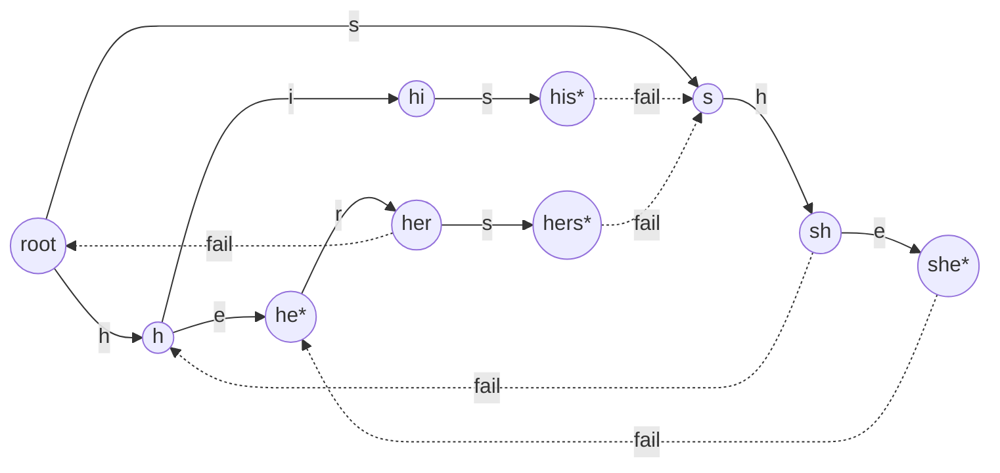

# String Matching: KMP, Rabin-Karp, and Aho-Corasick

> Sanctions screening scans millions of names against thousands of patterns.

**Type:** Build
**Languages:** Java
**Prerequisites:** Phase 1, Lesson 12 (Strings and Encodings), Phase 1, Lesson 13 (Tries), Phase 1, Lesson 07 (Hash Functions and Collisions), Phase 2, Lesson 08 (Graph Traversal)
**Time:** ~90 minutes

## Learning Objectives

- Show with a concrete input why naive matching is `O(n * m)` and identify the wasted work it repeats
- Build the KMP failure function by hand and in code, state its invariant, and explain why the text pointer never moves backwards
- Build a polynomial rolling hash, slide it in `O(1)`, and explain why Rabin-Karp must verify every hash match to be exact
- Build the Aho-Corasick automaton from a trie plus failure and output links, and trace one search over a text that triggers all three link types
- Apply the automaton to a sanctions-screening pass and name what the matching algorithm does and does not solve in that system

## The Problem

A cross-border payments platform must screen every outgoing wire against sanctions lists before release. The consolidated list it uses has about 14,000 entries, each a name or alias of one to six words. The platform processes 3 million payments a day, and the beneficiary name, the originator name, the bank name, and the free-text remittance field of each one must all be checked. Regulators expect a hit to block the payment before funds move; a missed hit is a reportable violation with penalties that have run to hundreds of millions of dollars for large banks.

The first implementation is the obvious one: for each payment, for each of the 14,000 names, call `text.contains(name)`. Java's `String.contains` is a naive search, so each call is `O(n * m)` in the worst case and `O(n)` typically. With four fields of roughly 60 characters and 14,000 names, that is about 3.4 million character comparisons per payment and 10 trillion per day. The screening service takes 180 milliseconds per payment on a warm JVM. At 3 million payments spread unevenly over the day, the queue falls two hours behind during the European-morning peak, and the business asks whether screening could be "sampled" for low-value payments. It cannot; the regulation does not have a de minimis threshold.

The platform's second attempt indexes the list in a hash set and checks whether each whitespace-separated token of the name is in the set. It is fast and it is wrong: "Northern Star Shipping" is on the list, "Star Shipping" is on the list separately, and tokenizing finds neither, because neither "Northern" nor "Star" nor "Shipping" is a listed name on its own. Multi-word names, names that contain other names, and names that appear inside longer strings are exactly what the list is full of.

The correct shape of the solution is an algorithm that reads each field once, in a single left-to-right pass, and reports every listed name that occurs anywhere in it, regardless of how many names there are. That algorithm exists, it is from 1975, it was built for bibliographic search at Bell Labs, and it brings the per-payment cost down to roughly the length of the four fields, about 240 character steps, independent of the 14,000. This lesson builds up to it through two single-pattern algorithms that teach the two ideas it combines: never re-read the text, and precompute what to do on a mismatch.

## The Concept

### Naive matching and what it wastes

To find pattern `P` of length `m` in text `T` of length `n`, naive matching tries every alignment `i` from `0` to `n - m` and compares `P[0..m)` against `T[i..i+m)` character by character, stopping at the first mismatch. Each alignment costs up to `m` comparisons, so the worst case is `O(n * m)`.

The worst case is not exotic. Text `aaaaaaaaaaaaaaaaaaaaaaaaaaaaaab` (30 a's and a b), pattern `aaaab`: at every alignment the first four characters match and the fifth fails, so each of the 27 alignments costs five comparisons, 135 in total, to find a single match at position 26. Real text that triggers this: long runs of zeros in account numbers, repeated delimiters, padded fixed-width fields, and names like "Aaaa Aaaaa" that fraud actors use precisely because they are hard to screen.

The waste is visible in the trace. After matching `aaaa` at alignment 0 and failing on `b`, the naive algorithm moves to alignment 1 and compares `a, a, a, a` again, characters it has already seen. It knows what `T[1..4]` is because it just read it. KMP is the observation that the pattern itself tells you how far to slide after a mismatch without re-reading.

### KMP: the failure function

For a pattern `P`, define `fail[i]` as the length of the longest **proper** prefix of `P[0..i]` (inclusive) that is also a suffix of it. "Proper" means shorter than the whole string, so `fail[0] = 0` always.

Worked by hand for `P = ABABAC`:

```text
i  P[0..i]   proper prefixes that are also suffixes   fail[i]
0  A         (none)                                   0
1  AB        (none)                                   0
2  ABA       A                                        1
3  ABAB      AB                                       2
4  ABABA     ABA                                      3
5  ABABAC    (none: no prefix ends in C)              0
```

And for `P = aaaab`: `fail = [0, 1, 2, 3, 0]`.

Now suppose you are matching and have matched `j` characters of `P` against the text ending at position `i`, and `T[i+1] != P[j]`. The naive move is to restart at alignment `i - j + 2` with `j = 0`. KMP says: the last `j` text characters equal `P[0..j)`, and `fail[j-1]` tells you the longest prefix of `P` that is a suffix of that, so set `j = fail[j-1]` and compare `T[i+1]` against `P[j]` again. The text index never moves. If `j` becomes 0 and still mismatches, advance the text index.

The invariant during the search: **`P[0..j)` equals the last `j` characters of the text read so far, and `j` is the largest value for which that is true.** The failure function is what maintains the "largest" part across a mismatch; without it you might slide too far and miss a match.

Complexity: computing `fail` is `O(m)` and the search is `O(n)`. The argument is amortized. In the search, `j` increases by at most one per text character (so at most `n` increases in total) and every iteration of the `while` loop strictly decreases `j`, so there are at most `n` decreases in total. The same argument applies to building `fail`, where `k` plays the role of `j`. No hashing, no randomness, no dependence on the alphabet, and no worst case worse than `2n` comparisons.

On the pathological input, KMP matches `aaaa`, fails on `b` versus `a`, sets `j = fail[3] = 3`, and compares the same text character against `P[3] = a`, which matches, `j = 4`. Each new text character costs about two comparisons instead of five, and the text is read exactly once.

### Rabin-Karp: compare hashes, verify matches

A different attack on the same problem: instead of comparing characters, compare a fingerprint. Treat the pattern as a number in base `B` (256 for bytes, or the alphabet size) modulo a large prime `q`:

```text
hash(s) = (s[0] * B^(m-1) + s[1] * B^(m-2) + ... + s[m-1]) mod q
```

Compute `hash(P)` once. Compute `hash(T[0..m))` once. Then slide: to get the hash of `T[i+1..i+m+1)` from the hash of `T[i..i+m)`, subtract the contribution of the outgoing character `T[i] * B^(m-1)`, multiply by `B`, add the incoming character `T[i+m]`, all modulo `q`. That is `O(1)` per step, so hashing every window costs `O(n)`.

Worked with small numbers to see the mechanics, `B = 10`, `q = 13`, pattern `31415` (hash `31415 mod 13 = 7`), text `2359023141526739921`:

```text
window  value   mod 13   action
23590   23590   8        no
35902   35902   9        no
59023   59023   3        no
90231   90231   11       no
02314   2314    0        no
23141   23141   1        no
31415   31415   7        hash matches: verify characters -> match at 6
14152   14152   8        no
41526   41526   4        no
15267   15267   5        no
52673   52673   10       no
26739   26739   11       no
67399   67399   7        hash matches: verify characters -> 67399 != 31415, false positive
73992   73992   9        no
39921   39921   11       no
```

One false positive in fifteen windows with `q = 13`. With `q = 1,000,000,007` the probability that a non-matching window collides is about one in a billion, so the verification step almost never runs for a non-match, and when the hashes agree the full character comparison is `O(m)`. Expected time `O(n + m)`; worst case `O(n * m)` if an adversary knows `q` and constructs text whose windows all collide. The verification step is what makes the algorithm exact rather than probabilistic: without it, the `7` at position 12 would be reported as a match. The implementation counts hash matches and false positives separately so you can see the collision rate in a test.

Rabin-Karp's real advantage is not single-pattern search, where KMP is strictly better. It is that one pass can check the window hash against a *set* of pattern hashes (all patterns of the same length), which gives multi-pattern search in `O(n)` expected, and that the rolling hash extends to two dimensions (image search) and to finding any repeated substring (plagiarism detection, deduplication, the content-defined chunking in rsync and backup systems).

### Aho-Corasick: KMP for a set of patterns

Aho and Corasick (1975) generalized the failure function from one pattern to a set. Build a trie of all patterns (Phase 1, Lesson 13). Each trie node represents a string: the path from the root. Add two kinds of links:

- **Failure link** of node `u`: the node representing the longest proper suffix of `u`'s string that is also a node in the trie. This is `fail[]` with "prefix of the pattern" replaced by "any node in the trie".
- **Output link** of node `u`: the nearest node on `u`'s failure chain (following failure links repeatedly) whose string is a complete pattern. It exists so that when the automaton is at a node, every pattern that ends at the current text position can be enumerated without walking the whole chain when most of it has no output.

Patterns `he, she, his, hers`:



Starred nodes end a pattern. Solid arrows are trie edges; dotted arrows are the failure links that do not go to the root (every depth-1 node fails to the root, and `hi`, `he` fail to the root too, omitted for clarity). The output link of `she` is `he`: when the text reaches `she`, it has also seen `he`.

Failure links are built by BFS from the root, so that every node's parent and every shallower node already have their links. For a node `child` reached from `node` by character `c`: start at `node.fail`, follow failure links until you reach a node that has a `c` edge (or the root), and `child.fail` is where that `c` edge leads, or the root if there is none. The output link is `node.fail` if that node ends a pattern, else `node.fail.output`.

Search over `ushers`:

```text
i  char  transitions                                   node     report
0  u     root has no u edge                            root
1  s     root -s-> s                                   s
2  h     s -h-> sh                                     sh
3  e     sh -e-> she                                   she*     she at 1; output link -> he*: he at 2
4  r     she has no r; fail -> he; he -r-> her         her
5  s     her -s-> hers                                 hers*    hers at 2; output link -> s (no pattern) -> none
```

Three matches, six text characters, no backtracking. The failure link at `i = 4` is the whole trick: after `she` the automaton did not restart from the root and re-read `he`; it jumped to the node that already represents the suffix `he` and continued.

Complexity: building the trie is `O(M)` for `M` total pattern characters; building the links is `O(M)` with the same amortized argument as KMP; searching is `O(n + z)` where `z` is the number of matches reported. The `z` term is unavoidable since matches can be dense (pattern set `a, aa, aaa, ...` on text `aaaa...`), and it is why real screening systems report at most one match per position or cap the output.

| | Naive | KMP | Rabin-Karp | Aho-Corasick |
|---|---|---|---|---|
| Patterns | 1 | 1 | 1, or a set of equal length | any set |
| Preprocessing | none | `O(m)` failure function | `O(m)` hash | `O(M)` trie + links |
| Search | `O(n * m)` worst | `O(n)` worst | `O(n)` expected, `O(n * m)` worst | `O(n + z)` worst |
| Extra space | none | `O(m)` | `O(1)` | `O(M * alphabet)` or `O(M)` with hash-map children |
| Exact? | yes | yes | yes, because of verification | yes |
| Randomness | none | none | the choice of `q` (fixed here) | none |
| Reads text backwards? | yes, up to `m` chars | never | never | never |
| Use when | `m` tiny, `n` tiny | one pattern, worst-case bound needed | many equal-length patterns, 2-D, rolling dedup | many patterns, streaming text |

### What these algorithms do not do

They find exact substrings. Sanctions screening is mostly not exact: "Mohammed", "Muhammad", "Mohamed", and "Mohammad" are one name; "Ivanov" and "Ivanova" are the same surname with a gender ending; Cyrillic, Arabic, and Chinese names are transliterated several ways; list entries have aliases, "weak aliases", and date-of-birth and nationality qualifiers that matter for deciding whether a hit is a true match. Production screening systems layer fuzzy matching (edit distance, phonetic keys like Soundex and Double Metaphone, token-level Jaro-Winkler), name-component reordering, and transliteration tables on top of exact matching, and then a human analyst reviews every hit. The exact matcher in this lesson is the first and cheapest filter, and it is also the component that runs on the remittance free-text field looking for embargoed city and vessel names, where exactness is right.

They also do not handle Unicode well on their own. The implementation matches Java `char`s (UTF-16 code units) after a normalization step that uppercases and strips punctuation; it does not decompose accents (`ü` versus `u`), fold full-width characters, or handle combining marks. Phase 1, Lesson 12 covers why that is hard, and `java.text.Normalizer` is where to start.

And they do not solve the policy question. Matching "Star Shipping" inside "Northern Star Shipping Co." is correct; matching "Rashid" inside "Rashida Patel" is a false positive that blocks a real customer. The implementation requires whole-token matches, which fixes the second case and would miss "AlRashid" written without a space. Where to draw that line is a compliance decision with a false-positive rate on one side and a regulator on the other, and the algorithm only makes the decision cheap to apply.

## Build It

The code is in `code/java/Main.java`: `NaiveMatcher`, `KmpMatcher`, `RabinKarpMatcher`, `AhoCorasick`, `SanctionsScreener`, and a `Match` record.

### Step 1: The naive baseline, kept as the oracle

```java
static List<Integer> search(String text, String pattern) {
    requireNonEmpty(pattern);
    List<Integer> hits = new ArrayList<>();
    for (int i = 0; i + pattern.length() <= text.length(); i++) {
        int j = 0;
        while (j < pattern.length() && text.charAt(i + j) == pattern.charAt(j)) j++;
        if (j == pattern.length()) hits.add(i);
    }
    return hits;
}
```

Every other matcher in this lesson is tested against this one on 200 random strings over the alphabet `{a, b}`. A two-letter alphabet is chosen deliberately: it produces overlapping matches and near-misses constantly, which is where failure-function bugs live. The empty pattern is rejected everywhere because it matches at every position and no caller ever wants that.

**Predict:** on text `aaaa` and pattern `aa`, how many matches does the naive search report, and at which positions?

### Step 2: The failure function

```java
static int[] failureFunction(String p) {
    int[] fail = new int[p.length()];
    int k = 0;
    for (int i = 1; i < p.length(); i++) {
        while (k > 0 && p.charAt(i) != p.charAt(k)) k = fail[k - 1];
        if (p.charAt(i) == p.charAt(k)) k++;
        fail[i] = k;
    }
    return fail;
}
```

This is KMP's search run with the pattern as the text, offset by one. `k` is the length of the longest proper prefix-suffix of `p[0..i)`. To extend it by `p[i]`, check whether `p[k] == p[i]`; if not, fall back to the next shorter prefix-suffix, which is `fail[k-1]`, and try again. The `while` loop is the fallback chain. Trace it on `ABABAC` yourself and you will reproduce the table in The Concept; the tests assert that table and two others.

**Predict:** what does `failureFunction("aaaa")` return, and what is the longest fallback chain any single step walks?

### Step 3: KMP search

```java
List<Integer> search(String text) {
    List<Integer> hits = new ArrayList<>();
    int j = 0;
    for (int i = 0; i < text.length(); i++) {
        while (j > 0 && text.charAt(i) != pattern.charAt(j)) j = fail[j - 1];
        if (text.charAt(i) == pattern.charAt(j)) j++;
        if (j == pattern.length()) {
            hits.add(i - j + 1);
            j = fail[j - 1];
        }
    }
    return hits;
}
```

`i` only ever increases: the text is read once. After a full match, `j = fail[m-1]` rather than `0`, so overlapping matches (`aa` in `aaaa` at 0, 1, 2) are found; resetting to 0 would miss the one at 1. The structure is identical to `failureFunction`, which is the point: the failure function is the pattern matched against itself.

**Predict:** on the pathological text from The Problem, what is the maximum number of times the `while` loop body runs for a single `i`?

### Step 4: Rolling hash

```java
static long hash(String s) {
    long h = 0;
    for (int i = 0; i < s.length(); i++) h = (h * BASE + s.charAt(i)) % MOD;
    return h;
}

long roll(long windowHash, char out, char in) {
    long h = (windowHash - (out * highPower) % MOD + MOD) % MOD;
    return (h * BASE + in) % MOD;
}
```

`highPower` is `BASE^(m-1) mod MOD`, computed once in the constructor: the weight of the leftmost character in the window. `roll` removes it, shifts the remaining `m - 1` characters up one place by multiplying by `BASE`, and appends the incoming character. The `+ MOD` before the second `% MOD` keeps the intermediate non-negative, because Java's `%` returns a negative result for a negative dividend. With `BASE = 256`, `MOD` just over `10^9`, and `char` values up to 65,535, every intermediate fits in a `long` with room to spare; the test `rollMatchesRehash` asserts that rolling and recomputing from scratch agree on every window.

**Predict:** if `MOD` were `2^31` instead of a prime, which class of inputs would collide systematically, and why does a prime modulus avoid it?

### Step 5: Rabin-Karp search with verification

```java
long window = hash(text.substring(0, m));
for (int i = 0; ; i++) {
    if (window == patternHash) {
        hashMatches++;
        if (text.regionMatches(i, pattern, 0, m)) hits.add(i); else falsePositives++;
    }
    if (i + m >= n) break;
    window = roll(window, text.charAt(i), text.charAt(i + m));
}
```

A hash match is a candidate, never a result. `regionMatches` does the `O(m)` character comparison only on candidates. The two counters exist for the demo and the tests: on the ledger-reference text they show 3 hash matches and 0 false positives, and Exercise 1 asks you to shrink `MOD` until false positives appear.

### Step 6: The automaton's links

```java
while (!queue.isEmpty()) {
    Node node = queue.poll();
    node.output = node.fail != root && !node.fail.patterns.isEmpty() ? node.fail : node.fail.output;
    for (Map.Entry<Character, Node> e : node.next.entrySet()) {
        char c = e.getKey();
        Node child = e.getValue();
        Node f = node.fail;
        while (f != root && !f.next.containsKey(c)) f = f.fail;
        Node target = f.next.get(c);
        child.fail = (target == null || target == child) ? root : target;
        queue.add(child);
    }
}
```

BFS order guarantees that when `child`'s failure link is computed, `node.fail` and everything shallower is already linked. The `while` loop is the KMP fallback chain generalized to the trie: from the parent's failure node, keep following failure links until one has a `c` edge. The `target == child` guard handles depth-1 nodes, whose parent is the root and whose "suffix" would be themselves. The output link is set when the node is dequeued, after its own failure link is final, and it points to the nearest pattern-ending node up the chain or inherits that node's output.

**Predict:** for the pattern set `{he, she, his, hers}`, what is the failure link of `hers`, and does `hers` have an output link?

### Step 7: Searching with the automaton

```java
for (int i = 0; i < text.length(); i++) {
    char c = text.charAt(i);
    while (cur != root && !cur.next.containsKey(c)) cur = cur.fail;
    Node step = cur.next.get(c);
    cur = step == null ? root : step;
    for (Node out = cur.patterns.isEmpty() ? cur.output : cur; out != null; out = out.output) {
        for (String p : out.patterns) hits.add(new Match(p, i - p.length() + 1));
    }
}
```

The same shape as KMP search with `fail[j-1]` replaced by `cur.fail` and `pattern.charAt(j)` replaced by `cur.next.containsKey(c)`. The inner loop walks the output chain starting at `cur` itself if it ends a pattern. Matches are reported in order of the position where they end, and when two patterns end at the same position the longer one (the current node) comes before the shorter (its output link), which is why the screener reports `NORTHERN STAR SHIPPING` before `STAR SHIPPING`.

### Step 8: Whole-token screening

```java
List<Match> screen(String counterpartyName) {
    String padded = " " + normalize(counterpartyName) + " ";
    List<Match> raw = automaton.search(padded);
    List<Match> whole = new ArrayList<>();
    for (Match m : raw) {
        int start = m.start();
        int end = m.end();
        if (padded.charAt(start - 1) == ' ' && padded.charAt(end) == ' ') {
            whole.add(new Match(m.pattern(), start - 1));
        }
    }
    return whole;
}
```

`normalize` uppercases, replaces every run of non-alphanumerics with one space, and trims. Padding the name with spaces means a match at the very start or end has a space on both sides without a bounds check. A raw match is kept only if the characters immediately before and after it are spaces, which is what turns "RASHID inside RASHIDA" into a non-hit while keeping "STAR SHIPPING inside NORTHERN STAR SHIPPING CO". The returned start index is shifted back by one to be relative to the normalized name, not the padded one.

**Predict:** the list entry is "Al-Rashid Exchange" and the beneficiary is "ALRASHID EXCHANGE HOUSE". Does the screener hit, and what would you change to make it?

### Step 9: Run it

```bash
cd phases/02-algorithms/12-string-matching/code/java
javac -d .out *.java && java -cp .out Main
java -cp .out MainTest
```

Expected output, abbreviated:

```console
== Naive vs KMP on a pathological input ==
text = a*30 + b, pattern = aaaab
naive hits:  [26]
kmp hits:    [26]  failure function [0, 1, 2, 3, 0]
failure(ABABAC) = [0, 0, 1, 2, 3, 0]

== Rabin-Karp: hash the window, verify on hash match ==
hits [0, 18, 36], hash matches 3, false positives 0

== Aho-Corasick: every pattern in one pass ==
patterns he, she, his, hers -> 10 trie nodes
search("ushers") = [Match[pattern=she, start=1], Match[pattern=he, start=2], Match[pattern=hers, start=2]]

== Sanctions screening: 6 listed names, one pass per payment ==
automaton nodes: 78
IVANOV TRADING, LLC            -> HIT [IVANOV, IVANOV TRADING LLC]
Northern Star Shipping Co.     -> HIT [NORTHERN STAR SHIPPING, STAR SHIPPING]
Dmitri Ivanova                 -> clear
Star Shipping Partners         -> HIT [STAR SHIPPING]
al rashid exchange house       -> HIT [RASHID, AL RASHID EXCHANGE]
Rashida Patel                  -> clear
Acme Widgets Inc               -> clear
```

The 38 tests cover: three hand-computed failure tables; overlapping matches in all three single-pattern matchers; the pathological input; `roll` agreeing with a fresh hash on every window; 200 random two-letter inputs where KMP and Rabin-Karp agree with naive; the textbook `ushers` trace; 100 random texts where Aho-Corasick agrees with KMP run per pattern; and the whole-token rules of the screener.

### Porting notes

Python strings are sequences of code points rather than UTF-16 units, so `len("𝔘")` is 1 where Java's is 2; the algorithms are unchanged but the test for surrogate pairs would differ. Python integers do not overflow, so the rolling hash needs no care about intermediate size, and `%` already returns a non-negative result for a positive modulus. Go strings are bytes; the natural port works on `[]rune` after `[]rune(s)` conversion, or on bytes with `BASE = 256` exactly, and the trie's children map is `map[rune]*node`. Go has no exceptions, so the empty-pattern check returns an error from a constructor function. In both languages the automaton's BFS is identical.

## Use It

**`java.lang.String.indexOf`** is a naive search with a first-character skip loop; the JDK chose it because for short patterns on short strings the constant factor beats KMP's table. `java.util.regex` compiles patterns to a backtracking NFA, which is exponential in the worst case (`(a+)+b` on `aaaa...`), and a regex alternation of 14,000 names is far slower than Aho-Corasick; the regex engine does use Boyer-Moore-style skipping for literal prefixes. Hyperscan (Intel) and RE2 (Google) are the production regex engines built on automata for exactly the reason this lesson gives: linear-time guarantees on untrusted input.

**Sanctions screening products** (Fircosoft, Actimize, LexisNexis Bridger, and in-house systems at large banks) run an exact or near-exact multi-pattern pass first and then fuzzy scoring on candidates. The OFAC SDN list, the EU consolidated list, and the UN list are published as structured files with names, aliases, and identifiers; OFAC publishes a free search tool whose documented matching uses Jaro-Winkler on top of normalization, which tells you exactly where the algorithms in this lesson stop and the fuzzy layer begins.

**Intrusion detection and antivirus.** Snort and Suricata match thousands of signature strings against every packet with Aho-Corasick variants; ClamAV's signature engine is Aho-Corasick plus Boyer-Moore. These systems have the same shape as screening: many patterns, streaming text, hard latency budget.

**`grep -F` with multiple patterns** (`fgrep`) uses Aho-Corasick or the Commentz-Walter hybrid. GNU grep's single-pattern path is Boyer-Moore, which skips text and beats KMP on natural language; KMP's advantage is the worst-case bound and that it never reads backwards, which matters for a stream.

**Rolling hashes in storage.** rsync's delta algorithm, Borg and Restic backup, and many deduplicating file systems compute a rolling hash over sliding windows to find content boundaries (content-defined chunking) so that an insertion at the start of a file does not change every chunk. That is Rabin-Karp's `roll` applied to a different question.

## Ship It

`outputs/checklist-screening-matcher.md` is a review checklist for a screening or pattern-matching service: algorithm choice by pattern count, normalization rules and their test cases, whole-token versus substring policy, worst-case input handling, Unicode, and how matches are reported and capped. It also lists the questions a compliance reviewer will ask that the algorithm cannot answer.

## Exercises

1. **Reinforce.** Change `RabinKarpMatcher.MOD` to 101 and run the random-agreement test. Record how many false positives appear across the 200 inputs. Then restore the large prime and add a test that constructs two different three-character strings with the same hash under `MOD = 101`, proving the verification step is load-bearing.
2. **Apply.** Add `AhoCorasick.searchLongestAtEachPosition(String text)` that reports at most one match per end position, the longest, as real screeners do to avoid flooding analysts with `RASHID` whenever `AL RASHID EXCHANGE` hits. Then measure, with the harness from Phase 0, Lesson 05, the time to screen 10,000 generated names against a list of 5,000 random five-to-twelve-character patterns using the automaton versus a loop of `String.contains`, and report the ratio.
3. **Extend.** Combine with Phase 1, Lesson 13 (Tries) and Phase 2, Lesson 06 (Dynamic Programming): implement edit-distance-1 screening by generating, for each token of the beneficiary name, every string within one edit (insert, delete, substitute, adjacent transpose) and looking each up in a hash set of listed tokens. Compute the number of candidates for a ten-letter token over a 26-letter alphabet, then explain why screening vendors use phonetic keys and Jaro-Winkler on the automaton's candidates instead of this approach for whole multi-word names.

## Key Terms

| Term | What people say | What it actually means |
|------|-----------------|------------------------|
| Failure function | "the KMP table" | `fail[i]` = length of the longest proper prefix of `P[0..i]` that is also its suffix; tells the matcher how much of the pattern is still matched after a mismatch |
| Border | "prefix-suffix" | A string that is both a proper prefix and a proper suffix of another; the failure function stores the longest border of each pattern prefix |
| Rolling hash | "sliding fingerprint" | A hash of a fixed-width window that can be updated in `O(1)` when the window moves by one character, by removing the outgoing character's weighted contribution and adding the incoming one |
| False positive (hashing) | "a collision" | Two different windows with equal hashes; Rabin-Karp verifies characters on every hash match so collisions cost time but never produce a wrong answer |
| Trie | "prefix tree" | A tree whose root-to-node paths spell strings; the Aho-Corasick automaton's states are the trie's nodes |
| Failure link | "suffix link" | From a trie node to the node for the longest proper suffix of its string that is also in the trie; the automaton follows it on a mismatch instead of restarting |
| Output link | "dictionary suffix link" | From a node to the nearest node on its failure chain that ends a pattern; lets the automaton report every pattern ending at the current position without scanning the whole chain |
| Whole-token match | "word boundary" | A match that is bounded on both sides by separators; the policy that stops `RASHID` from hitting inside `RASHIDA` and also stops it from hitting inside `ALRASHID` |

## Further Reading

- [Knuth, Morris, Pratt, "Fast pattern matching in strings", SIAM Journal on Computing 6(2), 1977](https://doi.org/10.1137/0206024) — the original paper, including the history of the algorithm being discovered independently by Morris and by Knuth (from Cook's theorem) and the amortized analysis in Section 2.
- [Karp and Rabin, "Efficient randomized pattern-matching algorithms", IBM Journal of Research and Development 31(2), 1987](https://doi.org/10.1147/rd.312.0249) — the fingerprinting method, the probability analysis with a random prime, and the two-dimensional extension.
- [Aho and Corasick, "Efficient string matching: an aid to bibliographic search", Communications of the ACM 18(6), 1975](https://doi.org/10.1145/360825.360855) — the automaton, the failure and output functions, and the `ushers` example that every textbook since has reused.
- [OFAC Sanctions List Search: technical documentation](https://sanctionssearch.ofac.treas.gov/) — the regulator's own search tool with its documented matching approach (Jaro-Winkler with a score threshold), showing where exact matching ends in a real screening system.
- [Hyperscan: a fast multi-pattern regex matcher for modern CPUs (Wang et al., NSDI 2019)](https://www.usenix.org/conference/nsdi19/presentation/wang-xiang) — how a production engine decomposes thousands of regexes into literal multi-pattern matching plus small automata, which is the Aho-Corasick idea at industrial scale.
- [Tridgell and Mackerras, "The rsync algorithm", 1996](https://rsync.samba.org/tech_report/) — the rolling checksum used to find matching blocks, which is Rabin-Karp's `roll` solving a different problem.
