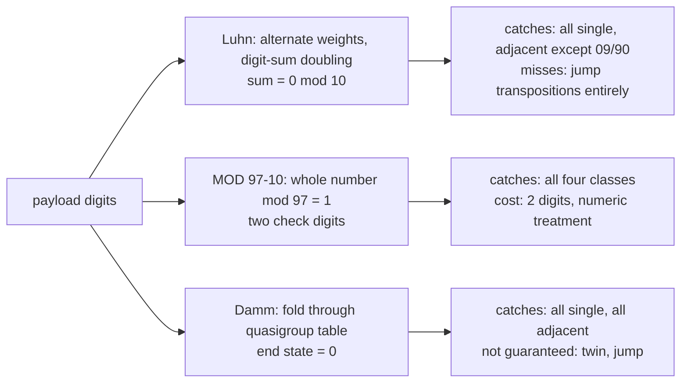

# Numerical Algorithms: GCD, Modular Arithmetic, and Check Digits

> Luhn, mod-97 IBAN checks, and why they catch the errors they catch.

**Type:** Build
**Languages:** Java, Python, Go
**Prerequisites:** Phase 0, Lesson 07 (Decimal and Integer Arithmetic in Three Runtimes), Phase 2, Lesson 06 (Dynamic Programming), Phase 10, Lesson 01 (Representing Money)
**Time:** ~60 minutes

## Learning Objectives

- Implement Euclid's algorithm and its extended form, state the Bezout identity it produces, and derive the modular inverse from it
- Compute remainders of arbitrarily long decimal strings and large powers without big integers, using Horner's rule and repeated squaring
- Implement three check-digit schemes from their specifications: Luhn (ISO/IEC 7812), ISO 7064 MOD 97-10 (IBAN), and Damm's quasigroup check
- Prove, from the arithmetic, which error classes each scheme catches and which it misses, then confirm the proof with an exhaustive injection test
- Choose a check-digit scheme for a new identifier by matching the scheme's guarantees to the keying errors humans actually make
- Explain where the same tools (gcd, inverses, modular exponentiation) reappear in coin change, fee ratios, and cryptography

## The Problem

A payout operations tool lets an agent type a beneficiary's account number. The number is a bare integer with no check digit, so a transposition (typing 5698 as 5689) produces a different, equally valid-looking account. Money goes to a stranger. The recovery process involves two banks, a legal notice, and three weeks; the amount comes back about 70% of the time. The bank's own IBAN would have caught the typo before submission: ISO 7064 MOD 97-10 detects every single-digit error and every adjacent transposition, and the agent would have seen a red box instead of a confirmation screen.

A second team copies the card industry's answer and puts a Luhn digit on their internal reference numbers. It catches every single-digit error, and the team's test, which flips one digit at random a thousand times, reports 100%. In production a specific class of mistake keeps getting through: references that contain `09` typed as `90`, and `22` typed as `55`. Luhn's doubling step maps 0 and 9 to the same contribution and maps the pair 2,2 to the same total as 5,5. These are not bugs in the implementation; they are properties of the scheme, and a test that only injects single-digit errors cannot see them. The team also assumes Luhn protects against swapping digits two apart, which it does not at all: positions two apart carry identical weights, so swapping them never changes the sum.

A third team needs a single check digit (an IBAN's two digits would not fit the existing fixed-width field) with full protection against both single-digit errors and adjacent transpositions. Luhn cannot deliver that. Verhoeff (1969) and Damm (2004) can, using a multiplication table instead of weighted sums, and Damm's version is twenty lines. Nobody on the team has heard of either.

All three stories reduce to the same question: for a given identifier, which keying errors matter, and which arithmetic structure catches them? The tools are a few thousand years old (Euclid), a few centuries old (modular arithmetic), and a few decades old (quasigroups). This lesson builds them and then, instead of asserting which errors are caught, enumerates every error of each class on a sample number and counts.

## The Concept

### Euclid and the Bezout identity

`gcd(a, b)` is the largest integer dividing both. Euclid's observation: `gcd(a, b) = gcd(b, a mod b)`, because any common divisor of `a` and `b` also divides `a - qb`. Iterate until the remainder is zero; the last non-zero remainder is the gcd. Each step at least halves the smaller argument every two iterations, so the running time is O(log min(a, b)) divisions.

```text
gcd(1071, 462): 1071 = 2 * 462 + 147
                 462 = 3 * 147 +  21
                 147 = 7 *  21 +   0      -> gcd = 21
```

The extended algorithm carries two extra sequences so that at every step the current remainder is expressed as `a*x + b*y`. At the end that gives the Bezout identity `a*x + b*y = gcd(a, b)`. For 240 and 46: `240 * (-9) + 46 * 47 = 2`. Two payments uses follow directly:

- **Reachability in coin change.** Amount `A` can be made from denominations `d1..dk` with unlimited repeats only if `gcd(d1..dk)` divides `A`; the Bezout coefficients are a witness combination (possibly with negative counts, which is why the gcd test is necessary but not sufficient for non-negative solutions). Lesson 06's table returned "unreachable" for 3 from `{2}`; `gcd(2) = 2` does not divide 3 and says so in O(1).
- **Reducing a fee ratio.** 2.9% is `29/1000` and `gcd(29, 1000) = 1`, so it is already in lowest terms; `250/10000` reduces to `1/40`. Reduced ratios keep `Money.times(numerator, denominator)` away from overflow.

### Modular inverses and why they matter

If `gcd(a, m) = 1`, the Bezout identity `a*x + m*y = 1` says `a*x = 1 (mod m)`: `x` is the inverse of `a` modulo `m`. If the gcd is not 1 there is no inverse; `6` has none modulo `10`. Inverses let you *solve* congruences rather than search for solutions. A check-digit scheme of the form `sum(w_i * d_i) = 0 (mod m)` is solved for the check digit by multiplying by the inverse of its weight; ISO 7064's pure systems do exactly this with radix powers as weights. In Phase 7 the same operation appears in RSA key generation (`d = e^-1 mod (p-1)(q-1)`), computed by the same twenty lines.

### Modular exponentiation and Horner's rule

Two more tools that avoid big numbers:

- `base^exp mod m` by repeated squaring: square the base, reduce mod `m`, and multiply into the result for each set bit of `exp`. O(log exp) multiplications; `3^200 mod 97` takes eight squarings, not two hundred multiplications and a 96-digit intermediate.
- The remainder of a long decimal string: process digits left to right with `r = (r * 10 + digit) mod m`. This is Horner's rule for evaluating a polynomial, applied to the polynomial whose coefficients are the digits. A 24-digit IBAN numeric never exists as a number; only `r < 97` does. The Java and Go versions rely on this to stay in a `long`; Python would not need it, and the lesson uses it anyway so the three implementations are one design.

### Check digits: the arithmetic behind the guarantees

A check digit scheme maps a payload to one or more extra symbols such that the whole identifier satisfies an equation. An error is *detected* when the corrupted identifier fails the equation. Whether a class of error is always detected is a question about the equation, not about luck.

| Scheme | Equation | Single-digit error | Adjacent transposition | Twin error (aa -> bb) | Jump transposition (abc -> cba) |
|--------|----------|--------------------|------------------------|-----------------------|---------------------------------|
| Luhn (ISO/IEC 7812) | weighted digit sum, weights alternate 1 and "2 with digit-sum", = 0 mod 10 | all | all except 09 <-> 90 | all except 22<->55, 33<->66, 44<->77 | none |
| ISO 7064 MOD 97-10 (IBAN) | the whole number as an integer = 1 mod 97 | all | all | all | all |
| Damm (2004) | fold digits through a totally anti-symmetric quasigroup, end state = 0 | all | all | not guaranteed | not guaranteed |
| Verhoeff (1969) | fold through the dihedral group D5 with position permutations | all | all | most | most |

Why each cell is what it is:

**Luhn, single digit.** A digit in an undoubled position contributes itself; changing it by `k` changes the sum by `k`, and `k` is not 0 mod 10. A doubled digit contributes `2d` for `d <= 4` and `2d - 9` for `d >= 5`: the ten digits map to `0, 2, 4, 6, 8, 1, 3, 5, 7, 9`, a permutation, so any change alters the sum by a non-zero amount below 10. Every single-digit error is caught.

**Luhn, adjacent transposition.** Swapping neighbours `a, b` moves one into the doubled position and the other out. The sum changes by `(f(a) + b) - (a + f(b))` where `f` is the doubling map. This is zero exactly when `f(a) - a = f(b) - b`, and `f(d) - d` takes the values `0, 1, 2, 3, 4, -4, -3, -2, -1, 0` for `d = 0..9`: only 0 and 9 collide. So `09 <-> 90` is the one adjacent transposition Luhn misses. The demo's sample PAN contains three such pairs and the test asserts exactly three misses.

**Luhn, twin errors.** Replacing `aa` with `bb` changes the sum by `(f(b) + b) - (f(a) + a)`, and `f(d) + d` takes `0, 3, 6, 9, 12, 6, 9, 12, 15, 18` for `d = 0..9`, which modulo 10 is `0, 3, 6, 9, 2, 6, 9, 2, 5, 8`. Three pairs collide: `2 <-> 5` (both 6), `3 <-> 6` (both 9), and `4 <-> 7` (both 2). Hence the classic list: 22<->55, 33<->66, 44<->77.

**Luhn, jump transposition.** Positions two apart have the same weight. Swapping them does not change the sum. Luhn detects zero jump transpositions, which the aggregate test confirms with `0/2531`.

**MOD 97-10.** Treat the identifier as a decimal integer `N` and require `N = 1 (mod 97)`. A single-digit change at position `i` changes `N` by `k * 10^i` with `1 <= |k| <= 9`; since 97 is prime and divides neither `k` nor `10^i`, the remainder changes. An adjacent transposition changes `N` by `(a - b)(10^(i+1) - 10^i) = (a - b) * 9 * 10^i`; 97 divides none of the factors. A twin error changes `N` by `(b - a) * 11 * 10^i`; a jump transposition by `(a - c) * 99 * 10^i`, and `99 = 2 (mod 97)`. None of these is 0 mod 97, so all four classes are caught, always. Two check digits buy this; the price is that the identifier must be treated as a number, which is why the IBAN rearranges the country code and check digits to the end before the computation.

**Damm.** The scheme folds the digits through a 10 x 10 table `T`: `state = T[state][digit]`, starting from 0; the check digit is the final state, and appending it drives the state to 0 because `T[s][s] = 0`. Two properties of the table give the guarantees. Each row and each column is a permutation of 0..9 (a *quasigroup*, or Latin square), so changing one digit changes the state at that step, and because columns are permutations the difference can never be undone by the following digits: every single-digit error is caught. The table is also *totally anti-symmetric*: `T[T[c][x]][y] != T[T[c][y]][x]` for all `c` and all `x != y`, which says precisely that swapping two adjacent inputs from any state yields a different state: every adjacent transposition is caught. Nothing in the definition constrains twin errors or jump transpositions, and the demo shows Damm missing some of each.

The Damm table in this lesson is the one from Damm's 2004 dissertation as reproduced in the standard references; the tests verify the Latin-square property and the zero diagonal directly rather than trusting the transcription. The first draft of this lesson had two entries swapped in row 8; the Latin-square test caught it before any digit test did.



### Worked example: Luhn by hand

Payload `453909012223456`, check digit to be appended on the right. Starting from the rightmost payload digit, double every other one (the rightmost payload digit is doubled because the check digit will occupy the undoubled slot to its right):

```text
digit   : 4  5  3  9  0  9  0  1  2  2  2  3  4  5  6
doubled?: y  n  y  n  y  n  y  n  y  n  y  n  y  n  y
```

Walk from the right: 6 doubled -> 12 -> 3; 5 kept -> 5; 4 doubled -> 8; 3 kept -> 3; 2 doubled -> 4; 2 kept -> 2; 2 doubled -> 4; 1 kept -> 1; 0 doubled -> 0; 9 kept -> 9; 0 doubled -> 0; 9 kept -> 9; 3 doubled -> 6; 5 kept -> 5; 4 doubled -> 8. Sum = 3+5+8+3+4+2+4+1+0+9+0+9+6+5+8 = 67. Check digit = (10 - 67 mod 10) mod 10 = 3. Full PAN `4539090122234563`. Validate: now with the check digit in place, the doubling pattern shifts by one, the check digit is kept as is, and the total is 70, which is 0 mod 10.

### Worked example: IBAN by hand

`DE89 3704 0044 0532 0130 00`. Move the first four characters to the end: `370400440532013000DE89`. Replace letters: D = 13, E = 14: `370400440532013000131489`. Compute mod 97 by Horner's rule. By hand it is easier to chunk: the first ten digits `3704004405` leave remainder 41, so continue from 41 with the remaining digits exactly as the code continues from `r`; the code does it one digit at a time and the two agree because `(r * 10^k + chunk) mod 97` is what Horner's rule computes. The final remainder is 1, so the IBAN is valid. To generate the check digits for a new BBAN, put `00` in the check position, compute the remainder `r`, and use `98 - r`, zero-padded to two digits. For this BBAN `r = 9` and the check is `89`, matching the published example.

### Worked example: Damm by hand

Payload `572`. Start in state 0 and look up `TABLE[state][digit]` for each digit:

```text
state 0, digit 5 -> TABLE[0][5] = 9
state 9, digit 7 -> TABLE[9][7] = 7
state 7, digit 2 -> TABLE[7][2] = 4      -> check digit 4, identifier 5724
validate 5724: ... state 4, digit 4 -> TABLE[4][4] = 0   -> valid
```

Now corrupt it. Transpose the first two digits, `7524`: `TABLE[0][7] = 6`, `TABLE[6][5] = 2`, `TABLE[2][2] = 0`, `TABLE[0][4] = 5`, not 0: caught. Change one digit, `5734`: `9`, `7`, `TABLE[7][3] = 5`, `TABLE[5][4] = 2`, not 0: caught. The anti-symmetry property guarantees the first; the Latin-square property guarantees the second. Neither says anything about twin errors: `1007` is a valid Damm identifier (payload `100`, check 7), and the twin error `1227` is also valid, so it passes. The aggregate table shows Damm missing about one twin error in ten.

### Choosing a scheme

| If the identifier... | Use | Because |
|----------------------|-----|---------|
| Must interoperate with card networks | Luhn | ISO/IEC 7812 mandates it; nothing else will be accepted |
| Must interoperate with bank account rails | ISO 7064 MOD 97-10 | ISO 13616 mandates it; two digits buy all four error classes |
| Is new, digits only, and has room for two check digits | MOD 97-10 | Strongest proven guarantees of the three; trivially implemented with Horner's rule |
| Is new, digits only, and has room for exactly one | Damm (or Verhoeff) | Full single-digit and adjacent-transposition detection, which Luhn cannot give in one digit |
| Is new and alphanumeric | ISO 7064 MOD 1271-36 or MOD 37-2 | Same family as MOD 97-10 with a radix that covers letters; do not invent your own |
| Will be read by machines only, never typed | None, or a CRC | Check digits model human keying errors; a CRC models bit errors and burst errors |

The one rule that covers every row: write down the error classes the scheme is supposed to catch, then run the exhaustive injection from Step 7 against your implementation of it. A scheme chosen for its guarantees and transcribed with one wrong table entry has none of them.

### What check digits do not do

- They are not cryptographic. Anyone can compute a valid check digit for any payload. A check digit catches *accidents*, not *adversaries*; an HMAC (Phase 7) is for adversaries.
- They do not detect every error. MOD 97-10 catches every error of the four named classes but still passes about 1 in 97 random multi-digit corruptions. Error detection is probabilistic beyond the proven classes.
- They do not validate the identifier's existence. A Luhn-valid PAN may belong to nobody; an IBAN with correct check digits may have a BBAN that fails the national bank's own check (many countries have one, and ISO 13616 explicitly leaves it to them).
- They do not help if the input path strips them. A form field that accepts 15 digits for a 16-digit PAN, or trims the IBAN to its last 18 characters "for display", has removed the protection without removing the belief in it.

## Build It

The primary walkthrough is in Java. The Python and Go files implement the same design with the same names; the subsections at the end show only what differs.

### Step 1: Euclid, extended

```java
static Bezout extendedGcd(long a, long b) {
    long oldR = a, r = b;
    long oldX = 1, x = 0;
    long oldY = 0, y = 1;
    while (r != 0) {
        long q = oldR / r;
        long tmp;
        tmp = oldR - q * r; oldR = r; r = tmp;
        tmp = oldX - q * x; oldX = x; x = tmp;
        tmp = oldY - q * y; oldY = y; y = tmp;
    }
    if (oldR < 0) return new Bezout(-oldR, -oldX, -oldY);
    return new Bezout(oldR, oldX, oldY);
}
```

The three pairs advance in lockstep: `(oldR, r)` are the remainders, `(oldX, x)` and `(oldY, y)` the coefficients that express them in terms of `a` and `b`. The invariant `oldR = a*oldX + b*oldY` holds at every iteration, so when `r` hits zero the identity is read straight off. The sign fix at the end keeps the gcd non-negative for negative inputs.

**Predict:** `extendedGcd(46, 240)`, arguments reversed. Is the gcd the same? Are `x` and `y`?

### Step 2: The inverse

```java
static long modInverse(long a, long m) {
    if (m <= 1) throw new IllegalArgumentException("modulus must be > 1");
    Bezout b = extendedGcd(Modular.mod(a, m), m);
    if (b.g() != 1) throw new ArithmeticException(a + " has no inverse modulo " + m + " (gcd = " + b.g() + ")");
    return Modular.mod(b.x(), m);
}
```

`a` is reduced first so the Bezout `x` is small; `x` is reduced at the end because it may be negative. The exception for a non-unit is the point: an inverse that does not exist should never come back as a wrong number. `Modular.mod` exists because Java's `%` keeps the dividend's sign, so `-7 % 5` is `-2` and must be lifted to `3`.

**Predict:** `modInverse(100, 97)` is 65. Without running it, what is `modInverse(3, 97)`? (Hint: `100 = 3 (mod 97)`.)

### Step 3: Remainders of long strings

```java
static long modOfDecimalString(String digits, long m) {
    if (digits.isEmpty()) throw new IllegalArgumentException("empty digit string");
    long r = 0;
    for (int i = 0; i < digits.length(); i++) {
        char c = digits.charAt(i);
        if (c < '0' || c > '9') throw new IllegalArgumentException("not a digit at " + i + ": " + c);
        r = (r * 10 + (c - '0')) % m;
    }
    return r;
}
```

`r` is always below `m`, so `r * 10 + 9` is below `10m + 9`; with `m = 97` nothing comes near a `long`'s range. The test compares this against `BigInteger` on a 30-digit string to make sure Horner's rule and the big-number route agree.

**Predict:** what is the largest `m` for which this function is safe on a `long`?

### Step 4: Luhn

```java
private static int weightedSum(String digits, boolean doubleFirst) {
    int sum = 0;
    boolean dbl = doubleFirst;
    for (int i = digits.length() - 1; i >= 0; i--) {
        int d = digits.charAt(i) - '0';
        if (dbl) {
            d *= 2;
            if (d > 9) d -= 9;
        }
        sum += d;
        dbl = !dbl;
    }
    return sum;
}

static int checkDigit(String payload) { return (10 - weightedSum(payload, true) % 10) % 10; }
static boolean validate(String pan)   { return weightedSum(pan, false) % 10 == 0; }
```

One helper serves both directions; the only difference is whether the rightmost digit processed is doubled. When computing the check digit for a payload, the rightmost payload digit *will* have the check digit to its right, so it is doubled. When validating, the rightmost digit *is* the check digit and is not doubled. `d -= 9` is the digit sum of a two-digit product (`16 -> 7`), which is what makes the doubled-position map a permutation.

**Predict:** why does `(10 - sum % 10) % 10` need the outer `% 10`?

### Step 5: MOD 97-10 and the IBAN rearrangement

```java
static String ibanToNumeric(String iban) {
    String s = iban.replace(" ", "").toUpperCase();
    String rearranged = s.substring(4) + s.substring(0, 4);
    StringBuilder out = new StringBuilder();
    for (int i = 0; i < rearranged.length(); i++) {
        char c = rearranged.charAt(i);
        if (c >= '0' && c <= '9') out.append(c);
        else if (c >= 'A' && c <= 'Z') out.append(c - 'A' + 10);
        else throw new IllegalArgumentException("invalid IBAN character: " + c);
    }
    return out.toString();
}

static String ibanCheckDigits(String countryCode, String bban) {
    long r = Modular.modOfDecimalString(ibanToNumeric(countryCode + "00" + bban), 97);
    long check = 98 - r;
    return (check < 10 ? "0" : "") + check;
}
```

Spaces are tolerated and case is normalised because that is how humans type IBANs; everything else is rejected, and `validateIban` turns the rejection into `false` rather than an exception, since "is this a valid IBAN" is a question with a yes/no answer. `98 - r` yields a check in `02..98`, which is why no valid IBAN has check digits `00`, `01`, or `99`.

**Predict:** an IBAN's letters `A..Z` become two digits each. Why does that not break the "every single-digit error is caught" proof for the digit positions?

### Step 6: Damm

```java
private static int interim(String digits) {
    int state = 0;
    for (int i = 0; i < digits.length(); i++) {
        int d = digits.charAt(i) - '0';
        state = TABLE[state][d];
    }
    return state;
}

static int checkDigit(String payload) { return interim(payload); }
static boolean validate(String identifier) { return interim(identifier) == 0; }
```

The entire algorithm is a table lookup in a loop. The guarantees live in the table, which is why the tests check the Latin-square property (every row and column a permutation) and the zero diagonal, and why the Concept section insists on verifying a transcribed table before trusting it.

**Predict:** `Damm.checkDigit("572")` is 4. What is `Damm.checkDigit("5724")`, and why must it be that value for any payload?

### Step 7: Exhaustive error injection

```java
static Report analyse(Validator v, String valid, ErrorClass cls) {
    if (!v.validate(valid)) throw new IllegalArgumentException("the sample must validate before it is corrupted: " + valid);
    List<String> missed = new ArrayList<>();
    long tried = 0, caught = 0;
    for (String bad : corruptions(valid, cls)) {
        tried++;
        if (v.validate(bad)) missed.add(bad); else caught++;
    }
    return new Report(cls, tried, caught, missed);
}
```

`corruptions` enumerates *every* error of a class on the sample: all `9n` single-digit substitutions, every adjacent pair of different digits swapped, every pair of equal digits replaced by each of the nine other equal pairs, every pair two apart swapped. Letters in an IBAN are skipped. The guard at the top matters: analysing an already-invalid sample would count every corruption as "caught". `aggregate` repeats this over 200 seeded random payloads so that a sample which happens to lack `09` cannot make Luhn look perfect.

**Predict:** the sample PAN `4539090122234563` has 13 adjacent transpositions available, not 15. Why?

### Step 8: Run it

```bash
cd phases/02-algorithms/15-numerical-algorithms/code/java
javac -d .out *.java && java -cp .out Main
java -cp .out MainTest
```

Expected output, abbreviated:

```console
== Which errors does each scheme catch? Exhaustive on one sample ==
error class              Luhn       MOD 97-10  Damm
SINGLE_DIGIT             144/144    180/180    144/144
ADJACENT_TRANSPOSITION   10/13      15/15      13/13
TWIN                     16/18      36/36      15/18
JUMP_TRANSPOSITION       0/11       16/16      6/11
Luhn misses (adjacent): [4530990122234563, 4539900122234563, 4539009122234563]
Luhn misses (twin)    : [4539090155234563, 4539090125534563]

== Aggregate over 200 seeded random 15-digit payloads (seed 7) ==
error class              Luhn                   MOD 97-10              Damm
SINGLE_DIGIT             28800/28800 (100.00%)  30600/30600 (100.00%)  28800/28800 (100.00%)
ADJACENT_TRANSPOSITION   2623/2683 (97.76%)     2864/2864 (100.00%)    2681/2681 (100.00%)
TWIN                     2662/2853 (93.31%)     3024/3024 (100.00%)    2597/2871 (90.46%)
JUMP_TRANSPOSITION       0/2531 (0.00%)         2716/2716 (100.00%)    2261/2526 (89.51%)
```

Every number in both tables is identical in Java, Python, and Go, because the random generator is the same LCG and the arithmetic is integer arithmetic. The table is the lesson: it is the proof in the Concept section, checked by enumeration.

### In Python

```python
def mod_of_decimal_string(digits: str, m: int) -> int:
    r = 0
    for i, c in enumerate(digits):
        if not "0" <= c <= "9":
            raise ValueError(f"not a digit at {i}: {c}")
        r = (r * 10 + ord(c) - 48) % m
    return r
```

Differences, all in `code/python/main.py`:

- **`%` is already non-negative for a positive modulus**, so `mod` is a one-liner kept only so the three designs match. `//` floors rather than truncates, which changes the Bezout coefficients for negative inputs but not the identity; the lesson's inputs are non-negative and the coefficients match Java and Go exactly.
- **`pow(base, exp, m)` is built in** and is what production code should call; the lesson's `mod_pow` exists to show the squaring loop, and the test checks it against `pow`.
- **`str.isdigit()` accepts Unicode digits** such as Arabic-Indic numerals, so the validators also check `isascii()`; without it `"٤٥٣٩"` would pass the type check and then fail arithmetic in a confusing place.
- **Validators are plain callables** (`Callable[[str], bool]`) rather than an interface.

### In Go

```go
func (r *SeededRandom) NextInt(bound int) int {
    r.state = r.state*6364136223846793005 + 1442695040888963407
    return int((r.state >> 33) % uint64(bound))
}
```

Differences, all in `code/go/main.go`:

- **The LCG uses `uint64` so the multiply wraps modulo 2^64 by definition.** Java gets the same bits from a signed `long` because two's-complement wrapping is identical; Python needs an explicit `& MASK`. This is the one place the three languages had to be made to agree on purpose.
- **Errors are values**: `ModInverse`, `ModPow`, `LuhnCheckDigit`, and the IBAN builders return `(value, error)`; `ErrNoInverse` is a sentinel. Validators return a bare `bool` because the question is yes/no.
- **`Validator` is a named function type**, `type Validator func(string) bool`, which lets plain functions be passed where Java needs a method reference.
- **Byte indexing** (`digits[i]`) is used because every valid input is ASCII; a `range` loop over runes would be needed for arbitrary Unicode, and the IBAN path uses one so a stray non-ASCII character is rejected cleanly.

## Use It

### Where each scheme is deployed

- **Luhn** is on every payment card PAN (ISO/IEC 7812-1 Annex B), on IMEI numbers, on US National Provider Identifiers, and on many national ID schemes. Payment gateways reject Luhn-invalid PANs before any network call, which is why a typo gets an instant error while a wrong-but-valid PAN gets a decline seconds later.
- **ISO 7064 MOD 97-10** is the IBAN check (ISO 13616) and also the ISO 6166 LEI (legal entity identifier) and some creditor reference schemes (RF creditor reference, ISO 11649). Every SEPA and SWIFT gateway validates it at ingestion.
- **Verhoeff** is used by India's Aadhaar number and by some postal and licence systems. **Damm** is the simpler modern alternative with the same two guarantees; you will mostly meet it in new internal identifiers designed by people who have read this lesson or its sources.
- **gcd and modular inverses** reappear in Phase 7 (RSA, Diffie-Hellman), in Phase 10 (reducing fee ratios), and in Lesson 06's reachability check.

### Libraries

`java.math.BigInteger` has `gcd`, `modInverse`, and `modPow`; Python has `math.gcd`, three-argument `pow`, and `pow(a, -1, m)` for inverses since 3.8; Go has `big.Int.GCD`, `ModInverse`, and `Exp`. None of the three standard libraries ships Luhn, MOD 97-10, or Damm; Java has `java.util.Currency` but no IBAN type, Python's `schwifty` and Go's `go-iban` are third party. The schemes are small enough that most payment codebases have their own copy, and the error-class table above is the review checklist for that copy.

### What the libraries hide

A library `isValidIBAN` tells you yes or no. It does not tell you what kinds of typo it would have missed, and for Luhn-based identifiers that gap (jump transpositions, 09/90) is where production incidents live. The exhaustive analysis in Step 7 is twenty lines and runs in under a second; attach it to any new identifier scheme as a test.

## Ship It

`outputs/interview-card-check-digits.md` is an interview card: the six questions a strong candidate should be able to answer about check digits and modular arithmetic, with model answers and the follow-ups that separate "has implemented Luhn" from "understands why Luhn misses 09/90". Use it to interview, or to interview yourself before designing an identifier.

## Exercises

1. **Reinforce.** Implement Verhoeff (the dihedral group `D5` multiplication table, the permutation table, and its inverse table) alongside Damm, and add it as a fourth column in both analysis tables. Confirm it catches all single-digit and adjacent transposition errors, and compare its twin and jump rates with Damm's.
2. **Apply.** ISO 7064 MOD 11-2 (used by ISBN-10 and ISO 7064's own examples) is a one-character scheme over `0-9` plus `X` with weights `2^i mod 11`. Implement check-character generation by solving for the check with `modInverse` rather than by trial, then run the error-class analysis. Explain, from the arithmetic, why it catches all single-digit errors and all adjacent transpositions with a single character where Luhn cannot.
3. **Extend.** Combine with Lesson 06. Given denominations `{6, 10, 15}`, use `gcd` to decide which amounts are reachable at all, then use `minCoinsTable` to find the largest unreachable amount (the Frobenius number; for two coprime denominations `a, b` it is `ab - a - b`). Write the test that shows every amount above it is reachable and explain why `gcd` alone cannot find that threshold.

## Key Terms

| Term | What people say | What it actually means |
|------|-----------------|------------------------|
| Bezout identity | "the extended gcd thing" | For any `a, b` there exist integers `x, y` with `a*x + b*y = gcd(a, b)`; the extended Euclidean algorithm computes them, and `x` is the modular inverse of `a` when the gcd is 1 |
| Modular inverse | "divide mod m" | The `x` with `a*x = 1 (mod m)`; exists iff `gcd(a, m) = 1`; the tool for solving congruences instead of searching them |
| Horner's rule | "process the digits one by one" | Evaluating `sum(d_i * 10^i)` as `((d_n * 10 + d_(n-1)) * 10 + ...)`, reducing mod `m` at each step so the number itself is never formed |
| Repeated squaring | "fast exponentiation" | `base^exp` in O(log exp) multiplications by squaring the base and multiplying in for each set bit of the exponent |
| Check digit | "the last digit" | One or more extra symbols chosen so the whole identifier satisfies an equation; detects accidental corruption of the proven classes, never adversarial change |
| Adjacent transposition | "swapped two digits" | Two neighbouring, different digits exchanged; the most common human keying error after single-digit substitution, and the one Luhn almost but not quite catches |
| Twin error | "doubled digit typo" | A pair of equal digits replaced by a different equal pair (`22 -> 55`); Luhn misses three specific pairs, MOD 97-10 misses none |
| Totally anti-symmetric quasigroup | "the Damm table" | A Latin square `T` with `T[T[c][x]][y] != T[T[c][y]][x]` for all `c` and `x != y`; that inequality is exactly "adjacent transpositions change the state" |

## Further Reading

- [ISO/IEC 7812-1: Identification cards, Part 1: Numbering system](https://www.iso.org/standard/70484.html) — Annex B is the Luhn formula as the card networks specify it; one page.
- [ISO 7064:2003: Information technology, Security techniques, Check character systems](https://www.iso.org/standard/31531.html) — defines MOD 97-10, MOD 11-2, and the other pure and hybrid systems; the error-class claims in this lesson are its Annex.
- [ISO 13616-1: Financial services, International bank account number (IBAN), Part 1](https://www.iso.org/standard/81090.html) — the rearrangement, the letter-to-digit mapping, and the `98 - r` rule; the `DE89 3704 0044 0532 0130 00` sample is from the SWIFT IBAN registry that accompanies it.
- [Damm, "Totally anti-symmetric quasigroups" (Dissertation, Philipps-Universität Marburg, 2004)](https://archiv.ub.uni-marburg.de/diss/z2004/0516/) — the construction and the proof that order-10 totally anti-symmetric quasigroups exist, which Verhoeff had conjectured impossible.
- [Verhoeff, "Error Detecting Decimal Codes" (Mathematical Centre Tracts 29, 1969)](https://ir.cwi.nl/pub/13045) — the study of real keying errors (which classes humans actually make, and how often) that every later scheme is measured against.
- [Knuth, *The Art of Computer Programming*, Volume 2, section 4.5.2 (The Greatest Common Divisor)](https://www-cs-faculty.stanford.edu/~knuth/taocp.html) — Euclid's algorithm, its extended form, and the analysis of its running time via Fibonacci numbers.
