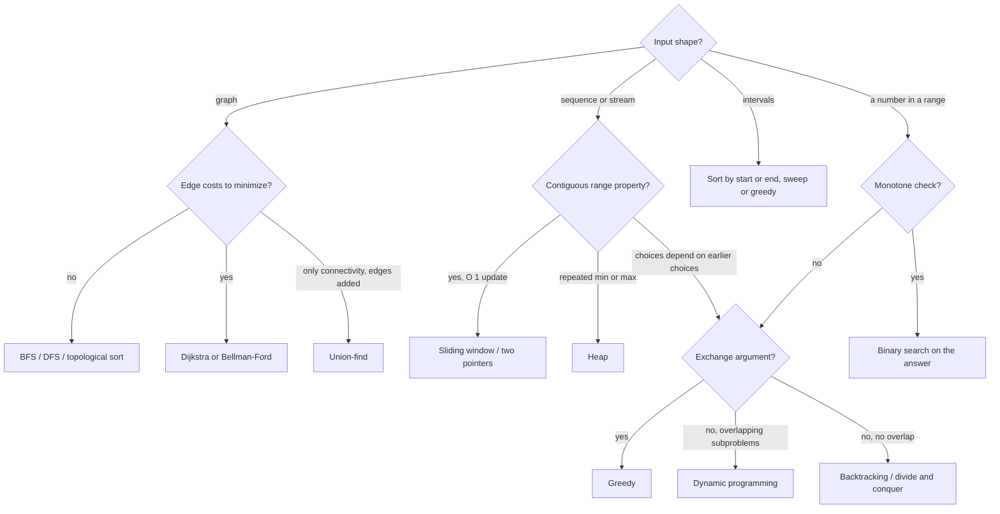

# Algorithm Design Patterns: A Field Guide

> How to recognize which pattern a new problem belongs to.

**Type:** Learn
**Languages:** —
**Prerequisites:** Phase 2, Lessons 01 through 15 (this lesson is the index to them), Phase 1, Lesson 14 (Choosing a Structure)
**Time:** ~45 minutes

## Learning Objectives

- Name the eight algorithmic patterns of this phase and, for each, the signals in a problem statement that point to it and the counter-signals that rule it out
- Apply a four-question decision procedure to an unfamiliar problem and arrive at a candidate pattern before writing code
- Recognize when two patterns combine (binary search over a greedy check, DP over a topological order) and which one is the outer loop
- Distinguish the patterns that are provably optimal from the ones that are heuristics, and say what proof each requires
- Work ten problems from a payments platform from statement to pattern to complexity, and identify the wrong pattern that each one tempts

## The Problem

A senior engineer on a payments team is asked, in one week, to: compute per-merchant rolling 24-hour transaction velocity for fraud rules; find the cheapest conversion path from THB to NGN through available currency pairs; decide the smallest per-request latency budget such that 99.9% of settlement jobs finish before the bank cutoff; group 40,000 merchants that share a device fingerprint, bank account, or phone number into clusters; split a 100,000-line payout file into the minimum number of batches under a 5,000,000 USD per-batch cap; and order 212 reconciliation jobs that depend on one another. None of these problems arrives labelled. They arrive as a Slack message, a Jira ticket, or a sentence in a design review.

The engineer who has done Phase 2 knows fifteen algorithms. The difficulty is not executing any of them; it is the forty seconds between reading the problem and knowing which one applies. Get that wrong and the week is spent writing a dynamic program for a problem that a sort and one pass would solve, or a greedy heuristic for a problem where greedy is provably wrong and the payout file goes out with eleven batches instead of nine. Get it right and the implementation is the easy part, because each pattern comes with its structure, its invariant, its complexity, and its tests already known.

Recognition is a skill with structure. Each pattern has **signals**: phrases and shapes in the problem statement that suggest it. Each has **counter-signals**: features that rule it out even when a signal is present. And there is a short decision procedure that, applied honestly, narrows most problems to one or two candidates before any code exists. This lesson is that procedure and that catalogue, with ten worked recognitions drawn from the week above.

## The Concept

### The decision procedure

Four questions, asked in order, each eliminating patterns.

1. **What is the shape of the input?** A sequence (array, stream, string), a set of intervals, a graph (things with relationships), a set of items with weights and values, or a numeric answer space. Shape rules out most patterns at once: graph patterns need a graph, window patterns need a sequence.
2. **What is being asked for?** A yes/no, a count, a single optimum (min or max), the optimum *and* the choice that achieves it, all solutions, or an ordering. Counting and "all solutions" push toward DP or backtracking; a single optimum opens greedy, DP, and binary search on the answer; an ordering is a sort or a topological sort.
3. **Does a local choice ever need to be undone?** If you can prove that the best local step is part of some optimal solution (an exchange argument), greedy applies. If a locally good step can be globally wrong, you need DP (overlapping subproblems with optimal substructure) or search (backtracking, when subproblems do not overlap).
4. **Is there monotonicity to exploit?** If a feasibility check is monotone in a parameter ("if budget `B` works then every `B' > B` works"), binary search on the answer turns an optimization into `log` feasibility checks. If a window's property is monotone as it grows or shrinks, two pointers or a sliding window apply.

Then confirm with complexity: the input size and the latency budget tell you whether the candidate is even allowed. A graph with 10^7 edges rules out anything quadratic. A ticket that says "real-time" rules out anything that needs the whole stream.

### The catalogue

Each row: the pattern, what it needs, the phrases that point to it, the phrases that point away, and the lesson that built it.

| Pattern | Requires | Signals | Counter-signals | Cost | Lesson |
|---|---|---|---|---|---|
| **Sliding window** | a sequence; a property of a contiguous range that updates in `O(1)` when one element enters or leaves | "contiguous", "last `k`", "within the past 24 hours", "longest/shortest subarray such that" | the property is not incrementally updatable (median, distinct-count without a map); the range need not be contiguous | `O(n)` | 03 |
| **Two pointers** | a sorted sequence or two sequences; a monotone relationship between the pointers | "pair that sums to", "merge two sorted", "remove duplicates in place", "partition" | unsorted input you cannot afford to sort; the decision for one pointer does not determine the direction of the other | `O(n)` after sort | 03 |
| **BFS / DFS** | a graph, explicit or implicit (states and moves) | "reachable", "connected", "shortest number of steps" (unweighted), "all paths", "cycle", "component" | weighted edges with a cost to minimize (use Dijkstra); a tree-shaped recurrence with repeated states (use DP) | `O(V + E)` | 08, 10 |
| **Shortest path** | a weighted graph | "cheapest", "fastest", "minimum cost route", "with at most `k` hops" | negative cycles (no answer exists); the "cost" is not additive along a path | `O((V + E) log V)` Dijkstra; `O(VE)` Bellman-Ford | 09 |
| **Dynamic programming** | optimal substructure and overlapping subproblems; a small state space | "number of ways", "minimum cost to reach", "longest common", "can we make exactly", choices that depend on earlier choices | the state space is exponential (no small state); a greedy exchange argument works (greedy is faster); no overlap (plain recursion or divide and conquer) | `O(states * transitions)` | 06 |
| **Greedy** | an exchange argument: the locally best choice is in some optimal solution | "earliest deadline", "largest first", "most X per unit Y", a sort followed by one pass | you cannot write the exchange argument; small counterexample exists (coin change with coins `1, 3, 4`); the problem is a knapsack with values | `O(n log n)` for the sort | 07, 11, 13 |
| **Binary search on the answer** | a feasibility check that is monotone in the answer | "minimum `X` such that", "maximum `X` such that", "smallest capacity", "the answer is a number in a known range" | feasibility is not monotone; the answer is a structure, not a number; the check itself is slow and the range is huge | `O(log(range) * check)` | 02 |
| **Union-find** | items and a stream of "these two are the same group" facts; only connectivity matters | "merge", "same group", "connected components" with incremental edges, "detect a cycle while adding edges" | you need paths, distances, or to *remove* edges; the structure must be ordered | `O(alpha(n))` per op | 10 (Phase 1), 11 |
| **Heap / priority queue** | repeatedly need the current min or max from a changing set | "top `k`", "`k`-th largest of a stream", "next event", "schedule by earliest", "merge `k` sorted" | need the `k`-th element once from a static array (quickselect is `O(n)`); need arbitrary lookup or deletion (use a tree or indexed heap) | `O(log n)` per op | 09 (Phase 1), 14 |

Two patterns from the phase are deliberately absent from the table because they are *tools inside* the others rather than first recognitions: string matching (Lesson 12) is what you reach for once you know the problem is "find patterns in text", and the numerical algorithms of Lesson 15 are what you reach for once you know it is "validate an identifier". Sorting (Lesson 01) is the step before half of the table.



The flowchart is the decision procedure drawn; the branch labels are the four questions. Most problems exit at the second or third node.

### Pattern cards

One card per pattern: the shape of the code, the invariant to assert in a test, a payments instance, and the failure that ships most often.

**Sliding window.** Two indices `lo` and `hi` over a sequence; `hi` advances every step, `lo` advances while the window violates its constraint; the window's property (sum, count, max via a monotonic deque) is updated incrementally.

```java
int lo = 0;
for (int hi = 0; hi < n; hi++) {
    add(a[hi]);
    while (violates()) remove(a[lo++]);
    best = Math.max(best, hi - lo + 1);
}
```

Invariant: after each step the window `[lo, hi]` satisfies the constraint and is the largest such window ending at `hi`. Payments: velocity counts, trailing-24-hour volume, "more than 3 declines in 10 minutes". Ships wrong when: the property is not incrementally updatable, and `violates()` quietly becomes `O(k)`.

**Two pointers.** One pointer from each end of a sorted array, or one in each of two sorted arrays; a comparison decides which pointer advances; each pointer moves monotonically, so the total is `O(n)`.

```java
int i = 0, j = n - 1;
while (i < j) {
    long s = a[i] + a[j];
    if (s == target) return new int[] {i, j};
    if (s < target) i++; else j--;
}
```

Invariant: the answer, if it exists, lies within `[i, j]`. Payments: matching a sorted list of bank statement lines against a sorted list of ledger postings (reconciliation), merging two sorted settlement files. Ships wrong when: the input is not sorted and the author did not notice, or there are duplicates and the pointer must skip them.

**BFS / DFS.** A queue (BFS) or stack (DFS) of nodes, a visited set, and a loop that pushes unvisited neighbours. BFS gives shortest hop count and level structure; DFS gives finishing order, cycle detection, and components.

Invariant: every node is visited at most once, so the traversal is `O(V + E)`. Payments: money-flow graphs (who paid whom within `k` hops of a flagged account), dependency ordering, fraud-ring components. Ships wrong when: the visited set is missing (exponential on a graph with cycles), or recursion depth overflows on a 100,000-node chain (use an explicit stack, Lesson 10).

**Shortest path.** BFS with the queue replaced by a min-heap keyed on distance (Dijkstra), with lazy deletion of stale heap entries; or `V - 1` rounds of relaxing every edge (Bellman-Ford) when weights may be negative.

Invariant (Dijkstra): a node's distance is final when it is popped, which holds only with non-negative weights. Payments: FX routing (`-log(rate)` as weight), cheapest correspondent chain, fastest settlement rail by expected hours. Ships wrong when: a negative edge (an arbitrage rate above 1) breaks the invariant silently and Dijkstra returns a wrong "shortest" path with no error.

**Dynamic programming.** Define the state as the smallest description of a subproblem; write the recurrence; fill a table in an order where every dependency is already computed (or memoize); read the answer off the table and, if the choice is needed, walk back through stored decisions.

```java
long[] ways = new long[target + 1];
ways[0] = 1;
for (int c : components)
    for (int a = c; a <= target; a++) ways[a] += ways[a - c];
```

Invariant: `ways[a]` is exactly the number of multisets of components summing to `a`, for every `a` processed so far. Payments: change-making and fee decomposition, payout batching with a value, instalment schedules, edit distance for fuzzy name matching. Ships wrong when: the state omits something the optimum depends on (the order of components when order matters, the currency when amounts mix), or the table is `O(n^2)` memory for `n = 10^6`.

**Greedy.** Sort by the key the exchange argument tells you (end time, weight, ratio), then one pass taking each item if it is compatible with what has been taken.

Invariant: after `i` choices, there exists an optimal solution that agrees with those `i` choices (this is what the exchange argument proves). Payments: interval scheduling of settlement slots, Kruskal on leased lines, order-preserving batch fill, retry scheduling by deadline. Ships wrong when: no exchange argument exists and the greedy is a heuristic presented as exact; coin change with a non-canonical fee table is the classic.

**Binary search on the answer.** `lo` and `hi` bracket the numeric answer; `mid` is tested with a feasibility check; the bracket halves each round; the loop ends when `lo == hi` and the answer is the boundary where the check flips.

```java
long lo = minPossible, hi = maxPossible;
while (lo < hi) {
    long mid = lo + (hi - lo) / 2;
    if (feasible(mid)) hi = mid; else lo = mid + 1;
}
return lo;   // smallest feasible value
```

Invariant: `feasible(hi)` is true and `feasible(lo - 1)` is false throughout, so the loop maintains a bracket on the flip point. Payments: smallest per-batch cap for `k` batches, smallest timeout for a 99.9% completion rate, largest per-merchant limit such that total exposure stays under a bound. Ships wrong when: the check is not monotone, or `mid` is computed as `(lo + hi) / 2` and overflows for amounts near `Long.MAX_VALUE`.

**Union-find.** A parent array with path compression and union by rank; `find` returns the representative; `union` merges and reports whether the two were already connected.

Invariant: `find(a) == find(b)` iff `a` and `b` are connected by some chain of unions so far. Payments: merchant entity resolution (shared device, account, phone), Kruskal's cycle test, deduplicating customer records. Ships wrong when: the problem later needs to *remove* a link (a disputed shared attribute), which union-find cannot do; rebuild from scratch or use a different structure.

**Heap.** A binary heap (`PriorityQueue`) holding candidates; `peek` and `poll` give the current min or max in `O(log n)`; a size-`k` heap holds the top `k` of a stream.

Invariant: the root is the minimum (or maximum) of everything currently in the heap. Payments: retry scheduler by next-attempt time, top-`k` merchants by volume, `k`-way merge of per-partition settlement streams, Dijkstra's frontier, timers (Phase 3, Lesson 12). Ships wrong when: an element's key changes after insertion and the author expects the heap to notice (use lazy deletion or an indexed heap), or a static array's `k`-th element is found with a heap in `O(n log k)` when quickselect is `O(n)`.

### Patterns that combine

Most real problems are two patterns, one inside the other. The outer one is what you recognize first; the inner one is what makes the check fast.

- **Binary search on the answer, greedy inside.** "Minimum per-batch cap so that the payout file fits in `k` batches": the check "does cap `C` give at most `k` batches" is a greedy one-pass fill (`O(n)`), and it is monotone in `C`, so binary search over `C` gives `O(n log(sum))`. The greedy is correct here because the items must stay in file order; if they could be reordered it would be bin packing, which is NP-hard, and the greedy becomes a heuristic.
- **Topological order, DP inside.** Longest path in a DAG (critical path, Lesson 10), counting paths in a DAG, and any "best value reachable at this node given its predecessors" is a DP whose evaluation order is the topological order. The DP needs the order; the order needs the graph to be acyclic.
- **Sort, then two pointers or sweep.** Merge intervals, max overlap, interval scheduling (Lesson 13), pair-sum, and Kruskal (Lesson 11) are all `O(n log n)` for a sort followed by `O(n)` of something simple. If you find yourself writing nested loops over a sortable input, sort first and look again.
- **Heap inside a graph traversal.** Dijkstra and Prim are BFS with the queue replaced by a heap keyed on distance or edge weight (Lessons 09 and 11). Recognizing the traversal is step one; choosing the queue is step two.
- **Hashing inside anything.** Sliding windows over distinct elements, two-sum on unsorted input, deduplication in a stream: a hash map turns "have I seen this" into `O(1)` and often downgrades the pattern from "sort first" to "one pass".

### Provable versus heuristic

Patterns divide into those that come with a correctness proof and those that do not, and a reviewer should ask which you are shipping.

| Provably optimal, given its precondition | The proof you owe | Heuristic unless a proof is added |
|---|---|---|
| Greedy | an exchange argument specific to this problem | greedy on any problem where you have not written one |
| DP | optimal substructure (the recurrence) and the base cases | a DP with a state that drops information the optimum needs |
| Dijkstra | non-negative edge weights | Dijkstra with negative edges; A* with an inadmissible heuristic |
| Binary search on the answer | the monotonicity of the check | a check that is "usually" monotone |
| Kruskal, Prim | the cut property | any spanning-tree heuristic that adds redundancy without re-proving cost |
| Earliest-deadline interval scheduling | the exchange argument of Lesson 13 | weighted interval scheduling solved greedily |

The most common failure in design reviews is a greedy presented as if it were optimal. The test is simple: ask for the exchange argument. If the author cannot state why swapping the greedy choice for any other choice never improves the result, the algorithm is a heuristic, and the review question becomes "how bad can it be, and do we care". For bin packing, first-fit-decreasing is within `11/9` of optimal plus a constant, which is fine for payout batches and not fine for a hard regulatory cap.

### Reading the complexity budget

Before choosing, estimate. The budget tells you which rows of the table are even allowed.

| Input size `n` | Budget of roughly 10^8 simple operations allows | Which means |
|---|---|---|
| 10 to 20 | `O(2^n)`, `O(n!)` for `n <= 11` | backtracking, bitmask DP over subsets |
| 10^3 | `O(n^2)` | pairwise comparison, simple DP tables |
| 10^5 to 10^6 | `O(n log n)` | sort-based patterns, heaps, binary search on the answer |
| 10^7 to 10^8 | `O(n)` | one pass: sliding window, two pointers, hashing, union-find |
| a stream | `O(1)` or `O(log n)` per item, `O(k)` memory | sketches, reservoirs, sliding windows with a deque |

A fraud-velocity feature on 3,000 transactions per second has a budget of under a millisecond per transaction: `O(1)` per item, which rules out everything but a sliding window with incremental state. A nightly reconciliation of 10^7 rows has a budget of minutes: `O(n log n)` is comfortable. Knowing the row before choosing the pattern saves the week described in The Problem.

### Signals in payments vocabulary

The signal words in the catalogue are generic. In a payments team the same patterns arrive wearing domain words, and it is worth knowing the translation.

| When the ticket says | It usually means | Pattern | Check first |
|---|---|---|---|
| velocity, "in the last N minutes", rolling | a contiguous trailing window over an event stream | sliding window | the per-event property updates in `O(1)` |
| route, rail, corridor, cheapest conversion | a weighted path through currencies, banks, or rails | shortest path | no rate above 1 after spread (else Bellman-Ford) |
| cutoff, window, hold, validity, expiry | intervals on a timeline | sort and sweep, or greedy by end | half-open bounds everywhere |
| depends on, runs after, prerequisite, upstream | a DAG of jobs or rules | topological sort | the graph is acyclic; report the cycle if not |
| same entity, linked, shared device, ring | connectivity facts arriving incrementally | union-find | nobody will ask to remove a link later |
| batch, bucket, cap, fits in, at most `k` | capacity-constrained grouping | greedy if order is fixed; binary search on the cap; bin packing (heuristic) if reorderable | whether order is fixed decides provable versus heuristic |
| top merchants, worst latencies, next due | repeated extremes from a changing set | heap | whether a one-shot `k`-th element (quickselect) would do |
| number of ways, can we make exactly, instalments | counting or feasibility over sums of parts | dynamic programming | the state is small (amount in minor units, not in cents squared) |
| screen, match against the list, contains any of | many patterns against one text | Aho-Corasick | normalization and whole-token policy |
| sample, spot-check, audit selection | uniform or weighted selection from a stream | reservoir sampling | the seed is recorded |

### Recognition failures in the wild

Two public incidents show what a missed recognition costs, and both are the same miss: treating a pattern-matching problem as "write a regex" without asking which algorithm the regex engine would run.

On 2 July 2019, Cloudflare's edge network returned HTTP 502 for 27 minutes worldwide. The post-incident report traces it to a single rule added to the web application firewall containing the regex fragment `.*(?:.*=.*)`. On a backtracking engine, that expression is quadratic in the input length (the engine tries every split point for each `.*`), and on long request bodies the CPU on every edge machine went to 100%. The engine had a linear-time alternative (the report describes moving to one with guaranteed linear matching); the problem was recognized as "match a pattern" and solved with the default tool, whose complexity nobody had asked about. In the terms of this lesson: the shape was text and patterns, the budget was microseconds per request, and the table says automaton, not backtracking.

On 20 July 2016, Stack Overflow was down for 34 minutes. A post containing about 20,000 consecutive whitespace characters was rendered through a regex `^[\s‌]+|[\s‌]+$` meant to trim it; on a backtracking engine the trailing-match branch is quadratic, and 20,000 characters became 200 million steps on the request thread. The fix was a hand-written trim loop: `O(n)`, no engine. The recognition that was missed: "strip whitespace from both ends" is a two-pointer problem, not a pattern-matching problem.

Neither team lacked skill. Both reached for the familiar tool without running the two questions that would have stopped them: what is the input size, and what does this tool cost per unit of input. The procedure in this lesson exists to make those questions reflexive.

### The forty-second checklist

Before writing code for a problem that arrived as a sentence:

1. Say the input shape out loud: sequence, intervals, graph, items with weights, a number.
2. Say what is returned: yes/no, count, optimum, optimum plus choice, all solutions, order.
3. Say the size of the input and the latency or memory budget, and pick the row of the complexity table.
4. Find the signal words in the statement and the row of the catalogue they point to.
5. Check that row's counter-signals against the statement. If one applies, go back to step 4.
6. Name the proof the pattern owes (exchange argument, recurrence, monotonicity, non-negative weights) and say whether you can write it. If not, you are choosing a heuristic; say so.
7. Say the tempting wrong pattern and why it is wrong. If you cannot name one, you have not understood the problem yet.

Seven steps, under a minute once practised, and the output is a sentence of the form "this is a sliding window over a per-card event sequence, `O(1)` per event, because the count updates incrementally and the window is contiguous; the tempting wrong answer is a query per event". That sentence is also the first paragraph of the design review.

### Counter-signals, collected

The patterns people reach for wrongly, and the sentence that should stop them:

- "It's a graph, so BFS." If edges have costs and you are minimizing cost, BFS gives the fewest hops, not the cheapest path.
- "It's an optimization, so DP." If a greedy exchange argument exists, DP is correct but a hundred times slower and harder to review. Try the exchange argument first.
- "Sort it and take the first `k`." If the input is a stream or `n` is 10^9, sorting is not available; a heap of size `k` or a reservoir is.
- "Sliding window." If the property is not maintainable incrementally (the median of the window, the number of distinct values without a map), the window is `O(k)` per step and you have an `O(nk)` algorithm wearing a disguise.
- "Binary search on the answer." If the check is not monotone (a cap that works at 5,000,000 fails at 5,000,001 because of a tie-break rule), the search converges on garbage with no error.
- "Union-find for connectivity." If you also need to delete edges or answer "what is the path", union-find cannot; it only knows "same set or not".
- "Greedy by largest first." The coin change counterexample: coins `1, 3, 4`, amount 6; greedy gives `4 + 1 + 1`, optimal is `3 + 3`. If the coin system is not canonical, greedy is wrong, and whether a fee or payout structure is canonical is a question, not an assumption.

## Worked Example

Ten problems from a payments platform, each taken from statement to pattern using the procedure. For each: the shape, the ask, the recognition, the pattern that tempts and is wrong, and the complexity.

**1. "Flag any card that makes more than 5 transactions in any 10-minute window."**
Shape: a time-ordered sequence per card. Ask: yes/no per transaction. The property "count of events in the trailing window" updates in `O(1)` as events enter and leave: sliding window with a deque of timestamps per card. Tempting and wrong: a database query `COUNT(*) WHERE ts > now - 10min` per transaction, which is `O(window)` per event and `O(n * window)` overall. `O(1)` amortized per event, `O(window)` memory per card. Lesson 03.

**2. "Find the cheapest way to convert THB to NGN given 40 currency pairs with spreads."**
Shape: a weighted directed graph (currencies are nodes, pairs are edges, weight is `-log(rate)` so that multiplying rates becomes adding weights). Ask: a single optimum and the path. Weights are non-negative when every rate is at most 1 after spread; if some are above 1 (arbitrage), Bellman-Ford and negative-cycle detection. Tempting and wrong: BFS for fewest hops, which finds a two-hop route through USD that is 40 basis points worse than a three-hop route. `O((V + E) log V)`. Lesson 09.

**3. "What is the smallest per-job timeout such that at least 99.9% of yesterday's settlement jobs would have completed?"**
Shape: a multiset of durations; the answer is a number. Ask: minimum `X` such that a monotone check passes ("fraction of jobs with duration `<= X`" only grows with `X`). Binary search on the answer, or directly: it is the 99.9th percentile, so quickselect in `O(n)`. Tempting and wrong: sorting all durations, which is correct but `O(n log n)` and needs the whole array in memory; a t-digest if it must be streamed. Lesson 02, Lesson 14.

**4. "Group merchants that share a device fingerprint, bank account, or phone number."**
Shape: items and equivalence facts ("these two share an attribute"). Ask: the groups. Only connectivity matters, edges are only added: union-find, `O(alpha(n))` per fact. Tempting and wrong: BFS over an explicit graph, which also works at `O(V + E)` but needs the whole graph built first and cannot answer "same group?" incrementally as new merchants onboard. Phase 1, Lesson 10; Lesson 11 for the clustering extension.

**5. "Split a payout file into the fewest batches, preserving order, with no batch over 5,000,000 USD."**
Shape: a sequence with a capacity constraint. Ask: a minimum count and the split. Because order is preserved, greedy fill (start a new batch only when the next item would overflow) is optimal by an exchange argument: any solution that closes a batch earlier can be made no worse by delaying the close. `O(n)`. Tempting and wrong: DP over split points, which is correct and `O(n^2)`; or, if someone relaxes "preserving order", first-fit-decreasing, which is now a bin-packing heuristic and should be labelled one. Lesson 07.

**6. "Order 212 reconciliation jobs so that each runs after everything it reads from."**
Shape: a directed graph of dependencies. Ask: an ordering, and an error if none exists. Topological sort, Kahn's algorithm for streaming dispatch, DFS for the cycle report. Tempting and wrong: sorting by a hand-assigned priority number, which is the cron-table failure of Lesson 10. `O(V + E)`. Lesson 10.

**7. "How many distinct ways can a 47.00 USD fee be assembled from the fee components 0.30, 2.50, and 5.00?"**
Shape: a target and a set of parts. Ask: a count. Counting with repetition over amounts is the coin-change counting DP: `ways[a] = sum over components c of ways[a - c]`, `O(target * components)` in minor units. Tempting and wrong: backtracking to enumerate every combination, which is exponential and unnecessary when only the count is asked. Greedy does not apply to counting at all. Lesson 06.

**8. "Which 3 merchants had the highest settlement volume today, from a stream of 41 million settlements?"**
Shape: a stream with keys. Ask: top `k`. A hash map from merchant to running total, then a min-heap of size 3 over the totals, or quickselect over the (much smaller) per-merchant totals at the end. Tempting and wrong: sorting the stream; sorting the per-merchant totals is fine (`O(m log m)` for `m` merchants) and is what most people should do, since the heap only wins when `m` is huge. Phase 1, Lesson 09.

**9. "Does any merchant's set of settlement windows overlap another's on the same bank connection, and how many connections do we need?"**
Shape: intervals. Ask: yes/no and a minimum count. Sort by start, sweep with a counter: max overlap is the number of connections needed (interval partitioning), and any instant with count `>= 2` on one connection is an overlap. `O(n log n)`. Tempting and wrong: pairwise comparison of every two windows, `O(n^2)`, which is how this is usually written first. Lesson 13.

**10. "Given 14,000 sanctioned names, which appear in this 2,000-character remittance field?"**
Shape: text and a set of patterns. Ask: all occurrences. Multi-pattern matching: Aho-Corasick, `O(n + M + z)`. Tempting and wrong: a loop of `contains`, `O(n * patterns)`; or a regex alternation, which is the same loop compiled badly. Lesson 12.

Three observations across the ten. First, four of them begin with a sort or a sort-equivalent such as a heap or a topological order (`2, 6, 8, 9`), which is why Lesson 01 comes first. Second, in five of them (`1, 5, 7, 9, 10`) the tempting wrong answer is quadratic or worse where the right one is linear or `n log n`; the gap between a ticket that closes and one that does not is almost always that factor. Third, in two of them (`3` and `8`) the "textbook" pattern is not the pragmatic answer: sorting a few thousand merchant totals is fine, and knowing when the simpler tool is enough is also recognition.

## Exercises

1. **Reinforce.** For each of the eight patterns in the catalogue, write one problem statement from your own system that fits it and one that contains a signal word for it but belongs to a different pattern. Trade with a colleague and classify each other's; disagreements are the interesting part.
2. **Apply.** Take a problem from your current sprint. Run the four-question procedure on paper before reading any code. Write down the candidate pattern, the proof it owes (exchange argument, recurrence, monotonicity), and the complexity against the input size and latency budget. Then read the existing code and record whether it matches, and if not, which of the two is wrong.
3. **Extend.** Problem 5 above becomes bin packing if the payout lines may be reordered. Implement first-fit-decreasing (sort by amount descending, place each line in the first batch with room, `O(n log n)` with a balanced tree of batch capacities) and the exact answer by DP over subsets for `n <= 16`. Find an input where first-fit-decreasing uses one more batch than optimal, and compute the ratio over 1,000 random inputs (Johnson's 1973 analysis bounds it by `11/9` of optimal plus a constant). Then write the sentence you would put in the design review explaining why the heuristic is or is not acceptable for a payout cap that is a hard regulatory limit. This connects Lesson 06, Lesson 07, and Phase 1, Lesson 11 (bitmasks).

## Key Terms

| Term | What people say | What it actually means |
|------|-----------------|------------------------|
| Signal | "it smells like a DP" | A phrase or shape in a problem statement that raises the probability of a pattern; evidence, not proof |
| Counter-signal | "but it can't be, because" | A feature of the problem that rules out a pattern despite a signal: negative weights for Dijkstra, non-monotone check for binary search, non-incremental property for a window |
| Exchange argument | "greedy is safe here" | A proof that replacing any choice in an optimal solution with the greedy choice never makes it worse; the precondition for every provably optimal greedy |
| Optimal substructure | "the best answer is built from best sub-answers" | The property that an optimal solution contains optimal solutions to its subproblems; necessary for DP and for Dijkstra, absent in longest simple path on general graphs |
| Overlapping subproblems | "we keep recomputing the same thing" | The same subproblem arising from several parents; what makes memoization or a table pay off, and what distinguishes DP from divide and conquer |
| Monotone predicate | "if it works at 10 it works at 11" | A yes/no check that, once true, stays true as its parameter grows (or shrinks); the precondition for binary search on the answer |
| Heuristic | "good enough" | An algorithm without a proof of optimality; acceptable when its worst-case ratio is known and tolerable, and must be labelled as such in a design |
| Complexity budget | "will it fit" | The product of input size and per-item cost against the latency or memory limit; the first filter on which patterns are even candidates |

## Further Reading

- [Kleinberg and Tardos, *Algorithm Design* (2005)](https://www.cs.princeton.edu/~wayne/kleinberg-tardos/) — organized by technique rather than by problem: Chapter 4 (greedy, with exchange arguments), 5 (divide and conquer), 6 (dynamic programming), 7 (network flow); the book whose structure this field guide borrows.
- [Cormen, Leiserson, Rivest, Stein, *Introduction to Algorithms*, 4th ed. (2022), Chapters 15 and 16](https://mitpress.mit.edu/9780262046305/introduction-to-algorithms/) — the formal treatment of optimal substructure, overlapping subproblems, and the greedy-choice property, with the activity-selection and knapsack examples.
- [Skiena, *The Algorithm Design Manual*, 3rd ed. (2020), Part II: The Hitchhiker's Guide to Algorithms](https://www.algorist.com/) — a catalogue organized by problem, each entry telling you which technique applies and what to watch for; the closest published analogue to a field guide.
- [Bentley, *Programming Pearls*, 2nd ed. (1999), Column 8: Algorithm Design Techniques](https://www.oreilly.com/library/view/programming-pearls-second/9780134498038/) — one problem (maximum subarray) solved five ways from `O(n^3)` to `O(n)`, the clearest demonstration that recognizing the pattern is the whole game.
- [Cloudflare, "Details of the Cloudflare outage on July 2, 2019"](https://blog.cloudflare.com/details-of-the-cloudflare-outage-on-july-2-2019/) — the post-incident report with the regex, the backtracking analysis, and the move to a linear-time engine; a recognition failure described by the people who made it.
- [Stack Overflow, "Outage Postmortem - July 20, 2016"](https://stackstatus.tumblr.com/post/147710624694/outage-postmortem-july-20-2016) — the 20,000-whitespace post, the quadratic trim regex, and the `O(n)` loop that replaced it.
