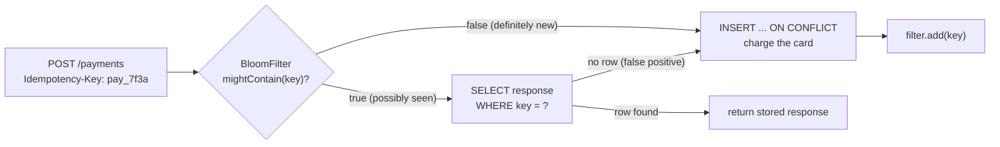

# Bloom Filters from Scratch

> A few bits per key to say 'definitely not seen' before hitting the database.

**Type:** Build
**Languages:** Java, Python, Go
**Prerequisites:** Phase 1, Lesson 06 (Hash Maps from Scratch), Phase 1, Lesson 07 (Hash Functions and Collisions), Phase 1, Lesson 11 (Bit Manipulation)
**Time:** ~90 minutes

## Learning Objectives

- Explain the one-sided guarantee of a Bloom filter and why a false positive is survivable but a false negative is not
- Derive the optimal number of bits `m` and hash functions `k` for a target false-positive rate and check the formula against a measurement
- Build a filter with a bit array and k indexes produced by double hashing from two 64-bit hashes (FNV-1a and a 64-bit mix)
- Place the filter correctly in front of a database for idempotency-key and card-token checks without weakening the database's own guarantee
- Recognise the failure modes: saturation when overfilled, the impossibility of deletes, and hash-function agreement across services written in different languages

## The Problem

A payment API accepts an `Idempotency-Key` header on every `POST /payments`. The contract is standard: the first request with a given key creates a payment, and any retry with the same key returns the stored response instead of charging the card twice. The implementation is a table `idempotency_keys(key PRIMARY KEY, response, created_at)` and, before every charge, `SELECT response FROM idempotency_keys WHERE key = ?`.

The service handles 4,000 requests per second. Measured over a week, 99.6% of those `SELECT`s return no row: almost every request is a first attempt, and the lookup exists only to catch the 0.4% that are retries. So 3,984 queries per second go to the primary database, consume a connection, consume a buffer-pool slot, and return nothing. During a mobile-app release that accidentally retried every failed request five times, request volume tripled, the lookup queries tripled with it, the connection pool saturated, and the charge path, which needed the same pool, started timing out. The retries then retried. The database that was supposed to prevent double charges became the bottleneck that caused the outage.

The same shape appears wherever a hot path asks a database "have we seen this before?" and the answer is usually no: a card-token blocklist consulted on every authorisation, where almost no card is blocked; a merchant's processed-webhook-id table, where almost every webhook is new; a sanctions-screening cache keyed by name hash, where almost no name matches. In each case the common answer is "no", the lookup is expensive, and the rare "yes" is the only one that matters.

A Bloom filter answers "have we seen this?" in a few bits per key and a handful of CPU cycles, with one asymmetry that makes the design work: it never says "no" when the answer is "yes". When the filter says a key is absent, it is absent, and the service can skip the database. When the filter says a key might be present, the service does the lookup it would have done anyway. At a 1% false-positive rate, the 3,984 empty lookups per second become about 40, and the 16 real retries are still caught, every one of them, by the database that remains the source of truth.

## The Concept

### The one-sided guarantee

A Bloom filter is a bit array of `m` bits, all zero at the start, plus `k` hash functions that each map a key to a position in `[0, m)`. To add a key, compute its `k` positions and set those bits to 1. To query a key, compute the same `k` positions and check them: if any bit is 0, the key was never added; if all are 1, the key was possibly added.

The guarantee is one-sided and absolute in one direction:

- **No false negatives, ever.** Adding a key sets its bits; nothing ever clears a bit; so every bit of every added key stays set, and a query for that key finds them all. This holds for any hash functions, any `m`, any `k`, any number of insertions. It is the invariant the tests check first.
- **False positives, at a rate you choose.** A key that was never added might find all its `k` bits already set by other keys. The probability depends on how full the filter is, and you size the filter to keep it where you want it.

This asymmetry is why the filter can stand in front of a database. The database is still the only thing that knows the truth. The filter is a cheap pre-check whose only permitted error, "possibly seen" when the key is new, costs one database query that would have happened anyway. The forbidden error, "definitely new" when the key was seen, would cause a double charge, and the structure makes it impossible rather than merely unlikely.



The `INSERT ... ON CONFLICT` on the right-hand path is not optional. The filter reduces reads; the uniqueness constraint still protects writes. A filter that has just been restarted is empty and says "definitely new" to everything until it is rebuilt from the table, and in that window only the constraint stands between you and a duplicate charge.

### Why the false-positive rate is what it is

Take one bit after `n` keys have been inserted with `k` hashes each. Each of the `kn` hash evaluations misses that particular bit with probability `1 - 1/m`, so the bit is still zero with probability `(1 - 1/m)^(kn)`, which for large `m` is `e^(-kn/m)`. The fraction of set bits after `n` insertions is therefore about

```text
fill = 1 - e^(-kn/m)
```

A key that was never inserted is a false positive when all `k` of its bits happen to be set, and each is set with probability `fill`, so

```text
p = (1 - e^(-kn/m))^k
```

This formula treats the `k` positions as independent, which they are not quite, and Bose et al. (2008) showed it slightly understates the true rate for small `m`. For any filter you would deploy, `m` is in the tens of thousands or more and the formula is accurate to the third decimal place, as the measurement in `main` shows.

Two knobs, `m` and `k`, control `p` for a given `n`. More bits always help. More hash functions help at first (an absent key has to be unlucky `k` times) and then hurt (each insertion sets more bits and fills the array faster). Setting the derivative of `p` with respect to `k` to zero gives the optimum:

```text
k_opt = (m / n) ln 2        (about 0.693 bits-per-key)
```

and substituting back, the bits needed for a target `p` are

```text
m = -n ln p / (ln 2)^2
```

Worked by hand for `n = 10,000` idempotency keys and `p = 0.01`:

```text
ln(0.01)        = -4.60517
(ln 2)^2        =  0.480453
m               = 10000 * 4.60517 / 0.480453 = 95,850.6 -> round up to 95,851 bits (11.7 KiB)
k               = (95851 / 10000) * 0.693147 = 6.644 -> round to 7
p (check)       = (1 - e^(-7 * 10000 / 95851))^7 = (1 - e^(-0.7303))^7 = (0.51822)^7 = 0.01004
```

Call that 9.6 bits per key. The key itself, `pay_7f3a...`, is a 36-byte UUID string: 288 bits. The filter represents membership in 3% of the space the keys occupy, and the price is one wrong "maybe" per hundred absent keys. The table below gives the bits per key for the rates you will actually choose:

| Target p | Bits per key (m/n) | k | Bytes for 10 million keys |
|----------|--------------------|---|---------------------------|
| 10% | 4.79 | 3 | 6.0 MB |
| 1% | 9.59 | 7 | 12.0 MB |
| 0.1% | 14.38 | 10 | 18.0 MB |
| 0.01% | 19.17 | 13 | 24.0 MB |

Each extra factor of ten in precision costs about 4.8 more bits per key. A hash set of the same 10 million UUIDs costs at least 360 MB for the strings alone, before pointers and load factor.

### Two hashes instead of k

The analysis assumes `k` independent hash functions, and computing seven real hashes of every key is the expensive part of a lookup. Kirsch and Mitzenmacher (2006) proved that two are enough: compute `h1(key)` and `h2(key)` once, and derive the `k` positions as

```text
index_i = (h1 + i * h2) mod m        for i in 0 .. k-1
```

This is double hashing, the same probe sequence that open-addressing hash tables use, and the paper shows the false-positive rate is asymptotically the same as with `k` independent functions. Guava's `BloomFilter`, RocksDB's legacy filter, and most production implementations do exactly this.

The lesson uses two 64-bit hashes:

- **`h1` is FNV-1a**, chosen because it is eight lines of code, has published test vectors you can check against (`fnv1a64("") = 0xcbf29ce484222325`), and is specified in an IETF draft so three implementations in three languages can be made to agree bit for bit. Its weakness, poor avalanche for short inputs with similar prefixes, is exactly what the second hash corrects.
- **`h2` is the murmur3 `fmix64` finaliser applied to `h1`**: three xor-shifts and two multiplies that take a 64-bit word and spread every input bit across every output bit. It is a bijection, so distinct `h1` values give distinct `h2` values, and it decorrelates the low bits of `h1` that `mod m` would otherwise expose.

Deriving `h2` from `h1` rather than hashing the bytes a second time means two keys that collide on `h1` collide on every index. With a 64-bit `h1` the chance of that for any given pair is 2^-64, far below any false-positive rate you would configure, so it costs nothing measurable and saves a second pass over the bytes.

Trace the key `idem-key-1` into a filter of `m = 1000, k = 3`:

```text
h1 = fnv1a64("idem-key-1") = 0x170107aea5203aea
h2 = mix64(h1)             = 0x6ee2bd7c56057bf8
index_0 = (h1 + 0*h2) mod 1000 = 994
index_1 = (h1 + 1*h2) mod 1000 = 570
index_2 = (h1 + 2*h2) mod 1000 = 146
```

The arithmetic is unsigned 64-bit with wraparound. Java's `long` is signed, so the lesson uses `Long.remainderUnsigned`; Python's integers are unbounded, so every product is masked with `& 0xFFFFFFFFFFFFFFFF`; Go's `uint64` wraps natively. All three produce `[994, 570, 146]`, and the test suites assert it, because a filter built by a Java service and queried by a Go service is only correct if the bits agree.

### Operations and their cost

| Operation | Cost | Notes |
|-----------|------|-------|
| `add(key)` | O(k) hash + k bit sets | Returns whether any bit changed: `false` means every bit was already set, so the key is possibly a duplicate |
| `mightContain(key)` | O(k), early exit on the first zero bit | Absent keys exit after about 1/(1-fill) probes on average, so a half-full filter rejects most absent keys on the first or second bit |
| `union(other)` | O(m/64) | Bitwise OR of two filters with the same `m` and `k`; the result answers for both key sets |
| `bitCount()` | O(m/64) | Population count; the fill ratio tells you how close to saturation you are |
| `approximateCount()` | O(m/64) | Swamidass and Baldi: `n* = -(m/k) ln(1 - X/m)` for `X` set bits; recovers the insertion count from the bits alone |
| delete | impossible | Clearing a bit might clear another key's bit, creating a false negative |

Space is `m` bits regardless of how many keys are inserted or how long they are. That independence from key length is the whole point: a 36-byte UUID and a 2 KB JSON blob each cost the same 9.6 bits.

### Saturation: the filter's one failure mode

The formula gives `p` for the `n` the filter was sized for. Insert more and `p` climbs steeply, because `fill` approaches 1 and `(fill)^k` approaches 1 with it. The demo in `main` measures this for the 95,851-bit filter:

| Inserted | Multiple of sized n | Fill ratio | Predicted p |
|----------|---------------------|------------|-------------|
| 10,000 | 1x | 0.520 | 0.010 |
| 20,000 | 2x | 0.769 | 0.158 |
| 50,000 | 5x | 0.974 | 0.832 |
| 100,000 | 10x | 0.999 | 0.995 |

At twice the sized capacity the filter has lost an order of magnitude of precision. At ten times, 99.5% of absent keys are reported "possibly seen", every lookup goes to the database, and the filter is doing nothing but costing seven hashes per request. Nothing crashes. No error is raised. The database load graph simply returns to where it was before the filter existed, which is why a production filter must export its fill ratio as a metric and alarm well before it reaches 0.7.

The standard remedies are to size for the maximum `n` you will see before the filter is rebuilt, to rotate filters on a time window (a fresh filter per hour for idempotency keys that expire after 24 hours, with lookups consulting all live filters), or to use a scalable Bloom filter (Almeida et al., 2007) that adds a new, tighter sub-filter each time the current one fills.

### What a Bloom filter does not do

- It does not say "definitely present". A `true` from `mightContain` is a hint to check the authoritative store, never a result to act on. A service that treats "possibly seen" as "seen" and returns a cached response without the lookup will, at `p = 0.01`, return the wrong customer's payment response to one new request in a hundred.
- It does not delete. Idempotency keys that expire after 24 hours cannot be removed from the filter; rebuild it or rotate it. The counting Bloom filter (Fan et al., 2000) replaces each bit with a small counter to allow deletes at four to eight times the space; the cuckoo filter (Fan et al., 2014) supports deletes at similar space to a Bloom filter with a different structure.
- It does not store the key, the value, or the count. If you need "how many times have we seen this?" you want a Count-Min sketch (next lesson); if you need "how many distinct keys?" you want HyperLogLog (also next lesson).
- It does not protect writes. The database's unique constraint or conditional insert does that. The filter is a read optimisation layered in front of a correct system, not a replacement for one.

## Build It

The primary walkthrough is in Java. The Python and Go files implement the same design with the same names; the subsections at the end show only what differs.

### Step 1: Two 64-bit hash functions

```java
final class Hashing {
    static final long FNV_OFFSET = 0xcbf29ce484222325L;
    static final long FNV_PRIME = 0x100000001b3L;

    static long fnv1a64(byte[] data) {
        long h = FNV_OFFSET;
        for (byte b : data) {
            h ^= (b & 0xff);
            h *= FNV_PRIME;
        }
        return h;
    }

    static long mix64(long h) {
        h ^= h >>> 33;
        h *= 0xff51afd7ed558ccdL;
        h ^= h >>> 33;
        h *= 0xc4ceb9fe1a85ec53L;
        h ^= h >>> 33;
        return h;
    }
}
```

FNV-1a is "xor the byte in, then multiply by the prime", in that order; FNV-1 (without the `a`) multiplies first and has worse dispersion for small changes. The `b & 0xff` matters: Java's `byte` is signed, and `h ^= b` on a byte of `0x80` or above would sign-extend to `0xffffffffffffff80` and produce a hash that disagrees with Python and Go. The multiplication overflows the `long` on almost every step, which is intended; FNV is defined modulo 2^64.

`mix64` is the finaliser from MurmurHash3's 128-bit variant. The `>>>` is the unsigned shift; with `>>` the sign bit would smear into the high half and the three implementations would disagree on inputs with the top bit set.

**Predict:** `mix64(0)` returns what, and why does that not matter for the filter?

### Step 2: The bit array and its parameters

```java
final class BloomFilter {
    private final long[] words;
    final long m;          // number of bits
    final int k;           // number of hash functions
    long insertions;       // how many add() calls so far

    BloomFilter(long bits, int hashes) {
        if (bits <= 0) throw new IllegalArgumentException("bits must be positive: " + bits);
        if (hashes <= 0) throw new IllegalArgumentException("hashes must be positive: " + hashes);
        this.m = bits;
        this.k = hashes;
        this.words = new long[(int) ((bits + 63) / 64)];
    }
}
```

The bits live in a `long[]`, 64 per word. Bit `idx` is word `idx >>> 6` (divide by 64) and mask `1L << (idx & 63)` (remainder). `java.util.BitSet` would do the same thing, but writing the two operations out shows that a Bloom filter is nothing more than this array, and keeps the Java, Python, and Go versions structurally identical. `insertions` is a convenience counter for `estimatedFalsePositiveRate`; the filter itself never reads it.

**Predict:** for `m = 95,851`, how many `long` words are allocated, and how many bits in the last word are never used?

### Step 3: Sizing from the formulas

```java
static long optimalBits(long expectedItems, double falsePositiveRate) {
    if (expectedItems <= 0) throw new IllegalArgumentException("expectedItems must be positive");
    if (!(falsePositiveRate > 0.0 && falsePositiveRate < 1.0)) {
        throw new IllegalArgumentException("falsePositiveRate must be in (0, 1)");
    }
    double ln2 = Math.log(2);
    return (long) Math.ceil(-expectedItems * Math.log(falsePositiveRate) / (ln2 * ln2));
}

static int optimalHashes(long bits, long expectedItems) {
    return Math.max(1, (int) Math.round((double) bits / expectedItems * Math.log(2)));
}

static double expectedFalsePositiveRate(long bits, int hashes, long items) {
    if (items == 0) return 0.0;
    return Math.pow(1.0 - Math.exp(-(double) hashes * items / bits), hashes);
}

static BloomFilter create(long expectedItems, double falsePositiveRate) {
    long bits = optimalBits(expectedItems, falsePositiveRate);
    return new BloomFilter(bits, optimalHashes(bits, expectedItems));
}
```

`optimalBits` rounds up, because fewer bits than the formula asks for means a higher rate than you asked for. `optimalHashes` rounds to nearest, because `k` is a shallow optimum: 5, 6, 7, and 8 hashes for 9.6 bits per key give 0.0111, 0.0101, 0.0100, and 0.0105 respectively. The `!(x > 0 && x < 1)` form of the range check is deliberate: it also rejects `NaN`, which `x <= 0 || x >= 1` would let through.

These are the only floating-point computations in the lesson, and they happen once, at construction. Nothing on the lookup path touches a `double`.

**Predict:** `create(1_000, 0.001)` produces what `m` and `k`? Check against the table in The Concept.

### Step 4: Double hashing into k indexes

```java
long[] indexes(byte[] key) {
    long h1 = Hashing.fnv1a64(key);
    long h2 = Hashing.mix64(h1);
    long[] out = new long[k];
    for (int i = 0; i < k; i++) {
        out[i] = Long.remainderUnsigned(h1 + i * h2, m);
    }
    return out;
}
```

`h1 + i * h2` wraps around in 64-bit arithmetic, which is fine: the sum is a 64-bit hash in its own right, and what matters is that it is reduced modulo `m` as an unsigned quantity. `Long.remainderUnsigned` treats the `long` as the 64-bit value it holds; the plain `%` operator would return negative remainders for half of all keys and the array index would throw. This method is package-visible rather than private so the tests can assert the exact positions `[994, 570, 146]` for `idem-key-1` and so you can print them while debugging a cross-service disagreement.

One degenerate case is worth knowing: if `h2 mod m == 0`, all `k` indexes coincide and the key effectively sets one bit. This happens for one key in `m`, it slightly raises the false-positive rate for that key alone, and Guava's implementation accepts the same trade. Enhanced double hashing (`h1 + i*h2 + i^2`) removes it if you ever need to.

**Predict:** with `k = 7` and `m = 95,851`, can two different values of `i` ever produce the same index for one key? What would that do to `bitCount()` after a single `add`?

### Step 5: add and mightContain

```java
boolean add(byte[] key) {
    boolean changed = false;
    for (long idx : indexes(key)) {
        int word = (int) (idx >>> 6);
        long mask = 1L << (idx & 63);
        if ((words[word] & mask) == 0) {
            words[word] |= mask;
            changed = true;
        }
    }
    insertions++;
    return changed;
}

boolean mightContain(byte[] key) {
    for (long idx : indexes(key)) {
        if ((words[(int) (idx >>> 6)] & (1L << (idx & 63))) == 0) return false;
    }
    return true;
}
```

`add` returns whether it changed anything. A `false` return means every one of the key's bits was already set before this call, which is the same condition `mightContain` tests, so `add` doubles as a "was this possibly already here?" check without a second pass over the hashes. For the idempotency path: `if (!filter.add(key)) { /* possibly a retry: consult the table */ }`.

`mightContain` exits on the first zero bit. In a half-full filter an absent key fails on the first probe half the time, on the second a quarter of the time, and so on; the expected number of probes before rejection is under two. Present keys, and false positives, always cost the full `k`.

Neither method takes a lock. The filter in this lesson is single-threaded by design; Phase 4 covers making it safe for concurrent `add` with `AtomicLongArray` and the observation that a torn read on a Bloom filter can only ever produce a false negative if a bit is read before its write lands, which is the one error you cannot allow, so the synchronisation is not optional.

**Predict:** after `add("pay_7f3a")` on an empty `m = 4096, k = 4` filter, what does `bitCount()` return? Under what circumstance would it return less than 4?

### Step 6: Fill, estimate, and union

```java
long bitCount() {
    long total = 0;
    for (long w : words) total += Long.bitCount(w);
    return total;
}

long approximateCount() {
    long x = bitCount();
    if (x >= m) return m;
    return Math.round(-((double) m / k) * Math.log(1.0 - (double) x / m));
}

BloomFilter union(BloomFilter other) {
    if (m != other.m || k != other.k) {
        throw new IllegalArgumentException("cannot union filters with different parameters: ("
                + m + "," + k + ") vs (" + other.m + "," + other.k + ")");
    }
    BloomFilter result = new BloomFilter(m, k);
    for (int i = 0; i < words.length; i++) result.words[i] = words[i] | other.words[i];
    result.insertions = insertions + other.insertions;
    return result;
}
```

`Long.bitCount` compiles to a single `POPCNT` instruction on any modern CPU, so the fill ratio of a 12 KB filter costs about 1,500 instructions. Export it as a gauge.

`approximateCount` inverts the fill formula: if `X` bits are set, then `X/m = 1 - e^(-kn/m)`, so `n = -(m/k) ln(1 - X/m)`. For the 10,000-key filter in `main` it reports 10,037. The use case is a filter rebuilt from a snapshot or received from another service, where the insertion counter is not available but you still want to know whether it is near saturation.

`union` is a bitwise OR. Two services that each keep a filter of the keys they have seen can merge them with no loss, which is how a sharded idempotency store builds one global filter. It is only valid when `m`, `k`, and the hash functions are identical, and the parameter check is the only thing standing between you and a filter that silently returns garbage.

**Predict:** `a.union(b).bitCount()` compared with `a.bitCount() + b.bitCount()`: equal, less, or greater, and when?

### Step 7: Run it

```bash
cd phases/03-systems-data-structures/01-bloom-filters/code/java
javac -d .out *.java && java -cp .out Main
java -cp .out MainTest
```

Expected output, abbreviated:

```console
== Sizing a filter for 10,000 idempotency keys at 1% false positives ==
m = 95851 bits (11.7 KiB), k = 7 hashes, 9.59 bits per key
formula predicts p = 0.01004

== Where a key lands ==
fnv1a64("idem-key-1") = 0x170107aea5203aea
indexes in m=1000, k=3: [994, 570, 146]

== Definitely not seen vs possibly seen ==
mightContain("pay_7f3a") = true: possibly seen -> check the database
mightContain("pay_9999") = false: definitely new -> skip the lookup
re-adding "pay_7f3a" changes bits: false

== Measured false-positive rate against the formula ==
BloomFilter(m=95851, k=7, insertions=10000, set_bits=49798)
fill ratio = 0.5195 (theory: 1 - e^(-kn/m) = 0.5182)
measured p = 0.01014, formula p = 0.01004

== What happens when you overfill it ==
 1x capacity: fill = 0.520, predicted p = 0.0100
10x capacity: fill = 0.999, predicted p = 0.9953
```

The measurement inserts `k-0` through `k-9999` and probes `q-0` through `q-49999`, none of which were inserted. 507 of the 50,000 probes come back "possibly seen": 1.014%, against a formula prediction of 1.004%. Because the keys and hashes are fixed, Python and Go print exactly the same 507. If a fourth implementation ever prints a different number, its hash disagrees, and it must not share a filter with the other three.

### In Python

```python
def fnv1a64(data: bytes) -> int:
    h = FNV_OFFSET
    for b in data:
        h ^= b
        h = (h * FNV_PRIME) & MASK64
    return h

def indexes(self, key: bytes) -> list[int]:
    h1 = fnv1a64(key)
    h2 = mix64(h1)
    return [((h1 + i * h2) & MASK64) % self.m for i in range(self.k)]
```

Differences, all in `code/python/main.py`:

- **Unbounded integers need an explicit mask.** Java and Go overflow at 64 bits for free; Python would happily compute a 128-bit product, and `% m` of a 128-bit number is a different bit position. Every multiplication and the `h1 + i*h2` sum is masked with `MASK64 = (1 << 64) - 1`. Forget one mask and the Python filter silently disagrees with the other two.
- **The bit array is a `bytearray`.** Python has no fixed-width `long[]`; a `bytearray` of `ceil(m/8)` bytes with `divmod(idx, 8)` addressing is the closest mutable equivalent. `bit_count` uses `bin(b).count("1")` per byte, which is slow but honest; `int.from_bytes(...).bit_count()` is the fast path if you need it.
- **`add` and `might_contain` accept `str` or `bytes`.** The `str` path encodes as UTF-8, matching Java's `getBytes(UTF_8)` and Go's `[]byte(s)`, so `"pay_7f3a"` lands on the same bits in all three.

### In Go

```go
func (bf *BloomFilter) Indexes(key []byte) []uint64 {
    h1 := Fnv1a64(key)
    h2 := Mix64(h1)
    out := make([]uint64, bf.K)
    for i := 0; i < bf.K; i++ {
        out[i] = (h1 + uint64(i)*h2) % bf.M
    }
    return out
}
```

Differences, all in `code/go/main.go`:

- **`uint64` makes the modulo honest.** Go has unsigned integers, so `%` on `uint64` is already the unsigned remainder and no `remainderUnsigned` helper is needed. This is the most natural of the three implementations.
- **Errors are values.** `NewBloomFilter`, `OptimalBits`, `Create`, and `Union` return `(value, error)`; `ErrParameterMismatch` is a sentinel for `errors.Is`. The demo and tests use a `mustNew` helper for parameters that are known-good.
- **`math/bits.OnesCount64`** is the population count, and like `Long.bitCount` it compiles to `POPCNT` where available.

## Use It

### Guava's `BloomFilter`

```java
BloomFilter<CharSequence> seen = BloomFilter.create(Funnels.stringFunnel(UTF_8), 10_000, 0.01);
seen.put("pay_7f3a");
seen.mightContain("pay_7f3a");   // true
seen.expectedFpp();               // the formula, from its own insertion count
```

Guava uses 128-bit MurmurHash3 split into two 64-bit halves for `h1` and `h2`, the same Kirsch-Mitzenmacher scheme as this lesson, and its `put` returns whether bits changed, as `add` does here. What it adds: a `Funnel` abstraction so any object can be hashed without first serialising it to bytes, a `writeTo`/`readFrom` wire format with a strategy version byte so a filter serialised by one JVM can be read by another, and `putAll` for union. What to watch: the `Funnel` is part of the filter's identity, and changing it on one service without the other is the same as changing the hash function.

### RocksDB, LevelDB, Cassandra, and PostgreSQL

LSM-tree storage engines (Phase 3, Lesson 05) keep a Bloom filter per SSTable so a point lookup for a key that does not exist in a given file can skip reading it. RocksDB's default is 10 bits per key, which the table in The Concept puts at about 0.8% false positives, and RocksDB's newer "ribbon" filter reaches the same rate in about 30% less space. Cassandra exposes `bloom_filter_fp_chance` per table (default 0.01 for most compaction strategies) and reports `Bloom filter false ratio` in `nodetool tablestats`, which is a measurement of exactly the quantity `main` computes. PostgreSQL ships a `bloom` index access method for multi-column equality queries, with per-column bit counts as index parameters.

In every one of these the filter is a read optimisation in front of an authoritative store, rebuilt when the store compacts, and never consulted for writes.

### Redis and the network boundary

RedisBloom adds `BF.ADD`, `BF.EXISTS`, and `BF.MADD` with automatic scaling (a new sub-filter when the current one fills). A filter in Redis is shared by every instance of a service, which solves the "restarted and empty" problem, at the cost of a network round trip per check that is often slower than the database lookup the filter was meant to avoid. The usual answer is a local filter per process, rebuilt from the database on start, with the fill ratio exported, and a periodic snapshot if the rebuild is expensive.

### Where a Bloom filter is the wrong tool

If the hot path needs to know *whether* a key exists and the answer is usually *yes* (checking that an account exists before posting to it), the filter saves nothing: every lookup is a "possibly present" and goes to the database anyway. If the data must be deleted (a card-token blocklist with removals), use a cuckoo filter or rebuild on a schedule. If you need the stored response, not just a membership hint, the filter is a pre-check in front of the cache, not a replacement for the cache.

## Ship It

`outputs/checklist-bloom-filter-deployment.md` is a review checklist for any pull request that puts a probabilistic filter in front of a store: the sizing arithmetic, the hash-agreement test between services, the rebuild-on-start plan, the fill-ratio alarm, and the proof that the authoritative store still enforces uniqueness. Use it when you review the idempotency-key change your team is about to ship.

## Exercises

1. **Reinforce.** Replace the single-hash derivation `h2 = mix64(h1)` with a genuinely independent second hash: FNV-1a over the bytes with a different offset basis (for example `FNV_OFFSET ^ 0x9e3779b97f4a7c15`), then `mix64`. Rerun the measurement in `main`. Does the measured false-positive rate change beyond noise? Explain in one sentence why Kirsch and Mitzenmacher's result predicts the answer.
2. **Apply.** Implement `BloomFilter.serialize()` returning `m`, `k`, a hash-scheme version byte, and the raw words, and `deserialize` that rejects a different version. Write the Java filter to a file, read it back in Python and Go, and assert that `might_contain` agrees on 1,000 keys. This is the test a polyglot payments platform needs before two services share a filter.
3. **Extend.** Build a time-partitioned idempotency filter: one `BloomFilter` per hour, a `mightContain` that consults every live hour, and an `advance(clock)` that drops filters older than 24 hours. Size each hourly filter from the hash map lesson's measured throughput (Phase 1, Lesson 06) and show, with the formula, how the effective false-positive rate of 24 filters consulted together differs from one filter's rate. Then compare the memory with a single 24-hour filter at the same effective rate.

## Key Terms

| Term | What people say | What it actually means |
|------|-----------------|------------------------|
| False positive | "the filter was wrong" | The filter reported "possibly present" for a key that was never added; the only error a Bloom filter can make, at a rate set by `m`, `k`, and `n` |
| False negative | "the filter missed one" | Reporting "definitely absent" for a key that was added; impossible by construction because bits are never cleared, which is why the filter can stand in front of a database |
| Bits per key | "how big the filter is" | `m / n`; about 9.6 for a 1% rate and 4.8 more for each further factor of ten, independent of how long the keys are |
| Double hashing | "two hashes instead of k" | Deriving `k` positions as `h1 + i*h2 mod m` from two hashes; Kirsch and Mitzenmacher proved it costs nothing in false-positive rate |
| Fill ratio | "how full it is" | Set bits over total bits, `1 - e^(-kn/m)` in theory; the metric to alarm on, because `p` is roughly `fill^k` |
| Saturation | "the filter stopped working" | Fill approaching 1 after inserting far more than the sized `n`, so nearly every absent key is a false positive; no error is raised and the database load quietly returns |
| Counting Bloom filter | "a Bloom filter with deletes" | Each bit replaced by a small counter so a key's slots can be decremented; four to eight times the space and counters can overflow |
| Avalanche | "a good mix" | The property that flipping one input bit changes about half the output bits; `fmix64` has it and short-input FNV-1a does not, which is why the two are combined |

## Further Reading

- [Bloom, "Space/Time Trade-offs in Hash Coding with Allowable Errors" (1970)](https://dl.acm.org/doi/10.1145/362686.362692) — the original four-page paper; the false-positive analysis in The Concept is its Section 3.
- [Kirsch and Mitzenmacher, "Less Hashing, Same Performance: Building a Better Bloom Filter" (2006)](https://www.eecs.harvard.edu/~michaelm/postscripts/rsa2008.pdf) — the proof that two hash functions suffice, which every production filter relies on.
- [Broder and Mitzenmacher, "Network Applications of Bloom Filters: A Survey" (2004)](https://www.eecs.harvard.edu/~michaelm/postscripts/im2005b.pdf) — the derivation of optimal `m` and `k`, counting filters, and the compressed variant, with the clearest statement of the independence approximation.
- [Fowler, Noll, Vo, "The FNV Non-Cryptographic Hash Algorithm" (IETF draft)](https://datatracker.ietf.org/doc/html/draft-eastlake-fnv) — the specification of FNV-1a with the offset basis, prime, and test vectors the tests assert.
- [RocksDB wiki: RocksDB Bloom Filter](https://github.com/facebook/rocksdb/wiki/RocksDB-Bloom-Filter) — how a production storage engine chooses bits per key, partitions filters, and measures the result.
- [Swamidass and Baldi, "Mathematical Correction for Fingerprint Similarity Measures to Improve Chemical Retrieval" (2007)](https://pubs.acs.org/doi/10.1021/ci600526a) — the source of the cardinality estimate `n* = -(m/k) ln(1 - X/m)` used by `approximateCount`.
- [Almeida et al., "Scalable Bloom Filters" (2007)](https://doi.org/10.1016/j.ipl.2006.10.007) — how to add capacity without rebuilding, for Exercise 3 and for RedisBloom's scaling behaviour.
