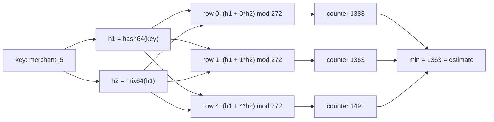

# Count-Min Sketch and HyperLogLog

> Counting distinct cards per merchant in constant memory.

**Type:** Build
**Languages:** Java, Python, Go
**Prerequisites:** Phase 3 Lesson 01 (Bloom Filters), Phase 1 Lesson 07 (Hash Functions and Collisions), Phase 1 Lesson 11 (Bit Manipulation and Compact Encodings)
**Time:** ~90 minutes

## Learning Objectives

- Explain why exact per-key counting and exact distinct counting both cost memory proportional to the number of keys, and name the two questions a sketch answers in constant memory instead
- Build a Count-Min Sketch sized from an error bound `epsilon` and a failure probability `delta`, and prove with a test that it never underestimates
- Build a HyperLogLog with `2^p` registers, compute the harmonic-mean estimate with Flajolet's `alpha_m` correction and the small-range linear-counting fallback, and measure its `1.04 / sqrt(m)` standard error
- Merge two sketches of either kind and state exactly what the merged sketch represents (sum of streams for CMS, union of sets for HLL)
- Decide which questions a risk engine may answer from a sketch and which still need the exact store

## The Problem

A card-acquiring platform runs a velocity rule for every merchant: if a merchant sees more than 5,000 distinct cards in an hour, or any single card more than 20 times, route the next authorizations through a manual-review queue. The rule is cheap to state and, in the first implementation, cheap to write: a `Map<MerchantId, Set<CardToken>>` for distinct cards and a `Map<MerchantId, Map<CardToken, Integer>>` for per-card counts, both reset every hour.

The platform has 400,000 merchants. A busy one sees 200,000 authorizations an hour from 60,000 distinct cards. A tokenized card is a 24-byte string; a `HashSet` entry in the JVM costs roughly 40 bytes on top of that. For the top 1,000 merchants alone, the distinct-card sets need about 1,000 × 60,000 × 64 bytes = 3.8 GB, and they are rebuilt every hour, so the garbage collector spends a measurable fraction of every hour reclaiming the previous hour's sets. The per-card count maps are worse: a key per (merchant, card) pair. When Black Friday traffic arrives the risk service exceeds its heap, the authorization path times out waiting for a risk decision, and the fallback policy ("approve if risk is unavailable") does exactly what the fraud ring was hoping for.

Both rules ask a question whose exact answer needs memory proportional to the number of distinct keys. But neither rule needs the exact answer. "More than 5,000 distinct cards" is a threshold; being off by 2% at the threshold is irrelevant because the threshold itself was chosen by a human looking at a histogram. "Any card more than 20 times" tolerates a small overcount, because the consequence of a false alarm is a review, not a decline. Once you accept a bounded error you can replace both structures with fixed-size arrays of integers: a Count-Min Sketch of about 11 KB per merchant for frequencies, and a HyperLogLog of 4 KB per merchant for distinct counts. 400,000 merchants × 15 KB is 6 GB for all merchants, including the ones with three transactions a day, and it never grows no matter how busy a merchant gets. This lesson builds both structures, derives their error bounds, and shows the one property that makes them useful in a distributed system: two sketches merge into the sketch of the combined data.

## The Concept

### Two questions, two sketches

A stream of events `(merchant, card)` arrives. Exact structures answer two questions:

| Question | Exact structure | Exact cost | Sketch | Sketch cost | Error |
|----------|-----------------|------------|--------|-------------|-------|
| How many times has key `x` appeared? | hash map `key -> count` | O(distinct keys) | Count-Min Sketch | `width * depth` counters | overestimates by at most `epsilon * N`, probability `1 - delta` |
| How many distinct keys have appeared? | hash set of keys | O(distinct keys) | HyperLogLog | `2^p` bytes | relative standard error `1.04 / sqrt(2^p)` |

Both sketches hash every key and fold the hash into a small array. Both are *linear*: the sketch of a stream is a function of the sketches of its parts, so sketches built on different machines or in different hours can be combined without reprocessing the events. Neither can enumerate the keys it has seen; the key is gone the moment it is hashed. That is the price of constant memory and also, for cardholder data, a privacy benefit: a sketch of card tokens contains no card tokens.

### Count-Min Sketch: minimum of several overestimates

A Count-Min Sketch is a `depth × width` table of counters, with one hash function per row. To add key `x` with count `c`, for each row `i` compute `h_i(x) mod width` and add `c` to that counter. To estimate the count of `x`, read the same `depth` counters and return the minimum.

The invariant: **every counter that `x` maps to holds at least the true count of `x`**, because every add of `x` incremented it and counters only grow. Other keys that collide into the same counter inflate it, so each counter is `true(x) + noise_i`. Taking the minimum picks the row with the least collision noise. The estimate is therefore never below the truth; it can only be above it.

How far above? Cormode and Muthukrishnan proved that with `width = ceil(e / epsilon)` and `depth = ceil(ln(1 / delta))`,

```text
estimate(x) <= true(x) + epsilon * N     with probability >= 1 - delta
```

where `N` is the total count added to the sketch. The argument: in one row, the expected collision noise on `x`'s counter is `N / width` (every other count lands in one of `width` cells uniformly), which is `epsilon * N / e`. By Markov's inequality the probability that the noise exceeds `epsilon * N` is at most `1/e`. The rows use independent hashes, so the probability that *all* `depth` rows exceed the bound is `(1/e)^depth = e^-depth = delta`. The minimum is below the bound unless every row is above it.

Worked example. Choose `epsilon = 0.01` and `delta = 0.01`:

```text
width = ceil(e / 0.01) = ceil(271.8) = 272
depth = ceil(ln(100))  = ceil(4.6)   = 5
counters = 1360, at 8 bytes each = 10,880 bytes

after N = 200,000 authorizations:
  error bound = 0.01 * 200,000 = 2,000
  a merchant with 1,320 true authorizations is reported as 1,320 to 3,320, and with
  probability 0.99 the report is within that range.
```

Two thousand is a large absolute error, and this is the honest truth about Count-Min: the bound is relative to the *total* stream, not to the key. Heavy keys (hundreds or thousands of hits) are estimated well because the noise is small relative to them; light keys can be drowned in noise. That is exactly the right trade-off for velocity rules, where only the heavy hitters matter. In the demo the five sample merchants are estimated with error 0, 20, 0, 0 and 0: the typical noise is far below the worst-case bound, because the bound comes from Markov's inequality, which is loose.



Rows get their "independent" hash functions by double hashing, the same trick as the Bloom filter in Lesson 01: `h_i = h1 + i * h2`. Kirsch and Mitzenmacher showed this loses nothing measurable against truly independent hashes, and it means every language implementation needs only one 64-bit hash and one mixer to agree bit-for-bit.

### HyperLogLog: the longest run of leading zeros

Distinct counting works on a different observation. Hash every element to 64 uniformly random bits. Among `n` distinct elements, the probability that at least one hash begins with `k` zero bits is about `1 - (1 - 2^-k)^n`; the longest run of leading zeros you observe is therefore about `log2(n)`. One register remembering the maximum run is a cardinality estimator with a standard error of about 100%, which is useless, so HyperLogLog splits the hash: the top `p` bits select one of `m = 2^p` registers, and the remaining `64 - p` bits supply the run of leading zeros. Each register is an independent experiment on about `n / m` elements. Averaging the `m` experiments shrinks the error to about `1.04 / sqrt(m)`.

The averaging is the clever part. An arithmetic mean of `2^M[j]` is wrecked by one unlucky register that saw a long run; the harmonic mean is dominated by the small values and is robust to it. Flajolet's raw estimate is

```text
E = alpha_m * m^2 / sum_j( 2^(-M[j]) )
```

where `alpha_m` corrects a multiplicative bias that the harmonic mean introduces: `0.673` for `m = 16`, `0.697` for `32`, `0.709` for `64`, and `0.7213 / (1 + 1.079 / m)` beyond that.

The raw estimate is biased high for small `n`: with `n` much smaller than `m`, most registers are still zero and `2^0 = 1` contributes a large term to the harmonic sum in a way the constant does not model. The paper's fix is a range check. If `E <= 2.5 * m` and `V > 0` registers are still zero, use **linear counting** instead: `m * ln(m / V)`. Linear counting is a Bloom-filter-style argument: after `n` random insertions into `m` cells, the expected fraction of empty cells is `e^(-n/m)`, so `n ≈ m * ln(m / V)`. For `n` up to a few times `m` it is nearly exact.

Worked example at `p = 12`, `m = 4096`, 100 distinct cards:

```text
each card lands in a random register; 100 cards fill about 99 registers (a couple collide)
raw estimate E = 0.7213/(1+1.079/4096) * 4096^2 / (3997*1 + sum over ~99 filled registers of 2^-M[j])
              ~ 3001   (far too high: 3997 empty registers each contribute a full 1.0)
E <= 2.5 * 4096 = 10240 and V = 3997 > 0, so linear counting:
              4096 * ln(4096 / 3997) = 4096 * 0.02447 = 100.2 -> 100
```

and at 49,895 distinct cards the demo reports 49,030, which is 1.73% low; the standard error at `m = 4096` is `1.04 / 64 = 1.63%`, so an error of about one standard deviation is exactly what the paper predicts.

The 2013 Google paper "HyperLogLog in Practice" (HLL++) improves two things this lesson leaves out: it replaces the hard switch to linear counting with an empirically fitted bias table around the crossover (where the error peaks at about 2x the nominal), and it adds a sparse representation so a sketch of ten elements does not cost 4 KB. Both are refinements, not corrections; the 64-bit hash is the other HLL++ change and this lesson already uses it, so the original paper's large-range correction for 32-bit hashes (`-2^32 * ln(1 - E / 2^32)`) is unnecessary.

### Merging: the property that makes sketches distributed

| Sketch | Merge operation | Merged sketch represents |
|--------|-----------------|--------------------------|
| Count-Min | counter-wise sum | the concatenation of both streams; `estimate` of any key is what a single sketch over both streams would give |
| HyperLogLog | register-wise maximum | the union of both sets; a key present in both is counted once |

Both merges are exact, not approximate: the merged sketch is bit-for-bit the sketch a single machine would have built from the combined input. That is what lets a fleet of authorization servers each keep local sketches and ship them to an aggregator every minute, or lets a data warehouse keep one HLL per (merchant, day) and answer "distinct cards this month" by merging thirty sketches instead of scanning a month of rows. It also means sketch state must be serialized exactly; a float in the serialization format would break the equality.

Note what merging does *not* give you. Two HLLs cannot be intersected (`|A ∩ B| = |A| + |B| - |A ∪ B|` works arithmetically but the error of the three estimates compounds and often exceeds the intersection itself). A Count-Min cannot be "subtracted" to remove a stream, although a variant with signed counts, the Count Sketch, can.

### What these structures do not do

- **They cannot list keys.** You can ask "how many times did `tok_4F1A` appear" but not "which cards appeared more than 20 times". Finding heavy hitters needs a separate candidate list (Exercise 3) or a different algorithm (Misra-Gries, Space-Saving).
- **Count-Min never underestimates; HyperLogLog is unbiased.** These are different promises. A velocity rule built on Count-Min has no false negatives (a card over threshold is always reported over threshold) and some false positives. An HLL estimate is above the truth about as often as below it.
- **Neither handles deletes or time windows by itself.** The hourly-window rule in the problem statement needs one sketch per window, or a ring of sketches (one per minute, sum or union the last sixty). Decrementing a Count-Min is legal arithmetically but breaks the never-underestimate guarantee unless you decrement exactly what you added.
- **Hash quality is load-bearing.** Both analyses assume uniform hashes. FNV-1a alone has poor low-bit dispersion on short keys, which would correlate the rows of the Count-Min and starve the HLL's leading-zero runs; the `mix64` finalizer fixes both.

## Build It

### Step 1: One hash, one mixer, shared by both sketches

```java
final class Hashing {
    static long fnv1a64(String key) {
        long h = 0xcbf29ce484222325L;
        for (byte b : key.getBytes(StandardCharsets.UTF_8)) {
            h ^= (b & 0xff);
            h *= 0x100000001b3L;
        }
        return h;
    }

    static long mix64(long h) {
        h ^= h >>> 33; h *= 0xff51afd7ed558ccdL;
        h ^= h >>> 33; h *= 0xc4ceb9fe1a85ec53L;
        h ^= h >>> 33;
        return h;
    }

    static long hash64(String key) { return mix64(fnv1a64(key)); }
}
```

This is the Bloom filter lesson's hashing, byte for byte, and the choice matters beyond convenience: a Count-Min built in a Java authorization server must agree with one built in a Python batch job, counter for counter, or the merge is garbage. Hashing the UTF-8 bytes (not Java's `hashCode`, which is specified but 32-bit and weak) is what makes that agreement possible.

**Predict:** `mix64` is a bijection on 64-bit words. What does that tell you about `mix64(0L)`, and why does the test for it exist?

### Step 2: The Count-Min table and its sizing

```java
final class CountMinSketch {
    final int width, depth;
    private final long[][] table;
    private long total;

    CountMinSketch(int width, int depth) {
        if (width <= 0) throw new IllegalArgumentException("width must be positive: " + width);
        if (depth <= 0) throw new IllegalArgumentException("depth must be positive: " + depth);
        this.width = width; this.depth = depth;
        this.table = new long[depth][width];
    }

    static CountMinSketch forErrorBounds(double epsilon, double delta) {
        if (!(epsilon > 0 && epsilon < 1)) throw new IllegalArgumentException("epsilon must be in (0,1): " + epsilon);
        if (!(delta > 0 && delta < 1)) throw new IllegalArgumentException("delta must be in (0,1): " + delta);
        int width = (int) Math.ceil(Math.E / epsilon);
        int depth = (int) Math.ceil(Math.log(1.0 / delta));
        return new CountMinSketch(width, depth);
    }
}
```

`forErrorBounds` is the paper's theorem turned into a constructor. A caller says "I accept being over by 1% of the stream, and I accept that guarantee failing one time in a hundred" and gets 272 × 5 counters. The `long` counters are deliberate: a Count-Min over a year of payments can exceed 2^31 in one cell, and an overflowing counter silently wraps to a negative, which would break the never-underestimate invariant in the worst possible way.

**Predict:** halving `epsilon` doubles `width`. What does halving `delta` do to `depth`, and which is the cheaper way to buy accuracy?

### Step 3: Add and estimate

```java
int column(long h1, long h2, int row) {
    long combined = h1 + (long) row * h2;
    return (int) Long.remainderUnsigned(combined, width);
}

void add(String key, long count) {
    if (count < 0) throw new IllegalArgumentException("count must be non-negative: " + count);
    long h1 = Hashing.hash64(key);
    long h2 = Hashing.mix64(h1);
    for (int row = 0; row < depth; row++) table[row][column(h1, h2, row)] += count;
    total += count;
}

long estimate(String key) {
    long h1 = Hashing.hash64(key);
    long h2 = Hashing.mix64(h1);
    long best = Long.MAX_VALUE;
    for (int row = 0; row < depth; row++) best = Math.min(best, table[row][column(h1, h2, row)]);
    return best;
}
```

`Long.remainderUnsigned` is the detail that bites: `combined` is a full 64-bit value and frequently negative as a signed `long`, and Java's `%` on a negative dividend returns a negative result, which would be an invalid index. Treating the hash as unsigned keeps the index in `[0, width)` and matches what a language with native unsigned integers would compute.

Negative counts are rejected at `add`. The invariant that `estimate >= truth` relies on counters only ever increasing; a decrement is a different data structure with a different proof.

**Predict:** two keys collide in row 0 but nowhere else. Which row's counter does `estimate` return for each of them, and is it exact?

### Step 4: Merge and the bound accessors

```java
CountMinSketch merge(CountMinSketch other) {
    if (other.width != width || other.depth != depth) {
        throw new IllegalArgumentException("cannot merge sketches of different shape");
    }
    CountMinSketch out = new CountMinSketch(width, depth);
    for (int r = 0; r < depth; r++)
        for (int c = 0; c < width; c++) out.table[r][c] = table[r][c] + other.table[r][c];
    out.total = total + other.total;
    return out;
}

double errorBound() { return Math.E / width * total; }
double failureProbability() { return Math.exp(-depth); }
```

Merging requires identical shape *and* identical hashing. The shape check is enforceable; the hashing agreement is a contract between services that no runtime check can verify, which is why the `Hashing` class is copied unchanged into every lesson that needs it rather than tweaked per lesson.

### Step 5: HyperLogLog registers and the leading-zero count

```java
final class HyperLogLog {
    final int precision, registers;
    private final byte[] register;

    HyperLogLog(int precision) {
        if (precision < 4 || precision > 16) throw new IllegalArgumentException("precision must be 4..16: " + precision);
        this.precision = precision;
        this.registers = 1 << precision;
        this.register = new byte[registers];
    }

    static int rho(long hash, int precision) {
        long rest = hash << precision;
        if (rest == 0) return 64 - precision + 1;
        return Long.numberOfLeadingZeros(rest) + 1;
    }

    void add(String key) {
        long h = Hashing.hash64(key);
        int index = (int) (h >>> (64 - precision));
        int r = rho(h, precision);
        if (r > register[index]) register[index] = (byte) r;
    }
}
```

The hash is split with two shifts. `h >>> (64 - p)` keeps the top `p` bits as the register index. `h << p` throws the index bits away and left-aligns the remaining `64 - p` bits so that `Long.numberOfLeadingZeros` counts zeros in the right place. `rho` is the paper's name for "position of the leftmost 1-bit", counted from 1, so a hash whose first remaining bit is set gives `rho = 1`, and the all-zero case (probability `2^-(64-p)`, effectively never) is capped at `65 - p` so the register never holds a value that `2^-M[j]` cannot represent. A `byte` holds the maximum of 61 comfortably; `m` bytes is the whole sketch.

**Predict:** `rho(0xFFF0000000000000L, 12)`: the top twelve bits are all ones, the rest are zero. What does it return, and what does that tell you about whether the index bits leak into the run count?

### Step 6: The estimate and its correction

```java
static double alpha(int m) {
    return switch (m) {
        case 16 -> 0.673;
        case 32 -> 0.697;
        case 64 -> 0.709;
        default -> 0.7213 / (1.0 + 1.079 / m);
    };
}

double rawEstimate() {
    double sum = 0.0;
    for (byte r : register) sum += Math.pow(2.0, -r);
    return alpha(registers) * registers * (double) registers / sum;
}

long cardinality() {
    double estimate = rawEstimate();
    if (estimate <= 2.5 * registers) {
        int zeros = zeroRegisters();
        if (zeros > 0) estimate = registers * Math.log((double) registers / zeros);
    }
    return Math.round(estimate);
}
```

`rawEstimate` is the formula from the paper, and the use of `double` here is legitimate: cardinality is an estimate with a stated error, not a quantity that must reconcile. The `cardinality` method applies the small-range correction exactly as the 2007 paper states it: if the raw estimate is below `2.5m` and any register is empty, trust linear counting instead. The threshold is where the two estimators have roughly equal error; HLL++ smooths this handoff with a bias table, which is Exercise 2.

**Predict:** an empty sketch has `V = m` zero registers. What does `m * ln(m / V)` give, and does `cardinality()` need a special case for it?

### Step 7: Merge as register-wise maximum

```java
HyperLogLog merge(HyperLogLog other) {
    if (other.precision != precision) throw new IllegalArgumentException("cannot merge different precisions");
    HyperLogLog out = new HyperLogLog(precision);
    for (int i = 0; i < registers; i++) out.register[i] = (byte) Math.max(register[i], other.register[i]);
    return out;
}
```

Why is the maximum exact? Register `j` in the union sketch holds the longest zero run among all elements that hash to `j`. That element was in `A` or in `B`, so it set register `j` in one of the two sketches to the same value, and nothing can set a register higher than the longest run. The test checks register-by-register equality against a sketch built over the union directly, not merely equal cardinalities.

### Step 8: Run it

```bash
cd phases/03-systems-data-structures/02-count-min-sketch-and-hyperloglog/code/java
javac -d .out *.java && java -cp .out Main
java -cp .out MainTest
```

Expected output, abbreviated:

```console
== Count-Min Sketch: authorizations per merchant, 11 KB instead of a hash map ==
width=272 depth=5 bytes=10880 (epsilon=0.01, delta=0.01)
total events = 200000, error bound = 1999
merchant_0     true=  1320  estimate=  1320  over by 0
merchant_5     true=  1363  estimate=  1383  over by 20
merchant_999   true=     0  estimate=     0  over by 0

== HyperLogLog: distinct cards per merchant, 4 KB instead of a set ==
precision=12 registers=4096 bytes=4096 standard error=1.63%
300000 events, true distinct = 49895, HLL estimate = 49030 (-1.73% off)

== Small sets: linear counting takes over ==
100 distinct cards -> raw 3001.3, corrected 100

== Merging two merchants' sketches is the union, not the sum ==
a=20193 b=19987 merged=30083 (true union 30000, sum would say 40180)
```

The test suite asserts the never-underestimate invariant over 100,000 events, the paper's sizing formulas, HLL accuracy within three standard errors, and that merging equals building over the combined input.

### In Python

The full port is `code/python/main.py`; it is the same three classes (`Hashing`, `CountMinSketch`, `HyperLogLog`) with the same method names in snake_case. Three things differ:

- **64-bit wraparound is explicit.** Python integers never overflow, so FNV-1a would grow without bound and every column index would disagree with Java. Every multiply is masked back to 64 bits, which makes the Python hashes bit-identical to the Java `long`s read as unsigned:

```python
@staticmethod
def fnv1a64(key: str) -> int:
    h = Hashing.FNV_OFFSET
    for b in key.encode("utf-8"):
        h = ((h ^ b) * Hashing.FNV_PRIME) & MASK64
    return h
```

- **Unsigned arithmetic is free; leading zeros are not.** Because the masked hash is already non-negative, `column` is a plain `% width` (Java needs `Long.remainderUnsigned`), and `index` is `h >> (64 - p)` with no `>>>`. There is no `numberOfLeadingZeros`, so `rho` uses `bit_length()`: `64 - rest.bit_length() + 1`.
- **Same random stream, same rounding.** The demo drives the sketches from `JavaRandom`, a bit-exact port of `java.util.Random` (48-bit LCG, `nextInt`, `nextLong`, polar-method `nextGaussian`), so seed 42 produces the same merchants and card tokens and the output matches Java line for line. `cardinality` uses `math.floor(x + 0.5)` because Python's `round` is banker's rounding and `Math.round` is not, and `fmt_fixed` reproduces Java's half-up `%.2f`.

```bash
cd phases/03-systems-data-structures/02-count-min-sketch-and-hyperloglog/code/python
python3 main.py
python3 -m unittest -v
```

### In Go

The full port is `code/go/main.go`; it is the same three parts (`Hashing` as package-level functions, `CountMinSketch`, `HyperLogLog`) with the same method names in exported CamelCase. Three things differ:

- **Unsigned hashes, no helpers.** The hash functions return `uint64`, so FNV-1a's multiply wraps exactly like Java's `long`, `Column` is a plain `%` (Java needs `Long.remainderUnsigned`), the register index is `hash >> (64 - p)` with no `>>>`, and `Rho` is `bits.LeadingZeros64`:

```go
func Rho(hash uint64, precision int) int {
    rest := hash << precision // discard the index bits; the rest now leads
    if rest == 0 {
        return 64 - precision + 1 // all remaining bits were zero
    }
    return bits.LeadingZeros64(rest) + 1
}
```

- **Errors are values.** Every `IllegalArgumentException` in the Java (bad width, epsilon outside (0,1), negative count, precision outside 4..16, merging different shapes) becomes an `error` wrapping the sentinel `ErrInvalidArgument`, so constructors are `NewCountMinSketch(width, depth) (*CountMinSketch, error)` and `Merge` returns `(*HyperLogLog, error)`. The tests check with `errors.Is`. `Add(key)` cannot fail, so it has no error return; `AddCount(key, n)` does.
- **Same random stream, same rounding.** `javarandom.go` is a bit-exact port of `java.util.Random` (48-bit LCG, `NextIntN`, `NextLong`, polar-method `NextGaussian`), so seed 42 produces the same merchants and card tokens and every count in the demo matches Java. `Cardinality` uses `math.Floor(x + 0.5)` because `Math.round` is half-up and Go's `math.Round` is half-away-from-zero. Only `%.2f` of the standard error prints differently (`1.62` vs Java's half-up `1.63` for 1.625).

```bash
cd phases/03-systems-data-structures/02-count-min-sketch-and-hyperloglog/code/go
go run .
go test ./...
```

## Use It

### Redis: PFADD, PFCOUNT, PFMERGE

Redis ships HyperLogLog as a native type with `p = 14` (16,384 registers, 0.81% standard error, 12 KB dense). `PFADD merchant:42:cards tok_...` adds, `PFCOUNT` estimates, and `PFMERGE` is exactly the register-wise maximum from Step 7, so a per-minute key can be merged into an hourly one. Redis implements HLL++'s sparse encoding, so a merchant with ten cards costs a few dozen bytes until the sketch grows. What it hides: the 6-bit register packing (`2^14 × 6 bits = 12 KB`) and a cached cardinality that is invalidated on write. What it does not hide: `PFCOUNT` on a key with millions of distinct values is still an estimate, and the Redis docs state the error as "0.81%" because that is `1.04 / sqrt(16384)`.

### Databases: APPROX_COUNT_DISTINCT

Every analytical database exposes HLL under some name: `APPROX_COUNT_DISTINCT` in BigQuery, Snowflake, and Spark SQL; `approx_distinct` in Presto and Trino; `hll_cardinality` via the `postgresql-hll` extension. BigQuery also exposes `HLL_COUNT.INIT`, `HLL_COUNT.MERGE`, and `HLL_COUNT.EXTRACT`, which are `add`, `merge`, and `cardinality` from this lesson as SQL functions over a serialized sketch column. A table of `(merchant_id, day, hll_sketch)` answers "distinct cards per merchant per month" with a `GROUP BY merchant_id` over `HLL_COUNT.MERGE`, which is why the merge property is the one to remember.

### Stream processors and the Count-Min in the wild

Apache Flink, Kafka Streams, and Druid use Count-Min or its cousins for top-k and heavy-hitter detection; Twitter's Algebird library popularized the "sketches are monoids" framing, where `merge` is the monoid operation. Ad-tech and CDN rate limiting use Count-Min to find the hottest keys in a stream without a per-key map. In payments the structure appears in velocity checks (this lesson), in BIN-level traffic monitoring, and in detecting card-testing attacks, where the signature is one merchant seeing thousands of distinct cards each exactly once: a Count-Min over cards says "all light", an HLL says "very many", and the pair together is the alarm.

### What the libraries do that this lesson did not

Production sketches use 6-bit or 5-bit register packing, a sparse mode for small cardinalities, the HLL++ bias table, and a serialization format with a version byte. Apache DataSketches (incubated from Yahoo) adds a different cardinality sketch (Theta) that supports set intersection and difference with bounded error, which plain HLL cannot. None of them change the invariants you tested here.

## Ship It

`outputs/checklist-sketch-rollout.md` is a review checklist for any design that replaces an exact counter or set with a sketch: which question is being approximated, the error budget and who signed off on it, hash agreement across services, window and merge semantics, and the questions the sketch cannot answer so nobody is surprised in an incident.

## Exercises

1. **Reinforce.** Add `CountMinSketch.estimateWithBound(key)` that returns both the estimate and the paper's upper bound `estimate - errorBound()` as a lower bound clamp at zero, that is, the interval `[max(0, estimate - epsilon*N), estimate]`. Then write a test that generates 10,000 keys and counts how many true values fall outside the interval; compare the count with `delta * keys` and explain why the observed number is far smaller.
2. **Apply.** The 2007 paper's hard switch to linear counting at `E = 2.5m` leaves a bump in the error curve near `n = 2.5m`. Measure it: for `p = 10`, build sketches of `n = 500, 1000, 1500, ..., 6000` distinct keys with ten different seeds each, and print the mean relative error at each `n`. Identify the `n` where the error peaks and read Section 5.2 of "HyperLogLog in Practice" to see how a bias table removes the bump.
3. **Extend.** Combine this lesson with Lesson 01. A card-testing attack looks like one merchant receiving thousands of distinct cards each used once. Build a detector that keeps, per merchant, an HLL of cards and a Count-Min of cards, plus a Bloom filter of cards seen in the previous hour. Flag a merchant when `HLL.cardinality() > 2000` and the fraction of a sample of recent cards that the Bloom filter says are new exceeds 90%. Write the test with a seeded generator that produces a normal merchant and an attacked merchant, and state in a comment which of the three structures' error modes could cause a false alarm and which a miss.

## Key Terms

| Term | What people say | What it actually means |
|------|-----------------|------------------------|
| Sketch | "approximate data structure" | A fixed-size summary of a stream that answers a specific query with a stated error bound and supports merging; it cannot reconstruct the stream |
| Count-Min Sketch | "a Bloom filter for counts" | `depth` rows of `width` counters; the estimate is the minimum over a key's counters, so it is never below the truth and is above it by at most `epsilon * N` with probability `1 - delta` |
| HyperLogLog | "approximate distinct count" | `2^p` registers each holding the longest leading-zero run of hashes routed to it; cardinality is a bias-corrected harmonic mean with relative standard error `1.04 / sqrt(2^p)` |
| Linear counting | "the small-range correction" | `m * ln(m / V)` where `V` is the number of empty registers; derived from the expected fraction of empty cells after `n` random insertions and used when the raw HLL estimate is below `2.5m` |
| Harmonic mean | "the average that ignores outliers" | `n / sum(1/x_i)`; dominated by small values, so one register with an unusually long run cannot blow up the estimate the way an arithmetic mean of `2^M[j]` would |
| Double hashing | "k hashes from two" | `h_i = h1 + i * h2`; gives each Count-Min row a distinct hash from one 64-bit hash and one mixer, at no measurable cost in accuracy |
| Mergeable | "sketches are monoids" | The sketch of a combined input equals a cheap combination (sum, max) of the inputs' sketches, exactly, which is what lets sketches be built per server or per day and aggregated later |

## Further Reading

- [Cormode and Muthukrishnan, "An Improved Data Stream Summary: The Count-Min Sketch and its Applications" (2005)](https://dimacs.rutgers.edu/~graham/pubs/papers/cm-full.pdf) — the original paper; Section 4 has the two-line Markov argument behind `width = e / epsilon` and `depth = ln(1 / delta)`.
- [Flajolet, Fusy, Gandouet, Meunier, "HyperLogLog: the analysis of a near-optimal cardinality estimation algorithm" (2007)](https://algo.inria.fr/flajolet/Publications/FlFuGaMe07.pdf) — Figure 3 is the complete algorithm including `alpha_m`, linear counting, and the range thresholds this lesson implements.
- [Heule, Nunkesser, Hall, "HyperLogLog in Practice: Algorithmic Engineering of a State of the Art Cardinality Estimation Algorithm" (2013)](https://research.google/pubs/pub40671/) — the 64-bit hash, the bias correction table, and the sparse representation that Redis and BigQuery use.
- [Kirsch and Mitzenmacher, "Less Hashing, Same Performance: Building a Better Bloom Filter" (2006)](https://www.eecs.harvard.edu/~michaelm/postscripts/rsa2008.pdf) — why `h1 + i * h2` is good enough for the Count-Min rows as well as for Bloom filters.
- [Redis documentation: HyperLogLog](https://redis.io/docs/latest/develop/data-types/probabilistic/hyperloglogs/) — `PFADD`, `PFCOUNT`, `PFMERGE`, the 0.81% figure, and the sparse-to-dense promotion.
- [Google BigQuery: HLL_COUNT functions](https://cloud.google.com/bigquery/docs/reference/standard-sql/hll_functions) — `INIT`, `MERGE`, `MERGE_PARTIAL`, and `EXTRACT` as the production shape of add, merge, and cardinality over serialized sketches.
