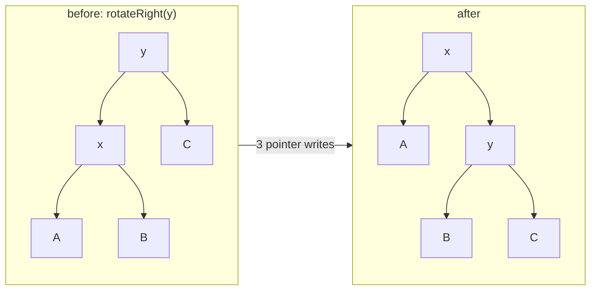

# Balanced Trees: AVL and Red-Black

> Rotations, invariants, and why Java's TreeMap is red-black.

**Type:** Build
**Languages:** Java, Python, Go
**Prerequisites:** Phase 1 Lesson 08 (Binary Search Trees), Phase 1 Lesson 06 (Hash Maps), Phase 2 Lesson 04 (Recursion and Backtracking)
**Time:** ~120 minutes

## Learning Objectives

- Show with a measurement that an unbalanced binary search tree fed sorted keys degenerates to a linked list, and name the two real workloads that produce sorted keys
- State the AVL invariant, implement the two rotations and the four rebalancing cases, and prove with a test that height stays below `1.44 log2(n + 2)` after inserts and deletes
- State the five red-black invariants, implement the CLRS insert fix-up, and explain why they bound height at `2 log2(n + 1)`
- Compare the two trees by rotation count and height on sorted and random input, and explain from that data why `java.util.TreeMap`, C++ `std::map`, and the Linux scheduler chose red-black
- Use the ordered operations a hash map cannot provide (`range`, `ceilingKey`) and recognise where a payment system needs them

## The Problem

An authorization service holds funds on a cardholder's account for up to seven days. Each hold has an expiry instant; a sweeper wakes every second and releases every hold whose expiry has passed. The first implementation stores holds in a hash map keyed by hold ID, and the sweeper scans the whole map each second. At 4 million open holds the scan takes 1.8 seconds, so the sweeper falls behind, expired holds stay on cardholders' accounts, and the support queue fills with "my available balance is wrong".

The second implementation is the textbook fix: a binary search tree keyed by expiry instant. The sweeper walks from the smallest key until it reaches one in the future, releasing as it goes, in time proportional to the number of holds that actually expired. It passes every unit test. In production it is slower than the hash map scan. The reason is that holds are created at a steady rate with a fixed seven-day lifetime, so their expiry instants arrive in almost perfectly increasing order. A plain BST given increasing keys puts every new node as the right child of the previous one. After 4 million inserts the tree is a linked list of height 4 million; every insert walks the whole chain, and the sweeper's "walk from the smallest" is a walk down 4 million right pointers to find the root's position. The demo in this lesson reproduces it: 2,000 sorted inserts, height 2,000.

Sorted keys are not an edge case. They are the normal case for anything keyed by time (expiries, timestamps, settlement windows), by sequence (ledger entry IDs, Kafka offsets, Snowflake IDs from Lesson 13), or by anything that was already sorted when it was exported from the previous system. A tree that is only fast on random input is fast only in tests. Self-balancing trees fix this by enforcing a structural invariant after every mutation; the invariant bounds the height at `O(log n)` regardless of insertion order, and the repair work is a constant number of local pointer swaps called rotations. This lesson builds the two classic ones: AVL, which keeps the tree as short as possible, and red-black, which does less work per update and is the one every standard library picked.

## The Concept

### Why height is the only number that matters

Every BST operation (`get`, `put`, `remove`, `ceilingKey`, the start of a range scan) walks one root-to-leaf path, so each costs `O(height)`. With `n` keys the best possible height is `ceil(log2(n + 1))`, about 22 for 4 million keys. The worst is `n`. A balanced tree is a BST plus an invariant that forces height to stay within a constant factor of the optimum, plus a repair procedure that re-establishes the invariant after each insert or delete in `O(log n)` time.

### Rotations: the only tool

A rotation is a local rearrangement of a node and one child that preserves in-order sequence (so the BST order is untouched) while moving one subtree up a level and another down. There are two, mirror images:



In-order before: `A x B y C`. In-order after: `A x B y C`. Subtree `A` moved up one level, `C` moved down one, `B` changed parent but not depth. That is the whole mechanism; both AVL and red-black trees are different rules for *when* to rotate.

### AVL: the strict invariant

**Invariant:** for every node, `|height(left) - height(right)| <= 1`. The difference is the node's balance factor.

**Height bound:** an AVL tree of height `h` has at least `F(h+2) - 1` nodes, where `F` is Fibonacci, because the smallest AVL tree of height `h` is a root with the smallest trees of height `h-1` and `h-2` beneath it. Inverting gives `h < 1.4405 log2(n + 2) - 0.3277`. For 100,000 keys that is 23.6; the demo measures 17 on sorted input and 20 on random input.

**Repair after insert.** Walk back up the insertion path, recomputing stored heights. The first node with balance factor `+2` or `-2` is fixed by one of four cases, named by the direction of the two steps from the unbalanced node to the heavier grandchild:

| Case | Shape | Fix | Rotations |
|------|-------|-----|-----------|
| LL | left child is left-heavy | `rotateRight(node)` | 1 |
| RR | right child is right-heavy | `rotateLeft(node)` | 1 |
| LR | left child is right-heavy | `rotateLeft(left child)` then `rotateRight(node)` | 2 |
| RL | right child is left-heavy | `rotateRight(right child)` then `rotateLeft(node)` | 2 |

After the fix the subtree has the height it had before the insert, so no ancestor needs further repair: an insert costs at most two rotations. A delete can shorten a subtree by one, which can unbalance every ancestor in turn, so deletes cost up to `O(log n)` rotations.

Worked example by hand. Insert `30`, `20`, `10`:

```text
put 30:            30               heights: 30->1
put 20:            30               heights: 30->2, 20->1; balance(30) = 1 - 0 = +1, fine
                  /
                20
put 10:            30               heights: 10->1, 20->2, 30->3; balance(30) = 2 - 0 = +2, violation
                  /                 balance(20) = +1 >= 0, so this is LL: rotateRight(30)
                20
               /
             10
after:             20               heights: 10->1, 30->1, 20->2; every balance is 0
                  /  \              rotations = 1
                10    30
```

Now the zig-zag. Insert `30`, `10`, `20`:

```text
put 20:            30               balance(30) = +2, but balance(10) = -1 (right-heavy): LR case
                  /                 step 1: rotateLeft(10) turns the zig-zag into a straight line
                10
                  \
                   20
step 1:            30               now balance(20) = +1, and the chain is LL
                  /
                20
               /
             10
step 2:            20               rotateRight(30); rotations = 2, height 2
                  /  \
                10    30
```

The test file asserts exactly these rotation counts for all four cases.

### Red-black: the relaxed invariant

A red-black tree colours each node and asks for five properties:

1. Every node is red or black.
2. The root is black.
3. Every null leaf is black.
4. A red node has two black children (no red-red edge).
5. Every path from a node to its null descendants contains the same number of black nodes (the node's black height).

**Height bound:** property 5 says every root-to-leaf path has the same black count `bh`; property 4 says at most half the nodes on any path are red, so no path is longer than `2 bh`. A tree with black height `bh` has at least `2^bh - 1` nodes (the all-black tree), so `bh <= log2(n + 1)` and height `<= 2 log2(n + 1)`. For 100,000 keys the bound is 33.2 and the demo measures 31 on sorted input, 20 on random input.

That bound is about 40% looser than AVL's. Lookups in a red-black tree can be slower by up to that factor in the worst case. What it buys is cheaper updates: the invariant is relaxed enough that most inserts are fixed by *recolouring* rather than rotating, and the amortised number of rotations per insert or delete is `O(1)` (at most two for an insert, three for a delete), while recolouring is amortised `O(1)` as well. The demo measures it: on 100,000 random inserts the AVL did 69,356 rotations and the red-black did 57,968 rotations plus 231,220 recolourings. A recolour is one byte write with no pointer traffic, far cheaper than a rotation that touches three nodes and, in a concurrent or persistent setting, invalidates three cache lines or three pages.

**Insert fix-up (CLRS).** A new node is coloured red, because adding a red node never changes any black height; the only property it can break is 4, if its parent is also red. The fix-up walks up while the parent is red. With `z` the current node, `p` its parent, `g` its grandparent (which exists and is black, because a red parent cannot be the root), and `u` the uncle:

| Case | Condition | Action | Then |
|------|-----------|--------|------|
| 1 | `u` is red | colour `p` and `u` black, `g` red | `z = g`, loop (the red may have moved up to another red parent) |
| 2 | `u` is black, `z` is an inner grandchild (zig-zag) | rotate at `p` toward the outside | now case 3 |
| 3 | `u` is black, `z` is an outer grandchild | colour `p` black and `g` red, rotate at `g` | done; the subtree root is black |

Finally colour the root black (case 1 may have pushed a red up to it). Case 1 moves the problem two levels up without rotating, which is why the loop can iterate `O(log n)` times but only ever reaches a rotating case once.

Worked example. Insert `10`, `5`, `15`, `1`:

```text
put 10:  10(B)                            root is black
put 5:   10(B) with left 5(R)             red child of a black parent, nothing to fix
put 15:  10(B) with 5(R), 15(R)           still fine; black height 1 on every path (null leaves count)
put 1:   under 5(R): z=1(R), p=5(R), g=10(B), u=15(R)  -> case 1
         recolour: 5(B), 15(B), 10(R); z = 10; its parent is null, loop ends
         root 10 is red -> colour it black
after:   10(B) with 5(B), 15(B), and 1(R) under 5     black height 2, zero rotations
```

Insert `10`, `20`, `30` instead and the third insert is case 3 (`z=30`, `p=20` red, `u` null, outer): recolour `20` black and `10` red, `rotateLeft(10)`, one rotation, root `20(B)` with red children.

### Side by side

| | AVL | Red-black |
|---|-----|-----------|
| Invariant | sibling heights differ by at most 1 | no red-red edge; equal black height on every path |
| Extra state per node | height (or 2-bit balance factor) | 1 bit of colour |
| Worst-case height | `1.44 log2(n)` | `2 log2(n)` |
| Rotations per insert | at most 2 | at most 2 |
| Rotations per delete | up to `O(log n)` | at most 3 |
| Measured, 100k sorted inserts | height 17, 99,983 rotations | height 31, 99,969 rotations, 499,846 recolourings |
| Measured, 100k random inserts | height 20, 69,356 rotations | height 20, 57,968 rotations, 231,220 recolourings |
| Best for | read-heavy, lookup latency matters | write-heavy, update cost and lock scope matter |
| Where it ships | some in-memory indexes, older textbooks | `java.util.TreeMap`, C++ `std::map`, Linux CFS run queue, Nginx timers, Rust `BTreeMap`'s predecessor |

On sorted input both trees rotate on almost every insert, because every insert lands at the far right and the right spine must be folded continuously; the difference shows on random input and, more sharply, on deletes, where AVL's strictness cascades.

### Why TreeMap is red-black

`java.util.TreeMap` is a red-black tree whose code is a direct transcription of CLRS chapter 13, including the `fixAfterInsertion` and `fixAfterDeletion` names. The decision is explained by what the JDK optimises for. `TreeMap` is a general-purpose ordered map with unknown read/write mix, so bounded `O(1)` amortised rotations per update is worth a constant-factor worse worst-case lookup. The same reasoning drove `std::map` (whose complexity requirements in the C++ standard effectively mandate a red-black tree), the Linux kernel's `rb_tree` used for the CFS scheduler's run queue and for virtual memory areas (where an insert or delete holds a lock and must finish fast), and Nginx's timer tree. AVL survives where lookups dominate: some in-memory databases and the original Linux VMA code before it switched.

### What balanced trees do not do

- **They do not beat a hash map at point lookups.** `O(log n)` comparisons with pointer-chasing versus `O(1)` hashing. Use a tree only when you need order: range queries, predecessor and successor, sorted iteration, or the smallest key.
- **They do not play well with disks or large memory.** Each node is a separate allocation; a lookup of height 20 is 20 dependent cache misses. B-trees (Lesson 04) fix this with wide nodes; LSM trees (Lesson 05) fix it differently.
- **They are not thread-safe by default.** A rotation changes three pointers that readers may be following. Concurrent ordered maps (`ConcurrentSkipListMap`, Lesson 07) use a different structure precisely to avoid rotations.
- **This lesson's red-black tree has no delete.** Red-black deletion is a six-case fix-up and is Exercise 3; AVL delete is implemented, and the comparison of delete costs is where red-black's advantage is largest.

## Build It

### Step 1: The naive tree, to measure the failure

```java
final class NaiveBst<K extends Comparable<K>, V> {
    private static final class Node<K, V> { K key; V value; Node<K, V> left, right; /* ... */ }
    private Node<K, V> root;

    void put(K key, V value) {
        if (root == null) { root = new Node<>(key, value); size++; return; }
        Node<K, V> cur = root;
        while (true) {
            int c = key.compareTo(cur.key);
            if (c == 0) { cur.value = value; return; }
            Node<K, V> next = c < 0 ? cur.left : cur.right;
            if (next == null) { /* attach new node on that side */ size++; return; }
            cur = next;
        }
    }

    int height() { return height(root); }
}
```

Nothing is wrong with this code; it is the BST from Phase 1. The test asserts `height() == 1000` after 1,000 sorted inserts so that the number is in front of you, not in a footnote.

**Predict:** what is the height after inserting `1..1000` and then `1000..1`? Does the second half fix anything?

### Step 2: AVL nodes, heights, and the two rotations

```java
static final class Node<K, V> {
    K key; V value; int height = 1; Node<K, V> left, right;
}

static <K, V> int height(Node<K, V> n) { return n == null ? 0 : n.height; }
static <K, V> int balanceFactor(Node<K, V> n) { return n == null ? 0 : height(n.left) - height(n.right); }
private static <K, V> void update(Node<K, V> n) { n.height = 1 + Math.max(height(n.left), height(n.right)); }

Node<K, V> rotateRight(Node<K, V> y) {
    Node<K, V> x = y.left;
    y.left = x.right;
    x.right = y;
    update(y);
    update(x);
    rotations++;
    return x;
}
```

Height is cached in the node so that `balanceFactor` is `O(1)`; recomputing it from scratch would make every insert `O(n)`. The order of the two `update` calls matters: `y` is now below `x`, so `y`'s height must be correct before `x` reads it. `rotateLeft` is the mirror image. Both return the new subtree root, and the caller stores it into the parent's pointer; this "return the new root" style is what lets the recursive `put` rebuild the path without parent pointers.

**Predict:** after `rotateRight(y)`, which of `A`, `B`, `C` in the diagram changed depth, and in which direction?

### Step 3: The four cases in one method

```java
private Node<K, V> rebalance(Node<K, V> n) {
    update(n);
    int bf = balanceFactor(n);
    if (bf > 1) {
        if (balanceFactor(n.left) < 0) n.left = rotateLeft(n.left);     // LR: straighten first
        return rotateRight(n);                                          // LL
    }
    if (bf < -1) {
        if (balanceFactor(n.right) > 0) n.right = rotateRight(n.right); // RL: straighten first
        return rotateLeft(n);                                           // RR
    }
    return n;
}

private Node<K, V> put(Node<K, V> n, K key, V value) {
    if (n == null) { size++; return new Node<>(key, value); }
    int c = key.compareTo(n.key);
    if (c < 0) n.left = put(n.left, key, value);
    else if (c > 0) n.right = put(n.right, key, value);
    else { n.value = value; return n; }
    return rebalance(n);
}
```

`rebalance` is called on every node on the path back up, and it is a no-op (one height update) for all but at most one of them. The inner child's balance factor distinguishes the straight cases from the zig-zag cases: a left-heavy node whose left child is itself left-heavy or balanced is LL; if the left child leans right, it is LR and needs the straightening rotation first.

**Predict:** `balanceFactor(n.left) == 0` with `bf == 2`. Can that happen on an insert? On a delete?

### Step 4: Delete by successor, then rebalance the path

```java
private Node<K, V> remove(Node<K, V> n, K key) {
    if (n == null) return null;
    int c = key.compareTo(n.key);
    if (c < 0) n.left = remove(n.left, key);
    else if (c > 0) n.right = remove(n.right, key);
    else {
        if (n.left == null || n.right == null) { size--; return n.left == null ? n.right : n.left; }
        Node<K, V> successor = n.right;
        while (successor.left != null) successor = successor.left;
        n.key = successor.key;
        n.value = successor.value;
        n.right = remove(n.right, successor.key);
    }
    return rebalance(n);
}
```

A node with two children is not unlinked; its key and value are overwritten with the in-order successor's, and the successor (which has no left child) is removed from the right subtree. Every node on the way back up is rebalanced, which is where AVL's `O(log n)` rotations on delete come from: shortening a subtree can tip each ancestor in turn. The demo removes every even key from a 100,000-node tree and re-verifies the invariant.

### Step 5: The invariant checker

```java
static <K extends Comparable<K>, V> int verify(Node<K, V> n, K lo, K hi) {
    if (n == null) return 0;
    if (lo != null && n.key.compareTo(lo) <= 0) throw new IllegalStateException("BST order violated at " + n.key);
    if (hi != null && n.key.compareTo(hi) >= 0) throw new IllegalStateException("BST order violated at " + n.key);
    int hl = verify(n.left, lo, n.key);
    int hr = verify(n.right, n.key, hi);
    if (n.height != 1 + Math.max(hl, hr)) throw new IllegalStateException("stale height at " + n.key);
    if (Math.abs(hl - hr) > 1) throw new IllegalStateException("AVL balance violated at " + n.key);
    return n.height;
}
```

Three checks in one traversal: BST order (every key within the `(lo, hi)` window its ancestors impose), cached heights equal to true heights, and the balance rule. This is the most valuable method in the file. Every mutation test ends with `checkInvariants()`, and the test file also feeds hand-built broken subtrees to `verify` to prove the checker itself detects each failure. A checker that has never been seen to fail is not evidence.

**Predict:** why is the window check `<=` and `>=` rather than `<` and `>`? What does that say about duplicate keys?

### Step 6: Ordered operations

```java
K ceilingKey(K key) {
    Node<K, V> cur = root; K best = null;
    while (cur != null) {
        int c = key.compareTo(cur.key);
        if (c == 0) return cur.key;
        if (c < 0) { best = cur.key; cur = cur.left; } else cur = cur.right;
    }
    return best;
}

private void range(Node<K, V> n, K lo, K hi, List<K> out) {
    if (n == null) return;
    if (lo.compareTo(n.key) < 0) range(n.left, lo, hi, out);
    if (lo.compareTo(n.key) <= 0 && hi.compareTo(n.key) >= 0) out.add(n.key);
    if (hi.compareTo(n.key) > 0) range(n.right, lo, hi, out);
}
```

These are the reason to have a tree at all. `ceilingKey` remembers the last node it turned left at; that node is the smallest key greater than the target. `range` prunes: it descends left only if `lo` is below this key, right only if `hi` is above it, so the cost is `O(log n + k)` for `k` results rather than `O(n)`. The hold sweeper is `range(0, now)` followed by removes.

### Step 7: Red-black nodes with parent pointers and the fix-up

```java
private void insertFixup(Node<K, V> z) {
    while (isRed(z.parent)) {
        Node<K, V> p = z.parent, g = p.parent;
        if (p == g.left) {
            Node<K, V> uncle = g.right;
            if (isRed(uncle)) {                                   // case 1
                p.color = BLACK; uncle.color = BLACK; g.color = RED;
                z = g;
            } else {
                if (z == p.right) { z = p; rotateLeft(z); p = z.parent; }   // case 2 -> 3
                p.color = BLACK; g.color = RED;                              // case 3
                rotateRight(g);
            }
        } else { /* mirror image with left and right swapped */ }
    }
    if (root.color == RED) root.color = BLACK;
}
```

The red-black tree uses parent pointers and in-place rotations (`rotateLeft(x)` rewires `x.parent`'s child pointer, or `root`), because the fix-up moves *up* the tree from the new node, and a recursive return-the-new-root style cannot express "now look at the grandparent". `isRed(null)` is false, which encodes property 3 without allocating sentinel leaves. The three cases map line for line onto the table in The Concept and onto `TreeMap.fixAfterInsertion`.

**Predict:** in case 1, why is it safe to colour `g` red without checking `g`'s parent right there?

### Step 8: Verifying the five properties

```java
private int verify(Node<K, V> n, K lo, K hi) {
    if (n == null) return 1;                                     // null leaf counts as one black
    /* BST window checks as in AVL */
    if (isRed(n) && (isRed(n.left) || isRed(n.right))) throw new IllegalStateException("red node with red child at " + n.key);
    if (n.left != null && n.left.parent != n) throw new IllegalStateException("broken parent link at " + n.left.key);
    int bl = verify(n.left, lo, n.key);
    int br = verify(n.right, n.key, hi);
    if (bl != br) throw new IllegalStateException("black height differs at " + n.key);
    return bl + (n.color == BLACK ? 1 : 0);
}
```

The method returns the subtree's black height and demands that both children agree, which is property 5 checked at every node, not just at the root. Parent-pointer consistency is checked too; a rotation that forgets one `parent` assignment produces a tree that iterates correctly and then corrupts itself on the next fix-up, which is the kind of bug that surfaces a week later.

### Step 9: Run it

```bash
cd phases/03-systems-data-structures/03-balanced-trees/code/java
javac -d .out *.java && java -cp .out Main
java -cp .out MainTest
```

Expected output, abbreviated:

```console
== Sorted inserts: what a plain BST does with timestamps ==
naive BST, 2000 sorted keys: height=2000 (a linked list; log2(2000)=11)

== AVL vs red-black on 100000 sorted keys (expiry timestamps arriving in order) ==
AVL        height=17  bound=23.6  rotations=99983
red-black  height=31  bound=33.2  rotations=99969  recolorings=499846  black-height=16

== Same keys, random order (seeded) ==
AVL        height=20  rotations=69356
red-black  height=20  rotations=57968  recolorings=231220

== The operation a hash map cannot do: expiries between two instants ==
expiries in [t0+10s, t0+20s): [11307, 16649, 18279, 18708]
first expiry at or after t0+30s: +30738 ms

== Deletes keep the AVL invariant ==
after removing every even key: size=50000 height=16, invariants hold
```

### In Python

`code/python/main.py` has the same classes (`NaiveBst`, `AvlTree`, `RedBlackTree`) with the same methods in snake_case (`rotate_right`, `ceiling_key`, `check_invariants`, `black_height`). Four things differ:

- **Comparison operators instead of `compareTo`.** Keys are compared with `<` and `==`, so any type with a total order (int, str, tuple) works without a `Comparable` bound. `get` returns `None` for a missing key, and `contains_key` is `get(key) is not None`, which mirrors Java's `get(key) != null` (and its blind spot for stored `None` values).
- **`None` stands in for `null` leaves.** `AvlTree.node_height(None)` is 0 and `is_red(None)` is `False`, so property 3 (null leaves are black) is still encoded without sentinel nodes. The invariant checkers raise `IllegalStateError`, the Python counterpart of `IllegalStateException`.
- **Recursion limit on the naive tree.** Python stops at about 1,000 nested calls, and the degenerate BST of 2,000 sorted keys is 2,000 levels deep, so `NaiveBst.height` walks level by level instead of recursing. The balanced trees keep the recursive `put`, `remove`, and `verify` because their depth is `O(log n)`:

```python
def height(self) -> int:
    level = [self._root] if self._root is not None else []
    h = 0
    while level:
        h += 1
        level = [c for n in level for c in (n.left, n.right) if c is not None]
    return h
```

- **Same shuffle, same numbers.** The random-order demo and tests use `JavaRandom`, a bit-exact port of `java.util.Random`, and `java_shuffle`, which is `Collections.shuffle` (swap `i - 1` with `nextInt(i)` from the end). Seed 2024 produces the same permutation as Java, so heights, rotation counts, and recoloring counts match line for line. `fmt_fixed` reproduces Java's half-up `%.1f`.

```bash
cd phases/03-systems-data-structures/03-balanced-trees/code/python
python3 main.py
python3 -m unittest -v
```

### In Go

`code/go/main.go` has the same three types (`NaiveBst`, `AvlTree`, `RedBlackTree`) with the same methods in exported CamelCase (`RotateRight`, `CeilingKey`, `CheckInvariants`, `BlackHeight`). Four things differ:

- **Generics with `cmp.Ordered` instead of `Comparable`.** `AvlTree[K cmp.Ordered, V any]` compares keys with `cmp.Compare(key, n.Key)`, which returns -1, 0, or 1 exactly like `compareTo`, so every `c < 0` / `c > 0` branch reads the same as the Java. `nil` stands in for `null` leaves: `avlHeight(nil)` is 0 and `isRed(nil)` is false, so property 3 (null leaves are black) needs no sentinel nodes.
- **Absence is a second return value.** Go has no `null` for an `int` value, so `Get` returns `(V, bool)` and `CeilingKey` returns `(K, bool)`; `ContainsKey` is the `bool` half of `Get`. `Verify` takes `*K` bounds so "unbounded" is `nil` rather than a null key.
- **Invariant violations are errors, not exceptions.** `CheckInvariants` returns `error` instead of throwing `IllegalStateException`; every violation wraps the sentinel `ErrInvariantViolated`, so the corruption tests use `errors.Is`. The `AvlNode` fields are exported for exactly that reason: the tests hand-build an unbalanced chain, a stale height, and a disordered node and check that `Verify` names each one:

```go
func (t *AvlTree[K, V]) CheckInvariants() error {
    _, err := Verify(t.root, nil, nil)
    return err
}
```

- **Same shuffle, same numbers.** The random-order demo and tests use `JavaRandom` (`javarandom.go`), a bit-exact port of `java.util.Random`, and its `Shuffle`, which is `Collections.shuffle` (swap `i - 1` with `nextInt(i)` from the end). Seed 2024 produces the same permutation as Java, so heights, rotation counts, and recoloring counts match line for line.

```bash
cd phases/03-systems-data-structures/03-balanced-trees/code/go
go run .
go test ./...
```

## Use It

### `java.util.TreeMap` and `TreeSet`

`TreeMap<K,V>` is the red-black tree with every ordered operation you built and several you did not: `ceilingKey`, `floorKey`, `higherKey`, `lowerKey`, `firstEntry`, `pollFirstEntry` (the sweeper's "take the earliest" in one call), `subMap(lo, hi)` and `headMap`/`tailMap` as live views, and `descendingMap`. Its iterator is fail-fast under concurrent modification. What it hides: the fix-up logic, the parent pointers, and a `modCount`. What to know: `TreeMap` compares with `compareTo` or a supplied `Comparator`, so two keys that compare equal are the *same* key even if `equals` says otherwise, which bites with `BigDecimal` (`1.0` and `1.00` compare equal) and is one more reason the course's `Money` is an integer record.

### `java.util.concurrent.ConcurrentSkipListMap`

The JDK's concurrent ordered map is not a tree. Rotations are hard to make lock-free because they change several pointers at once, so the concurrent version uses a skip list (Lesson 07), where every update is a single compare-and-swap. If you need an ordered map shared across threads, this is the one.

### `std::map`, Linux `rb_tree`, and PostgreSQL

C++ `std::map` and `std::set` are red-black in every major implementation. The Linux kernel's `include/linux/rbtree.h` is used by the CFS scheduler (tasks keyed by virtual runtime; the leftmost node is the next to run, cached so it is `O(1)`), by the memory manager for VMAs, by the I/O schedulers, and by high-resolution timers. PostgreSQL uses a red-black tree (`src/backend/lib/rbtree.c`) in GIN index construction. In every case the choice was made for update cost under a lock, which is red-black's strength.

### What the libraries do not do

None of them persist to disk or play well with cache lines; a node is a separate allocation and a lookup is a chain of dependent loads. Databases use B-trees (next lesson) for exactly this reason, and some in-memory engines use B-trees over red-black trees even in RAM because a 64-entry node fits in a few cache lines and a binary node does not.

## Ship It

`outputs/interview-card-balanced-trees.md` is a one-page interview and design-review card: the two invariants, the height bounds and how to derive them in two lines each, the four AVL cases and three red-black insert cases, the rotation-count comparison from this lesson's demo, and the decision rule for tree versus hash map versus skip list versus B-tree.

## Exercises

1. **Reinforce.** Add `floorKey`, `firstKey`, and `pollFirstEntry` to `AvlTree` and rewrite the hold sweeper as `while (firstKey() <= now) pollFirstEntry()`. Measure, with the demo's rotation counter, how many rotations 50,000 sweeps cost versus 50,000 `remove(firstKey())` calls, and explain any difference.
2. **Apply.** Replace the stored `int height` in `AvlTree.Node` with a two-bit balance factor (`-1`, `0`, `+1`) as Knuth's TAOCP Volume 3 describes. Rewrite `rebalance` to update balance factors without ever computing a height, keep `verify` computing true heights so the test still proves the invariant, and compare node size with `jol` or by reasoning about field alignment.
3. **Extend.** Implement `RedBlackTree.remove` following CLRS `RB-DELETE` and `RB-DELETE-FIXUP` (or `TreeMap.deleteEntry` and `fixAfterDeletion`), with the invariant checker running after every removal in a randomized test of 20,000 inserts and 20,000 deletes. Then repeat the AVL-versus-red-black rotation comparison from the demo on a workload of alternating inserts and deletes and report which tree does less work, connecting the result to Phase 3, Lesson 12 (timing wheels), which replaces the tree entirely for expiry workloads.

## Key Terms

| Term | What people say | What it actually means |
|------|-----------------|------------------------|
| Rotation | "rebalance the tree" | A three-pointer rearrangement of a node and one child that preserves in-order sequence while moving one subtree up a level and the other down |
| Balance factor | "how lopsided a node is" | `height(left) - height(right)`; AVL requires it to be in `{-1, 0, +1}` at every node |
| AVL tree | "a strictly balanced BST" | A BST where every node's balance factor is within one; height below `1.44 log2(n + 2)`; at most two rotations per insert, `O(log n)` per delete |
| Red-black tree | "a loosely balanced BST" | A BST with one colour bit per node, no red-red edge, and equal black height on every path; height at most `2 log2(n + 1)`; `O(1)` amortised rotations per update |
| Black height | "number of black nodes on a path" | The count of black nodes from a node down to any null leaf, which property 5 makes the same on every path; bounds height at twice its value |
| Recolouring | "flip the colours" | Changing a node's colour bit without moving pointers; the red-black fix-up's cheap operation, used in case 1 to push the problem two levels up |
| Degenerate tree | "the tree became a linked list" | A BST of height `n` produced by inserting keys in sorted or nearly sorted order, which is the common case for time- or sequence-keyed data |

## Further Reading

- [Adelson-Velsky and Landis, "An algorithm for the organization of information" (1962)](https://zhjwpku.com/assets/pdf/AED2-10-avl-paper.pdf) — the original three-page paper; the height bound via Fibonacci trees is in it.
- [Guibas and Sedgewick, "A Dichromatic Framework for Balanced Trees" (1978)](https://sedgewick.io/wp-content/themes/sedgewick/papers/1978Dichromatic.pdf) — where red-black trees were named and the colour-bit encoding of 2-3-4 trees was introduced.
- [Cormen, Leiserson, Rivest, Stein, *Introduction to Algorithms*, Chapter 13](https://mitpress.mit.edu/9780262046305/introduction-to-algorithms/) — the `RB-INSERT-FIXUP` and `RB-DELETE-FIXUP` pseudocode this lesson and `TreeMap` both follow.
- [OpenJDK `java.util.TreeMap` source](https://github.com/openjdk/jdk/blob/master/src/java.base/share/classes/java/util/TreeMap.java) — read `fixAfterInsertion` next to Step 7; the case structure is identical.
- [Linux kernel `rbtree` documentation](https://www.kernel.org/doc/html/latest/core-api/rbtree.html) — why the kernel chose red-black, the cached-leftmost optimisation, and the augmented-tree API.
- [Knuth, *The Art of Computer Programming*, Volume 3, Section 6.2.3](https://www-cs-faculty.stanford.edu/~knuth/taocp.html) — the balance-factor formulation of AVL trees used in Exercise 2 and the full analysis of expected rotations.
