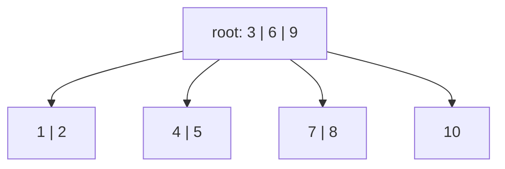

# B-Trees and Why Databases Love Them

> Pages, fan-out, and the disk access pattern behind every index.

**Type:** Build
**Languages:** Java, Python, Go
**Prerequisites:** Phase 3, Lesson 03 (Balanced Trees: AVL and Red-Black), Phase 1, Lesson 03 (Binary Search), Phase 0, Lesson 09 (Memory, Caches, and Why Arrays Win)
**Time:** ~120 minutes

## Learning Objectives

- Explain the disk and cache access model that makes a 23-level binary tree slow and a 4-level B-tree fast, with the numbers for an 8 KB page and a 400-way fan-out
- State the B-tree invariants (sorted keys, half-full nodes, equal leaf depth) and build insert with median split and delete with borrow-or-merge against a configurable order
- Count page reads for a point lookup and a range scan and show that the lookup costs exactly one read per level
- Measure why sequential keys leave naive B-tree pages half full and why production engines special-case the rightmost split
- Distinguish a B-tree from a B+ tree and read a PostgreSQL or InnoDB index description knowing what each word means

## The Problem

A ledger service stores 2 billion postings in PostgreSQL. The `postings` table has a primary key `posting_id BIGINT` and an index on `(account_id, posted_at)`. A reconciliation job asks, for one account, for every posting in a one-hour window. PostgreSQL answers in about 4 milliseconds from a cold cache: three page reads to walk the index from the root to the right leaf, one more to read the leaf, and a short scan along the leaf chain. A colleague proposes rewriting the index as an in-memory red-black tree from Lesson 03, because "trees are O(log n) either way".

They are not the same `O(log n)`. A red-black tree with 2 billion keys has height about 60. Each node is a separate heap allocation holding one key and three pointers, so a lookup is 60 dependent pointer dereferences, each one a probable cache miss at roughly 100 nanoseconds, or, if the structure lives on disk because 2 billion nodes do not fit in RAM, 60 random reads at 100 microseconds on an SSD. That is 6 milliseconds in the best case and nowhere near the 4 milliseconds PostgreSQL delivers from disk, and the red-black version also has no way to continue the range scan without walking back up and down the tree between leaves.

The B-tree exists because the cost model of memory is not uniform. A disk or SSD transfers data in blocks of 4 to 16 KB whether you want one byte or all of them, and a CPU loads 64-byte cache lines the same way. A binary tree node uses a few bytes of each block it touches and wastes the rest. A B-tree node is sized to fill a block: a few hundred keys, sorted, searched with binary search inside the block. The height drops from `log2(n)` to `log_fanout(n)`, which for 2 billion keys and a 400-way fan-out is 4 levels, of which the top three (one root page, 400 second-level pages, 160,000 third-level pages, about 1.3 GB) stay in the buffer cache permanently. A lookup is one disk read. This lesson builds the structure Bayer and McCreight published in 1972, counts its page accesses, and reproduces one production subtlety: the shape it takes when keys arrive in order.

## The Concept

### The access model

| Where the data is | Transfer unit | Latency per access | 23 random accesses (binary tree, 10M keys) | 4 random accesses (B-tree, 10M keys) |
|-------------------|---------------|--------------------|-------------------------------------------|---------------------------------------|
| L1/L2 cache | 64 B line | ~1-4 ns | negligible | negligible |
| Main memory, cache miss | 64 B line | ~100 ns | 2.3 microseconds | 0.4 microseconds |
| NVMe SSD | 4 KB page | ~100 microseconds | 2.3 milliseconds | 0.4 milliseconds |
| Spinning disk | 4 KB page, seek | ~10 milliseconds | 230 milliseconds | 40 milliseconds |

Two things follow. First, the number that matters is the count of *dependent* accesses, because each one must complete before the next address is known. Second, once you are paying for a whole page, reading one key from it is a waste; read as many keys as fit and binary-search them in cache. A B-tree is the structure that minimises dependent page accesses by maximising keys per page.

### The invariants

A B-tree of order `m` (the maximum number of children a node may have) promises, for every node:

1. **Sorted keys.** A node holds `k` keys in ascending order and, if it is not a leaf, `k + 1` children. The `i`-th key separates children `i` and `i + 1`: everything in child `i` is less than key `i`, everything in child `i + 1` is greater.
2. **Occupancy.** Every node except the root holds between `minKeys = ceil(m / 2) - 1` and `maxKeys = m - 1` keys. Every node is at least half full, which is what bounds the height.
3. **Equal leaf depth.** Every leaf is at the same depth. The tree is perfectly balanced in height; it absorbs growth by splitting nodes sideways and grows a level only when the root itself splits.

**Height bound.** With every non-root node at least half full, a tree of height `h` holds at least `2 * ceil(m/2)^(h-1) - 1` keys, so `h <= 1 + log_ceil(m/2)((n + 1) / 2)`. For 10 million keys: order 8 gives at most 12 levels, order 64 gives 5.5, order 400 gives 3.9. The demo prints this table. In practice pages are about 69% full under random insertion (the `ln 2` constant from the analysis of random splits), so the real height is usually one less than the bound.



That is the order-4 tree the demo builds from keys 1 to 10. Order 4 means at most 3 keys and 4 children per node, at least 1 key in a non-root node. Every leaf is at depth 2.

### Insert: find the leaf, add, split upward

Inserting is a search to the leaf where the key belongs, an insertion into that leaf's sorted key list, and then a check: if the leaf now has `maxKeys + 1` keys it is split at its median. The median key moves up into the parent as a new separator, the keys below it stay, the keys above it move to a new right sibling, and the parent gains one child pointer. If that pushes the parent over `maxKeys`, the parent splits in the same way. If the root splits, a new root with one key is created and the tree is one level taller. This is the only way the tree grows in height, and it is why all leaves stay at the same depth: growth happens at the top, never at the bottom.

Worked example by hand, order 4, keys 1 to 10 in order:

```text
put 1,2,3:  [1 2 3]                                   one leaf, three keys, full
put 4:      [1 2 3 4] overflows (4 > 3)               median index 4/2 = 2 -> key 3 goes up
            root [3]; children [1 2] [4]              split #1, height 2
put 5,6:    root [3]; children [1 2] [4 5 6]
put 7:      [4 5 6 7] overflows -> 6 goes up          split #2
            root [3 6]; children [1 2] [4 5] [7]
put 8,9:    root [3 6]; children [1 2] [4 5] [7 8 9]
put 10:     [7 8 9 10] overflows -> 9 goes up         split #3
            root [3 6 9]; children [1 2] [4 5] [7 8] [10]
```

Three splits, five nodes, height 2, and the leaves `[1 2]`, `[4 5]`, `[7 8]` are each half full and will stay that way forever, because nothing smaller than 10 will ever be inserted again. Hold that thought.

### Delete: borrow or merge

Deleting is the mirror image, and harder, because a node can fall below `minKeys`. After removing a key from a leaf, if the leaf is underfull its parent tries two repairs in order:

1. **Borrow.** If a neighbouring sibling has more than `minKeys` keys, rotate one key through the parent: the separator between them moves down into the underfull node and the sibling's nearest key moves up to replace it. Three pages change; the tree's shape does not.
2. **Merge.** Otherwise both siblings are at minimum, so the underfull node, the separator, and the sibling are combined into one node of `2 * minKeys` keys, which is at most `maxKeys`. The parent loses one key and one child, and may itself become underfull, so the repair propagates upward. If the root ends up with zero keys, its only child becomes the root and the tree is one level shorter.

Deleting a key from an internal node is reduced to the leaf case: replace it with its in-order predecessor (the largest key in the left subtree, which is in a leaf) and delete that key from the leaf. The demo deletes every odd key from 200,000 and then deletes a 5,000-key tree down to empty; `checkInvariants` runs after both.

Worked example by hand, continuing from the order-4 tree above (`minKeys = 1`):

```text
start:      root [3 6 9]; children [1 2] [4 5] [7 8] [10]
remove 10:  leaf [10] -> [] underfull (0 < 1); left sibling [7 8] has 2 > minKeys -> borrow
            separator 9 drops into the leaf, 8 rises to replace it
            root [3 6 8]; children [1 2] [4 5] [7] [9]
remove 9:   leaf [9] -> [] underfull; left sibling [7] has exactly minKeys -> cannot borrow -> merge
            [7] + separator 8 + [] -> [7 8]; root loses key 8 and one child
            root [3 6]; children [1 2] [4 5] [7 8]
remove 6:   6 is a separator in the root; predecessor is 5 (largest key in child [4 5])
            root becomes [3 5]; delete 5 from the leaf -> [4], which has minKeys, no repair
            root [3 5]; children [1 2] [4] [7 8]
```

Each step preserves all three invariants, and the leaf depth never changes until the root itself would empty.

### Reading cost: one page per level, then sideways

A point lookup reads exactly `height` pages: the demo's `get(123456)` on a 4-level tree reports 4 reads. A range scan reads the path to the first key and then walks in-order, which in this B-tree means visiting children between consecutive separators; the demo's 1,000-key scan touches 35 pages, which is the 4 on the path plus about 31 leaves of 32 keys each. A B+ tree (below) makes the sideways walk cheaper still with next-leaf pointers.

### The sequential-insert anomaly

Run the demo and look at the 200,000-key comparison:

```text
sequential: height=4 nodes=6249 ... splits=6245
random:     height=4 nodes=4630 ... splits=4626
occupancy: sequential ~51%, random ~69%
```

Sequential keys produce *more* pages than random keys, not fewer. The reason is in the worked example: every split leaves the left half behind, and when keys only ever arrive at the right edge, the left half is never revisited. Pages settle at 50% occupancy, the tree uses 35% more space than it needs, and every one of those pages is a page the buffer cache has to hold. Random keys hit random pages, so a half-full page keeps receiving keys until it splits again, and occupancy averages `ln 2`.

Every production engine special-cases this. PostgreSQL's nbtree detects a split of the rightmost leaf and, instead of splitting at the median, leaves the old page at `fillfactor` (90% by default) and starts a nearly empty new page: sequential inserts then produce pages 90% full. InnoDB does the same for ascending inserts. SQLite's B-tree has a "quick balance" path for appends. The lesson implements the naive median split so that you see the anomaly; fixing it is Exercise 2.

There is a second, separate reason sequential keys matter: random keys (UUIDv4 primary keys are the usual culprit) touch a random page on every insert, so for a table larger than RAM every insert is a cache miss and a dirty page, while sequential keys touch the same rightmost page repeatedly. That is a write-amplification and cache-locality argument, independent of occupancy, and it is why Lesson 13 (Unique ID Generation) exists.

### B-tree versus B+ tree

This lesson builds a B-tree in the original sense: every node, internal or leaf, stores keys *and* values, and a search can stop at an internal node. Databases almost universally build B+ trees instead:

| | B-tree (this lesson) | B+ tree (PostgreSQL, InnoDB, SQLite, LMDB) |
|---|---|---|
| Where values live | every node | leaves only; internal nodes hold separator keys and child pointers |
| Internal node fan-out | lower (values take space) | higher (separators only), so the tree is shorter |
| Range scan | in-order traversal up and down | follow `next` pointers along the leaf level, no re-descent |
| Point lookup | may stop early at an internal node | always reads to the leaf (one more page, but predictable) |
| Separator keys | real keys with values | can be shortened copies ("suffix truncation"), raising fan-out further |

The word "B-tree" in database documentation nearly always means B+ tree. PostgreSQL's source calls it `nbtree`, InnoDB's manual says "B-tree", and both are B+ trees with leaf sibling pointers.

### What a B-tree does not do

- **It is not write-optimised.** Every insert dirties at least one page, and a random insert into a cold table dirties a random page. Write-heavy workloads with poor locality are what LSM trees (Lesson 05) are for.
- **It does not give you concurrency for free.** A split modifies the parent while another thread may be descending through it. Real engines use latch coupling or Lehman-Yao right-link locking (the PostgreSQL README is a readable account). This lesson's tree is single-writer.
- **It does not survive a crash by itself.** A split that writes the new right page but crashes before updating the parent leaves an unreachable page. Durability needs a write-ahead log (Phase 7, Lesson 02).
- **It does not dedupe or compress.** Prefix compression, suffix truncation, and deduplication of equal keys are production additions that raise fan-out; the structure is the same.

## Build It

### Step 1: Pages and page statistics

```java
final class PageStats {
    long reads, writes, splits, merges;
    void reset() { reads = writes = splits = merges = 0; }
}

static final class Node<K, V> {
    final List<K> keys = new ArrayList<>();
    final List<V> values = new ArrayList<>();
    final List<Node<K, V>> children = new ArrayList<>();   // empty for a leaf
    boolean isLeaf() { return children.isEmpty(); }
}

BTree(int order) {
    if (order < 3) throw new IllegalArgumentException("order must be at least 3: " + order);
    this.order = order;
    this.maxKeys = order - 1;
    this.minKeys = (order + 1) / 2 - 1;
}
```

A `Node` is a page. `PageStats` is the buffer manager's view: every time the code looks at a node it increments `reads`, every time it modifies one it increments `writes`. These counters, not wall-clock time, are what the tests and the demo measure, because they are deterministic and they are the quantity a real database optimises. `minKeys` is `ceil(order/2) - 1`, computed with integer arithmetic.

**Predict:** for order 5, what are `maxKeys` and `minKeys`, and can a merge of two minimum nodes plus a separator ever overflow?

### Step 2: Search within a page, then down

```java
static <K extends Comparable<K>, V> int lowerBound(Node<K, V> n, K key) {
    int lo = 0, hi = n.keyCount();
    while (lo < hi) {
        int mid = (lo + hi) >>> 1;
        if (n.keys.get(mid).compareTo(key) < 0) lo = mid + 1; else hi = mid;
    }
    return lo;
}

V get(K key) {
    Node<K, V> n = root;
    while (true) {
        stats.reads++;
        int i = lowerBound(n, key);
        if (i < n.keyCount() && n.keys.get(i).compareTo(key) == 0) return n.values.get(i);
        if (n.isLeaf()) return null;
        n = n.children.get(i);
    }
}
```

`lowerBound` returns the index of the first key not less than the target, which is both "where the key is, if present" and "which child to descend into, if not". That dual use is what makes the rest of the code short. The search inside a page is a binary search over a contiguous array, which is cache-friendly; the descent between pages is the expensive part, and it happens `height` times.

**Predict:** `lowerBound` on keys `[10, 20, 30]` for the target `25`. Which child does the search descend into, and why is that correct?

### Step 3: Insert with split propagated by return value

```java
private record Split<K, V>(K key, V value, Node<K, V> right) {}

private Split<K, V> insert(Node<K, V> n, K key, V value) {
    stats.reads++;
    int i = lowerBound(n, key);
    if (i < n.keyCount() && n.keys.get(i).compareTo(key) == 0) { n.values.set(i, value); stats.writes++; return null; }
    if (n.isLeaf()) {
        n.keys.add(i, key); n.values.add(i, value); size++;
    } else {
        Split<K, V> childSplit = insert(n.children.get(i), key, value);
        if (childSplit == null) return null;
        n.keys.add(i, childSplit.key());
        n.values.add(i, childSplit.value());
        n.children.add(i + 1, childSplit.right());
    }
    stats.writes++;
    return n.keyCount() > maxKeys ? split(n) : null;
}
```

The recursion descends to the leaf and returns either `null` (nothing more to do) or a `Split` carrying the promoted key and the new right sibling. The parent inserts the key at position `i` (the same `i` it descended through, because the promoted key is greater than everything in the old child and less than the next separator) and the new child at `i + 1`. If that overflows the parent, it splits and returns its own `Split` upward. `put` handles the last case: a `Split` coming out of the root means a new root.

**Predict:** a leaf splits and its parent was already at `maxKeys`. How many `Split` objects are created on this insert, and how many pages are written?

### Step 4: The split itself

```java
private Split<K, V> split(Node<K, V> n) {
    int mid = n.keyCount() / 2;
    K midKey = n.keys.get(mid);
    V midValue = n.values.get(mid);
    Node<K, V> right = new Node<>();
    right.keys.addAll(n.keys.subList(mid + 1, n.keyCount()));
    right.values.addAll(n.values.subList(mid + 1, n.keyCount()));
    n.keys.subList(mid, n.keyCount()).clear();
    n.values.subList(mid, n.values.size()).clear();
    if (!n.isLeaf()) {
        right.children.addAll(n.children.subList(mid + 1, n.children.size()));
        n.children.subList(mid + 1, n.children.size()).clear();
    }
    stats.splits++;
    stats.writes++;
    return new Split<>(midKey, midValue, right);
}
```

The node has `maxKeys + 1 = order` keys when this runs. The median goes up; `mid` keys stay left and `order - mid - 1` go right. For an internal node, children `0..mid` stay (that is `mid + 1` children for `mid` keys) and `mid + 1..order` go right (`order - mid` children for `order - mid - 1` keys). Both halves satisfy `children == keys + 1`, which `checkInvariants` verifies. Both halves also have at least `minKeys` keys, which is why `minKeys` is defined as it is.

### Step 5: Delete, borrow, merge

```java
private void rebalance(Node<K, V> parent, int i) {
    Node<K, V> child = parent.children.get(i);
    if (i > 0 && parent.children.get(i - 1).keyCount() > minKeys) {
        Node<K, V> left = parent.children.get(i - 1);
        child.keys.add(0, parent.keys.get(i - 1));
        child.values.add(0, parent.values.get(i - 1));
        parent.keys.set(i - 1, left.keys.remove(left.keyCount() - 1));
        parent.values.set(i - 1, left.values.remove(left.values.size() - 1));
        if (!left.isLeaf()) child.children.add(0, left.children.remove(left.children.size() - 1));
    } else if (i < parent.children.size() - 1 && parent.children.get(i + 1).keyCount() > minKeys) {
        /* mirror image: borrow from the right sibling */
    } else {
        int leftIndex = i > 0 ? i - 1 : i;
        Node<K, V> left = parent.children.get(leftIndex), right = parent.children.get(leftIndex + 1);
        left.keys.add(parent.keys.remove(leftIndex));
        left.values.add(parent.values.remove(leftIndex));
        left.keys.addAll(right.keys); left.values.addAll(right.values); left.children.addAll(right.children);
        parent.children.remove(leftIndex + 1);
        stats.merges++;
    }
}
```

Borrowing from the left is a rotation through the parent: the separator drops into the front of the underfull child, the sibling's last key rises to be the new separator, and if the nodes are internal the sibling's last child pointer moves across too. Merging always combines a left node, a separator, and a right node, so `leftIndex` picks the pair; when the underfull node is child 0 it merges with child 1, otherwise with its left neighbour. `remove` calls `rebalance` on the way back up, so a merge that leaves the parent underfull is repaired by the grandparent.

**Predict:** both siblings of an underfull node have exactly `minKeys` keys. After the merge, how many keys does the merged node hold, and is that within `maxKeys` for both odd and even orders?

### Step 6: Range scan

```java
private void range(Node<K, V> n, K lo, K hi, List<K> out) {
    stats.reads++;
    int i = lowerBound(n, lo);
    if (!n.isLeaf()) range(n.children.get(i), lo, hi, out);
    for (; i < n.keyCount(); i++) {
        K k = n.keys.get(i);
        if (k.compareTo(hi) > 0) return;
        out.add(k);
        if (!n.isLeaf()) range(n.children.get(i + 1), lo, hi, out);
    }
}
```

Start at the first separator not below `lo`, descend into the child before it, then alternate emitting a separator and descending into the child after it, stopping at the first key above `hi`. Pages entirely outside `[lo, hi]` are never read, which is what the test checks by counting reads.

### Step 7: The invariant checker

```java
private void verify(Node<K, V> n, K lo, K hi, int depth, int[] leafDepth) {
    if (n != root && n.keyCount() < minKeys) throw new IllegalStateException("underfull node: " + n.keys);
    if (n.keyCount() > maxKeys) throw new IllegalStateException("overfull node: " + n.keys);
    for (int i = 0; i < n.keyCount(); i++) { /* sorted, and within (lo, hi) */ }
    if (n.isLeaf()) {
        if (leafDepth[0] == -1) leafDepth[0] = depth;
        else if (leafDepth[0] != depth) throw new IllegalStateException("leaves at different depths");
        return;
    }
    if (n.children.size() != n.keyCount() + 1) throw new IllegalStateException("children != keys + 1");
    for (int i = 0; i < n.children.size(); i++) {
        verify(n.children.get(i), i == 0 ? lo : n.keys.get(i - 1), i == n.keyCount() ? hi : n.keys.get(i), depth + 1, leafDepth);
    }
}
```

All three invariants in one pass: occupancy, order (each child is checked against the separators on either side of it), and equal leaf depth (the first leaf records its depth; every other leaf must match). The test runs it after sorted inserts, random inserts, mass deletes, and a 20,000-step randomised churn compared against `java.util.TreeMap`.

### Step 8: Run it

```bash
cd phases/03-systems-data-structures/04-b-trees/code/java
javac -d .out *.java && java -cp .out Main
java -cp .out MainTest
```

Expected output, abbreviated:

```console
== Fan-out decides height: 10 million keys, one page read per level ==
binary tree: height ~ 23.3 (one node per level: 23 dependent cache misses or disk reads)
order    8:  height <= 12.1
order   64:  height <= 5.5
order  400:  height <= 3.9

== A small tree you can draw: order 4, keys 1..10 ==
height=2 nodes=5 keys=[1, 2, 3, 4, 5, 6, 7, 8, 9, 10]
stats after 10 inserts: reads=16 writes=16 splits=3 merges=0

== 200,000 payment ids, order 64: sequential vs random keys (UUIDv4-style) ==
sequential: height=4 nodes=6249 reads=727043 writes=212490 splits=6245 merges=0
random:     height=4 nodes=4630 reads=647276 writes=209252 splits=4626 merges=0
occupancy: sequential ~51% (every split leaves a half-empty page behind), random ~69% (ln 2)

== Point lookup and range scan cost in page reads ==
get(123456): 4 page reads (= height 4)
range(100000, 100999): 1000 keys in 35 page reads

== Deletes: borrow from a sibling or merge, leaves stay level ==
after removing every odd id: size=100000 height=4 nodes=3124 ... merges=3125
```

### In Python

`code/python/main.py` keeps the same names: `PageStats`, `BTree` with `lower_bound`, `put`, `remove`, `range`, `check_invariants`, `height_bound`, and a frozen `Split` dataclass in place of the Java record. Three things differ:

- **List slicing replaces `subList(...).clear()`.** A split copies the upper half into the new right page and truncates the left in place; `pop()`, `pop(0)`, and `insert(0, ...)` do the borrow rotations. Since the right page gets fresh lists, there is no aliasing to worry about:

```python
mid = len(n.keys) // 2
mid_key, mid_value = n.keys[mid], n.values[mid]
right = BTreeNode()
right.keys = n.keys[mid + 1:]
right.values = n.values[mid + 1:]
del n.keys[mid:]
del n.values[mid:]
if not n.is_leaf():
    right.children = n.children[mid + 1:]
    del n.children[mid + 1:]
```

- **The page search stays hand-written.** `bisect.bisect_left` would compute the same index faster, but `lower_bound` is the within-page binary search the lesson is about, so it is spelled out. Keys compare with `<` and `==` instead of `compareTo`. Recursion depth is the tree height (4 or 5), so the recursion limit is not a concern.
- **Same random keys, same page counts.** The demo's random ids come from `JavaRandom`, a bit-exact port of `java.util.Random`, with `next_long() & LONG_MAX` standing in for `nextLong() & Long.MAX_VALUE`. `java_shuffle` reproduces `Collections.shuffle`. That makes the node, split, read, write, and merge counts identical to Java's, which is a strong check that both versions touch the same pages. `IllegalStateError` replaces `IllegalStateException`, and `ValueError` replaces `IllegalArgumentException` for an order below 3.

```bash
cd phases/03-systems-data-structures/04-b-trees/code/python
python3 main.py
python3 -m unittest -v
```

### In Go

`code/go/main.go` keeps the same names: `PageStats`, `BTree[K cmp.Ordered, V any]` with `LowerBound`, `Put`, `Remove`, `Range`, `CheckInvariants`, `HeightBound`, and an unexported `split` struct in place of the Java record. Three things differ:

- **Slices replace `ArrayList`, and the right page must not alias the left.** `slices.Insert` and `slices.Delete` do the in-page shifts that `add(i, x)` and `remove(i)` did. A split re-slices the left page down to the median and gives the right page a `slices.Clone` of the upper half; without the clone both pages would share one backing array and a later `slices.Insert` into the left would overwrite the right's keys:

```go
right := &Node[K, V]{
    Keys:   slices.Clone(n.Keys[mid+1:]),
    Values: slices.Clone(n.Values[mid+1:]),
}
n.Keys = n.Keys[:mid]
n.Values = n.Values[:mid]
```

- **Absence and violations are values.** `Get` returns `(V, bool)` because a `V` of `int` has no `null`; `NewBTree(order)` returns `(*BTree, error)` with `ErrInvalidArgument` for an order below 3; `CheckInvariants` returns an `error` wrapping `ErrInvariantViolated` instead of throwing `IllegalStateException`. `verify` carries `*K` separator bounds so "no bound" is `nil`. The `Stats` field is a pointer so `sequential.Stats.Reset()` mutates the tree's counters, as the Java field does.
- **Same random keys, same page counts.** The demo's random ids come from `JavaRandom` (`javarandom.go`), a bit-exact port of `java.util.Random`, with `NextLong() & math.MaxInt64` standing in for `nextLong() & Long.MAX_VALUE`, and `Shuffle` reproducing `Collections.shuffle`. The node, split, read, write, and merge counts are identical to Java's, which is a strong check that both versions touch the same pages.

```bash
cd phases/03-systems-data-structures/04-b-trees/code/go
go run .
go test ./...
```

## Use It

### PostgreSQL `nbtree`

PostgreSQL's default index is a B+ tree over 8 KB pages, implemented in `src/backend/access/nbtree/`. Its README is the best short description of a production B-tree: Lehman and Yao right-links so readers never block on a concurrent split, `fillfactor` (default 90) applied to rightmost splits so ascending keys fill pages, suffix truncation of separator keys, and deduplication of equal keys since version 13. `EXPLAIN (ANALYZE, BUFFERS)` prints the buffer hits and reads for an index scan, which are this lesson's `PageStats` on a real query. A typical index on a `BIGINT` key holds about 400 entries per leaf page and 3 to 4 levels for billions of rows.

### InnoDB clustered indexes

MySQL's InnoDB stores the table itself as a B+ tree ordered by primary key (a clustered index), with 16 KB pages, and every secondary index stores the primary key as its leaf value, so a secondary lookup is two B-tree descents. This is why a random UUIDv4 primary key hurts InnoDB more than PostgreSQL: it scatters the *table*, not just an index. The InnoDB manual's "Physical Structure of an InnoDB Index" states the 15/16 fill for sequential inserts and the 50% fill for random ones, the same anomaly the demo measures.

### SQLite, LMDB, and embedded engines

SQLite's whole file format is a set of B+ trees (tables) and B-trees (indexes) over 4 KB pages; its file format document is a complete spec you can implement against. LMDB (used by OpenLDAP and many blockchain clients) is a copy-on-write B+ tree mapped into memory; `etcd`'s bbolt is a Go port. Copy-on-write means a split never modifies a page in place, which gives crash safety without a separate log at the cost of writing the path to the root on every commit.

### What `TreeMap` is not

`java.util.TreeMap` is a red-black tree and the JDK has no B-tree. Rust's standard library made the opposite choice: `std::collections::BTreeMap` is an in-memory B-tree with nodes of 11 keys, chosen because cache lines, not disk pages, make wide nodes faster than binary ones even in RAM. If you ever need an in-memory ordered map in Java with millions of keys and tight latency, a B-tree of order 32 to 64 over primitive arrays beats `TreeMap` for the same reason.

## Ship It

`outputs/design-doc-choosing-an-index.md` is a template for the "storage and indexing" section of a design document: the access pattern questions to answer first (point lookups, ranges, prefix scans, write rate, key distribution), the B-tree versus LSM versus hash decision, the primary-key shape decision with the sequential-insert and random-insert numbers from this lesson, and the operational checks (fill factor, bloat, index-only scans) to put in the runbook.

## Exercises

1. **Reinforce.** Add a `firstKey()` and a `nextKey(K after)` to `BTree` and use them to iterate the whole tree one key at a time. Count page reads for a full iteration of 200,000 keys and compare with `keys()`. Then explain why a B+ tree with leaf sibling pointers would make `nextKey` cheaper, and what it would cost on `remove`.
2. **Apply.** Implement the rightmost-split optimisation: when the overflowing leaf is the rightmost leaf in the tree (every ancestor chose its last child), split so that the left page keeps `maxKeys` keys and the right page starts with one, instead of splitting at the median. Re-run the 200,000 sequential-insert demo and report the new occupancy and node count. Verify that `checkInvariants` still passes and that random-key occupancy is unchanged.
3. **Extend.** Combine this lesson with Phase 3, Lesson 13 (Unique ID Generation). Generate 200,000 keys three ways: sequential `long`, UUIDv4 (random 128 bits, compare as two longs), and ULID or UUIDv7 (timestamp-prefixed). Insert each set into an order-64 tree and report node count, occupancy, and, by tracking the set of distinct pages written per 1,000 inserts, how many distinct pages each scheme dirties. Write one paragraph recommending a primary-key shape for a ledger `postings` table and defend it with your numbers.

## Key Terms

| Term | What people say | What it actually means |
|------|-----------------|------------------------|
| Page | "a block" | The fixed-size unit (4-16 KB) a storage engine reads and writes; one B-tree node is sized to fill exactly one |
| Fan-out | "how wide the tree is" | The number of children per node, bounded by how many separator keys fit in a page; height is `log_fanout(n)` |
| Order | "the B-tree parameter" | Knuth's definition: the maximum number of children a node may have; `maxKeys = order - 1`, `minKeys = ceil(order/2) - 1` |
| Split | "the page filled up" | Dividing an overfull node at its median, promoting the median to the parent and creating a right sibling; the only way height grows |
| Borrow and merge | "rebalancing on delete" | Repairing an underfull node by rotating a key through the parent from a sibling, or by combining it with a sibling and the separator; the only way height shrinks |
| B+ tree | "a B-tree" (in database docs) | A variant where values live only in leaves and leaves are linked; higher fan-out and cheaper range scans; what PostgreSQL, InnoDB, and SQLite actually build |
| Fill factor | "how full pages are" | The target occupancy after a split; naive median splits give 50% on sequential input and about 69% on random; engines use 90% on rightmost splits |

## Further Reading

- [Bayer and McCreight, "Organization and Maintenance of Large Ordered Indexes" (1972)](https://infolab.usc.edu/csci585/Spring2010/den_ar/indexing.pdf) — the original paper; the invariants, the height bound, and the split and merge algorithms in nine pages.
- [Comer, "The Ubiquitous B-Tree" (1979)](https://dl.acm.org/doi/10.1145/356770.356776) — the survey that named the B+ tree and B* tree variants and explains why the leaf-linked form won.
- [PostgreSQL `nbtree` README](https://github.com/postgres/postgres/blob/master/src/backend/access/nbtree/README) — concurrency via Lehman-Yao right-links, rightmost-split fill factor, suffix truncation, and deduplication, written by the people who maintain it.
- [Lehman and Yao, "Efficient Locking for Concurrent Operations on B-Trees" (1981)](https://dl.acm.org/doi/10.1145/319628.319663) — the right-link technique that lets readers proceed during splits; the basis of PostgreSQL's design.
- [SQLite file format, section "B-tree Pages"](https://www.sqlite.org/fileformat.html#b_tree_pages) — a complete, implementable on-disk B-tree specification including cell layout and overflow pages.
- [MySQL manual, "The Physical Structure of an InnoDB Index"](https://dev.mysql.com/doc/refman/8.0/en/innodb-physical-structure.html) — 16 KB pages, 15/16 fill on sequential insert versus 1/2 on random, and the clustered-index consequences for primary-key choice.
