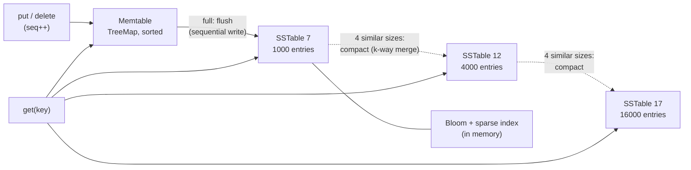

# LSM Trees: Memtables, SSTables, and Compaction

> Write-optimized storage, built with a sorted map and some files.

**Type:** Build
**Languages:** Java, Python, Go
**Prerequisites:** Phase 3 Lesson 01 (Bloom Filters), Phase 3 Lesson 04 (B-Trees), Phase 2 Lesson 01 (Sorting)
**Time:** ~120 minutes

## Learning Objectives

- Explain why a B-tree pays a random page write per insert and how an LSM tree turns every write into a sequential append at the cost of extra work later
- Build the three parts: a sorted in-memory memtable, immutable sorted SSTable files with a Bloom filter and a sparse index, and a size-tiered compaction that merges runs
- Trace the read path and state the read amplification of size-tiered compaction, including why recency must come from sequence numbers rather than file order
- Implement deletes as tombstones and state precisely when a tombstone may be dropped
- Measure write amplification and Bloom-filter skip rate on a payment-status workload and name the production systems that make the same trade

## The Problem

A payment-status service records every state transition of every payment: `created`, `authorized`, `captured`, `settled`, and the occasional `refunded` or `disputed`. On a busy day it receives 40,000 writes per second, each a small key-value pair: a payment ID and a status blob of a few hundred bytes. Reads are rare in comparison: a few hundred per second, mostly for the most recent payments. The first implementation puts the pairs in a B-tree index on an SSD.

The B-tree does what Lesson 04 says it does: every write finds the leaf page for its key and modifies it. Payment IDs are random (they come from the gateway, which issues UUIDs), so every write dirties a different 8 KB page, and 40,000 writes per second means 40,000 dirty pages per second, each of which must eventually be written back whole: 320 MB per second of disk writes to record 10 MB per second of actual data. That is a write amplification of 32. The SSD's sustained write bandwidth is 500 MB per second, so the service runs at 64% of the disk's capacity for a workload whose logical size is 2% of it, and the next doubling of traffic takes it down. The on-call engineer sees it as checkpoint stalls: the database pauses to flush dirty pages, and payments wait.

The log-structured merge tree inverts the trade. Writes go to an in-memory sorted map and, when that fills, the whole map is written to disk as one sorted, immutable file in a single sequential write. No page is ever modified in place. The cost moves to two other places: reads must now look in several files instead of one tree, and the files must periodically be merged (compacted) so their number stays bounded. Both costs are real and both are tunable, which is why every write-heavy store of the last fifteen years (Bigtable, HBase, Cassandra, LevelDB, RocksDB, and the storage engines under CockroachDB, TiKV, and YugabyteDB) is an LSM tree. This lesson builds one in about four hundred lines on top of a `TreeMap`, a byte-array file system, and the Bloom filter from Lesson 01.

## The Concept

### Three components and two background jobs



- **Memtable.** The mutable write buffer: a sorted map in memory. Every `put` and `delete` lands here in `O(log n)`. Because it is sorted, flushing it is a single in-order scan that produces a sorted file. A real engine also appends every write to a write-ahead log so a crash does not lose the memtable; that log is Phase 7, Lesson 02 and is omitted here.
- **SSTable** (Sorted String Table). An immutable file holding sorted key-value entries. Immutability is the whole point: a file that never changes needs no locks for readers, can be written sequentially once, can be cached without invalidation, and can be deleted as a unit when compaction supersedes it. Each table carries two in-memory summaries: a Bloom filter over its keys so a lookup can skip files that cannot contain the key, and a sparse index with the first key of every block so a lookup reads one block, not the file.
- **Compaction.** The background job that merges several SSTables into one, keeping the newest version of each key and discarding the rest. Without it, reads would have to consult an ever-growing list of files.

### The write path

`put(key, value)` increments a global sequence number, stores `(value, seq)` in the memtable, and returns. When the memtable reaches its size limit (1,000 entries in the demo; 64 MB in RocksDB) it is frozen, written as a new SSTable, and replaced with an empty one. The write to disk is one sequential stream of the memtable's entries. Nothing on disk is modified; the new file is simply added to the list.

A delete is also a write: it stores a **tombstone** `(null, tombstone=true, seq)` in the memtable. The old value may be in an SSTable written weeks ago and cannot be touched, so the tombstone is a newer record that says "gone". A reader that finds the tombstone stops; a compaction that merges the tombstone's table with the table holding the old value discards both.

### The read path and read amplification

`get(key)` checks the memtable first; a hit there (value or tombstone) is definitive because the memtable always holds the newest write. Otherwise every SSTable is a candidate. For each one, in order: if the key is outside the table's `[minKey, maxKey]`, skip it (no I/O); if the Bloom filter says the key is absent, skip it (no I/O); otherwise binary-search the sparse index for the block, read that one block, and look for the key. Among the entries found, the one with the highest `seq` wins; if it is a tombstone the answer is "absent".

Why the highest `seq` and not "the first table that has it"? Because size-tiered compaction (below) merges tables by *size*, not by *age*. After a few compactions the list might hold a 16,000-entry table containing a two-hour-old version of key `x` and a 1,000-entry table containing a two-minute-old version. File order no longer encodes recency; the sequence number does. Leveled compaction, which RocksDB defaults to, restores a "newest level first" property for everything below level 0, which is one of its advantages.

The cost of a miss is one Bloom probe per table (a few nanoseconds) plus, for the roughly 1% of tables where the Bloom filter lies, one block read. The demo measures 1,000 lookups of absent keys against 6 tables: 3,003 skipped by range, 2,980 by Bloom, 20 block reads. Without the filters that would have been up to 6,000 block reads. The number of tables a read may have to consult is the **read amplification**; size-tiered compaction keeps it to roughly `tierThreshold * log(n)`, leveled compaction to roughly the number of levels.

### A read, traced

Take the demo's state after the 60,000 writes: six tables, `[16000, 16000, 16000, 4000, 4000, 4000]` entries, memtable empty. The key `pay_000042` was written three times, with `seq` 43, 20043, and 40043, and each version was flushed in a different 1,000-entry table before compaction carried it upward.

```text
get("pay_000042")
  memtable: miss
  table 16000-A  range [pay_000000, pay_015999]: in range; Bloom: maybe; block 2 -> pay_000042 seq 43     "created@..."
  table 16000-B  range [pay_000000, pay_015999]: in range; Bloom: maybe; block 2 -> pay_000042 seq 20043  "authorized@..."
  table 16000-C  range [pay_000000, pay_015999]: in range; Bloom: maybe; block 2 -> pay_000042 seq 40043  "captured@..."
  table  4000-D  range [pay_016000, pay_019999]: out of range, skipped
  table  4000-E  range [pay_016000, pay_019999]: out of range, skipped
  table  4000-F  range [pay_016000, pay_019999]: out of range, skipped
  highest seq = 40043 -> "captured@682401"
```

Three block reads for a hit on a key with three live versions. A B-tree would have done one. That is read amplification, and it is the direct cost of never updating in place: the three versions sit in three files until a compaction brings those files together and the k-way merge discards two of them. The demo's state shows why size-tiered compaction is slow to do that: the three 16,000-entry tables are in the same tier but there are only three of them, one short of the threshold, so they wait.

Now the miss `get("pay_000042x")`, a key that was never written:

```text
  memtable: miss
  tables A, B, C: in range; Bloom: no (3 probes, no I/O)
  tables D, E, F: out of range (no I/O)
  result: absent, zero block reads
```

Across the demo's 1,000 such misses, 20 of 3,000 Bloom probes were false positives and cost a block read each, which is the 0.7% the 10-bits-per-key filter promises.

### Size-tiered compaction

The policy in this lesson is Cassandra's original default. Group the tables by size: a tier is a set of tables whose entry counts are all less than twice the smallest in the set. When a tier holds `tierThreshold` tables (4 in the demo and in Cassandra), merge them into one table of roughly four times the size. That table joins the next tier up, which may itself become full, so compactions cascade: the demo's 60 flushes of 1,000 entries produce 18 compactions and end with tables of sizes `[16000, 16000, 16000, 4000, 4000, 4000]`.

The merge is a k-way merge of sorted runs with a heap, from Phase 1, Lesson 09, with one twist: entries for the same key are ordered newest-first, so the first one popped for a key is kept and the rest are dropped. That is where old versions and overwritten values are reclaimed.

Worked example, memtable limit 4, tier threshold 2:

```text
put a=1, b=2, c=3, d=4        memtable full -> flush -> sst-0 = [a=1 b=2 c=3 d=4]
delete b, put e=5, f=6, g=7   memtable full -> flush -> sst-1 = [b=tomb e=5 f=6 g=7]
                              tier {sst-0 (4), sst-1 (4)} has 2 tables -> compact
k-way merge:  a=1(sst-0)  b: tomb seq 5 beats b=2 seq 2 -> tombstone wins
              c=3  d=4  e=5  f=6  g=7
every table was in this compaction -> no older copy of b can exist anywhere -> drop the tombstone
result: sst-2 = [a c d e f g]; sst-0 and sst-1 deleted; 3 files written, 2 deleted
```

**When may a tombstone be dropped?** Only when no table outside the compaction could hold an older value for its key. If the tombstone's table is compacted with its siblings but the table holding `b=2` is not included, the tombstone must be carried into the output; dropping it would resurrect `b=2`. The lesson uses the simplest safe rule: tombstones are dropped only when the compaction includes every table. Production engines are smarter (RocksDB drops a tombstone when the key's range does not overlap any lower level; Cassandra waits `gc_grace_seconds` so that the tombstone also reaches every replica) but the invariant is the same, and the test suite checks both the drop and the keep case.

### Write amplification, the number you pay for

Each byte the user writes is written to disk once at flush, then again each time its table is compacted. With size-tiered compaction a byte moves up one tier per compaction and there are `log_4(n / memtableLimit)` tiers, so write amplification is roughly the number of tiers plus one. The demo reports 4.25x for 60,000 writes: 1.5 MB of user data became 2.3 MB of live files, after 6.4 MB of total disk writes. Compare the B-tree in The Problem, which wrote whole pages for each random insert at 32x. The comparison is not always in the LSM tree's favour: a B-tree with sequential keys and a warm cache writes each page once when it fills, and leveled compaction, which rewrites a level each time it overflows, has write amplification around 10 to 30 in exchange for its lower read amplification. Picking a compaction strategy is picking a point on the read-write-space triangle.

| | B-tree (Lesson 04) | LSM, size-tiered | LSM, leveled |
|---|---|---|---|
| Write path | modify a page in place (random I/O) | append to memtable, sequential flush | same |
| Write amplification | 1 per page fill, up to page-size/record-size per random insert | about number of tiers (4-6) | 10-30 |
| Read amplification (tables consulted) | 1 tree | `threshold * tiers`, Bloom-filtered | about `levels + L0 files` |
| Space amplification | about 1.4x (fill factor) | up to 2x during compaction, plus shadowed versions | about 1.1x |
| Range scan | leaf chain, one pass | merge across all tables | merge across levels |
| Where it ships | PostgreSQL, InnoDB, SQLite | Cassandra STCS, ScyllaDB, HBase | RocksDB default, LevelDB, CockroachDB |

### The knobs and what they move

The lesson exposes two parameters; production engines expose dozens, but they move the same three quantities.

| Knob | Raising it | Lowering it |
|------|------------|-------------|
| Memtable limit (`memtableLimit`, RocksDB `write_buffer_size`) | Fewer, larger flushes; fewer tables; more RAM at risk on a crash without a log; longer flush pauses | More small tables; more compaction work per byte; faster recovery |
| Tier threshold (`tierThreshold`, Cassandra `min_threshold`) | Fewer compactions and lower write amplification; more tables to consult per read | More frequent compaction; fewer tables; higher write amplification |
| Bloom bits per key (10 in the lesson) | Fewer false-positive block reads (1% at 10 bits, 0.1% at 15); more memory per table | Less memory; more wasted block reads on misses |
| Block size (16 entries here, 4 KB in RocksDB) | Smaller sparse index; more bytes decoded per lookup | Larger index in memory; tighter reads |

Two consequences worth stating. A memtable limit of 1,000 entries, as in the demo, is absurdly small for production and was chosen to make compaction visible within 60,000 writes; RocksDB's 64 MB default would make the whole demo fit in one memtable. And the Bloom filter's memory, about 1.25 bytes per key, is the one component that must stay resident: the demo's six tables need 75 KB of filter for 60,000 entries, and a store with a billion keys needs about 1.25 GB, which is a line item in the capacity plan.

### The invariants, stated

A correct LSM tree promises four things, and `checkInvariants` plus the model-based tests check each one:

1. **Recency.** For every key, the entry with the highest `seq` across the memtable and all tables is the current value; `get` and `range` return it or, if it is a tombstone, nothing.
2. **Immutability.** A written SSTable is never modified; the disk refuses overwrites, and compaction writes a new file before deleting its inputs.
3. **Bounded tiers.** After `maybeCompact` returns, no tier holds `tierThreshold` or more tables, so read amplification is bounded.
4. **Tombstone safety.** A tombstone is dropped only when no table outside the compaction can hold an older value for its key; the test suite has one scenario where it must be kept and one where it must be dropped.

Everything else, the Bloom filters, the sparse index, the block format, is an optimisation that must preserve these four.

### What an LSM tree does not do

- **It is not crash-safe without a log.** The memtable is RAM. Every real engine writes each operation to a write-ahead log before acknowledging it (Phase 7, Lesson 02); this lesson leaves the log out so the structure is visible.
- **It does not give you cheap space.** A deleted or overwritten value occupies disk until compaction reaches it, and a compaction temporarily holds both inputs and output. Capacity planning for an LSM store budgets for about twice the live data.
- **It does not read as fast as a B-tree for point lookups on a cold cache.** A miss may touch several tables' blocks even with Bloom filters; a hit in an old table does too. Workloads that are read-heavy on random keys favour B-trees.
- **It is not concurrent here.** A production engine flushes and compacts on background threads while serving writes; this lesson runs them inline on the writing thread so the tests are deterministic. The design question that concurrency raises, how readers see a consistent snapshot while a compaction swaps files, is answered by immutability plus a versioned manifest, which is Exercise 3.

## Build It

### Step 1: Entries, sequence numbers, and tombstones

```java
record Entry(String value, boolean tombstone, long seq) {
    static Entry value(String v, long seq) { return new Entry(v, false, seq); }
    static Entry tombstone(long seq) { return new Entry(null, true, seq); }
}
```

Every write carries the global sequence number at which it happened. The structure never compares timestamps or file positions to decide recency; it compares `seq`. A tombstone is an `Entry` with no value and the flag set, which keeps the file format uniform: a tombstone is written exactly like a value with an empty string.

**Predict:** two tables both contain key `x`, one with `seq=40` and one with `seq=35`. Which one is in the older file? Can you tell?

### Step 2: The memtable

```java
final class Memtable {
    private final TreeMap<String, Entry> map = new TreeMap<>();
    void put(String key, Entry entry) { map.put(key, entry); /* track approximate bytes */ }
    Entry get(String key) { return map.get(key); }
    NavigableMap<String, Entry> entries() { return map; }
}
```

A `TreeMap`, the red-black tree from Lesson 03, is the memtable. `put` on an existing key replaces the entry, so the memtable holds exactly one version per key, the newest. RocksDB uses a skip list (Lesson 07) here because it needs concurrent writers; the single-threaded lesson does not. The flush will iterate `entries()` in order, which is what makes the output file sorted for free.

### Step 3: A simulated disk of immutable files

```java
final class SimulatedDisk {
    private final Map<String, byte[]> files = new LinkedHashMap<>();
    long bytesWritten, bytesRead, filesWritten, filesDeleted;

    void write(String name, byte[] data) {
        if (files.containsKey(name)) throw new IllegalStateException("files are immutable: " + name);
        files.put(name, data.clone());
        bytesWritten += data.length; filesWritten++;
    }
    byte[] read(String name) { /* clone + count */ }
    void delete(String name) { if (files.remove(name) != null) filesDeleted++; }
}
```

The disk refuses to overwrite a file. That one check enforces the design's central discipline: once an SSTable is written, the only operations on it are read and delete. The byte counters are what the demo reports as write amplification, and the fact that they are exact and deterministic is why the lesson simulates the file system instead of using `java.nio.file`.

**Predict:** why does `write` clone the array it is given, and what bug would appear in the compaction test if it did not?

### Step 4: Writing an SSTable with its Bloom filter and sparse index

```java
static SSTable write(SimulatedDisk disk, String fileName, NavigableMap<String, Entry> sorted) {
    ByteArrayOutputStream bytes = new ByteArrayOutputStream();
    DataOutputStream out = new DataOutputStream(bytes);
    BloomFilter bloom = new BloomFilter(sorted.size());
    out.writeInt(sorted.size());
    int i = 0;
    for (Map.Entry<String, Entry> e : sorted.entrySet()) {
        if (i % BLOCK_ENTRIES == 0) { sparseKeys.add(e.getKey()); sparseOffsets.add(out.size()); }
        out.writeUTF(e.getKey());
        out.writeLong(e.getValue().seq());
        out.writeBoolean(e.getValue().tombstone());
        out.writeUTF(e.getValue().tombstone() ? "" : e.getValue().value());
        bloom.add(e.getKey());
        i++;
    }
    disk.write(fileName, bytes.toByteArray());
    /* return the handle holding bloom, sparseKeys, sparseOffsets, minKey, maxKey */
}
```

The file is a count followed by entries in key order, each self-delimiting (`writeUTF` prefixes a length). Every 16th entry starts a block and its key and byte offset go into the sparse index, so the index is 1/16 the size of the key set and lives in memory. The Bloom filter is built in the same pass. In RocksDB the filter and index are written into the file as separate blocks and loaded on open; here they stay with the handle, which is equivalent for a single process.

**Predict:** a table has 100 entries. How many blocks does it have, and what are the indexes of the entries in the last block?

### Step 5: Reading one block, not the file

```java
Entry get(String key) {
    if (minKey == null || key.compareTo(minKey) < 0 || key.compareTo(maxKey) > 0) { rangeNegatives++; return null; }
    if (!bloom.mightContain(key)) { bloomNegatives++; return null; }
    int block = blockFor(key);
    for (Map.Entry<String, Entry> e : readBlock(block).entrySet()) {
        int c = e.getKey().compareTo(key);
        if (c == 0) return e.getValue();
        if (c > 0) break;
    }
    return null;
}

int blockFor(String key) {       // last sparse key <= key
    int lo = 0, hi = sparseKeys.size() - 1;
    while (lo < hi) {
        int mid = (lo + hi + 1) >>> 1;
        if (sparseKeys.get(mid).compareTo(key) <= 0) lo = mid; else hi = mid - 1;
    }
    return lo;
}
```

Three filters before any I/O: range, Bloom, then one block decode. The counters let the demo and the tests show exactly which filter answered. `blockFor` is an upper-bound binary search: the block whose first key is the largest one not exceeding the target. A false positive from the Bloom filter costs one block read and finds nothing, which is the 20 block reads in the demo's 6,000 probes.

### Step 6: Flush

```java
void flush() {
    if (memtable.isEmpty()) return;
    SSTable t = SSTable.write(disk, "sst-" + (nextFileId++) + ".db", memtable.entries());
    tables.add(t);
    memtable = new Memtable();
    flushes++;
    maybeCompact();
}
```

Freeze, write, replace, then see whether the new table filled a tier. In a production engine the frozen memtable stays readable while a background thread writes it, so writers never wait; the lesson does it inline.

### Step 7: Compaction by k-way merge

```java
void compact(List<SSTable> chosen) {
    boolean everything = chosen.size() == tables.size();
    PriorityQueue<Cursor> heap = new PriorityQueue<>((a, b) -> {
        int c = a.head.getKey().compareTo(b.head.getKey());
        return c != 0 ? c : Long.compare(b.head.getValue().seq(), a.head.getValue().seq());   // newest first on ties
    });
    for (SSTable t : chosen) { var it = t.readAll().entrySet().iterator(); if (it.hasNext()) heap.add(new Cursor(it.next(), it)); }
    TreeMap<String, Entry> merged = new TreeMap<>();
    String lastKey = null;
    while (!heap.isEmpty()) {
        Cursor c = heap.poll();
        String k = c.head.getKey();
        if (!k.equals(lastKey)) {
            lastKey = k;
            Entry e = c.head.getValue();
            if (!(e.tombstone() && everything)) merged.put(k, e);
        }
        if (c.rest.hasNext()) heap.add(new Cursor(c.rest.next(), c.rest));
    }
    for (SSTable t : chosen) { tables.remove(t); disk.delete(t.fileName); }
    if (!merged.isEmpty()) tables.add(SSTable.write(disk, "sst-" + (nextFileId++) + ".db", merged));
}
```

The heap orders cursors by key, then by descending `seq`, so for each key the first cursor popped holds the newest version; subsequent cursors for the same key are skipped by the `lastKey` check. The tombstone rule is the one from The Concept. Inputs are deleted only after the output is written, which is the order a crash-safe engine needs too (plus a manifest update, which is the exercise).

**Predict:** three tables are compacted but a fourth, older one is not. A key has a tombstone in one of the three and a value in the fourth. What does the output contain for that key, and what happens on `get`?

### Step 8: Choosing a tier

```java
private List<SSTable> fullTier() {
    List<SSTable> sorted = new ArrayList<>(tables);
    sorted.sort((a, b) -> Integer.compare(a.entryCount, b.entryCount));
    for (int i = 0; i < sorted.size(); i++) {
        List<SSTable> tier = new ArrayList<>();
        int base = Math.max(1, sorted.get(i).entryCount);
        for (int j = i; j < sorted.size() && sorted.get(j).entryCount < 2L * base; j++) tier.add(sorted.get(j));
        if (tier.size() >= tierThreshold) return tier;
    }
    return null;
}
```

Sort by size, and for each starting table collect the tables less than twice its size. The first group that reaches the threshold is compacted; `maybeCompact` loops until no group does. The strict `<` matters: with `<=`, a 4-entry merged table and a 2-entry fresh one would be one tier and the cascade would never settle into distinct sizes. The test file has a scenario that fails with `<=`.

### Step 9: Run it

```bash
cd phases/03-systems-data-structures/05-lsm-trees/code/java
javac -d .out *.java && java -cp .out Main
java -cp .out MainTest
```

Expected output, abbreviated:

```console
== Payment status store: 20,000 payments, each updated three times ==
flushes=60 compactions=18 tables=6 memtable=0 entries
disk: 6 files, 2,293,278 bytes; user wrote 1,513,254 bytes; write amplification 4.25x
table sizes (entries): [16000, 16000, 16000, 4000, 4000, 4000]

== Read path: highest seq wins, Bloom filters skip the rest ==
pay_000042 -> captured@682401  (the third write; earlier versions are shadowed)
1000 misses consulted 6000 tables: 3003 rejected by key range, 2980 by Bloom, 20 block reads (false positives)

== Deletes are writes: tombstones ==
after delete, pay_000042 -> null (tombstone in the memtable shadows the table)
after flush, pay_000042 -> null (tombstone now in the newest table)

== Forcing compaction down to one table drops the tombstone ==
tables=1, keys=[a, c, d, e, f, g], b -> null
files written=3 deleted=2 (compaction rewrote, then removed the inputs)
```

### In Python

`code/python/main.py` has the same classes (`Entry`, `Hashing`, `BloomFilter`, `SimulatedDisk`, `Memtable`, `SSTable`, `LsmTree`) and the same file format byte for byte, so the demo's disk totals and write amplification match Java's exactly. Four things differ:

- **No sorted map in the standard library.** `Memtable` is a plain `dict`, and `entries()` returns `dict(sorted(...))`, a key-ordered snapshot, at flush time. That is `O(n log n)` once per flush instead of `O(log n)` per put, which is fine for a write buffer of 1,000 entries. Every "sorted map" the Java code passes around (SSTable input, decoded blocks, compaction output) is an insertion-ordered `dict` built in key order.
- **`struct` replaces `DataOutputStream`.** `writeInt`, `writeLong`, and `writeBoolean` become `struct.pack(">i")` and `struct.pack(">q?")`. `writeUTF` is not plain UTF-8: it writes a 2-byte length and then *modified* UTF-8 (NUL as `C0 80`, characters outside the BMP as two 3-byte surrogates). `write_utf` and `read_utf` implement exactly that, and a test pins the bytes against Java's output.
- **`heapq` with a tuple key is the k-way merge.** The tuple sorts by key, then by negated `seq` so the newest version pops first, with the table index as a tie-breaker so iterators are never compared:

```python
heap.append((head[0], -head[1].seq, idx, head[1], it))  # key, then newest first on ties
...
k, _, idx, e, it = heapq.heappop(heap)
if k != last_key:  # first occurrence of k is the newest
```

- **Names that collide.** Java's `Entry.value(v, seq)` and `Entry.tombstone(seq)` factories share names with the record's fields, which a frozen dataclass cannot express, so they are `Entry.of_value` and `Entry.of_tombstone`. Bloom-filter hashes are masked to 64 bits after every multiply so they equal Java's `long` values. The demo uses `JavaRandom` (a bit-exact `java.util.Random`), so the payment statuses and every counter match line for line.

```bash
cd phases/03-systems-data-structures/05-lsm-trees/code/python
python3 main.py
python3 -m unittest -v
```

### In Go

`code/go/main.go` has the same types (`Entry`, `BloomFilter`, `SimulatedDisk`, `Memtable`, `SSTable`, `LsmTree`) and the same file format byte for byte, so the demo's disk totals, table sizes, and write amplification match Java's exactly. Four things differ:

- **No ordered map in the standard library.** `sortedmap.go` is a small `SortedMap`: a sorted `[]string` of keys found with `sort.SearchStrings` plus a `map[string]Entry`. It stands in for every `TreeMap` the Java passes around (memtable, decoded blocks, compaction output) and offers `Keys`, `FirstKey`, `LastKey`, `SubMap(lo, hi)`, and `Equal`. `fullTier` uses `slices.SortStableFunc` because Java's `List.sort` is stable and the order of same-size tables decides which tier compacts first.
- **`encoding/binary` replaces `DataOutputStream`.** `writeInt`, `writeLong`, and `writeBoolean` become big-endian appends. `writeUTF` is not plain UTF-8: it writes a 2-byte length and then *modified* UTF-8 (NUL as `C0 80`, characters outside the BMP as two 3-byte surrogates), so `writeUTF` and `readUTF` encode via `unicode/utf16` and a test pins the bytes against Java's output. Reads use `io.ReadFull`, because a `bytes.Reader` reports `EOF` even for a zero-length read when the empty tombstone value is the last thing in the file.
- **`container/heap` is the k-way merge.** A `cursorHeap` orders cursors by key, then by descending `Seq` so the newest version pops first:

```go
func (h cursorHeap) Less(i, j int) bool {
    if h[i].key() != h[j].key() {
        return h[i].key() < h[j].key()
    }
    return h[i].entry().Seq > h[j].entry().Seq // newest first on ties
}
```

- **Absence and errors are values.** `Get` returns `(string, bool)` because Go strings cannot be null, which also removes Java's "null value is not a delete" path: `Delete` is the only way to write a tombstone. `SimulatedDisk.Write` returns `ErrIllegalState` for a second write to the same name, `NewLsmTree` returns `ErrInvalidArgument` for bad limits, and `CheckInvariants` returns an error instead of throwing. `Range` returns `[]KV` in key order rather than a `NavigableMap`. The demo uses `JavaRandom` (`javarandom.go`, a bit-exact `java.util.Random`), so the payment statuses and every counter match line for line.

```bash
cd phases/03-systems-data-structures/05-lsm-trees/code/go
go run .
go test ./...
```

## Use It

### RocksDB and LevelDB

RocksDB (Meta's fork of Google's LevelDB) is the LSM tree most systems embed: CockroachDB and TiKV used it for years, Kafka Streams and Flink use it for state, and many payment companies use it under their ledgers. Its memtable is a concurrent skip list, its SSTables have block-based format with an index block, a filter block, and compression, and its default compaction is leveled: level 0 holds freshly flushed files that may overlap, and each level `L >= 1` is a single sorted run ten times larger than the one above. Reads consult L0 files newest-first and then at most one file per level. Its wiki pages on compaction and on write amplification are the practitioner's reference for the trade-offs table above, and `rocksdb.stats` reports read, write, and space amplification per level.

### Apache Cassandra and ScyllaDB

Cassandra's `SizeTieredCompactionStrategy` is this lesson's policy with `min_threshold=4` and bucket bounds of 0.5 and 1.5 times the average size instead of the lesson's factor of two. Its `LeveledCompactionStrategy` is LevelDB's. Tombstones are kept for `gc_grace_seconds` (ten days by default) so that a replica that was down receives the delete before the tombstone disappears; a tombstone that is dropped before every replica has seen it resurrects the data on the next repair, which is the distributed version of the "keep the tombstone" rule from Step 7.

### HBase and Bigtable

The 2006 Bigtable paper introduced the memtable/SSTable vocabulary and the three-tier compaction (minor, merging, major). HBase is its open-source descendant; a "major compaction" is the "everything" case where tombstones can finally be dropped.

### Where an LSM tree shows up in a payments stack

Three places, typically. First, event and state stores with high write rates and recency-skewed reads: payment status, webhook delivery attempts, idempotency keys with a TTL. Second, stream-processing state: a Kafka Streams or Flink job that joins authorizations with captures keeps its per-key state in an embedded RocksDB, and its throughput ceiling is RocksDB's compaction, not the CPU. Third, the storage layer under distributed SQL databases (CockroachDB's Pebble, TiKV, YugabyteDB's DocDB) that ledgers increasingly run on; when such a database shows p99 latency spikes every few minutes, the first graph to open is compaction backlog. The one place an LSM tree is usually wrong is the ledger's balance table itself, where reads of random accounts dominate and every read must be fast: that stays on a B-tree.

### What the engines add that this lesson left out

A write-ahead log for the memtable; a manifest file recording the current set of SSTables so that a crash between "write output" and "delete inputs" is recoverable; block compression; per-level Bloom filters with prefix support; snapshots (a reader pins a `seq` and ignores newer entries, which the sequence-number design already allows); and rate-limited background compaction so flushes never stall writers. The structure is the same.

## Ship It

`outputs/runbook-lsm-store-operations.md` is an operations runbook for a service backed by an LSM store (RocksDB, Cassandra, or an in-house engine): the four amplification numbers to graph and their healthy ranges, what a compaction backlog looks like and how to relieve it, why deletes do not free space immediately and how to plan capacity, tombstone pitfalls (wide deletes, TTL scans), and the checklist for a safe compaction-strategy change.

## Exercises

1. **Reinforce.** Add `snapshot()` returning the current `seq`, and `get(key, snapshotSeq)` that ignores every entry with a higher `seq`. Show with a test that a reader holding a snapshot still sees `pay_000042` after a later `delete` and flush. Then explain why compaction must not drop a version that some open snapshot can still see, and add that rule to `compact`.
2. **Apply.** Implement leveled compaction alongside size-tiered: level 0 accepts flushed tables as they are; when level 0 holds 4 tables, merge them with all of level 1's tables that overlap their key range into new level-1 tables of at most 1,000 entries each, and so on with a 10x size ratio per level. Measure write amplification and the average number of tables consulted per `get` on the demo's workload under both strategies, and present the two numbers side by side.
3. **Extend.** Combine this lesson with Phase 7, Lesson 02 (Write-Ahead Logs). Add a `Manifest` file on the `SimulatedDisk` listing the live SSTable file names, rewritten atomically (write new, delete old) after every flush and compaction, and a `WriteAheadLog` that records every `put` and `delete` before the memtable accepts it. Then write a crash test: at a random point during a compaction, discard the in-memory `LsmTree`, build a new one from the disk alone (manifest plus log replay), and assert every key still returns what the model says.

## Key Terms

| Term | What people say | What it actually means |
|------|-----------------|------------------------|
| Memtable | "the write buffer" | A sorted in-memory map holding the newest version of each recently written key; frozen and flushed as one sorted file when full |
| SSTable | "a data file" | Sorted String Table: an immutable file of key-ordered entries with an in-memory Bloom filter and sparse index; read and deleted, never modified |
| Tombstone | "a delete marker" | A newer entry recording that a key was deleted, needed because the old value sits in an immutable file; dropped only when no older copy can exist outside the compaction |
| Compaction | "garbage collection for the files" | A k-way merge of several SSTables into one, keeping the highest-seq entry per key; bounds the number of files a read must consult |
| Size-tiered compaction | "Cassandra's default" | Merge tables of similar size when enough accumulate; low write amplification, higher read and space amplification |
| Write amplification | "how much extra the disk writes" | Bytes written to disk divided by bytes the application wrote; about the number of tiers for size-tiered, 10-30 for leveled, up to page-size/record-size for a random-key B-tree |
| Read amplification | "how many places a read looks" | The number of tables or blocks a lookup may touch; Bloom filters reduce the block reads but not the Bloom probes |

## Further Reading

- [O'Neil, Cheng, Gawlick, O'Neil, "The Log-Structured Merge-Tree (LSM-Tree)" (1996)](https://www.cs.umb.edu/~poneil/lsmtree.pdf) — the original paper; the cost model comparing in-place B-tree writes with rolling merges is Section 3.
- [Chang et al., "Bigtable: A Distributed Storage System for Structured Data" (2006)](https://research.google/pubs/pub27898/) — introduced memtable, SSTable, and minor/merging/major compaction; Section 5.3 is the read and write path this lesson follows.
- [RocksDB Wiki: Compaction](https://github.com/facebook/rocksdb/wiki/Compaction) — leveled versus universal (size-tiered) compaction with the read/write/space amplification trade-offs stated plainly.
- [RocksDB Wiki: RocksDB Bloom Filter](https://github.com/facebook/rocksdb/wiki/RocksDB-Bloom-Filter) — full and partitioned filters, bits per key, and the measured effect on point-lookup I/O.
- [Apache Cassandra documentation: Compaction](https://cassandra.apache.org/doc/latest/cassandra/managing/operating/compaction/index.html) — STCS and LCS parameters, `gc_grace_seconds`, and the tombstone rules in a replicated setting.
- [Dong et al., "Optimizing Space Amplification in RocksDB" (CIDR 2017)](https://www.cidrdb.org/cidr2017/papers/p82-dong-cidr17.pdf) — why Meta tuned for space rather than write amplification and what it cost.
