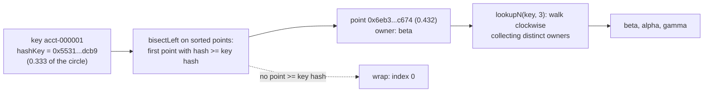
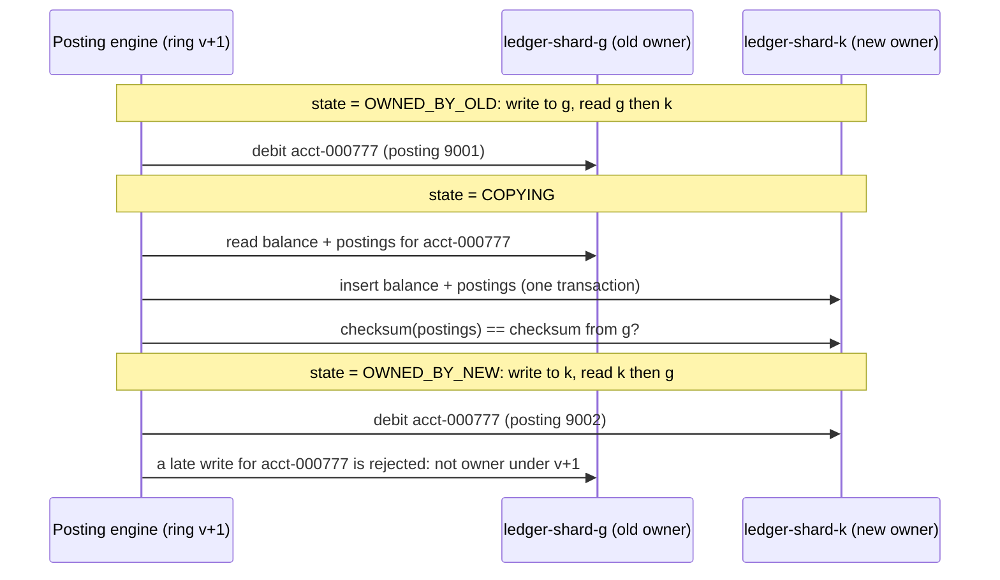

# Consistent Hashing and Virtual Nodes

> Add a shard and move 1/N of the keys instead of all of them.

**Type:** Build
**Languages:** Java, Python, Go
**Prerequisites:** Phase 1, Lesson 06 (Hash Maps from Scratch), Phase 1, Lesson 07 (Hash Functions and Collisions), Phase 2, Lesson 02 (Binary Search and Its Variants), Phase 3, Lesson 01 (Bloom Filters)
**Time:** ~90 minutes

## Learning Objectives

- Explain why `hash(key) mod N` remaps almost every key when N changes and quantify the fraction that moves
- Build a hash ring as a sorted array of points with binary-search lookup, add and remove nodes, and prove the monotonicity property with a test
- Measure the load imbalance of a ring with one point per node and show how virtual nodes bring it within a few percent of ideal
- Derive a replication preference list by walking the ring to the next N distinct physical nodes
- Place the ring correctly in a ledger architecture: what it decides, what it does not move, and why every client must hold the identical ring

## The Problem

A ledger service stores account balances and postings across eight PostgreSQL shards. The routing rule is one line: `shard = hash(account_id) mod 8`. Every service that touches the ledger, the posting engine, the balance API, the reconciliation job, and the statement generator, has a copy of that line. It has worked for three years.

The shards are at 78% disk and growing 3% a month, so the team adds a ninth. With `mod 9`, the account `acct-000123` whose hash is `0xd43c…0057` moves from shard 7 to shard 2, and so does almost everyone else: by the arithmetic of the remainder, a key stays on the same shard under `mod 8` and `mod 9` only by coincidence, which happens for about one key in nine. Eight ninths of all accounts, their balances, and their posting history have to move to a different database before the new rule can be switched on. During the move, a posting engine running the old rule and a balance API running the new rule read and write different shards for the same account. The balance a customer sees is not the balance the posting engine debits. The team schedules a maintenance window, freezes postings for four hours on a Sunday, copies 89% of the data, flips a feature flag in every service at once, and hopes nothing was missed. The second time they need to add a shard, they look for a better rule.

The same failure appears at every layer where a key is routed to one of N homes. A memcached pool loses most of its hit rate when a node is added, because every key now hashes to a different server and the one that holds it is never asked. A Kafka topic whose partition count is increased stops guaranteeing per-key ordering, because the default partitioner is `murmur2(key) mod partitions` and old and new records for the same account land in different partitions. An HTTP load balancer that pins a merchant's webhook deliveries to one worker for in-order processing scatters them when a worker is added.

Consistent hashing is the rule that changes the arithmetic. Instead of mapping keys to a slot number that depends on N, it maps keys and nodes to the same 64-bit circle and gives each key to the next node clockwise. Adding a node then takes keys only from its clockwise neighbour, about 1/(N+1) of the total, and every other key stays exactly where it was. The ninth ledger shard receives one ninth of the accounts, those accounts can be migrated one at a time while both rules are live, and nothing else moves.

## The Concept

### Keys and nodes on the same circle

Take the range of a 64-bit hash, `[0, 2^64)`, and bend it into a circle so that `2^64 - 1` is next to `0`. Hash every node's name onto the circle; these are the ring's points. Hash a key onto the same circle; the key belongs to the first point you meet walking clockwise (increasing hash), wrapping around past the top if necessary. That is the whole mechanism. Everything else in the lesson is about making its guarantees quantitative.

Karger et al. (1997) named four properties, and the first two are the ones that matter in production:

- **Monotonicity.** When a node is added, keys move only from existing nodes to the new node, never between existing nodes. When a node is removed, only its keys move. The tests check this directly: after `addNode(k)`, every key's owner is either unchanged or `k`.
- **Balance.** Each node gets about the same number of keys. With one point per node this is only true on average, and the variance is large; virtual nodes fix it, below.
- **Spread** and **load** concern many clients with different views of the membership; the lesson treats them in the "what it does not do" paragraph, because the fix is operational, not algorithmic.



### A ring by hand

Three nodes, `alpha`, `beta`, `gamma`, each with three virtual nodes (the point for replica `i` of node `n` is `hashKey(n + "#" + i)`). The nine points, sorted, with their position as a fraction of the circle:

| Position | Hash (hex, abbreviated) | Owner |
|----------|-------------------------|-------|
| 0.034 | `08d0…383e` | alpha |
| 0.051 | `0d08…ad50` | alpha |
| 0.062 | `0fef…5fc` | beta |
| 0.084 | `1564…06ff` | gamma |
| 0.432 | `6eb3…c674` | beta |
| 0.531 | `880c…7979` | alpha |
| 0.596 | `9872…b3ff` | gamma |
| 0.643 | `a4ab…55c0` | beta |
| 0.930 | `ee19…e15c` | gamma |

Now route `acct-000001`, whose `hashKey` is `0x5531a9b58386dcb9`, at position 0.333. Binary search for the first point at or above 0.333: that is 0.432, owned by `beta`. So `lookup("acct-000001") = beta`. For a replication list of three, keep walking: 0.531 is `alpha` (new, take it), 0.596 is `gamma` (new, take it), and we have three distinct owners: `[beta, alpha, gamma]`. Had the next point also been `beta`, it would have been skipped; the preference list counts physical nodes, not points.

Route `acct-000002` (position 0.265): the first point at or above is again 0.432, `beta`. Any key between 0.084 and 0.432, more than a third of the circle, belongs to `beta` through that single point. That is the imbalance virtual nodes exist to fix.

A key at position 0.95 finds no point at or above it; the search returns the array length, which the lookup maps to index 0, and the key belongs to `alpha` at 0.034. This is the wrap, and it is the one branch in the lookup.

### Why mod-N moves everything and the ring moves 1/(N+1)

Under `hash mod N`, a key's shard is the remainder, and changing the divisor changes the remainder for all but a 1/(N+1) fraction of keys. The demo measures it: adding an eleventh shard to ten moves 90.6% of 20,000 accounts (expected 10/11 = 0.909).

On the ring, the new node's points land at `V` positions and each one claims the arc between itself and the previous point. Those arcs were owned by whichever node's point came next; those are the only keys that move. With `V` points per node and `N` nodes already present, the new node's expected share is `V / ((N+1)V) = 1/(N+1)`. The demo measures 7.7% moved for the same eleventh shard (ideal 9.1%; the shortfall is the variance of the new node's arcs), and asserts that 0 keys moved anywhere except to the new node.

Removal is the mirror image: the removed node's keys go to the next point clockwise, which may belong to several different nodes, and every key not on the removed node keeps its owner. The demo removes `ledger-shard-c`, which held 8.9% of the keys, and confirms that all 18,219 keys that were not on it are unmoved.

### Virtual nodes and the balance problem

With one point per node, the arc each node owns is the gap between consecutive random points on a circle. Those gaps are far from uniform: the largest of N random gaps is about `ln(N)/N` of the circle rather than `1/N`, so with ten nodes the busiest can hold two to three times its share. The demo with 10 shards, 20,000 accounts, and one point each measures a maximum load 3.24 times the mean.

Virtual nodes give each physical node `V` points, so its total arc is the sum of `V` random gaps, and sums of independent random variables concentrate: the coefficient of variation falls roughly as `1/sqrt(V)`.

| Points per node | Max load / mean | Coefficient of variation | Rough 1/sqrt(V) |
|-----------------|-----------------|--------------------------|-----------------|
| 1 | 3.239 | 1.042 | 1.000 |
| 10 | 1.238 | 0.198 | 0.316 |
| 100 | 1.119 | 0.083 | 0.100 |
| 1000 | 1.074 | 0.045 | 0.032 |

A hundred or so points per node is the usual production setting (Cassandra's original default was 256 tokens per node; libketama uses 160 points per server, scaled by weight). Beyond that, the ring's memory and the cost of membership changes grow while the balance improves slowly. The second use of virtual nodes is heterogeneous capacity: a node with twice the disk gets twice the points and therefore twice the keys, with no other change to the algorithm.

### Complexity

| Operation | Cost | Why |
|-----------|------|-----|
| `lookup(key)` | O(log P), P = N·V points | One hash and one binary search over the sorted array |
| `lookupN(key, n)` | O(log P + steps) | The binary search plus a clockwise walk until n distinct owners are collected; in practice a few dozen steps |
| `addNode` | O(V·P) with array insert; O(V log P) with a balanced tree | Membership changes are rare; the array keeps lookups cache-friendly, which is what matters |
| `removeNode` | O(P) | One filtering pass |
| memory | O(P) | 16 bytes per point: 1,000 nodes at 256 points each is 4 MB |

A `TreeMap<Long, String>` (Java) or `sort.Search` over a slice (Go) would give the same lookup complexity; the lesson uses parallel sorted arrays because binary search on a contiguous array is the fastest version and because it exposes the wrap as an explicit `pos == length` check rather than a `ceilingEntry` returning `null`.

### Replication: the preference list

A ledger that must survive the loss of a shard keeps each account on more than one. On the ring, the natural replica set for a key is its owner plus the next `n - 1` distinct physical nodes clockwise, which Dynamo calls the preference list. Three properties fall out:

- The list is a pure function of the key and the ring, so every client computes the same one without coordination.
- When the owner fails, the first replica is already the next point clockwise, so it becomes the owner with no data movement: the test `replicas_survive_losing_the_owner` asserts exactly this.
- "Distinct" means distinct physical nodes. With virtual nodes, the next point clockwise is often another point of the same node, which must be skipped or the "replica" would sit on the same disk as the primary.

Rack- or zone-awareness is the same walk with a stricter distinctness test (skip any node in a zone already represented), and is how Cassandra's `NetworkTopologyStrategy` and DynamoDB's multi-AZ placement extend the idea.

### Sharding a ledger by account id

The shard key for a ledger is the account id, and the reason is the invariant from Phase 10: an account's balance is the sum of its postings, so every posting for an account must be readable from one place with one transaction. Hashing the account id puts all of `acct-000123`'s postings, its balance row, and its open holds on `ledger-shard-c`, and a debit is a single-shard transaction. A transfer between two accounts on different shards is a two-shard operation, which is why the ledger lessons in Phase 10 and the transaction lessons in Phase 7 treat cross-shard transfers as the hard case and route around them where they can (a platform account per shard, for instance).

Once the ring has decided that `acct-000777` moves from shard `g` to the new shard `k`, the migration for that one account is a small state machine, and the ring's monotonicity is what makes it small: only the moved set, about 1/(N+1) of accounts, ever enters it.



Two details matter. First, the ring version travels with every request, so a shard can refuse a write from a client that is routing on a stale ring; without that check a posting engine that has not reloaded the ring writes posting 9003 to shard `g` after the cutover, and the account's balance is split across two databases with no error anywhere. Second, the checksum is over the ordered postings, not just the balance, because two shards can agree on a balance while disagreeing on the history that produced it. The runbook in `outputs/` carries both checks.

### The alternatives

| Scheme | Lookup | Memory | Keys moved on add | Weakness |
|--------|--------|--------|-------------------|----------|
| `hash mod N` | O(1) | O(1) | about N/(N+1) | Everything moves |
| Hash ring with V points per node | O(log NV) | O(NV) | about 1/(N+1) | Balance needs V around 100; ring must be identical everywhere |
| Rendezvous (HRW) hashing | O(N) | O(N) | exactly 1/(N+1) | Lookup is linear in N; fine for N under a few hundred |
| Jump consistent hash (Lamping and Veach 2014) | O(log N) | O(1) | exactly 1/(N+1) | Nodes are numbered 0..N-1, so only the last node can be removed |
| Maglev (Google 2016) | O(1) | O(M), M a prime around 65,537 or larger | small, not minimal | Table rebuild on any change; built for load balancers, not storage |
| Fixed slots (Redis Cluster, 16,384 slots) | O(1) | O(slots) | whatever the operator moves | Rebalancing is a manual slot migration, but migration is explicit and resumable |

### What a hash ring does not do

- It does not move data. `addNode` changes the answer to `lookup`; the accounts that now belong to the new shard are still stored on the old one until something copies them. The ring tells you exactly which 1/(N+1) of keys to migrate, which is what makes the migration tractable, but a dual-read or dual-write period and a cutover per key are still your job. `outputs/runbook-resharding-with-a-hash-ring.md` is that plan.
- It does not guarantee balance of *load*, only of *keys*. One merchant with a million postings a day is one key. Hot keys need a different split (by time, by sub-account) or Google's bounded-loads variant, which caps each node at `c` times the mean and spills to the next point.
- It does not know who is alive. Membership comes from configuration, a coordination service, or gossip; the ring is a pure function of that membership. Two clients with different membership lists compute different owners, and for a ledger that is a split-brain write. Version the membership and refuse to route on a stale version.
- It does not make hashes agree across languages for free. The point hash is `mix64(fnv1a64(name + "#" + i))` in all three implementations here, and the tests assert `acct-000123` lands on `ledger-shard-c` in each. Change the hash in one service and that service alone routes every account differently.

## Build It

The primary walkthrough is in Java. The Python and Go files implement the same design with the same names; the subsections at the end show only what differs.

### Step 1: The point hash

```java
static long hashKey(String key) {
    return mix64(fnv1a64(key.getBytes(StandardCharsets.UTF_8)));
}
```

The same FNV-1a and `fmix64` as Lesson 01. FNV-1a alone would be a poor ring hash: `ledger-shard-a#0` through `ledger-shard-a#99` differ in their last bytes, and FNV's low output bits are strongly correlated for inputs that differ only at the end, so the points of one node would cluster. The finaliser spreads them. The ring compares hashes as unsigned 64-bit values; in Java that means `Long.compareUnsigned` everywhere a `<` would otherwise appear.

**Predict:** if you dropped `mix64` and used raw FNV-1a, would `lookup` still be correct? What would change?

### Step 2: The sorted points and the search

```java
final class HashRing {
    final int virtualNodes;
    private final List<Long> hashes = new ArrayList<>();
    private final List<String> owners = new ArrayList<>();
    private final TreeSet<String> nodes = new TreeSet<>();

    private int bisectLeft(long h) {
        int lo = 0, hi = hashes.size();
        while (lo < hi) {
            int mid = (lo + hi) >>> 1;
            if (Long.compareUnsigned(hashes.get(mid), h) < 0) lo = mid + 1; else hi = mid;
        }
        return lo;
    }
}
```

Two parallel lists, hashes and owners, kept sorted by hash. `bisectLeft` is the lower-bound binary search from Phase 2, Lesson 02: the first index whose hash is at least `h`, or `size()` if there is none. That "or `size()`" is the wrap case, handled one layer up. `(lo + hi) >>> 1` avoids the overflow that `(lo + hi) / 2` has for arrays above a billion elements; it does not matter here, but it is the form to write by reflex.

**Predict:** with the nine-point ring from The Concept, what does `bisectLeft` return for a key at position 0.95? For one at position 0.034 exactly?

### Step 3: Adding a node

```java
static long pointHash(String node, int replica) {
    return Hashing.hashKey(node + "#" + replica);
}

void addNode(String node) {
    if (nodes.contains(node)) throw new IllegalArgumentException("node already on ring: " + node);
    for (int i = 0; i < virtualNodes; i++) {
        long h = pointHash(node, i);
        int pos = bisectLeft(h);
        while (pos < hashes.size() && hashes.get(pos) == h && owners.get(pos).compareTo(node) < 0) pos++;
        hashes.add(pos, h);
        owners.add(pos, node);
    }
    nodes.add(node);
}
```

Each virtual node is inserted at its sorted position. The `while` handles the case of two points with identical hashes, which for 64-bit hashes you will not see in practice, but which would otherwise make the ring's order depend on insertion order: ties are broken by owner name so Java, Python, and Go build the same ring from the same membership regardless of the order nodes were added. Duplicates are rejected, because adding the same node twice would double its share silently.

**Predict:** after adding `alpha`, `beta`, `gamma` with three virtual nodes each, what does `pointCount()` return, and what does `nodes()` return?

### Step 4: Lookup, with the wrap

```java
private int firstIndexAtOrAfter(long h) {
    int pos = bisectLeft(h);
    return pos == hashes.size() ? 0 : pos;
}

String lookup(String key) {
    if (hashes.isEmpty()) throw new IllegalStateException("ring is empty");
    return owners.get(firstIndexAtOrAfter(Hashing.hashKey(key)));
}
```

One hash, one binary search, one branch. An empty ring is an error rather than a `null`: a ledger service that gets no shard for an account must fail the request, not write it to a default.

**Predict:** a ring with a single node and 100 virtual nodes: what does `lookup` return for any key, and how many comparisons does the binary search make?

### Step 5: The preference list

```java
List<String> lookupN(String key, int n) {
    if (n <= 0) throw new IllegalArgumentException("n must be positive");
    if (hashes.isEmpty()) throw new IllegalStateException("ring is empty");
    int start = firstIndexAtOrAfter(Hashing.hashKey(key));
    List<String> result = new ArrayList<>();
    int total = hashes.size();
    for (int step = 0; step < total; step++) {
        String owner = owners.get((start + step) % total);
        if (!result.contains(owner)) {
            result.add(owner);
            if (result.size() == n || result.size() == nodes.size()) break;
        }
    }
    return result;
}
```

Walk clockwise from the owner's point, collecting owners not yet seen, until `n` distinct nodes are found or every node has been seen. The modulo makes the walk wrap. The `result.size() == nodes.size()` check stops the walk early when `n` exceeds the number of physical nodes, so `lookupN(key, 8)` on a five-node ring returns five, each once. `result.contains` is a linear scan over a list of at most `n` entries, which is faster than a hash set for the `n` of 2 to 5 you will actually use.

**Predict:** why does the first element of `lookupN(key, n)` always equal `lookup(key)`?

### Step 6: Removing a node and measuring movement

```java
void removeNode(String node) {
    if (!nodes.contains(node)) throw new IllegalArgumentException("node not on ring: " + node);
    for (int i = owners.size() - 1; i >= 0; i--) {
        if (owners.get(i).equals(node)) {
            owners.remove(i);
            hashes.remove(i);
        }
    }
    nodes.remove(node);
}

static double fractionMoved(Map<String, String> before, Map<String, String> after) {
    if (before.isEmpty()) return 0.0;
    int moved = 0;
    for (Map.Entry<String, String> e : before.entrySet()) {
        if (!after.get(e.getKey()).equals(e.getValue())) moved++;
    }
    return (double) moved / before.size();
}
```

Removal walks backwards so that removing an element does not shift the indexes still to be visited. `fractionMoved` takes two assignments (key to owner maps over the same key set) and counts disagreements; it is the number the whole lesson is about, and it is how the tests pin the ring at about 1/11 and mod-N at about 10/11 for the same membership change.

**Predict:** after `removeNode("ledger-shard-c")`, which node receives `acct-000123`, whose preference list was `[c, d, e]`?

### Step 7: Run it

```bash
cd phases/03-systems-data-structures/06-consistent-hashing/code/java
javac -d .out *.java && java -cp .out Main
java -cp .out MainTest
```

Expected output, abbreviated:

```console
== Where an account lands ==
hashKey("acct-000123") = 0xd43cbef4d0200057
1000 points on the ring for 10 shards
lookup("acct-000123") = ledger-shard-c
lookupN("acct-000123", 3) = [ledger-shard-c, ledger-shard-d, ledger-shard-e]  (owner + 2 replicas)

== Adding an eleventh shard: how many accounts move? ==
consistent hash ring: 0.077 of keys moved (ideal 1/11 = 0.091)
hash(key) mod N:      0.906 of keys moved (expected 10/11 = 0.909)
ring: 1543 keys moved to the new shard, 0 moved anywhere else

== Removing a shard: only its keys move ==
18219 keys not on shard-c kept their owner (out of 18219)

== Virtual nodes and balance (10 shards, 20,000 accounts) ==
vnodes  max/mean  coeff. of variation
     1     3.239                1.042
   100     1.119                0.083
```

The line to keep is `0 moved anywhere else`. That zero is monotonicity, and it is the difference between migrating 1,543 accounts with both rules live and freezing the ledger for a Sunday.

### In Python

```python
def _first_index_at_or_after(self, h: int) -> int:
    pos = bisect.bisect_left(self._hashes, h)
    return 0 if pos == len(self._hashes) else pos
```

Differences, all in `code/python/main.py`:

- **`bisect` is the standard library's lower bound.** `bisect_left` on a sorted list is exactly `bisectLeft`; the Java version spells it out because the JDK's `Collections.binarySearch` returns an insertion point encoded as a negative number and does not support unsigned comparison.
- **Unsigned is free.** Python integers are unbounded and non-negative here, so the hashes sort correctly with plain `<`; the 64-bit masking lives inside `fnv1a64` and `mix64`.
- **`LookupError` for an empty ring**, the base class of `KeyError` and `IndexError`, which is what "no owner for this key" is.

### In Go

```go
func (r *HashRing) bisectLeft(h uint64) int {
    return sort.Search(len(r.points), func(i int) bool { return r.points[i].hash >= h })
}
```

Differences, all in `code/go/main.go`:

- **`sort.Search` is the lower bound.** It returns the smallest index for which the predicate is true, or `n`, which is the same contract as `bisectLeft`.
- **A slice of `point{hash, owner}` structs** rather than two parallel lists; insertion uses `append` plus `copy` to shift the tail, the idiomatic Go way to insert into a slice.
- **Errors are values.** `Lookup` and `LookupN` return `(value, error)`, with `ErrEmptyRing`, `ErrNodeExists`, `ErrNodeMissing`, and `ErrBadParameter` as sentinels for `errors.Is`. `Assign` panics on an empty ring because it is a demo and test helper, not an API.
- **`uint64` compares unsigned natively**, so there is no `compareUnsigned` anywhere.

## Use It

### Cassandra and Dynamo

Cassandra's token ring is this structure with a 64-bit Murmur3 partitioner. Each node owns `num_tokens` virtual nodes; the original default of 256 was lowered to 16 in Cassandra 4.0 because the newer `allocate_tokens_for_local_replication_factor` option places tokens deliberately to balance load rather than relying on randomness, which is the same observation as the table in The Concept read in reverse: fewer, better-placed points beat many random ones. `nodetool ring` prints the points; `nodetool status` prints the per-node ownership percentage, which is the `loadPerNode` measurement. The Dynamo paper (DeCandia et al., 2007) describes the same ring, the preference list, and the operational lesson that one point per node was unbalanced enough that they moved to virtual nodes, and then to fixed equal-size partitions assigned to nodes, in production.

### Memcached, nginx, and Envoy

libketama, the consistent hashing library written for memcached clients, places 160 points per server scaled by weight and is the reason adding a cache node costs a few percent of hit rate rather than all of it. nginx's `hash $request_uri consistent` directive uses the ketama algorithm. Envoy offers `RING_HASH` (this lesson, with a configurable minimum ring size that is the `P` in the complexity table) and `MAGLEV` (a lookup table with O(1) lookup and slightly more movement on membership change) as load-balancing policies, and the choice between them is the trade-off in the alternatives table.

### Kafka's partitioner, as a contrast

Kafka's default partitioner is `murmur2(key) mod numPartitions`, deliberately. Partitions are not nodes; they are the unit of ordering, and the rule is that the partition count is fixed for the life of a topic whose consumers depend on per-key order. Increasing it reroutes keys exactly as the mod-N ledger did. The lesson is that mod-N is correct when N never changes, and a ring is correct when it does.

### Redis Cluster's slots

Redis Cluster hashes keys to one of 16,384 fixed slots with CRC16 and keeps a slot-to-node table. Resharding moves whole slots, and a client that hits a slot mid-migration gets `-ASK` or `-MOVED` redirections. This is the "fixed slots" row of the table: the ring's automatic 1/(N+1) movement is traded for explicit, resumable, observable migration, which for a ledger is often the better deal. Either way, the migration protocol is the part the ring does not give you.

### Jump hash and bounded loads

Lamping and Veach's jump consistent hash computes the owner in O(log N) with no memory at all and exactly minimal movement, at the price that nodes are numbered 0..N-1 and only the highest can be removed, which makes it ideal for sharding a storage backend whose shard count only grows. Mirrokni, Thorup, and Zadimoghaddam's "consistent hashing with bounded loads" (2016, deployed at Google and Vimeo) adds a capacity cap of `c` times the average per node and spills a key to the next point when its owner is full, which addresses the hot-key weakness above.

## Ship It

`outputs/runbook-resharding-with-a-hash-ring.md` is a runbook for adding or removing a shard behind a hash ring with no write freeze: computing the moved set, versioning the ring, the dual-read window, per-key cutover, and the checks that prove nothing was lost. Use it the next time the disk graph says a ninth shard is coming.

## Exercises

1. **Reinforce.** Add weights: `addNode(node, weight)` gives a node `weight * virtualNodes` points. Build a ring with three nodes of weights 1, 1, and 2, assign 20,000 account ids, and assert that the heavy node holds between 45% and 55% of them. Then explain why a weight of 100 with `virtualNodes = 100` is a bad idea for a ring that also has weight-1 nodes.
2. **Apply.** Implement jump consistent hash from the Lamping and Veach paper (it is nine lines) with the same `hashKey`, and compare it with the ring on the same 20,000 keys: fraction moved when going from 10 to 11 shards, imbalance with no virtual nodes at all, and what happens when you try to remove shard 3 of 11. Write the comparison as a table in your test's docstring.
3. **Extend.** Build the migration coordinator the runbook describes: given a ring before and after `addNode`, compute the moved key set, then process it in batches with a per-key state (`OWNED_BY_OLD`, `COPYING`, `OWNED_BY_NEW`) and a read path that consults the Bloom filter from Phase 3, Lesson 01 to decide whether a key is "possibly migrated" before looking up its state. Measure how many state lookups the filter saves at 1% false positives when 10% of keys have been migrated.

## Key Terms

| Term | What people say | What it actually means |
|------|-----------------|------------------------|
| Hash ring | "the ring" | A sorted array of (hash, node) points over the 64-bit hash space treated as a circle; a key belongs to the first point clockwise from its own hash |
| Virtual node | "vnode", "token", "replica point" | One of V points a single physical node places on the ring; more points means the node's total arc is a sum of V random gaps and its share concentrates around 1/N |
| Monotonicity | "only the new node's keys move" | Karger's property that a membership change moves keys only to or from the node that changed; the tests assert it directly |
| Preference list | "the replicas", "the replica set" | The owner plus the next n-1 distinct physical nodes clockwise, a pure function of key and ring that every client computes identically |
| Fraction moved | "how much reshuffles" | Share of keys whose owner differs between two assignments; about 1/(N+1) for a ring and about N/(N+1) for mod-N when adding one node |
| Coefficient of variation | "how balanced it is" | Standard deviation of per-node load divided by the mean; falls roughly as 1/sqrt(V) with V virtual nodes |
| Rendezvous hashing | "highest random weight" | Each key scores every node by hash(key, node) and picks the highest; minimal movement, O(N) lookup, no ring to keep in sync |
| Split-brain routing | "two services disagree about the shard" | Two clients with different membership views computing different owners for the same key; for a ledger, a write to the wrong shard |

## Further Reading

- [Karger et al., "Consistent Hashing and Random Trees: Distributed Caching Protocols for Relieving Hot Spots on the World Wide Web" (STOC 1997)](https://dl.acm.org/doi/10.1145/258533.258660) — the original paper; Section 4 defines balance, monotonicity, spread, and load.
- [DeCandia et al., "Dynamo: Amazon's Highly Available Key-value Store" (SOSP 2007)](https://www.allthingsdistributed.com/files/amazon-dynamo-sosp2007.pdf) — Sections 4.2 and 6.2 on the ring, virtual nodes, the preference list, and the three partitioning strategies they tried in production.
- [Lamping and Veach, "A Fast, Minimal Memory, Consistent Hash Algorithm" (2014)](https://arxiv.org/abs/1406.2294) — jump consistent hash, for Exercise 2 and the alternatives table.
- [Mirrokni, Thorup, Zadimoghaddam, "Consistent Hashing with Bounded Loads" (2016)](https://arxiv.org/abs/1608.01350) — the hot-node fix, with the Google and Vimeo deployment notes.
- [Thaler and Ravishankar, "Using Name-Based Mappings to Increase Hit Rates" (IEEE/ACM ToN 1998)](https://ieeexplore.ieee.org/document/660853) — rendezvous (highest random weight) hashing, the ring's main competitor.
- [Apache Cassandra documentation: Dynamo-style architecture](https://cassandra.apache.org/doc/latest/cassandra/architecture/dynamo.html) — the token ring, `num_tokens`, and token allocation as deployed.
- [Redis Cluster specification](https://redis.io/docs/latest/operate/oss_and_stack/reference/cluster-spec/) — the fixed-slot alternative, with the `MOVED` and `ASK` migration protocol.
