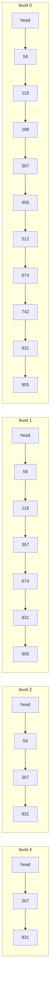

# Skip Lists

> The probabilistic ordered structure inside Redis sorted sets.

**Type:** Build
**Languages:** Java
**Prerequisites:** Phase 3, Lesson 03 (Balanced Trees: AVL and Red-Black), Phase 1, Lesson 04 (Linked Lists), Phase 0, Lesson 08 (Probability for Engineers)
**Time:** ~60 minutes

## Learning Objectives

- Explain how a linked list with randomly promoted express lanes achieves expected `O(log n)` search without any rebalancing
- Build insert, search, and delete with Redis-style spans so that rank-by-key and key-by-rank are also `O(log n)`
- Measure the level distribution and the search cost against Pugh's analysis, and show that insertion order has no effect on either
- Demonstrate the one failure mode, a biased or broken coin, and explain why the randomness must come from the structure and never from the keys
- State why Redis chose a skip list for sorted sets and why the JDK chose one for `ConcurrentSkipListMap`, where balanced trees would have been the textbook answer

## The Problem

A risk service maintains, for each acquiring region, a live ranking of merchants by rolling chargeback rate. Three operations hit it at about 50,000 per second combined: update a merchant's score (which moves it in the ranking), ask a merchant's current rank ("you are in the worst 2%"), and page through the top 100. The first implementation is a `TreeMap<Score, Merchant>` behind a lock. It is correct, and it is `O(log n)` for updates and for "top 100", but "what is this merchant's rank" is `O(n)`: `TreeMap` has no rank operation, so the code counts with `headMap(score).size()`, which walks the subtree. At 300,000 merchants per region that is a few milliseconds per rank query under the lock, and the lock is what every other operation is waiting for.

A second team hits the same wall from the other direction. Their in-memory order index for pending settlements is a red-black tree shared across sixteen threads. Rotations change three pointers at once, so the tree cannot be made lock-free without a great deal of machinery; it is protected by a single mutex, and profiling shows the threads spend more time contending for it than inserting. The `java.util.concurrent` package has no concurrent red-black tree, and the reason is the same: rotations.

Both teams end up on the same structure. A skip list is a sorted linked list with extra "express lane" pointers chosen by coin flips. Its search is expected `O(log n)` with no rebalancing at all, because the balance comes from the randomness and not from the data; a rank query is `O(log n)` if each pointer records how many nodes it skips; and an insert is a local splice of a few pointers at known positions, which is exactly the shape a lock-free algorithm can handle with compare-and-swap. Redis uses it for sorted sets (`ZADD`, `ZRANK`, `ZRANGE`), the JDK uses it for `ConcurrentSkipListMap`, and LevelDB and RocksDB use it for their memtables. This lesson builds the Redis version, with spans, from an injected random source so every run is reproducible.

## The Concept

### Express lanes over a linked list

A sorted singly linked list finds a key in `O(n)`. Add a second list containing every other node, with pointers down to the full list, and a search can skip two at a time, then drop down: about `n/2 + 1` steps. Add a third list over every fourth node: `n/4 + 2`. With `log2(n)` such lists a search takes about `2 log2(n)` steps, like a balanced tree. The trouble is maintaining "every other node" under insertions, which would require shifting the whole upper structure.

Pugh's idea in 1990 was to make the lanes random instead of regular. Each node is assigned a level by flipping a coin: level 1 with probability `1 - p`, level 2 with probability `p(1 - p)`, level 3 with `p^2(1 - p)`, and so on. A node at level `k` appears in lists 1 through `k`. With `p = 1/2`, about half the nodes are in the second list, a quarter in the third, an eighth in the fourth, which is what the regular version wanted, but on average rather than exactly, and the average is maintained automatically: a new node's level is independent of every other node's, so inserting it never requires touching anything but its own neighbours at each level.



That is the demo's ten-key list (level 3, identical to level 4, is omitted). The coin flips, in insertion order 742, 118, 905, 367, 512, 288, 674, 59, 831, 456, gave levels 1, 2, 2, 5, 1, 1, 2, 3, 5, 1. Six nodes reached level 2, three reached level 3, two reached level 4 and 5.

### Search

Start at the head on the highest level in use. Move forward while the next key is less than the target; when it is not, step down one level and continue. At level 0, the next node is either the target or the proof that it is absent.

Searching for 456 in the list above:

```text
level 4: head -> 367 (367 < 456, advance); next is 831 (> 456), step down         1 move, 1 failed comparison
level 3: at 367; next is 831, step down                                           1 failed comparison
level 2: at 367; next is 831, step down                                           1 failed comparison
level 1: at 367; next is 674, step down                                           1 failed comparison
level 0: at 367; next is 456 = target                                             1 comparison, found
total: 6 comparisons for 10 keys
```

Pugh's analysis gives the expected number of comparisons as about `log_(1/p)(n) / p + 1 / (1 - p)`. For `p = 1/2` that is `2 log2(n) + 2`; the demo measures 32.5 comparisons per search on 100,000 keys against the formula's 33.2. The constant is worse than a red-black tree's (which does at most `2 log2(n)` comparisons and typically fewer), and the structure uses more pointers; what it buys is the absence of any rebalancing step.

### Insert and the `update` array

Insertion is a search that remembers, at each level, the last node it visited before stepping down: the `update[i]` array. These are exactly the nodes whose level-`i` forward pointer must be redirected to the new node. Flip the coin to get the new node's level `k`, then for each level `i < k`, splice: `node.forward[i] = update[i].forward[i]; update[i].forward[i] = node`. Nothing else in the list changes. If `k` exceeds the current number of levels in use, the head's new levels point straight at the new node.

The coin must be fair in a specific sense: the level of a node must be independent of its key and of every other node's level. The demo includes a list whose "coin" always returns level 1; it is a correct sorted linked list, and a search in it takes 11,364 comparisons for 20,000 keys. A coin that depended on the key (say, `key % 2`) would let an adversary, or just an unlucky key distribution, produce the same degradation. The randomness is the balancing mechanism, and it must come from a source the keys cannot influence. That is also why insertion *order* is irrelevant: inserting sorted keys, which destroys a plain BST (Lesson 03), gives a skip list the same shape as random keys. The demo measures 33.1 comparisons per search after 100,000 sorted inserts.

### Spans: rank in `O(log n)`

Redis adds one integer to each forward pointer: `span[i]`, the number of level-0 steps that following `forward[i]` jumps over. The head's level-4 pointer to 367 has span 4 because 367 is the fourth key; 367's level-0 pointer to 456 has span 1. With spans, a search accumulates the rank of the node it stands on, so `rank(key)` is a search, and `byRank(r)` is a search that compares accumulated spans against `r` instead of comparing keys.

```text
rank(512):
level 4: head -> 367, traversed += 4 (span of head.forward[4]); next 831 > 512, step down
levels 3, 2: no movement
level 1: at 367; next 674 > 512, step down
level 0: 367 -> 456 (traversed 5), 456 -> 512 (traversed 6); 512 == target -> rank 6
```

Worked insert by hand. The demo's last insert is 456, into the nine-key list `59(3) 118(2) 288(1) 367(5) 512(1) 674(2) 742(1) 831(5) 905(2)` (levels in parentheses); the coin gives 456 level 1.

```text
search, recording update[] and rank[]:
  level 4: head -> 367 (rank 4); next 831 > 456            update[4] = 367, rank[4] = 4
  level 3: at 367; next 831                                 update[3] = 367, rank[3] = 4
  level 2: at 367; next 831                                 update[2] = 367, rank[2] = 4
  level 1: at 367; next 674 > 456                           update[1] = 367, rank[1] = 4
  level 0: at 367; next 512 > 456                           update[0] = 367, rank[0] = 4
splice at level 0 only (new node has level 1):
  456.forward[0] = 512;  367.forward[0] = 456
  456.span[0] = 367.span[0] - (rank[0] - rank[0]) = 1 - 0 = 1
  367.span[0] = (rank[0] - rank[0]) + 1 = 1
levels 1..4 now jump over one more node:
  367.span[1] (to 674): 2 -> 3      367.span[2..4] (to 831): 4 -> 5
head spans unchanged: head.span[3..4] to 367 is still 4, because 456 sits after 367
```

Two pointer writes and five span updates, all on nodes the search had already visited. Compare a red-black insert, which may recolour and rotate nodes the search never saw.

Maintaining spans on insert is the only intricate part of the structure. During the search, record `rank[i]`, the rank of `update[i]`. After splicing the new node in at level `i`, the pointer from `update[i]` to the new node spans `rank[0] - rank[i] + 1` (the distance from `update[i]` to the new node's position), and the new node's own pointer at level `i` spans whatever `update[i]` used to span minus that. Every level above the new node's level has one more node under it, so its span grows by one. Delete reverses it. The invariant checker verifies every span by walking level 0 and confirming that `base[position + span - 1]` is the node the pointer reaches.

### The probabilistic guarantees, precisely

| Quantity | Expected value | Notes |
|----------|----------------|-------|
| Nodes at level `>= i` | `n * p^(i-1)` | measured 49,875 / 24,841 / 12,484 for 100,000 keys at `p = 1/2` against 50,000 / 25,000 / 12,500 |
| Levels in use | about `log_(1/p)(n)` | 17 for 100,000 keys; `maxLevel` caps it at `ceil(log_(1/p)(n))` to bound the arrays |
| Pointers per node | `1 / (1 - p)` | 2 at `p = 1/2`, 1.33 at `p = 1/4`; Redis uses `p = 1/4` to save memory |
| Comparisons per search | `log_(1/p)(n) / p + 1 / (1 - p)` | 33 at `p = 1/2`, 35 at `p = 1/4` for 100,000 keys |
| Worst case | `O(n)` | probability that a search exceeds `c * log n` falls as `n^(-c')`; a skip list with a million keys is more likely to be hit by a cosmic ray than to be 10x slower than expected |

The guarantee is about the expectation over coin flips, not over inputs, and that distinction is the whole point: there is no bad input, only bad luck, and bad luck is quantifiable and does not persist.

### Choosing `p`

`p` trades memory for comparisons. Pugh's table, for `n = 2^16`:

| `p` | Pointers per node | Expected comparisons (relative) | Who uses it |
|-----|-------------------|----------------------------------|-------------|
| 1/2 | 2.00 | 1.00 | this lesson, `ConcurrentSkipListMap` |
| 1/e | 1.58 | 0.94 | the theoretical optimum for comparisons |
| 1/4 | 1.33 | 1.00 | Redis, LevelDB, RocksDB |
| 1/8 | 1.14 | 1.33 | rarely |

`p = 1/4` costs the same comparisons as `1/2` in expectation (fewer levels to descend, more steps per level) with a third less pointer memory, which is why the three production implementations that care about memory all chose it. The variance of search time is higher at smaller `p`, which is why a latency-sensitive in-memory map might stay at `1/2`. Exercise 2 measures the difference.

### Skip list versus balanced tree

| | Red-black tree (Lesson 03) | Skip list |
|---|---|---|
| Balance comes from | invariants repaired by rotations | random levels; no repair step |
| Worst-case search | `2 log2(n)`, guaranteed | `O(n)`, with vanishing probability |
| Insert touches | the path plus up to 2 rotations (3 pointers each) | `k` pointers at known positions, `k` geometric with mean 2 |
| Rank by key | `O(n)` in `TreeMap`; `O(log n)` with subtree sizes | `O(log n)` with spans |
| Concurrency | hard: rotations are multi-pointer | natural: each level's splice is one CAS |
| Memory | 2 child pointers + colour per node | about `1/(1-p)` pointers + spans per node |
| Determinism | yes | needs a seeded RNG for reproducible tests |

### What a skip list does not do

- **It does not give worst-case bounds.** A payment system that needs a hard latency bound on every operation (rare) should use a deterministic structure.
- **It does not play well with disks.** Like a binary tree, each node is a separate allocation and a search is a chain of dependent loads; a B-tree (Lesson 04) is the on-disk answer. Skip lists live in RAM: memtables, caches, in-memory indexes.
- **It is not smaller than a tree.** At `p = 1/2` it uses about the same pointer memory as a binary tree; at `p = 1/4`, less, at the cost of about 6% more comparisons.
- **This lesson's version is not concurrent.** It is single-threaded and deterministic so the invariants can be tested. The concurrent version in `ConcurrentSkipListMap` is Exercise 3's reading.

## Build It

### Step 1: Nodes with forward pointers and spans

```java
static final class Node<K, V> {
    final K key;
    V value;
    final Node<K, V>[] forward;   // forward[i]: next node at level i
    final int[] span;             // span[i]: level-0 steps that forward[i] jumps over

    Node(K key, V value, int levels) {
        this.key = key; this.value = value;
        this.forward = (Node<K, V>[]) new Node[levels];
        this.span = new int[levels];
    }
}
```

A node's arrays are sized to its own level, so a level-1 node costs one pointer and one int and a level-5 node costs five of each. The header is a node with `maxLevel` levels and no key.

### Step 2: The coin, injected

```java
SkipList(int maxLevel, double p, Random rng) {
    this.levelSource = () -> {
        int lvl = 1;
        while (lvl < maxLevel && rng.nextDouble() < p) lvl++;
        return lvl;
    };
    this.header = new Node<>(null, null, maxLevel);
}

static <K, V> int defaultMaxLevel(int expectedSize, double p) {
    return Math.max(1, (int) Math.ceil(Math.log(expectedSize) / Math.log(1.0 / p)));
}
```

The level generator is an `IntSupplier` built from a caller-supplied `Random`, so a test can seed it and a demo can replace it with `() -> 1` to show the degenerate case. `maxLevel` is `log_(1/p)(n)` for the expected size; levels beyond that would almost never be used and only cost array space in the header.

**Predict:** with `p = 1/2`, what is the probability that a node gets level 5 or more, and roughly how many such nodes are there among 100,000?

### Step 3: Search

```java
V get(K key) {
    Node<K, V> x = header;
    for (int i = level - 1; i >= 0; i--) {
        while (x.forward[i] != null && x.forward[i].key.compareTo(key) < 0) { x = x.forward[i]; searchSteps++; }
        searchSteps++;                 // the comparison that failed, sending us down a level
    }
    x = x.forward[0];
    return x != null && x.key.compareTo(key) == 0 ? x.value : null;
}
```

Six lines, and the counter is there so the demo can report comparisons per search and compare them with Pugh's formula. `level` is the number of levels currently in use, not `maxLevel`, so an empty list searches one level.

### Step 4: Insert with ranks and spans

```java
void put(K key, V value) {
    Node<K, V>[] update = (Node<K, V>[]) new Node[maxLevel];
    int[] rank = new int[maxLevel];
    Node<K, V> x = header;
    for (int i = level - 1; i >= 0; i--) {
        rank[i] = i == level - 1 ? 0 : rank[i + 1];
        while (x.forward[i] != null && x.forward[i].key.compareTo(key) < 0) { rank[i] += x.span[i]; x = x.forward[i]; }
        update[i] = x;
    }
    Node<K, V> existing = x.forward[0];
    if (existing != null && existing.key.compareTo(key) == 0) { existing.value = value; return; }

    int lvl = randomLevel();
    if (lvl > level) {
        for (int i = level; i < lvl; i++) { rank[i] = 0; update[i] = header; update[i].span[i] = size; }
        level = lvl;
    }
    Node<K, V> node = new Node<>(key, value, lvl);
    for (int i = 0; i < lvl; i++) {
        node.forward[i] = update[i].forward[i];
        update[i].forward[i] = node;
        node.span[i] = update[i].span[i] - (rank[0] - rank[i]);
        update[i].span[i] = (rank[0] - rank[i]) + 1;
    }
    for (int i = lvl; i < level; i++) update[i].span[i]++;
    size++;
}
```

This is `zslInsert` from Redis's `t_zset.c` with the names kept. `rank[i]` is the rank of `update[i]`; `rank[0]` is therefore the rank of the new node's predecessor, and the new node's rank is `rank[0] + 1`. The pointer from `update[i]` to the new node must span `rank[0] + 1 - rank[i]`, and the new node inherits the remainder of what `update[i]` used to span. When the list grows a level, the header's new pointer spans the entire current list (`size`) before the splice adjusts it.

**Predict:** a new node gets level 1 (the common case). How many pointers change, and how many spans?

### Step 5: Delete

```java
boolean remove(K key) {
    Node<K, V>[] update = (Node<K, V>[]) new Node[maxLevel];
    Node<K, V> x = header;
    for (int i = level - 1; i >= 0; i--) {
        while (x.forward[i] != null && x.forward[i].key.compareTo(key) < 0) x = x.forward[i];
        update[i] = x;
    }
    x = x.forward[0];
    if (x == null || x.key.compareTo(key) != 0) return false;
    for (int i = 0; i < level; i++) {
        if (update[i].forward[i] == x) { update[i].span[i] += x.span[i] - 1; update[i].forward[i] = x.forward[i]; }
        else update[i].span[i]--;
    }
    while (level > 1 && header.forward[level - 1] == null) level--;
    size--;
    return true;
}
```

At every level where `update[i]` pointed at the victim, bypass it and absorb its span (minus one for the victim itself). At levels above the victim's height, `update[i]` pointed over it, so its span just shrinks by one. If the top level is now empty, lower `level`. No rebalancing; the coin flips of the remaining nodes are still independent, so the structure is still a valid random skip list.

**Predict:** why is `update[i].forward[i] == x` the right test for "this level contains the victim", rather than `i < x.forward.length`?

### Step 6: Rank and byRank

```java
int rank(K key) {
    int traversed = 0;
    Node<K, V> x = header;
    for (int i = level - 1; i >= 0; i--) {
        while (x.forward[i] != null && x.forward[i].key.compareTo(key) <= 0) { traversed += x.span[i]; x = x.forward[i]; }
        if (x != header && x.key.compareTo(key) == 0) return traversed;
    }
    return 0;
}

K byRank(int r) {
    if (r < 1 || r > size) return null;
    int traversed = 0;
    Node<K, V> x = header;
    for (int i = level - 1; i >= 0; i--) {
        while (x.forward[i] != null && traversed + x.span[i] <= r) { traversed += x.span[i]; x = x.forward[i]; }
        if (traversed == r) return x.key;
    }
    return null;
}
```

`rank` uses `<=` so that it lands *on* the target rather than before it. `byRank` is the same descent with the comparison on accumulated spans. These are `ZRANK` and `ZRANGE start stop` in Redis, and they are the operations that `TreeMap` cannot do in logarithmic time.

### Step 7: The invariant checker

```java
boolean checkInvariants() {
    List<K> base = keys();
    /* level 0 holds exactly size keys, sorted */
    for (int i = 0; i < level; i++) {
        int position = 0;
        for (Node<K, V> x = header; x.forward[i] != null; x = x.forward[i]) {
            int target = position + x.span[i];
            if (target < 1 || target > size || !base.get(target - 1).equals(x.forward[i].key))
                throw new IllegalStateException("span mismatch at level " + i);
            position = target;
        }
        if (i == 0 && position != size) throw new IllegalStateException("level 0 spans do not reach the end");
    }
    return true;
}
```

Every span at every level is checked against the level-0 sequence: following `forward[i]` from a node at rank `position` must land on the key at rank `position + span[i]`. This is the test that catches an off-by-one in Step 4 or Step 5 immediately; the tests run it after every batch of mutations and after a 50,000-key randomized comparison with `TreeMap`.

### Step 8: Run it

```bash
cd phases/03-systems-data-structures/07-skip-lists/code/java
javac -d .out *.java && java -cp .out Main
java -cp .out MainTest
```

Expected output, abbreviated:

```console
== Merchant risk scores as a sorted set (Redis ZADD / ZRANK / ZRANGE) ==
sorted: [59, 118, 288, 367, 456, 512, 674, 742, 831, 905]
rank of 512 = 6, key at rank 3 = 288, scores in [300, 700] = [367, 456, 512, 674]
levels in use: 5, nodes per level: [10, 6, 3, 2, 2]

== 100,000 keys: the geometric level distribution ==
level  0: 100000 nodes  (expected n/2^0 = 100000)
level  1:  49875 nodes  (expected n/2^1 =  50000)
level  2:  24841 nodes  (expected n/2^2 =  25000)

== Search cost: measured pointer steps vs Pugh's bound ==
average comparisons per get = 32.5, Pugh's expectation log2(n)/p = 33.2, log2(n) = 16.6

== Sorted inserts do not hurt: the shape depends on coins, not on keys ==
sorted input: levels=17, average steps per get = 33.1

== What the coin buys: a list whose coin always says 1 is a linked list ==
level=1, average steps per get = 11364 (n/2 = 10000)
```

### Porting notes

Python ports directly with lists of forward pointers per node and `random.Random(seed)` injected; comparisons use `<` on keys, and the degenerate-coin demo passes a lambda. Go uses `[]*Node` and `[]int` per node, `*rand.Rand` from `rand.New(rand.NewSource(seed))`, and generics `[K cmp.Ordered, V any]`. The one real port concern is the concurrent variant: in Go a lock-free skip list needs `atomic.Pointer` for every forward pointer and the Fraser/Harris marking trick for deletes, and tests must run under `-race`; this lesson's single-threaded design needs none of that.

## Use It

### Redis sorted sets

A Redis sorted set is a hash table from member to score plus a skip list ordered by `(score, member)` with spans, exactly this lesson's structure. `ZADD` is `put`, `ZSCORE` is the hash lookup, `ZRANK` is `rank`, `ZRANGE key 0 99` is `byRank` followed by a walk along level 0, `ZRANGEBYSCORE` is `range`, and `ZREM` is `remove`. Redis uses `p = 1/4` and `maxLevel = 32`, and switches to a compact listpack encoding below 128 members because the skip list's pointers are not worth it for tiny sets. The author's stated reasons for choosing a skip list over a balanced tree were that it is not much more memory intensive once `p` is tuned, that `ZRANGE` and `ZREVRANGE` are a simple linked-list walk, and that it is simpler to implement, debug, and extend, as when spans were added to make `ZRANK` logarithmic. For the merchant-ranking service in The Problem, Redis gives all three operations in `O(log n)` from a single sorted set.

### `java.util.concurrent.ConcurrentSkipListMap`

The JDK's concurrent ordered map is a lock-free skip list. Lesson 03 noted that `TreeMap` has no concurrent counterpart; this is why. Each insert is a CAS on one level-0 pointer to make the node visible, followed by CASes to link its index levels, which can fail and be retried independently without affecting correctness. Deletes mark a node before unlinking it so that concurrent readers never see a half-removed structure. The result is a `NavigableMap` with `ceilingKey`, `subMap`, `pollFirstEntry` and the rest, safe under any number of threads with no lock. Its one gap: `size()` is `O(n)` and not atomic, and there is no rank operation, because maintaining spans under concurrent modification would need exactly the kind of multi-pointer update the design avoids.

### LevelDB and RocksDB memtables

Both engines (Lesson 05) use a skip list as the memtable: writers insert under a lightweight lock while readers traverse without one, because an insert never moves or modifies an existing node, only splices a new one in after it is fully built. The sorted order is what makes a flush a sequential scan.

### What the production versions add

Redis stores a backward pointer at level 0 for `ZREVRANGE`. `ConcurrentSkipListMap` separates data nodes from index nodes to shrink memory. RocksDB's `InlineSkipList` allocates a node's pointers inline with its key for cache locality and supports concurrent inserts with per-level CAS. None change the mechanism you built.

## Ship It

`outputs/interview-card-skip-lists.md` is a one-page card: the mechanism, the expected-cost formula and the level distribution, the span bookkeeping, the three production users and why each chose it, the biased-coin failure, and the decision rule for skip list versus red-black tree versus B-tree.

## Exercises

1. **Reinforce.** Add a `backward` pointer at level 0 (as Redis does) and implement `rangeReversed(hi, lo)` and `byRankReversed(r)`. Update `remove` to maintain the backward pointer and extend `checkInvariants` to verify that following `backward` from the tail reproduces `keys()` reversed.
2. **Apply.** Change `p` to `1/4` and `maxLevel` accordingly, and measure comparisons per search, levels in use, and total pointer count (sum of `forward.length` over all nodes) for 100,000 keys against `p = 1/2`. Report the memory saving and the search cost increase, and explain in two sentences why Redis chose `1/4`.
3. **Extend.** Read the Javadoc and the class comment of `java.util.concurrent.ConcurrentSkipListMap` (the comment is a complete description of the algorithm). Then combine this lesson with Phase 4, Lesson 03 (Compare-and-Swap and Lock-Free Structures): make `put` for level 0 lock-free using `AtomicReference` forward pointers and a CAS loop, keep the index levels under a lock, and write a test with eight threads inserting disjoint key ranges that passes `checkInvariants` afterwards. State which of the invariants spans would break under concurrent updates and why the JDK left them out.

## Key Terms

| Term | What people say | What it actually means |
|------|-----------------|------------------------|
| Skip list | "a probabilistic balanced tree" | A sorted linked list where each node also appears in `k - 1` sparser lists, `k` chosen by independent coin flips; expected `O(log n)` search, insert, and delete with no rebalancing |
| Level | "how high a node is" | The number of lists a node participates in; geometric with parameter `p`, so about `n * p^(i-1)` nodes reach level `i` |
| Express lane | "the upper lists" | A level above 0; a search uses the highest lane as long as it can, then steps down, skipping most of level 0 |
| `update` array | "the predecessors" | For each level, the last node visited before stepping down during a search; exactly the nodes whose pointers an insert or delete must change |
| Span | "how far the pointer jumps" | The number of level-0 positions a forward pointer skips over; summing spans along a search path yields rank in `O(log n)` |
| Expected cost | "it's O(log n)" | Average over the coin flips, not over inputs: `log_(1/p)(n) / p + 1/(1 - p)` comparisons; the worst case is `O(n)` with probability that vanishes polynomially |
| Biased coin | "the RNG is broken" | A level source that is not independent of keys and other nodes; the only way a skip list degrades, and the reason the RNG is injected and never derived from the key |

## Further Reading

- [Pugh, "Skip Lists: A Probabilistic Alternative to Balanced Trees" (CACM, 1990)](https://15721.courses.cs.cmu.edu/spring2018/papers/08-oltpindexes1/pugh-skiplists-cacm1990.pdf) — the original paper; the expected-cost analysis and the `update` array algorithm this lesson follows.
- [Redis source: `t_zset.c`](https://github.com/redis/redis/blob/unstable/src/t_zset.c) — `zslInsert`, `zslDeleteNode`, `zslGetRank`, and `zslGetElementByRank`; Step 4 is a transcription of `zslInsert`.
- [Redis documentation: Sorted sets](https://redis.io/docs/latest/develop/data-types/sorted-sets/) — the command set, the listpack-to-skiplist threshold, and the complexity of each command.
- [OpenJDK `ConcurrentSkipListMap` source and class comment](https://github.com/openjdk/jdk/blob/master/src/java.base/share/classes/java/util/concurrent/ConcurrentSkipListMap.java) — a complete description of a lock-free skip list, including why index nodes are separate and why `size()` is not constant time.
- [Fraser, "Practical Lock-Freedom" (PhD thesis, Cambridge, 2004)](https://www.cl.cam.ac.uk/techreports/UCAM-CL-TR-579.pdf) — Chapter 4 is the lock-free skip list design the JDK and many others adopted.
- [RocksDB source: `inlineskiplist.h`](https://github.com/facebook/rocksdb/blob/main/memtable/inlineskiplist.h) — a production memtable skip list with concurrent inserts and inline key storage; read the header comment.
