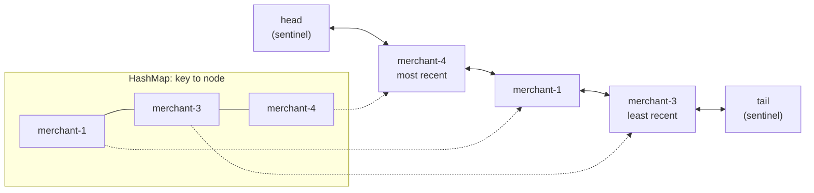

# LRU and LFU Caches from Scratch

> O(1) eviction with a hash map and a doubly linked list.

**Type:** Build
**Languages:** Java, Python, Go
**Prerequisites:** Phase 1 Lesson 04 (Linked Lists), Phase 1 Lesson 06 (Hash Maps), Phase 0 Lesson 07 (Decimal and Integer Arithmetic)
**Time:** ~90 minutes

## Learning Objectives

- Build an LRU cache whose `get`, `put`, and `remove` are O(1) by pairing a hash map with a doubly linked list, and state the invariant that keeps the two in sync
- Build an O(1) LFU cache from frequency buckets and a `minFreq` pointer, and explain why the pointer never has to search
- Replay the same deterministic lookup trace through both policies and explain the two results: LFU survives a scan that flushes LRU, and LRU adapts to a shifted hot set that LFU does not
- Add time-to-live with an injected clock and distinguish expiration (staleness) from eviction (capacity)
- Decide what a payment system may cache (BIN tables, merchant configuration) and what it must not (balances), and defend the rule with a worked overdraft

## The Problem

An authorization service receives a card number and must answer in under 50 milliseconds. Two of its lookups are reference data. The first six to eight digits of the card, the BIN, identify the issuing bank, the brand, the country, and whether the card is debit or credit; that decides which network to route to, what interchange applies, and whether a cross-border fee is due. The merchant's configuration, its category code, its settlement currency, and its fee plan, decides how the amount is split. Both live in a database. The BIN table has 500,000 ranges and changes monthly; a merchant's configuration changes when the merchant changes plans, a few times a year.

Reading both from the database on every authorization is 2 of the 50 milliseconds and most of the database's load, for answers that were identical the last ten thousand times. So the team adds a cache: a `HashMap` in each service instance, filled on first lookup, never emptied. It works for a week, then an instance runs out of heap: with 500,000 BINs and 80,000 merchants there is no bound on the map. They add a size limit and evict "something" when full, choosing the first key in iteration order. The hit rate drops to 40% because what gets evicted has nothing to do with what is used. Then finance changes a merchant's fee plan on the first of the month and the merchant is charged the old plan for eleven hours, until the instance happens to restart, because the cached configuration never expires.

A third version of the failure is the one that costs real money. A developer, seeing the BIN cache work, caches account balances the same way: `balance = cache.get(accountId)`. A customer with 100.00 USD makes an 80.00 USD purchase; the ledger posts it and the balance is now 20.00 USD; the cache still says 100.00. A second purchase of 50.00 USD arrives, reads the cache, and is approved. The account is at -30.00 USD, a position the ledger would never have allowed. Nothing in the cache was buggy. The data it held was correct when it was stored. The bug is that a balance is not reference data; it is derived state whose entire purpose is to change.

This lesson builds the two eviction policies every cache library offers, measures them against each other on the same trace, adds expiry with a clock that tests can control, and ends with the rule that the balance incident violates.

## The Concept

### A cache is a bounded map with an eviction policy

A cache holds at most `capacity` entries. When a new entry arrives and the cache is full, something must leave, and the eviction policy picks it. The ideal policy, Belady's MIN (1966), evicts the entry whose next use is furthest in the future; it is optimal and unimplementable, because it needs the future. Every real policy is a guess about the future from the past, and the two classic guesses are:

- **Recency (LRU).** The entry used longest ago is least likely to be used soon. True when access patterns shift over time: a merchant's traffic peaks, then moves on.
- **Frequency (LFU).** The entry used least often is least likely to be used soon. True when popularity is stable: the top twenty BINs are the top twenty BINs all year.

Both are measured by **hit rate**, hits over all lookups, on a given trace. Neither dominates. The lesson's demo runs one trace through both and gets 0.727 against 0.788 in one segment and 0.750 against 0.424 in another. Which policy is right depends on the workload, and the only way to know is to replay the workload.

### LRU: a hash map and a doubly linked list

The structure that makes LRU O(1) is two structures kept in sync:

- A hash map from key to node, for O(1) lookup by key.
- A doubly linked list of the same nodes, ordered by recency: most recently used at the head, least recently used at the tail.

The invariant: **the list order is exactly the recency order, and every node in the map is in the list and vice versa.** Every operation preserves it with a constant number of pointer writes:

| Operation | Map | List | Cost |
|-----------|-----|------|------|
| `get(k)`, hit | lookup | unlink node, push to head | O(1) |
| `get(k)`, miss | lookup | nothing | O(1) |
| `put(k, v)`, k present | lookup | update value, unlink, push to head | O(1) |
| `put(k, v)`, k absent, not full | insert | push to head | O(1) |
| `put(k, v)`, k absent, full | remove victim, insert | unlink tail's predecessor (the victim), push new node to head | O(1) |
| `remove(k)` | remove | unlink | O(1) |

A singly linked list would make `unlink` O(n), because you need the predecessor; the `prev` pointer is what buys O(1). Two sentinel nodes, a permanent `head` and `tail` that never hold data, remove every null check from the list surgery: the most recent real node is always `head.next` and the least recent is always `tail.prev`, even when the list is empty.



Walk the demo by hand with capacity 3. `put(merchant-1)`, `put(merchant-2)`, `put(merchant-3)`: the list reads `[3, 2, 1]`, most recent first. `get(merchant-1)` is a hit: unlink 1 from the tail end, push it to the head, `[1, 3, 2]`. `put(merchant-4)`: the map does not contain 4, the cache is full, so the victim is `tail.prev`, which is 2; unlink it, remove it from the map, insert 4 at the head: `[4, 1, 3]`. `get(merchant-2)` now misses. Three operations, every one a handful of pointer assignments, and the hit rate counters tell you what the cache is doing.

### LFU in O(1): frequency buckets and a floor pointer

The naive LFU keeps a counter per entry and, when full, scans for the smallest: O(n) per eviction. A min-heap of counters gets eviction to O(log n) but makes every hit O(log n) too, because a hit changes a counter and the heap must re-sort. Shah, Mitra, and Matani (2010) showed how to make both O(1):

- A hash map from key to node, as in LRU. Each node carries its frequency.
- A hash map from frequency to a **bucket**: a doubly linked list of all nodes that currently have that frequency, most recently touched at the head.
- An integer `minFreq`: the smallest frequency that has a non-empty bucket.

A hit on a node with frequency `f` unlinks it from bucket `f` and pushes it onto the head of bucket `f + 1`, creating that bucket if needed. If bucket `f` is now empty and `f` was `minFreq`, then `minFreq` becomes `f + 1`. An insert creates the node at frequency 1 and sets `minFreq = 1`. An eviction removes the least recent node of bucket `minFreq`.

The invariant: **`minFreq` is always the smallest frequency with a non-empty bucket**, and the reason it never needs a search is in the two places it changes. After an insert, a node at frequency 1 exists, so 1 is the minimum. After a hit that empties bucket `f == minFreq`, no bucket below `f` existed (because `f` was the minimum) and the node just moved to `f + 1`, so `f + 1` is the new minimum. Only an explicit `remove` of the last node in the minimum bucket forces a scan over the distinct frequencies, and that is an operation caches rarely perform.

Within a bucket, the tie is broken by recency: the least recently touched node at the same frequency is evicted first. This makes the LFU deterministic and gives it a little LRU behaviour at the margin, which is what most production LFUs do.

Walk the demo by hand, capacity 3. `put(bin-411111)` three times: the first creates the node at frequency 1; the second and third are updates, each a touch, so 411111 is at frequency 3 in bucket 3. `put(bin-555555)` twice: frequency 2. `put(bin-601100)` once: frequency 1, `minFreq = 1`. Now `put(bin-371449)`: the map does not contain it, the cache is full, so evict the least recent node of bucket `minFreq = 1`, which is 601100; insert 371449 at frequency 1. `get(bin-601100)` misses; `get(bin-411111)` hits and moves to frequency 4.

### The same trace, two policies

The demo generates a lookup trace with a seeded splitmix64 generator so that Java, Python, and Go replay exactly the same keys: 20 hot BINs receive 80% of lookups and 2,000 cold BINs share the rest, which is roughly what a real BIN distribution looks like. Capacity is 32: room for the hot set and a dozen cold entries. Four segments:

| Segment | LRU hit rate | LFU hit rate | What happened |
|---------|--------------|--------------|---------------|
| Phase 1: hot set A, 6,000 lookups | 0.727 | 0.788 | Both learn the hot set. LFU wastes fewer slots on cold one-offs, because a cold BIN at frequency 1 is always the next victim |
| Scan: 500 one-off BINs | 0.000 | 0.000 | Nothing is a hit. LRU evicts its entire hot set to make room; LFU evicts the scan keys against each other at frequency 1 and keeps the hot set at frequency 200+ |
| Phase 1 again, first 200 lookups | 0.570 | 0.725 | LRU must reload all 20 hot BINs from the database; LFU still has them |
| Phase 2: hot set B, 6,000 lookups | 0.750 | 0.424 | The hot set moves. LRU forgets A within 32 lookups and learns B. LFU keeps the 20 old hot BINs at frequency 200+ forever, leaving 12 slots for 20 new hot BINs plus the cold tail |

The two weaknesses have names. LRU is not **scan resistant**: one pass over a large set of keys nobody will ask for again (a nightly BIN-table refresh, a batch reconciliation that touches every merchant) flushes the working set. LFU has **frequency inertia**: an entry that was popular once is never evicted, so the cache fills with history. Production caches fix both: segmented LRU (memcached) protects entries that have been hit at least once from a single scan; LFU with aging (Redis halves counters on a schedule; TinyLFU uses a sketch with periodic reset) lets old popularity decay.

### Time to live: expiration is not eviction

A capacity limit says how much the cache may hold. It says nothing about how old an entry may be. The merchant whose fee plan changed is served stale configuration not because the cache is full but because nothing told the cache the entry was dead. Two mechanisms fix that:

- **Invalidation**: the system that changed the configuration tells every cache to drop the key. Exact, immediate, and dependent on every writer remembering to send the message and every cache receiving it.
- **Time to live**: each entry carries an expiry instant; a read after that instant is a miss. Inexact (the entry may be stale for up to one TTL), independent of the writer, and a backstop for the invalidation that did not arrive.

RFC 9111 formalises the second as HTTP's `max-age`: freshness is a property of the stored response, computed from a clock, and a stale response is served only if explicitly permitted (`stale-while-revalidate`). The lesson's `LruCache` carries an `expiresAt` per node, compares it with an injected `Clock` on every read, and counts expirations separately from evictions, because the two numbers answer different questions. Evictions high means the cache is too small. Expirations high means the TTL is shorter than the reuse interval.

Expiry here is lazy: an entry is noticed to be dead only when it is read. Until then it occupies a slot, and the test `expired_entry_still_counts_toward_capacity_until_touched` shows the consequence: a dead entry can be the LRU victim while a live one is kept, or the reverse. Eager expiry, a timer wheel (Phase 3, Lesson 12) that removes entries at their deadline, trades that imprecision for a background thread.

### What a payment system may cache

The question is not "is this data read often" but "what happens when a decision is made on a value that changed since it was cached". That gives a clean rule:

| Data | Changes | Decision made on it | Cache? |
|------|---------|---------------------|--------|
| BIN table (brand, country, debit/credit) | Monthly, published in advance | Routing, interchange category | Yes, long TTL, invalidate on table load |
| Merchant configuration (MCC, fee plan, settlement currency) | A few times a year, by an operator | Fee computation | Yes, short TTL plus invalidation on change; log the config version with the fee |
| FX rate table | Every few seconds to minutes | Converted amount quoted to a customer | Yes, with the rate's timestamp stored alongside and a hard maximum age (Phase 10, Lesson 02) |
| Idempotency key to response | Written once, never changes | Return the stored response | Yes; immutable data is the ideal cache content |
| Account balance | On every posting | Approve or decline | No. A stale balance approves an overdraft or declines a good customer; the ledger is the only source (Phase 10, Lesson 03) |
| Available credit, holds, velocity counters | On every authorization | Approve or decline | No, same reason; if latency forces it, use a reservation (Phase 12, Lesson 09), not a cache |

The demo's last section is the overdraft: the ledger moves from 100.00 to 20.00 USD, the cache still says 100.00, a 50.00 authorization is approved against the cache, and the resulting balance is -30.00 USD. The `Money` type from Phase 10 makes the arithmetic exact so the error is unambiguous: this is not a rounding problem, it is a staleness problem, and no TTL short enough to fix it would be long enough to be worth having.

### What these caches do not do

- They are not thread-safe. Every operation mutates shared pointers; two threads calling `get` concurrently will corrupt the list. Phase 4, Lesson 04 (Concurrent Hash Maps) adds the locking or striping; Caffeine's design is the production answer.
- They count entries, not bytes. A cache of 32 BIN records and a cache of 32 merchant configurations with embedded fee tables are very different sizes. Production caches weigh entries.
- They have no admission policy. Every miss inserts. TinyLFU (Einziger, Friedman, Manes 2017) asks "is the new key more frequent than the victim?" before admitting it, which is what finally makes a frequency-based cache scan-resistant without inertia.
- They do not persist, replicate, or share across processes. A process restart starts cold, and two instances have two independent caches with two different contents, which matters when a configuration change must be seen everywhere at once.

## Build It

The primary walkthrough is in Java. The Python and Go files implement the same design with the same names; the subsections at the end show only what differs.

### Step 1: A clock you can control

```java
interface Clock {
    long nowMillis();
}

final class ManualClock implements Clock {
    private long now;
    ManualClock(long startMillis) { this.now = startMillis; }
    @Override public long nowMillis() { return now; }
    void advance(long millis) {
        if (millis < 0) throw new IllegalArgumentException("clock cannot go backwards");
        now += millis;
    }
}
```

Every TTL decision reads `clock.nowMillis()`, never `System.currentTimeMillis()`. The tests advance the clock by exactly 4,999 and then 1 millisecond to check that expiry happens at the TTL boundary and not a millisecond before; with a real clock that test would be flaky, slow, or both. A production deployment passes `System::currentTimeMillis` as the `Clock`.

**Predict:** `put("cfg", v, 5000)` at clock 1,000, then `advance(4999)`: is `get("cfg")` a hit? After one more millisecond?

### Step 2: The node and the list surgery

```java
private static final class Node<K, V> {
    final K key;
    V value;
    long expiresAt;
    Node<K, V> prev, next;
    Node(K key, V value, long expiresAt) { this.key = key; this.value = value; this.expiresAt = expiresAt; }
}

private final Node<K, V> head = new Node<>(null, null, 0);
private final Node<K, V> tail = new Node<>(null, null, 0);

private void unlink(Node<K, V> node) {
    node.prev.next = node.next;
    node.next.prev = node.prev;
}

private void pushFront(Node<K, V> node) {
    node.next = head.next;
    node.prev = head;
    head.next.prev = node;
    head.next = node;
}
```

The node stores its key so that evicting from the tail can also remove the right map entry; without it, eviction would need a reverse lookup. The two sentinels are wired `head.next = tail; tail.prev = head` in the constructor, after which `unlink` and `pushFront` never see a null: a real node always has a real `prev` and `next`, even if both are sentinels. Four assignments each, no branches.

**Predict:** what does the list look like after `pushFront(a)` then `pushFront(b)` on an empty cache? Which node is `tail.prev`?

### Step 3: get, with expiry as a miss

```java
V get(K key) {
    Node<K, V> node = map.get(key);
    if (node == null) {
        misses++;
        return null;
    }
    if (expired(node)) {
        unlink(node);
        map.remove(key);
        expirations++;
        misses++;
        return null;
    }
    unlink(node);
    pushFront(node);
    hits++;
    return node.value;
}
```

Three outcomes. Not in the map: a miss. In the map but past its `expiresAt`: remove it, count an expiration and a miss, and return null, so the caller reloads and reinserts exactly as it would for an absent key. Present and fresh: move it to the head and return it. An entry without a TTL has `expiresAt = Long.MAX_VALUE`, which `expired` never reaches. A hit is the only outcome that changes recency; a miss must not, or probing for absent keys would reorder the list.

**Predict:** `expirations` and `evictions` are separate counters. Which one rises when the cache is too small, and which when the TTL is too short?

### Step 4: put, with eviction from the tail

```java
private void putInternal(K key, V value, long expiresAt) {
    Node<K, V> node = map.get(key);
    if (node != null) {
        node.value = value;
        node.expiresAt = expiresAt;
        unlink(node);
        pushFront(node);
        return;
    }
    if (map.size() >= capacity) {
        Node<K, V> victim = tail.prev;
        unlink(victim);
        map.remove(victim.key);
        evictions++;
    }
    node = new Node<>(key, value, expiresAt);
    map.put(key, node);
    pushFront(node);
}
```

An update of an existing key is a touch: new value, new expiry, moved to the head, no eviction. A new key evicts first if full, then inserts, so the cache never exceeds `capacity` even transiently. The victim is `tail.prev`, which the invariant guarantees is the least recently used node. The public `put(key, value)` passes `NO_EXPIRY`; `put(key, value, ttlMillis)` validates `ttlMillis > 0` and passes `clock.nowMillis() + ttlMillis`.

**Predict:** `put` 1,000 distinct integer keys into a capacity-10 cache. How many evictions, and which ten keys remain?

### Step 5: LFU's bucket and the touch

```java
private void touch(Node<K, V> node) {
    Bucket<K, V> bucket = buckets.get(node.freq);
    bucket.unlink(node);
    if (bucket.size == 0) {
        buckets.remove(node.freq);
        if (minFreq == node.freq) minFreq = node.freq + 1;
    }
    node.freq++;
    buckets.computeIfAbsent(node.freq, f -> new Bucket<>()).pushFront(node);
}
```

`Bucket` is the same sentinel-bounded doubly linked list as the LRU, with a `size` counter so emptiness is O(1). `touch` is the whole O(1) argument: one unlink from the old bucket, one possible `minFreq` bump, one push onto the new bucket. The `minFreq == node.freq` branch is correct because if the emptied bucket was the minimum, nothing exists below it and the node just moved one above it. `computeIfAbsent` creates bucket `f + 1` the first time any node reaches that frequency.

**Predict:** a node at frequency 7 is touched and bucket 7 still has other nodes. Does `minFreq` change?

### Step 6: LFU put and eviction from the floor

```java
void put(K key, V value) {
    Node<K, V> node = map.get(key);
    if (node != null) {
        node.value = value;
        touch(node);
        return;
    }
    if (map.size() >= capacity) {
        Bucket<K, V> bucket = buckets.get(minFreq);
        Node<K, V> victim = bucket.leastRecent();
        bucket.unlink(victim);
        if (bucket.size == 0) buckets.remove(minFreq);
        map.remove(victim.key);
        evictions++;
    }
    node = new Node<>(key, value);
    map.put(key, node);
    buckets.computeIfAbsent(1, f -> new Bucket<>()).pushFront(node);
    minFreq = 1;
}
```

Eviction reads bucket `minFreq`, which the invariant guarantees is non-empty when the cache is full, and takes its least recent node. Then the new node enters at frequency 1 and `minFreq` is set to 1 unconditionally: a frequency-1 node now exists, so 1 is the floor. Note that after eviction the emptied bucket is removed but `minFreq` is not recomputed, because the very next line sets it.

**Predict:** capacity 2. `put(a)`, `get(a)`, `get(a)`, `put(b)`, `get(b)`. What is `minFreq`? Now `put(c)`: which key is evicted and what is `minFreq` afterwards?

### Step 7: A trace both languages agree on

```java
final class Rng {
    private long state;
    Rng(long seed) { this.state = seed; }
    long next() {
        state += 0x9E3779B97F4A7C15L;
        long z = state;
        z = (z ^ (z >>> 30)) * 0xBF58476D1CE4E5B9L;
        z = (z ^ (z >>> 27)) * 0x94D049BB133111EBL;
        return z ^ (z >>> 31);
    }
    int nextInt(int bound) { return (int) ((next() >>> 33) % bound); }
}
```

splitmix64 is ten lines and has the same output in every language with 64-bit wrapping arithmetic, which `java.util.Random`, Python's `random`, and Go's `math/rand` do not. The tests assert `new Rng(42).next() == 0xBDD732262FEB6E95L` and the first six keys of `binTrace(1, 6, 0)` in all three languages, so when the hit rates match to three decimals it is because the caches behaved identically on identical input, not by coincidence. `nextInt` takes the top bits (`>>> 33`) because splitmix's low bits are the weakest.

**Predict:** why does `replay` insert on a miss with a value derived from the key, rather than from a lookup table?

### Step 8: Run it

```bash
cd phases/03-systems-data-structures/08-lru-and-lfu-caches/code/java
javac -d .out *.java && java -cp .out Main
java -cp .out MainTest
```

Expected output, abbreviated:

```console
== LRU: merchant config, most recent at the head ==
after 3 puts: [merchant-3, merchant-2, merchant-1]
after get(merchant-1): [merchant-1, merchant-3, merchant-2]
after put(merchant-4): [merchant-4, merchant-1, merchant-3]  evicted merchant-2, evictions=1

== TTL: a config entry that must be re-read after five minutes ==
t+4:59.9 get(merchant-9) = fee_bps=290
t+5:00   get(merchant-9) = null  expirations=1

== Same trace, both policies, capacity 32 (20 hot BINs carry 80% of lookups) ==
segment                  LRU hit rate LFU hit rate
phase 1: hot set A              0.727        0.788
scan: 500 one-off BINs          0.000        0.000
phase 1 again                   0.723        0.796
phase 2: hot set B              0.750        0.424
first 200 lookups after the scan: LRU 0.570  LFU 0.725

== Why you do not cache balances ==
ledger says 20.00 USD, cache says 100.00 USD
authorize 50.00 USD against the cache: approved
actual balance after that approval would be -30.00 USD: an overdraft the ledger never allowed
```

Python prints `0.795` where Java prints `0.796` on the third line: the exact value is 1591/2000 = 0.7955, and the two languages round a binary tie differently when formatting. The caches did the same thing.

### In Python

```python
def get(self, key: K) -> Optional[V]:
    node = self._map.get(key)
    if node is None:
        self.misses += 1
        return None
    if self._expired(node):
        ...
```

Differences, all in `code/python/main.py`:

- **`__slots__` on the node classes.** A node is `key, value, expires_at, prev, next`; without `__slots__` each one also carries a `__dict__`, roughly doubling the memory of a cache that exists to save memory.
- **`None` is the miss signal**, so a cache cannot store `None` as a value. Java has the same limitation with `null`; Go returns `(value, ok)` and has no such limit.
- **Masking in `Rng`.** Python integers do not wrap, so every multiplication is followed by `& MASK64`, exactly as in Lesson 01's hash functions. Forget one and the trace diverges from Java and Go after the first key.
- **`OrderedDict.move_to_end` and `functools.lru_cache`** are the standard-library LRU; the lesson writes the list by hand so that the LFU's buckets, which have no standard-library equivalent, use the same mechanics.

### In Go

```go
func (c *LruCache[K, V]) Get(key K) (V, bool) {
    var zero V
    n, ok := c.m[key]
    if !ok {
        c.Misses++
        return zero, false
    }
    ...
}
```

Differences, all in `code/go/main.go`:

- **Generics with `K comparable`.** The map key type must be comparable, which Go enforces at compile time; Java relies on `equals`/`hashCode` and Python on `__hash__`.
- **`(V, bool)` instead of null.** The idiomatic Go miss signal, which also allows caching the zero value.
- **`Put` and `PutWithTTL`** rather than an overload, since Go has none; `PutWithTTL` returns an error for a non-positive TTL where Java and Python throw.
- **`container/list`** would supply the doubly linked list; the lesson writes the four pointer assignments out so the structure is visible, and to keep the LFU buckets identical to the LRU list.

## Use It

### Java: `LinkedHashMap`, Caffeine

```java
Map<String, Config> lru = new LinkedHashMap<>(16, 0.75f, true) {
    @Override protected boolean removeEldestEntry(Map.Entry<String, Config> eldest) {
        return size() > 1_000;
    }
};
```

`LinkedHashMap` with `accessOrder = true` is exactly the map-plus-list structure of this lesson, and `removeEldestEntry` is the eviction hook. It is not thread-safe and has no TTL. Caffeine is the production answer: `maximumSize` or `maximumWeight`, `expireAfterWrite`, `expireAfterAccess`, `refreshAfterWrite` (which serves the stale value while reloading, the `stale-while-revalidate` of RFC 9111), and an eviction policy, W-TinyLFU, that keeps a small LRU window for recency and a frequency sketch for admission, so it is both scan resistant and free of inertia. Its `recordStats()` exposes hit rate, eviction count, and load penalty, which are the counters this lesson's caches carry.

### Python: `functools.lru_cache`, `cachetools`

`@functools.lru_cache(maxsize=1024)` memoises a function with an LRU of this lesson's shape and reports `cache_info()` hits and misses; it has no TTL and keys on the argument tuple. The third-party `cachetools` package provides `LRUCache`, `LFUCache`, and `TTLCache` as mapping types with the same semantics as here.

### Go: `golang-lru`, Ristretto

`hashicorp/golang-lru` is `container/list` plus a map with a mutex, the LRU of this lesson made thread-safe; its `expirable` variant adds TTL. `dgraph-io/ristretto` is a TinyLFU cache with cost-based (weighted) eviction and admission, built for the same reasons as Caffeine.

### Redis and memcached

Redis bounds memory with `maxmemory` and chooses victims with `maxmemory-policy`. `allkeys-lru` is approximate: Redis samples a few keys (default 5) and evicts the least recent of the sample, because a true linked list across millions of keys costs more memory than it saves. `allkeys-lfu` uses an 8-bit logarithmic counter per key (a Morris counter) with a configurable decay time, which is the aging that fixes the frequency inertia the demo shows. memcached's LRU is segmented into hot, warm, and cold queues; a key must be hit once to leave the cold segment, so a single scan cannot flush the warm set.

### Databases and the kernel

PostgreSQL's shared buffer pool uses clock-sweep, an approximation of LRU with a usage counter per page that is decremented as the clock hand passes; the Linux page cache uses two LRU lists (active and inactive) for the same scan-resistance reason as memcached. The lesson's design is the exact version these approximate, and knowing it is what lets you read their documentation.

## Ship It

`outputs/checklist-what-to-cache-in-payments.md` is the decision checklist for any pull request that adds a cache in a payment path: the data classification table, the TTL and invalidation questions, the policy choice, the metrics to export, and the two rules that are not negotiable (no balances, no decisions on stale money). Attach it to the review of the next "add a cache" change.

## Exercises

1. **Reinforce.** Add `peek(key)` to both caches: returns the value without changing recency or frequency and without counting a hit or a miss. Then add `putIfAbsent(key, value)` that returns the existing value if present (counting a hit) and inserts otherwise. Write the tests that show `peek` leaves `keys()` and `frequency()` unchanged.
2. **Apply.** Give the LFU aging: every `decayEvery` operations, halve every node's frequency (merging buckets as needed) and recompute `minFreq`. Rerun the phase 2 segment of the trace and find the smallest `decayEvery` at which LFU's hit rate on the shifted hot set exceeds 0.7. Explain what you traded to get there by rerunning the scan segment.
3. **Extend.** Build a TinyLFU admission filter in front of the LRU: estimate each key's frequency with the Count-Min Sketch from Phase 3, Lesson 02, and on a miss when full, admit the new key only if its estimated frequency exceeds the victim's. Replay all four segments and compare the hit rates with plain LRU and plain LFU. Then reset the sketch every 10,000 operations and show how that reset is the aging from Exercise 2 in a different form.

## Key Terms

| Term | What people say | What it actually means |
|------|-----------------|------------------------|
| Hit rate | "how good the cache is" | Hits over all lookups on a given trace; a property of the policy and the workload together, not of the policy alone |
| Eviction | "the cache dropped it" | Removal because the cache is at capacity; the policy chooses the victim, and the count tells you whether the cache is too small |
| Expiration | "it timed out" | Removal because the entry's TTL passed; a freshness decision made against a clock, and the count tells you whether the TTL is shorter than the reuse interval |
| Working set | "the hot keys" | The set of keys accessed in a recent window (Denning 1968); a cache smaller than the working set thrashes regardless of policy |
| Scan resistance | "a batch job killed the cache" | A policy's ability to keep its working set through one pass over many never-reused keys; LRU has none, segmented LRU and TinyLFU do |
| Frequency inertia | "LFU remembers too long" | Entries that were popular once stay at high frequency and are never evicted after the hot set moves; fixed by aging or periodic reset |
| Sentinel node | "dummy head and tail" | Permanent list nodes that hold no data so every real node has a non-null predecessor and successor, removing every null check from the list surgery |
| Admission policy | "should we even cache this" | A decision on a miss about whether the new key deserves a slot at all, usually by comparing its frequency estimate with the victim's; what distinguishes TinyLFU from plain LFU |

## Further Reading

- [Shah, Mitra, Matani, "An O(1) algorithm for implementing the LFU cache eviction scheme" (2010)](https://arxiv.org/abs/2110.11602) — the frequency-bucket design in Steps 5 and 6, with the proof that every operation is constant time.
- [Belady, "A study of replacement algorithms for a virtual-storage computer" (IBM Systems Journal, 1966)](https://ieeexplore.ieee.org/document/5388441) — the optimal offline policy every real policy is measured against.
- [Denning, "The Working Set Model for Program Behavior" (CACM 1968)](https://dl.acm.org/doi/10.1145/363095.363141) — the working-set concept and why capacity below it defeats any policy.
- [Einziger, Friedman, Manes, "TinyLFU: A Highly Efficient Cache Admission Policy" (ACM ToS 2017)](https://arxiv.org/abs/1512.00727) — the admission-filter design behind Caffeine and Ristretto, for Exercise 3.
- [RFC 9111: HTTP Caching](https://www.rfc-editor.org/rfc/rfc9111) — freshness lifetime, `max-age`, and `stale-while-revalidate`; the clearest specification of TTL semantics in any standard.
- [Redis documentation: Key eviction](https://redis.io/docs/latest/develop/reference/eviction/) — approximate LRU by sampling and the LFU logarithmic counter with decay, with the measured accuracy of each.
- [Megiddo and Modha, "ARC: A Self-Tuning, Low Overhead Replacement Cache" (FAST 2003)](https://www.usenix.org/conference/fast-03/arc-self-tuning-low-overhead-replacement-cache) — the adaptive policy that balances recency and frequency automatically, used in ZFS.
