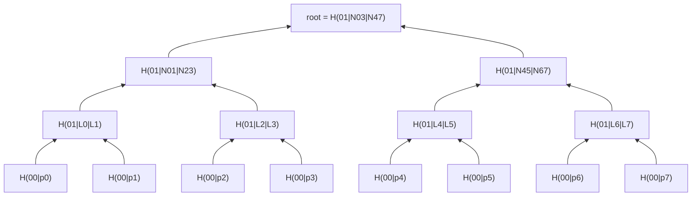
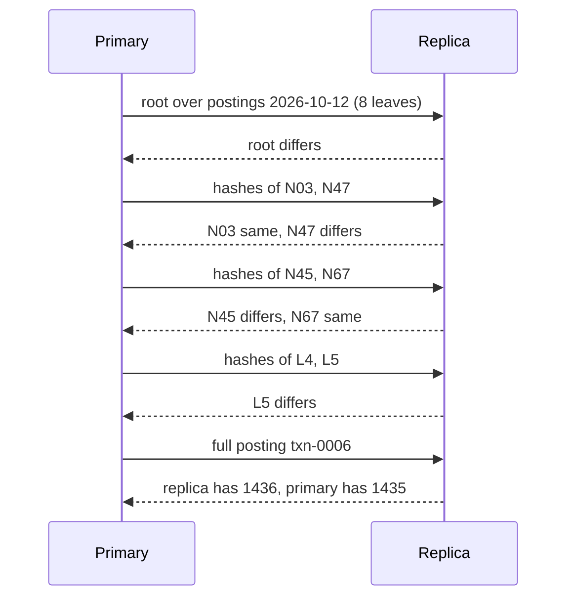

# Merkle Trees and Content-Addressed Verification

> Verify two ledgers agree by comparing one hash.

**Type:** Build
**Languages:** Java
**Prerequisites:** Phase 1, Lesson 06 (Hash Maps from Scratch), Phase 1, Lesson 07 (Hash Functions and Collisions), Phase 3, Lesson 01 (Bloom Filters)
**Time:** ~75 minutes

## Learning Objectives

- Build a binary hash tree over an ordered list of records and explain why its root commits to every byte of every record and to their order
- Implement RFC 6962 domain separation between leaf and internal hashes and show the forgery it prevents
- Generate and verify an inclusion proof of O(log n) hashes, and state exactly what the proof does and does not prove
- Diff two trees by descending only into subtrees whose hashes differ, and count the hash comparisons it costs to locate one divergent record among a million
- Explain why duplicating the odd node at a level (the Bitcoin construction) lets two different leaf lists share a root, and why carrying the node up does not

## The Problem

A payment processor keeps its posting ledger in a primary database in one region and a replica in another. The replica is fed by a change stream. Every night, finance runs a reconciliation job that proves the two agree. The first version of the job is the obvious one: `SELECT * FROM postings WHERE posted_on = yesterday ORDER BY id` on both sides, ship both result sets to a comparison service, walk them in lockstep. On a day with 40 million postings that is two 6 GB transfers and a 35-minute compare, and it runs during the window when the replica is also serving the morning batch of settlement reports. Nobody likes it, but it finds nothing wrong for eleven months, so nobody changes it.

Then it finds something. One posting in the replica carries `1435` minor units where the primary has `1436`. The change-stream consumer had a bug in how it decoded a decimal column during a library upgrade, and for 40 minutes it was rounding half-cents the wrong way. By the time the job runs the replica has been serving balance reads to the fraud team for eighteen hours. The reconciliation job did its job, but it did it a full day late and at the cost of shipping 12 GB across a region boundary to find a single wrong byte.

The second version of the job is what this lesson builds. Each side hashes every posting into a leaf, pairs the leaf hashes up into a binary tree, and publishes the 32-byte root. If the roots match, every posting matches, and the job is finished after one network round trip of 32 bytes. If they do not match, the two sides exchange the two child hashes under the root, descend into whichever subtree disagrees, and repeat. For 40 million postings the tree is 27 levels deep and locating the one bad row costs about 54 hash exchanges instead of 80 million rows. The same tree gives you a second capability for free: an auditor who holds yesterday's signed root can verify that a single posting is in the ledger, unmodified, from 27 sibling hashes, without being given the other 39,999,999 postings.

Hash trees are not a payments invention. Merkle described them in 1979 for digital signatures; Git uses one to make every commit hash commit to the entire repository history; Certificate Transparency logs (RFC 6962) use one so that browsers can audit certificate authorities; Cassandra and DynamoDB use them in anti-entropy repair to find divergent key ranges between replicas; and Bitcoin uses one so that a light client can verify a transaction is in a block without downloading the block. The construction is twenty lines. The details that make it correct, domain separation and the treatment of odd levels, are the content of this lesson.

## The Concept

### Content addressing

A cryptographic hash function such as SHA-256 maps any byte string to a fixed 32-byte digest with two properties you rely on: it is **collision resistant** (nobody can find two different inputs with the same digest; the best known attack costs about 2^128 work) and **second-preimage resistant** (given an input, nobody can find a different input with the same digest). From those two properties follows a working rule: **if two digests are equal, the inputs were equal.** Not "probably equal", as with a Bloom filter or a checksum; equal, unless someone has broken SHA-256, in which case your reconciliation job is not the first thing to worry about.

That rule turns a hash into an address for content. Two services that each compute `SHA-256(canonical bytes of posting txn-0006)` and get the same 32 bytes know they hold the same posting, without exchanging the posting. The word *canonical* carries weight: the two sides must hash exactly the same byte sequence, so the posting needs a serialization that is fully determined by its fields. `toString()` is not that; a formatted amount like `"14.35 USD"` depends on locale and formatting code and would differ between a Java service and a Go service. The leaf in this lesson hashes `id|debit|credit|minorUnits|currencyCode` with the amount as an integer count of minor units, the same discipline as Phase 10, Lesson 01.

### From one hash to a tree

Hashing all 40 million postings into one digest, `SHA-256(p0 || p1 || ... || pN)`, already gives you the agree-or-disagree answer in 32 bytes. What it cannot do is tell you *where* the disagreement is, and it cannot prove that a single posting is included without re-hashing everything. The tree fixes both by hashing hierarchically:

1. Leaf `i` is `H(0x00 || bytes(p_i))`.
2. Each internal node is `H(0x01 || left || right)` over its two children.
3. If a level has an odd number of nodes, the last one is carried up to the next level unchanged.
4. Repeat until one node remains: the root.



The root commits to every leaf, and to their order: change one byte in `p5` and `L5` changes, so `N45` changes, so `N47` changes, so the root changes. Swap `p0` and `p1` and `N01` changes because `H(01 || L1 || L0) != H(01 || L0 || L1)`. The tree over `n` leaves has `ceil(log2 n) + 1` levels and takes `n - 1` internal hashes to build (every internal hash reduces the node count by one). Building is O(n); the root, a proof, and the diff descent are all O(log n) in size or in work once the trees exist.

### A build by hand

Take four postings and write the hashes as their first eight hex digits (the full digests are 64 digits; the demo prints them). The leaf bytes are the canonical form from the previous section.

```text
p0 = "txn-0001|alice|bob|1250|USD"      L0 = H(00 || p0) = 6fcafc13...
p1 = "txn-0002|bob|carol|1287|USD"      L1 = H(00 || p1) = b286a9fa...
p2 = "txn-0003|carol|dave|1324|USD"     L2 = H(00 || p2) = 5a0ed5be...
p3 = "txn-0004|dave|alice|1361|USD"     L3 = H(00 || p3) = f430d4c3...

level 1:  N01 = H(01 || L0 || L1) = 8b9dbef3...   N23 = H(01 || L2 || L3) = 171607e6...
level 2:  root = H(01 || N01 || N23) = f061e2d6...
```

Seven hashes in total: four leaf hashes and three node hashes, which is `n` leaves plus `n - 1` internal nodes. Now the replica records `p2` with `1325` minor units. Its `L2` is a completely different 32 bytes (SHA-256 has no locality; one changed input bit flips about half the output bits), so its `N23` differs, so its root differs. Its `L0`, `L1`, and `N01` are byte-for-byte identical to the primary's. The diff compares the roots (differ), then `N01` (same, prune) and `N23` (differ), then `L2` (differ, record) and `L3` (same): five comparisons, one leaf identified, and nobody read `p0`, `p1`, or `p3`.

### Cost model

| Operation | Work | Data exchanged between two replicas |
|-----------|------|-------------------------------------|
| Build the tree over `n` leaves | `n` leaf hashes + `n - 1` node hashes, O(n) | none |
| Compare two replicas that agree | 1 comparison | 32 bytes |
| Locate `k` divergent leaves | at most `1 + 2k (h - 1)` comparisons, `h = ceil(log2 n) + 1` | about `2k log2 n` hashes, or `log2 n` round trips if a level is fetched per round |
| Produce an inclusion proof | O(log n) array reads | `log2 n` hashes plus side tags, about 27 x 33 bytes for 40 million leaves |
| Verify an inclusion proof | `log2 n + 1` hashes | the leaf bytes and the proof |
| Update one leaf in place | rehash `log2 n` ancestors | the new leaf, if the other side re-derives |
| Insert a leaf in the middle | rebuild from that index; every later proof is invalid | effectively a full rebuild |

The row that matters for a reconciliation job is the second: the common case, in which the replicas agree, costs one round trip and 32 bytes no matter how large the ledger is. The row that matters for an auditor is the fourth: a proof for one posting in a 40-million-row ledger is under a kilobyte.

### The invariant

**Every node's hash is a function of exactly the bytes of the leaves beneath it, and nothing else.** That is what makes the root a commitment to the whole list and what makes a subtree comparison sound: if two nodes at the same position have the same hash, every leaf beneath them is identical, and the diff never has to look there. The construction keeps the invariant only if two things hold: the leaf serialization is canonical (above), and a node hash can never be confused with a leaf hash (next).

### Domain separation: why the 0x00 and 0x01

Suppose leaves were hashed as `H(data)` and nodes as `H(left || right)`, with no prefix. An attacker who wants to prove a fake posting is in the ledger constructs a 64-byte "posting" whose bytes are exactly `L2 || L3`, the two leaf hashes under node `N23`. Its leaf hash is `H(L2 || L3)`, which is exactly `N23`. The attacker now presents it with a proof path that starts one level higher, and the verifier recomputes the real root. The forgery verifies. The fix is one byte: prefix `0x00` before leaf data and `0x01` before child hashes. A leaf hash is now `H(0x00 || 64 bytes)` and an internal node is `H(0x01 || 64 bytes)`, different inputs, so no leaf can impersonate a node. RFC 6962 section 2.1 specifies exactly these prefixes for Certificate Transparency; the tests in this lesson check that `hashLeaf(x || y) != hashNode(x, y)`.

### Odd levels: carry up, never duplicate

Eight leaves pair up perfectly. Five do not. Two constructions are in common use:

| Construction | Rule for an odd last node | Used by | Ambiguity |
|--------------|---------------------------|---------|-----------|
| Duplicate | hash it with a copy of itself: `H(01 || L4 || L4)` | Bitcoin block headers | Yes: `[p0..p4]` and `[p0..p4, p4]` have the same root (CVE-2012-2459) |
| Carry up | promote it unchanged to the next level | this lesson; Certificate Transparency uses an equivalent unbalanced split | No: a duplicated leaf changes the leaf count and the root |

The duplicate rule looks harmless until you notice that a list with a genuinely repeated last element produces the same level above as the odd list did, so two different inputs share a root. In Bitcoin that let an attacker build a block whose transaction list was valid under one reading and invalid under another, and peers that cached the block hash as "bad" could be made to reject the legitimate block with the same hash. The carry-up rule has no such collision: `[p0..p4]` has five leaves and `[p0..p4, p4]` has six, their leaf levels differ in length, and their roots differ. The cost is that proofs vary in length: in a five-leaf tree the proof for `p4` has one sibling (it is carried up through two levels before meeting `N03`), while the proof for `p0` has three.

### Inclusion proofs

A proof that leaf `i` is in the tree is the list of sibling hashes along the path from the leaf to the root, each tagged with which side the sibling is on. For `p2` in the eight-leaf tree the path is `L2 -> N23 -> N03 -> root`, and the siblings are `L3` (right), `N01` (left), `N47` (right). Verification recomputes the path:

```text
h = H(00 || p2)                       = L2
h = H(01 || h  || L3)                 = N23   (sibling on the right)
h = H(01 || N01 || h)                 = N03   (sibling on the left)
h = H(01 || h  || N47)                = root  (sibling on the right)
compare h with the root you trust
```

Three hashes prove membership in an eight-leaf list; 27 hashes prove membership in a 40-million-row ledger. The side tags matter: flip one and the verifier computes `H(01 || L3 || L2)` instead of `H(01 || L2 || L3)` and the proof fails, which the tests check. Note what the proof does **not** prove. It proves that *this exact byte string* is a leaf of *a tree with this root*. It does not prove that the root is the right root (that needs a signature or a trusted channel), it does not prove the leaf is at a particular index unless the verifier also knows the tree size and checks the side bits against the index, and it cannot prove absence: a Merkle tree over an unsorted list has no way to show that `txn-0099` is *not* present. Sorted trees and sparse Merkle trees address absence; this lesson does not.

### Diffing two trees

Two replicas each build the tree over the same ordered key range. The diff is a top-down walk:

```text
compare(level, index):
    1 comparison
    if hashes equal: return                     # whole subtree identical, prune
    if level == 0:  record index as divergent
    else:           compare both children (or the single carried child)
```

Worked example, eight leaves, replica differs at `p5`:

```text
root       differ   (1 comparison)
N03 / N47  same / differ   (2)
N45 / N67  differ / same   (2)
L4 / L5    same / differ   (2)  -> divergent leaf 5
total 7 comparisons, 1 leaf read on each side
```

As a protocol between two machines, the same walk looks like this:



Four round trips of 64 bytes each, then one posting. In a 40-million-row ledger the exchange is 26 round trips and still one posting.

Two divergent leaves in different halves (`p1` and `p7`) cost 11; `k` divergent leaves cost at most `1 + 2k * (height - 1)` and usually fewer because paths share prefixes near the root. The diff requires both trees to have the same leaf count. That is not a limitation to engineer around: the two sides must first agree on *which* records they are comparing (same key range, same count, same order), and a tree over a different number of rows would have differed at the root for a structural reason that has nothing to do with content. Anti-entropy in Cassandra does exactly this: nodes agree on a token range, build a tree over it, and exchange only the hashes needed to find divergent ranges.

### What a Merkle tree does not do

- It does not detect which side is *right*. The diff says the replicas disagree on posting 5; deciding whether the primary or the replica is correct is the reconciliation policy's job.
- It does not update cheaply. Changing one leaf requires rehashing its `log n` ancestors, which is fine; inserting a leaf in the middle shifts every later index and invalidates every proof. Append-only logs (Certificate Transparency) and keyed trees (sparse Merkle trees) are the two standard answers.
- It does not replace a signature. A root is a commitment, and a commitment is only as trustworthy as the channel that delivered it.
- It does not prove absence over an unsorted list.

## Build It

### Step 1: Canonical bytes for a posting

```java
record Posting(String id, String debitAccount, String creditAccount, Money amount) {
    byte[] canonicalBytes() {
        String canonical = id + "|" + debitAccount + "|" + creditAccount + "|"
                + amount.minorUnits() + "|" + amount.currency().code();
        return canonical.getBytes(StandardCharsets.UTF_8);
    }
}
```

`Money` is the integer-minor-units record from Phase 10, Lesson 01, copied in because lessons are self-contained. The canonical form writes `1435|USD`, never `14.35 USD`: a Go replica hashing the same posting must produce the same bytes, and a formatted string is the first thing to drift between languages. The field separator is `|`, which none of the fields can contain; a real system would use a length-prefixed encoding (Lesson 15) so that an account named `a|b` cannot collide with two fields.

**Predict:** two postings differ only in that one has `creditAccount = "bob"` and the other `"bob "` with a trailing space. Do their leaf hashes differ?

### Step 2: Leaf and node hashes with domain separation

```java
static final byte LEAF_PREFIX = 0x00;
static final byte NODE_PREFIX = 0x01;

static byte[] hashLeaf(byte[] data) {
    MessageDigest md = sha256();
    md.update(LEAF_PREFIX);
    md.update(data);
    return md.digest();
}

static byte[] hashNode(byte[] left, byte[] right) {
    MessageDigest md = sha256();
    md.update(NODE_PREFIX);
    md.update(left);
    md.update(right);
    return md.digest();
}
```

`MessageDigest.update` accumulates bytes, so the prefix, the data, and the second child are hashed as one input without concatenating arrays. These two functions are the entire cryptographic surface of the lesson; everything else is array indexing.

**Predict:** `hashLeaf(concat(a, b))` versus `hashNode(a, b)` for two 32-byte arrays `a` and `b`. Same or different, and which byte decides it?

### Step 3: Building the levels

```java
private final List<byte[][]> levels = new ArrayList<>();

MerkleTree(List<byte[]> leafData) {
    if (leafData.isEmpty()) throw new IllegalArgumentException("a Merkle tree needs at least one leaf");
    byte[][] leaves = new byte[leafData.size()][];
    for (int i = 0; i < leafData.size(); i++) leaves[i] = hashLeaf(leafData.get(i));
    levels.add(leaves);
    byte[][] current = leaves;
    while (current.length > 1) {
        byte[][] next = new byte[(current.length + 1) / 2][];
        for (int i = 0; i < current.length; i += 2) {
            if (i + 1 < current.length) next[i / 2] = hashNode(current[i], current[i + 1]);
            else next[i / 2] = current[i];                 // odd node: carried up, not duplicated
        }
        levels.add(next);
        current = next;
    }
}
```

The tree is stored as a list of levels rather than as linked nodes. Level 0 is the leaf hashes; each level above has `ceil(len / 2)` entries; the top level has one. Node `i` at level `L` has children `2i` and `2i + 1` at level `L - 1`, and when `2i + 1` does not exist the node is a carried-up copy of child `2i`. That arithmetic is what makes `proof` and `diff` short. The empty tree is rejected rather than given a conventional root: there is no agreed-on hash for "no postings", and RFC 6962's choice (`SHA-256("")`) is a convention a verifier would have to know about.

**Predict:** for 5 leaves, what are the lengths of the levels, and how many times is `hashNode` called?

### Step 4: Proofs and verification

```java
List<ProofStep> proof(int index) {
    Objects.checkIndex(index, leafCount());
    List<ProofStep> path = new ArrayList<>();
    int i = index;
    for (int level = 0; level < levels.size() - 1; level++) {
        byte[][] nodes = levels.get(level);
        int sibling = (i % 2 == 0) ? i + 1 : i - 1;
        if (sibling < nodes.length) path.add(new ProofStep(nodes[sibling].clone(), sibling < i));
        i /= 2;
    }
    return path;
}

static boolean verify(byte[] leafData, List<ProofStep> proof, byte[] expectedRoot) {
    byte[] h = hashLeaf(leafData);
    for (ProofStep step : proof) {
        h = step.siblingOnLeft() ? hashNode(step.sibling(), h) : hashNode(h, step.sibling());
    }
    return MessageDigest.isEqual(h, expectedRoot);
}
```

`proof` walks up one level at a time: the sibling of an even index is the next one, of an odd index the previous one, and a sibling that does not exist (the carried-up case) contributes no step. `verify` is `static` and takes only the leaf bytes, the path, and a root: a verifier holds none of the tree, which is the whole point. The comparison uses `MessageDigest.isEqual`, which runs in constant time regardless of where the first differing byte is, so a verifier exposed to the network does not leak how close a forged proof came.

**Predict:** in the eight-leaf tree, what does `proof(7)` contain, and are all three siblings on the left?

### Step 5: Diffing by pruned descent

```java
Diff diff(MerkleTree other) {
    if (other.leafCount() != leafCount()) {
        throw new IllegalArgumentException("cannot diff trees with " + leafCount() + " and " + other.leafCount() + " leaves");
    }
    List<Integer> out = new ArrayList<>();
    int[] comparisons = {0};
    diffNode(other, levels.size() - 1, 0, out, comparisons);
    return new Diff(out, comparisons[0]);
}

private void diffNode(MerkleTree other, int level, int index, List<Integer> out, int[] comparisons) {
    comparisons[0]++;
    if (Arrays.equals(levels.get(level)[index], other.levels.get(level)[index])) return;
    if (level == 0) { out.add(index); return; }
    int below = levels.get(level - 1).length;
    int left = 2 * index, right = 2 * index + 1;
    if (right >= below) {                             // this node was carried up: one child only
        diffNode(other, level - 1, left, out, comparisons);
        return;
    }
    diffNode(other, level - 1, left, out, comparisons);
    diffNode(other, level - 1, right, out, comparisons);
}
```

Depth-first, left child first, so divergent indexes come out in ascending order, which a repair job appreciates. The recursion depth is the tree height, 27 for 40 million leaves, so there is no stack risk. The comparison counter exists so the demo and the tests can show the cost: 7 comparisons to find one bad leaf among eight, about 2 per level in general.

In production the two trees are on different machines and `other.levels.get(level)[index]` is a network request for one 32-byte hash. The structure of the algorithm is identical; only the latency per comparison changes, which is why anti-entropy implementations fetch a whole level or a whole subtree per round trip rather than one hash at a time.

**Predict:** the replica differs at `p0` and `p1`, both under `N01`. How many comparisons, and why is it fewer than for `p1` and `p7`?

### Step 6: Run it

```bash
cd phases/03-systems-data-structures/09-merkle-trees/code/java
javac -d .out *.java && java -cp .out Main
java -cp .out MainTest
```

Expected output, abbreviated:

```console
== 1. Eight postings, one root ==
  txn-0001 alice -> bob 12.50 USD
  ...
  root = 4d637a9bd4f8ce3eb34cee489fc275f8ff0893e83ae35d42535b2ba5509fae18
  height = 4 levels for 8 leaves

== 3. The replica is one cent off on txn-0006 ==
  divergent leaves = [5] (txn-0006)
  hash comparisons = 7 (a row-by-row compare would read all 8 rows on both sides)
  primary says 14.35 USD, replica says 14.36 USD

== 4. Inclusion proof: txn-0003 is in the signed daily root ==
  proof length = 3 siblings [R:f430d4c3, L:8b9dbef3, R:a2f8255f]
  verify(txn-0003, proof, root) = true
  verify(forged txn-0003 with 999.99 USD) = false

== 5. Odd leaf counts: carry up, never duplicate ==
  [p0..p4] vs [p0..p4,p4] roots equal = false  <- duplication would make this true (CVE-2012-2459)

== 6. Scale: 1,000,000 postings disagree on one row ==
  tree height = 21 levels, internal hashes to build = 999999
  hashes exchanged to locate one bad row ~ 2 per level = 40, versus 1000000 rows shipped for a full compare
59 passed, 0 failed
```

The root in section 1 is reproducible: anyone who runs this file on any machine gets `4d637a9b...`, because SHA-256 and the canonical serialization are fully specified. That reproducibility is the property the whole lesson rests on.

### Porting notes

The design ports without structural change. Python's `hashlib.sha256()` has the same `update`/`digest` shape as `MessageDigest`; use `hmac.compare_digest` for the constant-time root comparison and `bytes` everywhere (never `str`, which would re-encode). Go's `crypto/sha256` gives `sha256.New()` with `Write` and `Sum(nil)`, and `crypto/subtle.ConstantTimeCompare` for the final check; `levels` becomes `[][][]byte`, `proof` returns `([]ProofStep, error)` for an out-of-range index, and `diff` returns `(Diff, error)` for a leaf-count mismatch instead of panicking. The canonical posting bytes must be identical across the three languages, so keep the integer-minor-units `|`-separated form and add a cross-language test that pins the eight-posting root `4d637a9b...` as a constant.

## Use It

### Git

Every Git object is addressed by the SHA-1 (now optionally SHA-256) of `type || size || NUL || content`; the type prefix (`blob`, `tree`, `commit`) is Git's domain separation. A tree object lists the hashes of its blobs and subtrees, and a commit holds the hash of its tree and of its parents, so a commit hash commits to the entire history. `git fetch` is a Merkle diff: the client and server exchange commit hashes until they find the common ancestor, then transfer only the objects below the divergence.

### Certificate Transparency (RFC 6962)

CT logs are append-only Merkle trees over issued TLS certificates with exactly the `0x00`/`0x01` prefixes used here. A log returns an inclusion proof (RFC 6962 calls it an audit path) so a browser can check that a certificate it was served is in a public log, and a consistency proof between two tree sizes so monitors can check that the log only ever appended. Consistency proofs are the mechanism this lesson omits; they are Exercise 3.

### Cassandra and DynamoDB anti-entropy

`nodetool repair` builds a Merkle tree per token range on each replica (Cassandra's `MerkleTree` class, with a configurable depth that trades tree size against the granularity of the ranges it can isolate) and streams only the ranges whose hashes differ. The Dynamo paper describes the same technique and gives the same reason: replicas that are almost identical should exchange almost nothing to prove it. The trade-off the production versions make explicit is that a full tree over billions of rows is itself large, so they bound the depth and accept that a leaf covers a range of rows rather than one row.

### Bitcoin and light clients

A block header carries the root of a Merkle tree over the block's transactions. A wallet that stores only headers (about 80 bytes per block) can verify that a payment to it is in a block from a proof of around 12 hashes, without downloading the block. The duplicate-last-node construction and CVE-2012-2459 are the cautionary tale in this lesson's section 5.

### Where it lands in payments

Ledger replicas and reconciliation (this lesson's framing), settlement file verification between a processor and a network (each side publishes a root over the day's cleared transactions; a mismatch starts the diff instead of a phone call), and audit: a signed daily root plus a per-posting inclusion proof lets an external auditor verify any posting they sample without being handed the whole ledger.

## Ship It

`outputs/checklist-merkle-reconciliation.md` is a design-review checklist for any system that uses hash trees to compare or prove data: canonical serialization, domain separation, odd-node handling, what the root is signed by, and how the diff is bounded. Use it when a team proposes "we will just compare hashes" for a reconciliation or replication job.

## Exercises

1. **Reinforce.** Add `MerkleTree.indexedVerify(byte[] leafData, int index, int leafCount, List<ProofStep> proof, byte[] root)` that recomputes the expected side bits from `index` and `leafCount` and rejects a proof whose sides do not match the claimed position. Write the test that catches a valid proof presented for the wrong index.
2. **Apply.** Change `diff` to work level-by-level instead of depth-first: at each level, exchange the hashes of every node still under suspicion in one batch, then descend. Count round trips instead of comparisons and show that locating one divergent leaf among a million costs 20 round trips instead of 40 single-hash requests.
3. **Extend.** Implement RFC 6962 consistency proofs: given a tree of size `m` and a later tree of size `n > m` over the same prefix of leaves, produce the O(log n) hashes that let a verifier holding both roots confirm the second tree is an append-only extension of the first. This combines the carried-up node arithmetic from this lesson with the append-only log discipline from Phase 7, Lesson 02 (Write-Ahead Logs). Note that RFC 6962 defines the tree by splitting at the largest power of two below `n`, which gives different internal nodes from the level-by-level carry-up used here for non-power-of-two sizes; decide whether to switch constructions or adapt the proof.

## Key Terms

| Term | What people say | What it actually means |
|------|-----------------|------------------------|
| Merkle tree | "a hash tree" | A binary tree whose leaves are hashes of records and whose internal nodes are hashes of their children; the root commits to every record and their order |
| Content addressing | "address it by its hash" | Identifying data by the digest of its canonical bytes, so equal digests imply equal data under collision resistance |
| Domain separation | "the 0x00 and 0x01 bytes" | Prefixing leaf and node inputs differently so a crafted leaf cannot reproduce an internal node's hash (RFC 6962 section 2.1) |
| Inclusion proof | "a Merkle proof", "audit path" | The sibling hashes from a leaf to the root, with side tags; proves the leaf is in a tree with that root, not that the root is trustworthy |
| Canonical serialization | "just hash the object" | A byte encoding fully determined by the fields, identical across languages and versions; without it two correct replicas disagree |
| Anti-entropy | "repair" | Comparing replicas by exchanging tree hashes and streaming only the ranges that differ (Dynamo, Cassandra) |
| Second-preimage resistance | "you can't fake it" | Given an input, no feasible way to find a different input with the same hash; the property an inclusion proof's security rests on |
| Carry-up vs duplicate | "the odd node thing" | Promoting an unpaired node unchanged (unambiguous) versus hashing it with itself (lets `[..x]` and `[..x, x]` collide, CVE-2012-2459) |

## Further Reading

- [RFC 6962: Certificate Transparency](https://www.rfc-editor.org/rfc/rfc6962) — section 2.1 defines the leaf/node prefixes, audit paths, and consistency proofs used by every public CT log; the reference for Exercise 3.
- [R. C. Merkle, "A Digital Signature Based on a Conventional Encryption Function" (CRYPTO 1987)](https://link.springer.com/chapter/10.1007/3-540-48184-2_32) — the original tree construction and its purpose: authenticating many values from one signed root.
- [FIPS 180-4: Secure Hash Standard](https://csrc.nist.gov/publications/detail/fips/180/4/final) — the SHA-256 specification; the digest length and the properties the lesson relies on.
- [CVE-2012-2459 and the Bitcoin Merkle duplicate-node issue](https://bitcointalk.org/?topic=102395) — the disclosure thread for the ambiguity that the carry-up rule avoids.
- [DeCandia et al., "Dynamo: Amazon's Highly Available Key-value Store" (SOSP 2007)](https://www.allthingsdistributed.com/files/amazon-dynamo-sosp2007.pdf) — section 4.7 describes Merkle-tree anti-entropy between replicas, the production version of this lesson's `diff`.
- [Git internals: Git objects](https://git-scm.com/book/en/v2/Git-Internals-Git-Objects) — how blobs, trees, and commits form a content-addressed tree with type-prefixed hashing.
