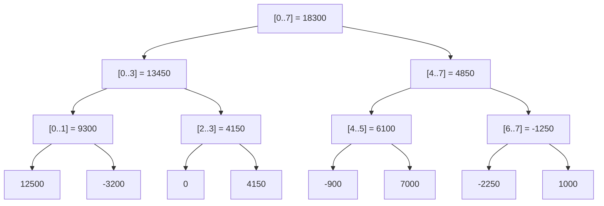

# Segment Trees and Fenwick Trees

> Range sums over balances with O(log n) updates.

**Type:** Build
**Languages:** Java, Python, Go
**Prerequisites:** Phase 1 Lesson 03 (Dynamic Arrays), Phase 1 Lesson 08 (Binary Search Trees), Phase 1 Lesson 11 (Bit Manipulation and Compact Encodings), Phase 2 Lesson 05 (Divide and Conquer and the Master Theorem)
**Time:** ~90 minutes

## Learning Objectives

- Explain why a prefix-sum array makes range queries O(1) but updates O(n), and why that trade is wrong for a live ledger
- Build a Fenwick tree that answers prefix sums and applies point updates in O(log n) using only the lowest-set-bit trick, and construct it from an array in O(n)
- Build an array-backed segment tree with point set and range sum, then extend it with lazy propagation so range add and range sum are both O(log n)
- State the invariant each tree maintains and the exact set of nodes an operation touches, and verify both against a naive array under randomized testing
- Choose between the two structures from their operation sets, memory footprint, and constant factors, and name the production systems that use each

## The Problem

A bank computes interest on a savings account from its **average daily balance**: the sum of the closing balance on each day of the statement period divided by the number of days. The balance team stores one row per account per day, so the interest job reads 30 rows per account, adds them, and divides. For 40 million accounts that is 1.2 billion row reads once a month, which is fine, because it runs once a month.

Then the product team ships backdated postings. A merchant settlement that arrives on the 18th but was effective on the 12th must change the closing balance for the 12th through the 17th, six rows, and the statement has to reflect it. The first implementation updates the six rows in a loop. A wire reversal effective 90 days ago updates 90 rows. A corrected FX rate applied to a batch effective at the start of the quarter updates 90 rows for each of 200,000 accounts, inside a transaction, during business hours, and the balance service's p99 goes from 4 ms to 1.8 s. The write amplification is linear in how far back the posting reaches, and nothing bounds that.

The same shape appears whenever you keep a running total over an ordered sequence and need both to query a range and to change the middle. Cumulative transaction volume per merchant per hour, where a late-arriving event lands in a past hour and every later cumulative total must shift. Per-day fee accruals that a correction revises retroactively. The sum of outstanding authorizations across a time window, where an authorization from last Tuesday is reversed today. The naive answers are "store the deltas and sum on read" (O(1) update, O(n) query) or "store the running totals" (O(1) query, O(n) update). Both are linear in the thing you cannot bound.

Two structures put both operations at O(log n). The Fenwick tree does it in `n + 1` machine words and about ten lines, for sums and other invertible operations, with point updates and prefix queries. The segment tree does it in `2n` to `4n` words for any associative operation, and with lazy propagation it also handles updates to an entire range in O(log n), which is exactly what a backdated posting is: add one amount to every closing balance from the effective date to today.

## The Concept

### Prefix sums and why they are not enough

Given `values[0..n-1]`, the prefix array `P[i] = values[0] + ... + values[i]` answers any range sum as `P[hi] - P[lo-1]` in two reads. It costs O(n) to build and O(n) to update, because changing `values[k]` changes `P[k], P[k+1], ..., P[n-1]`. It is the right structure when the data is immutable after load (a daily snapshot, a report). It is the wrong structure the moment a write arrives.

The insight behind both trees is to store sums over *blocks* of the array instead of over every prefix, chosen so that any prefix (or any range) is the union of O(log n) blocks and any single position lies inside O(log n) blocks. Query: add up the blocks. Update: adjust the blocks that contain the position. Both touch O(log n) entries.

### The Fenwick tree: blocks defined by the lowest set bit

Peter Fenwick's 1994 construction uses a 1-indexed array `tree[1..n]` where `tree[i]` holds the sum of the `lowbit(i)` values ending at position `i`, with `lowbit(i) = i & -i` (the value of the lowest set bit of `i`). In two's complement, `-i` flips every bit above the lowest set bit and keeps that bit, so `i & -i` isolates it: `lowbit(6) = 2`, `lowbit(8) = 8`, `lowbit(7) = 1`.

For eight values, the blocks are:

| `i` (1-indexed) | binary | `lowbit(i)` | `tree[i]` covers (0-indexed values) |
|-----------------|--------|-------------|-------------------------------------|
| 1 | 0001 | 1 | `[0..0]` |
| 2 | 0010 | 2 | `[0..1]` |
| 3 | 0011 | 1 | `[2..2]` |
| 4 | 0100 | 4 | `[0..3]` |
| 5 | 0101 | 1 | `[4..4]` |
| 6 | 0110 | 2 | `[4..5]` |
| 7 | 0111 | 1 | `[6..6]` |
| 8 | 1000 | 8 | `[0..7]` |

**Prefix sum of `values[0..index]`**: start at `i = index + 1` and repeatedly add `tree[i]` then clear the lowest set bit (`i -= lowbit(i)`). Each step jumps to the block that ends immediately before the current one begins, and the number of steps is the number of set bits in `index + 1`, at most `log2 n + 1`.

**Point add at `index`**: start at `i = index + 1` and repeatedly add the delta to `tree[i]` then move to `i += lowbit(i)`. Each step moves to the next block that contains the position; again at most `log2 n + 1` steps.

Worked example with the lesson's eight daily net postings, in minor units: `[12500, -3200, 0, 4150, -900, 7000, -2250, 1000]`.

```text
tree[1] = 12500               (values 0..0)
tree[2] = 12500 - 3200 = 9300 (values 0..1)
tree[3] = 0                   (values 2..2)
tree[4] = 9300 + 0 + 4150 = 13450   (values 0..3)
tree[5] = -900                (values 4..4)
tree[6] = -900 + 7000 = 6100  (values 4..5)
tree[7] = -2250               (values 6..6)
tree[8] = 13450 + 6100 - 2250 + 1000 = 18300   (values 0..7)

prefixSum(5)  -> i = 6 (0110): add tree[6] = 6100,  i = 6 - 2 = 4
                 i = 4 (0100): add tree[4] = 13450, i = 4 - 4 = 0   -> 19550
rangeSum(2,5) = prefixSum(5) - prefixSum(1) = 19550 - 9300 = 10250

add(1, -100)  -> i = 2 (0010): tree[2] -= 100 -> 9200,  i = 2 + 2 = 4
                 i = 4 (0100): tree[4] -= 100 -> 13350, i = 4 + 4 = 8
                 i = 8 (1000): tree[8] -= 100 -> 18200, i = 16 > n, stop
```

Three blocks touched by the update, two by the query. For a million entries, at most 21 of either. Construction is O(n) rather than O(n log n): copy the values into `tree`, then for each `i` in order add `tree[i]` into its parent `tree[i + lowbit(i)]`. Each node pushes its finished total up exactly once.

### The invariant, Fenwick

**`tree[i]` equals the sum of `values[i - lowbit(i) .. i - 1]` at all times.** `add` preserves it by touching exactly the set of `i` whose block contains the position; `prefixSum` relies on it by decomposing a prefix into disjoint blocks. The structure works for any operation that is associative, commutative, and **invertible**: sums, XOR, counts. It does not work for `min` or `max`, because `prefixMin(hi) - prefixMin(lo-1)` is not a thing, and because a point update that *raises* a value cannot be applied to a min-block without knowing the other values in it.

A second Fenwick operation worth knowing is the **descent**: given a target `T`, find the smallest index whose prefix sum is at least `T`, in O(log n), without binary-searching over `prefixSum` (which would be O(log^2 n)). Walk from the largest power of two down to 1; at each step, if the block at `pos + step` is entirely below the remaining target, take it. The lesson uses it to answer "on which day did cumulative volume cross 20,000?", and the same routine is how weighted random sampling and order-statistic queries are built on a Fenwick tree of counts.

### The segment tree: explicit blocks over halves

A segment tree stores, for a node covering `[lo, hi]`, the sum over that range, and recursively for its two halves. The root covers everything; leaves cover single positions. The lesson stores it in an array in heap order: node `k` has children `2k` and `2k + 1`, and with `size` the smallest power of two at least `n`, leaf `i` sits at `size + i`. The array has `2 * size` entries, at most `4n`.



**Point set** writes the leaf, then recomputes each ancestor as the sum of its two children, `log2 size` steps. **Range sum** over `[lo, hi]` walks up from both ends: if the left boundary is a right child, take its node and step right; if the right boundary (exclusive) is a right child, step left and take that node; then move both boundaries to their parents. Each level contributes at most two nodes, so the answer is a sum of at most `2 log2 size` node values. For `rangeSum(2, 5)` on the tree above the nodes taken are `[2..3]` and `[4..5]`: `4150 + 6100 = 10250`.

Unlike the Fenwick tree, the segment tree stores the sum for every node, so it works for any associative operation: `min`, `max`, `gcd`, matrix product, "count of positive values". It needs no inverse. The cost is two to four times the memory and a less cache-friendly access pattern.

### Lazy propagation: updating a range without visiting it

A backdated posting of `-7500` effective on day 5 of a 30-day period must add `-7500` to the closing balance of days 5 through 29. Doing that leaf by leaf is 25 point updates, each O(log n). Lazy propagation makes it one O(log n) operation by storing, at each node, a **pending** addend that applies to every value under that node but has not yet been pushed to its children.

`rangeAdd(lo, hi, delta)` descends from the root:

- If the node's range is disjoint from `[lo, hi]`, return.
- If the node's range is **fully inside** `[lo, hi]`, add `delta * count` to the node's sum, add `delta` to its pending, and **stop**. Its children are now stale, and that is fine: nobody will read them without first passing through this node.
- Otherwise, push the node's pending down one level so its children are exact, recurse into both, and recompute the node's sum from its children.

`rangeSum` descends the same way and pushes pending values down before it reads a child. The push is what makes laziness correct: a stale child is only ever read after every ancestor's pending addend has been applied to it.

Worked example on 30 closing balances all equal to `100000` (1000.00 USD), after `post(10, -40000)`:

```text
rangeAdd(10, 29, -40000) from root [0..29]:
  [0..29] partially covered -> push (nothing pending), recurse
    [0..14] partially covered -> recurse
      [0..7]   disjoint -> return
      [8..14]  partially -> recurse
        [8..11]  partially -> [8..9] disjoint; [10..11] fully covered: sum -= 2 * 40000, pending = -40000
        [12..14] fully covered: sum -= 3 * 40000, pending = -40000; children [12..13], [14..14] untouched and stale
      [8..14] sum recomputed = 7 * 100000 - 5 * 40000
    [15..29] fully covered: sum -= 15 * 40000, pending = -40000; its entire subtree is stale
  [0..29] sum = 30 * 100000 - 20 * 40000 = 2200000

averageDailyBalance(0, 29) = 2200000 / 30 = 73333.33 -> 73333 (HALF_EVEN) = 733.33 USD
balanceOn(29) = rangeSum(29, 29): descends into [15..29], pushes -40000 to [15..22] and [23..29], and so on
                down to the leaf, which reads 60000 = 600.00 USD
```

Three nodes received the update and four ancestors were recomputed, seven writes for a 20-day update; a 25-day backdated posting on day 5 touches about as many. The number of fully-covered nodes an arbitrary range decomposes into is at most `2 log2 n`, so range add is O(log n) regardless of the range's length.

### The invariant, segment tree

**For every node `k`, `sum[k]` equals the true sum over its range *given* that every pending addend on `k`'s proper ancestors has already been applied.** Equivalently: the root is always exact, and any node is exact once you have pushed from the root down to it. `rangeAdd` and `rangeSum` both push before descending, so every node they read is exact at the moment they read it. The randomized test in `MainTest` checks this invariant against a plain array over 5,000 mixed operations on a 131-element tree, a size chosen because it is not a power of two and exercises the padding.

### Choosing between them

| | Prefix array | Fenwick tree | Segment tree | Lazy segment tree |
|--|--------------|--------------|--------------|-------------------|
| Range sum | O(1) | O(log n) | O(log n) | O(log n) |
| Point update | O(n) | O(log n) | O(log n) | O(log n) |
| Range update | O(n) | O(n) (O(log n) with two trees) | O(n) | O(log n) |
| Operations supported | invertible | invertible, commutative | any associative | any associative with a composable update |
| Memory (longs) | n | n + 1 | 2 x next power of two, at most 4n | 8n (sum + pending) |
| Build | O(n) | O(n) | O(n) | O(n) |
| Code size | 5 lines | 15 lines | 40 lines | 80 lines |
| Cache behaviour | sequential | mostly local, small | strided, 2-4x the memory | recursive, 8x the memory |

Use a Fenwick tree when the operation is a sum or count, updates are to single positions, and memory or constant factors matter: it is the structure to reach for first. Use a segment tree when the operation is `min`/`max` or anything without an inverse. Use lazy propagation when updates genuinely apply to ranges, as backdated postings do over closing balances. A range-add-point-query problem has a trick that avoids laziness: keep a Fenwick tree over the *differences*, so `rangeAdd(lo, hi, d)` is `add(lo, d); add(hi + 1, -d)` and `pointQuery(i)` is `prefixSum(i)`. Range-add-range-sum with Fenwick trees needs two of them and some algebra; that is Exercise 3.

### What these trees do not do

- They do not handle insertion or deletion of positions. The index space is fixed at construction; a day that did not exist cannot be added in the middle. Phase 3, Lesson 03 (balanced trees) and Lesson 07 (skip lists) are the structures for dynamic ordered sets.
- They are not persistent. An update destroys the old state; "what was the average daily balance as of yesterday's view" needs either a copy or a persistent segment tree, which is Exercise 2.
- They do not replace the ledger. The tree is a derived index over postings, rebuilt from the posting log if lost; the postings remain the source of truth (Phase 10, Lesson 03).
- They do not protect against overflow. The code uses `Math.addExact` and `Math.multiplyExact` so that a sum exceeding `Long.MAX_VALUE` throws instead of wrapping; a plain `+` would silently produce a negative balance sum.

## Build It

### Step 1: The Fenwick tree's two loops

```java
final class FenwickTree {
    private final long[] tree;   // tree[0] unused
    private final int n;

    void add(int index, long delta) {
        Objects.checkIndex(index, n);
        for (int i = index + 1; i <= n; i += i & -i) tree[i] = Math.addExact(tree[i], delta);
    }

    long prefixSum(int index) {
        if (index < -1 || index >= n) throw new IndexOutOfBoundsException("index " + index + " for size " + n);
        long sum = 0;
        for (int i = index + 1; i > 0; i -= i & -i) sum = Math.addExact(sum, tree[i]);
        return sum;
    }

    long rangeSum(int lo, int hi) {
        if (lo > hi) throw new IllegalArgumentException("lo > hi: " + lo + " > " + hi);
        Objects.checkIndex(lo, n);
        Objects.checkIndex(hi, n);
        return Math.subtractExact(prefixSum(hi), prefixSum(lo - 1));
    }
}
```

The public API is 0-indexed, like every other array in the course; the `+ 1` converts to the 1-indexed layout the bit trick needs (`lowbit(0)` is 0, which would loop forever). `prefixSum(-1)` is legal and returns 0 so that `rangeSum(0, hi)` needs no special case. The two loops differ by one character, `+=` versus `-=`, which is the whole algorithm.

**Predict:** `add(0, 5)` on a tree of size 8 touches which entries of `tree[]`?

### Step 2: O(n) construction

```java
static FenwickTree build(long[] values) {
    FenwickTree f = new FenwickTree(values.length);
    System.arraycopy(values, 0, f.tree, 1, values.length);
    for (int i = 1; i <= f.n; i++) {
        int parent = i + (i & -i);
        if (parent <= f.n) f.tree[parent] = Math.addExact(f.tree[parent], f.tree[i]);
    }
    return f;
}
```

After the copy, `tree[i]` holds only `values[i-1]`. Processing `i` in increasing order guarantees that by the time `i` is reached, every smaller block inside it has already been added in, so `tree[i]` is complete when it is pushed to its parent. The test checks that `build` and `n` successive `add` calls produce identical trees.

**Predict:** in which order do `tree[1]`, `tree[2]`, `tree[3]` contribute to `tree[4]`, and does `tree[3]` go through `tree[4]` directly or via `tree[2]`?

### Step 3: Descent for "which index crosses the target"

```java
int firstIndexWithPrefixAtLeast(long target) {
    if (target <= 0) return 0;
    int pos = 0;
    long remaining = target;
    int step = Integer.highestOneBit(n);
    for (; step > 0; step >>= 1) {
        int next = pos + step;
        if (next <= n && tree[next] < remaining) {
            pos = next;
            remaining -= tree[next];
        }
    }
    return pos < n ? pos : -1;
}
```

`pos` is the 1-indexed position of the last block boundary whose prefix stays strictly below the target; the answer, 0-indexed, is `pos`. If the whole array's total is below the target, `pos` ends at `n` and the method returns `-1`. The precondition that every value is non-negative matters: with negative values, prefix sums are not monotone and "first index with prefix at least T" has no binary-search structure.

**Predict:** with volumes `[5000, 3000, 8000, 2000, 6000, 1000]` and target `8000`, is the answer index 1 (prefix exactly 8000) or index 2?

### Step 4: The array-backed segment tree

```java
final class SegmentTree {
    private final int n;
    private final int size;       // smallest power of two >= n
    private final long[] sum;     // 2 * size entries

    SegmentTree(long[] values) {
        this.n = values.length;
        int s = 1;
        while (s < n) s <<= 1;
        this.size = s;
        this.sum = new long[2 * s];
        System.arraycopy(values, 0, sum, s, n);
        for (int k = s - 1; k >= 1; k--) sum[k] = Math.addExact(sum[2 * k], sum[2 * k + 1]);
    }

    void set(int index, long value) {
        Objects.checkIndex(index, n);
        int k = index + size;
        sum[k] = value;
        for (k >>= 1; k >= 1; k >>= 1) sum[k] = Math.addExact(sum[2 * k], sum[2 * k + 1]);
    }

    long rangeSum(int lo, int hi) {
        long left = 0, right = 0;
        int l = lo + size, r = hi + size + 1;              // half-open [l, r)
        while (l < r) {
            if ((l & 1) == 1) left = Math.addExact(left, sum[l++]);
            if ((r & 1) == 1) right = Math.addExact(sum[--r], right);
            l >>= 1;
            r >>= 1;
        }
        return Math.addExact(left, right);
    }
}
```

Leaves beyond `n` are zero-filled padding; because 0 is the identity for addition they never affect a sum, and the index checks keep callers from querying them. The bottom-up `rangeSum` keeps `left` and `right` accumulators separately so that the code is correct for non-commutative operations too (replace `+` with matrix multiplication and it still works, which is why this form is preferred over a recursive one for point-update trees).

**Predict:** for `n = 5`, what is `size`, how many entries does `sum` have, and which indexes are padding?

### Step 5: Lazy propagation

```java
private void apply(int k, int count, long delta) {
    sum[k] = Math.addExact(sum[k], Math.multiplyExact(delta, count));
    pending[k] = Math.addExact(pending[k], delta);
}

private void push(int k, int lo, int hi) {
    if (pending[k] == 0) return;
    int mid = (lo + hi) >>> 1;
    apply(2 * k, mid - lo + 1, pending[k]);
    apply(2 * k + 1, hi - mid, pending[k]);
    pending[k] = 0;
}

private void rangeAdd(int k, int nodeLo, int nodeHi, int lo, int hi, long delta) {
    if (hi < nodeLo || nodeHi < lo) return;                       // disjoint
    if (lo <= nodeLo && nodeHi <= hi) { apply(k, nodeHi - nodeLo + 1, delta); return; }
    push(k, nodeLo, nodeHi);
    int mid = (nodeLo + nodeHi) >>> 1;
    rangeAdd(2 * k, nodeLo, mid, lo, hi, delta);
    rangeAdd(2 * k + 1, mid + 1, nodeHi, lo, hi, delta);
    sum[k] = Math.addExact(sum[2 * k], sum[2 * k + 1]);
}
```

`apply` is the only place a node's sum and pending change together, and it needs the node's `count` because adding `delta` to each of `count` values raises the sum by `delta * count`. `push` moves a pending addend down exactly one level; it is called before any descent so children are exact when read. The recursive layout (node `k` covers `[nodeLo, nodeHi]`, split at `mid`) is used here instead of the power-of-two layout because the counts per node fall out of the recursion for free. `rangeSum` is the same recursion with `return sum[k]` at fully-covered nodes and `push` before descending; see the file.

**Predict:** after `rangeAdd(0, 9, 1)` on a fresh 10-element tree, how many entries of `pending[]` are non-zero, and what does `get(7)` do before it can read leaf 7?

### Step 6: The balance history

```java
final class BalanceHistory {
    private final LazySegmentTree balances;

    void post(int day, long deltaMinor) { balances.rangeAdd(day, balances.size() - 1, deltaMinor); }

    Money balanceOn(int day) { return Money.ofMinor(balances.get(day), currency); }

    Money averageDailyBalance(int fromDay, int toDay) {
        long total = balances.rangeSum(fromDay, toDay);
        long days = toDay - fromDay + 1;
        return Money.ofMinor(divideHalfEven(total, days), currency);
    }
}
```

The tree holds closing balances in minor units, one per day, so a posting effective on `day` is a range add from `day` to the end of the period, and the statement's average daily balance is one range sum and one rounded division. `divideHalfEven` is the rounding routine from Phase 10, Lesson 01, copied in: the average of 30 integer balances is not an integer, and the rounding rule belongs in code a reviewer can see.

**Predict:** `post(29, -1)` on a 30-day history: how many leaves does the lazy tree actually modify?

### Step 7: Run it

```bash
cd phases/03-systems-data-structures/10-segment-trees-and-fenwick-trees/code/java
javac -d .out *.java && java -cp .out Main
java -cp .out MainTest
```

Expected output, abbreviated:

```console
== 1. Fenwick tree: daily net postings, balance by prefix sum ==
  daily net   = [12500, -3200, 0, 4150, -900, 7000, -2250, 1000]
  balances    = [12500, 9300, 9300, 13450, 12550, 19550, 17300, 18300]
  net days 2..5 = 102.50 USD
  balance day 1 = 92.00 USD, day 7 = 182.00 USD (every later balance moved by one dollar)

== 3. Lazy segment tree: backdated posting = range add over closing balances ==
  balance day 0 = 1125.00 USD, day 10 = 725.00 USD, day 29 = 775.00 USD
  average daily balance days 0..29 = 875.00 USD
  a backdated posting arrives: -75.00 effective day 5
  average daily balance days 0..29 = 812.50 USD (25 of 30 days moved by -75.00: 25 * 75 / 30 = 62.50 lower)

== 4. Fenwick descent: which day does cumulative volume cross 20000 minor units? ==
  first index with prefix >= 20000 = 4 (prefix sums 5000, 8000, 16000, 18000, 24000)

== 5. Randomized agreement: 20000 mixed operations against the naive array ==
  mismatches = 0
54 passed, 0 failed
```

Section 5 is the one that earns trust: 257 positions (not a power of two), 20,000 random range adds and range sums, three structures and a plain array, zero disagreements.

### In Python

`code/python/main.py` has the same classes (`FenwickTree`, `SegmentTree`, `LazySegmentTree`, `BalanceHistory`, plus `Currency` and `Money`) with the same methods in snake_case (`prefix_sum`, `range_sum`, `first_index_with_prefix_at_least`, `range_add`, `divide_half_even`). The 1-indexed Fenwick layout ports unchanged: `i & -i` isolates the lowest set bit of a Python `int` exactly as it does for a Java `int`. Three things differ. **Overflow is checked by hand:** Python integers never overflow, so a sum past `Long.MAX_VALUE` would silently become a big number that no Java or Go service could store. `add_exact`, `subtract_exact`, and `multiply_exact` reproduce `Math.*Exact` and raise `OverflowError` (an `ArithmeticError`, like Java's `ArithmeticException`), and the overflow tests assert that error rather than a correct big sum. **Truncating division for half-even rounding:** `-25 // 10` is `-3` in Python, but `-25 / 10` is `-2` in Java. `divide_half_even` uses `java_div` and `java_rem`, which truncate toward zero, so `divide_half_even(-25, 10)` is `-2` in both languages; the test pins that case. **Explicit index checks:** a Python list accepts `-1` and returns the last element, which would let `fw.add(-1, x)` corrupt the last day without any error. `check_index` reproduces `Objects.checkIndex` and raises `IndexError`; `ValueError` replaces `IllegalArgumentException` for `lo > hi` and empty inputs. The randomized demo uses `JavaRandom` (a bit-exact `java.util.Random`, including `next_boolean`), so the 20,000 operations are the same as in Java. Recursion depth in the lazy tree is `log2 n`, far below Python's limit.

Run it from `code/python/` with `python3 main.py`; test with `python3 -m unittest -v`.

#### Step 1: The Fenwick tree's two loops

The `for` loops with a bit-trick stride become `while` loops. `add_exact` wraps every addition because a Python `int` would otherwise exceed 64 bits without complaint; `check_index` is the hand-written `Objects.checkIndex`.

```python
def add_exact(a: int, b: int) -> int:
    """Math.addExact: a long sum outside [-2^63, 2^63) is an error, never a silent wrap."""
    r = a + b
    if not LONG_MIN <= r <= LONG_MAX:
        raise OverflowError("long overflow")
    return r
```

```python
    def add(self, index: int, delta: int) -> None:
        """values[index] += delta. Walks up: i += lowest set bit of i."""
        check_index(index, self._n)
        i = index + 1
        while i <= self._n:
            self._tree[i] = add_exact(self._tree[i], delta)
            i += i & -i

    def prefix_sum(self, index: int) -> int:
        """Sum of values[0..index] inclusive. Walks down: i -= lowest set bit. Returns 0 for index -1."""
        if index < -1 or index >= self._n:
            raise IndexError(f"index {index} for size {self._n}")
        s = 0
        i = index + 1
        while i > 0:
            s = add_exact(s, self._tree[i])
            i -= i & -i
        return s

    def range_sum(self, lo: int, hi: int) -> int:
        if lo > hi:
            raise ValueError(f"lo > hi: {lo} > {hi}")
        check_index(lo, self._n)
        check_index(hi, self._n)
        return subtract_exact(self.prefix_sum(hi), self.prefix_sum(lo - 1))
```

#### Step 2: O(n) construction

Slice assignment `f._tree[1:] = values` is the `System.arraycopy` into the 1-indexed layout; the single parent-push pass is unchanged.

```python
    @staticmethod
    def build(values: list[int]) -> "FenwickTree":
        """O(n) construction: each node pushes its total to its parent once."""
        f = FenwickTree(len(values))
        f._tree[1:] = values
        for i in range(1, f._n + 1):
            parent = i + (i & -i)
            if parent <= f._n:
                f._tree[parent] = add_exact(f._tree[parent], f._tree[i])
        return f
```

#### Step 3: Descent for "which index crosses the target"

`Integer.highestOneBit(n)` is `1 << (n.bit_length() - 1)`. The descent itself is unchanged, and `-1` still means the total never reaches the target.

```python
    def first_index_with_prefix_at_least(self, target: int) -> int:
        """Smallest index whose prefix sum >= target, or -1. Requires values >= 0. Binary descent, O(log n)."""
        if target <= 0:
            return 0
        pos = 0
        remaining = target
        step = 1 << (self._n.bit_length() - 1)  # Integer.highestOneBit(n)
        while step > 0:
            nxt = pos + step
            if nxt <= self._n and self._tree[nxt] < remaining:
                pos = nxt
                remaining -= self._tree[nxt]
            step >>= 1
        return pos if pos < self._n else -1
```

#### Step 4: The array-backed segment tree

The power-of-two layout, built with `[0] * (2 * s)` and a slice assignment for the leaves. `set` walks up with `>>= 1`; `range_sum` keeps `left` and `right` separate and tests the low bit with `l & 1`.

```python
    def __init__(self, values: list[int]) -> None:
        if not values:
            raise ValueError("size must be positive")
        self._n = len(values)
        s = 1
        while s < self._n:
            s <<= 1
        self._size = s
        self._sum = [0] * (2 * s)
        self._sum[s:s + self._n] = values
        for k in range(s - 1, 0, -1):
            self._sum[k] = add_exact(self._sum[2 * k], self._sum[2 * k + 1])

    def set(self, index: int, value: int) -> None:
        """values[index] = value; recompute the log n ancestors."""
        check_index(index, self._n)
        k = index + self._size
        self._sum[k] = value
        k >>= 1
        while k >= 1:
            self._sum[k] = add_exact(self._sum[2 * k], self._sum[2 * k + 1])
            k >>= 1

    def range_sum(self, lo: int, hi: int) -> int:
        if lo > hi:
            raise ValueError(f"lo > hi: {lo} > {hi}")
        check_index(lo, self._n)
        check_index(hi, self._n)
        left = right = 0
        l, r = lo + self._size, hi + self._size + 1  # half-open [l, r)
        while l < r:
            if l & 1:
                left = add_exact(left, self._sum[l])
                l += 1
            if r & 1:
                r -= 1
                right = add_exact(self._sum[r], right)
            l >>= 1
            r >>= 1
        return add_exact(left, right)
```

#### Step 5: Lazy propagation

`_apply`, `_push`, and `_range_add` are the Java methods with `multiply_exact` guarding `delta * count` and `>> 1` for the midpoint (safe because indexes are small non-negative ints).

```python
    def _apply(self, k: int, count: int, delta: int) -> None:
        """Node k covers `count` values: its sum grows by count * delta."""
        self._sum[k] = add_exact(self._sum[k], multiply_exact(delta, count))
        self._pending[k] = add_exact(self._pending[k], delta)

    def _push(self, k: int, lo: int, hi: int) -> None:
        """Push k's pending addend one level down so its children are exact before we look at them."""
        if self._pending[k] == 0:
            return
        mid = (lo + hi) >> 1
        self._apply(2 * k, mid - lo + 1, self._pending[k])
        self._apply(2 * k + 1, hi - mid, self._pending[k])
        self._pending[k] = 0

    def _range_add(self, k: int, node_lo: int, node_hi: int, lo: int, hi: int, delta: int) -> None:
        if hi < node_lo or node_hi < lo:
            return  # disjoint
        if lo <= node_lo and node_hi <= hi:
            self._apply(k, node_hi - node_lo + 1, delta)  # fully covered: stop here
            return
        self._push(k, node_lo, node_hi)
        mid = (node_lo + node_hi) >> 1
        self._range_add(2 * k, node_lo, mid, lo, hi, delta)
        self._range_add(2 * k + 1, mid + 1, node_hi, lo, hi, delta)
        self._sum[k] = add_exact(self._sum[2 * k], self._sum[2 * k + 1])
```

#### Step 6: The balance history

`post` is a range add to the end of the period and `average_daily_balance` one range sum and one rounded division. `divide_half_even` is written over `java_div`/`java_rem` so negative averages round as Java's truncating `/` and `%` would.

```python
    def post(self, day: int, delta_minor: int) -> None:
        self._balances.range_add(day, self._balances.size() - 1, delta_minor)

    def balance_on(self, day: int) -> Money:
        return Money.of_minor(self._balances.get(day), self._currency)

    def average_daily_balance(self, from_day: int, to_day: int) -> Money:
        """Average daily balance over [from_day, to_day], rounded half-even to a minor unit."""
        total = self._balances.range_sum(from_day, to_day)
        return Money.of_minor(BalanceHistory.divide_half_even(total, to_day - from_day + 1), self._currency)

    @staticmethod
    def divide_half_even(dividend: int, divisor: int) -> int:
        q, r = java_div(dividend, divisor), java_rem(dividend, divisor)
        if r == 0:
            return q
        sign = -1 if (dividend < 0) != (divisor < 0) else 1
        twice, d = abs(r) * 2, abs(divisor)
        if twice > d:
            return q + sign
        if twice < d:
            return q
        return q if java_rem(q, 2) == 0 else q + sign
```

#### Step 7: Run it

```bash
cd phases/03-systems-data-structures/10-segment-trees-and-fenwick-trees/code/python
python3 main.py
python3 -m unittest -v
```

```console
== 1. Fenwick tree: daily net postings, balance by prefix sum ==
  daily net   = [12500, -3200, 0, 4150, -900, 7000, -2250, 1000]
  balances    = [12500, 9300, 9300, 13450, 12550, 19550, 17300, 18300]
  net days 2..5 = 102.50 USD
```

Section 5 reports `mismatches = 0` over the same 20,000 operations as the Java run, because `JavaRandom` reproduces the seed's stream.

### In Go

`code/go/main.go` has the same types (`FenwickTree`, `SegmentTree`, `LazySegmentTree`, `BalanceHistory`, plus `Currency` and `Money`) with the same methods in exported CamelCase (`PrefixSum`, `RangeSum`, `FirstIndexWithPrefixAtLeast`, `RangeAdd`, `DivideHalfEven`). The 1-indexed Fenwick layout ports unchanged: `i & -i` isolates the lowest set bit of a Go `int` exactly as it does for a Java `int`, and `/` and `%` truncate toward zero like Java's, so `DivideHalfEven(-25, 10)` is `-2` without any helper. Three things differ. **Overflow is checked by hand:** Go's `int64` wraps silently and there is no `Math.addExact`, so `addChecked`, `subChecked`, and `mulChecked` reproduce the `Math.*Exact` family and return `ErrOverflow`. Every sum in every tree goes through them, which is why the overflow tests assert an error rather than a wrapped total. **Every range-checked method returns an error:** `Add`, `Set`, `RangeAdd`, and `Post` return `error`; `PrefixSum`, `RangeSum`, `Get`, `BalanceOn`, and the constructors return `(value, error)`. `checkIndex` reproduces `Objects.checkIndex` with `ErrIndexOutOfBounds`, `lo > hi` and empty inputs give `ErrInvalidArgument`, and the tests check each with `errors.Is`. The Java test that wraps three Fenwick calls in one `checkThrows` becomes an `errors.Join` of the three results, because in Go the overflow surfaces from whichever call hits it. **The bottom-up `RangeSum` keeps two accumulators:** `left` and `right` are added in order and only combined at the end, so the same loop serves a non-commutative operation later. The randomized demo uses `JavaRandom` (`javarandom.go`, a bit-exact `java.util.Random` including `NextBoolean`), so the 20,000 operations are the same as in Java and the demo output is identical.

Run it from `code/go/` with `go run .`; test with `go test ./...`.

#### Step 1: The Fenwick tree's two loops

`addChecked` detects overflow by the sign rule. Every loop body assigns-and-checks in one `if` statement, and the methods return errors instead of throwing; `RangeSum` threads two `PrefixSum` results into `subChecked`.

```go
func addChecked(a, b int64) (int64, error) {
	r := a + b
	if (a >= 0) == (b >= 0) && (r >= 0) != (a >= 0) {
		return 0, ErrOverflow
	}
	return r, nil
}

func (f *FenwickTree) Add(index int, delta int64) error {
	if err := checkIndex(index, f.n); err != nil {
		return err
	}
	for i := index + 1; i <= f.n; i += i & -i {
		var err error
		if f.tree[i], err = addChecked(f.tree[i], delta); err != nil {
			return err
		}
	}
	return nil
}

func (f *FenwickTree) PrefixSum(index int) (int64, error) {
	if index < -1 || index >= f.n {
		return 0, fmt.Errorf("%w: index %d for size %d", ErrIndexOutOfBounds, index, f.n)
	}
	sum := int64(0)
	for i := index + 1; i > 0; i -= i & -i {
		var err error
		if sum, err = addChecked(sum, f.tree[i]); err != nil {
			return 0, err
		}
	}
	return sum, nil
}
```

#### Step 2: O(n) construction

`copy(f.tree[1:], values)` is the `System.arraycopy`, and the parent push goes through `addChecked`.

```go
func BuildFenwick(values []int64) (*FenwickTree, error) {
	f, err := NewFenwickTree(len(values))
	if err != nil {
		return nil, err
	}
	copy(f.tree[1:], values)
	for i := 1; i <= f.n; i++ {
		parent := i + (i & -i)
		if parent <= f.n {
			if f.tree[parent], err = addChecked(f.tree[parent], f.tree[i]); err != nil {
				return nil, err
			}
		}
	}
	return f, nil
}
```

#### Step 3: Descent for "which index crosses the target"

`highestOneBit` is built from `bits.Len`. The descent needs no error return: it only reads the tree.

```go
func (f *FenwickTree) FirstIndexWithPrefixAtLeast(target int64) int {
	if target <= 0 {
		return 0
	}
	pos := 0
	remaining := target
	for step := highestOneBit(f.n); step > 0; step >>= 1 {
		next := pos + step
		if next <= f.n && f.tree[next] < remaining {
			pos = next
			remaining -= f.tree[next]
		}
	}
	if pos < f.n {
		return pos // pos is the 1-indexed position of the last node that stayed below target
	}
	return -1
}

// highestOneBit is Integer.highestOneBit for a positive int.
func highestOneBit(n int) int { return 1 << (bits.Len(uint(n)) - 1) }
```

#### Step 4: The array-backed segment tree

The same power-of-two layout; `copy(t.sum[s:], values)` places the leaves. `Set` uses a three-clause `for` that starts by halving `k`, and `RangeSum` keeps the two accumulators with every addition checked.

```go
func (t *SegmentTree) Set(index int, value int64) error {
	if err := checkIndex(index, t.n); err != nil {
		return err
	}
	k := index + t.size
	t.sum[k] = value
	for k >>= 1; k >= 1; k >>= 1 {
		var err error
		if t.sum[k], err = addChecked(t.sum[2*k], t.sum[2*k+1]); err != nil {
			return err
		}
	}
	return nil
}

func (t *SegmentTree) RangeSum(lo, hi int) (int64, error) {
	if err := checkRange(lo, hi, t.n); err != nil {
		return 0, err
	}
	var left, right int64
	var err error
	l, r := lo+t.size, hi+t.size+1 // half-open [l, r)
	for l < r {
		if l&1 == 1 {
			if left, err = addChecked(left, t.sum[l]); err != nil {
				return 0, err
			}
			l++
		}
		if r&1 == 1 {
			r--
			if right, err = addChecked(t.sum[r], right); err != nil {
				return 0, err
			}
		}
		l >>= 1
		r >>= 1
	}
	return addChecked(left, right)
}
```

#### Step 5: Lazy propagation

`apply` chains `mulChecked` and two `addChecked`s; `push` and `rangeAdd` propagate any error upward. The midpoint uses `uint(lo+hi) >> 1`, Go's spelling of `>>> 1`.

```go
func (t *LazySegmentTree) apply(k, count int, delta int64) error {
	grow, err := mulChecked(delta, int64(count))
	if err != nil {
		return err
	}
	if t.sum[k], err = addChecked(t.sum[k], grow); err != nil {
		return err
	}
	t.pending[k], err = addChecked(t.pending[k], delta)
	return err
}

func (t *LazySegmentTree) push(k, lo, hi int) error {
	if t.pending[k] == 0 {
		return nil
	}
	mid := int(uint(lo+hi) >> 1)
	if err := t.apply(2*k, mid-lo+1, t.pending[k]); err != nil {
		return err
	}
	if err := t.apply(2*k+1, hi-mid, t.pending[k]); err != nil {
		return err
	}
	t.pending[k] = 0
	return nil
}

func (t *LazySegmentTree) rangeAdd(k, nodeLo, nodeHi, lo, hi int, delta int64) error {
	if hi < nodeLo || nodeHi < lo { // disjoint
		return nil
	}
	if lo <= nodeLo && nodeHi <= hi { // fully covered: stop here
		return t.apply(k, nodeHi-nodeLo+1, delta)
	}
	if err := t.push(k, nodeLo, nodeHi); err != nil {
		return err
	}
	mid := int(uint(nodeLo+nodeHi) >> 1)
	if err := t.rangeAdd(2*k, nodeLo, mid, lo, hi, delta); err != nil {
		return err
	}
	if err := t.rangeAdd(2*k+1, mid+1, nodeHi, lo, hi, delta); err != nil {
		return err
	}
	var err error
	t.sum[k], err = addChecked(t.sum[2*k], t.sum[2*k+1])
	return err
}
```

#### Step 6: The balance history

`Post` and `BalanceOn` forward to the lazy tree and return its errors. `DivideHalfEven` needs no helper because Go's `/` and `%` already truncate toward zero like Java's.

```go
func (h *BalanceHistory) Post(day int, deltaMinor int64) error {
	return h.balances.RangeAdd(day, h.balances.Size()-1, deltaMinor)
}

func (h *BalanceHistory) BalanceOn(day int) (Money, error) {
	v, err := h.balances.Get(day)
	return OfMinor(v, h.currency), err
}

// AverageDailyBalance over [fromDay, toDay], rounded half-even to a minor unit.
func (h *BalanceHistory) AverageDailyBalance(fromDay, toDay int) (Money, error) {
	total, err := h.balances.RangeSum(fromDay, toDay)
	if err != nil {
		return Money{}, err
	}
	days := int64(toDay - fromDay + 1)
	return OfMinor(DivideHalfEven(total, days), h.currency), nil
}

// DivideHalfEven rounds the quotient to the nearest integer, ties to even. Go's / and % truncate toward zero like Java's.
func DivideHalfEven(dividend, divisor int64) int64 {
	q, r := dividend/divisor, dividend%divisor
	if r == 0 {
		return q
	}
	sign := int64(1)
	if (dividend < 0) != (divisor < 0) {
		sign = -1
	}
	twice, d := abs64(r)*2, abs64(divisor)
	if twice > d {
		return q + sign
	}
	if twice < d {
		return q
	}
	if q%2 == 0 {
		return q
	}
	return q + sign
}
```

#### Step 7: Run it

```bash
cd phases/03-systems-data-structures/10-segment-trees-and-fenwick-trees/code/go
go run .
go test ./...
```

```console
== 5. Randomized agreement: 20000 mixed operations against the naive array ==
  mismatches = 0

== 6. Cost: 10 million days, one query ==
  naive range sum: up to 10000000 additions; Fenwick: 2 * 24 node reads; segment tree: about 2 * 24 node reads
  memory: Fenwick 10000001 longs; segment tree 33554432 longs; lazy tree 2 x 40000000 longs
```

Sections 1 through 4 print the same balances, averages, and descent index as the Java run.

## Use It

### Where the two trees live in production

Fenwick trees are the structure under most order-statistics and ranking code that must update live: a leaderboard that reports a player's rank among millions after every score change is a Fenwick tree over score buckets with the descent from Step 3; a percentile estimate over a histogram (Phase 9, Lesson 06) that must stay current as samples arrive is the same thing. Database engines use segment trees and their cousins (interval trees, range trees) for range-aggregate queries over in-memory columns; ClickHouse's `AggregatingMergeTree` and DuckDB's windowed aggregates precompute block aggregates in the same spirit, trading memory for sub-linear range scans. Lazy propagation appears wherever an update is naturally a range: time-series databases applying a retroactive correction to a window of points, and in compilers' liveness and interval analyses.

### Databases: materialized running balances

The relational answer to average daily balance is a `running_balance` column maintained by a trigger, or a `SUM(amount) OVER (ORDER BY posted_on)` window function at read time. The trigger is the prefix array: O(1) read, O(n) write on a backdated posting, which is exactly the incident in The Problem. The window function is the naive sum: O(n) read every time. PostgreSQL has no built-in Fenwick tree, but the standard mitigation is a **periodic snapshot**: store the closing balance at the end of each month, and compute any day's balance as the last snapshot plus the sum of postings since. That is a two-level tree, a Fenwick tree with blocks of fixed size, and it bounds the write amplification of a backdated posting to one month of snapshots. The segment tree in this lesson is what you build when the snapshot approach is still too slow or the correction horizon is unbounded.

### Java, Python, Go standard libraries

None of the three ships a Fenwick or segment tree. Java's `java.util.TreeMap` gives O(log n) ordered access but no subtree aggregates; Python's `itertools.accumulate` and `bisect` give the prefix array; Go has `sort.Search`. The absence is why the structures are worth knowing: when you need them, you write them, and they are short.

### The ledger connection

Phase 10, Lesson 03 (Double-Entry Ledger) and Lesson 05 (Balances and Snapshots) store postings as the source of truth and derive balances. A `BalanceHistory` like this lesson's is one derivation: an in-memory index over a period's closing balances for a hot account, rebuilt from the postings if the process restarts. Interest, overdraft fee, and minimum-balance calculations all read it; backdated postings write it. The tree does not change what the ledger records; it changes how fast the derived view answers.

## Ship It

`outputs/interview-card-range-queries.md` is a one-page interview and design card: the decision table from this lesson, the five questions to ask before choosing a structure, the three bit tricks to be able to write on a whiteboard, and the pitfalls (1-indexing, power-of-two padding, overflow, non-invertible operations) with the test that catches each. Use it to prepare a systems interview or to review a design that proposes a running-balance column.

## Exercises

1. **Reinforce.** Add `rangeMin(lo, hi)` to `SegmentTree` by storing a second array and using `Math.min` as the combine. Then explain in a comment why the same method cannot be added to `FenwickTree`, and write a test with a point update that *raises* a value to show the failure a naive attempt would produce.
2. **Apply.** Make `LazySegmentTree` support `rangeSet(lo, hi, value)` (assign, not add) alongside `rangeAdd`. The pending state becomes a small tagged value: "add d", "set v", or nothing, and composition order matters: a set followed by an add is "set v + d", an add followed by a set is "set v". Write the composition table as a test before writing the code.
3. **Extend.** Implement range add and range sum with **two Fenwick trees** and no laziness. The identity is `prefixSum(i) = (i + 1) * B1.prefix(i) - B2.prefix(i)` where a range add of `d` over `[lo, hi]` does `B1.add(lo, d); B1.add(hi + 1, -d); B2.add(lo, d * lo); B2.add(hi + 1, -d * (hi + 1))`. Derive the identity on paper, implement it, and check it against `LazySegmentTree` under the randomized test from `MainTest`. Then measure both on 10 million positions using the benchmark harness from Phase 0, Lesson 05 and report which is faster and by how much.

## Key Terms

| Term | What people say | What it actually means |
|------|-----------------|------------------------|
| Prefix sum | "running total" | `P[i] = values[0] + ... + values[i]`; O(1) range query, O(n) update, right for immutable data only |
| Fenwick tree | "BIT", "binary indexed tree" | An implicit tree in a 1-indexed array where `tree[i]` covers the `lowbit(i)` values ending at `i`; prefix query and point update in O(log n) |
| `lowbit(i)` | "`i & -i`" | The value of the lowest set bit of `i`, obtained from two's complement; the block size of Fenwick node `i` |
| Segment tree | "range tree", "interval tree" (loosely) | A binary tree over array positions storing an aggregate per node; supports any associative operation in O(log n) per query and update |
| Lazy propagation | "deferred updates" | Storing an update at a fully-covered node and pushing it to children only when they are read; makes range updates O(log n) |
| Invertible operation | "you can subtract it back out" | An operation with an inverse (sum, XOR); required for the Fenwick prefix-difference trick, not required by a segment tree |
| Average daily balance | "ADB" | Sum of each day's closing balance over a period divided by the number of days; the base for most deposit interest and some card interest |
| Backdated posting | "effective-dated entry" | A posting whose effective date precedes its arrival; it changes every closing balance from the effective date onward, a range update |

## Further Reading

- [P. M. Fenwick, "A New Data Structure for Cumulative Frequency Tables" (Software: Practice and Experience 24(3), 1994)](https://doi.org/10.1002/spe.4380240306) — the original paper; short, and the descent operation in Step 3 is in it.
- [Codeforces: Efficient and easy segment trees (Al.Cash)](https://codeforces.com/blog/entry/18051) — the canonical write-up of the bottom-up array layout used in Step 4, including the non-commutative variant and lazy propagation in the iterative style.
- [de Berg, Cheong, van Kreveld, Overmars, "Computational Geometry: Algorithms and Applications", 3rd ed., chapter 10](https://link.springer.com/book/10.1007/978-3-540-77974-2) — the textbook treatment of segment trees in their original setting (Bentley's 1977 solution to Klee's measure problem), with the proof that any interval decomposes into O(log n) canonical nodes.
- [CP-Algorithms: Segment Tree](https://cp-algorithms.com/data_structures/segment_tree.html) — a thorough reference for variants (range min, persistent, 2D) with proofs of the O(log n) node-count bound.
- [Oracle: `Math.addExact` (Java 21 API)](https://docs.oracle.com/en/java/javase/21/docs/api/java.base/java/lang/Math.html#addExact(long,long)) — why the trees use checked arithmetic for sums of money, and what a wrap would otherwise look like.
- [12 CFR Part 1030 (Regulation DD), Appendix A: Annual Percentage Yield Calculation](https://www.consumerfinance.gov/rules-policy/regulations/1030/A/) — the US rule that defines how deposit interest is computed from daily balances, which is the query the lesson's `BalanceHistory` answers.
