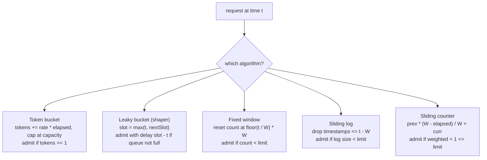

# Rate Limiter Algorithms: Token Bucket, Leaky Bucket, Sliding Window

> Protect a payment API from a retry storm with forty lines of code.

**Type:** Build
**Languages:** Java, Python, Go
**Prerequisites:** Phase 1 Lesson 05 (Stacks, Queues, and Ring Buffers), Phase 1 Lesson 06 (Hash Maps), Phase 3 Lesson 08 (LRU and LFU Caches)
**Time:** ~90 minutes

## Learning Objectives

- Build five rate-limiting algorithms behind one interface, each driven by an injected clock so the tests never sleep
- Explain the difference between a limiter that bounds the admitted rate and a shaper that bounds the output rate, and show it on the same burst
- Compute the Retry-After value each algorithm can promise and map it onto HTTP 429 semantics correctly
- Replay one retry-storm trace through all five limiters and account for every difference in the summary table
- Choose a limiter for a payment endpoint from the trade-offs: burst tolerance, boundary accuracy, memory per key, and the latency cost of queueing

## The Problem

A payment gateway exposes `POST /payments` to merchants. At 14:02 on a Friday the gateway's downstream acquirer connection degrades and 8% of authorizations start returning timeouts after four seconds. Every merchant's integration does the sensible thing: on a timeout it retries. Most retry immediately. Some retry three times. One large merchant's SDK retries in a tight loop with no backoff, because the retry logic was written for a 500 and never tested against a timeout. Within ninety seconds the gateway's inbound rate is 6.4 times normal, nearly all of it retries of requests that are still in flight, and the connection pool to the acquirer, which was the thing that was degraded, is now fully consumed by duplicates. The 8% failure rate becomes 100%. The incident report calls it a retry storm, and the fix proposed in the retrospective is a rate limiter.

A rate limiter decides, per merchant, whether a request is admitted now, and if not, when a retry could succeed. Its two outputs are a boolean and a duration, and the HTTP mapping is standard: `429 Too Many Requests` (RFC 6585) with a `Retry-After` header in whole seconds (RFC 9110, section 10.2.3). A merchant whose SDK honours `Retry-After` stops contributing to the storm. One that does not is throttled anyway, and the acquirer connection pool is spent on first attempts rather than fifth ones.

The algorithm matters because the storm has a shape. It is a burst: forty requests in twenty milliseconds from a client whose normal rate is ten per second. The five classic algorithms respond to the same burst in five different ways. One admits ten of it and then a further nine within the same second. One admits eleven but delays the last of them by nearly a full second. Two admit twenty across a one-second boundary where ten was the limit. One admits exactly one. The lesson builds all five, runs the same trace through each, and makes every row of that table explainable. The choice of algorithm is then a choice you can defend, not a default you inherited.

## The Concept

### One interface, two outputs

Every limiter in this lesson answers `tryAcquire()` with a `Decision`:

- `allowed`: serve the request now (or, for a shaper, after `delayMillis`).
- `retryAfterMillis`: when denied, the earliest instant a retry could succeed, given no other traffic. It is never zero, because a client told to retry in zero milliseconds retries immediately and the storm continues.
- `delayMillis`: when a shaper admits a request into its queue, how long until it is processed.

`Decision.retryAfterHeader()` converts milliseconds to the header's delta-seconds by rounding up. A 95 ms wait becomes `Retry-After: 1`. Rounding down would tell the client to retry at zero, and truncating 1,001 ms to one second would let it retry one millisecond early and be denied again. Always round up.

The interface is deliberately the same for a limiter and a shaper so that the replay harness and the comparison table can treat all five identically; the `delayMillis` field is zero for everything except the leaky bucket, and the row where it is not zero is the row that explains why shapers do not belong on an authorization path.

Every limiter reads time from an injected `Clock`. The `ManualClock` used by the demo and tests has `advance` and `set`, both of which refuse to go backwards. This is what lets a test assert that a token bucket at 499 ms denies and at 500 ms admits, deterministically, in a few microseconds of wall time.

### The five algorithms



**Token bucket.** A bucket holds up to `capacity` tokens and is refilled at `refillPerSecond`. A request takes one token or is denied. The bucket starts full, so a client that has been quiet can burst up to `capacity` at once, and the long-run rate is the refill rate. Retry-After is the time until one token has accumulated: `ceil((1 - tokens) / rate)`. The implementation keeps tokens in thousandths so that a refill of `rate` tokens per second is exactly `rate` thousandths per millisecond, with no floating point.

**Leaky bucket.** The name is used for two different things. As a *meter* it is algebraically identical to the token bucket (water leaking out at a constant rate is tokens refilling at a constant rate), and the Generic Cell Rate Algorithm of the ATM standards is that meter. As a *shaper*, which is what this lesson builds, it is a queue drained at a constant rate: requests are admitted into the queue and leave one every `interval`, so the output is perfectly smooth regardless of the input. The implementation does not keep a queue; it keeps `nextSlot`, the time the next admitted request will be released, and computes each new request's delay as `max(now, nextSlot) - now`. If that delay would exceed the queue's capacity in time, the request is denied. This virtual-scheduling form is O(1) and is how the GCRA is specified.

**Fixed window.** Count requests in the window `[floor(t / W) * W, +W)` and admit while the count is under the limit. One counter, one timestamp, trivially distributed (a Redis `INCR` with an expiry). Retry-After is the time to the next boundary. Its flaw is the boundary itself.

**Sliding window log.** Keep the timestamp of every admitted request; on each call drop those older than `W` and admit if fewer than `limit` remain. Exact, by construction: no window of width `W` ever contains more than `limit` admissions. Retry-After is exactly when the oldest retained timestamp ages out. Memory is O(limit) per client, which for a 10,000-per-minute limit across 50,000 merchants is 500 million timestamps.

**Sliding window counter.** Keep two fixed-window counters, previous and current, and estimate the count in the sliding window as `previous * (fraction of the previous window still inside the sliding window) + current`. O(1) memory with most of the log's accuracy, assuming requests were spread evenly through the previous window. Cloudflare described deploying this in 2017 and measured the approximation error against the log on production traffic at under 0.003% of decisions. The implementation keeps everything multiplied by `W` so the comparison is integer arithmetic.

### A worked boundary

Limit 10 per second. Ten requests arrive at t = 950, 955, …, 995 ms and ten more at 1000, 1005, …, 1045 ms: twenty requests in 100 milliseconds.

Fixed window: the first ten land in window `[0, 1000)` and are admitted; the counter resets at 1000, and the next ten are admitted too. Twenty requests in 100 ms against a limit of ten per second. In general the fixed window admits up to `2 * limit` in any interval that straddles a boundary, and a client that knows the boundary (they are aligned to the clock, so every client knows it) can double its allowance on purpose.

Sliding log: the first ten are admitted. At t = 1000 the log holds `[950, …, 995]`, none older than 1000 - 1000 = 0, so the eleventh request is denied with Retry-After `950 + 1000 - 1000 = 950 ms`. All ten of the second batch are denied. Exactly ten in the 100 ms.

Sliding counter: at t = 1000 the window rolls, `previous = 10, current = 0, elapsed = 0`, and the weighted count is `10 * (1000 - 0) / 1000 + 0 = 10`; the request is denied. At t = 1045 the weight is `10 * 955 / 1000 = 9.55`, so `9.55 + 1 > 10`, still denied. The counter would first admit at elapsed = 100 ms, when `10 * 0.9 + 1 = 10`. Its Retry-After computes exactly that: `W - (limit - 1 - current) * W / previous - elapsed = 1000 - 900 - 0 = 100 ms`.

### The retry storm, five ways

The demo's trace is 99 timestamps: a steady request every 100 ms for three seconds (30 requests), a burst of 40 within 20 ms at t = 3000, then steady every 100 ms until t = 6000 (29 more). Every limiter is configured for a nominal 10 requests per second: token bucket capacity 10 refilling at 10/s, leaky bucket queue 10 draining at 10/s, and a limit of 10 per 1000 ms for the three window algorithms. A limiter that admitted exactly the steady traffic plus a one-second allowance of the burst would admit 69.

| Limiter | Allowed | Denied | Admitted from burst | Max admitted in any 1 s | Max Retry-After | Max delay | What happened |
|---------|---------|--------|---------------------|-------------------------|-----------------|-----------|---------------|
| Token bucket | 69 | 30 | 10 | 19 | 95 ms | 0 | Steady traffic at exactly the refill rate kept the bucket full; the burst drained it; 10 steady requests then arrived in the same second on freshly refilled tokens |
| Leaky bucket | 69 | 30 | 11 | 10 | 195 ms | 995 ms | Queued 10 immediately and an 11th five milliseconds later as the first slot opened; the output never exceeded 10 in any second, but every later steady request waited about 900 ms behind the queue |
| Fixed window | 60 | 39 | 10 | 19 | 995 ms | 0 | The burst started a new window and took all 10 slots; the 9 steady requests in the rest of that window were denied; 9 steady from the previous window plus the 10 burst fell inside one second |
| Sliding log | 60 | 39 | 1 | 10 | 100 ms | 0 | Nine steady requests in the trailing second left room for exactly one; every later steady request was admitted as its predecessor aged out |
| Sliding counter | 55 | 44 | 1 | 10 | 112 ms | 0 | Same shape as the log but conservative: at exactly the limit, the previous window's full count weighs in at each boundary and one steady request per window is denied |

Four of the five numbers you would quote in a design review are in this table. The token bucket and fixed window admit 19 in a second against a limit of 10; the token bucket by design (its one-second ceiling is `capacity + rate`, not `rate`), the fixed window by accident of alignment. The leaky bucket holds the ceiling perfectly and pays for it with a 995 ms queueing delay on every request after the burst, which is latency a payment authorization cannot afford. The sliding log is exact and tells the truth in Retry-After. The sliding counter under-admits a steady client running at exactly its limit, which is either a 10% tax on good clients or a reason to set the limit 10% above the intended rate.

### Retry-After, algorithm by algorithm

Retry-After is only honest if the limiter can actually promise it. Each algorithm computes it from its own state, and each promise has a condition attached: "assuming no other request from this client arrives first". A client that sends a request before its Retry-After has elapsed is denied again with a fresh, usually shorter, value.

| Limiter | Retry-After | Why that is the earliest possible success |
|---------|-------------|-------------------------------------------|
| Token bucket | `ceil((1 token - tokens) / rate)` | The bucket gains exactly `rate` thousandths per millisecond; one whole token exists at that instant and not before |
| Leaky bucket | `(wait - queueCapacity * interval) + interval` | The queue frees one slot per interval; the request fits once the wait has shrunk by one slot's worth |
| Fixed window | `windowEnd - now` | The counter does not change until the boundary; nothing before it can succeed |
| Sliding log | `oldest + W - now` | The oldest retained admission leaves the window at exactly that instant, freeing one slot |
| Sliding counter | smallest `e` with `prev * (W - e) / W + curr + 1 <= limit`, else `windowEnd - now` | The previous window's weight decays linearly; solve for when it has decayed enough |

Two consequences for an API. First, the value is in milliseconds and the header is in seconds, so a 95 ms wait is reported as 1 s: the client waits ten times longer than necessary, which is the correct direction to err. If sub-second precision matters, put the millisecond value in the response body or a custom header alongside the standard one. Second, Retry-After is computed for one client's state; under a global limit shared by many clients, the honest value is the one for the shared bucket, and the first client to retry after it wins. That is why the client half of the contract requires jitter.

### Which clock

All five limiters subtract timestamps, which makes them sensitive to the clock going backwards. A wall clock adjusted by NTP can step back by seconds; a fixed window would then re-open an old window and a token bucket would compute a negative refill (the `elapsed > 0` guard in `refill` prevents the latter from draining the bucket). In production the `Clock` should be a monotonic one (`System.nanoTime()` in Java, `time.monotonic_ns()` in Python, Go's `time.Now()` which carries a monotonic reading), converted to milliseconds. The lesson's `ManualClock` is monotonic by construction: `advance` and `set` refuse to go backwards, and the tests rely on it. The fixed window is the exception: its boundaries must align to the wall clock so that every client and every server instance agrees on where they fall, which is a second reason to avoid it where accuracy matters.

### Which one for a payment API

| Concern | Token bucket | Leaky bucket (shaper) | Fixed window | Sliding log | Sliding counter |
|---------|--------------|-----------------------|--------------|-------------|-----------------|
| Bursts | Allowed up to capacity | Queued, output smooth | Allowed up to limit, 2x at boundary | Allowed up to limit in any window | Allowed up to limit, approximately |
| Accuracy of the per-window ceiling | capacity + rate per second | Exact | 2x at boundaries | Exact | Within a few percent |
| Memory per client | 2 longs | 1 long | 2 longs | O(limit) timestamps | 3 longs |
| Retry-After honesty | Exact | Exact | Exact to boundary | Exact | Approximate |
| Added latency | None | Up to queue depth / rate | None | None | None |
| Distributed form | Lua script on Redis or a cells-style GCRA | Rarely distributed | `INCR` + `EXPIRE` | Sorted set per client, expensive | Two counters per client |

For `POST /payments`, the token bucket is the usual answer: merchants' traffic is legitimately bursty (a batch of subscription renewals at midnight), the one-second overshoot is bounded and known, memory is two numbers per merchant, and Retry-After is exact. A fixed window is acceptable for a coarse per-day quota where the boundary overshoot is irrelevant. The sliding log belongs where exactness is a contractual requirement and the client count is small (a partner API with fifty integrators). The leaky bucket shaper belongs on the outbound side, where you must not exceed an acquirer's or a card network's rate and a queueing delay is acceptable; it is a bad fit for an inbound authorization path where every queued millisecond is customer-visible latency.

### What a rate limiter does not do

- It does not make retries safe. A retry that is admitted still re-executes the request, and if the first attempt succeeded after its client timed out, the customer is charged twice. Idempotency keys (Phase 12, Lesson 01) make the retry a replay; the limiter only makes it rarer.
- It does not work across instances by itself. Every limiter here is per process. Twelve gateway instances each allowing 10 per second allow 120. Phase 9, Lesson 05 (Distributed Rate Limiting) covers the Redis-backed and cell-based versions, and the token bucket's two-long state is why it is the one that distributes best.
- It does not tell a client how to back off. Retry-After is a floor, not a schedule. A client that retries exactly at Retry-After, in lockstep with ten thousand others told the same thing, produces the next burst. Exponential backoff with jitter on the client side is the other half of the fix, and `outputs/` has the contract that says so.
- It is not load shedding. A rate limiter enforces a policy per client regardless of how healthy the server is; load shedding drops requests because the server is unhealthy (queue depth, latency, CPU), regardless of who sent them. Phase 9, Lesson 13 (Graceful Degradation) covers the second; a payment gateway needs both, and the storm in The Problem is the case where the limiter alone is enough only if it is tuned to the degraded downstream's capacity.
- It does not distinguish good traffic from bad. A merchant whose SDK is looping and a merchant whose customers are checking out at the same instant look the same to a counter. Per-merchant limits plus a global limit plus priority for first attempts over retries (a request header the SDK sets) is the usual layering.

## Build It

The primary walkthrough is in Java. The Python and Go files implement the same design with the same names; the subsections at the end show only what differs.

### Step 1: The decision and the clock

```java
record Decision(boolean allowed, long retryAfterMillis, long delayMillis) {
    static Decision allow() { return new Decision(true, 0, 0); }
    static Decision allow(long delayMillis) { return new Decision(true, 0, delayMillis); }
    static Decision deny(long retryAfterMillis) { return new Decision(false, Math.max(1, retryAfterMillis), 0); }
    long retryAfterHeader() { return (retryAfterMillis + 999) / 1000; }
}

interface RateLimiter {
    String name();
    Decision tryAcquire();
}
```

`deny` clamps the wait to at least one millisecond; `retryAfterHeader` rounds up with the `(x + 999) / 1000` idiom. The `Clock` and `ManualClock` are the same as Lesson 08's, with one addition: `set(millis)` jumps to an absolute time so a trace of timestamps can be replayed, and it refuses to move backwards, which catches a trace that is not sorted.

**Predict:** `Decision.deny(1000).retryAfterHeader()` and `Decision.deny(1001).retryAfterHeader()`?

### Step 2: Token bucket with integer refill

```java
private void refill() {
    long now = clock.nowMillis();
    long elapsed = now - lastRefill;
    if (elapsed > 0) {
        tokens = Math.min(capacity * Params.SCALE, tokens + elapsed * refillPerSecond);
        lastRefill = now;
    }
}

public Decision tryAcquire() {
    refill();
    if (tokens >= Params.SCALE) {
        tokens -= Params.SCALE;
        return Decision.allow();
    }
    long deficit = Params.SCALE - tokens;
    return Decision.deny(Params.ceilDiv(deficit, refillPerSecond));
}
```

`SCALE = 1000`: tokens are stored in thousandths. A rate of `r` tokens per second is `r / 1000` tokens per millisecond, which is `r` thousandths per millisecond, so `elapsed * refillPerSecond` is the exact refill with no division and no `double`. Refill is lazy, computed from `lastRefill` on each call, so there is no timer. The denial's Retry-After is the deficit divided by the rate, rounded up, which is the exact instant the bucket will hold one whole token. The test asserts 499 ms denies and 500 ms admits for capacity 5 at 2 per second after draining.

**Predict:** a bucket of capacity 10 at 10 per second, under steady traffic of exactly one request every 100 ms. How many tokens does it hold just before each request, and what happens when 40 arrive at once?

### Step 3: Leaky bucket by virtual scheduling

```java
public Decision tryAcquire() {
    long now = clock.nowMillis();
    long slot = Math.max(now, nextSlot);
    long delay = slot - now;
    if (delay >= queueCapacity * intervalMillis) {
        return Decision.deny(delay - queueCapacity * intervalMillis + intervalMillis);
    }
    nextSlot = slot + intervalMillis;
    return Decision.allow(delay);
}
```

`nextSlot` is the only state. If it is in the past, the request runs now and the next slot is one interval from now. If it is in the future, the request is queued until then, and the queue is "full" when the wait would reach `queueCapacity` intervals. The denial's Retry-After is how long until the wait drops below that, plus one interval: the earliest time a request would be admitted into the last slot. The constructor requires `leakPerSecond` to divide 1000 so `intervalMillis` is a whole number; a production version would keep `nextSlot` in microseconds or nanoseconds.

Note what `allowed` means here: admitted to the queue, not processed. The caller must actually wait `delayMillis` before proceeding, which in a server means parking the request. That parking is the latency cost in the table.

**Predict:** queue capacity 3 at 10 per second, five requests at t = 0. What are the five decisions?

### Step 4: Fixed window and sliding log

```java
// FixedWindow
long start = now - now % windowMillis;
if (start != windowStart) { windowStart = start; count = 0; }
if (count < limit) { count++; return Decision.allow(); }
return Decision.deny(start + windowMillis - now);

// SlidingWindowLog
long cutoff = now - windowMillis;
while (!log.isEmpty() && log.peekFirst() <= cutoff) log.pollFirst();
if (log.size() < limit) { log.addLast(now); return Decision.allow(); }
return Decision.deny(log.peekFirst() + windowMillis - now);
```

The fixed window aligns to multiples of `windowMillis` from the epoch, which is why two clients and the server all agree where the boundary is. The log is an `ArrayDeque<Long>`: timestamps are appended in order, so expiry is a pop from the front, and `peekFirst` after expiry is the oldest live admission, which is exactly what determines Retry-After. The `<= cutoff` comparison makes a timestamp exactly `W` old count as expired, so the window is half-open `(now - W, now]`; the test `entry at exactly window age has left` pins that choice, and it must match in all three languages or the same trace produces different counts.

**Predict:** with the sliding log at limit 2, requests at 100 and 400, then a request at 500: what is Retry-After, and what does the log contain after a request at 1100?

### Step 5: Sliding window counter in integers

```java
private long roll(long now) {
    long start = now - now % windowMillis;
    if (start != windowStart) {
        previous = (start == windowStart + windowMillis) ? current : 0;
        current = 0;
        windowStart = start;
    }
    return now - start;
}

public Decision tryAcquire() {
    long now = clock.nowMillis();
    long elapsed = roll(now);
    long w = windowMillis;
    long scaled = previous * (w - elapsed) + current * w;
    if (scaled + w <= limit * w) { current++; return Decision.allow(); }
    if (current >= limit || previous == 0) return Decision.deny(w - elapsed);
    long needed = w - ((limit - 1 - current) * w) / previous;
    return Decision.deny(Math.max(1, needed - elapsed));
}
```

`roll` handles the gap case: if the current window is not the one immediately after the stored one, nothing from the stored window overlaps and `previous` is zero. The weighted count is `previous * (w - elapsed) / w + current`; multiplying everything by `w` turns the comparison into `previous * (w - elapsed) + current * w + w <= limit * w` with no division and no rounding. The Retry-After branch solves that inequality for the smallest elapsed time at which it holds, which is when the previous window's weight has decayed enough. The `previous == 0` guard avoids dividing by zero when the current window alone is full.

**Predict:** ten requests in window 0; at t = 1250 what is the weighted count, and is the next request admitted?

### Step 6: Replay the storm

```java
static ReplaySummary replay(RateLimiter limiter, ManualClock clock, List<Long> trace, long burstStart, long burstEnd) {
    List<Long> allowedTimes = new ArrayList<>();
    int denied = 0, inBurst = 0;
    long maxRetry = 0, maxDelay = 0;
    for (long t : trace) {
        clock.set(t);
        Decision d = limiter.tryAcquire();
        if (d.allowed()) {
            allowedTimes.add(t + d.delayMillis());
            maxDelay = Math.max(maxDelay, d.delayMillis());
            if (t >= burstStart && t < burstEnd) inBurst++;
        } else {
            denied++;
            maxRetry = Math.max(maxRetry, d.retryAfterMillis());
        }
    }
    return new ReplaySummary(limiter.name(), allowedTimes.size(), denied, inBurst, maxInWindow(allowedTimes, 1000), maxRetry, maxDelay);
}
```

The replay advances the limiter's own clock to each timestamp and records the processing time (`t + delay`) of each admission, so `maxInWindow` measures the output rate the downstream actually sees, which for the shaper is what matters. `maxInWindow` is the two-pointer sliding window from Phase 2, Lesson 03 over the sorted admission times. Each limiter gets its own `ManualClock`; sharing one would make the second limiter's replay start with a clock already at t = 6000 and `set` would refuse to go back.

**Predict:** why does the leaky bucket's `maxInWindow` come out at exactly 10 even though it admitted 11 of the burst?

### Step 7: Run it

```bash
cd phases/03-systems-data-structures/11-rate-limiter-algorithms/code/java
javac -d .out *.java && java -cp .out Main
java -cp .out MainTest
```

Expected output, abbreviated:

```console
== Token bucket: burst now, steady later ==
7 requests at t=0 against capacity 5: [true, true, true, true, true, false, false]
denied: retry after 500 ms -> Retry-After: 1

== Leaky bucket: admits, but spaces the output ==
request 0 at t=0: queued, runs at +0 ms
request 2 at t=0: queued, runs at +200 ms
request 3 at t=0: rejected, Retry-After 100 ms

== Fixed window: the 2x problem at the boundary ==
20 requests between t=950 and t=1050 ms, limit 10/s: fixed window admitted 20, sliding log admitted 10

== The same retry storm through all five (limit 10 rps, burst of 40 at t=3.0 s) ==
limiter          allowed denied in burst max/1s max Retry-After max delay
token bucket          69     30       10     19           95 ms      0 ms
leaky bucket          69     30       11     10          195 ms    995 ms
fixed window          60     39       10     19          995 ms      0 ms
sliding log           60     39        1     10          100 ms      0 ms
sliding counter       55     44        1     10          112 ms      0 ms
```

The tests in all three languages assert this table row by row. If a reimplementation changes one number, the test names which algorithm and which column, and the explanation column in The Concept tells you what behaviour you changed.

### In Python

The Python port (`code/python/main.py`) is the same design with three differences. **Ceiling division is `-(-a // b)`:** Python's `//` floors, so the negate-floor-negate idiom gives the ceiling for positive operands; Java and Go use `(a + b - 1) / b`. Both are exact integer arithmetic. **`collections.deque`** is the sliding log, with `popleft` for expiry and `[0]` for the oldest entry. **A frozen dataclass** for `Decision`, with `allow` and `deny` as static methods; the Java record and Go struct carry the same three fields. The `RateLimiter` base class raises `NotImplementedError`, the lightweight interface, and constructors raise `ValueError` for bad parameters.

Run it from `code/python/` with `python3 main.py`; test with `python3 -m unittest -v`.

#### Step 1: The decision and the clock

`Decision` is a frozen dataclass with defaults so `allow()` and `allow(delay)` are one static method; `deny` clamps to at least one millisecond and `retry_after_header` rounds up with `-(-x // 1000)`. `ManualClock.set` refuses to move backwards, which catches an unsorted trace.

```python
    def set(self, millis: int) -> None:
        if millis < self._now:
            raise ValueError("clock cannot go backwards")
        self._now = millis
```

```python
@dataclass(frozen=True)
class Decision:
    allowed: bool
    retry_after_millis: int = 0
    delay_millis: int = 0

    @staticmethod
    def allow(delay_millis: int = 0) -> "Decision":
        return Decision(True, 0, delay_millis)

    @staticmethod
    def deny(retry_after_millis: int) -> "Decision":
        return Decision(False, max(1, retry_after_millis), 0)

    def retry_after_header(self) -> int:
        """Retry-After is delta-seconds; always round up so the client never retries early."""
        return -(-self.retry_after_millis // 1000)


class RateLimiter:
    name = "base"

    def try_acquire(self) -> Decision:
        raise NotImplementedError
```

#### Step 2: Token bucket with integer refill

Tokens are kept in thousandths (`SCALE = 1000`) so `elapsed * refill_per_second` is the exact refill. The denial's wait is the deficit divided by the rate, rounded up with the floor-division idiom.

```python
    def _refill(self) -> None:
        now = self.clock.now_millis()
        elapsed = now - self._last_refill
        if elapsed > 0:
            # refill_per_second tokens/s == refill_per_second thousandths per ms: exact integer math
            self._tokens = min(self.capacity * SCALE, self._tokens + elapsed * self.refill_per_second)
            self._last_refill = now

    def try_acquire(self) -> Decision:
        self._refill()
        if self._tokens >= SCALE:
            self._tokens -= SCALE
            return Decision.allow()
        deficit = SCALE - self._tokens
        return Decision.deny(-(-deficit // self.refill_per_second))  # ceil(deficit / rate) ms
```

#### Step 3: Leaky bucket by virtual scheduling

`_next_slot` is the only state; the built-in `max` picks the later of now and the next free slot, and `Decision.allow(delay)` carries the wait the caller must observe.

```python
    def try_acquire(self) -> Decision:
        now = self.clock.now_millis()
        slot = max(now, self._next_slot)
        delay = slot - now
        if delay >= self.queue_capacity * self.interval_millis:
            # the queue is full: the request would wait longer than queue_capacity slots
            return Decision.deny(delay - self.queue_capacity * self.interval_millis + self.interval_millis)
        self._next_slot = slot + self.interval_millis
        return Decision.allow(delay)
```

#### Step 4: Fixed window and sliding log

The fixed window aligns to multiples of `window_millis` with `%`. The log is a `deque`: `popleft` expires the front while it is at or before the cutoff (`<=`, so the window is half-open), and `_log[0]` is the oldest live admission that decides Retry-After.

```python
    def try_acquire(self) -> Decision:
        now = self.clock.now_millis()
        start = now - now % self.window_millis
        if start != self._window_start:
            self._window_start = start
            self._count = 0
        if self._count < self.limit:
            self._count += 1
            return Decision.allow()
        return Decision.deny(start + self.window_millis - now)
```

```python
    def try_acquire(self) -> Decision:
        now = self.clock.now_millis()
        cutoff = now - self.window_millis
        while self._log and self._log[0] <= cutoff:
            self._log.popleft()
        if len(self._log) < self.limit:
            self._log.append(now)
            return Decision.allow()
        return Decision.deny(self._log[0] + self.window_millis - now)
```

#### Step 5: Sliding window counter in integers

`_roll` handles the gap case, and the weighted comparison is kept multiplied by `w` so no division happens on the admit path. The Retry-After branch uses `//`, which agrees with Java's `/` here because every operand is non-negative.

```python
    def _roll(self, now: int) -> int:
        start = now - now % self.window_millis
        if start != self._window_start:
            if start == self._window_start + self.window_millis:
                self._previous = self._current       # the window just before this one
            else:
                self._previous = 0                   # a gap: nothing overlaps
            self._current = 0
            self._window_start = start
        return now - start

    def try_acquire(self) -> Decision:
        now = self.clock.now_millis()
        elapsed = self._roll(now)
        w = self.window_millis
        scaled = self._previous * (w - elapsed) + self._current * w
        if scaled + w <= self.limit * w:
            self._current += 1
            return Decision.allow()
        if self._current >= self.limit or self._previous == 0:
            return Decision.deny(w - elapsed)
        # smallest e' with previous*(w - e') + current*w + w <= limit*w
        needed = w - ((self.limit - 1 - self._current) * w) // self._previous
        return Decision.deny(max(1, needed - elapsed))
```

#### Step 6: Replay the storm

The replay drives each limiter's own `ManualClock` through the trace with `set`, records processing times (`t + delay`), and tallies the columns of the table; `burst_start <= t < burst_end` is the chained in-burst test.

```python
def replay(limiter: RateLimiter, clock: ManualClock, trace: list[int], burst_start: int, burst_end: int) -> ReplaySummary:
    """Drive the injected clock through the trace and tally what the limiter did."""
    allowed_times: list[int] = []
    denied = 0
    in_burst = 0
    max_retry = 0
    max_delay = 0
    for t in trace:
        clock.set(t)
        d = limiter.try_acquire()
        if d.allowed:
            allowed_times.append(t + d.delay_millis)
            max_delay = max(max_delay, d.delay_millis)
            if burst_start <= t < burst_end:
                in_burst += 1
        else:
            denied += 1
            max_retry = max(max_retry, d.retry_after_millis)
    return ReplaySummary(limiter.name, len(allowed_times), denied, in_burst, max_in_window(allowed_times, 1000), max_retry, max_delay)
```

#### Step 7: Run it

```bash
cd phases/03-systems-data-structures/11-rate-limiter-algorithms/code/python
python3 main.py
python3 -m unittest -v
```

```console
== Token bucket: burst now, steady later ==
7 requests at t=0 against capacity 5: [True, True, True, True, True, False, False]
denied: retry after 500 ms -> Retry-After: 1
```

The five-row storm table is identical to the Java run; the tests assert it row by row.

### In Go

The Go port (`code/go/main.go`) keeps the design with three differences. **Built-in `min` and `max`** (Go 1.21+) replace `Math.min` and `Math.max`. **Constructors return `(limiter, error)`** with `ErrBadParameter` as the sentinel, in place of `IllegalArgumentException` and `ValueError`. `ManualClock` panics on a backwards move, because a trace that is not sorted is a programming error in the test, not a runtime condition. **The sliding log is a slice** re-sliced from the front on expiry (`l.log = l.log[drop:]`); Go has no deque in the standard library, and for a bounded log the slice is the idiomatic answer. A long-running production version would copy to a fresh slice periodically so the backing array does not grow without bound.

Run it from `code/go/` with `go run .`; test with `go test ./...`.

#### Step 1: The decision and the clock

`Decision` is a struct with three constructor functions (`Allow`, `AllowAfter`, `Deny`) because Go has no overloading; `Deny` clamps the wait and `RetryAfterHeader` uses the `(x + 999) / 1000` idiom. `ceilDiv` is the helper the token bucket uses, and `Set` panics on a backwards move.

```go
func (c *ManualClock) Set(millis int64) {
	if millis < c.now {
		panic("clock cannot go backwards")
	}
	c.now = millis
}

type Decision struct {
	Allowed          bool
	RetryAfterMillis int64
	DelayMillis      int64
}

// Allow is an immediate admission.
func Allow() Decision { return Decision{Allowed: true} }

// AllowAfter is an admission that is processed delayMillis from now.
func AllowAfter(delayMillis int64) Decision { return Decision{Allowed: true, DelayMillis: delayMillis} }

// Deny is a rejection; the wait is never reported as zero.
func Deny(retryAfterMillis int64) Decision {
	if retryAfterMillis < 1 {
		retryAfterMillis = 1
	}
	return Decision{RetryAfterMillis: retryAfterMillis}
}

// RetryAfterHeader is delta-seconds; always round up so the client never retries early.
func (d Decision) RetryAfterHeader() int64 { return (d.RetryAfterMillis + 999) / 1000 }

func ceilDiv(a, b int64) int64 { return (a + b - 1) / b }
```

#### Step 2: Token bucket with integer refill

The `if elapsed := ...; elapsed > 0` form scopes the elapsed time to the refill branch, and the built-in `min` caps the bucket. The denial goes through `ceilDiv`.

```go
func (b *TokenBucket) refill() {
	now := b.clock.NowMillis()
	if elapsed := now - b.lastRefill; elapsed > 0 {
		// refillPerSecond tokens/s == refillPerSecond thousandths per ms: exact integer math
		b.tokens = min(b.Capacity*Scale, b.tokens+elapsed*b.RefillPerSecond)
		b.lastRefill = now
	}
}

func (b *TokenBucket) TryAcquire() Decision {
	b.refill()
	if b.tokens >= Scale {
		b.tokens -= Scale
		return Allow()
	}
	return Deny(ceilDiv(Scale-b.tokens, b.RefillPerSecond))
}
```

#### Step 3: Leaky bucket by virtual scheduling

The Java method with the built-in `max` and `AllowAfter(delay)` for an admission that carries a wait.

```go
func (b *LeakyBucket) TryAcquire() Decision {
	now := b.clock.NowMillis()
	slot := max(now, b.nextSlot)
	delay := slot - now
	if delay >= b.QueueCapacity*b.IntervalMillis {
		// the queue is full: the request would wait longer than queueCapacity slots
		return Deny(delay - b.QueueCapacity*b.IntervalMillis + b.IntervalMillis)
	}
	b.nextSlot = slot + b.IntervalMillis
	return AllowAfter(delay)
}
```

#### Step 4: Fixed window and sliding log

The fixed window is unchanged. The log counts how many leading entries are at or before the cutoff and re-slices them away in one step; `l.log[0]` is then the oldest live admission.

```go
func (w *FixedWindow) TryAcquire() Decision {
	now := w.clock.NowMillis()
	start := now - now%w.WindowMillis
	if start != w.windowStart {
		w.windowStart = start
		w.count = 0
	}
	if w.count < w.Limit {
		w.count++
		return Allow()
	}
	return Deny(start + w.WindowMillis - now)
}
```

```go
func (l *SlidingWindowLog) TryAcquire() Decision {
	now := l.clock.NowMillis()
	cutoff := now - l.WindowMillis
	drop := 0
	for drop < len(l.log) && l.log[drop] <= cutoff {
		drop++
	}
	l.log = l.log[drop:]
	if int64(len(l.log)) < l.Limit {
		l.log = append(l.log, now)
		return Allow()
	}
	return Deny(l.log[0] + l.WindowMillis - now)
}
```

#### Step 5: Sliding window counter in integers

`roll` and `TryAcquire` are the Java lines; Go's `/` truncates like Java's, and every operand in the Retry-After formula is non-negative so the result is identical. The built-in `max` clamps the wait to one millisecond.

```go
func (c *SlidingWindowCounter) roll(now int64) int64 {
	start := now - now%c.WindowMillis
	if start != c.windowStart {
		if start == c.windowStart+c.WindowMillis {
			c.previous = c.current // the window just before this one
		} else {
			c.previous = 0 // a gap: nothing overlaps
		}
		c.current = 0
		c.windowStart = start
	}
	return now - start
}

func (c *SlidingWindowCounter) TryAcquire() Decision {
	now := c.clock.NowMillis()
	elapsed := c.roll(now)
	w := c.WindowMillis
	scaled := c.previous*(w-elapsed) + c.current*w
	if scaled+w <= c.Limit*w {
		c.current++
		return Allow()
	}
	if c.current >= c.Limit || c.previous == 0 {
		return Deny(w - elapsed)
	}
	// smallest e' with previous*(w - e') + current*w + w <= limit*w
	needed := w - ((c.Limit-1-c.current)*w)/c.previous
	return Deny(max(1, needed-elapsed))
}
```

#### Step 6: Replay the storm

`Replay` fills the `ReplaySummary` fields in place as it walks the trace and computes `MaxInAnySecond` at the end from the recorded processing times.

```go
func Replay(limiter RateLimiter, clock *ManualClock, trace []int64, burstStart, burstEnd int64) ReplaySummary {
	var allowedTimes []int64
	s := ReplaySummary{Name: limiter.Name()}
	for _, t := range trace {
		clock.Set(t)
		d := limiter.TryAcquire()
		if d.Allowed {
			allowedTimes = append(allowedTimes, t+d.DelayMillis)
			s.MaxDelayMillis = max(s.MaxDelayMillis, d.DelayMillis)
			if t >= burstStart && t < burstEnd {
				s.AllowedInBurst++
			}
		} else {
			s.Denied++
			s.MaxRetryAfterMillis = max(s.MaxRetryAfterMillis, d.RetryAfterMillis)
		}
	}
	s.Allowed = len(allowedTimes)
	s.MaxInAnySecond = MaxInWindow(allowedTimes, 1000)
	return s
}
```

#### Step 7: Run it

```bash
cd phases/03-systems-data-structures/11-rate-limiter-algorithms/code/go
go run .
go test ./...
```

```console
limiter          allowed denied in burst max/1s max Retry-After max delay
token bucket          69     30       10     19           95 ms      0 ms
leaky bucket          69     30       11     10          195 ms    995 ms
fixed window          60     39       10     19          995 ms      0 ms
sliding log           60     39        1     10          100 ms      0 ms
sliding counter       55     44        1     10          112 ms      0 ms
```

Every row matches the Java table, and the earlier sections print the same decisions.

## Use It

### Guava `RateLimiter`, Bucket4j, and `golang.org/x/time/rate`

Guava's `RateLimiter.create(permitsPerSecond)` is a token bucket with a twist: `acquire()` blocks the calling thread until a permit is available, which turns it into a shaper, while `tryAcquire()` is the non-blocking limiter of this lesson. Its `SmoothWarmingUp` variant refills more slowly after idleness so a cold downstream is not hit with a full bucket. Bucket4j is the production Java token bucket with distributed backends (JCache, Redis, Hazelcast) and a `probe` call that returns the nanoseconds to wait, which is this lesson's `retryAfterMillis`. Go's `golang.org/x/time/rate` is a token bucket with `Allow`, `Wait` (blocking), and `Reserve`, which returns a reservation carrying the delay, the same shape as `Decision.allow(delay)`.

### Envoy, nginx, and Redis

Envoy's local rate limit filter is a token bucket per route with `max_tokens`, `tokens_per_fill`, and `fill_interval`, and it sets `x-envoy-ratelimited` and returns 429 with a configurable `Retry-After`. nginx's `limit_req` is a leaky bucket shaper: `rate=10r/s burst=20` queues up to 20 requests and drains them at 10 per second, with `nodelay` converting it into a token bucket that admits the burst immediately. Redis has no built-in limiter but two common patterns: `INCR` plus `EXPIRE` for a fixed window, and a sorted set of timestamps with `ZREMRANGEBYSCORE` for a sliding log, both usually wrapped in a Lua script so the read-modify-write is atomic. The `redis-cell` module implements the GCRA, which is the token bucket in leaky-bucket clothing, with a single `CL.THROTTLE` command that returns the retry-after and the remaining allowance.

### Kafka quotas, as a different shape of the same idea

Kafka brokers enforce per-client produce and fetch quotas in bytes per second, and when a client exceeds its quota the broker does not reject the request: it delays the response by a computed `throttle_time_ms` and reports that value in the response header. That is the leaky-bucket shaper of this lesson applied at the protocol level, with the delay made explicit to the client the way `delayMillis` is here, and it is why a Kafka producer under quota sees rising latency rather than errors.

### Stripe, GitHub, and the headers

Stripe's public API documents a per-second limit in live mode and returns `429` with a `rate_limit_error`; its client libraries retry with exponential backoff and jitter and set an `Idempotency-Key` so the retry is safe. GitHub returns `429` or `403` for secondary rate limits with `Retry-After` and documents that a client which ignores it has its limit tightened. The IETF HTTP API working group's `RateLimit` header fields draft standardises `RateLimit-Limit`, `RateLimit-Remaining`, and `RateLimit-Reset` so a client can see its allowance before it is denied, which is the information `TokenBucket.tokens()` exposes.

### The client half

AWS's Architecture Blog post on exponential backoff and jitter (2015) is the standard reference for the client side: full jitter, `sleep = random(0, min(cap, base * 2^attempt))`, spreads retries so that ten thousand clients told `Retry-After: 1` do not all return at the same millisecond. A rate limiter without a jittered client produces a sequence of synchronised bursts one Retry-After apart, which is a slower storm, not the absence of one.

## Ship It

`outputs/runbook-retry-storm-and-429-contract.md` has two halves: the server's 429 contract (what the limiter promises, how Retry-After is computed per algorithm, what to log and alarm on) and the retry-storm runbook (how to recognise one, how to tighten limits per merchant without freezing the good ones, how to verify the storm has stopped). Use the first half when you design an endpoint and the second at 14:02 on the Friday.

## Exercises

1. **Reinforce.** Add `tryAcquire(int permits)` to the token bucket for requests that cost more than one token (a batch endpoint that creates 50 payments costs 50). Decide what Retry-After means when `permits > capacity` and encode the decision in a test.
2. **Apply.** Implement the GCRA as a meter (not a shaper): a single `theoreticalArrivalTime` with increment `1 / rate` and tolerance `capacity / rate`, admitting when `now >= tat - tolerance`. Replay the storm and show that its summary row is identical to the token bucket's. Then explain in two sentences why Redis's `redis-cell` chose this form over the two-long token bucket.
3. **Extend.** Build a two-level limiter: a per-merchant token bucket in front of a global token bucket, where a request must pass both, and a `Retry-After` that is the larger of the two. Store the per-merchant buckets in the LRU cache from Phase 3, Lesson 08 so idle merchants' buckets are evicted (what state does an evicted-then-recreated bucket start with, and is that safe?). Replay a trace with 1,000 merchants where one of them is the storm, and show that the other 999 are unaffected.

## Key Terms

| Term | What people say | What it actually means |
|------|-----------------|------------------------|
| Rate limiter | "throttling" | A per-client admission decision with two outputs: admit now, or deny with the earliest time a retry can succeed |
| Shaper | "smoothing" | A limiter that admits into a queue drained at a constant rate, so the output rate is bounded exactly at the cost of queueing delay; the leaky bucket proper |
| Burst capacity | "the bucket size" | The number of requests a quiet client may send at once; a token bucket's one-second ceiling is capacity plus rate, not rate |
| Boundary problem | "the 2x bug" | A fixed window admits up to twice its limit in any interval straddling a window boundary, because the counter resets at an instant every client can predict |
| Retry-After | "the backoff header" | RFC 9110's delta-seconds (or HTTP-date) telling the client the earliest time to retry; always rounded up, never zero, and a floor rather than a schedule |
| Retry storm | "thundering herd" | A failure in which retries of still-failing requests multiply load on the component that is failing, turning a partial outage into a full one |
| GCRA | "the ATM algorithm" | Generic Cell Rate Algorithm: a leaky-bucket meter kept as a single theoretical arrival time; equivalent to a token bucket and the basis of redis-cell |
| Jitter | "randomised backoff" | Randomising each client's retry delay so that clients denied at the same instant do not retry at the same instant; the client half of storm prevention |

## Further Reading

- [RFC 6585: Additional HTTP Status Codes](https://www.rfc-editor.org/rfc/rfc6585#section-4) — defines 429 Too Many Requests and says a `Retry-After` header may accompany it.
- [RFC 9110: HTTP Semantics, section 10.2.3 Retry-After](https://www.rfc-editor.org/rfc/rfc9110#section-10.2.3) — the header's two forms (delta-seconds and HTTP-date) and its meaning on a 429 or 503.
- [ATM Forum, Traffic Management Specification Version 4.0 (1996)](https://www.broadband-forum.org/technical/download/af-tm-0056.000.pdf) — the Generic Cell Rate Algorithm in both its virtual-scheduling and continuous-state leaky-bucket forms; the two are proven equivalent in the specification.
- [Cloudflare, "How we built rate limiting capable of scaling to millions of domains" (2017)](https://blog.cloudflare.com/counting-things-a-lot-of-different-things/) — the sliding window counter and its measured error against an exact log on production traffic.
- [AWS Architecture Blog, "Exponential Backoff And Jitter" (2015)](https://aws.amazon.com/blogs/architecture/exponential-backoff-and-jitter/) — the client-side half: why jitter, and the measured effect of full jitter on contention.
- [IETF httpapi, "RateLimit header fields for HTTP" (draft)](https://datatracker.ietf.org/doc/draft-ietf-httpapi-ratelimit-headers/) — the standard fields for telling a client its remaining allowance before it is denied.
- [Stripe API documentation: Rate limits](https://docs.stripe.com/rate-limits) — a payment API's published limits, 429 behaviour, and the client retry guidance that goes with them.
