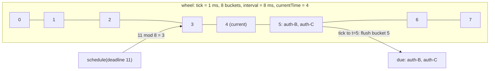
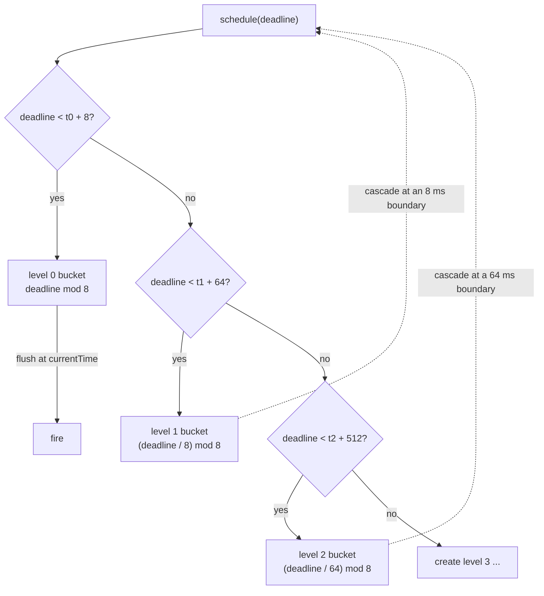

# Hierarchical Timing Wheels

> Millions of timeouts with O(1) insert and tick.

**Type:** Build
**Languages:** Java, Python
**Prerequisites:** Phase 1, Lesson 04 (Linked Lists), Phase 1, Lesson 09 (Heaps and Priority Queues), Phase 3, Lesson 08 (LRU and LFU Caches)
**Time:** ~75 minutes

## Learning Objectives

- Explain why a heap-based timer costs O(log n) per insert and why that matters when a payment gateway holds millions of pending timeouts
- Build a single timing wheel with O(1) schedule, O(1) cancel, and O(1 + due) tick, using a circular array of doubly linked buckets and an injected clock
- Extend it to a hierarchy of wheels where each level's tick is the level below's whole interval, and trace an entry cascading from a coarse wheel to a fine one
- State the precision guarantee a wheel gives (never early, at most one tick late) and the two costs it pays for O(1) operations: tick granularity and work on idle ticks
- Compare the wheel with a binary heap on the same seeded workload and choose between them from the operation mix

## The Problem

A card authorization places a hold on the cardholder's funds. If the merchant does not capture within a window (seven days for most card-present transactions, longer for hotels and rentals), the hold must be released: the issuer's available balance goes back up, the risk engine's exposure goes down, and the merchant's authorization is marked expired. A mid-sized acquirer has around 40 million open authorizations at any time, and each one is a pending timeout. Every capture cancels one; every new authorization creates one; several thousand expire each second.

The first implementation is a `java.util.PriorityQueue` ordered by expiry, polled by a thread. It is correct and it is the textbook answer. It is also O(log n) per insert, with n at 40 million that is 25 comparisons and 25 pointer-chasing cache misses per authorization, and cancellation is worse: `PriorityQueue.remove(Object)` is O(n), so the team does what everyone does and marks the entry cancelled, leaving it in the heap until it surfaces a week later. The heap now holds every authorization that was ever opened in the last seven days, captured or not, about three times the live set. Memory triples, every operation gets slower because the heap is bigger, and a GC pause during the morning peak produces a burst of late expirations that the risk engine reads as a spike in exposure.

The same shape appears on every hop of a payment: the gateway's per-request deadline (Phase 5, Lesson 08), the retry schedule with backoff (Phase 5, Lesson 10), the webhook delivery timeout, the idempotency-key TTL, the session expiry on a checkout page, the heartbeat timer in a Raft follower (Phase 6). In each case the number of pending timers is large, the inserts and cancels vastly outnumber the expirations (most requests succeed, so most timeouts are cancelled), and the precision needed is coarse: nobody cares whether an authorization expires at 7 days plus 3 ms or 7 days plus 9 ms.

Those three properties are what the timing wheel exploits. It gives up precision below a configurable tick and in exchange makes every operation constant time: scheduling is one array index and two pointer writes, cancellation unlinks a node, and each tick processes exactly the entries that are due. Varghese and Lauck described it in 1987 for BSD's TCP timers; it is the timer inside the Linux kernel, Netty, Kafka's request purgatory, and most RPC frameworks. Forty million holds with a one-second tick is a 604,800-slot wheel, or, with the hierarchy this lesson builds, three small wheels of 64 slots each.

## The Concept

### What a timer facility must do

Three operations, with the counts a payment gateway sees:

| Operation | Rate | Heap | Wheel |
|-----------|------|------|-------|
| `schedule(delay, task)` | every request | O(log n) | O(1) |
| `cancel(handle)` | almost every request (success cancels the timeout) | O(1) lazy with memory leak until expiry, or O(n) eager | O(1), memory freed immediately |
| `tick()` / `poll()` | once per tick | O(k log n) for k due | O(1 + k) |
| Precision | | exact | one tick |
| Idle cost | | zero | one bucket check per tick |

The heap is exact and does no work when idle. The wheel is approximate and does a little work every tick whether or not anything is due. For timeouts, where inserts and cancels dominate and the required precision is coarse, the wheel wins by a wide margin; for a small number of precise timers (a cron-like scheduler with a few hundred entries), the heap is the right choice and the wheel is over-engineering.

### A single wheel

A wheel is a circular array of `wheelSize` buckets, each spanning `tickMillis`, so the whole wheel covers `interval = tickMillis * wheelSize`. The wheel has a `currentTime`, always a multiple of the tick. An entry whose deadline falls in `[currentTime + tick, currentTime + interval)` goes into bucket `(deadline / tick) mod wheelSize`. Every tick, `currentTime` advances by one tick and the bucket at `(currentTime / tick) mod wheelSize` is flushed: everything in it is due.



Why a bucket is a doubly linked list and not an `ArrayList`: cancellation. An entry holds a pointer to its bucket and to its neighbours, so `cancel()` is four pointer writes and never searches. The LRU cache in Lesson 08 used the same trick for the same reason, and the `Bucket` class here is that lesson's list with a sentinel.

Within a bucket, entries fire in insertion order. Two deadlines that round to the same tick are indistinguishable to the wheel; this is the precision trade, and section 3 of the demo shows it directly with a 10 ms tick and deadlines of 23 and 29 ms.

### Rounding: never early

The wheel can only act at tick boundaries, so a deadline between boundaries must be moved to one of them. This lesson rounds **up**: `deadline = ceil((now + delay) / tick) * tick`. A timer therefore never fires before its requested time and fires at most one tick late. For timeouts that is the correct direction: a request that is timed out 5 ms early was failed while it might still have succeeded, and an authorization released 5 ms early is a settlement that can bounce. Kafka's purgatory makes the opposite choice (bucket expiration at the start of the tick, so a task can run up to a tick early); Netty's `HashedWheelTimer` rounds the way this lesson does. Know which one you are holding.

### The hierarchy

A single wheel covering seven days at one-second precision has 604,800 buckets, most of them empty, and a wheel covering seven days at one-millisecond precision is not buildable. The hierarchical design (Varghese and Lauck's "Scheme 6") uses several wheels whose ticks grow geometrically: level 0 has tick `t` and covers `t * w`; level 1 has tick `t * w` and covers `t * w^2`; level 2 has tick `t * w^2` and covers `t * w^3`. With `t = 1 ms` and `w = 64`, three levels cover 262 seconds and four cover 4.6 hours; with `w = 256`, four levels cover 1.9 years. An entry is placed in the lowest level whose interval reaches its deadline.

```text
level 0: tick   1 ms, 8 buckets, covers [currentTime, currentTime +   8 ms)
level 1: tick   8 ms, 8 buckets, covers [currentTime, currentTime +  64 ms)
level 2: tick  64 ms, 8 buckets, covers [currentTime, currentTime + 512 ms)
```

When level 0 ticks to a time that is a multiple of level 1's tick, level 1 advances one slot and its current bucket **cascades**: every entry in it is removed and re-inserted from the bottom, where it either lands in a level-0 bucket (its deadline is now within 8 ms), or is due this very tick and runs. An entry scheduled 300 ms out with these parameters sits in level 2, cascades to level 1 at t = 256, cascades to level 0 at t = 296, and fires at t = 300. Each cascade is O(1) per entry and each entry cascades at most `levels - 1` times over its life, so scheduling remains amortized O(1) with a constant that depends on the depth, not on n.

Worked trace, level 0 tick 1 ms, 8 buckets, starting at t = 0, five holds scheduled at once:

```text
schedule(3)   -> deadline 3   < 0 + 8   -> level 0, bucket 3 mod 8 = 3
schedule(5)   -> deadline 5   < 0 + 8   -> level 0, bucket 5
schedule(5)   -> deadline 5             -> level 0, bucket 5 (after the previous one)
schedule(12)  -> deadline 12  >= 0 + 8  -> level 1 created (tick 8, currentTime 0)
                 12 < 0 + 64            -> level 1, bucket (12 / 8) mod 8 = 1
schedule(300) -> 300 >= 0 + 64          -> level 2 created (tick 64)
                 300 < 0 + 512          -> level 2, bucket (300 / 64) mod 8 = 4

tick to t=3:  flush level 0 bucket 3 -> fires the 3 ms hold
tick to t=5:  flush bucket 5 -> fires both 5 ms holds, insertion order
tick to t=8:  8 is a multiple of level 1's tick -> level 1 currentTime = 8, flush its bucket 1
              re-insert deadline 12 from the bottom: 12 < 8 + 8 -> level 0, bucket 12 mod 8 = 4
tick to t=12: flush level 0 bucket 4 -> fires the 12 ms hold
...
tick to t=256: level 2 boundary -> level 2 currentTime = 256, flush its bucket 4
              re-insert 300: 300 >= 256 + 8 -> level 1: 300 < 256 + 64 -> bucket (300/8) mod 8 = 37 mod 8 = 5
tick to t=296: level 1 boundary -> flush its bucket 5 -> re-insert 300: 300 < 296 + 8 -> level 0, bucket 4
tick to t=300: flush bucket 4 -> fires the 300 ms hold, exactly on time
```

### Sizing a hierarchy

The parameters are the tick (precision), the wheel size (fan-out), and the number of levels (range). Range is `tick * size^levels`; memory is `levels * size` buckets plus the entries. Some configurations for the authorization-expiry case, where the requirement is seven days of range at one-second precision:

| Tick | Wheel size | Levels | Range | Buckets allocated | Max cascades per entry |
|------|------------|--------|-------|-------------------|------------------------|
| 1 s | 604,800 | 1 | 7 days | 604,800 | 0 |
| 1 s | 1,024 | 2 | 12.1 days | 2,048 | 1 |
| 1 s | 64 | 4 | 194 days | 256 | 3 |
| 100 ms | 256 | 3 | 19.4 days | 768 | 2 |
| 1 ms | 64 | 5 | 12.4 days | 320 | 4 |

The one-level wheel is a legitimate choice when the range is fixed and memory is cheap: 604,800 sentinels is about 30 MB and every entry is placed exactly once. The deep hierarchies trade a few cascades per entry for a few hundred buckets. The middle rows are where production systems sit; Kafka uses tick 1 ms and size 20, which reaches 17 hours in six levels and two weeks in seven.



The dotted edges are the cascades: an entry leaves a coarse bucket and re-enters the placement logic from the top of the diagram, which is the bottom of the hierarchy.

### The invariant

**At every tick boundary, every pending entry is in the lowest level whose interval, measured from that level's `currentTime`, contains its deadline; and level 0's current bucket holds exactly the entries due at `currentTime`.** `add` establishes the first half by trying levels from the bottom. Cascading restores it whenever a coarse wheel advances: the entries in the flushed bucket have deadlines within the next coarse tick, so when re-inserted from the bottom they fit a finer level. The second half is what makes `tick` correct: flushing the current bucket fires exactly the due entries, never a future one, because an entry with a later deadline would have been placed in a later bucket (or a higher level) by the first half.

Two details make the invariant hold at the boundaries. First, each level's `currentTime` is the lowest level's time floored to that level's tick, and it is only updated when the lowest level crosses one of its boundaries, so the check `deadline < currentTime + interval` is evaluated against a consistent view. Second, cascading re-inserts from the **root**, not from the level directly below: an entry due at exactly the boundary time has `deadline == root.currentTime`, which the root reports as "due now" and fires immediately; the level below the coarse wheel would wrongly report the same.

### Precision and idle cost: what the wheel does not do

- It does not order entries within a tick. Two deadlines in the same tick fire in insertion order. If you need sub-tick ordering, shrink the tick or use a heap.
- It does not sleep until the next deadline. A driver must advance it tick by tick; an idle wheel with a 1 ms tick does 1,000 empty bucket checks per second. Production implementations either run a dedicated thread that sleeps one tick (Netty) or combine the wheel with a small delay queue of non-empty buckets so idle periods cost nothing (Kafka). Exercise 2 builds the latter.
- It does not handle a clock that jumps backward. The injected clock in this lesson refuses negative advances; a real system driven by `System.nanoTime()` (monotonic) rather than `System.currentTimeMillis()` (wall clock, adjusted by NTP) has the same guarantee.
- It does not persist. Timers live in memory; a crash loses them. Authorization expiry in a real acquirer is also recorded in the database with an `expires_at` column, and the wheel is the fast path that fires on time while a periodic sweep is the slow path that catches what a restart lost.
- It does not run tasks concurrently or protect against a slow task. `poll` runs each due task inline; a task that blocks delays every later one. Hand the task to an executor (Phase 4, Lesson 06) if it does I/O.

### Cost in memory

A wheel entry is the entry object plus two pointers; a heap entry is the object plus one array slot. The wheel also allocates `wheelSize` sentinels per level, a fixed cost of a few kilobytes. The practical difference is cancellation: the heap keeps a cancelled entry until it surfaces, so its live size is "everything scheduled in the last `maxDelay`" while the wheel's is "everything still pending". In the demo, 200,000 schedules and 66,667 cancels leave the wheel holding 133,333 entries and the heap holding 200,000.

At the scale of The Problem the arithmetic is: a `TimerEntry` is about 56 bytes on a 64-bit JVM with compressed references (object header, five references, two longs, two booleans, padded), so 40 million live holds are 2.2 GB in either structure. The heap with lazy cancellation holds roughly three times as many (every hold opened in the last seven days, captured or not), 6.7 GB, and each insert touches about 25 of them across the array. The wheel holds exactly the live set and each insert touches two neighbours in one bucket. The difference is not asymptotic elegance; it is 4.5 GB of heap and a cache-miss profile that a GC can live with.

| Pending | Heap entries held (3x cancel ratio) | Heap insert comparisons | Wheel entries held | Wheel insert work |
|---------|-------------------------------------|-------------------------|--------------------|-------------------|
| 10,000 | 30,000 | 15 | 10,000 | 1 bucket link |
| 1,000,000 | 3,000,000 | 22 | 1,000,000 | 1 bucket link |
| 40,000,000 | 120,000,000 | 27 | 40,000,000 | 1 bucket link |

## Build It

### Step 1: The clock and the entry

```java
interface Clock {
    long nowMillis();
}

final class TimerEntry {
    final long id;
    final long deadlineMillis;     // the tick boundary this entry fires on
    final Runnable task;
    TimerEntry prev, next;
    Bucket bucket;
    private boolean cancelled, fired;

    boolean cancel() {
        if (cancelled || fired) return false;
        cancelled = true;
        if (bucket != null) bucket.remove(this);
        return true;
    }

    boolean fire() {
        if (cancelled || fired) return false;
        fired = true;
        task.run();
        return true;
    }
}
```

Time is injected so that tests and the demo advance it by hand; nothing in this lesson sleeps. The entry carries its own list links and a pointer to its bucket, which is what lets `cancel` be O(1) and work from any thread that holds the handle. `cancel` and `fire` are mutually exclusive and each is idempotent: a capture that races with expiry resolves to exactly one of them, and the second call reports `false` so the caller knows it lost.

**Predict:** an entry is cancelled while sitting in a level-2 bucket. Does anything need to happen at level 2's next cascade?

### Step 2: A bucket is a sentinel list

```java
final class Bucket {
    private final TimerEntry sentinel = new TimerEntry(-1, Long.MIN_VALUE, () -> {});
    private int size;

    void add(TimerEntry e) {
        e.bucket = this;
        e.prev = sentinel.prev;
        e.next = sentinel;
        sentinel.prev.next = e;
        sentinel.prev = e;
        size++;
    }

    void remove(TimerEntry e) {
        if (e.bucket != this) return;
        e.prev.next = e.next;
        e.next.prev = e.prev;
        e.prev = e.next = null;
        e.bucket = null;
        size--;
    }

    void flush(Consumer<TimerEntry> consumer) {
        TimerEntry e = sentinel.next;
        while (e != sentinel) {
            TimerEntry next = e.next;
            remove(e);
            consumer.accept(e);
            e = next;
        }
    }
}
```

The sentinel removes every null check: an empty bucket is a sentinel pointing at itself. `flush` reads `next` before calling the consumer because the consumer may re-add the entry to a different bucket (that is exactly what a cascade does), which would overwrite `e.next`.

**Predict:** what happens if `flush` called `consumer.accept(e)` before `remove(e)` and the consumer re-added `e` to another bucket?

### Step 3: One level

```java
boolean add(TimerEntry e) {
    long deadline = e.deadlineMillis;
    if (e.isCancelled()) return true;
    if (deadline < currentTime + tickMillis) return false;       // due now
    if (deadline < currentTime + interval) {
        long virtualId = Math.floorDiv(deadline, tickMillis);
        buckets[(int) Math.floorMod(virtualId, (long) wheelSize)].add(e);
        return true;
    }
    if (overflow == null) overflow = new TimingWheel(interval, wheelSize, currentTime);
    return overflow.add(e);
}
```

Three outcomes: due now (the caller runs it), fits here (one index computation and a list link), or too far out (hand it up). The overflow wheel is created lazily with a tick equal to this wheel's whole interval and a `currentTime` floored to that tick, so a timer facility that never sees a long delay never pays for upper levels. `floorDiv` and `floorMod` rather than `/` and `%` keep the arithmetic correct if `currentTime` is ever negative, which it is not here but would be with a `nanoTime`-based clock whose origin is arbitrary.

**Predict:** with tick 1 ms and 8 buckets at `currentTime = 0`, where does a deadline of exactly 8 go, and why not into bucket 0 of this wheel?

### Step 4: Ticking and cascading

```java
void advanceTo(long timeMillis, Consumer<TimerEntry> due) {
    while (currentTime + tickMillis <= timeMillis) {
        currentTime += tickMillis;
        if (overflow != null) overflow.cascadeTo(currentTime, this, due);
        buckets[(int) Math.floorMod(Math.floorDiv(currentTime, tickMillis), (long) wheelSize)].flush(e -> {
            if (!e.isCancelled()) due.accept(e);
        });
    }
}

private void cascadeTo(long timeMillis, TimingWheel root, Consumer<TimerEntry> due) {
    if (timeMillis < currentTime + tickMillis) return;           // not our boundary yet
    currentTime = timeMillis - Math.floorMod(timeMillis, tickMillis);
    if (overflow != null) overflow.cascadeTo(currentTime, root, due);
    buckets[(int) Math.floorMod(Math.floorDiv(currentTime, tickMillis), (long) wheelSize)].flush(e -> {
        if (e.isCancelled()) return;
        root.cascades++;
        if (!root.add(e)) due.accept(e);                         // deadline inside the current lowest tick
    });
}
```

Only the lowest wheel is driven; on each tick it asks the wheel above whether this time is one of its boundaries, and that wheel asks the one above it, so the coarsest wheel cascades first and its entries land in finer wheels before those are flushed. The cascade re-inserts from `root`, the lowest wheel, for the reason given in The Concept: an entry due at exactly this boundary must run now, and only the root can say so.

`advanceTo` loops one tick at a time. If the clock jumped by 100 ms, that is 100 iterations, each flushing one (usually empty) bucket. That loop is the idle cost the wheel pays for O(1) everything else.

**Predict:** at t = 64 with the three-level configuration from The Concept, which wheels change `currentTime`, and in what order are buckets flushed?

### Step 5: The facade and the heap to compare against

```java
TimerEntry schedule(long delayMillis, Runnable task) {
    if (delayMillis < 0) throw new IllegalArgumentException("delay must be >= 0");
    long deadline = Math.addExact(clock.nowMillis(), delayMillis);
    long tick = wheel.tickMillis;
    long rounded = Math.multiplyExact(Math.ceilDiv(deadline, tick), tick);
    TimerEntry e = new TimerEntry(nextId++, rounded, task);
    if (!wheel.add(e) && e.fire()) fired++;                       // already due: run inline
    return e;
}

void poll() {
    wheel.advanceTo(clock.nowMillis(), e -> { if (e.fire()) fired++; });
}
```

`schedule` is where the rounding-up rule lives, so the wheel itself only ever sees tick-aligned deadlines. `HeapTimer` in the same file is twenty lines around a `PriorityQueue` with lazy cancellation; the demo runs both on the same seeded workload of 200,000 schedules and 66,667 cancels and checks that they fire the same set.

**Predict:** `schedule(0, task)` when `now` is 1,003 and the tick is 10. Does the task run inline, or at t = 1,010?

### Step 6: Run it

```bash
cd phases/03-systems-data-structures/12-time-wheels-and-timers/code/java
javac -d .out *.java && java -cp .out Main
java -cp .out MainTest
```

Expected output, abbreviated:

```console
== 1. Authorization holds: schedule, fire, cancel on capture ==
  levels after scheduling = 2, pending = 4
  t+4:  [auth-A expired]
  auth-B captured, cancel() = true (O(1) unlink), pending = 2
  t+12: [auth-A expired, auth-C expired, auth-D expired (beyond the 8 ms wheel: overflow level)]

== 2. Three levels: 1 ms x 8 covers 8 ms, 8 ms x 8 covers 64 ms, 64 ms x 8 covers 512 ms ==
  delays [1, 7, 8, 9, 63, 64, 65, 300, 511] -> levels = 3
  fired at   [1, 7, 8, 9, 63, 64, 65, 300, 511] (each at exactly its deadline)
  cascades = 9 (one per entry per level it descended)

== 3. Tick granularity: a 10 ms tick cannot tell 23 ms from 29 ms ==
  at t=25 fired: [] (nothing: both sit in the tick that ends at 30)
  at t=30 fired: [29ms, 23ms] (insertion order, not deadline order, within a tick)

== 4. Wheel versus heap on the same seeded workload ==
  scheduled 200000, cancelled 66667 -> wheel pending 133333 (freed on cancel), heap pending 200000 (freed lazily when polled)
  wheel levels = 4 for deadlines up to 600000 ms with 1 ms x 64 buckets
  fired: wheel 133333, heap 133333, expected 133333
  same set of timers fired = true
32 passed, 0 failed
```

Section 2 is the correctness evidence: nine delays spanning three levels, each fires at exactly its deadline. Section 3 is the trade-off made visible. Section 4 is the memory argument in two numbers.

### In Python

`code/python/main.py` has the same classes (`ManualClock`, `TimerEntry`, `Bucket`, `TimingWheel`, `HierarchicalTimer`, `HeapTimer`) and the same methods in snake_case (`advance_to`, `deadline_millis`, `cascades`). `Clock` is a `typing.Protocol` with one method, `now_millis`. Four things differ:

- **Floor arithmetic is native.** Python's `//` and `%` already floor, which is exactly what `Math.floorDiv` and `Math.floorMod` do, so the bucket index is `(deadline // tick_millis) % wheel_size` with no helper. `Math.ceilDiv` becomes `-(-a // b)`, and `add_exact`/`multiply_exact` keep the Java overflow checks on the deadline arithmetic.
- **`TimerEntry` uses `__slots__`.** The entry has six mutable fields (`prev`, `next`, `bucket`, and the two flags), and 200,000 of them are live in the demo. Slots keep each entry compact and catch a misspelt field name at assignment time. A cancelled entry still unlinks itself in `O(1)` through its `bucket` back-pointer.
- **Closures bind late.** A `lambda` that captures a loop variable sees its final value when it runs, so the workload loops bind the index as a default argument. Without `i=i`, every timer would record the last `i`, and the wheel-versus-heap comparison would pass for the wrong reason:

```python
for i in range(n):
    delay = 1 + rng.next_int(600_000)  # up to 10 minutes
    wheel_entries.append(wheel_t.schedule(delay, lambda i=i: wheel_order.append(i)))
    heap_entries.append(heap_t.schedule(delay, lambda i=i: heap_order.append(i)))
```

- **`heapq` with a `(deadline, id, entry)` tuple is the comparison heap.** It gives the same total order as the Java comparator. The workload's delays come from `JavaRandom`, a bit-exact `java.util.Random`, so the pending counts, fired counts, and cascades match Java line for line. `ValueError` replaces `IllegalArgumentException`. Recursion depth is the number of wheel levels (four in the demo).

```bash
cd phases/03-systems-data-structures/12-time-wheels-and-timers/code/python
python3 main.py
python3 -m unittest -v
```

### Porting notes

Go: `Clock` is an interface with `NowMillis() int64`; `Schedule` returns `(*TimerEntry, error)` for a negative delay; the wheel and buckets are plain structs with pointer links. If the timer is to be driven from one goroutine while `Cancel` is called from others, guard the entry's `cancelled` flag and the bucket unlink with a `sync.Mutex` on the facade and run the tests under `go test -race`. Keep the rounding rule in `Schedule`, not in the wheel, so the wheel's arithmetic stays tick-aligned.

## Use It

### Netty `HashedWheelTimer`

Netty's timer is a single-level wheel (default 100 ms tick, 512 buckets) with a dedicated worker thread that sleeps until the next tick. Deadlines beyond one revolution are handled with a `remainingRounds` counter per entry instead of a hierarchy: the entry sits in its bucket and is skipped `remainingRounds` times before firing. That is the other classic solution to long delays (Varghese and Lauck's "Scheme 5"), simpler than cascading but O(entries in bucket) per tick rather than O(due). Netty rounds up as this lesson does, and its documentation says plainly that the timer "does not provide accurate execution" below the tick.

### Kafka's purgatory

Kafka's `SystemTimer` is a hierarchical wheel with the lazily created overflow wheel this lesson copies, plus a `java.util.concurrent.DelayQueue` of **buckets**: a bucket is enqueued when its first entry arrives and the reaper thread blocks on the delay queue instead of ticking through empty slots. That removes the idle cost entirely; it is the design to copy for a production broker and it is Exercise 2. Kafka uses it for every delayed operation: produce acknowledgements waiting for replication, fetch requests waiting for data, and group-coordinator heartbeats.

### The Linux kernel

Linux's timer subsystem (`kernel/time/timer.c`) has used a hierarchical wheel since 1997. Since 4.8 it deliberately **does not cascade**: upper-level timers are placed in a bucket that fires when their deadline rounds up to that level's granularity, trading precision (a long timer may fire up to 12.5% late) for never paying the cascade cost. Timeouts in the kernel are overwhelmingly cancelled before they fire, so optimizing for schedule and cancel over expiry accuracy is the right trade, and the same reasoning applies to a payment gateway's request deadlines.

### `java.util.concurrent.ScheduledThreadPoolExecutor` and `time.AfterFunc`

The JDK's scheduler is a binary heap (`DelayedWorkQueue`) with O(log n) schedule and an O(log n) `cancel` that removes the entry eagerly using a stored heap index. Go's runtime timers were a per-P four-ary heap through Go 1.13 and remain heap-based. Both are the right default for the thousands-of-timers case. The point at which a wheel pays for itself is when the timer count is in the millions and schedule/cancel dominate, which is where a gateway's per-request deadlines live.

### Payments

Authorization expiry is the running example. The same wheel also drives idempotency-key TTLs (Phase 5, Lesson 09), retry backoff (Phase 5, Lesson 10), and the "pending" state timeout in a payment state machine (Phase 12, Lesson 02): a payment that has been `PROCESSING` for longer than the processor's SLA is moved to `UNKNOWN` and queued for status inquiry, and that transition is a timer scheduled when the request went out and cancelled when the response came back.

## Ship It

`outputs/design-doc-timeout-service.md` is a design-document template for any component that manages many timeouts: the questions to answer (count, precision, cancel ratio, persistence, what runs the callback), the decision between heap and wheel with the numbers to fill in, and the failure modes to test (clock jump, slow callback, restart). Use it before building the next "expiry sweeper" cron job.

## Exercises

1. **Reinforce.** Add `reschedule(TimerEntry e, long newDelayMillis)` to `HierarchicalTimer` that cancels and re-inserts in O(1) without allocating a new entry, preserving the entry's `id`. Write the test for rescheduling an entry from level 2 down to level 0 and for rescheduling one that has already fired (it should fail).
2. **Apply.** Remove the idle cost. Keep a `java.util.PriorityQueue<Bucket>` (or `DelayQueue`) of non-empty level-0 buckets keyed by their expiration time, and change `poll` to advance directly to the next non-empty bucket instead of ticking through empty ones. Measure the number of bucket visits for 1,000 timers spread over 600 seconds with a 1 ms tick before and after.
3. **Extend.** Make the timer persistent for the authorization-expiry use case: every `schedule` and `cancel` is also appended to a write-ahead log (Phase 7, Lesson 02), and on startup the log is replayed into a fresh wheel with `currentTime` set from the clock, firing immediately anything whose deadline has passed. Test with a simulated crash between a schedule and its expiry and assert exactly-once firing.

## Key Terms

| Term | What people say | What it actually means |
|------|-----------------|------------------------|
| Timing wheel | "hashed timer", "the Varghese thing" | A circular array of buckets indexed by `deadline / tick mod size`, giving O(1) schedule and cancel at the cost of tick-granular precision |
| Tick | "resolution" | The duration of one bucket; the wheel can only fire at multiples of it, so a deadline is rounded to a boundary |
| Hierarchical wheel | "multi-level wheel" | Several wheels whose ticks grow geometrically; an entry lives in the coarsest wheel that must hold it and cascades down as time passes |
| Cascade | "migrate", "redistribute" | Moving a coarse wheel's current bucket into finer wheels when the coarse wheel advances; O(1) per entry, at most `levels - 1` times per entry |
| Lazy cancellation | "tombstone it" | Marking a heap entry cancelled and leaving it in place until it surfaces; O(1) but holds memory until the deadline |
| Never early | "round up" | The rule that a timer fires at the first tick boundary at or after its deadline; the right choice for timeouts, the opposite of Kafka's purgatory |
| Purgatory | "Kafka's delayed-op queue" | Kafka's hierarchical wheel plus a delay queue of non-empty buckets, so idle periods cost nothing |
| Monotonic clock | "nanoTime" | A clock that never goes backward (`System.nanoTime`, `CLOCK_MONOTONIC`); the only kind a timer should be driven by |

## Further Reading

- [G. Varghese and A. Lauck, "Hashed and Hierarchical Timing Wheels: Data Structures for the Efficient Implementation of a Timer Facility" (SOSP 1987)](https://dl.acm.org/doi/10.1145/41457.37504) — the original paper; Schemes 4 through 7 are the single wheel, the rounds counter, and the hierarchy built here.
- [Apache Kafka `TimingWheel` source and class comment](https://github.com/apache/kafka/blob/trunk/server-common/src/main/java/org/apache/kafka/server/util/timer/TimingWheel.java) — the production hierarchical wheel this lesson's `add` and overflow logic follow, with the class comment's worked example.
- [Netty `HashedWheelTimer` documentation](https://netty.io/4.1/api/io/netty/util/HashedWheelTimer.html) — a single-level wheel with a rounds counter; read the precision caveats in the class Javadoc.
- [LWN: "Reinventing the timer wheel" (2015)](https://lwn.net/Articles/646950/) — why the Linux kernel dropped cascading and what it traded for it.
- [Oracle: `ScheduledThreadPoolExecutor` (Java 21 API)](https://docs.oracle.com/en/java/javase/21/docs/api/java.base/java/util/concurrent/ScheduledThreadPoolExecutor.html) — the heap-based alternative, including how `cancel` is O(log n) via a stored heap index.
- [Visa Core Rules and Visa Product and Service Rules](https://usa.visa.com/support/consumer/visa-rules.html) — the authorization validity periods (the "seven days" in The Problem) are set by network rules, not by your code.
