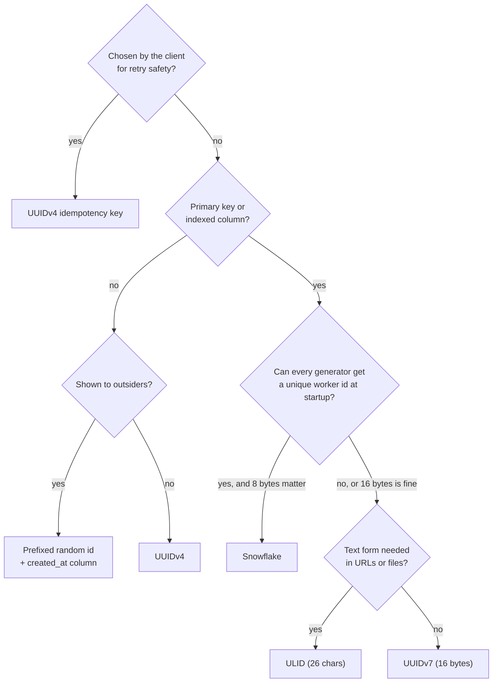

# Unique ID Generation: UUIDs, ULIDs, and Snowflake

> Sortable, collision-resistant IDs for a distributed ledger.

**Type:** Build
**Languages:** Java
**Prerequisites:** Phase 1, Lesson 07 (Hash Functions and Collisions), Phase 1, Lesson 11 (Bit Manipulation), Phase 3, Lesson 04 (B-Trees and Why Databases Love Them)
**Time:** ~60 minutes

## Learning Objectives

- Lay out the bits of a UUIDv4, a UUIDv7, a ULID, and a Snowflake id and state what each field buys: randomness, time order, or coordination-free uniqueness
- Build generators for all four behind an injected clock and seeded randomness, and make the time-based ones strictly monotonic within a millisecond
- Handle a clock that moves backwards in each scheme without issuing a duplicate or an out-of-order id
- Compute collision probability from the birthday bound and decide how many random bits a given id volume needs
- Explain why random primary keys fragment a B-tree index and show the sortability difference in a 1,000-id demo

## The Problem

A ledger service assigns every posting a `UUID.randomUUID()` and stores it as the primary key of a PostgreSQL table. The table is clustered on that key, which is what a primary key index does, so each insert lands on a uniformly random leaf page of a 400 GB B-tree. The buffer pool holds 64 GB. Every insert is therefore a page miss with probability about 0.84, which means a disk read, a page split about one time in a few hundred, and a write-ahead-log record that includes a full page image after every checkpoint. At 12,000 postings per second the database spends most of its I/O budget on index maintenance, and the nightly `VACUUM` never catches up because the index pages are all half-full from the splits. The same postings, keyed by a time-ordered id, would append to the rightmost leaf, hit the buffer pool every time, and split only at the right edge.

A second team avoids that by using a database sequence: `BIGSERIAL`. Inserts are fast and the ids are tiny. Then the service is deployed in two regions with an active-active database, and the sequences collide, because a sequence is a single counter and there are now two of them. The fix, interleaving odd and even ids per region, lasts until the third region. Meanwhile the ids are guessable: a customer who receives receipt `100042` can request `100041` and learn that the previous payment was somebody else's, and a competitor can count the gaps to estimate daily volume.

A third team, in the clearing-file pipeline, generates ids from `System.currentTimeMillis()` plus a four-digit random suffix because the downstream format allows only 17 characters. It works in testing. In production, two of the twelve worker processes generate the same id within the same millisecond about once every two hours, which is exactly what the birthday bound predicts for ten thousand possible suffixes, and the duplicate key error poisons a whole batch file.

The requirements that these three failures expose are the specification for a distributed id: unique without coordination across many generators, sortable by creation time so indexes stay compact and range scans by time are cheap, not guessable, and fixed-width so every system in the chain can store it. No single scheme satisfies all four for free. This lesson builds the four that production systems actually use, UUIDv4, UUIDv7, ULID, and Snowflake, and makes their trade-offs measurable.

## The Concept

### Four layouts

All four fit in 128 bits or fewer. What differs is how the bits are spent.

| Scheme | Bits | Layout | Sortable | Needs coordination | Random bits | Text form |
|--------|------|--------|----------|--------------------|-------------|-----------|
| UUIDv4 (RFC 9562) | 128 | 4 version, 2 variant, 122 random | No | No | 122 | 36 chars hex, `8-4-4-4-12` |
| UUIDv7 (RFC 9562) | 128 | 48 ms timestamp, 4 version, 12 counter or random, 2 variant, 62 random | Yes, to the ms, and within a generator | No | 62 to 74 | 36 chars hex |
| ULID | 128 | 48 ms timestamp, 80 random | Yes, to the ms, and within a generator | No | 80 | 26 chars Crockford base32 |
| Snowflake (Twitter, 2010) | 63 | 41 ms since custom epoch, 10 worker id, 12 sequence | Yes, strictly, per worker | Worker id assignment | 0 | 19-digit decimal |

```text
UUIDv7:    tttttttt-tttt-7ccc-vrrr-rrrrrrrrrrrr
           48-bit unix ms  | version 7 | 12-bit counter | variant 10 + 62 random bits

ULID:      TTTTTTTTTT RRRRRRRRRRRRRRRR
           10 chars = 48-bit unix ms (50 bits, top 2 zero) | 16 chars = 80 random bits

Snowflake: 0 | 41 bits ms since epoch | 10 bits worker | 12 bits sequence
           sign bit kept zero so the id is a positive signed 64-bit integer
```

### A Snowflake id by hand

The demo's first Snowflake id is `234599166771269632`. Decoding it is three shifts and two masks:

```text
id                     = 234599166771269632
id >>> 22              = 55932800000            (41-bit milliseconds since the custom epoch)
+ EPOCH 1704067200000  = 1760000000000          -> 2025-10-09T08:53:20.000Z
(id >>> 12) & 0x3FF    = 17                     (worker id)
id & 0xFFF             = 0                      (first id this worker issued in that millisecond)

check: 55932800000 << 22 = 234599166771200000
     + 17 << 12          =                69632
     + 0                 = 234599166771269632
```

The number is 18 digits because the timestamp bits are still small; from mid-2031 it will use all 19, which is worth knowing if a downstream column is `CHAR(18)`. Nothing in the id is secret: anyone holding it knows when it was made and which worker made it, which is the privacy trade mentioned above.

### Capacity

| Scheme | Ids per millisecond per generator | Generators | Lifetime of the timestamp field |
|--------|-----------------------------------|------------|---------------------------------|
| UUIDv4 | unbounded (probabilistic) | unbounded | none (no timestamp) |
| UUIDv7, method 1 | about 2,048 to 4,096 strictly ordered, then borrows the next ms | unbounded, 62 random bits separate them | 48 bits of ms: year 10889 |
| ULID monotonic | 2^80 strictly ordered, in practice unbounded | unbounded, 80 random bits separate them | 48 bits of ms: year 10889 |
| Snowflake | exactly 4,096, then borrows or waits | 1,024 worker ids | 41 bits of ms: 69.7 years from the epoch |

A payment platform doing 50,000 postings per second needs 50 per millisecond fleet-wide, so the per-generator limits never bind; they matter for a single hot process generating ids in a tight loop (a bulk import, a replay), which is where Snowflake's hard 4,096 shows up first.

### Uniqueness without coordination: the birthday bound

A random id of `b` bits is unique only probabilistically. For `n` ids drawn uniformly from `2^b` values, the probability that at least one pair collides is

```text
p(n, b) ~ 1 - exp(-n(n-1) / (2 * 2^b))      which is close to n^2 / 2^(b+1) when p is small
```

and the number of ids at which `p` reaches 50% is about `1.18 * 2^(b/2)`. The square root is the whole story: 122 random bits do not give you 2^122 ids, they give you about 2^61 before collisions become likely. Some numbers from the demo:

| Bits | Ids | Collision probability |
|------|-----|-----------------------|
| 32 | 100,000 | 0.688 (50% at 77,163) |
| 62 (UUIDv7 `rand_b`, all generated in one millisecond) | 1,000,000 | 1.1 x 10^-7 |
| 80 (ULID random part, one millisecond) | 1,000,000 | 4.1 x 10^-13 |
| 80 | 1,000,000,000 | 4.1 x 10^-7 |
| 122 (UUIDv4) | 1,000,000,000,000 | 9.4 x 10^-14 |

Worked by hand for the clearing-file team: twelve workers, each issuing one id per millisecond, 4-digit suffix, so `n = 12` and `2^b = 10,000`.

```text
pairs            = 12 * 11 / 2 = 66
p per millisecond = 1 - exp(-66 / 10000) ~ 0.0066
expected ms between collisions = 1 / 0.0066 ~ 152 ms of busy time
```

Their observed "once every two hours" is consistent with the workers being busy only a fraction of the time. The fix is not a 6-digit suffix (`p` per millisecond drops to 6.6 x 10^-5, still a collision every few minutes of busy time) but a scheme whose random part is wide enough that `p` is negligible for the lifetime of the system: 40 random bits gives `66 / 2^40 = 6 x 10^-11` per busy millisecond, about one collision per 500 years of continuous load.

Two consequences. First, the clearing-file team's 4-digit suffix (`b` about 13 bits) with twelve generators in the same millisecond collides every few thousand milliseconds, which matched what they saw. Second, for time-prefixed ids the question is not "how many ids ever" but "how many ids in the same millisecond across all generators", because the timestamp already separates different milliseconds. A ULID's 80 random bits are generous for that; UUIDv7's 62 are adequate for anything under about 10^6 ids per millisecond fleet-wide. Snowflake sidesteps the mathematics: uniqueness is structural, because no two generators share a worker id and no generator issues the same sequence number twice in a millisecond.

### Text encodings and widths

The same 128 bits can be written several ways, and the choice decides how many bytes a column, a URL, or a log line spends and whether string order matches numeric order.

| Encoding | Alphabet | Chars for 128 bits | Chars for 64 bits | String order equals numeric order | Used by |
|----------|----------|--------------------|-------------------|-----------------------------------|---------|
| Hex with hyphens | `0-9a-f` | 36 | n/a | yes (lowercase, fixed width) | UUID text form |
| Crockford base32 | `0-9A-HJKMNP-TV-Z` | 26 | 13 | yes | ULID |
| Base62 | `0-9A-Za-z` | 22 | 11 | no: ASCII order is digits, upper, lower, and most libraries emit variable width | Stripe-style ids, URL shorteners |
| Base64url | `A-Za-z0-9-_` | 22 | 11 | no: `-` and `_` sort outside the letters | tokens, not ids |
| Decimal | `0-9` | 39 | 19 or 20 | yes if zero-padded to fixed width | Snowflake as rendered by APIs |
| Binary | bytes | 16 | 8 | yes (unsigned byte compare) | `UUID`, `BINARY(16)`, `BIGINT` columns |

Fixed width is what makes an encoding sortable as text: a 19-digit Snowflake id sorts after an 18-digit one lexically only if the shorter is left-padded. Twitter's API returns Snowflake ids as strings (`id_str`) not for ordering but because JavaScript's `Number` loses precision above 2^53, a trap every JSON consumer of 64-bit ids meets eventually (Lesson 15 covers the serialization side).

### Sortability and the B-tree

A B-tree index stores keys in order, so consecutive inserts of increasing keys go to the same rightmost leaf until it fills, then to a new one. Random keys go to random leaves. The practical effects: a random-key index has a working set equal to the whole index (every leaf is equally likely to be touched next), its leaves end up about 70% full because splits happen everywhere, and a range query "postings from 09:00 to 09:05" cannot use it at all. A time-ordered key keeps the hot set to the last few pages, fills leaves to near 100%, and makes time ranges a contiguous scan. Section 2 of the demo generates 1,000 ids over 1,000 ms with each scheme and sorts the strings: UUIDv7, ULID, and Snowflake come back in generation order; of 1,000 UUIDv4s, 998 change position.

Ordering has a cost that is easy to miss: a time-ordered id leaks its creation time. A payment id that encodes `2025-10-09T08:53:20.000Z` tells anyone who sees it when the payment was made, and consecutive Snowflake ids from the same worker reveal that the two payments were adjacent. Whether that matters depends on who sees the id; receipts shown to customers often use a separate opaque reference for this reason.

### Monotonicity within a millisecond

Time order to the millisecond is not the same as strictly increasing. Two ids in the same millisecond have the same timestamp, and if the rest is random their relative order is random. Each scheme has a rule for it:

- **UUIDv7**, RFC 9562 section 6.2, "method 1": use the 12 `rand_a` bits as a counter, seeded randomly each millisecond with the top bit clear (so there is room to count), incremented for each id in the same millisecond. Overflow of the counter rolls the timestamp forward by one millisecond.
- **ULID**, spec section "Monotonicity": within the same millisecond, increment the 80-bit random part by one. Overflow (the random part was all ones) is an error, which happens with probability 2^-80 per millisecond.
- **Snowflake**: the 12-bit sequence is the counter, reset to zero each new millisecond. When it wraps at 4,096, the reference implementation spins until the next millisecond; this lesson's version instead advances its logical timestamp by one millisecond and continues, which keeps the generator non-blocking at the cost of ids that are up to a few milliseconds "in the future" under sustained overload.

Worked example, UUIDv7, clock frozen at `1760000000000`, generator seeded so the first counter is `0x5d8`:

```text
id 1: ts = 0x0199c82cc000, counter = 0x5d8  ->  0199c82c-c000-75d8-....
id 2: same ms, counter = 0x5d9              ->  0199c82c-c000-75d9-....
...
id 2601: counter would be 0x1000 (overflow) -> ts = 0x0199c82cc001, counter re-seeded
```

The version nibble `7` sits between the timestamp and the counter in the text form, which is why the third group reads `75d8`: version 7, counter `5d8`.

### When the clock goes backwards

Wall clocks step backwards: NTP corrects a fast clock, a VM is migrated, a leap second is smeared differently on two hosts. A generator that trusts the clock will, after a step back, issue timestamps it has already used, and with Snowflake's deterministic sequence that is a guaranteed duplicate. The three time-based schemes handle it differently and the difference is a design choice you should make deliberately:

| Scheme | On `now < lastTimestamp` |
|--------|--------------------------|
| UUIDv7 (this lesson) | Treat as the same millisecond: keep `lastTimestamp`, increment the counter. Ids stay unique and increasing; their timestamps are briefly wrong. |
| ULID (this lesson) | Same: keep the last timestamp and increment the random part. |
| Snowflake (this lesson) | If the step is within a tolerance (5 ms), keep issuing on `lastTimestamp` with the sequence. If larger, throw `ClockMovedBackwardsException` and let the caller decide (wait, fail over, alarm). Twitter's original refuses to generate for any backwards step. |

The reason Snowflake refuses on a large step and the UUID schemes do not: Snowflake has no random bits, so running for 60 seconds on a stale timestamp means 60 seconds of ids whose embedded time is wrong by a minute, and a second process that did not see the step would issue ids with the real time that sort *before* ids issued later. The UUID schemes have the same ordering problem but their uniqueness never depends on the timestamp.

### Choosing a scheme



The diagram encodes the lesson's position: time-ordered ids are the default for anything indexed, randomness is the default for anything exposed, and Snowflake is the choice when the eight-byte width or the structural uniqueness is worth a worker-id assignment step.

### What these ids do not do

- They are not idempotency keys. An idempotency key (Phase 5, Lesson 09) is chosen by the *client* so that a retry carries the same key; a server-generated id is new on every call by definition.
- They do not encode the data. Content-addressed ids (Lesson 09) are hashes of the record; the ids here are assigned before the record exists.
- They are not unguessable in the cryptographic sense unless the randomness is. `java.util.Random` is seeded and predictable; this lesson uses it so the demo is reproducible. A production generator uses `SecureRandom` for the random bits, and a Snowflake id is predictable by construction.
- They do not solve the "two regions" problem by themselves. UUIDs and ULIDs do (no coordination). Snowflake requires that every generator in the fleet have a distinct worker id, which is a small coordination problem (a configuration file, a ZooKeeper lease, or a Kubernetes StatefulSet ordinal) that has to be solved once.

## Build It

### Step 1: 128 bits with a text form

```java
record Uuid(long msb, long lsb) implements Comparable<Uuid> {
    int version() { return (int) ((msb >>> 12) & 0xF); }
    int variant() { return (int) ((lsb >>> 62) & 0x3); }
    long timestampMillis() { return msb >>> 16; }

    @Override public int compareTo(Uuid o) {
        int c = Long.compareUnsigned(msb, o.msb);
        return c != 0 ? c : Long.compareUnsigned(lsb, o.lsb);
    }
}
```

Two longs rather than `java.util.UUID` so that every bit is placed by code in this file. The comparison is **unsigned**: a UUID whose top bit is set must sort after one whose top bit is clear, and `Long.compare` would get that backwards for half of all ids. `java.util.UUID.compareTo` has exactly this bug (it uses signed comparison) and the JDK documents it as a known behaviour that cannot be changed for compatibility; it is the first thing to check if you ever see UUIDv7 keys sorting strangely in Java.

**Predict:** `new Uuid(0x8000000000000000L, 0).compareTo(new Uuid(0x7fffffffffffffffL, 0))`: positive or negative, and what would `Long.compare` say?

### Step 2: UUIDv4, the baseline

```java
Uuid next() {
    long msb = rng.nextLong(), lsb = rng.nextLong();
    msb = (msb & ~0xF000L) | 0x4000L;                          // version nibble = 4
    lsb = (lsb & 0x3FFFFFFFFFFFFFFFL) | 0x8000000000000000L;   // variant bits = 10
    return new Uuid(msb, lsb);
}
```

Six bits are fixed, 122 are random. The version nibble is bits 48 to 51 of the high half (the first hex digit of the third group), and the variant occupies the top two bits of the low half (the first hex digit of the fourth group is always 8, 9, a, or b).

**Predict:** why does the demo's v4 sort test show 998 of 1,000 displaced rather than 1,000?

### Step 3: UUIDv7 with a monotonic counter

```java
Uuid next() {
    long now = clock.nowMillis();
    if (now <= lastMillis) {                              // same ms, or clock went backwards
        counter++;
        if (counter > 0xFFF) { lastMillis++; counter = rng.nextInt(1 << 11); }   // borrow the next ms
    } else {
        lastMillis = now;
        counter = rng.nextInt(1 << 11);                    // leave the top counter bit clear: room to count
    }
    long msb = (lastMillis << 16) | 0x7000L | counter;
    long lsb = (rng.nextLong() & 0x3FFFFFFFFFFFFFFFL) | 0x8000000000000000L;
    return new Uuid(msb, lsb);
}
```

The `<=` is the whole clock-drift policy: a backwards clock is indistinguishable from a frozen one, and both are handled by counting. Seeding the counter with 11 random bits rather than starting at zero is an RFC 9562 recommendation: it adds unguessability and spreads ids from different generators in the same millisecond, at the cost of overflowing after roughly 2,048 instead of 4,096 ids.

**Predict:** two independent generators in the same millisecond. What is the probability they produce the same `rand_a` counter, and does that make their ids collide?

### Step 4: ULID encoding

```java
@Override public String toString() {
    char[] out = new char[26];
    long t = timestampMillis;
    for (int i = 9; i >= 0; i--) { out[i] = ALPHABET.charAt((int) (t & 0x1F)); t >>>= 5; }
    long lo = randomLo, hi = randomHi;
    for (int i = 25; i >= 10; i--) {
        out[i] = ALPHABET.charAt((int) (lo & 0x1F));
        lo = (lo >>> 5) | ((hi & 0x1F) << 59);
        hi >>>= 5;
    }
    return new String(out);
}
```

Crockford base32 uses digits and uppercase letters minus `I`, `L`, `O`, `U` so the text cannot be misread, and because its alphabet is in ASCII order, lexical order of the strings equals numeric order of the bits; that is the property that makes a ULID usable as a sortable string key where a hex UUID is not (hex is also ASCII-ordered, which is why UUIDv7 strings sort correctly too, but hex spends 36 characters where base32 spends 26). The 80 random bits are held as a 16-bit `randomHi` and a 64-bit `randomLo`; the loop peels five bits at a time off the bottom and shifts the pair as one 80-bit value. The timestamp's ten characters hold 50 bits, so the top two are always zero and the maximum encodable time is `7ZZZZZZZZZ`, which is `2^48 - 1` milliseconds, in the year 10889.

**Predict:** `parse("8ZZZZZZZZZZZZZZZZZZZZZZZZZ")`. What goes wrong and where is it caught?

### Step 5: Snowflake with sequence borrow and drift tolerance

```java
long next() {
    long now = clock.nowMillis() - EPOCH_MILLIS;
    if (now < lastMillis) {
        if (lastMillis - now > maxBackwardsMillis) throw new ClockMovedBackwardsException(lastMillis - now);
        now = lastMillis;                                    // small drift: keep issuing on the last timestamp
    }
    if (now == lastMillis) {
        sequence = (sequence + 1) & MAX_SEQUENCE;
        if (sequence == 0) { lastMillis++; borrowedMillis++; now = lastMillis; }   // 4096 in one ms: borrow the next
    } else {
        lastMillis = now;
        sequence = 0;
    }
    return (lastMillis << 22) | (workerId << 12) | sequence;
}
```

The custom epoch (2024-01-01 here; Twitter used 2010-11-04) is what makes 41 bits of milliseconds last 69.7 years from a date you care about instead of from 1970. `borrowedMillis` counts how far logical time has run ahead of the wall clock; a production generator exports it as a metric, because a value that keeps growing means a single worker is being asked for more than 4,096 ids per millisecond and needs a second worker id.

**Predict:** the wall clock reaches a millisecond the generator already borrowed. Which branch runs, and is the sequence reset?

### Step 6: Run it

```bash
cd phases/03-systems-data-structures/13-unique-id-generation/code/java
javac -d .out *.java && java -cp .out Main
java -cp .out MainTest
```

Expected output, abbreviated:

```console
== 1. Four ids for the same posting, four shapes ==
  UUIDv4    bb0f1798-a377-4418-bfc9-945a02770b39  version=4 variant=2  (122 random bits)
  UUIDv7    0199c82c-c000-72c9-bd98-4a5ce5b3f441  version=7 ts=1760000000000 (48-bit ms, 12-bit counter, 62 random)
  ULID      01K742SG00QRDBAJRS0J8V7JJX  ts=1760000000000 (48-bit ms, 80 random, base32)
  Snowflake 234599166771269632  ts=1760000000000 worker=17 seq=0 (63 bits)

== 2. Sortability: 1000 ids over 1000 ms, then sort the strings ==
  generation order == string sort order?  v4=false  v7=true  ulid=true  snowflake=true
  v4: 998 of 1000 ids change position when sorted -> random B-tree page writes

== 3. Monotonic within one millisecond ==
  5000 ids, clock frozen: v7 increasing=true ulid increasing=true snowflake increasing=true
  snowflake borrowed 1 ms of logical time to issue 5000 ids at 4096/ms

== 4. The clock moves backwards ==
  3 ms backwards (within tolerance 5): issued 234599166771236864 then 234599166771236865, still increasing=true
  60 s backwards: clock moved backwards by 60000 ms; refusing to issue ids that could collide

== 5. Collision math (birthday bound) ==
  UUIDv4, 122 random bits: 10^12 ids -> p = 9.4e-14; 50% at 2.71e+18 ids
  a 32-bit random id: 10^5 ids -> p = 0.688 (50% at about 77,000 ids)
46 passed, 0 failed
```

Every value above is reproducible because the clock and the randomness are injected; run it twice and diff the output.

### Porting notes

Python has arbitrary-precision integers, so a UUID is one 128-bit `int` and the ULID random part is one 80-bit `int`; the two-long juggling disappears, and `int.to_bytes`/`from_bytes` plus `format(x, '032x')` do the hex. `random.Random(seed)` gives the seeded source; use `secrets` in production. Go: `uint64` pairs as here, `bits.Add64` for the ULID carry, `math/rand/v2` with a seeded `PCG` for reproducibility and `crypto/rand` in production; return `(uint64, error)` from the Snowflake generator instead of throwing. In both, keep the unsigned comparison explicit; Python's ints are signed-agnostic but Go's `int64` would reintroduce the `java.util.UUID` ordering bug.

## Use It

### `java.util.UUID`, `uuid` in Python, `google/uuid` in Go

`UUID.randomUUID()` is a v4 generator over `SecureRandom`; it is the right call when you need an opaque, unguessable id and do not care about index locality. The JDK has no v7 generator as of Java 21; Python gained `uuid.uuid7()` in 3.14; Go's `google/uuid` has `NewV7()` with a monotonic counter. Remember `java.util.UUID.compareTo`'s signed comparison: sort v7 ids by their string form or by your own unsigned comparator.

### Databases

PostgreSQL 18 ships `uuidv7()`; before that, `gen_random_uuid()` is v4 and v7 comes from an extension or the application. MySQL's `UUID()` is a v1 (MAC address plus timestamp, with the timestamp's low bits first, so it does *not* sort by time) and the common fix is `UUID_TO_BIN(UUID(), 1)`, which swaps the time fields to make it sortable. The storage question matters as much as the generation: a UUID stored as a 36-character string is 36 bytes plus length prefix; stored as `UUID` (PostgreSQL) or `BINARY(16)` (MySQL) it is 16, and the index is correspondingly smaller. A Snowflake id is a `BIGINT`: 8 bytes, native comparison, no parsing.

### Snowflake's descendants

Twitter's Snowflake (2010) begat Instagram's variant (41 time, 13 shard, 10 sequence, generated inside PostgreSQL with a stored function so the shard id is the database's own), Discord's (same layout, epoch 2015), and Sony's Sonyflake (39 bits of 10 ms units, 8 sequence, 16 machine id, for a smaller id space with more machines). Every one of them is the same trade: give up randomness, accept a worker-id assignment problem, get 8-byte strictly ordered ids with structural uniqueness.

### Cassandra `timeuuid`, KSUID, and the pre-v7 generation

Before RFC 9562, systems that wanted time-ordered UUIDs used version 1 (60-bit timestamp in 100 ns units since 1582, a clock sequence, and a 48-bit node id that was originally the MAC address). Cassandra's `timeuuid` column type is a v1 UUID with a custom comparator that orders by the timestamp fields rather than by the bytes, which is how it gets time order out of a layout that does not sort as bytes. Segment's KSUID (2017) is 20 bytes: a 32-bit timestamp in seconds since a 2014 epoch plus 128 random bits, base62-encoded to 27 characters; it predates ULID's popularity and chose seconds over milliseconds to keep the random part wide. Both are evidence that every large system eventually reinvents "timestamp prefix plus randomness"; UUIDv7 and ULID are the standardized versions of that reinvention, and the lesson's generators are the two you should reach for today.

### Stripe-style prefixed ids

Stripe's ids look like `pi_3MtwBwLkdIwHu7ix28a3tqPa`: a type prefix, an underscore, and a base-62 random body. The prefix is an engineering choice worth copying: a `pi_` can never be passed where a `ch_` is expected without the mistake being visible in logs, and support staff can tell object types apart at a glance. The body is random, not time-ordered; Stripe stores a separate `created` timestamp and indexes on it, which is the other legitimate answer to the B-tree problem.

### Where each lands in a payment system

| Object | Reasonable choice | Why |
|--------|-------------------|-----|
| Ledger posting / journal entry | UUIDv7 or ULID | Time-ordered for the index and for "postings since T" scans; no coordination between regions |
| Payment intent shown to merchants | Prefixed random (Stripe style) or UUIDv4 | Opaque to outsiders; creation time is a separate field |
| Internal event / message key | Snowflake | 8 bytes, fast, strictly ordered per producer; worker ids come from the deployment |
| Idempotency key | Client-generated UUIDv4 | Must be chosen by the retrying party |
| Clearing-file record reference | Snowflake rendered in the file's width | Fixed width, no collisions, decodable to a time and a worker for investigations |

## Ship It

`outputs/checklist-id-scheme.md` is a decision checklist for choosing an id scheme for a new table or message type: the questions about volume, sortability, exposure, width, and clock behaviour, the collision arithmetic to fill in, and the storage and comparison traps to check in the code review.

Two items on it come directly from incidents in this lesson's Problem section and are worth calling out: the primary-key question (time-ordered or a separate indexed timestamp, never a bare random key on a large table) and the width question (compute the birthday bound with the bits you actually have, not the bits you wish you had).

## Exercises

1. **Reinforce.** Add `Uuid.timestampAsInstant()` for v7 ids and `Ulid.timestampAsInstant()`, both returning `java.time.Instant`, and make them throw for a UUID whose version is not 7. Write the test that a v4 id's "timestamp" is rejected rather than returned as a nonsense date.
2. **Apply.** Implement RFC 9562's "method 3" for UUIDv7 monotonicity: replace the 12-bit counter with sub-millisecond precision by using the 12 `rand_a` bits as a fraction of a millisecond derived from a nanosecond clock, and compare the two methods' behaviour at 10,000 ids per millisecond. Which one stays strictly increasing, and what does each one leak about generation rate?
3. **Extend.** Build the worker-id assignment that Snowflake needs using the leases from Phase 5, Lesson 12 (Leases and Fencing Tokens): a generator acquires a worker id as a lease with a TTL, renews it, and refuses to issue ids after the lease expires. Simulate two generators racing for the same id on a deterministic network and prove no two ids are ever equal across the pair.

## Key Terms

| Term | What people say | What it actually means |
|------|-----------------|------------------------|
| UUIDv4 | "a random UUID" | 122 random bits plus 6 fixed; unique by probability, unordered, and the default `randomUUID()` in most languages |
| UUIDv7 | "time-ordered UUID" | RFC 9562 layout with a 48-bit Unix millisecond prefix, a version nibble, 12 bits for a counter or extra precision, and 62 random bits |
| ULID | "sortable UUID in base32" | 48-bit millisecond timestamp plus 80 random bits, encoded as 26 Crockford base32 characters whose lexical order matches numeric order |
| Snowflake | "Twitter ids" | 63-bit integer of 41 ms since a custom epoch, 10 worker bits, 12 sequence bits; strictly ordered per worker, unique by construction |
| Birthday bound | "collision probability" | `p ~ n^2 / 2^(b+1)`; the number of random `b`-bit ids before a collision is likely scales with `2^(b/2)`, not `2^b` |
| Monotonic generator | "strictly increasing ids" | A generator that guarantees each id sorts after the previous one it issued, including within a single millisecond, via a counter or an incremented random part |
| Clock skew tolerance | "what if the clock goes back" | The policy for `now < lastTimestamp`: count on the stale timestamp (UUID schemes), tolerate a small step (Snowflake here), or refuse (Twitter's) |
| Custom epoch | "Snowflake's zero point" | The instant from which the 41-bit millisecond field counts; moving it from 1970 to the system's launch date is what buys 69 years of ids |
| Worker id | "machine id", "shard id" | The 10-bit field that makes two Snowflake generators structurally distinct; it must be unique per running process, which is the scheme's one coordination requirement |
| Crockford base32 | "that alphabet without I, L, O, U" | A 32-symbol encoding in ASCII order that avoids visually confusable letters and decodes them leniently |

## Further Reading

- [RFC 9562: Universally Unique IDentifiers (UUIDs)](https://www.rfc-editor.org/rfc/rfc9562) — the 2024 standard that defines versions 4 and 7, the monotonic counter methods in section 6.2, and the guidance on randomness.
- [ULID specification](https://github.com/ulid/spec) — the layout, the Crockford alphabet, the monotonicity rule, and the test vectors used in `MainTest`.
- [Twitter Engineering, "Announcing Snowflake" (2010)](https://blog.twitter.com/engineering/en_us/a/2010/announcing-snowflake) — the original 41/10/12 layout and the reasons: ordering, 64-bit width, no coordination at generation time.
- [Instagram Engineering, "Sharding & IDs at Instagram"](https://instagram-engineering.com/sharding-ids-at-instagram-1cf5a71e5a5c) — a Snowflake variant generated inside PostgreSQL, with the shard id taken from the database.
- [PostgreSQL documentation: UUID functions](https://www.postgresql.org/docs/current/functions-uuid.html) — `gen_random_uuid()` and `uuidv7()`, and the storage type that makes a UUID 16 bytes instead of 36.
- [Oracle: `java.util.UUID.compareTo` (Java 21 API)](https://docs.oracle.com/en/java/javase/21/docs/api/java.base/java/util/UUID.html#compareTo(java.util.UUID)) — the signed-comparison behaviour that breaks sorting of time-ordered UUIDs in Java.
