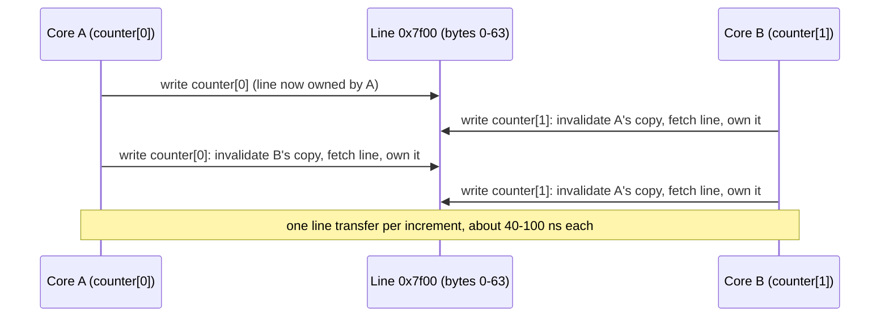

# Memory Layout, Cache Lines, and False Sharing

> Why an array of structs can be 10x faster than a struct of arrays, or the reverse.

**Type:** Learn
**Languages:** —
**Prerequisites:** Phase 1 Lesson 03 (Dynamic Arrays), Phase 0 Lesson 05 (Benchmarking and Profiling)
**Time:** ~60 minutes

## Learning Objectives

- Draw the memory hierarchy with its approximate latencies and explain why a cache miss, not an instruction, is the unit of cost for most data-structure code
- Compute the size and field layout of a Java object by hand, including the header, alignment padding, and compressed references
- Decide between array-of-structs and struct-of-arrays from the access pattern, and predict which one a given loop favours
- Explain false sharing from the cache-coherence protocol and recognise its signature in a profile
- Apply four concrete layout techniques: field ordering, primitive arrays, padding or `@Contended`, and keeping hot data contiguous

## The Problem

A risk-scoring service holds the last 10 million postings for a merchant portfolio in memory and, on every incoming authorization, sums the amounts for the cardholder's recent activity. The postings are `Posting` objects in an `ArrayList`: id, amount, account, timestamp, currency, status. The sum loop reads one field per object. A profiler shows the loop at 60 ms for a full scan, and the team's first instinct is that the JIT has failed to vectorize it. It has not. The loop executes about 10 million loads, and almost every one of them is a cache miss, because each `Posting` is a separate 48-byte object somewhere on the heap and the loop touches 8 bytes of each. The CPU fetches 64 bytes for every 8 it uses, and the 10 million objects are scattered across 480 MB of heap that the 2 MB L2 cache cannot hold. The same sum over a `long[] amounts` runs in 10 ms on the same machine: six times faster, same algorithm, same number of additions. This lesson pairs with Phase 4 Lesson 02 (Locks, Atomics, and a Balance That Never Lies), which comes later.

A second team, building the throughput counters for a payment gateway, keeps per-worker counters in a `long[16]`, one slot per thread, so that no two threads write the same variable and no lock is needed. The counters are correct and the design is lock-free. Under load the gateway's p99 latency doubles, and a CPU profile shows the worker threads stalled on their own counter increments. The 16 longs occupy 128 bytes, two cache lines, and eight threads are writing to each line. Every increment by one core invalidates the line in every other core's cache; the line ping-pongs between cores at about 100 ns per transfer, and a counter that should take one cycle takes two hundred. The threads share nothing logically and everything physically. Padding each counter to its own 64-byte line fixes it, and the team learns that the hardware's unit of ownership is the line, not the variable.

Both failures are invisible in the code and in the asymptotic analysis. A `List<Posting>` and a `long[]` are both O(n) to sum; a `long[16]` has no data race. What differs is where the bytes are, and the hardware cares about that more than it cares about almost anything else. This lesson gives you the model to predict the two failures, the arithmetic to size a Java object by hand, and the four techniques that fix layout problems without changing what the code does.

## The Concept

### The hierarchy and its latencies

The CPU does not read memory; it reads cache lines, and it waits when the line is not in a cache. Approximate numbers for a 2024-era server core (your machine differs; Phase 0, Lesson 05 showed how to measure):

| Level | Size | Latency | Line size | Shared between |
|-------|------|---------|-----------|----------------|
| Register | about 1 KB | 0 cycles | n/a | one core |
| L1 data cache | 32 to 64 KB | 4 to 5 cycles, about 1 ns | 64 bytes | one core |
| L2 cache | 1 to 2 MB | 12 to 14 cycles, about 4 ns | 64 bytes | one core |
| L3 cache | 30 to 100 MB | 40 to 70 cycles, about 15 to 25 ns | 64 bytes | all cores on the socket |
| Main memory (DRAM) | hundreds of GB | 60 to 100 ns | 64 bytes fetched | everything |
| Another core's L1/L2 (coherence transfer) | | 40 to 100 ns | 64 bytes | |
| NVMe SSD | TB | 20 to 100 microseconds | 4 KB page | |

Two ratios to remember: a DRAM access costs about 100 instructions' worth of time, and a cache line is 64 bytes, so a loop that uses 8 bytes per line pays eight times the memory traffic of one that uses all 64. Everything in this lesson follows from those two numbers. Hardware prefetchers detect sequential and strided access and fetch lines ahead of the loop, which is why scanning an array is fast even when it is far bigger than the cache and why pointer chasing, where the next address is unknown until the current load completes, is the worst thing you can do.

### What an object costs in Java

A Java object on a 64-bit HotSpot JVM has a header, its fields laid out by the JVM (not in declaration order), and padding to an 8-byte boundary.

```text
header: mark word        8 bytes   (hash code, GC age, lock state)
        class pointer    4 bytes with compressed class pointers (default), 8 without
        array length     4 bytes, arrays only
fields: longs/doubles    8 bytes, 8-aligned
        ints/floats      4 bytes
        shorts/chars     2 bytes
        bytes/booleans   1 byte
        references       4 bytes with compressed oops (heaps under 32 GB), 8 above
object size rounded up to a multiple of 8
```

HotSpot reorders fields to minimise padding: longs first, then ints, then shorts, then bytes, then references. Sizing the risk service's `Posting` by hand:

```java
final class Posting {
    long id;            // 8
    long amountMinor;   // 8
    long accountId;     // 8
    long timestamp;     // 8
    int currency;       // 4
    byte status;        // 1
}
```

```text
header            12 bytes  (8 mark + 4 compressed class pointer)
4 longs           32 bytes  -> but the first long needs 8-alignment, so 4 bytes of padding after the header
int currency       4 bytes
byte status        1 byte
subtotal          12 + 4 + 32 + 4 + 1 = 53 -> rounded up to 56 bytes
```

HotSpot actually does better: it places the `int` in the 4-byte gap after the header, so the layout is header (12), currency (4), four longs (32), status (1), padding (7), 56 bytes. Either way the object is 56 bytes for 37 bytes of data, and the `ArrayList` adds a 4-byte compressed reference per element. The 10 million postings cost 560 MB of objects plus 40 MB of reference array, and the amount field of consecutive postings is 56 bytes apart at best and anywhere on the heap at worst, depending on allocation order and GC compaction. The equivalent `long[]` is 80 MB and the amounts are 8 bytes apart. JOL (`jdk.internal.jol`, or the separate OpenJDK Java Object Layout tool) prints these layouts for any class and is the tool to confirm your arithmetic.

The same 10 million postings under five layouts, with the bytes the hot "sum amounts" loop must fetch:

| Layout | Bytes per posting | Total | Bytes fetched to sum `amountMinor` | Lines fetched per posting |
|--------|-------------------|-------|-------------------------------------|---------------------------|
| `ArrayList<Posting>`, boxed `Long` fields | about 56 + 4 x 24 (boxed longs) + 4 | about 1.5 GB | all of it: each amount is behind two pointers | 3 or more |
| `Posting[]` with primitive fields (above) | 56 + 4 reference | 600 MB | 560 MB (whole objects stream past) | about 1 |
| `Posting[]` with `int` account, `int` timestamp offset, `short` currency | 40 + 4 | 440 MB | 400 MB | about 0.7 |
| SoA, six primitive arrays | 37 | 370 MB | 80 MB (the `long[]` only) | 0.125 |
| SoA with `int` amounts where the range allows | 33 | 330 MB | 40 MB | 0.0625 |

The last column is the one the CPU sees. Going from the first row to the fourth is a 25x reduction in memory traffic for the hot loop without changing a line of the loop body.

### Compressed oops

A 64-bit pointer is 8 bytes. On heaps up to 32 GB, HotSpot stores references as 32-bit offsets scaled by 8 (because every object is 8-aligned, the low three bits of an address are always zero and can be dropped), which is **compressed ordinary object pointers**. It halves the cost of every reference field and every reference array, and it is on by default below the 32 GB threshold. Cross the threshold, say by setting `-Xmx40g`, and every reference doubles; a heap that was 90% references can need more memory at 40 GB than it did at 31 GB. The practical rule: either stay under 32 GB or go well beyond it (64 GB and up), and know which side you are on. `-XX:ObjectAlignmentInBytes=16` extends compressed oops to 64 GB at the cost of more padding per object.

### Array of structs versus struct of arrays

The two layouts for a collection of records:

```java
// Array of structs (AoS): one object per posting, an array of references to them
Posting[] postings;                   // postings[i].amountMinor

// Struct of arrays (SoA): one primitive array per field, index i is the posting
long[] id; long[] amountMinor; long[] accountId; long[] timestamp; int[] currency; byte[] status;
```

The hook of this lesson is that each one can be 10x faster than the other, depending on the loop:

| Access pattern | Favours | Why |
|----------------|---------|-----|
| Sum one field over all records (`amountMinor`) | SoA | The loop reads 8 contiguous bytes per record; every byte of every fetched line is used; the prefetcher streams the array |
| Read every field of one record by index (render posting 4,312) | AoS | All fields are in one or two lines; SoA touches six arrays, six lines, six potential misses |
| Filter on one field, then read all fields of the matches | depends | SoA for the scan, AoS for the matches; column stores add a row id to bridge the two |
| Random access to one field (`amountMinor` of posting `k`) | neither matters | One miss either way |
| Update many fields of many records | AoS | Each record's fields share lines; SoA scatters the writes across arrays |

Relational databases made this exact choice twice: row stores (PostgreSQL, MySQL InnoDB) are AoS and win on transactional workloads that read whole rows; column stores (ClickHouse, Parquet files, Redshift) are SoA and win on analytical scans that aggregate one column. A ledger does both, posting rows and summing balances, which is why ledgers keep a row store for postings and derive balance tables or columnar snapshots for the aggregates (Phase 10, Lesson 05).

The measured numbers from this lesson's demo (the `Layout.java` program described in the Worked Example, 10 million postings, 2 cores, Java 21): summing `amountMinor` through `Posting[]` took 59 to 74 ms; summing `long[] amountMinor` took 9 to 15 ms. A six-fold difference for the same loop body.

### Traversal order

A two-dimensional array `long[4096][4096]` in Java is an array of 4,096 row arrays. Summing it row by row reads each row sequentially: 64 bytes fetched, 64 bytes used, prefetcher engaged. Summing it column by column reads one `long` from each of 4,096 different rows per column: every load is in a different line, and by the time the loop comes back to a row for the next column, that row's line has been evicted. On the demo machine row-major took 16 to 19 ms and column-major took 284 to 302 ms, a 17x difference for identical arithmetic. Any grid, matrix, histogram-of-histograms, or table-of-buckets code has this trap, and the fix is to iterate in the order the data is laid out, or to lay the data out in the order you iterate.

### False sharing

Cache coherence (the MESI protocol and its descendants) guarantees that all cores see a single value for each memory location by tracking ownership **per line**. When core A writes to a line, every other core's copy of that line is invalidated; when core B then reads or writes any byte of that line, it must fetch the line from A (or from memory after A writes back). If A and B are writing to *different variables that happen to share a line*, they invalidate each other on every write although they never touch the same byte. That is false sharing: contention with no logical sharing.



The signature in a profile is a lock-free, contention-free design that nonetheless scales *worse* as threads are added, with time attributed to plain stores or atomic increments. The fix is padding: put each thread's hot variable on its own line. In the demo, two threads doing 50 million `incrementAndGet` each on adjacent `AtomicLongArray` slots took 1.75 to 2.1 seconds; the same work on slots 0 and 16 (128 bytes apart, so on different lines even if the array starts mid-line) took 0.96 to 1.06 seconds. Twice as slow for no logical reason, and in a run with more cores the ratio grows with the number of writers.

Java gives two tools. `@jdk.internal.vm.annotation.Contended` (needs `-XX:-RestrictContended` outside the JDK) pads a field or class to its own line, and the JDK uses it in `ConcurrentHashMap`'s counter cells, `ForkJoinPool`, and `Thread`. Without the annotation, the manual version is an array with a stride of 16 longs (128 bytes, covering the adjacent-line prefetcher on Intel) and indexes `i * 16`. `LongAdder` is the ready-made answer for the counter case: it keeps one cell per contending thread, each padded, and sums them on read.

### Layout in the other two runtimes

The JVM's layout rules are specific, but the model is not:

| | Java | Go | Python |
|--|------|----|--------|
| A struct in an array | `Posting[]` is an array of references; objects live elsewhere | `[]Posting` is contiguous values: true AoS, 37 bytes of data padded to 40, no header | `list` of objects is an array of pointers to 56+-byte heap objects with a 16-byte header each |
| Per-field arrays | `long[]`, 16-byte header then packed | `[]int64`, 24-byte slice header then packed | `array.array('q')` or NumPy: packed; a `list` of `int` is pointers to boxed 28-byte ints |
| Object header | 12 bytes | none for structs; 16-byte interface header when boxed | 16 bytes (`PyObject_HEAD`), plus 8 for a GC-tracked object |
| Field reordering | automatic | none: declaration order, with padding, so order your fields largest-first | n/a (instance dict or `__slots__` array of pointers) |
| Padding for false sharing | `@Contended`, stride arrays, `LongAdder` | `[64]byte` pad fields, `sync.Pool` per P | the GIL serialises writers, so false sharing rarely shows; NumPy releases it for large ops |

Go programmers get AoS for free and have to work for SoA; Java programmers get neither for free and have to choose. Python programmers who care about layout are using NumPy, which is SoA by construction and is why a `numpy.sum` over 10 million amounts takes milliseconds where a `sum()` over a list of `Decimal` takes seconds.

### Reading a profile for layout problems

Layout problems do not show up as hot functions; they show up as a hot loop with a low instructions-per-cycle (IPC) figure. The hardware counters to look at, with `perf stat -e` on Linux or the equivalent in Intel VTune and the JDK's `-XX:+UnlockDiagnosticVMOptions -XX:+PrintAssembly` for the loop body:

| Counter | Healthy | Layout problem |
|---------|---------|----------------|
| `instructions` / `cycles` (IPC) | 2 to 4 | below 1: the core is waiting on memory |
| `LLC-load-misses` per element | near 0 for a scan that fits in cache | about 1 per element: every record is a miss (AoS scan, pointer chasing) |
| `L1-dcache-load-misses` / loads | a few percent | high with a regular stride: column-major traversal, strided struct access |
| `machine_clears.memory_ordering` or coherence events, per thread | flat as threads are added | rising with thread count on a lock-free design: false sharing |
| GC time | | high allocation rate from millions of small objects: AoS where SoA would do |

A JIT-compiled loop that sums a `long[]` is three or four instructions per element with IPC near 3; the same loop over `Posting[]` is six instructions per element (load reference, null check, load field, add, increment, compare) with IPC near 0.5. The instruction count barely changes; the cycle count explodes.

### A decision procedure

1. Is the structure scanned (many records, one or two fields) or looked up (one record, many fields)? Scanned: SoA for the hot fields. Looked up: AoS, with hot fields first.
2. Is it written by more than one thread? If per-thread state is adjacent in memory, pad it. If the same variable is written by several threads, that is true sharing; layout cannot help and the design needs `LongAdder`, striping, or a different algorithm.
3. Does it fit in L2 (about 1 to 2 MB), L3 (tens of MB), or neither? Below L2, layout barely matters. Above L3, every technique in this lesson matters and the prefetcher is your only friend.
4. Is the access order the layout order? If not, either transpose the data or transpose the loop.
5. Measure with the counters above, before and after, on the target machine. Write the bytes-fetched-per-byte-used arithmetic in the commit message.

### What layout does not fix

- Algorithmic complexity. A 7x constant-factor win does not rescue an O(n^2) loop at scale; fix the algorithm first (Phase 1, Lesson 01), then the layout.
- Latency of a single random access. One cache miss is one cache miss whether the structure is AoS or SoA; layout helps when there is a pattern to exploit.
- Correctness. Padding removes false sharing, not true sharing: two threads incrementing the *same* counter still need an atomic or a lock, and the padding changes nothing about the memory model.
- Garbage collection cost. Fewer objects (SoA) means less GC work, which is a real benefit, but a `long[]` of 80 MB still has to be scanned by a copying collector if it is in a young generation; large arrays are better allocated once and kept.
- Portability of the numbers. Line size is 64 bytes on x86 and most ARM servers but 128 bytes on Apple M-series; L2 and L3 sizes vary by an order of magnitude across machines; a layout tuned on a laptop needs re-measuring on the server.

## Worked Example

The two measurements in this lesson were taken with the following program, which you can run as-is (one file, `javac Layout.java && java -Xmx3g Layout`; it needs about 2 GB of heap for the 10 million objects):

```java
import java.util.concurrent.atomic.AtomicLongArray;

public class Layout {
    static final class Posting { long id; long amountMinor; long accountId; long timestamp; int currency; byte status; }

    public static void main(String[] a) throws Exception {
        int n = 10_000_000;
        Posting[] aos = new Posting[n];
        long[] amount = new long[n];
        for (int i = 0; i < n; i++) {
            Posting p = new Posting(); p.id = i; p.amountMinor = i % 1000; p.accountId = i % 5000;
            p.timestamp = i; p.currency = 840; p.status = 1;
            aos[i] = p;
            amount[i] = i % 1000;
        }
        for (int rep = 0; rep < 5; rep++) {
            long t0 = System.nanoTime(); long s = 0;
            for (int i = 0; i < n; i++) s += aos[i].amountMinor;
            long t1 = System.nanoTime(); long s2 = 0;
            for (int i = 0; i < n; i++) s2 += amount[i];
            long t2 = System.nanoTime();
            System.out.printf("rep %d: AoS sum %d ms, SoA sum %d ms (s=%d,%d)%n", rep, (t1 - t0) / 1_000_000, (t2 - t1) / 1_000_000, s, s2);
        }
        int m = 4096; long[][] grid = new long[m][m];
        for (int rep = 0; rep < 3; rep++) {
            long t0 = System.nanoTime(); long s = 0;
            for (int i = 0; i < m; i++) for (int j = 0; j < m; j++) s += grid[i][j];
            long t1 = System.nanoTime();
            for (int j = 0; j < m; j++) for (int i = 0; i < m; i++) s += grid[i][j];
            long t2 = System.nanoTime();
            System.out.printf("rep %d: row-major %d ms, column-major %d ms%n", rep, (t1 - t0) / 1_000_000, (t2 - t1) / 1_000_000);
        }
        for (int rep = 0; rep < 4; rep++) {
            System.out.printf("rep %d: adjacent counters %d ms, padded counters %d ms%n", rep,
                    contend(new AtomicLongArray(32), 0, 1), contend(new AtomicLongArray(32), 0, 16));
        }
    }

    static long contend(AtomicLongArray arr, int i0, int i1) throws Exception {
        final int iters = 50_000_000;
        Thread t1 = new Thread(() -> { for (int k = 0; k < iters; k++) arr.incrementAndGet(i0); });
        Thread t2 = new Thread(() -> { for (int k = 0; k < iters; k++) arr.incrementAndGet(i1); });
        long t0 = System.nanoTime(); t1.start(); t2.start(); t1.join(); t2.join();
        return (System.nanoTime() - t0) / 1_000_000;
    }
}
```

Output on a 2-core Intel Xeon at 2.8 GHz with 64 KB L1d, 2 MB L2, 33 MB L3, OpenJDK 21:

```console
rep 0: AoS sum 61 ms, SoA sum 15 ms (s=4995000000,4995000000)
rep 1: AoS sum 74 ms, SoA sum 11 ms (s=4995000000,4995000000)
rep 2: AoS sum 62 ms, SoA sum 9 ms (s=4995000000,4995000000)
rep 3: AoS sum 59 ms, SoA sum 10 ms (s=4995000000,4995000000)
rep 4: AoS sum 60 ms, SoA sum 10 ms (s=4995000000,4995000000)
rep 0: row-major 16 ms, column-major 284 ms
rep 1: row-major 19 ms, column-major 289 ms
rep 2: row-major 17 ms, column-major 302 ms
rep 0: adjacent counters 1903 ms, padded counters 1063 ms
rep 1: adjacent counters 2032 ms, padded counters 957 ms
rep 2: adjacent counters 2093 ms, padded counters 1023 ms
rep 3: adjacent counters 1752 ms, padded counters 964 ms
```

Reading the numbers with the model:

- **AoS versus SoA, 60 ms versus 10 ms.** 10 million postings in 56-byte objects allocated in order occupy 560 MB; the loop touches 8 bytes per 56, so at best one line in seven is fully used and the working set is 7x the SoA array's 80 MB. Neither fits in the 33 MB L3, so both stream from DRAM, and the ratio of bytes fetched (560 MB versus 80 MB) predicts the ratio of time (6x to 7x) closely. If the objects had been allocated out of order, or survived a few GC cycles that moved them, the AoS number would be worse.
- **Row versus column, 17 ms versus 290 ms.** The grid is 128 MB. Row-major streams it once. Column-major touches 4,096 lines per column and comes back to each row 4,096 times; with 4,096 rows each 32 KB apart, the accesses also defeat the L1 and L2 set-associativity (addresses 32 KB apart map to the same sets), so the effective cache is tiny. 17x is typical; on a machine with a larger L2 it would be less.
- **False sharing, 1.9 s versus 1.0 s.** Two threads, 50 million atomic increments each. Even the padded case is slow because `incrementAndGet` is a locked instruction (about 20 cycles uncontended), and the adjacent case adds a coherence transfer per increment on top of it. On a two-core machine the ratio is 2x; with eight writers on one line it is commonly 10x or worse, because every writer invalidates every other. The run-to-run variance is the OS scheduler moving threads between cores; false sharing costs nothing if both writers happen to be on the same core.

Three things to take from the exercise: the arithmetic (bytes fetched per byte used) predicts the result before you run it; the first repetition of each measurement is warm-up and should be discarded (the JIT compiles the loop during it); and the numbers are specific to one machine, which is why the lesson teaches the model rather than the figures.

### Four techniques, in the order to try them

1. **Order fields and shrink objects.** Use `int` instead of `long` where the range allows, `byte` for enumerations with a few values, and let HotSpot pack them; check with JOL. A `Posting` with `int` account and timestamp offsets drops from 56 to 40 bytes.
2. **Hot fields into primitive arrays.** Keep the record objects for the rare full-row reads if you must, but copy the field that the hot loop scans into a `long[]` or `int[]` and index both by the same position. This is the columnar projection that every analytical engine performs.
3. **Pad per-thread state to a line.** Use `LongAdder` for counters, `@Contended` or a stride-16 array for anything else written by one thread and read by others.
4. **Keep what is used together, together.** A hash map of boxed `Long` keys to objects chases three pointers per lookup (table slot, entry, key); an open-addressing map over `long[]` keys and `long[]` values chases none. Phase 1, Lesson 06 built the second kind; this lesson is why it was faster.

## Exercises

1. **Reinforce.** Size these three classes by hand, with compressed oops and compressed class pointers, then confirm with JOL (`java -jar jol-cli.jar internals <Class>`): (a) `class A { int x; }`, (b) `class B { byte a; long b; byte c; }`, (c) `class C { Object ref; int n; boolean flag; }`. Explain where HotSpot moved the `byte` fields in (b).
2. **Apply.** Rewrite the Lesson 10 `BalanceHistory` to hold 1,000 accounts' 365-day balance arrays and implement "sum of all accounts' balances on day d" twice: as `long[account][day]` and as `long[day][account]`. Measure both for a day-by-day scan and for an account-by-account scan, predict the ratios before running, and write the prediction and the result in a comment.
3. **Extend.** Take the lock-free counter from Phase 4, Lesson 02 and run it with 2, 4, and 8 threads in three layouts: one shared `AtomicLong`, an `AtomicLongArray` with one slot per thread, and the same with a stride of 16. Plot throughput against thread count for the three and identify which curve is true sharing, which is false sharing, and which is neither. Then replace all three with `LongAdder` and explain, from its source, which layout it uses.

## Key Terms

| Term | What people say | What it actually means |
|------|-----------------|------------------------|
| Cache line | "a block of memory" | The 64-byte (sometimes 128) unit the CPU fetches, caches, and tracks ownership of; the unit of cost for memory access and of contention for coherence |
| Object header | "object overhead" | The 12 bytes (mark word plus compressed class pointer) at the start of every HotSpot object; 16 bytes for arrays or without compressed class pointers |
| Alignment padding | "wasted bytes" | Bytes inserted so each field starts at an address that is a multiple of its size and each object at a multiple of 8; HotSpot reorders fields to minimise it |
| Compressed oops | "32-bit pointers on a 64-bit JVM" | References stored as 32-bit offsets scaled by the 8-byte alignment, valid for heaps under 32 GB; halves the size of every reference |
| Array of structs (AoS) | "a list of objects" | One record per object, records referenced from an array; good for reading whole records, bad for scanning one field |
| Struct of arrays (SoA) | "columnar layout" | One primitive array per field, indexed by record position; good for scanning one field, bad for reading whole records |
| False sharing | "cache line bouncing" | Two cores writing different variables on the same line, each write invalidating the other's copy; contention with no logical sharing |
| Hardware prefetcher | "the CPU reads ahead" | Logic that detects sequential or strided access and fetches upcoming lines before the loop asks; the reason array scans beat pointer chasing |

## Further Reading

- [Ulrich Drepper, "What Every Programmer Should Know About Memory" (2007)](https://www.akkadia.org/drepper/cpumemory.pdf) — the long-form treatment of caches, coherence, and layout; sections 3 and 6 cover everything in this lesson with measurements.
- [OpenJDK: Java Object Layout (JOL)](https://openjdk.org/projects/code-tools/jol/) — the tool that prints the actual field layout and size of any class; use it for Exercise 1.
- [HotSpot: CompressedOops](https://wiki.openjdk.org/display/HotSpot/CompressedOops) — the OpenJDK wiki page on how compressed references work, the 32 GB limit, and the alignment trade-off.
- [JEP 142: Reduce Cache Contention on Specified Fields](https://openjdk.org/jeps/142) — the design of `@Contended`, with the measured effect on the JDK's own classes.
- [Intel 64 and IA-32 Architectures Optimization Reference Manual, chapter on memory and cache](https://www.intel.com/content/www/us/en/developer/articles/technical/intel-sdm.html) — the vendor's statement of line size, prefetcher behaviour, and the adjacent-line prefetch that makes 128-byte padding the safe choice.
- [Abadi, Madden, Hachem, "Column-Stores vs. Row-Stores: How Different Are They Really?" (SIGMOD 2008)](https://doi.org/10.1145/1376616.1376712) — the database literature's AoS-versus-SoA paper, with the finding that layout alone does not explain the gap and the other techniques (compression, late materialization) that do.
